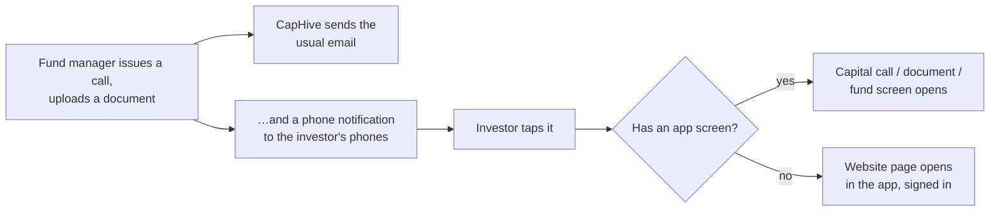

# CapHive Mobile App (for Investors) User Guide

The CapHive app puts an investor's funds, capital calls, documents and alerts on their phone, with notifications the moment a fund manager needs something from them.

> **Where to find it:** Install **CapHive** from the App Store or Google Play and sign in with your CapHive website email and password. Phones you have signed in on are listed on the website under [**Mobile Devices**](/users/mobile_devices) (profile menu → **My Profile** → **Mobile Devices**). For investors, investor advisors and family-office users.

This guide is written for investors (stakeholders) and for the fund-manager teams who support them.

---

## Table of Contents

1. [What the App Does](#what-the-app-does)
2. [Signing In](#signing-in)
3. [Home](#home)
4. [Funds and Capital Calls](#funds-and-capital-calls)
5. [Documents and Signing](#documents-and-signing)
6. [Alerts and Push Notifications](#alerts-and-push-notifications)
7. [Profile, Security and Lost Phones](#profile-security-and-lost-phones)
8. [Frequently Asked Questions](#frequently-asked-questions)
9. [Related Guides](#related-guides)

---

## What the App Does

The app shows the same investments, with the same permissions, as the CapHive website — it never shows an investor more than the website would. It deliberately has only the screens an investor needs on the go: four tabs (**Home**, **Documents**, **Alerts**, **Profile**) and three detail screens (fund, capital call, document). Anything else — approvals, KYC forms, evergreen subscriptions and redemptions — opens the matching website page inside the app, already signed in.

---

## Signing In

1. Choose your region — **India** or **United States**. Each is a separate CapHive site with its own accounts, the same as on the web. You can change it later.
2. Enter the email and password you use on the CapHive website.
3. If you use two-factor authentication on the website, enter the same code (authenticator app, SMS or WhatsApp).
4. Allow notifications when asked, and turn on Face ID / fingerprint unlock if you want it.

---

## Home

- **The dial** shows how much of your total commitment has been called so far (for example *46% of ₹7.00 Cr called*), with **Called**, **Due** and **Distributed to you** below it.
- **To do** lists unpaid capital calls (earliest due date first) and documents waiting for your signature. When there is nothing, it says *You're all caught up*.
- **One card per fund** (per folio), grouped by fund manager, with committed, called, due and distributed amounts — the same figures as the fund card on the website. Tap a card for the fund screen.

---

## Funds and Capital Calls

The fund screen shows the exact committed, called, received, due and distributed amounts, then three tabs: **Calls**, **Distributions** and **Documents**. Tap a call to open the capital call screen: the amount due, the due date, the status (**Pending**, **Paid**, **Overdue**) and **View call notice**. The call notice carries the payment instructions and the fund's bank details.

For evergreen (open-ended) funds the fund screen shows value, units, NAV per unit and gain; **Subscribe** and **Redeem** open the website's wizard inside the app.

---

## Documents and Signing

The **Documents** tab lists the documents on your own commitments, capital calls and distributions — statements, call notices, distribution advices, agreements — newest first, with search and a **To sign** filter. Data room documents are not listed in the app; open them on the website, where any NDA you need to accept is shown first.

Opening a document is recorded as viewed, exactly as on the website. If your signature is needed, **Sign** opens the signing page inside the app for documents sent through Digio; for DocuSign documents, sign from the email DocuSign sent you.

---

## Alerts and Push Notifications

The **Alerts** tab shows the same notifications as the bell on the website, and reading one marks it read in both places. **Mark all read** clears them all.

A phone notification is sent for every notification that would also be emailed to you, so if your fund manager has switched off emails for your access, you get no push either. You choose which kinds reach your phone under **Profile → Notifications**: **Capital calls & reminders**, **Distributions**, **Documents & signatures** and **Everything else** (KYC, approvals, deals, fund news). These switches apply to all your phones and never change your emails.

---

## Profile, Security and Lost Phones

- **Sign out** ends the app's session on this phone and stops its notifications.
- The app locks after more than 5 minutes in the background when Face ID / fingerprint is on.
- A phone unused for 90 days must sign in again; changing your password signs every phone out.
- On the website, the profile menu → **My Profile** → [**Mobile Devices**](/users/mobile_devices) lists your phones (the button shows once you have signed in on one). **Sign out** next to a phone ends its session at once — use it for a lost phone.

---

## Frequently Asked Questions

### Navigation and getting there

**Where do I get the CapHive mobile app?**
Install **CapHive** from the App Store (iPhone) or Google Play (Android). It is the app for investors, investor advisors and family-office users; fund-manager teams keep using the website.

**Which region do I choose when the app asks India or United States?**
Choose the site you sign in to on the web — India accounts live on the India site and US accounts on the US site, and they are separate. If you pick the wrong one the app says *Incorrect email or password* and offers **Switch region**; you can also change it later under **Profile → Change region**.

**Where do I see the phones I have signed in on?**
On the website, open the profile menu → **My Profile** and click [**Mobile Devices**](/users/mobile_devices). The button appears once you have signed in on at least one phone; the page lists each phone with its region, last use, notification setting and last delivery.

**Where are capital calls in the app?**
Unpaid calls appear in **To do** on **Home**. Every call, paid or not, is on the fund screen's **Calls** tab: tap the fund's card on **Home**, then tap a call to see the amount due, due date, status and call notice.

**Where do I approve a request or complete my KYC in the app?**
Open the alert for it on the **Alerts** tab. Approvals, KYC forms and other items without an app screen open the matching website page inside the app, already signed in, so you can finish them there.

### Creating, updating and managing the app and notifications

**How do I sign in to the CapHive app?**
Choose your region, then enter the email and password you use on the CapHive website. If you use two-factor authentication on the website, the app asks for the same code from your authenticator app, SMS or WhatsApp before it opens.

**How do I turn push notifications on or off?**
Go to **Profile → Notifications**. **Push notifications on this phone** turns them on or off for this phone; the four category switches below it choose which kinds you get on all your phones. Your emails are not affected.

**How do I choose which notifications reach my phone?**
Under **Profile → Notifications**, switch **Capital calls & reminders**, **Distributions**, **Documents & signatures** or **Everything else** (KYC, approvals, deals and fund news) on or off. The choice applies to every phone you are signed in on.

**How do I turn on Face ID or fingerprint unlock?**
The app offers it after your first sign-in. You can also switch **Unlock with Face ID / fingerprint** on or off under **Profile** — the option appears when your phone has Face ID or a fingerprint set up.

**How do I sign a document from my phone?**
Open the document from **To do** or the **Documents** tab and tap **Sign**. Digio documents open their signing page inside the app and show **Signed** when you return. For DocuSign documents, open the email DocuSign sent you on the phone and sign there.

**How do I sign out a lost phone?**
On the website, open the profile menu → **My Profile** → [**Mobile Devices**](/users/mobile_devices) and click **Sign out** next to that phone, then confirm. The phone's session ends straight away and it gets no more notifications.

**How do I switch investor as an investor advisor?**
On **Home**, tap **Switch to** followed by the investor's name. The app uses the same switch as the website's persona selector, and **Home** then shows that investor's funds.

### Why use the CapHive app

**Why use the app instead of the website on my phone?**
The app tells you the moment a capital call or document needs you, and opens it in one tap. Home shows what you have committed, what has been called and what is due at a glance, without logging in to a desktop-style website.

**Is the app as secure as the website?**
Yes. It uses the same password, the same two-factor code and the same permissions, so it never shows more than the website would. Sign-in details are kept in your phone's secure storage, and you can sign a phone out from the website at any time.

**Do I still get emails if I use the app?**
Yes. Phone notifications are sent in addition to emails and WhatsApp messages, never instead of them. Switching a category off in the app only stops that kind of phone notification.

### What happens when I …

**What happens when my fund manager issues a capital call?**
You get the usual email and, on each phone you are signed in on, a notification titled with the fund manager's name and the email's subject line. Tapping it opens the capital call screen, and the call appears in **To do** until it is paid.

**What happens when I tap a notification?**
The app unlocks and opens the item — a capital call, fund or document screen, or the matching website page for anything else — and marks the notification as read, on the website too.

**What happens when I mark an alert as read in the app?**
It is marked read everywhere: the bell on the website shows the same read state. **Mark all read** on the **Alerts** tab clears every unread alert at once.

**What happens when I open a document in the app?**
The document opens in the phone's viewer and is recorded as viewed by you, exactly as when you open it on the website.

**What happens when I change my password?**
Every phone signed in to your account is signed out and must sign in again with the new password.

**What happens when I sign out of the app?**
That phone's session ends and it stops receiving notifications. Your other phones stay signed in.

**What happens if I don't use the app for a long time?**
A phone unused for 90 days must sign in again with your password and code. After more than 5 minutes in the background, the app also asks for Face ID or your fingerprint if you turned that on.

### Troubleshooting and edge cases

**Why don't I get notifications on my phone?**
Check **Profile → Notifications**: if it says **Off in phone settings**, allow notifications for CapHive in your phone's settings. If the switches are on, ask your fund manager whether emails are switched on for your investor access — phone notifications follow the same setting.

**Why does the app say my account is not for the app?**
The app is for investors, investor advisors and family-office users. Fund-manager staff see *This app is for investors. Please use the CapHive website.* and keep using the website.

**Why does the app say "Too many failed attempts. Please sign in again."?**
Three wrong two-factor codes end the sign-in, the same as on the website. Enter your email and password again and use a fresh code.

**Why does the app say my account is locked?**
Six wrong passwords lock the account for 5 minutes, on the website and in the app alike. Wait and try again, or reset your password from **Forgot password?** on the sign-in screen.

**Why does the app say "Finish setting up two-factor authentication on the CapHive website"?**
Two-factor authentication is switched on for your account but no method has been chosen yet. Sign in on the website once to choose and confirm a method, then sign in to the app.

**Why can't I see a document in the app that I can see on the website?**
The app lists documents on your own commitments, capital calls and distributions. Data room documents stay on the website, where any NDA you need to accept is shown first.

**Why does a capital call say "The call notice isn't available yet"?**
The fund manager has not yet generated and approved the notice for your call. It appears on the capital call screen as soon as they do; the amount and due date are already correct.

**Why does an alert open the website instead of an app screen?**
Approvals, KYC forms, deals and some other items have no screen in the app yet. They open the matching website page inside the app, already signed in, so you can still finish them from your phone.

**Why does the app show "You no longer have access to this item"?**
The item is no longer shared with you — for example, the fund manager removed your access after the notification was sent. Contact the fund manager if you think you should still see it.

**Why does the app ask me to update?**
Your version of the app is older than the one CapHive now supports. Tap **Update** to install the latest version from the App Store or Google Play.

**Why does the app show "offline"?**
Your phone has no internet connection. The app shows what it last loaded with the time it was updated; signing documents is disabled until you are back online.

---

## Related Guides

- [Investor Access Tutorial](investor_access_tutorial) — how fund managers give investors access, including the email setting that also controls phone notifications.
- [Investor Advisor User Guide](investor_advisor_user_guide) — how advisors switch between the investors they advise.
- [Authenticator App Setup](authenticator_app_setup_user_guide) — setting up the two-factor code the app asks for.
- [E-signing User Guide](esigning_user_guide) — how documents are sent for signature through Digio and DocuSign.
- [Capital Calls User Guide](capital_calls_user_guide) — how calls and call notices are created and sent.
- [Custom Notifications User Guide](custom_notifications_user_guide) — how fund managers customise the subject line that also becomes the phone notification text.
