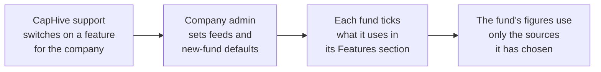
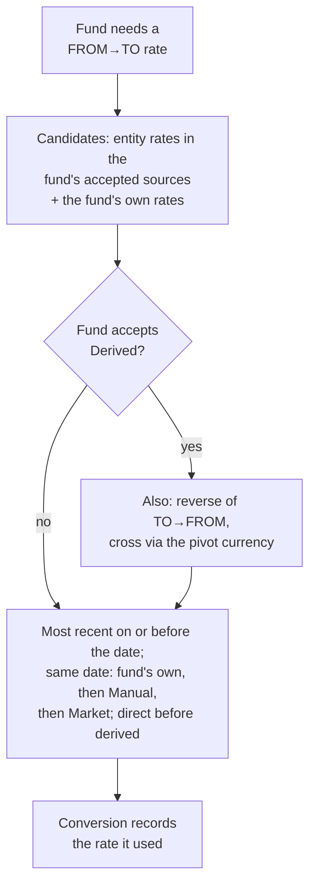
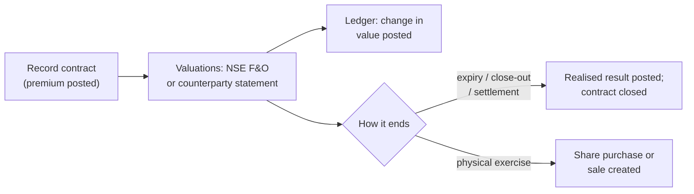

# Market Data Guide

Market Data lets one company run very different funds side by side — a SEBI AIF on hand-entered rates, a hybrid fund and a public-market fund — by switching each market-data feature on for the company and then choosing, fund by fund, what each fund uses.

> **Where to find it:** Company menu (house icon, top right) → [**Market Data**](/market_data/settings) for the company settings, shown once CapHive support has switched on at least one market-data feature. Each fund's choices are in its **Features** section: open the fund from Sidebar → [**Funds → Funds**](/funds), then **Actions → Edit**. Editing the company settings needs the company admin role; editing a fund's features needs update access on the fund.

This guide covers the switches. Later sections will cover the rate feed, prices and derivatives as they arrive.

---

## How the switches fit together

| Level | Who | What is set |
|---|---|---|
| Company features | CapHive support | **Market FX rates**, **Market prices**, **Derivatives** |
| Company Market Data settings | Company admin | FX rate feed and providers, price feed and providers, cross-rate pivot currency, new-fund defaults, open-ended fund limits |
| Fund Features | Fund staff with update access | Investor visibility, AI commentary, which FX rates and prices the fund accepts, derivatives, fund-specific FX rates |

## The fund Features section

Every fund switch is in one place on the fund's edit form:

| Group | Switch | Notes |
|---|---|---|
| Investor visibility | **Show fund ratios to LPs**, **Show fund units to LPs**, **Show fund portfolios to LPs**, **Show valuations to LPs** | Same switches as before, now in one section |
| Reporting | **Enable AI commentary on Account Entries Reports** | Same as before |
| Market data — FX rates | **Manual (always)**, **Market**, **Derived** | **Market** shows only when the company has Market FX rates |
| Market data — Prices | **Manual (always)**, **Market** | **Market** shows only when the company has Market prices |
| Market data | **Derivatives** | Shows only when the company has Derivatives |
| Market data | **Use fund-specific FX rates** | Lets the fund hold its own manual rates |
| Limits (open-ended) | **Max rate age**, **Max price age**, **Price move threshold** | Open-ended funds only; blank uses the company default |

Manual rates and prices are always accepted and cannot be unticked: they are how a wrong feed value is corrected and how an AIF works today.

## Which FX rate a fund uses

Every exchange rate shows its **Source** — **Manual** (typed in or uploaded), **Market** (loaded by the rate feed) or **Derived** (worked out from other rates) — and, if it belongs to one fund, that fund. A fund converts with:

| Rule | Example |
|---|---|
| The most recent accepted rate on or before the date wins | Market 85.00 (30 Oct) beats Manual 84.10 (26 Oct) |
| On the same date, Manual beats Market | Manual 84.80 and Market 85.00 on 30 Oct → 84.80 |
| A fund's own rate beats the company's rates on the same date | Own 84.50 vs company 84.80 on 30 Oct → 84.50 |
| A derived rate is dated by its older leg | EUR→USD 30 Sep × USD→INR 1 Apr → dated 1 Apr |
| Correcting a rate = adding a Manual rate for that date | The Market rate stays as history |
| Amounts already booked keep their rate | Changing a fund's sources only changes current fair values |

On holdings in another currency, the gain is split into **Price effect** (the change in the local price, at today's rate) and **Currency effect** (the rest), so the two always add up to the gain.

## Prices for listed holdings

Each instrument has an **ISIN**, **Ticker**, **Exchange** and **Pricing method**: **Market** (priced daily by the price feed), **Model**, **Manual** or **Cost** (priced from valuations you enter). Existing instruments are **Manual**. Every valuation shows its **Source** — **Manual** (typed or uploaded), **Market** (price feed) or **Cost** (recorded by a purchase).

| Rule | Example |
|---|---|
| A fund uses the most recent price it accepts on or before the date | Market ₹1,250 (30 Oct) for a fund accepting market prices; Manual ₹1,100 (30 Sep) for one that doesn't |
| Same date: Manual, then Market, then Cost | Manual ₹1,240 beats Market ₹1,250 on 30 Oct |
| A purchase records a Cost price and never overwrites another price | Buying at ₹1,230 on a day with a ₹1,250 close keeps both |
| Market needs a ticker and exchange (or an ISIN) on an exchange your price feed covers | NSE or BSE ticker, or an ISIN for AMFI mutual funds; NASDAQ stays Manual |

## Derivatives

Funds with the **Derivatives** feature have a **Derivatives** page (fund **Actions → Derivatives**). Record a contract — option, warrant, future, forward or FX forward — then add events to it: **Valuation**, **Settlement**, **Margin / collateral**, **Exercise**, **Expiry** or **Close-out**. CapHive does no pricing itself: a listed contract's value comes from the NSE F&O settlement price; an OTC contract's value comes from the counterparty's or administrator's statement.

| Event | Ledger entry |
|---|---|
| Trade | **Derivative Premium**: premium paid (−) or received (+) |
| Valuation | **Derivative Unrealised Gain/Loss**: the change since the last value |
| Settlement, close-out, expiry, cash exercise | **Derivative Settlement** (cash), **Derivative Realised Gain/Loss** (cash − cost of the closed lots) and reversal of their unrealised result |
| Margin / collateral | **Derivative Margin** |

---

## Frequently Asked Questions

### Navigation and getting there

**Where do I find the Market Data settings?**
Open the Company menu (house icon, top right) and choose [**Market Data**](/market_data/settings). It holds the feeds, the cross-rate pivot currency, the defaults new funds start with and the open-ended fund limits.

**Why don't I see Market Data in the Company menu?**
The menu item appears only after CapHive support switches on at least one of the company features **Market FX rates**, **Market prices** or **Derivatives**. Ask CapHive support to enable the feature your funds need.

**Where do I choose which rates and prices a fund uses?**
Open the fund from Sidebar → [**Funds → Funds**](/funds), choose **Actions → Edit** and scroll to the **Features** section. Tick the sources under **Market data** and save.

**Where did the "Show fund ratios to LPs" and "Show fund portfolios to LPs" checkboxes go?**
They are now in the fund's **Features** section on the edit form, under **Investor visibility**, together with **Show fund units to LPs**, **Show valuations to LPs** and the AI commentary switch. Their values were carried over unchanged.

**Where can I see whether the rate feed ran?**
Company menu → [**Market Data**](/market_data/settings) shows the pairs tracked and the last run; click **Run history** for every run with its status (**Ok**, **Partial**, **Empty** or **Failed**), how many rates were loaded and what was missing.

**Where do I review suggested corporate actions?**
Open Company menu → [**Market Data**](/market_data/settings) and click **Corporate actions**, or go straight to [**Corporate actions**](/corporate_action_suggestions). Pending suggestions are listed with **Confirm** and **Dismiss** buttons; use the status buttons to see confirmed or dismissed ones.

**Where do I record derivatives for a fund?**
Open the fund and choose **Actions → Derivatives**. The item appears only when CapHive support has switched on **Derivatives** for your company and the fund has **Derivatives** ticked in its **Features** section.

### Creating, updating and managing market data settings

**How do I turn on the FX rate feed or the price feed?**
In Company menu → [**Market Data**](/market_data/settings), tick **FX rate feed** or **Price feed**, tick at least one provider under it and click **Save**. Only company admins and CapHive support can save this page.

**Which providers can I choose?**
For FX rates: ECB. For prices: NSE, BSE, AMFI and NSE F&O. All are free public files; a licensed data vendor for other markets is added only when a client asks for it.

**What are the new fund defaults?**
They are the market-data switches a newly created fund starts with, for example **Accept market FX rates**. Changing them does not change existing funds; only funds created afterwards pick them up.

**How do I let a fund use market FX rates?**
Open the fund's **Actions → Edit**, tick **Market** next to **FX rates** in the **Features** section and save. The box appears only when CapHive support has switched on **Market FX rates** for your company.

**What does "Derived" mean for FX rates?**
A derived rate is worked out from other rates: the reverse of a rate (USD→INR from INR→USD) or a cross through the pivot currency (EUR→INR from EUR→USD and USD→INR). Tick **Derived** only for funds that are allowed to use such rates.

**What is the cross-rate pivot currency?**
It is the currency used to build cross rates, USD by default. With USD as the pivot, EUR→INR is worked out as EUR→USD × USD→INR for funds that accept derived rates.

**What are the open-ended fund limits?**
**Max rate age** and **Max price age** (in business days) and the **Price move threshold** (%) are used to flag stale or unusual values before an open-ended fund's NAV is approved. Set company defaults on the Market Data page; an open-ended fund can override them in its **Features** section.

**How do I add a rate that only one fund uses?**
First tick **Use fund-specific FX rates** in that fund's **Features** section. Then add the rate from Company menu → [**Exchange Rates**](/exchange_rates) → **New Exchange Rate** and choose the fund in **Fund**, or put the fund's name in the **Fund** column of the exchange-rate upload. Other funds never use it.

**How do I correct a wrong market rate?**
Add a Manual rate for the same currency pair and date from **New Exchange Rate**. On the same date Manual beats Market for every fund, and the fed rate stays in the list as history.

**How do I price a listed holding from the market?**
Open the instrument, choose **Edit**, enter the **Ticker** and **Exchange** (or the **ISIN** for a mutual fund) and set **Pricing method** to **Market**. The exchange must be one your company's price feed covers (NSE or BSE; AMFI for mutual funds by ISIN).

**Can I upload ISINs, tickers and price types?**
Yes. The instrument upload accepts optional **ISIN**, **Ticker**, **Exchange** and **Pricing Method** columns, and the valuation upload accepts an optional **Price Type** column (Close, Bid or Mid). Older sheets without these columns still upload.

**How do I check the feeds before relying on them?**
On the Market Data page click **Test feed**. CapHive fetches from every selected provider for the latest weekday and shows, for example, "2 of 2 found" with each item found or missing and why. Nothing is stored.

**How do I confirm or dismiss a corporate action?**
On [**Corporate actions**](/corporate_action_suggestions) click **Confirm** to create the stock adjustment (split or bonus) or the dividend income for each fund holding the share, exactly as if entered by hand. Click **Dismiss** to ignore it; a dismissed action is not suggested again.

**How do I record an option, future or FX forward?**
On the fund's **Derivatives** page click **New contract**, choose the type and side, and enter the underlying, strike or forward rate, lots and lot size or notional, expiry and premium. For an exchange-traded contract enter the **Exchange symbol** (for example NIFTY26NOV24000PE) so the daily settlement price values it.

**How do I enter a counterparty's valuation?**
Open the contract, choose **Add event → Valuation**, enter the value (negative if the fund owes it) and who valued it. For many contracts at once use **Upload valuations** on the Derivatives page with the columns Contract, Valuation Date, Value and Valued By.

**How do I record an exercise, expiry or close-out?**
Open the contract and choose **Add event**. Enter the lots (blank means all open lots) and any cash received or paid. A physically settled call exercise creates the share purchase at strike plus premium per share; a put creates the sale at the strike.

**How do I record an interest-rate or other swap?**
Choose **New contract** and pick **Interest-rate swap**, **Cross-currency swap**, **Total-return swap** or **Credit-default swap**. A swap needs the notional, maturity, counterparty and the ISDA/CSA agreement from the fund's documents. Record each periodic payment as a **Settlement** event with the net amount (received +, paid −); the swap stays open until its final settlement.

### Why use market data features

**Why are features switched on per company and then per fund?**
A company often runs an AIF that must use board-approved manual rates next to a public-market fund that wants daily market rates. Switching on per company and choosing per fund lets each fund use only the data it is allowed to.

**Why can't I untick Manual for a fund?**
Hand-entered rates and prices are how a wrong feed value is corrected, and they are what a fund on manual data relies on. Turning them off would leave no way to fix a bad value, so Manual is always accepted.

**Why were the fund's visibility switches moved?**
All fund switches now live in one **Features** section, in the same way company features do, so you can see at a glance what a fund has on. Nothing changed for investors.

### What happens when I change a switch

**What happens when I tick Market or Derived for a fund's FX rates?**
The fund's current fair values are recalculated in the background using the sources it now accepts. Amounts already booked — commitments, calls, remittances and distributions — keep the rate they were booked with. The change is recorded in the fund's audit trail. No one is notified.

**What happens to a fund's choice if CapHive support switches the company feature off?**
The fund keeps its tick, but it is ignored while the company feature is off, so the fund uses manual data only. When the feature is switched back on, the fund's earlier choice applies again.

**What happens when I change a fund's investor visibility switches?**
Investors see the fund ratios, units, portfolio or valuations immediately according to the new setting, exactly as before. No email is sent.

**Do investors see anything new?**
No. Market Data settings and the fund's market-data switches are only visible to your team. The investor visibility switches behave exactly as they did before.

**Does a new fund start with the company's defaults?**
Yes. A new fund starts with **Show fund units to LPs** and AI commentary on, plus the market-data switches ticked under **New fund defaults** on the Market Data page — only those whose company feature is on.

**Does a fund upload still set the visibility switches?**
Yes. The **Show Fund Ratios To Lps** and **Show Fund Portfolios To Lps** columns of the fund upload still set the matching switches.

**Which rate does a fund use when several exist for the same day?**
The fund's own rate if it uses fund-specific rates, then the Manual rate, then the Market rate. Across different days the most recent accepted rate on or before the date wins, even if it is a derived rate.

**What is the Source column on Exchange Rates?**
It shows where each rate came from: **Manual** (typed in or uploaded, with **User** or **Upload**), **Market** (loaded by the feed, with the provider such as ECB via EUR) or **Derived** (worked out by CapHive, shown as **via USD** or **reverse**). Use the **Source** buttons above the list to filter.

**What are the Price effect and Currency effect on a holding?**
For a holding in another currency, the gain is split in two: the price effect is the change in the local price converted at today's rate, and the currency effect is the rest. They always add up to the gain shown.

**Does a market rate change past capital calls or commitments?**
No. Amounts already booked keep the rate they were booked with. New rates only change current fair values and amounts booked afterwards.

**Does a market rate create commitment adjustments?**
No. The exchange-rate commitment adjustment option reacts only to Manual rates, so a daily feed never creates daily adjustments. A fund's own Manual rate adjusts only that fund's commitments.

**What happens when the FX feed runs?**
Every weekday evening CapHive loads that day's ECB euro reference rates for the currency pairs your funds use and stores them as Market rates for your company only. Pairs without EUR, such as USD→INR, are worked out from the same ECB table through EUR and labelled **ECB via EUR**. Weekends are skipped.

**Which currency pairs does the feed load?**
The pairs your company actually needs: each fund currency against the currencies of its holdings and investor folios, plus each fund currency against its tracking currency and the company currency. A new currency is picked up from the next run.

**Who is told when the feed misses rates?**
Users of your company tagged **FundAccounting** get one email, "FX feed: no rates loaded for …", listing the missing pairs and why. Running the feed again for the same day does not send it again.

**What happens to a price when I buy a holding?**
The purchase records a **Cost** price for its date so a fund on manual prices has a starting value. It never replaces a Manual or Market price for that date, and on the same date Market and Manual prices win over it.

**Why does one holding show different values in two funds?**
Each fund uses only the price sources it accepts. A fund that accepts market prices uses the latest Market price; a fund on manual prices uses the latest Manual or Cost price. Each value shows its source.

**What happens when the price feed runs?**
Every weekday evening CapHive loads the closing price of each Market instrument from NSE or BSE (by ticker) and the NAV of Market mutual funds from AMFI (by ISIN). Each price is stored as a Market valuation for your company only, and each fund holding the instrument is recalculated once.

**What happens when the feed reports a split, bonus or dividend?**
For Market instruments on NSE, CapHive records it as a suggested corporate action and emails users tagged **FundAccounting** once. Nothing changes in your holdings until someone confirms it.

**What happens when a derivative contract expires?**
Recording **Expiry** closes the contract and posts the realised result: cash received (if any) minus the premium paid, reversing the unrealised result posted so far. Users tagged **FundAccounting** get a reminder email 5 business days before expiry.

**Does CapHive price options or swaps?**
No. A listed contract takes the exchange's daily settlement price and an OTC contract takes the counterparty's or administrator's statement. You can record a delta from the statement, but nothing is calculated from models.

### Troubleshooting and edge cases

**Why is there no Market checkbox next to FX rates on my fund?**
The company does not have the **Market FX rates** feature. Ask CapHive support to switch it on; the box then appears in the fund's **Features** section.

**Why do I get "Choose at least one provider" when saving Market Data?**
A feed is ticked but none of its providers is. Tick at least one provider under the feed, or untick the feed, and save again.

**Why do I get "must be between 0 and 30" or "must be between 1 and 100"?**
Rate and price ages must be whole business days from 0 to 30, and the price move threshold must be from 1 to 100 percent. Correct the value, or leave it blank to use the default.

**Why can't I see the Limits group on my fund?**
The limits apply only to open-ended funds. Other funds do not show the **Limits (open-ended)** group.

**Why do I get "No EUR→INR rate on or before … in this fund's accepted sources (Manual)"?**
The fund has no accepted rate for that pair on or before the date. Add a Manual rate for the pair from [**Exchange Rates**](/exchange_rates), or tick **Derived** in the fund's **Features** section so CapHive can build it from other rates.

**Why didn't my upload accept the Fund column?**
The named fund must belong to your company and have **Use fund-specific FX rates** ticked. The row is refused with "Fund … does not use fund-specific FX rates" or "Fund … not found".

**Why is a rate missing after the feed ran?**
The ECB does not publish every currency, and publishes nothing on TARGET holidays. Check **Run history** for the reason, and enter the rate by hand under [**Exchange Rates**](/exchange_rates); a Manual rate wins over a Market rate on the same date.

**Why can't I set an instrument to Market?**
It needs a **Ticker** and **Exchange**, or an **ISIN**, and the exchange must be covered by your company's price feed. Otherwise you see "Market pricing needs a ticker and exchange, or an ISIN" or "No price feed covers NASDAQ; keep this holding Manual".

**Why is my ISIN refused?**
"ISIN is not valid" means it is not 12 characters or its last check digit is wrong. Copy it again from the security's documents.

**Why was a listed price not loaded?**
Run history lists each missing instrument with a reason such as "ticker not found at NSE". Check the instrument's **Ticker** and **Exchange** (or **ISIN** for a mutual fund) and run **Test feed** again. Until then you can enter the price as a Manual valuation.

**Why can't I add an event to a contract?**
Closed contracts take no more events ("Contract is closed"), an event cannot be dated before the trade date, and you cannot exercise or close out more lots than are open ("Only 1 lots open"). A physical put exercise also needs the shares in the fund.

**Why is the Market Data page read-only for me?**
Only company admins and CapHive support can change the settings. Other team members can view the page but not save it.

---

## Related Guides

- [Tracking Currency](tracking_currency_guide) — how a second reporting currency uses exchange rates.
- [Fund Ratios](fund_ratios_user_guide) — the ratios shown to LPs when the switch is on.
- [Fund Units](fund_units_user_guide) — the units shown to LPs when the switch is on.
- [Portfolio Investments](portfolio_investments_user_guide) — the holdings whose fair values use these sources.
- [Entities](entities_user_guide) — company settings and features.
