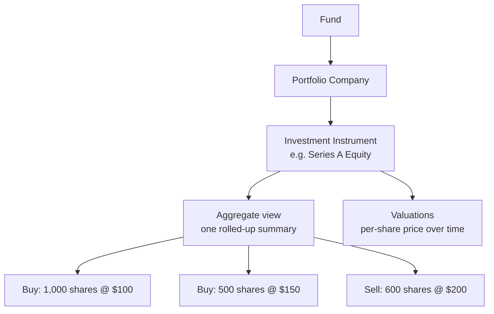
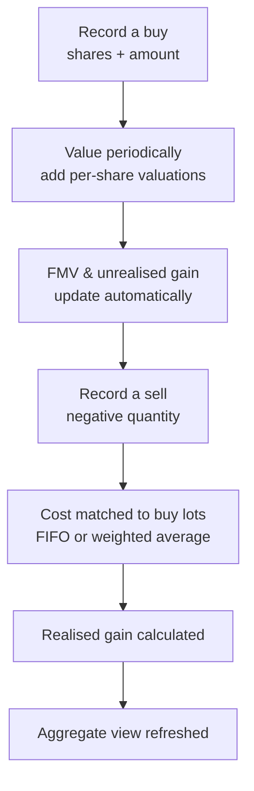
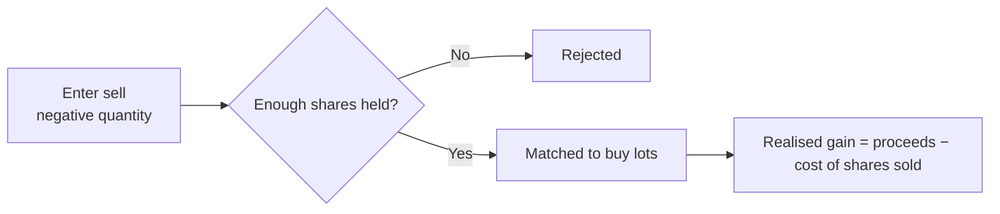
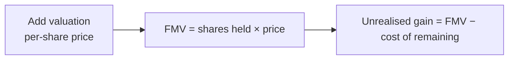

# Portfolio Investments User Guide

This guide covers how a fund's **direct investments in portfolio companies** are recorded and tracked: buying and selling holdings, valuing what you still hold, working out realised and unrealised gains, handling conversions and splits, recording income, and modelling future exits. It's written for investment and finance teams — no technical background needed.

> **Where to find it:** Sidebar → [**Funds → Funds**](/funds) → open the fund → **Portfolio** tab (shown only when the *Fund Portfolios* feature is enabled for your firm). Record a buy or sell with **New Investment** on that tab; instruments, valuations and income live on the portfolio company's Stakeholder page. You need the **Funds** feature on your user and update rights on the fund.

---

## Table of Contents

1. [How Portfolio Investments Are Organised](#how-portfolio-investments-are-organised)
2. [Key Terms in Plain English](#key-terms-in-plain-english)
3. [The Investment Lifecycle](#the-investment-lifecycle)
4. [Investment Instruments](#investment-instruments)
5. [Recording a Purchase (Buy)](#recording-a-purchase-buy)
6. [Recording a Sale (Sell)](#recording-a-sale-sell)
7. [Cost Attribution: FIFO vs Weighted Average](#cost-attribution-fifo-vs-weighted-average)
8. [Valuations and Fair Market Value](#valuations-and-fair-market-value)
9. [The Aggregate (Rolled-Up) View](#the-aggregate-rolled-up-view)
10. [Stock Conversions](#stock-conversions)
11. [Stock Splits and Adjustments](#stock-splits-and-adjustments)
12. [Portfolio Income](#portfolio-income)
13. [Excused Investors](#excused-investors)
14. [Modelling: Proforma Investments and Scenarios](#modelling-proforma-investments-and-scenarios)
15. [Working Across Currencies](#working-across-currencies)
16. [Importing Data](#importing-data)
17. [Frequently Asked Questions](#frequently-asked-questions)

---

## How Portfolio Investments Are Organised

A fund invests in companies, in specific securities, through individual transactions. The structure mirrors that:

- A **portfolio company** is the business the fund invests in.
- An **investment instrument** is the specific security held in that company (equity, debentures, convertible notes, etc.).
- Each **transaction** is a single buy or sell.
- The **aggregate view** automatically rolls every buy and sell for one fund-company-instrument combination into a single summary.

---

## Key Terms in Plain English

| Term | What it means |
|------|---------------|
| **Portfolio Company** | A company the fund has invested in. |
| **Investment Instrument** | The specific security held (e.g. "Series A Equity", "10% NCD"). Each belongs to one company and has a fixed currency. |
| **Transaction** | A single buy (positive quantity) or sell (negative quantity). |
| **Buy Lot** | A single purchase, tracked separately so its cost can be matched against future sales. |
| **Aggregate View** | The auto-maintained summary of all buys and sells for one fund-company-instrument. |
| **Valuation** | A per-share price on a given date, used to value remaining holdings. |
| **FMV (Fair Market Value)** | Current value of what's still held = shares held × latest price. |
| **Cost of Remaining** | The book cost of holdings not yet sold. |
| **Unrealised Gain** | FMV − cost of remaining (paper gain on what you still hold). |
| **Realised Gain** | Sale proceeds − cost of the shares actually sold. |
| **FIFO / Weighted Average** | Two methods for deciding which buy lots a sale draws from. |

---

## The Investment Lifecycle

---

## Investment Instruments

An instrument is the security the fund invests in. It must exist before you record transactions.

| Field | Required | Notes |
|-------|----------|-------|
| **Name** | Yes | e.g. "Series A Equity", "CCDs". Unique within the company. |
| **Currency** | Yes | The instrument's denomination. **Cannot be changed later** — it underpins every amount calculation. |
| **Sector** | No | Industry sector. |
| **Category / Sub-Category** | No | Your own classification. |
| **Investment Domicile** | No | Domestic or foreign (sets the offshore flag automatically). |
| **Regulatory fields** | No | Investee type, security type, ISIN, registration number, and similar, used for regulatory reporting. |

Each instrument belongs to a single company (instruments aren't shared across companies), and **valuations are recorded per instrument** rather than per transaction.

---

## Recording a Purchase (Buy)

A buy records capital deployed into a company.

| Field | Required | Notes |
|-------|----------|-------|
| **Portfolio Company** | Yes | The company invested in. |
| **Investment Instrument** | Yes | The security bought. |
| **Investment Date** | Yes | The transaction date. |
| **Quantity** | Yes | Number of shares/units — must be positive. |
| **Amount (excluding expenses)** | Yes | The amount in the instrument's currency, before expenses. |
| **Notes** | No | Internal notes. |
| **Excused Folios** | No | Investors excused from this investment (see [Excused Investors](#excused-investors)). |
| **Proforma** | No | A what-if record for modelling only — excluded from all live figures. |
| **Reference ID** | No | An external reference that helps prevent duplicate imports. |

**On save, the system automatically:**

1. Adds any expense fields to the base amount.
2. Converts the amount to the fund's currency if the instrument is in a different currency (recording the rate used).
3. Creates the aggregate view if this is the first transaction for the company-instrument.
4. Creates an initial valuation at the buy price, so the holding can be valued from day one.
5. Calculates cost of remaining, FMV, and unrealised gain.

---

## Recording a Sale (Sell)

A sell records disposing of shares. It's recorded just like a buy, but with a **negative quantity** (e.g. −500 to sell 500 shares).

Before saving, the system checks you aren't selling more than you hold across all open buy lots; if you are, it's rejected. Once saved, a background job **matches the sale to specific buy lots** (allow a few seconds, then refresh) to determine its cost basis and realised gain (see the next section). A sell has no FMV or unrealised gain of its own — it's a realised event.

---

## Cost Attribution: FIFO vs Weighted Average

When you sell, the system has to decide **which** of your purchases the sold shares came from, because different purchases were made at different prices. This is set per fund.

Consider two purchases, then a sale of 1,200 shares at $200:

| Buy lot | Shares | Price | Date |
|---------|--------|-------|------|
| Lot 1 | 1,000 | $100 | Mar 2021 |
| Lot 2 | 500 | $150 | Jun 2022 |

### FIFO (First-In, First-Out)

The oldest shares are sold first.

| Drawn from | Shares | Cost | Sale | Gain |
|------------|--------|------|------|------|
| Lot 1 | 1,000 | $100,000 | $200,000 | $100,000 |
| Lot 2 | 200 | $30,000 | $40,000 | $10,000 |
| **Total** | **1,200** | **$130,000** | **$240,000** | **$110,000** |

FIFO is the default for most tax and regulatory reporting.

### Weighted Average

The sale is spread proportionally across all open lots. Total held = 1,500 shares (Lot 1 is 66.67%, Lot 2 is 33.33%).

| Drawn from | Shares | Cost | Gain |
|------------|--------|------|------|
| Lot 1 (66.67%) | 800 | $80,000 | $80,000 |
| Lot 2 (33.33%) | 400 | $60,000 | $20,000 |
| **Total** | **1,200** | **$140,000** | **$100,000** |

Weighted average smooths the cost basis across all purchases, as some accounting standards require.

> **Notice the difference:** the same sale produces a **$110,000** gain under FIFO but **$100,000** under weighted average, because the two methods consume different-priced lots. Choose the method that matches your reporting framework.

Once a sale has been matched, changing the fund's method later doesn't automatically re-match past sales — that has to be redone deliberately. You can always review how a sale was matched on its attribution breakdown.

---

## Valuations and Fair Market Value

**FMV** is the current value of holdings you still own, based on the latest per-share price.

> FMV = Shares still held × Latest per-share valuation (converted to the fund's currency)

Valuations are recorded per instrument, each with a date and a per-share price. The system uses the most recent valuation on or before the date you're valuing as of. A buy automatically creates an opening valuation at its purchase price, so you always have at least one.

FMV refreshes automatically whenever you add a valuation, record a buy or sell, or match a sale. Note:

- If there's **no valuation** on or before the date, FMV can't be computed — add one.
- If **no shares** remain (all sold or converted), FMV is zero.

---

## The Aggregate (Rolled-Up) View

For each fund-company-instrument combination there's a single **aggregate view** that summarises every transaction — no matter how many buys and sells you've recorded. It's created automatically with the first buy and keeps itself up to date.

It shows, at a glance:

| Aggregate figure | What it tells you |
|------------------|-------------------|
| **Quantity held** | Net shares still owned. |
| **Total bought / sold** | Cumulative amounts purchased and sold. |
| **Average cost** | Blended cost per share across all purchases. |
| **Cost of remaining** | Book cost of shares still held. |
| **FMV** | Current value of remaining holdings. |
| **Unrealised gain** | Paper gain on what's still held. |
| **Realised gain** | Gain locked in from sales. |
| **Portfolio income** | Actual income received (dividends, interest). |

### Point-in-time views

You can also view the aggregate **as of a past date** — a read-only snapshot using only the transactions and valuations that existed then. This powers historical reports, performance metrics, and the portfolio report generator.

---

## Stock Conversions

A **stock conversion** records one security turning into another — for example convertible debentures (CCDs) converting into equity.

A conversion records the instrument and lot being converted, the quantity surrendered, the new instrument, the quantity received, and the date. On save, the system reduces the original holding, creates a new holding in the destination instrument (carrying the original cost across, converted at the rate on the original investment date), and updates both aggregate views.

Key points:

- The "from" and "to" instruments must be different.
- You can't convert more than you currently hold.
- A conversion is **cost-preserving** — it doesn't create a gain or reduce the portfolio's cost; it just moves cost to the new instrument.
- In Gross Portfolio IRR, conversions are netted out so the converted cost isn't double-counted as a fresh investment.

---

## Stock Splits and Adjustments

### Stock splits

A split changes the number of shares without changing the total invested. After a 2-for-1 split, 1,000 shares at $100 become 2,000 shares at $50 — same total value, half the price each. There is no separate split screen: record a split as a stock adjustment (below) with **Adjustment Factor** 2.

### Stock adjustments

A **stock adjustment** rescales the share count without a full buy or sell — used for splits, consolidations and bonus issues. On the portfolio company page → **Stock Adjustments** tab → **New Stock Adjustment**, pick the **Instrument** and enter the **Adjustment Factor** — a multiplier, not a number of shares (e.g. 10 if one share becomes ten). A background job multiplies the quantity of every buy of that instrument by the factor and divides every valuation by it, in every fund of your firm, then recalculates per-share cost, FMV and the aggregate views. An adjustment cannot be reversed or deleted, so check the factor before saving.

---

## Portfolio Income

**Portfolio income** records money received from an investment — dividends, interest, or partial payouts.

| Field | Notes |
|-------|-------|
| **Portfolio Company / Instrument** | What generated the income. |
| **Payment Date** | When it was received. |
| **Amount** | In the fund's currency. |
| **Tag** | "Actual" for real income, or other tags for projections/budgets. |

Only income tagged **"Actual"** counts toward the portfolio's cumulative income and is included as a positive cash flow in **Gross Portfolio IRR** on its payment date. Projection/budget tags are kept separate for modelling.

---

## Excused Investors

Sometimes specific investors don't participate in a particular investment — for example due to a conflict of interest or a mandate restriction. A buy can list these **excused investors** (by folio).

When the fund later works out each investor's share of a realised gain, it looks at who was actually invested at the time of the buy. An excused investor wasn't in that deal, so they receive **no share** of the gain from selling it. This keeps gain allocation fair to the investors who actually carried the position.

---

## Modelling: Proforma Investments and Scenarios

### Proforma investments

**Proforma** transactions are what-if records for modelling. They're excluded from all live figures (FMV, gains, performance, aggregates), so you can sketch a proposed deal or a hypothetical exit without affecting real numbers. Use them to model a deal before committing or to test exit assumptions.

### Portfolio scenarios

**Scenarios** let you model exits at different valuations to estimate returns. A scenario holds a set of hypothetical sales at chosen prices and computes XIRR, MOIC, DPI, and similar — using the same logic as real investments, applied to the scenario's transactions. This is the tool for answering "what would our return be if we exited Company X at a $500M valuation next year?"

---

## Working Across Currencies

When an instrument is held in a currency different from the fund's:

- The amount is stored in the instrument's currency and also converted to the fund's currency at the rate on the investment date.
- FMV is calculated in the instrument's currency and converted to the fund's currency at the rate on the valuation date.
- A tracking-currency version is maintained for cross-fund dashboards.

If no exchange rate exists between the instrument and fund currencies on the transaction date, the transaction is rejected — set up the rate first.

---

## Importing Data

You can bulk-load from spreadsheets.

**Transactions** — provide fund, portfolio company (must already exist), investment date, amount (excluding expenses, in instrument currency), quantity (positive to buy, negative to sell), instrument, and currency. Optional columns include domicile, notes, excused folios, proforma, a reference ID (helps avoid duplicates), and regulatory fields. If an instrument doesn't exist yet, it's created from the import. Sales are matched to buy lots during the import so ordering stays correct.

**Income** — provide fund, company, instrument, payment date, amount (fund currency), and tag ("Actual" or a custom tag).

**Instruments** — provide company, name, currency, and optional attributes (sector, category, ISIN, etc.).

---

## Frequently Asked Questions

### Navigation and getting there

**Where do I find a fund's portfolio investments in CapHive?**
Sidebar → [**Funds → Funds**](/funds), open the fund, then click the **Portfolio** tab. The tab only appears when the **Fund Portfolios** feature is enabled for your firm (`enable_fund_portfolios`). You can also get there from the fund card on the [**Funds**](/funds) list via **Actions → Portfolio**.

**What does the Portfolio tab show?**
It loads the fund's **Portfolio Dashboard**: portfolio stats (bought, sold, cost, FMV, gains), the **Aggregate Portfolio Investments** list (one row per company-instrument, see [The Aggregate (Rolled-Up) View](#the-aggregate-rolled-up-view)), FMV / holding-cost / bought / sold percentage charts, and Portfolio IRR. The aggregate list header has the **New Investment**, **Scenarios**, **Conversions**, **Upload / Download** and (when snapshots are enabled) **Time Series** buttons.

**Can I see the portfolio outside the fund's Portfolio tab?**
Yes. The [rolled-up portfolio list](/aggregate_portfolio_investments) and the [individual buy/sell transactions](/portfolio_investments) are also available as lists across all your funds. Opening an aggregate row (**Show**) takes you to its own page, which has **Investments**, **Income**, **Documents**, **Widgets** and **Track Record** tabs.

**Where do I manage the portfolio company itself (instruments, valuations, income, adjustments)?**
A portfolio company is a **Stakeholder** with the category "Portfolio Company". Sidebar → [**Stakeholders → View Stakeholders**](/investors), open the company, and use its **Valuations**, **Investments**, **Instruments**, **Portfolio Income** and **Stock Adjustments** tabs.

### Creating, updating and managing investments

**How do I record a buy?**
On the fund's **Portfolio** tab click [**New Investment**](/portfolio_investments/new), pick the portfolio company and instrument, enter the investment date, a positive quantity and the amount excluding expenses, then save. See [Recording a Purchase (Buy)](#recording-a-purchase-buy). If the company already has an aggregate row, its row menu also has **New Investment**, which pre-fills the company and instrument.

**How do I record a sale?**
Use the same **New Investment** form with a **negative quantity** (e.g. -500 to sell 500 shares). The system rejects the sale if you are selling more than you hold, and otherwise matches it to buy lots automatically. See [Recording a Sale (Sell)](#recording-a-sale-sell).

**How do I create an investment instrument?**
Open the portfolio company (Stakeholder) page → **Instruments** tab → [**New → Investment Instrument**](/investment_instruments/new). Give it a name and currency (the currency cannot be changed later). If your firm has several customised instrument forms you will see one **Investment Instrument (...)** entry per form. See [Investment Instruments](#investment-instruments).

**How do I add a valuation?**
Either open the aggregate row's menu on the **Portfolio** tab and choose **Add Valuation**, or go to the portfolio company page → **Valuations** tab → [**New Valuation**](/valuations/new). Enter the valuation date and per-share price; FMV and unrealised gain refresh automatically. See [Valuations and Fair Market Value](#valuations-and-fair-market-value).

**How do I edit or delete a transaction?**
Open the transaction (from the **Investments** tab of an aggregate row, or from the [portfolio transactions list](/portfolio_investments)) and use the **Actions** card: **Edit** or **Delete**. Editing is meant for corrections to notes, dates or reference data; if the quantity or amount of a buy that has already been partly sold is wrong, the safest fix is to delete the dependent sales, delete the buy, and re-enter it. **Delete** is disabled on a buy that sales have already drawn from.

**How do I record a stock conversion?**
Open the buy transaction you want to convert and click **Conversion** in the **Actions** card (only shown on buys with quantity remaining). Choose the destination instrument, the quantities surrendered and received, and the date. All conversions for a fund are listed under **Conversions** on the Portfolio tab. See [Stock Conversions](#stock-conversions).

**How do I apply a stock split or adjustment?**
Go to the portfolio company page → **Stock Adjustments** tab → **New Stock Adjustment**. Enter the adjustment factor (e.g. 10 if one share becomes ten) and the instrument; the share count, per-share cost and FMV are recalculated. See [Stock Splits and Adjustments](#stock-splits-and-adjustments).

**How do I record portfolio income (dividends, interest)?**
Open the aggregate row (**Show**) and switch to the **Income** tab, then click [**New Portfolio Income**](/portfolio_cashflows/new). The same tab has **Upload** (bulk import) and **Download** (Excel). All income for a company is also visible on the portfolio company page → **Portfolio Income** tab. Only income tagged **Actual** counts in live figures. See [Portfolio Income](#portfolio-income).

**How do I mark investors as excused from a deal?**
Fill in the **Excused Folios** field on the buy form. To review every excused folio for a fund, open the fund page → **Actions → Excused Investors**. See [Excused Investors](#excused-investors).

**How do I model an exit with scenarios?**
On the fund's **Portfolio** tab click **Scenarios**, then **New Scenario** to build a set of hypothetical sales, or **Summary Scenario** for a quick single-assumption estimate. See [Modelling: Proforma Investments and Scenarios](#modelling-proforma-investments-and-scenarios).

**How do I bulk-import transactions, instruments, income or valuations?**
On the fund's **Portfolio** tab open **Upload / Download → Upload** (import type **PortfolioInvestment**, with a sample file to download), or use Company menu (house icon, top right) → [**Imports**](/import_uploads) and pick the import type: **PortfolioInvestment**, **InvestmentInstrument**, **PortfolioIncome** or **Valuation**. See [Importing Data](#importing-data).

**How do I export the portfolio?**
On the Portfolio tab use **Upload / Download → Export All Investments** (Excel of every aggregate row), **Export visible** (what is on screen), or **Portfolio Investment Report**. The same report is under the fund page's **Fund Reports** dropdown. Individual transactions can be downloaded from the **Download** button on the [portfolio transactions list](/portfolio_investments), which covers all your funds.

**What permission do I need to add or change investments?**
You need the **Funds** feature on your user and **update** rights on the specific fund (granted through the fund's **Access** tab). Employees with only read access can view the Portfolio tab but see no **New Investment** button. Ask your company admin to add you to the fund's access rights.

### Why it matters

**Why should I track portfolio investments in CapHive rather than a spreadsheet?**
Every buy, sell, valuation, conversion and income entry feeds one ledger, so cost of remaining, FMV, realised and unrealised gain, Portfolio IRR and MOIC are always consistent, historic snapshots are preserved, and the same data drives fund ratios, LP dashboards, the portfolio report generator and regulatory reports (SEBI / CRISIL) without re-keying.

**What can I do once the portfolio is set up?**
See the position and gain per company and instrument at any past date, allocate realised gains fairly across investors (respecting excused investors), run exit scenarios, show LPs a read-only portfolio view (fund setting **Show fund portfolios to LPs**), build portfolio reports and dashboards, and generate reports and ratios that depend on portfolio data.

**What happens if I do not keep the portfolio up to date?**
Missing valuations leave FMV at zero or stale, gains and IRR will be wrong, and any downstream fund ratios, LP-facing dashboards and portfolio reports will show incorrect numbers. Missing exchange rates block cross-currency transactions altogether.

**Who typically uses this?**
Investment and finance teams of the fund manager record and maintain the data; partners and analysts use the dashboards and scenarios; LPs (investors) see a read-only view when the fund has portfolio visibility enabled.

### What happens when I…

**What happens when I save a buy?**
CapHive first checks that an exchange rate exists if the instrument currency differs from the fund currency (otherwise the save is rejected), converts the amount, creates the company-instrument aggregate row if it is the first transaction, and records a valuation on the instrument dated the investment date at the buy price per share. FMV, cost of remaining and unrealised gain are computed and the aggregate totals update immediately. No one is notified; you are taken to the new transaction page and the Portfolio tab shows the updated row.

**What happens when I save a sell?**
The sale is rejected if the negative quantity exceeds the shares held across open buy lots. If a sell with the same date, quantity and amount already exists you get a duplicate warning before submitting. Once saved, a background job matches the sale to buy lots using the fund's FIFO or weighted-average setting, creating one attribution per lot, which sets the cost of sold and realised gain and reduces each lot's remaining quantity. Allow a few seconds and refresh to see the realised gain; no one is notified.

**What happens when I edit a transaction?**
The record is recomputed (amount conversion, FMV, unrealised gain, average cost) and the aggregate row updates. Existing buy-lot matching is not redone on edit, so changing the quantity or amount of a sell, or of a buy that sales have drawn from, leaves the old attribution in place; for those cases delete and re-enter instead. Edits are recorded in the audit trail; no one is notified.

**What happens when I delete a transaction?**
A sell's attributions are removed and each buy lot it drew from is recomputed, restoring its remaining quantity, cost of remaining and FMV. A buy that sales have already drawn from cannot be deleted (no **Delete** button) until those sells are deleted. The aggregate totals decrement immediately and you are returned to the fund's Portfolio tab. Deletion is permanent apart from the audit trail; no one is notified.

**What happens when I add a valuation?**
If it is the latest-dated valuation for that company-instrument, every open buy of that instrument in every fund of your firm is recomputed synchronously: FMV, unrealised gain and the aggregate rows change straight away and the LP-facing portfolio view and portfolio reports pick it up. A valuation dated earlier than the latest one does not change current FMV but is used for as-of-date views. Deleting a valuation queues a background recompute of the affected investments. See [Valuations and Fair Market Value](#valuations-and-fair-market-value).

**What happens when I record a stock conversion?**
The system checks an exchange rate exists if the two instruments differ in currency, marks the converted quantity as transferred on the original buy, creates a new buy in the destination instrument dated the original investment date at the original cost (converted at that date's rate), and refreshes both aggregate rows. Conversions cannot be edited or deleted, but the conversion page has a **Reverse** button that deletes the new holding and restores the original. No one is notified.

**What happens when I save a stock adjustment?**
A background job divides every valuation of that company-instrument by the factor and multiplies the quantity of every buy (and its attributions) by the factor, in every fund of your firm, then recomputes cost per share, FMV and the aggregate rows; a note is appended to each affected transaction. There is no reverse or delete for an adjustment, so check the factor before saving. No one is notified.

**What happens when I record portfolio income?**
Income tagged **Actual** is added to the aggregate row's portfolio income immediately and appears on the aggregate **Income** tab, the company's **Portfolio Income** tab and as a positive cash flow in Gross Portfolio IRR. Income with any other tag is stored for modelling and ignored by live figures. It can be edited or deleted from the Income tab; no one is notified.

**What happens when I run an import?**
Rows are created in order in a single background job; instruments named in the file are created if missing, sells are matched to buy lots as they are loaded, and a row that exactly matches an existing transaction (same company, date, amount, quantity, instrument, fund and reference ID) is reported as an error instead of being loaded twice. You receive an in-app alert when the import finishes, and the import's page under [**Imports**](/import_uploads) lists any rows that failed with the reason. Investors are not notified.

**What happens when I tick Proforma?**
The transaction is stored but excluded from every live figure, aggregate row, ratio and report. It still appears, flagged **Proforma**, in the individual transaction list so you can review, edit or delete it later.

**What happens when I create a scenario?**
Scenario investments are hypothetical and never touch real holdings. Computation runs in the background and the scenario page refreshes itself with XIRR, MOIC and DPI when done; you can edit or delete scenarios at any time.

**What happens if I don't add an exchange rate before a cross-currency buy?**
The save fails with "Exchange rate X->Y not found" and nothing is recorded. Add the rate under Company menu (house icon, top right) → [**Exchange Rates**](/exchange_rates), then save again.

**What happens if I don't add valuations after the initial buy?**
FMV stays at the purchase price forever, so unrealised gain reads zero, Portfolio IRR and MOIC are understated or overstated, and LP dashboards and portfolio reports show stale values. Add a valuation each reporting period.

**Who can see the portfolio data?**
Employees with the **Funds** feature and access rights on the fund see everything. Investors (LPs) see the read-only aggregate view only when the fund has **Show fund portfolios to LPs** ticked; investors in a feeder fund see the master fund's holdings. Nothing is emailed to investors when the portfolio changes.

### Calculations and edge cases

**What's the difference between the amount before expenses and the total amount?**
The amount before expenses is what you actually pay the company; the total amount adds any transaction costs/fees. Both are entered in the instrument's currency and also stored converted to the fund's currency.

**Can I switch FIFO and weighted average after recording sales?**
The method is set per fund (`portfolio_cost_type`, FIFO or weighted average). It is not on the regular fund edit form; it is set by a CapHive super-admin in the Admin console, so contact support to change it. Changing it doesn't automatically re-match past sales; those have to be re-matched deliberately. See [Cost Attribution: FIFO vs Weighted Average](#cost-attribution-fifo-vs-weighted-average).

**Why is my gain different from what I expected?**
Gain depends on which buy lots the sale drew from. FIFO uses the oldest (often cheaper) lots, producing larger gains; weighted average smooths across all lots. Open the sale and check its attribution breakdown to see exactly how it was matched.

**What if I delete a buy that's been partly sold?**
You can't delete it while sales reference it (the **Delete** button is not shown). Delete the dependent sales first, then the buy.

**Why is FMV zero even though I hold shares?**
Either there's no valuation on or before today (add one), or no shares actually remain (all sold or converted). Check the instrument's valuations on the portfolio company's **Valuations** tab.

**How is a conversion different from a sale?**
A conversion (e.g. CCD → equity) is cost-preserving; it changes the security type without realising a gain. A sale realises a gain and reduces the cost of remaining.

**What do excused investors do?**
They list investors who didn't participate in a specific deal. When a gain is later allocated, excused investors get no share of that deal's gain.

**Can the same instrument be held in two funds?**
Yes. Each fund-company-instrument combination has its own aggregate view, and transactions never mix across funds.

**What is a proforma investment?**
A modelling-only record that doesn't affect live figures, used to test proposed deals or hypothetical exits. Tick **Proforma** on the investment form.

**Why can't I see the Portfolio tab at all?**
The **Fund Portfolios** feature is switched off for your firm, or you are logged in as an investor and the fund does not have **Show fund portfolios to LPs** ticked (fund edit form). Ask your company admin or CapHive support.

**Why is the New Investment button missing?**
You do not have update rights on this fund. View-only fund access shows the data but hides the create, upload, scenarios and conversions buttons.

**I am looking at a feeder fund. Why does the Portfolio tab show another fund's holdings?**
Feeder funds display their master fund's portfolio, since the feeder invests through the master. The aggregate list shows a **Master Fund Portfolio** button when the master fund has portfolio visibility on.

**Can I see the portfolio as it was on a past date?**
Yes. When snapshots are enabled for your firm, click **Time Series** on the Portfolio tab and pick the date. See [Point-in-time views](#point-in-time-views).

**My cross-currency transaction was rejected. What do I do?**
There is no exchange rate between the instrument currency and the fund currency for that date. Add it via Company menu (house icon, top right) → [**Exchange Rates**](/exchange_rates) and save the transaction again. See [Working Across Currencies](#working-across-currencies).

**Does deleting or adding a transaction change the aggregate view immediately?**
Yes. The aggregate row is recalculated on every save, delete, valuation and sale matching, so the Portfolio tab is always current; refresh the page if a lazy-loaded frame looks stale.

**Can I link a sale to a capital distribution?**
Yes. A sell has an optional **Capital Distribution** field that ties the exit proceeds to the distribution paid out to investors; it must be a distribution of the same fund and can only be set on a sell, not a buy. The linked distribution is shown on the transaction page.

**The Portfolio tab is blank or still loading. What should I do?**
The tab is a lazy-loaded frame that opens the fund's Portfolio Dashboard. Wait a moment or refresh the page; if it stays blank, open the [rolled-up portfolio list](/aggregate_portfolio_investments) directly and check that the fund has at least one non-proforma transaction.

**Can I see who changed a transaction?**
Yes. Buys, sells, conversions and valuations are audit-tracked. Use Company menu (house icon, top right) → [**Audit Trail**](/audits?filter=true) and filter by the record type and date.

## Related Guides

- [Valuations](valuations_user_guide) — how per-share valuations are recorded and how they drive FMV.
- [Fund Ratios](fund_ratios_user_guide) — ratios such as Portfolio IRR and MOIC computed from portfolio data.
- [Portfolio Report Drafts](portfolio_report_drafts_user_guide) — building portfolio reports from the holdings recorded here.
- [Capital Distributions](capital_distributions_user_guide) — distributing exit proceeds from a sale to investors.
- [Investors (Stakeholders)](investors_user_guide) — portfolio companies are Stakeholders with the Portfolio Company category.
- [Tracking Currency](tracking_currency_guide) — how tracking-currency amounts are maintained for cross-fund dashboards.
- [Custom Fields](custom_fields_user_guide) — adding your own fields to the investment and instrument forms.
