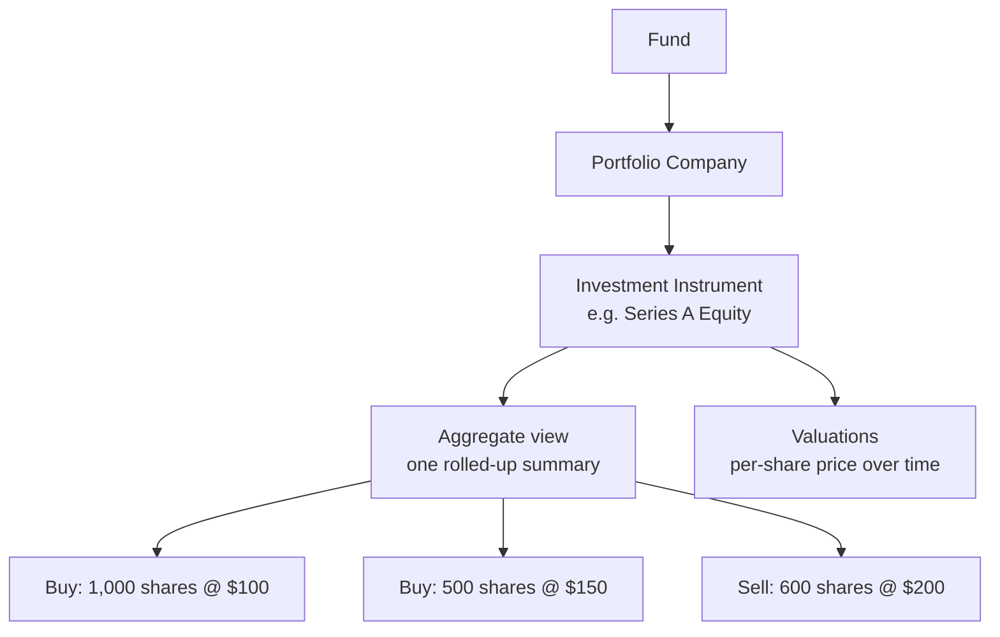
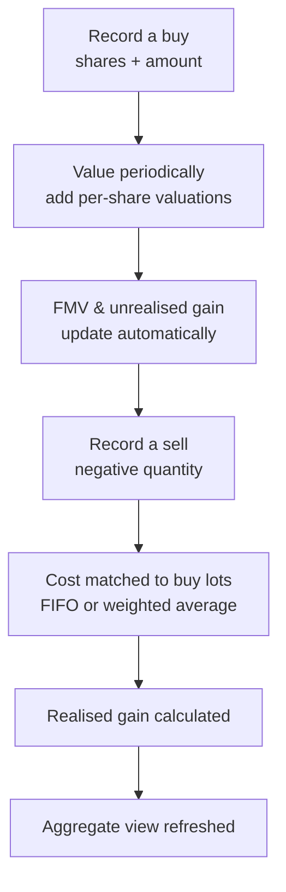
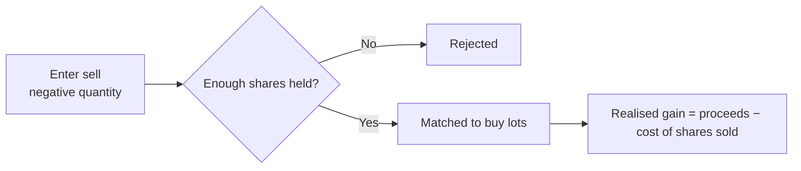
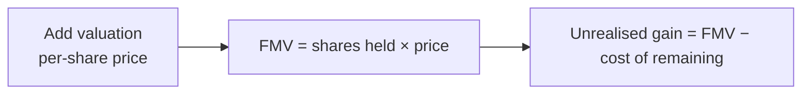

# Portfolio Investments User Guide

This guide covers how a fund's **direct investments in portfolio companies** are recorded and tracked: buying and selling holdings, valuing what you still hold, working out realised and unrealised gains, handling conversions and splits, recording income, and modelling future exits. It's written for investment and finance teams — no technical background needed.

---

## Table of Contents

1. [How Portfolio Investments Are Organised](#how-portfolio-investments-are-organised)
2. [Key Terms in Plain English](#key-terms-in-plain-english)
3. [The Investment Lifecycle](#the-investment-lifecycle)
4. [Investment Instruments](#investment-instruments)
5. [Recording a Purchase (Buy)](#recording-a-purchase-buy)
6. [Recording a Sale (Sell)](#recording-a-sale-sell)
7. [Cost Attribution: FIFO vs Weighted Average](#cost-attribution-fifo-vs-weighted-average)
8. [Valuations and Fair Market Value](#valuations-and-fair-market-value)
9. [The Aggregate (Rolled-Up) View](#the-aggregate-rolled-up-view)
10. [Stock Conversions](#stock-conversions)
11. [Stock Splits and Adjustments](#stock-splits-and-adjustments)
12. [Portfolio Income](#portfolio-income)
13. [Excused Investors](#excused-investors)
14. [Modelling: Proforma Investments and Scenarios](#modelling-proforma-investments-and-scenarios)
15. [Working Across Currencies](#working-across-currencies)
16. [Importing Data](#importing-data)
17. [Frequently Asked Questions](#frequently-asked-questions)

---

## How Portfolio Investments Are Organised

A fund invests in companies, in specific securities, through individual transactions. The structure mirrors that:

- A **portfolio company** is the business the fund invests in.
- An **investment instrument** is the specific security held in that company (equity, debentures, convertible notes, etc.).
- Each **transaction** is a single buy or sell.
- The **aggregate view** automatically rolls every buy and sell for one fund-company-instrument combination into a single summary.

---

## Key Terms in Plain English

| Term | What it means |
|------|---------------|
| **Portfolio Company** | A company the fund has invested in. |
| **Investment Instrument** | The specific security held (e.g. "Series A Equity", "10% NCD"). Each belongs to one company and has a fixed currency. |
| **Transaction** | A single buy (positive quantity) or sell (negative quantity). |
| **Buy Lot** | A single purchase, tracked separately so its cost can be matched against future sales. |
| **Aggregate View** | The auto-maintained summary of all buys and sells for one fund-company-instrument. |
| **Valuation** | A per-share price on a given date, used to value remaining holdings. |
| **FMV (Fair Market Value)** | Current value of what's still held = shares held × latest price. |
| **Cost of Remaining** | The book cost of holdings not yet sold. |
| **Unrealised Gain** | FMV − cost of remaining (paper gain on what you still hold). |
| **Realised Gain** | Sale proceeds − cost of the shares actually sold. |
| **FIFO / Weighted Average** | Two methods for deciding which buy lots a sale draws from. |

---

## The Investment Lifecycle

---

## Investment Instruments

An instrument is the security the fund invests in. It must exist before you record transactions.

| Field | Required | Notes |
|-------|----------|-------|
| **Name** | Yes | e.g. "Series A Equity", "CCDs". Unique within the company. |
| **Currency** | Yes | The instrument's denomination. **Cannot be changed later** — it underpins every amount calculation. |
| **Sector** | No | Industry sector. |
| **Category / Sub-Category** | No | Your own classification. |
| **Investment Domicile** | No | Domestic or foreign (sets the offshore flag automatically). |
| **Regulatory fields** | No | Investee type, security type, ISIN, registration number, and similar, used for regulatory reporting. |

Each instrument belongs to a single company (instruments aren't shared across companies), and **valuations are recorded per instrument** rather than per transaction.

---

## Recording a Purchase (Buy)

A buy records capital deployed into a company.

| Field | Required | Notes |
|-------|----------|-------|
| **Portfolio Company** | Yes | The company invested in. |
| **Investment Instrument** | Yes | The security bought. |
| **Investment Date** | Yes | The transaction date. |
| **Quantity** | Yes | Number of shares/units — must be positive. |
| **Amount (excluding expenses)** | Yes | The amount in the instrument's currency, before expenses. |
| **Notes** | No | Internal notes. |
| **Excused Folios** | No | Investors excused from this investment (see [Excused Investors](#excused-investors)). |
| **Proforma** | No | A what-if record for modelling only — excluded from all live figures. |
| **Reference ID** | No | An external reference that helps prevent duplicate imports. |

**On save, the system automatically:**

1. Adds any expense fields to the base amount.
2. Converts the amount to the fund's currency if the instrument is in a different currency (recording the rate used).
3. Creates the aggregate view if this is the first transaction for the company-instrument.
4. Creates an initial valuation at the buy price, so the holding can be valued from day one.
5. Calculates cost of remaining, FMV, and unrealised gain.

---

## Recording a Sale (Sell)

A sell records disposing of shares. It's recorded just like a buy, but with a **negative quantity** (e.g. −500 to sell 500 shares).

Before saving, the system checks you aren't selling more than you hold across all open buy lots; if you are, it's rejected. Once saved, the sale is **matched to specific buy lots** to determine its cost basis and realised gain (see the next section). A sell has no FMV or unrealised gain of its own — it's a realised event.

---

## Cost Attribution: FIFO vs Weighted Average

When you sell, the system has to decide **which** of your purchases the sold shares came from, because different purchases were made at different prices. This is set per fund.

Consider two purchases, then a sale of 1,200 shares at $200:

| Buy lot | Shares | Price | Date |
|---------|--------|-------|------|
| Lot 1 | 1,000 | $100 | Mar 2021 |
| Lot 2 | 500 | $150 | Jun 2022 |

### FIFO (First-In, First-Out)

The oldest shares are sold first.

| Drawn from | Shares | Cost | Sale | Gain |
|------------|--------|------|------|------|
| Lot 1 | 1,000 | $100,000 | $200,000 | $100,000 |
| Lot 2 | 200 | $30,000 | $40,000 | $10,000 |
| **Total** | **1,200** | **$130,000** | **$240,000** | **$110,000** |

FIFO is the default for most tax and regulatory reporting.

### Weighted Average

The sale is spread proportionally across all open lots. Total held = 1,500 shares (Lot 1 is 66.67%, Lot 2 is 33.33%).

| Drawn from | Shares | Cost | Gain |
|------------|--------|------|------|
| Lot 1 (66.67%) | 800 | $80,000 | $80,000 |
| Lot 2 (33.33%) | 400 | $60,000 | $20,000 |
| **Total** | **1,200** | **$140,000** | **$100,000** |

Weighted average smooths the cost basis across all purchases, as some accounting standards require.

> **Notice the difference:** the same sale produces a **$110,000** gain under FIFO but **$100,000** under weighted average, because the two methods consume different-priced lots. Choose the method that matches your reporting framework.

Once a sale has been matched, changing the fund's method later doesn't automatically re-match past sales — that has to be redone deliberately. You can always review how a sale was matched on its attribution breakdown.

---

## Valuations and Fair Market Value

**FMV** is the current value of holdings you still own, based on the latest per-share price.

> FMV = Shares still held × Latest per-share valuation (converted to the fund's currency)

Valuations are recorded per instrument, each with a date and a per-share price. The system uses the most recent valuation on or before the date you're valuing as of. A buy automatically creates an opening valuation at its purchase price, so you always have at least one.

FMV refreshes automatically whenever you add a valuation, record a buy or sell, or match a sale. Note:

- If there's **no valuation** on or before the date, FMV can't be computed — add one.
- If **no shares** remain (all sold or converted), FMV is zero.

---

## The Aggregate (Rolled-Up) View

For each fund-company-instrument combination there's a single **aggregate view** that summarises every transaction — no matter how many buys and sells you've recorded. It's created automatically with the first buy and keeps itself up to date.

It shows, at a glance:

| Aggregate figure | What it tells you |
|------------------|-------------------|
| **Quantity held** | Net shares still owned. |
| **Total bought / sold** | Cumulative amounts purchased and sold. |
| **Average cost** | Blended cost per share across all purchases. |
| **Cost of remaining** | Book cost of shares still held. |
| **FMV** | Current value of remaining holdings. |
| **Unrealised gain** | Paper gain on what's still held. |
| **Realised gain** | Gain locked in from sales. |
| **Portfolio income** | Actual income received (dividends, interest). |

### Point-in-time views

You can also view the aggregate **as of a past date** — a read-only snapshot using only the transactions and valuations that existed then. This powers historical reports, performance metrics, and the portfolio report generator.

---

## Stock Conversions

A **stock conversion** records one security turning into another — for example convertible debentures (CCDs) converting into equity.

A conversion records the instrument and lot being converted, the quantity surrendered, the new instrument, the quantity received, and the date. On save, the system reduces the original holding, creates a new holding in the destination instrument (carrying the original cost across, converted at the rate on the original investment date), and updates both aggregate views.

Key points:

- The "from" and "to" instruments must be different.
- You can't convert more than you currently hold.
- A conversion is **cost-preserving** — it doesn't create a gain or reduce the portfolio's cost; it just moves cost to the new instrument.
- In Gross Portfolio IRR, conversions are netted out so the converted cost isn't double-counted as a fresh investment.

---

## Stock Splits and Adjustments

### Stock splits

A split changes the number of shares without changing the total invested. After a 2-for-1 split, 1,000 shares at $100 become 2,000 shares at $50 — same total value, half the price each. Apply a split and the system updates the share count and recalculates per-share cost and FMV; the aggregate view follows automatically.

### Stock adjustments

A **stock adjustment** corrects the share count without a full buy or sell — used for bonus shares, rights issues, or data fixes. Record the company, instrument, and the adjustment (positive to add shares, negative to remove), and the system applies it across the relevant holdings.

---

## Portfolio Income

**Portfolio income** records money received from an investment — dividends, interest, or partial payouts.

| Field | Notes |
|-------|-------|
| **Portfolio Company / Instrument** | What generated the income. |
| **Payment Date** | When it was received. |
| **Amount** | In the fund's currency. |
| **Tag** | "Actual" for real income, or other tags for projections/budgets. |

Only income tagged **"Actual"** counts toward the portfolio's cumulative income and is included as a positive cash flow in **Gross Portfolio IRR** on its payment date. Projection/budget tags are kept separate for modelling.

---

## Excused Investors

Sometimes specific investors don't participate in a particular investment — for example due to a conflict of interest or a mandate restriction. A buy can list these **excused investors** (by folio).

When the fund later works out each investor's share of a realised gain, it looks at who was actually invested at the time of the buy. An excused investor wasn't in that deal, so they receive **no share** of the gain from selling it. This keeps gain allocation fair to the investors who actually carried the position.

---

## Modelling: Proforma Investments and Scenarios

### Proforma investments

**Proforma** transactions are what-if records for modelling. They're excluded from all live figures (FMV, gains, performance, aggregates), so you can sketch a proposed deal or a hypothetical exit without affecting real numbers. Use them to model a deal before committing or to test exit assumptions.

### Portfolio scenarios

**Scenarios** let you model exits at different valuations to estimate returns. A scenario holds a set of hypothetical sales at chosen prices and computes XIRR, MOIC, DPI, and similar — using the same logic as real investments, applied to the scenario's transactions. This is the tool for answering "what would our return be if we exited Company X at a $500M valuation next year?"

---

## Working Across Currencies

When an instrument is held in a currency different from the fund's:

- The amount is stored in the instrument's currency and also converted to the fund's currency at the rate on the investment date.
- FMV is calculated in the instrument's currency and converted to the fund's currency at the rate on the valuation date.
- A tracking-currency version is maintained for cross-fund dashboards.

If no exchange rate exists between the instrument and fund currencies on the transaction date, the transaction is rejected — set up the rate first.

---

## Importing Data

You can bulk-load from spreadsheets.

**Transactions** — provide fund, portfolio company (must already exist), investment date, amount (excluding expenses, in instrument currency), quantity (positive to buy, negative to sell), instrument, and currency. Optional columns include domicile, notes, excused folios, proforma, a reference ID (helps avoid duplicates), and regulatory fields. If an instrument doesn't exist yet, it's created from the import. Sales are matched to buy lots during the import so ordering stays correct.

**Income** — provide fund, company, instrument, payment date, amount (fund currency), and tag ("Actual" or a custom tag).

**Instruments** — provide company, name, currency, and optional attributes (sector, category, ISIN, etc.).

---

## Frequently Asked Questions

**What's the difference between the amount before expenses and the total amount?**
The amount before expenses is what you actually pay the company; the total amount adds any transaction costs/fees. Both are held in the fund's currency.

**Can I switch FIFO and weighted average after recording sales?**
The method is set per fund. Changing it doesn't automatically re-match past sales — those have to be re-matched deliberately.

**Why is my gain different from what I expected?**
Gain depends on which buy lots the sale drew from. FIFO uses the oldest (often cheaper) lots, producing larger gains; weighted average smooths across all lots. Check the sale's attribution breakdown to see exactly how it was matched.

**What if I delete a buy that's been partly sold?**
You can't delete it while sales reference it. Delete the dependent sales first, then the buy.

**Why is FMV zero even though I hold shares?**
Either there's no valuation on or before today (add one), or no shares actually remain (all sold or converted). Check the instrument's valuations.

**How is a conversion different from a sale?**
A conversion (e.g. CCD → equity) is cost-preserving — it changes the security type without realising a gain. A sale realises a gain and reduces the cost of remaining.

**What do excused investors do?**
They list investors who didn't participate in a specific deal. When a gain is later allocated, excused investors get no share of that deal's gain.

**Can the same instrument be held in two funds?**
Yes — each fund-company-instrument combination has its own aggregate view, and transactions never mix across funds.

**What is a proforma investment?**
A modelling-only record that doesn't affect live figures — used to test proposed deals or hypothetical exits.
