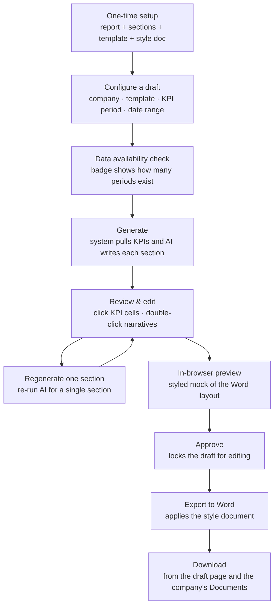
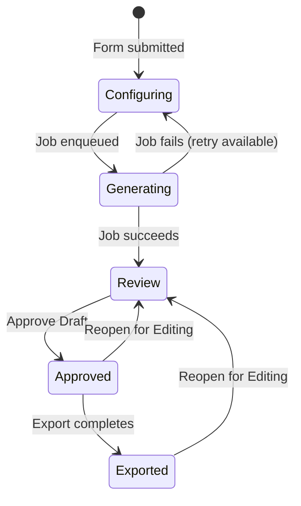

# Portfolio Report Drafts — User Guide

CapHive can produce analyst-quality portfolio company reports for you: it pulls the company's KPI data and uses AI to write the narrative for each section. You then review, edit, approve, and export to a styled Word document. This guide covers the whole journey — one-time setup, generating drafts (one company or many at once), reviewing and editing, approving, previewing, and exporting.

---

## Table of Contents

1. [Key Concepts](#key-concepts)
2. [How It Works, End to End](#how-it-works-end-to-end)
3. [One-Time Setup](#one-time-setup)
   - [1. Create a Portfolio Report](#1-create-a-portfolio-report)
   - [2. Add Sections (manually or AI-suggested)](#2-add-sections-manually-or-ai-suggested)
   - [3. Create an Output Template](#3-create-an-output-template)
   - [4. Upload a Style Document](#4-upload-a-style-document)
   - [5. Schedule Automatic Generation](#5-schedule-automatic-generation)
   - [6. Clone a Report Type](#6-clone-a-report-type)
4. [Generating a Draft](#generating-a-draft)
5. [Reviewing a Draft](#reviewing-a-draft)
6. [Approving a Draft](#approving-a-draft)
7. [Exporting to Word](#exporting-to-word)
8. [Reopening a Draft](#reopening-a-draft)
9. [Draft Statuses](#draft-statuses)
10. [Example Walkthrough](#example-walkthrough)
11. [Frequently Asked Questions](#frequently-asked-questions)

---

## Key Concepts

| Term | Meaning |
|------|---------|
| **Portfolio Report** | The top-level setup for a report type (e.g. "Quarterly LP Update"). Holds its sections and templates. |
| **Section** | A named content block (e.g. "Financial Highlights"), with a name, an icon, and the instructions AI uses to write it. |
| **Output Template** | Defines which sections appear, in what order, how KPI data is laid out, and which style document to use. One report can have several templates. |
| **Style Document** | A Word file whose fonts, headings, and table styles are applied to the exported report. |
| **KPI Report** | A periodic snapshot of a company's KPIs, tagged by period and type (e.g. Actual, Budget). |
| **Draft** | A generated report for one company, one template, and one time range: the KPI table plus AI-written narratives. |
| **Draft Status** | The stage a draft is in: Configuring → Generating → Review → Approved → Exported. |

---

## How It Works, End to End

---

## One-Time Setup

Setup is done once per entity — you don't repeat it for every draft.

### 1. Create a Portfolio Report

The **Portfolio Report** is the container that groups your sections and templates.

1. Open **Portfolio Reports** and click **New Portfolio Report**.
2. Enter a **Name** (e.g. "Quarterly LP Update"). The entity is filled in for you.
3. Save.

> The Portfolio Reports list shows a **Setup Complete** badge — green **Ready** or amber **Incomplete**. A report is ready once it has at least one section and one output template.

### 2. Add Sections (manually or AI-suggested)

Sections are the content blocks AI writes; each becomes a tab on the draft review page.

**Manually:** open the report, click **Edit**, then **Add Section** for each block. Provide:

- **Name** — e.g. "Financial Highlights".
- **Instructions** — what you want AI to write. The more specific, the better the result.
- **Icon** — choose an icon to represent the section.

**AI-suggested (faster):** on the same Edit screen, click **Suggest Sections (AI)**. The system proposes 4–6 sections (name, instructions, icon) based on the report name and adds them to the list. Remove any you don't need, fine-tune the instructions, and save.

> The instructions you write for each section are what guides the AI. Precise instructions produce better, more relevant narratives.

### 3. Create an Output Template

A template chooses which sections appear, their order, and how KPI data is laid out.

1. Open the report and click **New Template** (or edit an existing one).
2. Set:
   - **Name** — e.g. "LP Quarterly — Word".
   - **Output format** — Word or PowerPoint.
   - **Sections** — select and order the sections for this template.
   - **KPI layout** — which KPI categories to include, the tag(s), how many periods, and whether to show them side by side.
3. Save.

A report can have several templates — for example a short LP summary and a detailed internal version.

### 4. Upload a Style Document

A **style document** is a Word file that controls fonts, heading colours, and table styling in the exported report.

1. Edit the output template.
2. In the **Style reference file** area, upload a Word file. Its named styles are applied when the report is exported.
3. Select it from the dropdown and save.

> If you don't upload a style document, the export uses the system's default styling.

### 5. Schedule Automatic Generation

A template can automatically queue drafts for every portfolio company on a monthly or quarterly schedule.

1. Edit the output template and find **Auto-generation schedule**.
2. Tick **Enable scheduled auto-generation**.
3. Set the **frequency** (monthly or quarterly) and the **day of month** to run (1–28; using 28 avoids short-month issues).
4. Save.

On the chosen day, the system queues one draft per company and notifies you as each completes. The "Last run" date appears after the first run.

### 6. Clone a Report Type

To create a variant of an existing report (for example a condensed version), click **Clone** on the Portfolio Reports list or on the report's page. The copy is suffixed "(Copy)", duplicates all sections and templates (including style documents), and opens in edit mode so you can adjust it right away.

---

## Generating a Draft

### For a single company

1. Open the portfolio company's page.
2. Choose **Misc → Portfolio Report**.
3. Select a **report type** and **output template**.
4. Set the date range, KPI period, KPI tag, and number of periods.
5. Choose which KPI metrics to include (those marked "show in report" are pre-selected).
6. Click **Generate Report Draft**.
7. You're taken to the draft page; a spinner shows the work running (usually 30–90 seconds).
8. When it's done, you get a notification with a link, the page refreshes, and the draft moves to **Review**.

### For many companies at once

1. Open **Portfolio Reports** and click **Bulk Generate Drafts**.
2. Select an output template.
3. Set the date range, KPI period, KPI tag, and number of periods.
4. Tick the companies to include (**Select all** / **Clear all** are available).
5. Click **Queue Drafts for Selected Companies**.

One draft is queued per company, with a notification as each finishes.

### Check data availability first

Before you generate, a live badge shows how many KPI periods actually exist for your chosen settings, updating as you change the end date, period, tag, or number of periods:

- **Green** — all requested periods found.
- **Amber** — fewer found than requested (e.g. "3 of 6 periods found").
- **Red** — no data for this combination.

Use this to catch missing KPI data before committing to a run.

### Settings carry over

The form pre-fills from the most recent draft for that company — dates, number of periods, period type, tag, and previously chosen metrics. A banner confirms "Settings pre-filled from last draft". Adjust anything before submitting.

---

## Reviewing a Draft

The draft page has one tab per section plus a **KPI Data** tab.

### KPI Data tab

Shows the KPI table — metrics as rows, periods as columns (oldest to newest). To correct a figure (in **Review** status): click a value cell, type the corrected value, and press **Enter** (or click away) to save — a green **Saved** badge confirms; **Escape** cancels.

> Your corrections are stored separately from the raw KPI data, so regenerating doesn't wipe them on existing drafts.

### Section narratives

Each section tab shows the AI-written narrative as bullet points. A small coloured dot on each tab signals quality:

| Dot | Meaning |
|-----|---------|
| **Green** | Content looks good. |
| **Amber** | Short — consider editing or regenerating. |
| **Red** | No content generated. |

### Editing a narrative

In **Review** status, double-click a narrative to edit it, type freely, and click away to save (green **Saved** badge; **Escape** restores the original). Your edited text takes precedence over the AI output and is what the Word export uses.

### Regenerating one section

If a single section is weak, re-run AI for just that section without redoing the whole draft: open the section tab, click **Regenerate**, and confirm (current content is overwritten). A notification arrives when it's ready; reload to see it. This reuses the existing KPI data — no re-fetch needed.

### In-browser preview

Before exporting, click **Preview** to see a styled mock of the Word layout in a new tab — cover, KPI table, and section narratives separated by page breaks. It's an approximation; the final Word file may differ slightly because of the style document.

---

## Approving a Draft

When you're happy with the data and narratives, click **Approve Draft**. A dialog explains that the status becomes **Approved**, editing is locked, and **Export to Word** becomes available. You can either:

- **Approve Draft** — approve now and export later, or
- **Approve & Export Now** — approve and immediately queue the Word export.

---

## Exporting to Word

On an **Approved** draft, click **Export to Word**. The export runs in the background; when it finishes the status becomes **Exported**, a **Download** button appears, you get a notification with a download link, and the file is saved to the company's **Documents** folder.

The exported document contains a cover (company, template, period, date), the KPI table with your corrections applied, and one section per template section using your edited narratives. If the template has a style document, its styles are applied; otherwise the system's default styling is used.

---

## Reopening a Draft

An **Approved** or **Exported** draft can go back to **Review** for more editing: open it, click **Reopen for Editing**, and confirm. KPI and narrative editing are re-enabled. Reopening doesn't delete the previously exported Word file — export again after re-approving to get a fresh one with your new edits.

---

## Draft Statuses

| Status | Meaning | What you can do |
|--------|---------|-----------------|
| **Configuring** | Created but not generated yet, or generation failed. | Re-configure and retry. |
| **Generating** | Work is running. | Wait — the page refreshes itself. |
| **Review** | KPI data and narratives are ready. | Edit cells and narratives, regenerate sections, preview, approve. |
| **Approved** | Locked and ready to export. | Export to Word, Approve & Export Now, Reopen. |
| **Exported** | Word document generated. | Download, Reopen. |

---

## Example Walkthrough

Say you want a quarterly update for *Helios Robotics*:

1. **Setup (once):** create a report "Quarterly LP Update", add sections "Financial Highlights", "Operational KPIs", "Risks & Outlook" (or let AI suggest them), create a "Word" template that includes those three sections, and upload your firm's style document.
2. **Generate:** on the Helios Robotics page, choose **Misc → Portfolio Report**, pick the template, set the last 4 quarters, and confirm the data-availability badge is green ("4 periods found"). Click **Generate Report Draft**.
3. **Review:** 60 seconds later the draft is in Review. The Financial Highlights dot is green; Risks & Outlook is amber, so you double-click it, tighten the wording, and it saves. You also correct one mistyped revenue figure in the KPI table.
4. **Approve & export:** click **Approve & Export Now**. The Word file lands in the Helios Robotics Documents folder and a download link arrives.

Next quarter, the form pre-fills with these same settings — you just shift the date range and repeat.

---

## Frequently Asked Questions

**No KPI data appears — why?**
Check that KPI reports exist for the company with the selected period and tag, that the date range covers at least one period with submitted data, and that the chosen metrics match those reports. The data-availability badge on the configure form tells you before you generate.

**A section says "No content generated" — why?**
AI returned nothing, usually because the KPI context was empty or the section instructions were too vague. Tighten the section instructions in the report setup and use **Regenerate** on that section, or generate a fresh draft.

**Can I regenerate one section without losing my KPI edits?**
Yes — use **Regenerate** on the section (Review status only). The KPI table and your corrections are preserved, and other sections are untouched.

**The export failed — what now?**
You'll see an error notification. Common causes are a corrupt or password-protected style document (re-upload it) or a temporary storage issue (reopen, re-approve, and export again).

**Can I generate reports for many companies at once?**
Yes — use **Bulk Generate Drafts** on the Portfolio Reports page.

**Can reports generate automatically each month?**
Yes — enable the auto-generation schedule on the output template and set the frequency and day. Drafts are queued automatically for every company.

**Can I have different formats for the same company?**
Yes — create multiple output templates on one report, each with its own sections, order, and style document, or use **Clone** to make a variant.

**Where does the exported file go?**
To the company's Documents folder, and it's downloadable directly from the draft page.

**Can I undo an approval?**
Yes — click **Reopen for Editing** on an Approved or Exported draft to return it to Review.
