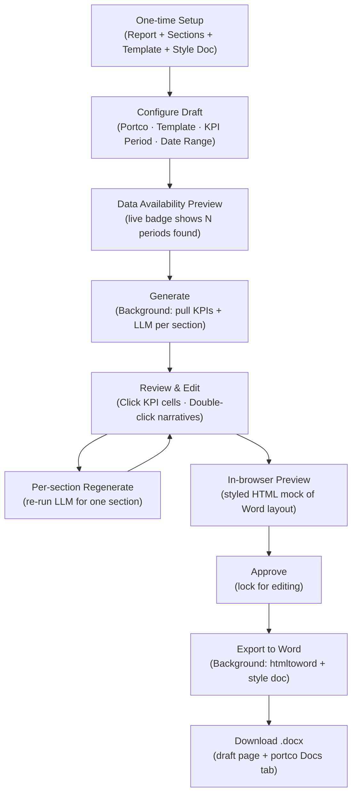
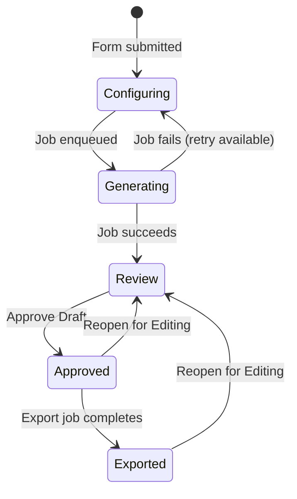

# Portfolio Report Drafts — User Guide

CapHive can generate analyst-quality portfolio company reports by pulling KPI data and using an LLM to write section narratives. This guide covers the complete lifecycle: one-time setup, generating drafts (single or bulk), reviewing and editing, approving, previewing, and exporting to Word.

---

## Table of Contents

1. [Key Concepts](#key-concepts)
2. [Feature Overview](#feature-overview)
3. [One-Time Setup](#one-time-setup)
   - [1. Create a Portfolio Report](#1-create-a-portfolio-report)
   - [2. Add Sections (manually or AI-suggested)](#2-add-sections-manually-or-ai-suggested)
   - [3. Create an Output Template](#3-create-an-output-template)
   - [4. Upload a Style Document](#4-upload-a-style-document)
   - [5. Configure Scheduled Auto-Generation](#5-configure-scheduled-auto-generation)
   - [6. Clone a Report Type](#6-clone-a-report-type)
4. [Generating a Draft](#generating-a-draft)
   - [Single portco](#single-portco)
   - [Bulk generate across multiple portcos](#bulk-generate-across-multiple-portcos)
   - [Data availability preview](#data-availability-preview)
   - [Pre-fill from last draft](#pre-fill-from-last-draft)
5. [Reviewing a Draft](#reviewing-a-draft)
   - [KPI Data tab](#kpi-data-tab)
   - [Section narrative tabs](#section-narrative-tabs)
   - [Narrative quality indicators](#narrative-quality-indicators)
   - [Inline editing](#inline-editing)
   - [Per-section regenerate](#per-section-regenerate)
   - [In-browser preview](#in-browser-preview)
6. [Approving a Draft](#approving-a-draft)
7. [Exporting to Word](#exporting-to-word)
8. [Reopening a Draft](#reopening-a-draft)
9. [Draft Statuses](#draft-statuses)
10. [Frequently Asked Questions](#frequently-asked-questions)

---

## Key Concepts

| Term | Meaning |
|---|---|
| **Portfolio Report** | Top-level configuration for a report type, linked to an entity. Holds sections and output templates. |
| **Section** | A named content block (e.g. "Financial Highlights"). Each has a name, icon, and LLM instructions. |
| **Output Template** | Defines which sections appear, their order, KPI layout config, and links to a style `.docx`. One report can have multiple templates. |
| **Style Document** | A `.docx` whose paragraph/table styles are applied to the exported Word file. Uploaded on the template edit page. |
| **KPI Report** | A periodic snapshot of a portfolio company's KPIs, tagged by period type and tag (e.g. Actual, Budget). |
| **Draft** | A generated instance: KPI table + LLM-written narratives for one portco, one template, one time range. |
| **Draft Status** | The stage the draft is in: `Configuring → Generating → Review → Approved → Exported`. |

---

## Feature Overview

---

## One-Time Setup

Setup is done once per entity. It does not need to be repeated for each draft.

### 1. Create a Portfolio Report

A **Portfolio Report** is the container that groups sections and templates.

1. Go to `/portfolio_reports` → click **New Portfolio Report**.
2. Fill in:
   - **Name** — e.g. "Quarterly LP Update"
   - **Entity** — auto-filled from your session
3. Save.

> **Setup completeness** — the portfolio reports index shows a "Setup Complete" badge (green **Ready** / amber **Incomplete**) for each report. A report is ready when it has at least one section and at least one output template.

### 2. Add Sections (manually or AI-suggested)

Sections are the content blocks the LLM writes. Each section becomes a tab on the draft review page.

**Manually:**
1. Open the Portfolio Report → click **Edit**.
2. Use **Add Section** to add each block. Fill in:
   - **Name** — e.g. "Financial Highlights"
   - **Data** (LLM Instructions) — tells the model what to write. Be specific.
   - **Icon** — Tabler icon name without prefix, e.g. `chart-bar`, `alert-triangle`
3. Save.

**AI-suggested (faster):**
1. Open the Portfolio Report → click **Edit**.
2. An "AI Section Suggestions" banner appears at the top of the form.
3. Click **Suggest Sections (AI)**.
4. The AI proposes 4–6 sections (name, instructions, icon) based on the report name. They are appended to the existing section list.
5. Remove any you don't need, adjust the instructions, then **Save**.

> The LLM instructions in the **Data** field are the prompt given to the model. More precise instructions produce better output.

### 3. Create an Output Template

An Output Template selects which sections appear, their order, and how KPI data is laid out.

1. Open the Portfolio Report → click **New Template** (or open an existing template → Edit).
2. Fill in:
   - **Name** — e.g. "LP Quarterly — Word"
   - **Output format** — Word or PPT
   - **Sections** — multi-select and order the sections for this template
   - **KPI layout** — categories to include, tag(s), N periods, side-by-side option
3. Save.

Multiple templates can exist on one report (e.g. a short LP summary vs. a detailed internal version).

### 4. Upload a Style Document

A style `.docx` controls fonts, heading colours, table borders, etc. of the exported Word document.

1. Open the Output Template → **Edit**.
2. In the **Style reference file** section, upload a `.docx`. The file's named paragraph and table styles are applied during export.
3. Once uploaded, select it from the **Style reference file** dropdown and save.

> If no style document is uploaded, the export uses the `htmltoword` default template.

### 5. Configure Scheduled Auto-Generation

Templates can automatically queue drafts for every portfolio company in your entity on a monthly or quarterly schedule.

1. Open the Output Template → **Edit**.
2. Scroll to **Auto-generation schedule**.
3. Check **Enable scheduled auto-generation**.
4. Set:
   - **Frequency** — Monthly or Quarterly
   - **Day of month to run** — 1–28 (using 28 avoids month-length issues)
5. Save.

When the daily job runs on the configured day, it queues one draft per portfolio company. You receive a notification per portco as each draft completes. The "Last run" date is shown on the form after the first execution.

### 6. Clone a Report Type

To quickly create a variant of an existing report (e.g. a condensed version):

- From the portfolio reports **index**: click **Clone** on any row.
- From the report **show page**: click the **Clone** button.

The copy gets the suffix `(Copy)`, duplicates all sections and templates (including style document references), and opens in edit mode so you can customise it immediately.

---

## Generating a Draft

### Single portco

1. Navigate to the portfolio company show page.
2. Click **Misc → Portfolio Report** (or go directly to `/investors/:id/generate_reports`).
3. Select a **Report type** and **Output template** from the dropdowns.
4. Set the date range, KPI period, KPI data tag, and N periods.
5. Choose which KPI metrics to include (pre-selected from metrics marked "show in report").
6. Click **Generate Report Draft**.
7. You are redirected to the draft show page. A spinner indicates the background job is running (30–90 seconds).
8. When complete, a notification arrives with a direct link. The page auto-refreshes and shows **Review** status.

### Bulk generate across multiple portcos

Use this to queue one draft per portco for the same template and time period in a single action.

1. Go to `/portfolio_reports` → click **Bulk Generate Drafts** (top-right).
2. Select an output template.
3. Set the date range, KPI period, KPI tag, and N periods.
4. Check the portfolio companies to include. Use **Select all** / **Clear all** for convenience.
5. Click **Queue Drafts for Selected Companies**.
6. One draft job is queued per portco. You receive a notification as each finishes.

### Data availability preview

Before submitting the configure form, a live badge shows how many KPI periods are actually available for the chosen settings.

- Change **End date**, **KPI period**, **KPI data tag**, or **N periods** — the badge updates automatically after a short pause.
- **Green** — all requested periods found (e.g. "6 periods found — Jan 2025, Feb 2025, …")
- **Amber** — fewer periods found than requested (e.g. "3 of 6 periods found — …")
- **Red** — no data found for this combination

Use this to catch missing KPI data before committing to a generation run.

### Pre-fill from last draft

The configure form automatically pre-fills from the most recent draft for this portco:

- Start/end dates, N periods, KPI period type, KPI tag
- Previously selected KPI metrics are pre-checked

A grey banner confirms "Settings pre-filled from last draft (…)". Adjust any field as needed before submitting.

---

## Reviewing a Draft

The draft show page is full-width. A tab per section plus a **KPI Data** tab.

### KPI Data tab

Shows the KPI table: metrics as rows, periods as columns (oldest → newest).

**To edit a cell:**
1. Draft must be in **Review** status.
2. Click any value cell — it becomes an editable input.
3. Enter the corrected value and press **Enter** (or click away) to save.
4. A green **Saved** badge confirms. Press **Escape** to cancel.

> User overrides are stored separately from raw KPI data. Regenerating the draft does not affect overrides on existing drafts.

### Section narrative tabs

Each section tab shows the LLM-written narrative as bullet points.

### Narrative quality indicators

Each section tab in the pill nav has a small coloured dot:

| Dot colour | Meaning |
|---|---|
| **Green** | Content looks good (150+ characters) |
| **Amber** | Short content — consider editing or regenerating |
| **Red** | No content generated |

Hover over the dot to see the tooltip.

### Inline editing

**To edit a section narrative:**
1. Draft must be in **Review** status.
2. Double-click the narrative text area.
3. The area becomes editable — type freely.
4. Click away to save. Green **Saved** badge confirms.
5. Press **Escape** to cancel and restore the original text.

> Edited text takes precedence over the LLM output. The Word export uses your edited version.

### Per-section regenerate

If a section's content is poor quality, you can re-run the LLM for just that section without regenerating the entire draft.

1. Draft must be in **Review** status.
2. Click the section's tab.
3. Click **Regenerate** (top-right of the section card).
4. Confirm the popup — current content will be overwritten.
5. A background job runs. A notification arrives when the new content is ready.
6. Reload the draft to see the updated section.

> This reuses the existing KPI table data already on the draft — no KPI re-fetch is needed.

### In-browser preview

Before exporting, you can see a styled HTML mock of how the Word document will be laid out.

1. Click **Preview** (outline-info button in the draft header) — available on any draft not in Configuring or Generating status.
2. Opens in a new tab with:
   - A fixed toolbar showing "PREVIEW — not the final Word document" and a Back link
   - Cover header with portco name, template, and period
   - KPI data table
   - Section narratives separated by page breaks
3. This is a preview only — the actual Word export may differ in font/style due to the style document.

---

## Approving a Draft

When satisfied with the KPI data and narratives:

1. Click **Approve Draft** (green button, top-right).
2. A modal explains what happens:
   - Status changes to **Approved**
   - Inline editing is disabled
   - **Export to Word** becomes available
3. Choose one of:
   - **Approve Draft** — approve only; export separately later
   - **Approve & Export Now** — approve and immediately queue the Word export in one click

---

## Exporting to Word

1. On an **Approved** draft, click **Export to Word**.
2. A background job starts. When complete:
   - Status changes to **Exported**
   - A **Download** button appears on the draft page
   - A notification arrives with a direct download link
   - The `.docx` is saved to the portco's **Documents** folder

**The exported document contains:**
- Cover (portco name, template, period, generation date)
- KPI table with user overrides applied
- One section per template section, using your edited narrative

**Style application:** If the template has a style document, its named paragraph and table styles are applied. Otherwise the `htmltoword` default is used.

---

## Reopening a Draft

An **Approved** or **Exported** draft can be moved back to **Review** for further editing.

1. Open the draft.
2. Click **Reopen for Editing** (amber outline button).
3. Confirm the popup.
4. The draft returns to **Review** status. KPI cell and narrative editing are re-enabled.

> Reopening does not delete the previously exported Word document. To get a fresh Word export with your new edits, export again after re-approving.

---

## Draft Statuses

| Status | Meaning | Available actions |
|---|---|---|
| **Configuring** | Created but not yet generated, or generation failed | Re-configure and retry |
| **Generating** | Background job running | Wait — page auto-refreshes every 8 seconds |
| **Review** | KPI data and narratives ready | Edit cells, edit narratives, regenerate sections, preview, approve |
| **Approved** | Locked, ready for export | Export to Word, Approve & Export Now, Reopen |
| **Exported** | Word document generated | Download, Reopen |

---

## Frequently Asked Questions

**Q: No KPI data appears — what went wrong?**
Check that:
- KPI Reports exist for the portco with the selected period type and tag
- The date range includes at least one period with submitted data
- The KPI mappings selected match the metrics in those reports

Use the **data availability preview badge** on the configure form to check before generating.

**Q: A section shows "No content generated" — why?**
The LLM returned empty output, usually because the KPI context was empty or the section instructions were too vague. Edit the section instructions in the Portfolio Report configuration and use **Regenerate** on that section, or generate a new draft.

**Q: Can I regenerate just one section without losing my KPI edits?**
Yes — use the **Regenerate** button on the section card (Review status only). KPI table data and overrides are preserved. Other section narratives are not affected.

**Q: The export failed — what should I do?**
A danger notification appears with the error message. Common causes:
- The style document is corrupt or password-protected — re-upload it
- Temporary storage issue — reopen the draft, re-approve, and export again

**Q: Can I generate reports for many portcos at once?**
Yes — use **Bulk Generate Drafts** at `/portfolio_reports` (top-right button). Select the template, date range, and portcos in one form.

**Q: Can I set up reports to generate automatically each month?**
Yes — enable **Auto-generation schedule** on the Output Template edit page. Set frequency (monthly/quarterly) and the day of month. The system queues drafts automatically for all portcos in your entity on that schedule.

**Q: Can I have different report formats for the same portco?**
Yes — create multiple Output Templates on the same Portfolio Report, each with different section selections, ordering, and style documents. Or use **Clone** to quickly create a variant of an existing report type.

**Q: Where does the exported Word file go?**
It is saved as a Document owned by the portfolio company in the portco's root document folder. It is also directly accessible via the **Download** button on the draft page.

**Q: Can I undo an approval?**
Yes — click **Reopen for Editing** on an Approved or Exported draft to move it back to Review status.
