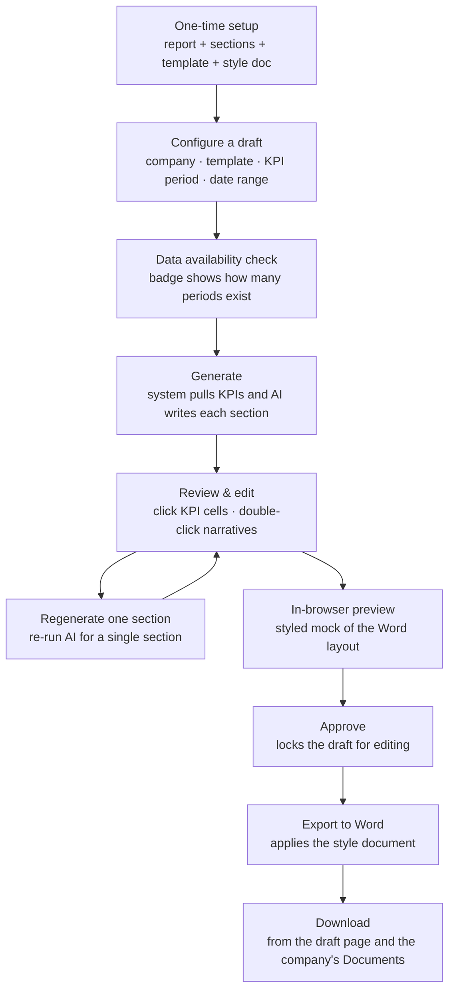
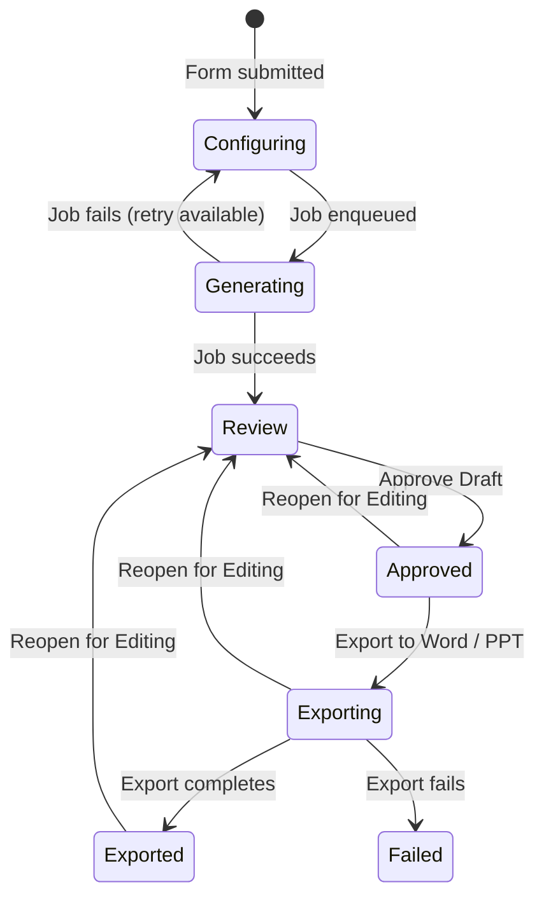

# Portfolio Report Drafts — User Guide

CapHive can produce analyst-quality portfolio company reports for you: it pulls the company's KPI data and uses AI to write the narrative for each section. You then review, edit, approve, and export to a styled Word document. This guide covers the whole journey — one-time setup, generating drafts (one company or many at once), reviewing and editing, approving, previewing, and exporting.

> **Where to find it:** Set up report types from Sidebar → [**Stakeholders → View Stakeholders**](/investors) → **Actions** → [**Portfolio Reports Setup**](/portfolio_reports). Generate a draft from the portfolio company's page → **Misc** → **Portfolio Report**, or for many companies with [**Bulk Generate Drafts**](/portfolio_reports/bulk_generate). Needs the *Fund Portfolios* feature on your company; creating output templates needs the *Company Admin* role.

---

## Table of Contents

1. [Key Concepts](#key-concepts)
2. [How It Works, End to End](#how-it-works-end-to-end)
3. [One-Time Setup](#one-time-setup)
   - [1. Create a Portfolio Report](#1-create-a-portfolio-report)
   - [2. Add Sections (manually or AI-suggested)](#2-add-sections-manually-or-ai-suggested)
   - [3. Create an Output Template](#3-create-an-output-template)
   - [4. Upload a Style Document](#4-upload-a-style-document)
   - [5. Schedule Automatic Generation](#5-schedule-automatic-generation)
   - [6. Clone a Report Type](#6-clone-a-report-type)
4. [Generating a Draft](#generating-a-draft)
5. [Reviewing a Draft](#reviewing-a-draft)
6. [Approving a Draft](#approving-a-draft)
7. [Exporting to Word](#exporting-to-word)
8. [Reopening a Draft](#reopening-a-draft)
9. [Draft Statuses](#draft-statuses)
10. [Example Walkthrough](#example-walkthrough)
11. [Frequently Asked Questions](#frequently-asked-questions)

---

## Key Concepts

| Term | Meaning |
|------|---------|
| **Portfolio Report** | The top-level setup for a report type (e.g. "Quarterly LP Update"). Holds its sections and templates. |
| **Section** | A named content block (e.g. "Financial Highlights"), with a name, an icon, and the instructions AI uses to write it. |
| **Output Template** | Defines which sections appear, in what order, how KPI data is laid out, and which style document to use. One report can have several templates. |
| **Style Document** | A Word (or, for PowerPoint templates, .pptx) file whose fonts, headings, and table styles are applied to the exported report. |
| **KPI Report** | A periodic snapshot of a company's KPIs, tagged by period and type (e.g. Actual, Budget). |
| **Draft** | A generated report for one company, one template, and one time range: the KPI table plus AI-written narratives. |
| **Draft Status** | The stage a draft is in: Configuring → Generating → Review → Approved → Exporting → Exported (or failed, if the export fails). |

---

## How It Works, End to End

---

## One-Time Setup

Setup is done once per entity — you don't repeat it for every draft.

### 1. Create a Portfolio Report

The **Portfolio Report** is the container that groups your sections and templates.

1. Open **Portfolio Reports Setup** (Sidebar → **Stakeholders → View Stakeholders** → **Actions** → **Portfolio Reports Setup**; there is no Portfolio Reports sidebar item) and click **New Portfolio Report**.
2. Enter a **Name** (e.g. "Quarterly LP Update"). The entity is filled in for you.
3. Save.

> The Portfolio Reports list shows a **Setup Complete** badge — green **Ready** or amber **Incomplete**. A report is ready once it has at least one section and one output template.

### 2. Add Sections (manually or AI-suggested)

Sections are the content blocks AI writes; each becomes a tab on the draft review page.

**Manually:** open the report, click **Edit**, then **Add Section** for each block. Provide:

- **Name** — e.g. "Financial Highlights".
- **Instructions** — what you want AI to write. The more specific, the better the result.
- **Icon** — choose an icon to represent the section.

**AI-suggested (faster):** on the same Edit screen, click **Suggest Sections (AI)**. The system proposes 4–6 sections (name, instructions, icon) based on the report name and adds them to the list. Remove any you don't need, fine-tune the instructions, and save.

> The instructions you write for each section are what guides the AI. Precise instructions produce better, more relevant narratives.

### 3. Create an Output Template

A template chooses which sections appear, their order, and how KPI data is laid out.

1. Open the report and click **New Template** (or edit an existing one).
2. Set:
   - **Name** — e.g. "LP Quarterly — Word".
   - **Output format** — Word or PowerPoint.
   - **Sections** — select and order the sections for this template.
   - **KPI layout** — which KPI categories to include, the tag(s), how many periods, and whether to show them side by side.
3. Save.

A report can have several templates — for example a short LP summary and a detailed internal version.

### 4. Upload a Style Document

A **style document** is a Word file (or a .pptx for PowerPoint templates) that controls fonts, heading colours, and table styling in the exported report.

1. Edit the output template.
2. In the **Style file** section, click **Upload .docx / .pptx** to upload a file, or open **Or pick a previously uploaded file** to reuse one. Its named styles are applied when the report is exported.
3. Save the template.

> If you don't upload a style document, the export uses the system's default styling.

### 5. Schedule Automatic Generation

A template stores a monthly or quarterly auto-generation schedule for queuing drafts for every portfolio company.

1. Edit the output template and find **Auto-generation schedule**.
2. Tick **Enable scheduled auto-generation**.
3. Set the **frequency** (monthly or quarterly) and the **day of month** to run (1–28; using 28 avoids short-month issues).
4. Save.

The job that reads this schedule is not registered on the app's job scheduler, so saving it does not by itself queue anything — drafts are created on the chosen day only if CapHive support has scheduled the job for your site. When it does run, it creates one draft per portfolio company using the **Monthly** period and **Actual** tag (whatever frequency you chose), owned by a company admin, and the "Last run" date appears afterwards. Until then, use **Bulk Generate Drafts** each period.

### 6. Clone a Report Type

To create a variant of an existing report (for example a condensed version), click **Clone** on the Portfolio Reports list or on the report's page. The copy is suffixed "(Copy)", duplicates all sections and templates (including style documents), and opens in edit mode so you can adjust it right away. The copied templates start with an empty section order, so edit each one and re-select its sections.

---

## Generating a Draft

### For a single company

1. Open the portfolio company's page.
2. Choose **Misc → Portfolio Report**.
3. Select a **report type** and **output template**.
4. Set the date range, KPI period, KPI tag, and number of periods.
5. Choose which KPI metrics to include (those marked "show in report" are pre-selected).
6. Click **Generate Report Draft**.
7. You're taken to the draft page; a spinner shows the work running (usually 30–90 seconds).
8. When it's done, an on-screen alert with a link appears (if you are still logged in; nothing is emailed), the page refreshes, and the draft moves to **Review**.

### For many companies at once

1. Open [**Portfolio Reports Setup**](/portfolio_reports) and click **Bulk Generate Drafts**.
2. Select an output template.
3. Set the date range, KPI period, KPI tag, and number of periods.
4. Tick the companies to include (**Select all** / **Clear all** are available). There is no metric picker: each company uses the metrics marked "show in report" on its KPI mappings.
5. Click **Queue Drafts for Selected Companies**.

One draft is queued per company, with an on-screen alert as each finishes.

#### Bulk Generate Drafts at a glance

The [**Bulk Generate Drafts**](/portfolio_reports/bulk_generate) button (and **Bulk Generate (Legacy)** beside it) is shown on the [Portfolio Reports list](/portfolio_reports) only to users with the *Company Admin* role, on companies with the *Fund Portfolios* feature. It is a form, not a filter-based menu: nothing is generated for a company you do not tick.

| Action (exact label) | What it does | Shown when |
|---|---|---|
| **Select all** / **Clear all** | Ticks or unticks every portfolio company in the list (every Stakeholder with category *Portfolio Company*, not limited by fund). | At least one portfolio company exists |
| **Queue Drafts for Selected Companies** | Creates one new draft per ticked company for the chosen output template, period, tag, **N periods** (1–24) and dates, and queues its background generation. | At least one report has sections and an output template; otherwise the page shows "No report types are ready yet" with **Create a Report Type** |

The page returns to the Portfolio Reports list with "Queued N report drafts — you'll be notified as each completes." Each draft reads that company's last **N periods** of KPI reports up to the **End date** and its "show in report" metrics; the bulk form has no data-availability badge and does not pre-fill from earlier drafts. You get a green on-screen alert with an **Open to review** link per finished draft, or a red "Draft generation failed" alert (the draft stays in **Configuring**); nothing is emailed. Drafts cannot be deleted, so there is no undo — re-running simply creates more drafts.

### Check data availability first

Before you generate, a live badge shows how many KPI periods actually exist for your chosen settings, updating as you change the end date, period, tag, or number of periods:

- **Green** — all requested periods found.
- **Amber** — fewer found than requested (e.g. "3 of 6 periods found").
- **Red** — no data for this combination.

Use this to catch missing KPI data before committing to a run.

### Settings carry over

The form pre-fills from the most recent draft for that company — dates, number of periods, period type, tag, and previously chosen metrics. A banner confirms "Settings pre-filled from last draft". Adjust anything before submitting.

---

## Reviewing a Draft

The draft page has one tab per section plus a **KPI Data** tab.

### KPI Data tab

Shows the KPI table — metrics as rows, periods as columns (oldest to newest). To correct a figure (in **Review** status): click a value cell, type the corrected value, and press **Enter** (or click away) to save — a green **Saved** badge confirms; **Escape** cancels.

> Your corrections are stored separately from the raw KPI data, so regenerating doesn't wipe them on existing drafts.

### Section narratives

Each section tab shows the AI-written narrative as bullet points. A small coloured dot on each tab signals quality:

| Dot | Meaning |
|-----|---------|
| **Green** | Content looks good. |
| **Amber** | Short — consider editing or regenerating. |
| **Red** | No content generated. |

### Editing a narrative

In **Review** status, double-click a narrative to open the editor, type freely, and click **Save** (green **Saved** badge) or **Cancel** to discard. Clicking away does not save. Your edited text takes precedence over the AI output and is what the Word export uses.

### Regenerating one section

If a single section is weak, re-run AI for just that section without redoing the whole draft: open the section tab, click **Regenerate**, and confirm (the AI text is overwritten). An on-screen alert appears when it's ready; reload to see it. This reuses the existing KPI data — no re-fetch needed. If you have already edited that section, your edited text still takes precedence, so the section will not change until you clear or re-edit it.

### In-browser preview

Before exporting, click **Preview** to see a styled mock of the Word layout in a new tab — cover, KPI table, and section narratives separated by page breaks. It's an approximation; the final Word file may differ slightly because of the style document.

---

## Approving a Draft

When you're happy with the data and narratives, click **Approve Draft**. A dialog explains that the status becomes **Approved**, editing is locked, and **Export to Word** becomes available. You can either:

- **Approve Draft** — approve now and export later, or
- **Approve & Export Now** — approve and immediately queue the Word export.

---

## Exporting to Word

On an **Approved** draft, click **Export to Word**. (For a PowerPoint template the button is **Export to PPT**.) The status becomes **Exporting** while the export runs in the background; when it finishes the status becomes **Exported**, a **Download DOCX** / **Download PPTX** button appears, an on-screen alert with a link appears if you are still logged in (nothing is emailed), and the file is saved to the company's **Documents** folder. If the export fails, a red alert appears and the status becomes **failed**; that draft offers no Export or Reopen button, so fix the cause and generate a new draft.

The exported document contains a cover (company, template, period, date), the KPI table with your corrections applied, and one section per template section using your edited narratives. If the template has a style document, its styles are applied; otherwise the system's default styling is used.

---

## Reopening a Draft

An **Approved**, **Exporting** or **Exported** draft can go back to **Review** for more editing: open it, click **Reopen for Editing**, and confirm. KPI and narrative editing are re-enabled. Reopening doesn't delete the previously exported Word file — export again after re-approving to get a fresh one with your new edits.

---

## Draft Statuses

| Status | Meaning | What you can do |
|--------|---------|-----------------|
| **Configuring** | Created but not generated yet, or generation failed. | Re-configure and retry. |
| **Generating** | Work is running. | Wait — the page refreshes itself. |
| **Review** | KPI data and narratives are ready. | Edit cells and narratives, regenerate sections, preview, approve. |
| **Approved** | Locked and ready to export. | Export to Word (or PPT), Reopen. |
| **Exporting** | The export job is running. | Wait — the page refreshes itself; Reopen. |
| **Exported** | Word document generated. | Download, Reopen. |
| **failed** | The export failed. | Nothing on the draft — generate a new draft. |

---

## Example Walkthrough

Say you want a quarterly update for *Helios Robotics*:

1. **Setup (once):** create a report "Quarterly LP Update", add sections "Financial Highlights", "Operational KPIs", "Risks & Outlook" (or let AI suggest them), create a "Word" template that includes those three sections, and upload your firm's style document.
2. **Generate:** on the Helios Robotics page, choose **Misc → Portfolio Report**, pick the template, set the last 4 quarters, and confirm the data-availability badge is green ("4 periods found"). Click **Generate Report Draft**.
3. **Review:** 60 seconds later the draft is in Review. The Financial Highlights dot is green; Risks & Outlook is amber, so you double-click it, tighten the wording, and click **Save**. You also correct one mistyped revenue figure in the KPI table.
4. **Approve & export:** click **Approve & Export Now**. The Word file lands in the Helios Robotics Documents folder and an on-screen alert links to it.

Next quarter, the form pre-fills with these same settings — you just shift the date range and repeat.

---

## Frequently Asked Questions

### Navigation and getting there

**Where do I find Portfolio Reports in CapHive?**
There is no sidebar item. Go to Sidebar → [**Stakeholders → View Stakeholders**](/investors) → **Actions** → **Portfolio Reports Setup**, or open the [Portfolio Reports list](/portfolio_reports) from this link. The list needs the *Fund Portfolios* feature on your company.

**Where do I generate a draft for one company?**
Open the portfolio company (Sidebar → **Stakeholders → View Stakeholders** → the company), then **Misc** → **Portfolio Report**. See [For a single company](#for-a-single-company).

**Where do I find drafts I generated earlier?**
Open the company's **Misc** → **Portfolio Report** page; the **Recent Drafts** card lists that company's last 10 drafts with status and a link. The completion alert also links straight to the draft. There is no all-drafts list.

**Where is Bulk Generate Drafts for portfolio report drafts?**
On the [Portfolio Reports list](/portfolio_reports), click [**Bulk Generate Drafts**](/portfolio_reports/bulk_generate). The older **Bulk Generate (Legacy)** button beside it is a different flow covered in the [legacy guide](portfolio_report_legacy_user_guide).

**Why don't I see the Bulk Generate Drafts button on the Portfolio Reports list?**
Both bulk buttons (**Bulk Generate Drafts** and **Bulk Generate (Legacy)**) are shown only to users with the *Company Admin* role, and the list itself needs the *Fund Portfolios* feature on your company. Ask a company admin to run the bulk generation or to grant you the role.

**Where are output templates managed?**
Open a report on the [Portfolio Reports list](/portfolio_reports) with **Show**; the **Output Templates** tab lists templates with **New Template**, **Edit** and **Delete**. The same page has **Templates (Legacy)** and **Extracts** tabs.

**Where does the exported Word or PowerPoint file go?**
It is saved in the portfolio company's documents folder (company page → **Misc** → **Documents**) as "<template name> - <Mon YYYY> to <Mon YYYY>", and a **Download DOCX** / **Download PPTX** button appears on the draft page.

### Creating, updating and managing reports and drafts

**How do I create a report type?**
On the [Portfolio Reports list](/portfolio_reports) click [**New Portfolio Report**](/portfolio_reports/new), enter the **Name** and optional tags, add sections with **Add Section**, and **Save**. See [1. Create a Portfolio Report](#1-create-a-portfolio-report).

**How do I add or edit sections?**
Open the report → **Edit**. Use **Add Section** for a name, instructions and icon, remove sections you don't want, or click **Suggest Sections (AI)** to append 4–6 AI-proposed sections, then **Save**. Suggestions are available only after the report has been saved once.

**How do I create or edit an output template?**
Open the report → **Output Templates** tab → **New Template** (or **Edit** on a row). Set **Template name**, **Output format** (WORD or PPT), the **Style file**, KPI categories, tag(s), **Last N periods**, **Side by side** and **Section order**, then **Create Template** / **Update Template**. See [3. Create an Output Template](#3-create-an-output-template).

**How do I upload a style document?**
Edit the output template and choose a file under **Style file** → **Upload .docx / .pptx**, or open **Or pick a previously uploaded file** to reuse one, then save. See [4. Upload a Style Document](#4-upload-a-style-document).

**How do I clone a report type?**
Click **Clone** on the report's row on the [Portfolio Reports list](/portfolio_reports) or on the report page. The copy is named "<name> (Copy)" and opens in edit mode. Re-select each cloned template's sections, because the copy's section order starts empty.

**How do I delete a report type or template?**
Report: open it and click **Delete**. Template: **Output Templates** tab → **Delete** (company admins only). Both are refused with an error once drafts have been generated from the template, because drafts still reference it.

**How do I generate a draft for one company?**
Company page → **Misc** → **Portfolio Report**. Pick **Report type** and **Output template**, set the dates, KPI period, tag and **Last N periods**, tick the metrics, check the data-availability badge, then click **Generate Report Draft**. See [Generating a Draft](#generating-a-draft).

**How do I bulk generate portfolio report drafts for many companies at once?**
[Portfolio Reports list](/portfolio_reports) → **Bulk Generate Drafts**. Choose the **Output template**, **KPI period**, **KPI data tag**, **N periods** and dates, tick companies (or **Select all**), then **Queue Drafts for Selected Companies**. Each company uses the metrics marked "show in report" on its KPI mappings. See [For many companies at once](#for-many-companies-at-once).

**How do I edit KPI values and narratives in a draft?**
While the draft is in **Review**, click a KPI cell, type and press **Enter**; double-click a section narrative to open the editor, change it and click **Save** (**Cancel** discards). See [Reviewing a Draft](#reviewing-a-draft).

**How do I approve, export, or reopen a draft?**
In **Review** click **Approve Draft** and choose **Approve Draft** or **Approve & Export Now**; on an approved draft click **Export to Word** (or **Export to PPT**); on an approved, exporting or exported draft click **Reopen for Editing**. See [Approving a Draft](#approving-a-draft).

**Can I delete a draft?**
No. There is no delete button for drafts; unwanted drafts stay in the company's **Recent Drafts** list. They are removed only if the whole report type is deleted.

**Who can use portfolio report drafts?**
Your company needs the *Fund Portfolios* feature. Creating output templates needs the *Company Admin* role, generating a draft needs update rights on the portfolio company, and opening, editing, approving and exporting drafts needs access to them as an employee of the company.

### Why use portfolio report drafts

**Why generate portfolio reports in CapHive instead of writing them by hand?**
The draft pulls the company's KPI figures for the chosen periods and has AI write each section from those figures, recent KPI report commentary and PDFs, and the company's latest notes. Analysts review and correct instead of starting from a blank page, and the export applies your house style.

**What can I do with portfolio report drafts?**
Define reusable report types and templates, generate drafts for one or all portfolio companies, check KPI coverage before generating, correct figures and wording inline, regenerate weak sections, preview, approve, and export Word or PowerPoint files into each company's documents.

**Who typically uses portfolio report drafts?**
Portfolio monitoring and investor relations teams preparing quarterly LP updates, investment committee packs or internal portco reviews, with a company admin setting up the report types and templates once.

**What happens if I don't set up sections and a template?**
The report shows **Incomplete** on the [Portfolio Reports list](/portfolio_reports) and does not appear in the report-type dropdown; the company's Portfolio Report page shows "No report types are ready yet" with **Create a Report Type**. A report needs at least one section and one output template.

### What happens when I…

**What happens when I click Generate Report Draft?**
A draft is created in **Configuring**, a background job moves it to **Generating**, stores the KPI table, sends the KPI data, commentary and notes to your configured external AI model to write each section, and sets **Review**. You get an on-screen alert with a link if you are still logged in; no email is sent.

**What happens when I click Queue Drafts for Selected Companies on Bulk Generate Drafts?**
One new draft per ticked company is created and queued the same way, each using that company's "show in report" metrics and last **N periods** of KPI reports up to the end date. You see "Queued N report drafts"; a green alert with **Open to review** appears as each finishes, and a failure shows a red alert and leaves that draft in **Configuring**. Nothing is emailed, no one else is notified, and drafts cannot be deleted.

**What happens if generation fails?**
The draft returns to **Configuring** and its page shows "Draft generation failed or was not started" with **Re-configure and retry**, which opens the company's generate form pre-filled from its most recent draft. You receive a red on-screen alert with the error.

**What happens when I edit a KPI cell or a narrative?**
Your value is saved on the draft as an override; the underlying KPI reports are not changed. An edited narrative takes precedence over the AI text in the preview and export.

**What happens when I regenerate a section?**
A background job rewrites that section's AI text using the draft's stored KPI table (with your cell corrections), commentary and notes, then shows an alert; reload to see it. If you had already edited that section, your edited text still wins, so clear or re-edit it to use the new AI output.

**What happens when I approve a draft?**
The status becomes **Approved**, KPI and narrative editing is locked, **Export to Word** / **Export to PPT** and **Reopen for Editing** appear, and **Preview** stays available. No one is notified. **Approve & Export Now** skips straight to **Exporting**.

**What happens when I export?**
The status becomes **Exporting** while a background job builds the file from your corrected KPI table and edited narratives, applies the style file, saves it as a new document in the company's documents folder and sets **Exported**. You get an on-screen alert with a link; no email is sent and no investor sees the file.

**What happens when I reopen a draft?**
It returns to **Review** so KPI cells and narratives can be edited again. Previously exported files stay in the company's documents; exporting again after re-approval creates another document rather than replacing the old one.

**What happens when I schedule auto-generation on a template?**
The template stores the frequency and day. The job that reads these settings would create one Monthly, Actual-tag draft per portfolio company on that day, owned by a company admin, but it is not registered on the app's job scheduler, so nothing runs unless CapHive support has scheduled it for your site. Use **Bulk Generate Drafts** meanwhile.

**What happens if I don't check the data-availability badge?**
Nothing stops generation, but a red or amber badge means periods are missing, so the KPI table will have gaps and the AI will write from partial or no data, often producing short (amber dot) or empty (red dot) sections.

### Troubleshooting and edge cases

**No KPI data appears — why?**
Check that KPI reports exist for the company with the selected period and tag, that the date range covers at least one period with submitted data, and that the chosen metrics match those reports. The data-availability badge on the configure form tells you before you generate.

**A section says "No content generated" — why?**
AI returned nothing, usually because the KPI context was empty or the section instructions were too vague. Tighten the section instructions in the report setup and use **Regenerate** on that section, or generate a fresh draft.

**Can I regenerate one section without losing my KPI edits?**
Yes. **Regenerate** (Review status only) keeps the KPI table with your corrections and leaves other sections untouched. It does not override a narrative you already edited for that section.

**The export failed — what now?**
You see a red on-screen alert and the draft's status becomes **failed**, which shows no Export or Reopen button. Fix the likely cause (a corrupt or password-protected style file: re-upload it on the template), then generate a new draft from the company's **Misc** → **Portfolio Report** page.

**The page is stuck on the spinner — what should I do?**
The **Generating** and **Exporting** pages refresh themselves every few seconds. If a newly created draft sits on "Starting draft generation…" the background workers may be busy; after 30 seconds it shows the retry link instead.

**Can I generate reports for many companies at once?**
Yes. Use **Bulk Generate Drafts** on the [Portfolio Reports list](/portfolio_reports); one draft is queued per selected company.

**A bulk draft generation finished but some companies have no draft ready — why?**
Each company's draft runs separately, so one can fail (for example the AI call errors) while others succeed; that draft gets a red "Draft generation failed" alert and stays in **Configuring**. Open it from the company's **Misc** → **Portfolio Report** page (**Recent Drafts**) and use **Re-configure and retry**. A company with no matching KPI reports still gets a draft, but its KPI table is empty and the AI writes from no data.

**Does Bulk Generate Drafts apply to every portfolio company?**
No. The bulk draft form lists every Stakeholder with category *Portfolio Company*, but only the companies you tick are queued; **Select all** ticks them all. If you tick none, the page still says "Queued 0 report drafts" and nothing is created.

**Can I undo Bulk Generate Drafts?**
No. There is no delete for portfolio report drafts, bulk or single, so drafts queued by mistake stay on each company's **Recent Drafts** list. Running the bulk form again creates further drafts rather than replacing the earlier ones.

**Can reports generate automatically each month?**
The template has an **Enable scheduled auto-generation** setting, but the job behind it is not on the app's scheduler, so drafts are not queued automatically unless CapHive support has set it up. Ask support, or run **Bulk Generate Drafts** each period.

**Can I have different formats for the same company?**
Yes. Create several output templates on one report, each with its own sections, order, format and style file, or use **Clone** to make a variant report type.

**Where does the exported file go?**
To the company's documents folder, and it is downloadable directly from the draft page with **Download DOCX** or **Download PPTX**.

**Can I undo an approval?**
Yes. Click **Reopen for Editing** on an Approved, Exporting or Exported draft to return it to Review.

**Why doesn't my report type appear in the dropdown, or Bulk Generate Drafts says no report types are ready?**
Only reports with at least one section and one output template are offered. Open the [Portfolio Reports list](/portfolio_reports), look for the **Incomplete** badge and add the missing piece.

**Why can't I click New Template?**
Creating, editing and deleting output templates needs the *Company Admin* role. Ask a company admin to add the template or grant you the role.

**Is my data sent outside CapHive?**
Yes. The generate form warns that data is sent to an external LLM: the selected KPI values, the latest KPI report notes, analysis and PDFs, and the company's 10 most recent notes go to the AI model configured for your company.

## Related Guides

- [Portfolio Report (Legacy)](portfolio_report_legacy_user_guide) — the older template-based report and extract flow.
- [Report Builder](report_builder_user_guide) — building tabular reports from your data.
- [KPI Upload](kpi_upload_user_guide) — loading the KPI reports that drafts pull from.
- [Portfolio Investments](portfolio_investments_user_guide) — the portfolio companies these reports cover.
- [Document Management](document_management_user_guide) — where exported reports are stored.
- [Portfolio Company Agent](agents/portfolio_company_agent_user_guide) — monitoring KPI submissions that feed the drafts.
- [LLM Configuration](llm_configuration_guide) — which AI model writes the narratives.
