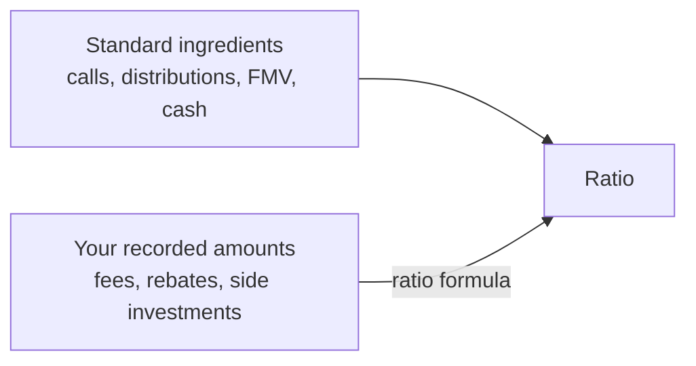
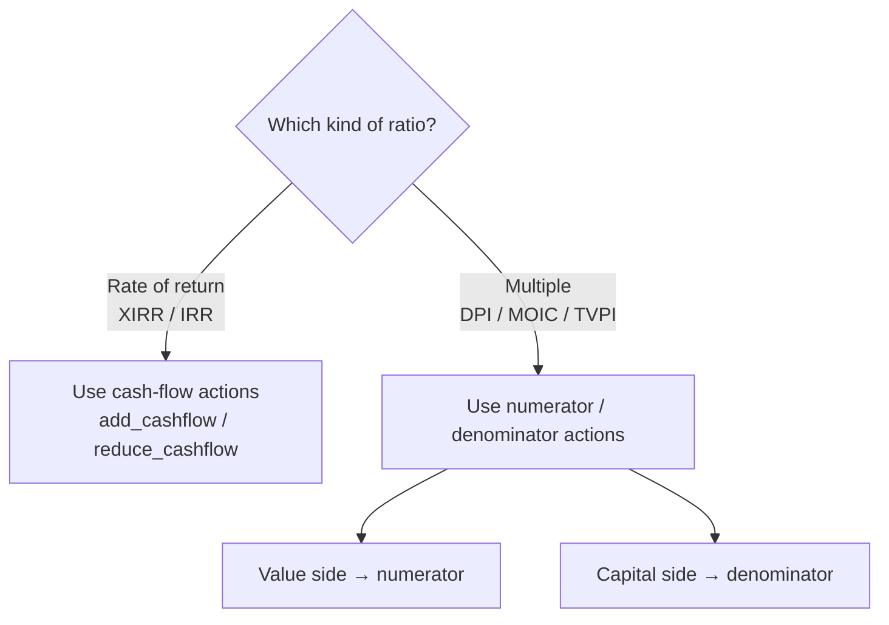
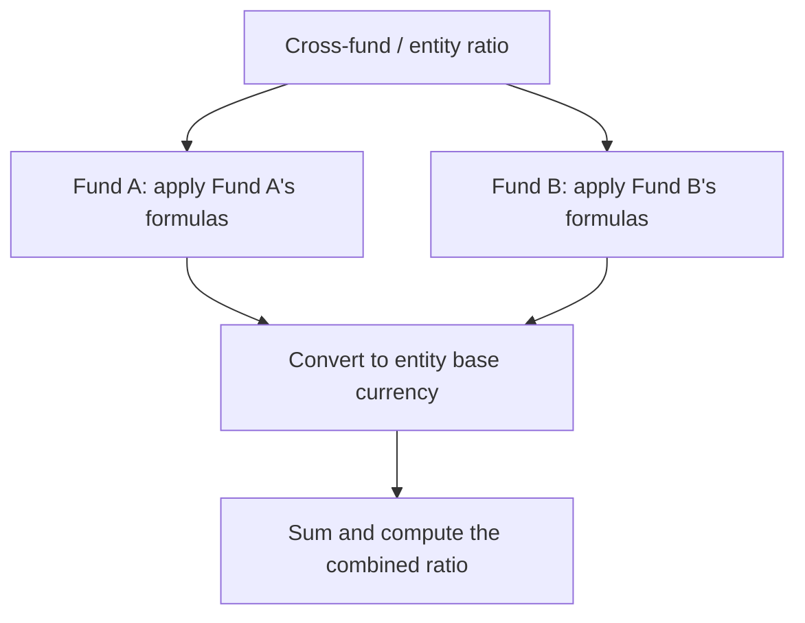

# Ratio Formulas User Guide

**Ratio formulas** let you tailor how a fund's performance ratios are calculated. Out of the box, the system computes XIRR, MOIC, DPI, TVPI and the rest from standard ingredients (capital called, distributions, fair market value, cash, and net current assets). Ratio formulas let you fold in *additional* amounts you've recorded against the fund — so a ratio reflects your fund's specific economics rather than a one-size-fits-all formula.

This guide is for fund managers and finance teams who need a ratio to account for something the standard calculation doesn't capture — for example a fee rebate, a side-pocket investment, or an expense that should reduce the return.

---

## Table of Contents

1. [What a Ratio Formula Does](#what-a-ratio-formula-does)
2. [When You'd Use One](#when-youd-use-one)
3. [Finding Ratio Formulas](#finding-ratio-formulas)
4. [Building a Rule](#building-a-rule)
5. [Choosing the Right Action](#choosing-the-right-action)
6. [How the Rules Are Applied](#how-the-rules-are-applied)
7. [Worked Examples](#worked-examples)
8. [Using Formulas Across Multiple Funds](#using-formulas-across-multiple-funds)
9. [Frequently Asked Questions](#frequently-asked-questions)

---

## What a Ratio Formula Does

Every performance ratio is a comparison of value against capital. A ratio formula adds your own amounts to one side of that comparison.

The amounts come from **account entries** — the line items already stored against the fund, an investor folio, or a portfolio company. A formula tells the system: *"for this ratio, take these named amounts and add or subtract them on the value side or the capital side."*

Crucially, formulas are **additive**. They supplement the standard calculation; they don't replace it. The fund still counts FMV, cash, net current assets, and estimated carry as usual.

---

## When You'd Use One

- Make Fund XIRR **net of** certain expenses that live in account entries (legal fees, non-deal costs).
- Count a **side-pocket or sidecar investment** toward residual value in TVPI and MOIC.
- Add a **management-fee rebate** into distributions for DPI.
- Reduce an investor's folio return by a **temporary income distribution**.

---

## Finding Ratio Formulas

1. Open the **Funds** list and select a fund.
2. Click **Actions** (top right).
3. Open the **Account Entries** sub-menu.
4. Click **Ratio Formulas**.

Here you can view, create, edit, or delete the rules for that fund. Rules are defined **per fund** — each fund keeps its own set.

---

## Building a Rule

Click **New Ratio Formula** and fill in:

| Field | What it controls |
|-------|------------------|
| **Level** | Which calculation the rule affects: **Fund** (fund-wide ratios), **Folio** (an individual investor's ratios), or **Portfolio Company** (a single company's ratios). |
| **Ratios** | One or more ratios this rule applies to (e.g. XIRR, DPI, MOIC, TVPI). |
| **Action** | How the amount is used — see [Choosing the Right Action](#choosing-the-right-action). |
| **Account Entry Names** | The named line items to pull amounts from. You can choose several. |
| **Period** | **All** — total every matching entry up to the end date. **As-on** — use only the single latest entry on or before the end date (best for valuations, where you want the most recent figure, not a sum). |

---

## Choosing the Right Action

The available actions depend on whether the ratio is a *rate of return* (XIRR/IRR) or a *multiple* (DPI, MOIC, RVPI, TVPI, PIC).

### For rate-of-return ratios (XIRR, IRR)

These work on cash flows, so you tell the system whether your amount behaves like money coming in or money going out:

| Action | Plain meaning |
|--------|---------------|
| **add_cashflow** | Treat the amount as an **inflow** (a positive return) on the reporting date. |
| **reduce_cashflow** | Treat the amount as an **outflow** (a cost) on the reporting date. |

### For multiple ratios (DPI, MOIC, RVPI, TVPI, PIC)

A multiple is value ÷ capital. You choose which side of the fraction to adjust:

| Action | Plain meaning |
|--------|---------------|
| **add_numerator** | Add to the **top** (the value side — e.g. distributions or total value). |
| **reduce_numerator** | Subtract from the top. |
| **add_denominator** | Add to the **bottom** (the capital side — e.g. paid-in capital). |
| **reduce_denominator** | Subtract from the bottom. |

---

## How the Rules Are Applied

A few principles govern how formulas behave:

- **Additive, not replacing.** Formulas are applied *on top of* the standard components (FMV, cash in hand, net current assets, estimated carry). Defining a formula doesn't switch those off.
- **Sensible fallback.** If a fund has no rules for "Cash In Hand" or "Net Current Assets", the system uses its built-in defaults. As soon as you define a rule for a specific ratio, your rules take over for that ratio.
- **No double-counting.** Only **non-cumulative** account entries are picked up, so a running-total entry won't be added twice.
- **Currency-aware.** Amounts are automatically converted to the right currency (tracking or base) using the exchange rate on the entry's reporting date.

---

## Worked Examples

### Example 1 — Make Fund XIRR net of expenses

You want Fund XIRR to reflect legal and non-deal costs stored as account entries.

| Setting | Value |
|---------|-------|
| Level | Fund |
| Ratios | XIRR |
| Action | **reduce_cashflow** (treat as an outflow) |
| Account Entry Names | "Non Deal Expenses", "Legal Fees" |
| Period | All (include every expense event) |

**Effect:** every matching expense becomes a negative cash flow, lowering the XIRR to reflect the true net return.

### Example 2 — Count a sidecar investment in TVPI and MOIC

The fund holds a side investment in a mutual fund that should count toward residual value.

| Setting | Value |
|---------|-------|
| Level | Fund |
| Ratios | TVPI, MOIC |
| Action | **add_numerator** (increase the value side) |
| Account Entry Names | "Mutual Fund Investment" |
| Period | As-on (use only the latest valuation) |

**Effect — illustrative:** if standard TVPI was (Distributions 5M + Remaining 7M) ÷ Paid-in 10M = **1.20×**, and the latest sidecar valuation is 2M, the adjusted TVPI becomes (5M + 7M + 2M) ÷ 10M = **1.40×**.

### Example 3 — Reduce a folio's XIRR with a temporary distribution

Some investors received a temporary distribution that should affect their individual return.

| Setting | Value |
|---------|-------|
| Level | Folio |
| Ratios | XIRR |
| Action | **add_cashflow** (a return to the investor) |
| Account Entry Names | "Temp income distribution" |
| Period | All |

**Effect:** the temporary distribution is treated as an inflow on the investor's folio XIRR only, not at the fund level.

---

## Using Formulas Across Multiple Funds

When you calculate a ratio for an **entity** (several funds combined) or a **cross-fund scenario**, each fund's own formulas are respected:

So if Fund A includes expenses in its XIRR but Fund B doesn't, the combined entity XIRR correctly reflects each fund's choice.

---

## Frequently Asked Questions

**Do I have to define formulas for the standard components?**
No. FMV, cash in hand, net current assets, and estimated carry are included automatically. Use formulas only to add something extra or to override a specific ratio.

**Will a formula change every ratio?**
Only the ratios you list, at the level you choose. A Folio-level rule, for instance, affects only per-investor ratios — not the fund total.

**When should I use "As-on" versus "All"?**
Use **As-on** for things that have a current value (like a valuation), where you want only the latest figure. Use **All** for things that accumulate (like a series of expenses or distributions), where you want the total.

**Why isn't my entry being picked up?**
Check that it isn't marked cumulative (only non-cumulative entries are used), that its name exactly matches one in the rule, and that its reporting date falls on or before the ratio's end date.

**Do formulas affect previously generated ratios?**
No — they apply the next time you generate ratios. Regenerate to see the effect.
