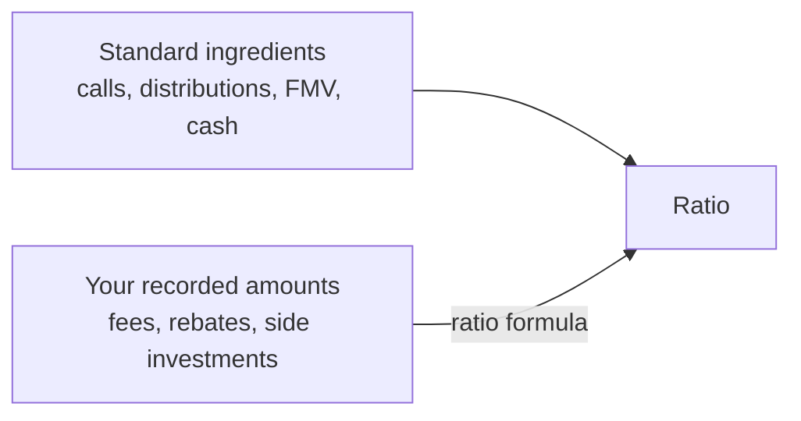
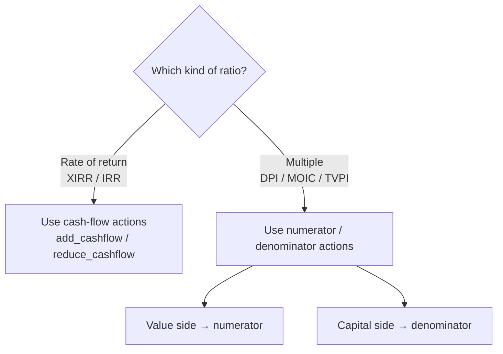
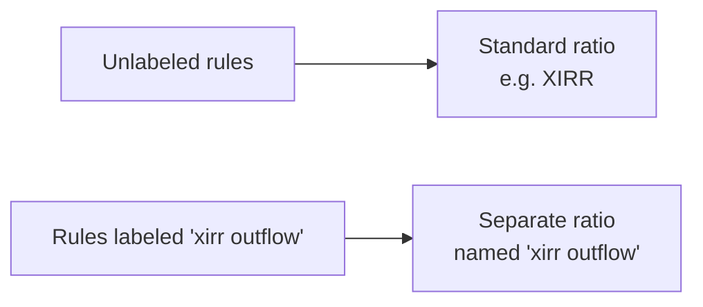
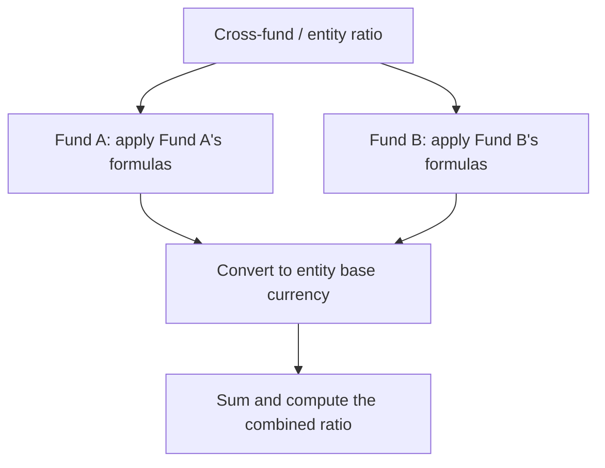

# Ratio Formulas User Guide

**Ratio formulas** let you tailor how a fund's performance ratios are calculated. Out of the box, the system computes XIRR, MOIC, DPI, TVPI and the rest from standard ingredients (capital called, distributions, fair market value, cash, and net current assets). Ratio formulas let you fold in *additional* amounts you've recorded against the fund — so a ratio reflects your fund's specific economics rather than a one-size-fits-all formula.

> **Where to find it:** Sidebar → [**Funds → Funds**](/funds) → open the fund → **Actions → Account Entries → Ratio Formulas**; the same link is in the **Actions** dropdown on the fund's **Ratios** tab. Create one with **New Ratio Formula**. Needs create rights on the fund (fund **Access** tab or company admin) and the account-entries feature enabled for your company.

This guide is for fund managers and finance teams who need a ratio to account for something the standard calculation doesn't capture — for example a fee rebate, a side-pocket investment, or an expense that should reduce the return.

---

## Table of Contents

1. [What a Ratio Formula Does](#what-a-ratio-formula-does)
2. [When You'd Use One](#when-youd-use-one)
3. [Finding Ratio Formulas](#finding-ratio-formulas)
4. [Building a Rule](#building-a-rule)
5. [Choosing the Right Action](#choosing-the-right-action)
6. [Grouping Rules with Labels](#grouping-rules-with-labels)
7. [How the Rules Are Applied](#how-the-rules-are-applied)
8. [Worked Examples](#worked-examples)
9. [Using Formulas Across Multiple Funds](#using-formulas-across-multiple-funds)
10. [Frequently Asked Questions](#frequently-asked-questions)

---

## What a Ratio Formula Does

Every performance ratio is a comparison of value against capital. A ratio formula adds your own amounts to one side of that comparison.

The amounts come from **account entries** — the line items already stored against the fund, an investor folio, or a portfolio company. A formula tells the system: *"for this ratio, take these named amounts and add or subtract them on the value side or the capital side."*

Crucially, formulas are **additive**. They supplement the standard calculation; they don't replace it. The fund still counts FMV, cash, net current assets, and estimated carry as usual.

---

## When You'd Use One

- Make Fund XIRR **net of** certain expenses that live in account entries (legal fees, non-deal costs).
- Count a **side-pocket or sidecar investment** toward residual value in TVPI and MOIC.
- Add a **management-fee rebate** into distributions for DPI.
- Reduce an investor's folio return by a **temporary income distribution**.

---

## Finding Ratio Formulas

1. Open the **Funds** list and select a fund.
2. Click **Actions** (top right).
3. Open the **Account Entries** sub-menu.
4. Click **Ratio Formulas**.

Here you can view, create, edit, or delete the rules for that fund. Rules are defined **per fund** — each fund keeps its own set.

---

## Building a Rule

Click **New Ratio Formula** and fill in:

| Field | What it controls |
|-------|------------------|
| **Level** | Which calculation the rule affects: **Fund** (fund-wide ratios), **Folio** (an individual investor's ratios), or **Portfolio Company** (a single company's ratios). |
| **Ratio** | The one ratio this rule applies to (XIRR, DPI, TVPI, MOIC, RVPI, PIC or Gross Portfolio IRR). To adjust another ratio, create a second rule. |
| **Action** | How the amount is used — see [Choosing the Right Action](#choosing-the-right-action). |
| **Account Entry Names** | The named line items to pull amounts from. You can choose several. |
| **Period** | **All** — total every matching entry up to the end date. **As-on** — use only the latest entry on or before the end date for *each* selected account entry name (best for valuations, where you want the most recent figure per line item, not a sum). |
| **Label** *(optional)* | Groups this rule with any other rule sharing the same label into its own, separately-named ratio. See [Grouping Rules with Labels](#grouping-rules-with-labels). |

The following advanced fields are tucked under the collapsible section next to Account Entry Names — most rules don't need them:

| Field | What it controls |
|-------|------------------|
| **Entry Type** *(optional)* | Restrict matching entries to one or more entry types (comma-separated), in addition to matching on name. Leave blank to match any entry type. |
| **Parent Type** *(optional)* | Restrict matching entries by the type of record they're attached to (comma-separated, e.g. `Investor`, `PortfolioInvestment`). Leave blank to use the default parent-type behavior for the rule's Level. |
| **Cumulative** | Whether to pull from **cumulative** account entries (running totals) instead of the default non-cumulative ones. Leave unchecked unless you specifically need cumulative entries — see [No double-counting](#how-the-rules-are-applied). |
| **Skip Portfolio FMV** *(optional, FMV-based ratios only)* | When checked, the fund's code-computed portfolio FMV is left out of this rule's ratio. For the FMV-based **multiples** — MOIC, TVPI, RVPI, Portfolio Value to Cost, and Value to Cost — it is subtracted from the numerator; for the **rate-of-return** ratios — XIRR and Gross Portfolio IRR — it is simply not added to the cash flow. Use this when the rule's own account entries already represent the FMV (e.g. feeder funds pulling FMV from the master fund via account entries instead of the API-computed value). Has **no effect** on ratios that don't include FMV, such as **DPI** and **PIC**. |

---

## Choosing the Right Action

The available actions depend on whether the ratio is a *rate of return* (XIRR/IRR) or a *multiple* (DPI, MOIC, RVPI, TVPI, PIC).

### For rate-of-return ratios (XIRR, IRR)

These work on cash flows, so you tell the system whether your amount behaves like money coming in or money going out:

| Action | Plain meaning |
|--------|---------------|
| **add_cashflow** | Treat the amount as an **inflow** (a positive return) on the reporting date. |
| **reduce_cashflow** | Treat the amount as an **outflow** (a cost) on the reporting date. |

### For multiple ratios (DPI, MOIC, RVPI, TVPI, PIC)

A multiple is value ÷ capital. You choose which side of the fraction to adjust:

| Action | Plain meaning |
|--------|---------------|
| **add_numerator** | Add to the **top** (the value side — e.g. distributions or total value). |
| **reduce_numerator** | Subtract from the top. |
| **add_denominator** | Add to the **bottom** (the capital side — e.g. paid-in capital). |
| **reduce_denominator** | Subtract from the bottom. |

---

## Grouping Rules with Labels

Normally, all the rules you define for a given ratio and level are combined into a single result — e.g. every Fund-level XIRR rule feeds the one "XIRR" figure.

A **Label** lets you carve out an *alternate* version of the ratio instead. Give one or more rules the same label, and when ratios are generated the system computes a **separate, additional** ratio using only the rules that share that label — stored under the label's own name rather than "XIRR" or "DPI".

Key points:

- **Labeled rules don't feed the standard ratio.** A rule with a label only counts toward the ratio named after that label — it's excluded from the plain "XIRR"/"DPI"/etc. figure. Rules with no label continue to produce the standard ratio exactly as before.
- **Several rules can share a label.** All rules with the same label (for the same ratio and level) are combined together into that one labeled result, the same way unlabeled rules combine into the standard one.
- **Every label becomes its own ratio record.** If a fund has an unlabeled XIRR rule and a rule labeled "xirr outflow", generating ratios produces two results: "XIRR" and "xirr outflow" — both viewable, exportable, and searchable like any other ratio.
- **Tracking currency still applies.** A labeled ratio gets its own tracking-currency variant too, e.g. "xirr outflow (USD)", following the same naming pattern as the standard ratio.
- **Use it to model variants side by side** — for example an "as reported" XIRR alongside an "ex-expenses" XIRR, without losing either figure.

> Labels are limited to 30 characters and are matched by exact, case-sensitive text — use the same label spelling on every rule you want grouped together.

---

## How the Rules Are Applied

A few principles govern how formulas behave:

- **Additive, not replacing.** Formulas are applied *on top of* the standard components (FMV, cash in hand, net current assets, estimated carry). Defining a formula doesn't switch those off.
- **Standard components stay in.** Cash in hand and net current assets always come from the latest "Cash In Hand" and "Net Current Assets" account entries on or before the end date, whether or not you define rules; a rule for a ratio adds to those components rather than taking over from them.
- **No double-counting.** By default only **non-cumulative** account entries are picked up, so a running-total entry won't be added twice; a rule picks up cumulative entries instead only when its **Cumulative** box is ticked.
- **Currency-aware.** Amounts are automatically converted to the right currency (tracking or base) using the exchange rate on the entry's reporting date.

---

## Worked Examples

### Example 1 — Make Fund XIRR net of expenses

You want Fund XIRR to reflect legal and non-deal costs stored as account entries.

| Setting | Value |
|---------|-------|
| Level | Fund |
| Ratio | XIRR |
| Action | **reduce_cashflow** (treat as an outflow) |
| Account Entry Names | "Non Deal Expenses", "Legal Fees" |
| Period | All (include every expense event) |

**Effect:** every matching expense becomes a negative cash flow, lowering the XIRR to reflect the true net return.

### Example 2 — Count a sidecar investment in TVPI and MOIC

The fund holds a side investment in a mutual fund that should count toward residual value.

| Setting | Value |
|---------|-------|
| Level | Fund |
| Ratio | TVPI (create an identical second rule with Ratio MOIC) |
| Action | **add_numerator** (increase the value side) |
| Account Entry Names | "Mutual Fund Investment" |
| Period | As-on (use only the latest valuation) |

**Effect — illustrative:** if standard TVPI was (Distributions 5M + Remaining 7M) ÷ Paid-in 10M = **1.20×**, and the latest sidecar valuation is 2M, the adjusted TVPI becomes (5M + 7M + 2M) ÷ 10M = **1.40×**.

### Example 3 — Reduce a folio's XIRR with a temporary distribution

Some investors received a temporary distribution that should affect their individual return.

| Setting | Value |
|---------|-------|
| Level | Folio |
| Ratio | XIRR |
| Action | **add_cashflow** (a return to the investor) |
| Account Entry Names | "Temp income distribution" |
| Period | All |

**Effect:** the temporary distribution is treated as an inflow on the investor's folio XIRR only, not at the fund level.

---

## Using Formulas Across Multiple Funds

When you calculate a ratio for an **entity** (several funds combined) or a **cross-fund scenario**, each fund's own formulas are respected:

So if Fund A includes expenses in its XIRR but Fund B doesn't, the combined entity XIRR correctly reflects each fund's choice.

---

## Frequently Asked Questions

**Where do I find Ratio Formulas in CapHive?**
Sidebar → [**Funds → Funds**](/funds), open the fund, click **Actions** (top right), open the **Account Entries** sub-menu and click **Ratio Formulas**. The same page is linked as **Ratio Formulas** in the **Actions** dropdown of the fund's **Ratios** tab. The **Account Entries** sub-menu only appears when account entries are enabled for your company. See [Finding Ratio Formulas](#finding-ratio-formulas).

**How do I create a ratio formula?**
On the fund's Ratio Formulas page click **New Ratio Formula**, choose the **Level**, **Action**, one **Ratio** (the form takes a single ratio per rule; create a second rule for another ratio), the **Account Entry Names**, the **Period** and an optional **Label**, then press **Save**. See [Building a Rule](#building-a-rule).

**How do I edit or delete a ratio formula?**
Each row on the Ratio Formulas page has **View**, **Edit** and **Delete** buttons; the rule's own page has **Edit** and **Delete** too. Delete asks for confirmation. Both need update rights on the fund.

**Can I import or export ratio formulas in bulk?**
Yes. The page has **Download** (Excel of the fund's rules) and **Import** (an Import Upload of type RatioFormula with a sample file on the next screen, columns Level, Action, Period, Ratio, Label, Account Entry Names, Entry Type, Parent Type, Cumulative, Skip Portfolio Fmv, plus an optional Update Only column). Imports are listed under Company menu → [**Imports**](/import_uploads). Import needs create rights on the fund.

**Can I copy ratio formulas from another fund?**
Not automatically: the fund's **Copy Formulas** action copies allocation formulas only. Use **Download** on the source fund and **Import** on the destination fund to move ratio formulas.

**What permission do I need?**
Any employee who can see the fund can view its ratio formulas; creating and importing need create rights on the fund, editing and deleting need update rights. Access rights are granted on the fund's **Access** tab, and company admins have all of them.

**Why should I use ratio formulas instead of adjusting the numbers by hand?**
Because the adjustment is applied by the platform every time ratios are generated, at fund, folio or company level, in the right currency, and is documented as a rule anyone can inspect. Hand-adjusted figures in a spreadsheet drift from the statements, LP portal and dashboards, which all read the stored ratios. See [When You'd Use One](#when-youd-use-one).

**What can I do with ratio formulas?**
Make XIRR net of expenses, count side investments toward TVPI and MOIC, add rebates to DPI, adjust one folio's return, exclude the computed FMV in favour of your own entries, and publish alternative versions of a ratio side by side using labels. See [Worked Examples](#worked-examples).

**Who typically sets these up?**
Fund finance or fund administration teams, usually once when a fund is onboarded and again when a new kind of account entry (a rebate, a sidecar) starts appearing; fund managers and IR consume the resulting ratios.

**What happens if I don't set any up?**
Every ratio is computed from the standard components only (calls, distributions, FMV, cash in hand, net current assets, estimated carry). Nothing breaks, but any fund-specific economics recorded as account entries are ignored.

**What happens when I save a ratio formula?**
Only the rule record is written: names are trimmed, the label is normalised, and the rule waits until the next **Compute Ratios** run on the fund. No ratio is recalculated, no account entry is touched and no one is notified. See [Do formulas affect previously generated ratios?](#frequently-asked-questions) below.

**What happens when ratios are next generated with a formula in place?**
For each ratio and level the run gathers the matching non-cumulative account entries up to the end date and applies the action; unlabelled rules change the standard ratio, and every distinct label produces an additional ratio row named after the label (with its own tracking-currency variant). The rows appear on the fund's **Ratios** tab like any other. See [Grouping Rules with Labels](#grouping-rules-with-labels).

**What happens when I delete a ratio formula?**
The rule is soft-deleted immediately and drops out of the next generation; ratios already computed with it keep their values until you regenerate, and a labelled ratio's old rows stay on the Ratios tab until you delete them there. No notification is sent.

**What happens when I import a spreadsheet of formulas?**
Each row creates a rule on the fund (or updates an existing one when **Update Only** is yes); rows with an unknown level, action, period or ratio are rejected and listed in the results file on the import. Nothing is recomputed until you generate ratios.

**What happens if I get the account entry name wrong?**
Nothing fails: the rule simply finds no entries and the ratio is unchanged, with no warning. The **Account Entry Names** picker lists only names that already exist on the fund's account entries, so choose from it rather than typing.

**Do I have to define formulas for the standard components?**
No. FMV, cash in hand, net current assets, and estimated carry are included automatically. Use formulas only to add something extra or to override a specific ratio.

**Will a formula change every ratio?**
Only the ratio you pick, at the level you choose. A Folio-level rule, for instance, affects only per-investor ratios, not the fund total; a Portfolio Company rule affects only the per-company IRR and MOIC.

**When should I use "As-on" versus "All"?**
Use **As-on** for things that have a current value (like a valuation), where you want only the latest figure. Use **All** for things that accumulate (like a series of expenses or distributions), where you want the total.

**Why isn't my entry being picked up?**
Check that it isn't marked cumulative (only non-cumulative entries are used unless the rule's **Cumulative** box is ticked), that its name exactly matches one in the rule, that its reporting date falls on or before the ratio's end date, and that it sits on the right owner for the rule's level (fund, folio or portfolio company).

**Do formulas affect previously generated ratios?**
No. They apply the next time you generate ratios; run **Compute Ratios** on the fund's **Ratios** tab to see the effect.

**Do formulas apply to cross-fund and cross-portfolio runs?**
Yes. Each fund's own rules are applied to its figures before they are converted and combined, so different funds can carry different adjustments. See [Using Formulas Across Multiple Funds](#using-formulas-across-multiple-funds).

**Can I undo a change to a formula?**
There is no version history on the rule itself; re-edit it and regenerate the ratios. Deleted rules are soft-deleted, so support can restore one if needed.

**I can't see the Account Entries sub-menu or the New Ratio Formula button.**
The sub-menu requires the account-entries feature to be enabled for your company; the button requires create rights on the fund. Ask your company admin or CapHive support.

## Related Guides

- [Fund Ratios](fund_ratios_user_guide) — the ratios these rules adjust and how to generate them.
- [Carry & Performance Metrics](carry_computations_user_guide) — the standard components, including Estimated Carry, that formulas add to.
- [Fund Ratio Run Templates](fund_ratio_run_templates_user_guide) — cross-fund runs, where each fund's rules are applied before combining.
- [Formula Dependencies](formula_dependencies_user_guide) — checking the allocation formulas that produce the account entries a rule reads.
- [Tracking Currency](tracking_currency_guide) — how amounts picked up by a rule are converted.
