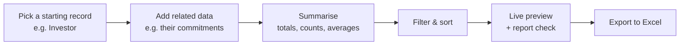
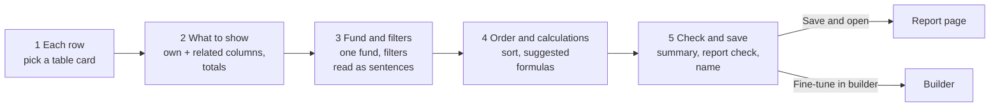
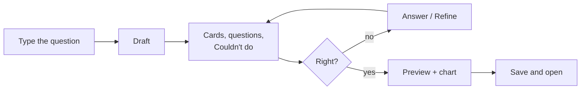
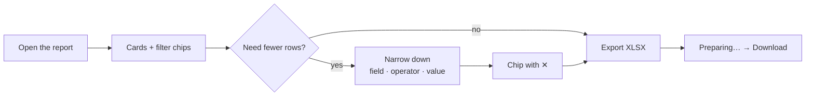
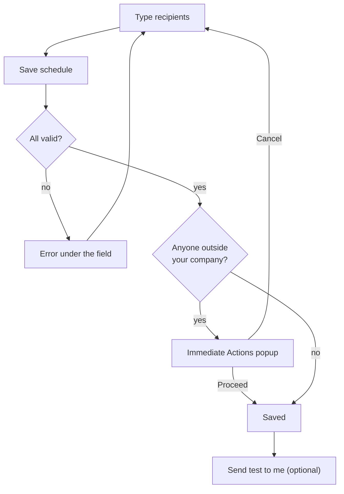

# Report Builder User Guide

The **Report Builder** is a self-service tool for creating custom data exports — without writing any code. Pick a starting record type, pull in related data, summarise it (totals, counts, averages), filter and sort it, even pivot it into a cross-tab, and export the result to Excel.

> **Where to find it:** Sidebar → [**Funds → Reports**](/reports) (shown when your user has the *Reports* feature; other logins can open the [Reports page](/reports) from this link). Click **New report** and choose **From a template** (the [template page](/report_builder/templates)) or **Guided setup** (the [step-by-step setup](/report_builder/wizard)). Reopen a report with **Edit** on its card to open the report builder, **Guided setup** to go step by step, or **Duplicate** to copy it. Any user of your company can create and edit builder reports.

This guide walks through building a report from scratch.

---

## Table of Contents

1. [What the Report Builder Does](#what-the-report-builder-does)
2. [Creating a Report](#creating-a-report)
3. [The Builder Layout](#the-builder-layout)
4. [Adding and Arranging Columns](#adding-and-arranging-columns)
5. [Pulling in Related Data](#pulling-in-related-data)
6. [Summarising Related Data](#summarising-related-data)
7. [Filtering and Sorting](#filtering-and-sorting)
8. [Pivot Tables](#pivot-tables)
9. [Report Check](#report-check)
10. [Preview and Export](#preview-and-export) (incl. [Reading a report](#reading-a-report))
11. [Email on a Schedule](#email-on-a-schedule)
12. [Worked Example](#worked-example)
13. [Tips for Success](#tips-for-success)
14. [Walkthrough: Five Reports, From Simple to Complex](#walkthrough-five-reports-from-simple-to-complex)
15. [Frequently Asked Questions](#frequently-asked-questions)

---

## What the Report Builder Does

Start from one record type — say *Investor*, *Fund*, or *Capital Commitment* — and build outwards:

Everything is point-and-click; every change saves as you make it and the preview follows. Reports are shared: every user of your company with the same role can see and edit them, and report rows include every matching record of your company (individual record access rights are not applied).

---

## Creating a Report

On the **Reports** list click **New report**. There are four ways to start:

| Way | When to use it | Where |
|---|---|---|
| **From a template** | Your question is a common one — LP capital accounts, call collection, overdue chasing, distribution statements, portfolio MOIC… | New report › From a template — see [Starting from a template](#starting-from-a-template) |
| **Guided setup** | You want to choose the table, columns and filters yourself, one step at a time | New report › Guided setup — the five steps below |
| **Duplicate** | You already have the report you want, for another fund or with a small change | A report card's ⋮ menu, or the report page — see [Duplicating a report](#duplicating-a-report) |
| **Describe it** | You can say what you want in a sentence but don't know which table or fields give it | New report › Describe it — see [Describing your report](#describing-your-report) |

### Guided setup

Follow its five steps. A sample of the first 5 rows sits beside steps 2–5 and follows every change.

| Step | What you do |
|---|---|
| **1 Each row** | Click the card of the table each row should be — every card shows an example question, e.g. *Investors: Which LPs still have KYC pending?* The report is created as "Untitled Investor report"; you name it at the end. |
| **2 What to show** | Tick columns under **About the investor** and under each related source (**From capital commitments**, …), then **Add selected**. Related data is added for you. Each related column's total (Sum, Count, …) can be changed in **In the report**. |
| **3 Fund and filters** | **Which fund?** limits the report to one fund (or **All funds**); it appears only when the rows or their related data have a fund. **Add a filter on** a field, choose the operator and value, click **Add**. Each filter reads back as a sentence, such as *Only include investors where Category is LP* or *Only capital commitments in Growth Fund II*. |
| **4 Order and calculations** | **In what order?** sets the default sort. **Suggested calculations** offers *Called %*, *Unpaid*, *Uncalled* and *DPI* when both of their columns are in the report — click **Add**. |
| **5 Check and save** | One card per step with **Change** to go back, the **Report check**, and the report name — already filled with a suggestion such as *Investors — Committed, Called — Growth Fund II*. **Save and open** names the report and opens its report page; **Fine-tune in builder** opens the builder. |

The one-page [advanced form](/report_builder/new) (**Report Name**, **Root Model**, **Create & Configure**) is linked from Guided setup step 1 ("Open the builder instead"); it takes you straight into the report builder. In the builder, click the report name to rename it (Enter or click away saves, Escape cancels; a blank name becomes "Untitled Report").

### Starting from a template

**New report › From a template** lists ready-made reports, grouped by area. Each card shows the question it answers, the table it starts from, what it includes, and whether it **Needs a fund** or has a **Fund optional**.

1. Click **Use this** on a card.
2. Keep or change the **Report name**. Left as it is, the fund's name is added — *LP Capital Account Summary — Growth Fund II*.
3. Choose the **Fund**:
   - **Needs a fund** — templates that add up amounts. There is no "All funds", so amounts in different currencies are never added together.
   - **Fund optional** — **All funds** is allowed; the report check warns if amounts in different currencies are added.
   - No Fund field — the template is per fund already, or isn't about money.
4. Click **Create**. A **new** report opens in the report builder with the message "Created from <template>". Change anything you like — the template itself is unchanged.

| Area | Template | Question it answers | Fund |
|---|---|---|---|
| Investors | LP Capital Account Summary | Which LPs owe us money, and how much of each commitment is called? | Needs |
| Investors | LP Holdings by Unit Class | What does each LP hold in each unit class? | Needs |
| Capital calls | Capital Call Collection Tracker | For each call, how much is paid, pending or overdue? | Needs |
| Capital calls | Overdue Remittances Chase List | Who do we chase, and what have they paid so far? | Needs |
| Distributions | Distribution Statement by Folio | What did each folio receive, what was deducted, and what's the DPI? | Needs |
| Fund overview | Fund Scorecard | One line per fund: raised, called, returned, invested. | — |
| Fund overview | Fundraising by Close | How much did each close raise, per unit class? | — |
| Portfolio | Portfolio Performance (MOIC) | What has each investment returned? | Needs |
| Portfolio | Portfolio KPI Matrix | Each company's latest KPIs, one column per KPI. | — |
| Compliance | Unverified KYC: Money at Stake | Which unverified KYCs hold the most committed money? | Optional |

Templates that use fund, call, distribution or portfolio data are listed only if your company has the Funds feature; the KPI matrix needs the Deals feature.

### Duplicating a report

**Duplicate** (on a report card's ⋮ menu, or next to **Edit Builder** on the report page) makes "Copy of <name>" — "Copy of <name> (2)" if that name is taken — and opens it in the report builder. The copy has the same columns (labels, totals and order), related data, filters, formulas, pivots, sort, Excel grouping and display currency. The email schedule is **not** copied, so the copy never emails anyone until you schedule it. The original is unchanged.

To make the same report for another fund: Duplicate, open the **Filters** tab, change the **Fund**, and rename the copy.

---

### Describing your report

**New report › Describe it** turns a question into a report, using your company's AI model.

1. Type the question, such as *Which LPs still owe money on calls? Biggest first.*, or click an example. Then click **Draft**.
2. The assistant drafts the report in the background (5–20 seconds). You can leave the page; an alert links back when it's ready.
3. Check **what it understood**: cards for what each row is, the columns, what's included and the order. It also lists:
   - **Questions** — for example *Which fund?*, with your company's funds to pick from.
   - **Assumptions** — for example how it read "last quarter".
   - **Couldn't do** — anything it left out, and why.
4. **Refine** in words ("also show what was distributed"). The assistant changes the current draft and keeps what you changed by hand.
5. Look at the **Preview** (20 rows, the totals row and the report check) and the **Chart**. A chart is suggested from the columns, with no AI call. You can also pick **No chart**, or **Describe a chart** in words.
6. Give it a name, then **Save and open** or **Fine-tune in builder**. **Discard** deletes the draft.

A draft is **only yours** until you save it. It shows on the Reports page with a *Draft* badge for you alone, and is deleted after 7 days without a change. The assistant can only use what the report builder allows, inside your company: anything else lands in **Couldn't do**, never in the report.

## The Builder Layout

The builder's header has the report name (click to rename), the table it reports on, **Guide**, a **⌘ K** search, the **report check** badge, **Guided setup**, **Export XLSX** and **Open report**.

Below it, the settings sit in tabs on the left and the **Preview** on the right:

| Tab | Purpose |
|---|---|
| **Columns** | Tick columns to add, grouped by where they come from; reorder, total and remove the columns in the report. |
| **Related data** | Bring in related data, switch on "Only … that have …", pivot it, or remove it. |
| **Filters** | Filters on the report's own rows and on each related data. |
| **Sort** | Default sort, Excel grouping and the display currency. |
| **Formulas** | Calculated columns. |
| **Delivery** | Email the report on a schedule, send yourself a test, and see when it was last sent. See [Email on a schedule](#email-on-a-schedule). |

The preview loads with the page and shows up to 20 rows. **Every change updates the settings, the preview and the report check together** — there is no Save button and nothing to refresh (**Refresh** re-runs the preview if the data changed underneath). A green message bottom-right confirms each saved change; a red one gives the reason it wasn't saved. The builder reopens on the tab you used last.

**⌘ K** (or Ctrl K) searches columns and actions: type part of a name and press Enter to add that column.

---

## Adding and Arranging Columns

- **Add several at once** — on the **Columns** tab, tick the columns you want and click **Add selected (n)**. Columns are grouped by source (**About the investor**, **From capital commitments**, …) and then by kind (**Amounts**, **Dates**, **Yes/No**, **Names & text**). The search box filters the list. Columns already in the report show ticked with **Added**.
- **Related columns bring their related data** — ticking a column from a related source that isn't on the report yet adds that related data too.
- **Two fields with the same name** — when two fields share a label, the field name appears beside each in grey so you can tell them apart. Internal id and cents fields are not listed.
- **Each preview column has a menu** — click the ▾ beside a column's header to **Rename** it (a blank name puts the original back), change its **Total** (related data with several rows per row only), **Move** it left or right, or **Remove** it. A formula column's menu opens it on the **Formulas** tab.
- **Reorder** — drag the grip in **In the report**, or use **Move** in the column's menu.
- **Undo a removal** — removing a column, or related data with its columns, shows a message with **Undo**. Undo puts everything back where it was — label, total, position, filters — for 10 minutes, as long as nothing else has changed in the report since.

---

## Pulling in Related Data

The quickest way is to tick a related column on the **Columns** tab — its related data is added for you. To add related data on its own:

1. Open the **Related data** tab and choose from **Add related data**. Each choice says whether it has **many per row** (an investor's commitments) or **one per row** (a commitment's fund); a **›** means **Drill Down** can reach data one step further.
2. Click **Add**. Its columns appear as a new **From …** group on the **Columns** tab.

Each related data has a card with its **many per row** / **one per row** badge, the **Only … that have …** switch, the **Pivot** settings and a remove button. Before removing, a popup lists the columns that go with it; **Undo** brings them back.

---

## Summarising Related Data

When a related record can have **many** rows for each row of the report (an investor with several commitments), each of its columns has a **total**:

| Total | Result |
|---------|--------|
| **Sum** | The total (e.g. total committed amount). |
| **Count** | The number of records (e.g. number of commitments). |
| **Average** | The average value. |
| **Minimum / Maximum** | The lowest / highest value (**Earliest date** / **Latest date** for dates, **All yes** / **Any yes** for yes/no). |
| **Latest** | The value from the most recent record (e.g. latest KYC status). |
| **List** | A comma-separated list of all unique values. |

Change it under the column in **In the report**, from the column's menu in the preview, or on wizard step 2.

**A total is always chosen for you.** When you add a column from related data, it gets a sensible total straight away, which you can change at any time:

| Kind of column | Total it starts with |
|---|---|
| Amounts and numbers | **Sum** |
| Dates | **Latest date** (the newest date) |
| Yes/no | **Any yes** (Yes if any related record says yes; **All yes** is the other choice) |
| Text | **Latest** — or **List** for data two steps away (e.g. an investor's funds through their commitments) |

**One per row.** Related data that has at most one record per row — a commitment's fund, a payment's capital call — needs no total: its value is shown as it is. A row whose related record is missing shows a blank.

**Two steps away.** Use **Drill Down** when adding related data to reach data through another relation (e.g. *Capital commitments › Fund*); it works alongside the first-level relation.

### Only rows that have related data

Each relation that can have several rows per record has a switch on its card: **Only investors that have capital commitments** (the wording follows your report). Turn it on to drop rows with no matching related records. It respects that relation's own filters — with the remittances filter *Status is Overdue* and the switch on, the report lists only investors with an overdue remittance. The row count and pages follow it.

---

## Filtering and Sorting

### Filters

The **Filters** tab has a group for the report's own rows and one for each related data with several rows per row.

1. Click **Add filter** in the group, and choose a field.
2. The row then offers that field's operators in words and the right input:

| Field | Input | Operators |
|---|---|---|
| Date | Date box in your date format | is on, is on or after, is on or before, is empty, is not empty |
| Yes/no | Yes / No | is, is empty |
| Fund | Your funds by name | is, is any of |
| Amount or number | Number box | is, is at least, is at most, is empty |
| Text with up to 30 different values | A list of the values in use | is, is not, is any of, is empty |
| Other text | Text box (separate several values with commas for *is any of*) | contains, is, is any of, is not, is empty |

3. The filters **save themselves** about half a second after you stop changing them; the preview follows. A row that isn't complete says what it needs — **needs a value**, or **Enter a date like 19/08/2026** — and nothing is saved until it is fixed.

Fields on the largest tables (capital remittances, distribution payments, account entries, documents) always get a text box, so the filter opens instantly.

### Sorting

On the **Sort** tab pick a **Default sort** column and **Lowest first** or **Highest first**. **Group rows in Excel by** makes collapsible groups in the export, and **Display currency** labels amount columns (it doesn't convert them).

### Formulas

On the **Formulas** tab click **Add formula**, give it a **Label**, and build the **Expression** by clicking the report's columns (each click inserts `[column.key]` where the cursor is) and typing `+ - * / ( )`, `IF`, `AND`, `OR` or `ROUND`. **Result on the first rows** shows the answer for the first five rows as you type — blank where it can't be worked out, such as dividing by zero. **Add formula** saves it as a column.

---

## Pivot Tables

Pivoting turns row values into columns — for example, one column per unit type showing the committed amount.

1. On the **Related data** tab, open **Pivot** on the related data's card.
2. **Categories** — the field(s) whose values become the new column headers (e.g. Unit Type).
3. **Value** — the number to show (e.g. Committed), and its **Total** (usually Sum).
4. Before you apply, the form says how many columns the pivot will create and names the first ones — *This will create 2 columns: A, B*. Above 20 columns it turns red and suggests fewer categories.
5. Click **Apply** (or **Clear** to undo a pivot).

---

## Report Check

The badge in the builder's header says **All good** or how many warnings there are. Click it to see each item, with **Fix** to open the tab that fixes it. Wizard step 5 shows the same check.

| It warns when… | Example |
|---|---|
| A column will be blank because its related data no longer exists | *no_such name will be blank — its related data no longer exists* |
| A formula uses a column that isn't in the report | *Formula Collected % uses capital_commitments.collected_amount, which isn't in the report* |
| Amounts in different currencies are summed together | *Committed adds amounts in INR and USD — pick a fund or split by fund* |
| The report is empty and one filter alone matches nothing | *No rows match Category is Partner* |
| A pivot would create more than 20 columns | *Capital commitments pivot creates 22 columns — consider fewer categories* |

It also notes, without counting them as warnings, an export of more than 50,000 rows and related columns saved before totals were chosen automatically (*Committed uses the default total Sum*). In a report of funds (one row per fund) amounts in different currencies aren't a warning — each row is one fund — but it notes that the totals row adds funds in, say, INR and USD.

---

## Preview and Export

- **Preview** — the builder's preview shows the first 20 rows ("20 of 1,284 rows", or "All 7 rows" for a small report) and updates with every change. To see every row, click **Open report** in the builder's header, or the report's name on the [Reports page](/reports).
  - *Note:* a row with no matching related data shows `0` or blank in those columns, rather than being dropped — unless you turn on [Only rows that have related data](#only-rows-that-have-related-data).
- **How values look** — the preview, the report page and Excel use the same rules: amounts with separators and two decimals, right-aligned (Indian grouping such as 5,00,00,000.00 for INR reports); dates in your date format; yes/no as **Yes** / **No**.
- **Totals row** — sums every amount and number column and every **Sum** or **Count** total; **Average**, **Latest**, **Minimum**, **Maximum** and **List** columns are left blank. Formula columns are worked out again from the totals, so *Called %* in the totals row is total called ÷ total committed. The row says **Total**, **Total (this page)** on a report page with several pages, or **Total (these 20 rows)** in a preview.
- **Sorting on the report page** — click a column header to sort by it (first click lowest first, again for highest first). This lasts for your visit and across pages; the report's saved sort is unchanged for everyone else.
- **Export** — click **Export XLSX** for a formatted Excel file. Amounts are real number cells and dates real date cells (so sorting and SUM work in Excel), and the bold last row of the **Data** sheet holds the totals for every exported row. The button reads *Preparing…* while the file is made, then **Download** (with **Export again** next to it); an on-screen alert links to it too. The file is saved as a document in your company's **Reports** folder (no email is sent). If the export fails, the button goes back to **Export XLSX** and a red alert says why.
- **Recent exports** — the report page lists the report's last 5 exports, newest first, with who made each and when, and a **Download** button.

### Reading a report

The report page (the report's name on the [Reports page](/reports), or **Open report** in the builder) shows, from the top:

| Part | What it shows |
|---|---|
| **Headline totals** | Up to four cards: the first four columns, in the report's order, that have a total. Each card shows exactly what the totals row shows, and says *this page* when the report has several pages. |
| **This report shows only:** | The report's own filters in words, such as *Category is LP* and *Only capital commitments in Growth Fund II*. They are changed in the builder (**Change in builder**). |
| **Narrow down** | Pick a field, then an operator and a value (a date picker, Yes/No, a list of funds or values, a number or text), and click **Apply**. Each of your filters shows as a chip under **Narrowed by you:**; click its ✕ to remove it. |
| The table | Rows, the totals row, sortable headers and pages, as before. |
| **Recent exports** | The last 5 Excel files. |

Narrow down is for your visit only. It doesn't change the report for anyone else, and **Export XLSX** still exports the whole report. A field the report already filters on can't be narrowed again; the page says, for example, *Category is already set by the report*.

## Email on a Schedule

On the builder's **Delivery** tab:

1. Turn on **Email this report on a schedule**.
2. Pick the **Frequency** (*Daily at 09:00*, *Weekly on Monday at 09:00* or *Monthly on the 1st at 09:00*) and the **Time zone** (India Standard Time for a new schedule).
3. Type the **Recipients**, separated by commas, semicolons or new lines. They are saved lower-case, without duplicates.
4. Click **Save schedule**. Each address is checked first: one that isn't an email is named under the field ("bob@ isn't an email address") and nothing is saved. If anyone isn't a user of your company, an **Immediate Actions** popup names them; **Proceed** saves, **Cancel** doesn't.
5. Optional: **Send test to me** emails the report to you alone, with the same subject and Excel file as the scheduled email.

The tab then shows *Last sent 02 Nov 2026 09:00 IST · Next 09 Nov 2026 09:00 IST* (or *Not sent yet* before the first send). Turning the switch off saves at once ("Schedule turned off") and keeps the recipients for next time.

---

## Worked Example

**Goal:** a one-row-per-investor report showing each investor's category and their total committed capital in one fund.

1. **New report › Guided setup** → click the **Investors** card.
2. On **What to show**, tick **Stakeholder** and **Category** under *About the investor*, and **Committed** under *From capital commitments*, then **Add selected**. Committed totals with **Sum**.
3. On **Fund and filters**, choose the fund under **Which fund?**. Add a filter on **Category**, **is any of**, choose the categories you want, and click **Add**.
4. On **Order and calculations**, sort by **Committed**, **Largest / Z first**, and **Save**.
5. On **Check and save**, check the sample and the report check, keep or change the suggested name, and click **Save and open**. **Export XLSX** from the report page.

Result: a clean list of investors ranked by how much they've committed to that fund.

---

## Tips for Success

- **Start small** — add a few columns and watch the preview.
- **Check the badge** — the report check catches blank columns, broken formulas and mixed currencies before you export.
- **Check your totals** — if a number looks off, confirm you're using **Sum** rather than **Count**.
- **Use search** — the Columns tab's search box, or ⌘ K, is the fastest way to find a field.
- **Reports save automatically** — every change is saved as you make it; a removal can be undone for 10 minutes.

---

## Walkthrough: Five Reports, From Simple to Complex

This section builds five real reports end to end, each one adding a new capability on top of the last. Follow them in order — by the end you'll have used every major feature: columns, related data, every total, pivot tables, filters, sorting, and formula columns.

> **Tip:** Sample versions of all five reports may already exist in your Reports list — look for the **Builder** tag on a report card. Building your own alongside them is a good way to check you get the same result.

### Report 1 (Simple): Distribution Payment Reconciliation

*New concepts: columns, filters, sorting, formula columns. No related data yet.*

1. Open the [advanced form](/report_builder/new) (linked from Guided setup step 1 as "Open the builder instead").
2. **Report Name**: `Distribution Payment Reconciliation`. **Root Model**: find **Capital distribution payment** (under the *Funds* group) and select it. Click **Create & Configure**.
3. On the **Columns** tab, the first group (open by default) is the table's own columns. Tick **Investing Entity**, **Folio No**, **Gross Payable**, **Net Payable**, **Payment Date** and **Completed**, then click **Add selected (6)**.
4. On the **Filters** tab, click **Add filter** and set field **Completed**, **is**, **Yes**. Click **Add filter** again: field **Net Payable**, **is at least**, `1`. Both save themselves.
5. On the **Sort** tab, set **Default sort** to **Payment Date**, **Highest first**.
6. On the **Formulas** tab, click **Add formula**:
   - **Label**: `Fee Deducted`
   - **Expression**: click **Gross Payable**, type ` - `, click **Net Payable** — the expression reads `[gross_payable] - [net_payable]`
   - Check **Result on the first rows**, then click **Add formula**.
7. Click **Add formula** again:
   - **Label**: `Fee %`
   - **Expression**: `(([gross_payable] - [net_payable]) / [gross_payable]) * 100`
   - Click **Add formula**.
8. Check the preview, then **Export XLSX** when you're happy with it.

You now have a filtered, sorted list of completed distribution payments with two computed columns showing the fee taken on each one.

### Report 2 (Add Related Data and Totals): KYC & AML Compliance Register

*New concepts: pulling in related data, and every way to total it.*

1. [Advanced form](/report_builder/new) → **Report Name**: `KYC & AML Compliance Register` → **Root Model**: **Investor KYC** (under *Core*) → **Create & Configure**.
2. On **Columns**, tick **Investor**, **Investing Entity**, **Type**, **Kyc Verified** and **AML Status**, then **Add selected**.
3. Open the **From capital commitments** group and tick **Committed**, **Called**, **Unit Type**, **Folio** and **Commitment date**, then **Add selected** — capital commitments are added to the report as related data.
4. In **In the report**, each of those five columns has a total. Set:
   - **Committed** → **Sum**
   - **Called** → **Sum**
   - **Unit Type** → **List**
   - **Folio** → **Count** (a commitment count — any column works for Count, since it just counts rows)
   - **Commitment date** → **Earliest date**
5. On **Filters**, under the KYC group, **Add filter**: **AML Status**, **is**, `potential_match`.
6. On **Sort**, set **Default sort** to **Kyc Verified**, **Lowest first**.
7. On **Formulas**, **Add formula**:
   - **Label**: `Call Coverage %`
   - **Expression**: `([capital_commitments.call_amount] / [capital_commitments.committed_amount]) * 100`
   - **Add formula**.
8. Check the preview, then **Export XLSX**.

Each row is now a KYC record with that investor's commitment totals rolled up next to it — even though commitments live in a completely different part of the system.

### Report 3 (Pivot Table): Capital Call Collection Waterfall

*New concept: turning row values into their own columns.*

1. [Advanced form](/report_builder/new) → **Report Name**: `Capital Call Collection Waterfall` → **Root Model**: **Capital call** (under *Funds*) → **Create & Configure**.
2. On **Columns**, tick **Name**, **Due Date**, **Call Amount**, **Collected Amount**, **Due Amount** and **Approved**, then **Add selected**.
3. On **Related data**, choose **Capital remittances (many per row)** under **Add related data** and click **Add**.
4. On the **Capital remittances** card, open **Pivot** and set:
   - **Categories**: **Status**
   - **Value**: **Collected Amount**
   - **Total**: **Sum**
   - Read the count of columns it will create, then click **Apply**.
5. On **Filters**, **Add filter**: **Due Date**, **is on or after**, a date a few years back.
6. On **Sort**, set **Default sort** to **Due Date**, **Highest first**.
7. In the preview, instead of one "Collected Amount" column you now see one column *per remittance status* (e.g. Paid, Pending, Overdue), each showing the amount collected in that status for that call. **Export XLSX**.

This is the pivot in action: one related data, turned sideways into a cross-tab instead of a single rolled-up total.

### Report 4 (Two Related Data + Sort by a Total): LP Commitment & Capital Activity Summary

*New concepts: two related data at once, and sorting by a number that only exists after totalling.*

1. [Advanced form](/report_builder/new) → **Report Name**: `LP Commitment & Capital Activity Summary` → **Root Model**: **Investor** (under *Core*) → **Create & Configure**.
2. On **Columns**, tick **Stakeholder**, **Tags** and **City**.
3. From **From capital commitments**, tick **Committed**, **Called**, **Collected**, **Distributed** and **Folio**; from **From investor KYCs**, tick **Kyc Verified** and **AML Status**. Click **Add selected** — both related data are added.
4. In **In the report**, set **Committed**, **Called**, **Collected** and **Distributed** to **Sum**, **Folio** to **Count**, and **Kyc Verified** and **AML Status** to **Latest** (the most recent KYC record's value).
5. On **Formulas**, **Add formula**:
   - **Label**: `Uncalled Commitment`
   - **Expression**: `[capital_commitments.committed_amount] - [capital_commitments.call_amount]`
   - **Add formula**.
6. On **Sort**, set **Default sort** to **Committed** (the total you just built), **Highest first**. The Report Builder works out the totals first and then sorts by them.
7. Check the preview, then **Export XLSX**.

Result: one row per investor, ranked by total committed capital, with an uncalled-commitment figure and their latest KYC status alongside — all pulled from two different related tables.

### Report 5 (Capstone): Fund-Level Commitment & Call Activity Dashboard

*Combines everything above, plus currency labelling and a yes/no filter.*

1. [Advanced form](/report_builder/new) → **Report Name**: `Fund-Level Commitment & Call Activity Dashboard` → **Root Model**: **Fund** (under *Funds*) → **Create & Configure**.
2. On **Columns**, tick **Name**, **Category** and **Tags**.
3. From **From capital commitments**, tick **Committed**, **Called**, **Collected** and **Distributed**; from **From capital calls**, tick **Name**, **Call Amount** and **Due Date**. Click **Add selected**.
4. In **In the report**, set the four commitment amounts to **Sum**; the capital calls' **Name** to **Count** (a call count), **Call Amount** to **Average** (average call size) and **Due Date** to **Latest date** (the most recent call's due date).
5. On **Filters**, under the funds group, **Add filter**: **Snapshot**, **is**, **No** — this excludes archived snapshot copies of funds.
6. On **Sort**, set **Default sort** to **Name**, **Lowest first**, and **Display currency** to your entity's reporting currency (e.g. `INR`) — this just labels amount columns with the right symbol, it doesn't convert anything.
7. Check the preview and the report check, then **Export XLSX**.

The result is a one-row-per-fund dashboard: commitment totals rolled up from every commitment, plus call activity (count, average size, most recent due date) rolled up from every capital call — the same techniques from Reports 2 and 4, combined on a single table.

---

## Frequently Asked Questions

### Navigation and getting there

**Where do I find the Report Builder in CapHive?**
Sidebar → [**Funds → Reports**](/reports). The **Reports** item appears when your user has the *Reports* feature; if it is missing you can still open the [Reports page](/reports) from this link. Builder reports show on that page as cards alongside the standard reports.

**How do I start a new report?**
On the [Reports page](/reports) click **New report** and choose **From a template** (a ready-made report for a common question), **Guided setup** (choose the table, columns and filters step by step) or **Describe it** (say what you want in a sentence). See [Creating a Report](#creating-a-report).

**How do I reopen a report I built?**
On the [Reports page](/reports) click the report's name to open its report page, or **Edit** in its card menu to open the report builder. **Guided setup** in the same menu reopens it step by step, and **Duplicate** copies it.

**How do I switch between the guided wizard and the builder?**
In the wizard click **Open in builder** at the top, or **Fine-tune in builder** on step 5. In the builder click **Guided setup**; it opens step 2 and the step bar lets you jump to any step. Both work on the same report, so nothing is lost either way.

**Where do exported files go?**
Each **Export XLSX** saves an Excel document named after the report in your company's **Reports** documents folder (or the top folder if there is none). The report page lists the last 5 under **Recent exports**, and the button and an on-screen alert link to the new one. Browse them all under Sidebar → [**Documents**](/documents).

**Is there a full-page view of all rows?**
Yes. Click **Open report** in the builder's header to see it as a paginated table (100 rows per page) with headline totals, the report's filters, **Narrow down**, **Export XLSX** and **Recent exports**; the builder's own preview shows only the first 20 rows. See [Reading a report](#reading-a-report).

**Where do I set up the email schedule?**
In the builder, on the **Delivery** tab. See [Email on a schedule](#email-on-a-schedule).

### Creating, updating and managing reports

**What are the steps in the guided wizard?**
**Each row**, **What to show**, **Fund and filters**, **Order and calculations** and **Check and save**. Each change saves as you make it, and a 5-row sample beside steps 2–5 shows the result. See [Creating a Report](#creating-a-report).

**Why does the wizard ask for a name only at the end?**
So the name can describe what you built. Step 5 suggests one from the table, the first two columns and the fund — for example *Investors — Committed, Called — Growth Fund II*. Keep it, change it, or leave the box empty to use the suggestion.

**How do I add, rename, reorder or remove columns?**
Tick columns on the **Columns** tab and click **Add selected**. Rename, total, move or remove a column from the ▾ menu on its header in the preview, or drag the grip in **In the report** to reorder. See [Adding and Arranging Columns](#adding-and-arranging-columns).

**How do I bring in related data?**
Tick a column from a **From …** group on the **Columns** tab — its related data is added for you — or choose it under **Add related data** on the **Related data** tab and click **Add**. See [Pulling in Related Data](#pulling-in-related-data).

**How do I total related data?**
Each related column with several rows per row has a total — **Sum**, **Count**, **Average**, **Minimum**, **Maximum**, **Latest** or **List** — under it in **In the report** or in its header menu. See [Summarising Related Data](#summarising-related-data).

**How do I filter and sort?**
On the **Filters** tab click **Add filter** in the group, choose a field, then the operator and value; it saves itself. On the **Sort** tab pick **Default sort** and **Lowest first** or **Highest first**. See [Filtering and Sorting](#filtering-and-sorting).

**How do I add a formula column?**
On the **Formulas** tab click **Add formula**, enter a **Label**, click columns to insert them into the **Expression**, check **Result on the first rows** and click **Add formula**. On wizard step 4, **Suggested calculations** adds *Called %*, *Unpaid*, *Uncalled* or *DPI* in one click.

**How do I build a pivot table?**
On a related data's card on the **Related data** tab, open **Pivot**, pick the **Categories**, **Value** and **Total**, check how many columns it will create, and click **Apply**. See [Pivot Tables](#pivot-tables).

**How do I start from a ready-made template?**
On the [Reports page](/reports) click **New report › From a template**, then **Use this** on a card, choose the fund if it asks for one, and click **Create**. It always makes a new report. See [Starting from a template](#starting-from-a-template).

**Can I apply a template to a report I already built?**
No. A template always creates a new report, so it can never overwrite one you built — the builder no longer has a Templates button. To start from your own report instead, use **Duplicate**.

**How do I make the same report for another fund?**
Click **Duplicate** on the report's card menu or report page. The copy opens in the report builder; change the **Fund** on the **Filters** tab and rename it. See [Duplicating a report](#duplicating-a-report).

**Why does a template ask for a fund?**
It adds up amounts across commitments, calls or distributions. An investor with commitments in an INR fund and a USD fund would otherwise have the two currencies added into one meaningless number, so these templates are always for one fund. Templates marked **Fund optional** allow **All funds** and the report check warns if currencies mix.

**Why don't I see some templates?**
A template is listed only when your company has the features its data comes from — fund, call, distribution and portfolio templates need the Funds feature, and the KPI matrix needs Deals.

**How do I rename a report?**
Click the report name at the top of the builder, type the new name and press Enter or click away (Escape cancels). A blank name becomes "Untitled Report".

**How do I schedule a report to be emailed?**
On the **Delivery** tab, switch on **Email this report on a schedule**, choose **Frequency** (**Daily (9 AM)**, **Weekly (Mon 9 AM)** or **Monthly (1st 9 AM)**) and enter **Recipients**, separating several emails with commas. Settings save when you change them.

**How do I delete a report?**
Open the report's **Show** page from its card on the [Reports page](/reports) and click **Delete**, then confirm. Only users of the company that owns the report can delete it.

**Who can create, edit and see builder reports?**
Any user of your company can create builder reports, and every user with the same role in your company sees and can edit the reports on the [Reports page](/reports). Report rows include every matching record of your company; individual record access rights are not applied.

### Why use the Report Builder

**Why use the Report Builder instead of exporting lists and combining them in Excel?**
It joins related records (for example investors with their commitments and KYCs), rolls them up with sums, counts or latest values, applies filters and formulas, and exports in one step, so the same report can be re-run or emailed on a schedule without rebuilding the spreadsheet.

**What can I do with the Report Builder?**
Build one-row-per-record reports from any supported table, pull in related data, total or pivot it, add calculated columns, filter and sort, check the result, export to Excel, and email it automatically on a daily, weekly or monthly schedule. See [Walkthrough: Five Reports, From Simple to Complex](#walkthrough-five-reports-from-simple-to-complex).

**Who typically uses the Report Builder?**
Fund operations, finance and compliance teams who need ad-hoc or recurring data extracts, such as commitment summaries, KYC registers, call collection status or distribution reconciliations, without asking for a custom report to be developed.

### What happens when I…

**What happens when I create a report?**
A report is saved for your company with the chosen table — named "Untitled <table> report" from the wizard until you name it on step 5, or the name you typed on the advanced form — and it appears on the [Reports page](/reports) for other users of your company with the same role. No data is exported and no one is notified.

**What happens when I change columns, related data, filters or sorting?**
The change is saved on the report straight away, and the settings, preview and report check update together without reloading the page. The next export or scheduled run uses the new set-up. A green message confirms it; a red one says why it wasn't saved.

**What happens when I remove a column or related data?**
It is removed and the message offers **Undo**. Undo puts back the columns with their labels, totals and positions — and, for related data, its filters and pivot — for 10 minutes, as long as nothing else changed in the report since. After that, or after another change, Undo says it's too late and you add them again.

**What happens when I click Export XLSX?**
The button reads *Preparing…* while a background job runs the full report (all matching rows, whatever you narrowed on screen), builds the Excel file and saves it as a document in your company's **Reports** folder. The button then becomes **Download**, the file joins **Recent exports**, and an on-screen alert links to it. No email is sent. If it fails, the button goes back to **Export XLSX** and a red alert reads "Couldn't export <name>: <reason>". If you leave the page meanwhile, the alert still arrives.

**What happens when a scheduled report runs?**
An hourly check picks up due schedules and runs the export as the report's creator: the Excel file is saved to the **Reports** folder as usual and emailed as an attachment, subject "Scheduled Report: <name>", to every recipient. Once the email has gone, the **Delivery** tab's *Last sent* shows that time, and the next run is set from the frequency, at 09:00 in the schedule's time zone.

**What happens when I click Save schedule?**
Every recipient is checked. If one isn't an email address, it is named under the field and nothing is saved. If anyone isn't a user of your company, an Immediate Actions popup lists them, and only **Proceed** saves. Once saved, the message reads, for example, "Schedule saved — weekly on Monday at 09:00 IST to 3 people", and the tab shows the next send.

**What happens when I click Send test to me?**
The report is exported and emailed to you only, with the same subject and Excel file the recipients get. The message reads "A test is on its way to <your email>". The schedule's recipients get nothing, *Last sent* doesn't change, and the file also appears under **Recent exports**.

**What happens when I click Draft in Describe it?**
A private draft report is saved and your company's AI model is asked, in the background, which table and which columns, totals, filters, formula and order answer your question. It gets the names of your report tables and columns and your words — never your data. Every part of its answer is checked with the report builder's own rules; what fails is listed under **Couldn't do**. You get the alert "Your draft report is ready" with a link. Nothing is shared until you save.

**What happens when I save a draft?**
It becomes an ordinary report: no *Draft* badge, your question kept as its description, the chart you chose kept, and other users of your company can see it. **Fine-tune in builder** saves the same way and opens the builder.

**What happens when I click Describe a chart?**
Your words and the 20 preview rows are sent to your company's AI model, which draws the chart. The page says this next to the button. The chart is kept with the report and shown above its table.

**What happens when I narrow down a report?**
The rows, totals and headline cards on your screen are limited to your filter for this visit. Nothing is saved: other users, the export and scheduled emails still get the whole report. Click the chip's ✕ to undo it.

**What happens when I create a report from a template?**
A new report is saved for your company with the template's columns, totals, filters, formulas and sort, limited to the fund you chose, and it opens in the report builder. Nothing else changes and no one is notified. If the template can't be used (for example after a data change), you see "That template can't be used right now" and nothing is created.

**What happens when I duplicate a report?**
A new report "Copy of <name>" is saved with the same set-up and opened in the report builder. Its email schedule and any pending Undo are not copied, and the original is untouched. No one is notified.

**What happens when I pick a fund on wizard step 3?**
If the report's own rows have a fund (commitments, calls, remittances…), only that fund's rows are kept. Otherwise each related data that has a fund — an investor's capital commitments, say — is limited to that fund, and the step reads *Only capital commitments in Growth Fund II*. **All funds** removes the limit.

**What happens when I turn on "Only … that have …" on related data?**
Rows with no matching related records (after that related data's own filters) are left out of the preview, the report page and exports, and the row count drops to match. Turn it off to bring them back; nothing else changes.

**What happens when I click a column header on the report page?**
The page is sorted by that column for your visit, and the sort follows you to the next pages. The report's saved sort, and what everyone else sees, does not change.

**What happens when a change shows a red message?**
The change was not saved — the message names the setting and the reason (for example your session expired, or the server couldn't be reached) and the control goes back to its saved value. Fix the cause and make the change again; a green message appears only once a change is really saved.

**What happens when I delete a report?**
The report, its schedule and any AI analyses are permanently deleted, so scheduled emails stop. Excel files already exported stay in the documents folder.

**What happens if a filter value is typed wrong?**
A filter row that can't be read — an empty value, or a date like 31/31/2026 — says so and isn't saved. A value that is readable but matches nothing is saved: the preview comes back empty and the report check names the filter, for example *No rows match Category is Partner*.

### Troubleshooting and edge cases

**Why is my preview empty or showing "Tick columns on the left, then Add selected"?**
The report has no columns yet: tick some on the **Columns** tab and click **Add selected**. If columns exist but no rows appear, open the report check — it names any filter that matches nothing on its own.

**Why does the report check say an amount adds INR and USD?**
The column sums amounts from funds in different currencies, so the total mixes them. Pick one fund (wizard step 3, or a **Fund** filter on the related data), or add the fund as a column so each row stays in one currency.

**Why does a related-data column show 0 or blank?**
That row has no matching related rows. Rows are kept rather than dropped, so they show 0 or blank in those columns.

**Why doesn't a column have a total?**
Only columns from related data that can have several rows per row have one. Columns from the report's own rows, and from one-per-row related data such as a commitment's fund, are one value per row and need no total.

**Why does Called % in the totals row not equal the sum of the rows?**
Formula columns are recalculated from the totals rather than added up, because adding percentages gives a meaningless number. With total called 3,40,00,000 and total committed 8,50,00,000, the totals row shows 3,40,00,000 ÷ 8,50,00,000 × 100 = 40.00.

**Why is a column left blank in the totals row?**
Only amounts, numbers and **Sum** or **Count** totals are added up. **Average**, **Latest**, **Minimum**, **Maximum** and **List** have no meaningful total, and dates and text are never totalled.

**Why does the totals row say "Total (this page)"?**
The report page shows one page of rows at a time and totals the rows you can see, so it says so. The Excel export always totals every row.

**Why can't I add some fields (like Carry) as columns?**
Some fields can be searched but have no value to show on a row. They are offered as filters only, so a column is never silently blank.

**Why does a text filter show a text box instead of a list of values?**
The list appears only for text fields with at most 30 different values, and never on the largest tables (capital remittances, distribution payments, account entries, documents), so the filter opens instantly. Type the value instead; separate several with commas for **is any of**.

**Why can't I undo a removal?**
Undo lasts 10 minutes and ends as soon as anything else in the report changes — a later change could otherwise be lost. Add the columns or related data again from the **Columns** or **Related data** tab.

**My totals look wrong — what should I check?**
Open the report check first — it catches mixed currencies and broken formulas. Then confirm the total is **Sum** rather than **Count**, that filters on the related data are set, and that two related data are not double-counting the same records. See [Tips for Success](#tips-for-success).

**Why was my formula rejected?**
The expression uses a column that is not in the report, or isn't finished (for example it ends with a divide sign). Click columns in the formula editor to insert their exact keys, and add the column first if it's missing.

**Sorting by a total seems slow or partial in the preview — why?**
Sorting by a rolled-up or related value is done after the totals are worked out, so the preview and report page cap that work at 20,000 rows. The Excel export sorts the full data set.

**I didn't get the scheduled email — why?**
Check that **Email this report on a schedule** is on and saved, the recipients are right, and the *Next* time on the **Delivery** tab has passed (the scheduler checks hourly, at 09:00 in the schedule's time zone). Use **Send test to me** to confirm the email itself arrives, and check spam folders for "Scheduled Report: <name>".

**Why does Describe it say "AI drafting isn't set up for your account"?**
Your company has no default AI model in its settings, and the platform has none either. Ask an administrator to set one; until then, start from a template or with guided setup.

**Why does the draft say "Couldn't draft this right now"?**
The AI model didn't answer in time or didn't answer in the expected form, even after one more try. Your question is kept: click **Draft again** in a moment.

**Why is something in "Couldn't do"?**
That part of the AI's answer isn't something the report builder allows: a column that doesn't exist, a table your company's features don't include, a filter on the company itself, or a value no row has. The message names it, for example *No investors have Category Partner — values: Co-Investor, LP*. Refine in words with what you meant.

**Why didn't the assistant ask the AI when I picked a fund?**
The fund comes from your company's own list and is placed the same way guided setup places it, so no AI call is needed.

**Can others see my draft?**
No. A draft is visible only to you until you save it. Others in your company don't see it on the Reports page and are refused if they open its address.

**Why does Save schedule ask before saving?**
At least one recipient isn't a user of your company, so the report's data would leave the company by email. The popup names them so a typo or a wrong address is caught before anything is sent. **Proceed** saves; **Cancel** saves nothing.

**Why does my schedule say UTC?**
Schedules saved before time zones could be chosen were stored in UTC, and they keep it so nothing moves without you knowing. Pick another **Time zone** and click **Save schedule** to change it.

**Why was my Narrow down filter not applied?**
The report already filters on that field, for example *Category is LP*. A reader's filter can't replace the report's own, so the page says "Category is already set by the report" and keeps the report's filter. Change the report's filter in the builder instead.

**Why are there only four headline cards, or none?**
The cards show the first four columns, in the report's order, that have a total in the totals row. A report with no totals (only names and text, say) has no cards. Reorder columns in the builder to choose which totals come first.

**Why does a headline card say "this page"?**
The report has more rows than fit on one page, and the cards show the same figures as the totals row, which adds up only the rows on this page. The Excel export totals every row.

**Can someone else change my report?**
Yes. Builder reports are shared with every user of your company who has the same role, and any of them can edit or delete them. Agree naming conventions for important reports.

**Is money converted when I set Display currency?**
No. **Display currency** on the **Sort** tab only labels amount columns with that currency; values are not converted.

## Related Guides

- [Custom Fields](custom_fields_user_guide) — custom fields appear as columns you can report on.
- [Capital Commitments](capital_commitments_user_guide) — the commitment data most reports join to.
- [Capital Calls](capital_calls_user_guide) — calls and remittances used in collection reports.
- [Investor KYC](investor_kyc_user_guide) — the KYC records behind compliance registers.
- [Document Management](document_management_user_guide) — where exported Excel files are stored.
- [Account Entries Period Report](account_entries_period_report_user_guide) — a ready-made accounting report.
- [Portfolio Report Drafts](portfolio_report_drafts_user_guide) — AI-written portfolio company reports.
