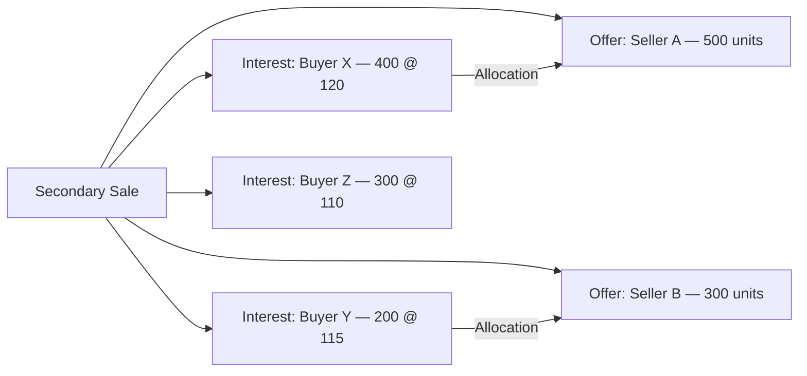
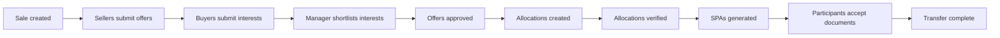
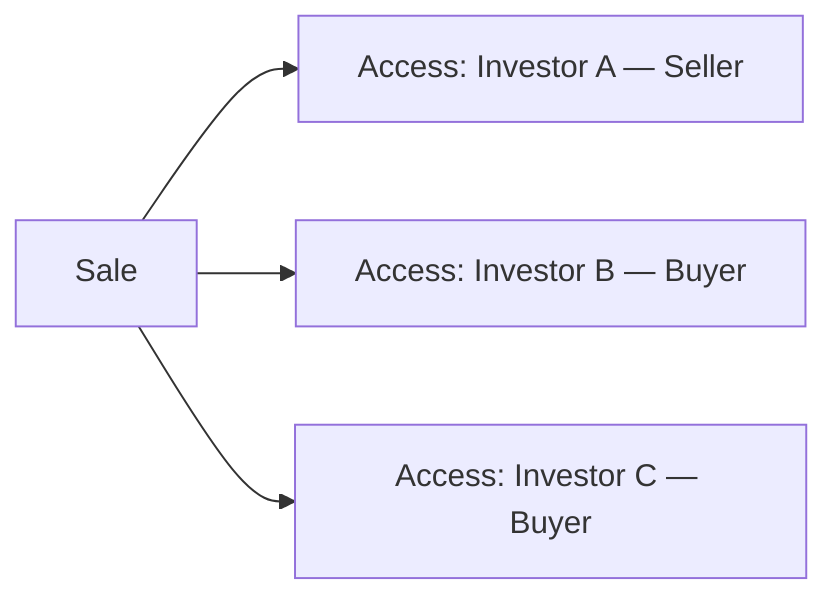
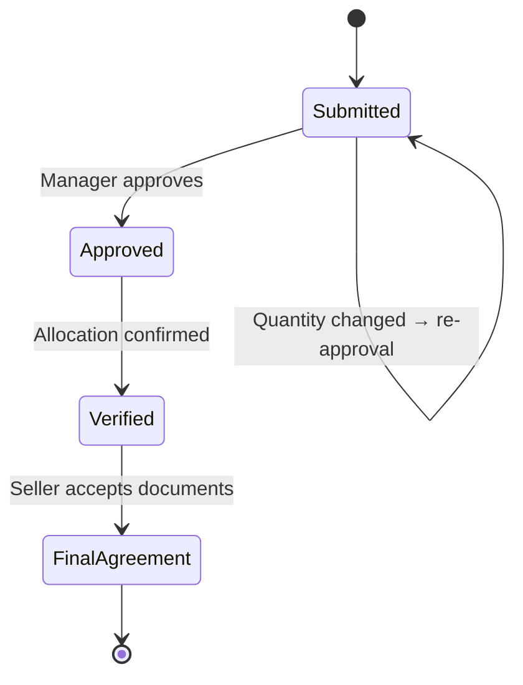
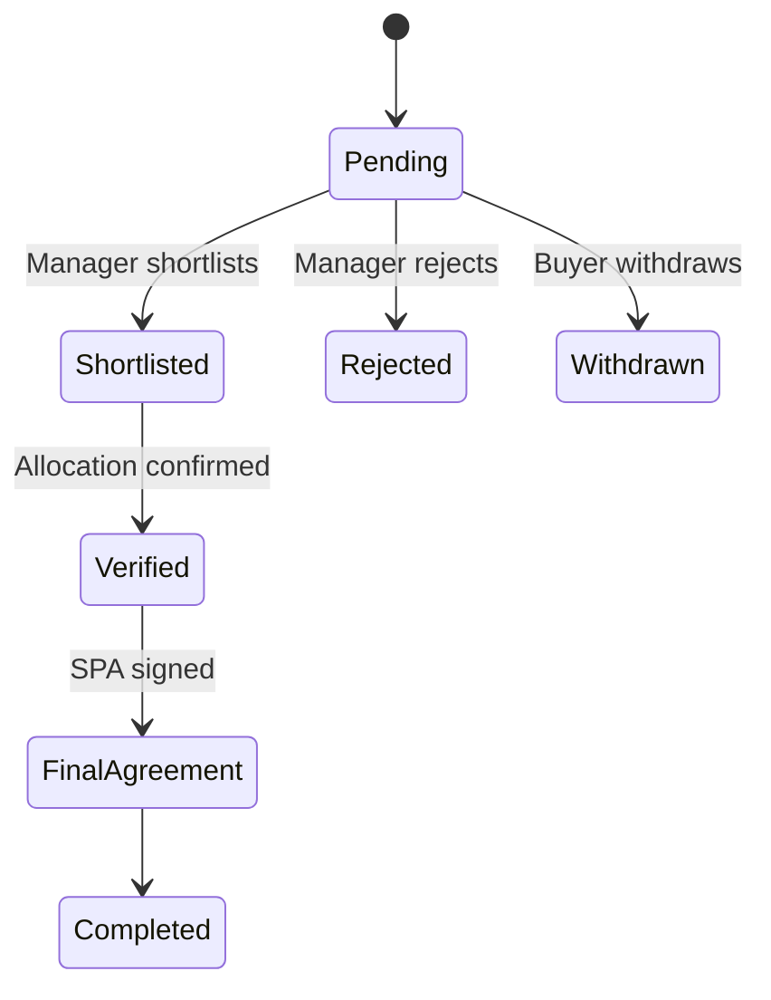
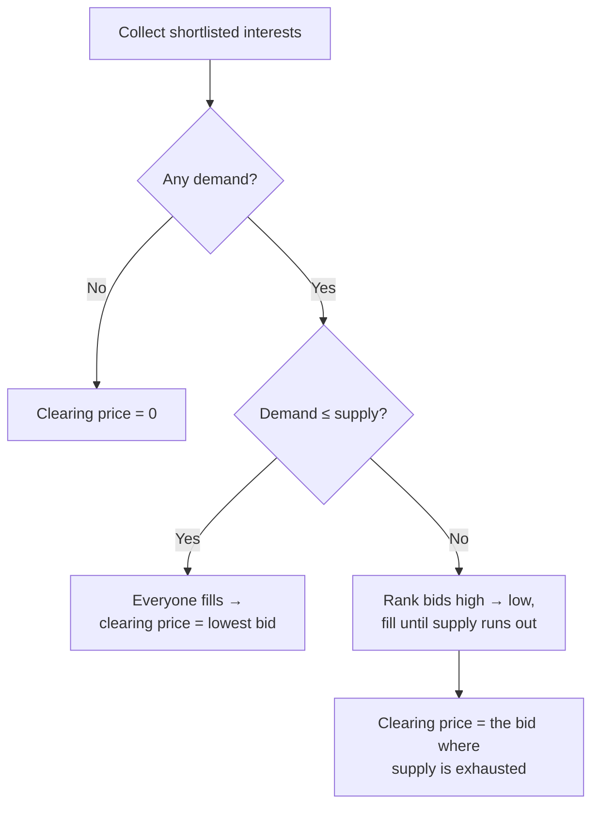

# Secondary Sales User Guide

The secondary sales module is a two-sided marketplace for transferring fund interests between **sellers** (existing investors exiting some or all of their stake) and **buyers** (new investors, or existing LPs buying more). This guide covers setting up a sale, managing offers and interests, running the clearing/allocation process, and generating the purchase agreements (SPAs).

> **Where to find it:** For a company login, Sidebar → [**Secondary Sales**](/secondary_sales); create a sale with **New Secondary Sale** and open it for the **Actions**, **View Allocations**, **Reports** and **Notifications** menus and the **Offers**, **Interests**, **Access Rights**, **Notification** and **Documents** tabs. Investor logins use Sidebar → [**Offers**](/offers?card=true) and [**Interests**](/interests?card=true); RMs get **Secondary Sales**. Needs the *Secondary Sale* feature (`enable_secondary_sale`); approving offers and **Shortlist All** also need the *Approver* role.

---

## Table of Contents

1. [Key Concepts](#key-concepts)
2. [How the Marketplace Works](#how-the-marketplace-works)
3. [The Sale Lifecycle](#the-sale-lifecycle)
4. [Creating a Secondary Sale](#creating-a-secondary-sale)
5. [Price Types](#price-types)
6. [Sale Types: Regular vs Tranche](#sale-types-regular-vs-tranche)
7. [Giving Buyers and Sellers Access](#giving-buyers-and-sellers-access)
8. [Seller Offers](#seller-offers)
9. [Buyer Interests and Shortlisting](#buyer-interests-and-shortlisting)
10. [The Clearing Price](#the-clearing-price)
11. [Allocations](#allocations)
12. [Verification and Final Agreement](#verification-and-final-agreement)
13. [Generating the SPA](#generating-the-spa)
14. [Escrow](#escrow)
15. [Advisor Fees](#advisor-fees)
16. [Document Templates](#document-templates)
17. [Notifications](#notifications)
18. [Worked Example](#worked-example)
19. [Frequently Asked Questions](#frequently-asked-questions)

---

## Key Concepts

| Term | Meaning |
|------|---------|
| **Secondary Sale** | The overall marketplace event, with a submission window. |
| **Offer** | A seller's listing of units they want to sell. |
| **Interest** | A buyer's bid to acquire units at a price. |
| **Allocation** | A confirmed match between an offer and an interest. |
| **Clearing Price** | The price at which supply and demand balance (calculated for information; not applied to the sale). |
| **Shortlisted** | An interest moved into active consideration. |
| **SPA** | Share Purchase Agreement — the legal transfer document. |
| **Escrow** | Buyer funds held pending completion. |

---

## How the Marketplace Works

Sellers submit offers; buyers submit interests. The fund manager approves offers, shortlists interests, and runs **Allocate Sale** (or uploads allocations) to match offers to interests.

---

## The Sale Lifecycle

---

## Creating a Secondary Sale

On a company login, go to Sidebar → [**Secondary Sales**](/secondary_sales) → **New Secondary Sale**.

**Required:**

| Field | Notes |
|-------|-------|
| **Name** | Unique within your entity. |
| **Start Date** | When participants can begin submitting. |
| **End Date** | The submission deadline. |
| **Percent Allowed** | The most a seller should offer, as a percentage of their units. Not enforced — an offer above it is only flagged on screen. |

**Optional but important:**

| Field | Notes |
|-------|-------|
| **Offer End Date** | The deadline for seller offers. |
| **Price Type** | Fixed Price or Price Range. |
| **Final Price** | Required for Fixed Price. |
| **Min / Max Price** | Required for Price Range. |
| **Show Quantity** | Show buyers the "Actual" or only "Indicative" quantity. |
| **Support Email** | Contact for participant queries. |
| **Documents / Forms** | The document lists and the offer and interest forms participants fill in. |
| **Notify Employees** | The employees emailed about interest activity on this sale. |

**Sale Type**, **Manage Offers / Interests**, disabling offer or interest emails, and disabling PAN/bank checks are not on this form; CapHive support sets them.

---

## Price Types

| Type | Behaviour |
|------|-----------|
| **Fixed Price** | Everything trades at one set price — no negotiation. The min and max are both set to that price. |
| **Price Range** | A min–max band; buyers bid within it and the system computes a clearing price. |

---

## Sale Types: Regular vs Tranche

| Type | Use |
|------|-----|
| **Regular** | A standard one-off secondary event. |
| **Tranche** | A label for a sale run in phases. It does not change how allocation or verification works. |

Sale Type is stored as a label only and is set by CapHive support, not on the sale form.

---

## Giving Buyers and Sellers Access

Access is granted per participant, each marked as a **Buyer** or a **Seller**. Only investors with the right access can view and submit. Grant access on the sale's **Access Rights** tab → **Grant Access**, choosing the Stakeholder (or category) and **Select Buyer or Seller** (**Buyer**, **Seller** or **RM**).

An investor can be granted **both** roles (two access rights, one Buyer and one Seller), letting them sell some units and bid for others in the same sale.

---

## Seller Offers

An **offer** is a seller's willingness to sell a quantity at a price. Create one on the sale's **Offers** tab → **New Offer**, shown only while the sale is between its start and end dates (or sellers submit via their portal).

| Field | Notes |
|-------|-------|
| **Investor** | The seller (must have Seller access). |
| **Quantity** | Units to sell. |
| **Price** | Price per unit (set to the final price for Fixed Price sales). |
| **PAN** | The seller's tax identifier. |
| **Bank Account / IFSC** | For settlement. |

Changing an offer's quantity sends it back for approval. Users with the *Approver* role approve offers after checking quantity and eligibility, and only approved offers count toward the total offered. Offers send no email on submission or approval.

### Bulk Actions on Offers

Open the sale → **View Allocations** → **Un Allocated Offers** or **Allocated Offers**, or apply a **Filter** to an offers list, then click **Bulk Actions** at the top right. The button appears only when the list carries a filter or search condition, so the sale's plain **Offers** tab and **View All Offers** do not show it. Running an action needs update rights on offers; seller (investor) logins get "Access Denied".

| Action (exact label) | What it does | Shown when |
|----------------------|--------------|------------|
| **Verify** | Marks each offer verified after checking that the seller's full name, address, PAN, bank account and IFSC are filled in. An offer missing any of them stays unverified and a red alert lists the errors. No email is sent and no document is generated. | A filter is applied |
| **Unverify** | Clears the verified flag on each offer, so it can be edited again. Its allocations stay verified. No email is sent. | A filter is applied |

After you confirm, the action runs in the background on every offer matching the filter conditions, including offers on other pages. The sale is not carried into the action, so it also reaches matching offers in every other sale you can access; the filter has no condition for one particular sale, so check what else matches first, or verify through **All Allocations** (see [Bulk Actions on Allocations](#bulk-actions-on-allocations)), which stays within the sale. You see "Bulk Action started, please check back in a few mins.", an alert per offer, and a final "Verify completed for N records" (or "Unverify …") alert; refresh the list to see the result. To undo, run the opposite action on the same filter.

---

## Buyer Interests and Shortlisting

An **interest** is a buyer's bid for a quantity at a price.

| Field | Notes |
|-------|-------|
| **Investor / Buying Entity** | The buyer. |
| **Quantity** | Units desired. |
| **Price** | The bid (within the band for Price Range sales). |
| **PAN** | The buyer's tax identifier. |
| **Escrow Deposited** | Whether escrow funds are in (company users only, before shortlisting). |

The fund manager **shortlists** interests for active consideration; only shortlisted interests count toward total demand and take part in clearing and allocation.

---

## The Clearing Price

For Price Range sales, the clearing price is the single price at which shortlisted demand and approved supply balance.

In plain terms:

- **If demand is at or below supply**, every buyer is filled and the clearing price is the **lowest** accepted bid.
- **If demand exceeds supply**, the **highest** bidders are prioritised, and the clearing price is the marginal bid where supply runs out.

The clearing price is calculated on the fly for information only. It is not written to the sale's **Final Price** and the allocation engine does not use it — set **Final Price** yourself if you want one price.

---

## Allocations

An **allocation** links one offer to one interest, recording the quantity and price of the match and whether both sides have confirmed it. Verifying an allocation marks both the offer and the interest as verified.

Allocations are created by **Actions → Allocate Sale** or by **Upload** on **All Allocations**; there is no New Allocation button. **Allocate Sale** first deletes every unverified allocation, then matches all approved offers to shortlisted interests where the offer price is at or below the bid, using the chosen **Time / Price Priority** and **Supply Driven** or **Demand Driven** matching. The offer **Auto Match** flag and the sale's custom matching fields are not used.

### Bulk Actions on Allocations

Open the sale → **View Allocations** → **All Allocations** (or **Allocations** on an offer or interest page) and click **Bulk Actions** at the top right. These links already carry a filter, which the button needs; an allocations list opened without a filter or search does not show it.

| Action (exact label) | What it does | Shown when |
|----------------------|--------------|------------|
| **Verify** | Marks each allocation verified, marks its offer and interest verified too (without the offer and interest detail checks), and adds its quantity and amount to the offer, interest and sale allocation totals. An allocation whose offer price is above the interest price fails with an error. No email is sent. | List opened from a sale and you have rights over the sale |
| **Unverify** | Clears verified on each allocation and on its offer and interest, and removes its quantity and amount from those totals. No email is sent. | Same as Verify |
| **Generate All Docs** | For each verified allocation, fills every **Allocation Template** on the sale (or only the templates named in the allocation's docs_to_generate custom field) and saves the documents in the allocation's folder, replacing an earlier generated document of the same template name. Unverified allocations, and templates whose document is already signed or approved, are skipped with an error. Participants are not notified. | Same as Verify |
| **Download Docs** | Builds a zip of the documents in the sale's Allocations folder and sends you a download link. The allocation filter is not applied, and users who are not company admins get only documents they uploaded. | List opened from a sale that has an Allocations folder |
| **All Docs**, **Approved Documents**, **Unapproved Documents** | Open the documents list for the sale's Allocations folder, all or filtered by approval. Nothing is changed. | Same as Verify |

**Verify**, **Unverify** and **Generate All Docs** run in the background on every allocation matching the filter in that sale, including those on other pages. You see "Bulk Action started, please check back in a few mins.", an alert per allocation and a final "… completed for N records" alert; if any allocation failed, the final alert says how many and the details are emailed to you. Verify and Unverify undo each other; generated documents can be deleted from the allocation's folder.

---

## Verification and Final Agreement

After allocation:

1. **Verify the offer** — confirm the seller's details (tax ID, bank account); identity and bank checks run in the background.
2. **Verify the interest** — confirm the buyer's details, with the same background checks.
3. **Final agreement** — both sides acknowledge the SPA.

Verifying an offer or interest on its own needs the participant's full name, address, PAN, and bank details to be present. Verifying through an allocation (**Bulk Actions → Verify** on **All Allocations**) marks the offer and interest verified without these checks, so review details first. **Bulk Actions → Verify** on a filtered offers list does apply the offer checks; see [Bulk Actions on Offers](#bulk-actions-on-offers).

---

## Generating the SPA

A Share Purchase Agreement is not generated automatically. Once an **Offer Template** document is attached to the sale, open an approved offer (or a shortlisted interest, or a verified allocation) → **Generate Document**, or use **Bulk Actions → Generate All Docs** on **All Allocations**, which fills the sale's **Allocation Template** documents for every verified allocation in the list (see [Bulk Actions on Allocations](#bulk-actions-on-allocations)). It pulls the seller's details from the offer, the buyer's from the matched interest, and the signatory emails from each side. The SPA is stored in the offer's folder and can be sent for [e-signing](esigning_user_guide). A separate buyer-side SPA can be produced from a **Buyer Template**.

---

## Escrow

Users of the company running the sale can record that a buyer's escrow funds are in by ticking **Escrow Deposited** on the interest form, before the interest is shortlisted. Buyers cannot tick it themselves. This is tracked for operations; the system doesn't move the money itself.

---

## Advisor Fees

The sale supports advisor fee calculation:

| Fee type | How it's calculated |
|----------|---------------------|
| **Per Share** | Allocated quantity × fee per share. |
| **Percentage** | Allocated amount × fee percentage. |
| **Flat** | A fixed fee regardless of quantity. |

Fees are computed per offer and totalled per buying entity on the payments view, which has no menu link or button — open the sale's page and add /payments to the end of its address in your browser. The sale page has no Fees tab, so fees cannot be added from the sale screens.

---

## Document Templates

Documents attached to the sale with specific owner tags act as templates:

| Tag | Used for |
|-----|----------|
| **Offer Template** | Seller-side SPA generation. |
| **Buyer Template** | Buyer-side SPA generation. |
| **Seller / Buyer** | General party documents. |
| **Allocation Template** | The allocation confirmation document. |

For each Offer Template, the system adds header and footer slots to the offer's documents.

Add a template with the sale's **Actions → New Template**: set **Document For** to the tag, upload the Word file and save. **Buyer** and **Seller** are ordinary documents, not templates. For merge fields and what happens on generation, see the [Document Templates guide](document_templates_user_guide).

---

## Notifications

You choose which employees are notified per sale (**Notify Employees**). When a buyer submits an interest or its status changes, notifications go to those employees, the buyer's relationship managers, and the buyer investor's users. Offers send no notification on submission or approval; the only offer email is the SPA confirmation to the seller. Switching off offer or interest emails for a sale is done by CapHive support. You can send ad-hoc messages to groups such as All Sellers, All Buyers, Approved Sellers, Verified Sellers, or Shortlisted Buyers.

---

## Worked Example

A Price Range sale with a **600-unit** supply (Seller A 500, Seller B 100) and a band of 110–125.

Shortlisted bids:

| Buyer | Quantity | Bid |
|-------|----------|-----|
| Buyer X | 400 | 120 |
| Buyer Y | 200 | 115 |
| Buyer Z | 300 | 110 |

Total demand = 900 units against 600 of supply, so **demand exceeds supply** — highest bidders first:

1. Buyer X (120) takes 400 → 200 units of supply left.
2. Buyer Y (115) takes the remaining 200 → supply exhausted.
3. Buyer Z (110) is not filled.

Supply runs out at Buyer Y's bid, so the **clearing price is 115** (shown for information; it is not applied to the sale). The manager then runs **Allocate Sale** to create allocations — for example Buyer X 400 and Buyer Y 200, drawn from Seller A and Seller B's offers — verifies them, and generates SPAs for signing.

If instead total demand had been **500 units (≤ 600 supply)**, everyone would fill and the clearing price would be the **lowest** accepted bid (110).

---

## Frequently Asked Questions

### Navigation and getting there

**Where do I find Secondary Sales in CapHive?**
On a company (startup) login, Sidebar → [**Secondary Sales**](/secondary_sales). The item appears only when the *Secondary Sale* feature is on for your company and user. Click a sale to open it.

**Where do sellers and buyers (investors) find a sale?**
An investor login sees Sidebar → [**Offers**](/offers?card=true) and [**Interests**](/interests?card=true), listing their own offers and interests. To reach the sale itself they follow the link in the "open for offers" / "open for interests" email or notification, or open the [Secondary Sales list](/secondary_sales), which lists only sales they have access to.

**Where do relationship managers (RMs) find sales?**
An RM login sees Sidebar → [**Secondary Sales**](/secondary_sales) instead of Offers and Interests. On a sale they get **Offers** and **Interests** tabs covering the clients mapped to them.

**What is on the sale page for the company?**
The sale summary plus the **Actions** menu (**Edit**, **Delete**, **Allocate Sale**, **New Template**), **View Allocations** (**All Allocations**, **Un Allocated Offers**, **Allocated Offers**, **Un Allocated Interests**, **Allocated Interests**), **Reports** and **Notifications** menus. Tabs: **Offers**, **Interests**, **Access Rights**, **Notification** and **Documents**.

**Where do I see all allocations for a sale?**
Open the sale → **View Allocations** → **All Allocations**. From there you can **Filter**, **Download**, **Upload** and use **Bulk Actions** (**Verify**, **Unverify**, **Generate All Docs**, **Download Docs** and document links), which appears whenever the list carries a filter, as it does from this link.

**Where are the bulk actions for offers and allocations in a secondary sale?**
For allocations: open the sale → **View Allocations** → **All Allocations** → **Bulk Actions** (**Verify**, **Unverify**, **Generate All Docs**, **Download Docs**, document links). For offers: open the sale → **View Allocations** → **Un Allocated Offers** or **Allocated Offers**, or filter an offers list → **Bulk Actions** (**Verify**, **Unverify**). See [Bulk Actions on Offers](#bulk-actions-on-offers).

**Why don't I see the Bulk Actions button on the offers list?**
The offers **Bulk Actions** button appears only when the list has a filter or search applied, so the sale's **Offers** tab and **View All Offers** do not show it. Open **View Allocations** → **Un Allocated Offers** or **Allocated Offers**, or click **Filter** and apply a condition. Seller (investor) logins see the button on a filtered list but get "Access Denied".

**Why don't I see Verify, Unverify or Generate All Docs in the allocations Bulk Actions menu?**
The allocations **Bulk Actions** button needs a filter on the list, and those three items (plus the document links) show only when the list was opened from a sale (**View Allocations** → **All Allocations**, or **Allocations** on an offer or interest) and you have rights over that sale. **Download Docs** shows only if the sale has an Allocations folder.

**Where are the completion and eSignature reports?**
Open the sale → **Reports** menu → **Generated Docs**, **Offers Completion Report**, **Interests Completion Report** or **eSignatures Report**.

**Where is the advisor payments view?**
There is no menu link or button; open the sale's page and add /payments to the end of its address in your browser. It groups approved, matched offers by buyer with advisor fees and has **Download** and a verified-offers filter.

### Creating, updating and managing sales

**How do I create a secondary sale?**
Sidebar → **Secondary Sales** → [**New Secondary Sale**](/secondary_sales/new). Enter **Name**, **Start Date**, **End Date**, **Offer End Date**, **Percent Allowed**, **Support Email**, **Price Type** with **Min/Max Price** or **Final Price**, **Show Quantity**, document lists, offer/interest forms and **Notify Employees**, then save. See [Creating a Secondary Sale](#creating-a-secondary-sale).

**How do I edit a sale?**
Open the sale → **Actions** → **Edit**. You can change dates, prices, documents, forms and **Notify Employees** at any time; existing offers and interests pick up a new fixed price only when they are next saved.

**How do I delete a sale?**
Open the sale → **Actions** → **Delete** and confirm. Only users with destroy rights on the sale see it; the sale and its offers, interests and allocations are soft-deleted.

**How do I give buyers and sellers access?**
Open the sale → **Access Rights** tab → **Grant Access**, pick the Stakeholder (investor) or category and set **Select Buyer or Seller** to **Buyer**, **Seller** or **RM**. Add two access rights to make one investor both buyer and seller. See [Giving Buyers and Sellers Access](#giving-buyers-and-sellers-access).

**How do I add an offer for a seller?**
Open the sale → **Offers** tab → **New Offer**, shown only while the sale is between its start and end dates. Sellers do the same from the **My Offers** tab of the sale. See [Seller Offers](#seller-offers).

**How do I add an interest for a buyer?**
Open the sale → **Interests** tab → **New Interest**. Buyers use **New Interest** on the same tab; the price must sit inside the sale's min–max band or equal the fixed price. See [Buyer Interests and Shortlisting](#buyer-interests-and-shortlisting).

**How do I bulk-upload offers, interests or allocations?**
Offers: **Offers** tab → **Upload / Download** → **Upload Offers** or **Upload Offers Documents**. Interests: **Interests** tab → **Upload Interests**. Allocations: **All Allocations** → **Upload**. Each opens the upload form with a sample file.

**How do I approve offers?**
Open an offer and click **Approve** (click again for **UnApprove**), or approve every pending offer with **Approve All Pending** on the **Offers** tab. Both need the *Approver* role plus update rights on the sale.

**How do I shortlist or reject interests?**
On the **Interests** tab use a row's **Change Status** menu → **Shortlist**, **Reject** or **Pending**, or shortlist every pending interest with **Shortlist All** (needs the *Approver* role). A buyer can only **Withdraw** their own interest while it is still pending.

**How do I run the allocation?**
Open the sale → **Actions** → **Allocate Sale**, choose **Default Allocation Engine**, **Time / Price Priority** (**Time** or **Price**) and **Matching Priority** (**Supply Driven** or **Demand Driven**), then submit. See [Allocations](#allocations).

**How do I edit or delete an allocation?**
Open the allocation from **All Allocations** → **Show**, then **Edit** (offer, interest, price, quantity, notes, verified) or **Delete**. There is no New Allocation button; allocations come from **Allocate Sale** or **Upload**. A verified allocation cannot be deleted.

**How do I bulk verify offers, interests and allocations?**
On **All Allocations** use **Bulk Actions** → **Verify**; verifying an allocation also marks its offer and interest verified. Offers can also be verified from a filtered offers list (for example **View Allocations** → **Allocated Offers**) with **Bulk Actions** → **Verify**, but that reaches matching offers in every sale you can access. See [Bulk Actions on Offers](#bulk-actions-on-offers).

**How do I unverify many offers or allocations at once with bulk actions?**
On **All Allocations** use **Bulk Actions** → **Unverify** to unverify the listed allocations together with their offers and interests. For offers alone, use **Bulk Actions** → **Unverify** on a filtered offers list such as **View Allocations** → **Allocated Offers**; this leaves their allocations verified.

**How do I bulk generate documents for all allocations in a sale?**
Attach **Allocation Template** documents to the sale (**Actions** → **New Template**), verify the allocations, then open **View Allocations** → **All Allocations** → **Bulk Actions** → **Generate All Docs**. Filter the list first to generate for fewer allocations. See [Bulk Actions on Allocations](#bulk-actions-on-allocations).

**How do I bulk download the documents of a sale's allocations?**
Open the sale → **View Allocations** → **All Allocations** → **Bulk Actions** → **Download Docs** and confirm. A zip of the sale's Allocations folder is built in the background and you are sent a download link. Use **All Docs**, **Approved Documents** or **Unapproved Documents** in the same menu to review them on screen.

**How do I add an SPA or allocation document template to a secondary sale?**
Open the sale → **Actions → New Template**, set **Document For** to **Offer Template** (seller SPA per offer), **Buyer Template** (buyer document per interest) or **Allocation Template** (agreement per allocation), upload the Word file and save. Signatory labels **Buyer Signatories** and **Seller Signatories** are offered. See [Document Templates](document_templates_user_guide).

**How do I generate the SPA and other documents?**
First attach templates via **Actions** → **New Template** with owner tag **Offer Template**, **Buyer Template** or **Allocation Template**. Then open an offer, interest or allocation → **Generate Document** → **All Docs** or a template, or use **Bulk Actions** → **Generate All Docs** on allocations. See [Generating the SPA](#generating-the-spa).

**How do participants accept the transaction documents?**
A seller opens their verified offer and clicks **Accept Transaction Documents** (shown once an approved generated document exists); a buyer does the same on their verified interest. This records the final agreement.

**How do I send notifications to participants?**
Open the sale → **Notifications** menu: **Send Sale Open : To Sellers**, **Send Offer Reminder : To Sellers**, **Send Sale Open : To Buyers**, **Send Interest Reminder : To Buyers**, **Allocation Notification : To All**, **Confirm SPA Notification : To Sellers / To Buyers**, plus any ad-hoc templates and **Add Investor Notice**. See [Notifications](#notifications).

**How do I create an ad-hoc email to a group such as Shortlisted Buyers?**
Open the sale → **Notification** tab and create a custom notification, choosing the recipient group (All Sellers, All Buyers, Approved Sellers, Verified Sellers or Shortlisted Buyers). It then appears by subject in the **Notifications** menu.

**How do I export offers, interests or allocations?**
**Offers** tab → **Upload / Download** → **Download All Offers**; **Interests** tab → **Download**; **All Allocations** → **Download**. Each gives an Excel file of the rows you can see.

**Who can do what in a secondary sale?**
Company users with the feature and rights on the sale create, edit, allocate and notify; approving offers individually or in bulk and **Shortlist All** need the *Approver* role. Sellers see and manage their own offers, buyers their own interests, and RMs act for mapped clients.

### Why use secondary sales

**Why run a secondary through CapHive instead of email and spreadsheets?**
Every offer and bid is captured with its price, quantity, KYC and bank details, approvals and shortlists are tracked, matching is automated, SPAs are generated from your templates, and each party accepts documents on-platform with a full audit trail.

**What can I do with a secondary sale?**
Invite chosen sellers and buyers, collect offers and interests within a price band or at a fixed price, approve and shortlist them, match them into allocations, verify both sides, generate and e-sign SPAs, notify participants at each stage, and export completion and payment reports.

**Who typically uses secondary sales?**
Company secretarial and finance teams running an employee or investor liquidity event, their approvers, existing investors and employees selling units, incoming buyers, and RMs acting for clients. See [Key Concepts](#key-concepts).

**What happens if I don't grant access rights?**
No investor can see the sale or submit, and the **Sale Open** and **Reminder** notifications reach nobody because they go only to approved users of investors with Buyer or Seller access.

### What happens when I…

**What happens when I create a sale?**
The sale is saved with a document folder and data room, and **Manage Offers / Manage Interests** are switched on so your team can add entries for participants. No one is notified until you send a notification from the **Notifications** menu.

**What happens when a seller submits an offer?**
The offer is saved unapproved in its own folder, and background PAN and bank-account checks start (unless disabled for the sale). It does not count toward **Total Offered** until approved, and no email is sent to anyone.

**What happens when I approve or unapprove an offer?**
Approving adds its quantity and amount to the sale's **Total Offered** and makes it eligible for allocation; unapproving removes it. No email is sent. If the seller later changes the quantity, the offer drops back to unapproved.

**What happens when a buyer submits an interest?**
The interest is saved as **pending**, PAN and bank checks start, and an "Interest received" email plus in-app notification goes to the buyer investor's users, their RMs and the sale's **Notify Employees** (unless interest emails are switched off for the sale).

**What happens when I shortlist, reject or reset an interest?**
Its status changes and the same group (buyer's users, RMs, Notify Employees) is emailed. Only shortlisted interests count toward total demand and take part in allocation and buyer document generation.

**What happens when I click Allocate Sale?**
A background job first deletes every unverified allocation, then matches approved offers to shortlisted interests where the offer price is at or below the bid, by time or price priority. Supply-driven matches use the bid price, demand-driven the offer price. You see progress alerts; participants are not notified.

**What happens when I verify an allocation, individually or with Bulk Actions → Verify on the allocations list?**
The allocation is marked verified, its quantity and amount roll up into the offer, interest and sale allocation totals, and the offer and interest are marked verified without their detail checks. They can no longer be edited, and the allocation can no longer be deleted. No one is emailed; a bulk run ends with a completion alert. Undo with **Unverify**.

**What happens when I use Bulk Actions → Unverify on the allocations list?**
In the background every matching allocation in the sale, and its offer and interest, is marked unverified and its quantity and amount leave the allocation totals, so offers and interests become editable again. No one is emailed. A later **Allocate Sale** deletes these allocations because they are unverified.

**What happens when I use Bulk Actions → Generate All Docs on the allocations list?**
For each verified matching allocation the sale's **Allocation Template** documents are filled and saved in the allocation's folder, replacing earlier generated copies. Unverified allocations and already signed or approved documents are skipped. Participants are not notified; you get alerts and an error email if anything failed. Delete unwanted documents from the folder.

**What happens when I use Bulk Actions → Download Docs on the allocations list?**
A background job zips the documents in the sale's Allocations folder, uploads the zip and sends you a download link. It is not limited to the filtered allocations, and non-admin users get only documents they uploaded. Nothing is changed.

**What happens when I use Bulk Actions → Verify on the offers list?**
In the background each matching offer (in any sale you can access) is marked verified if the seller's full name, address, PAN, bank account and IFSC are present; others stay unverified with a red alert. It becomes read-only, no email is sent and no SPA is generated. Undo with **Unverify**.

**What happens when I use Bulk Actions → Unverify on the offers list?**
In the background each matching offer (in any sale you can access) has its verified flag cleared, so it can be edited again. Its allocations and the matched interests stay verified. No email is sent; you see per-offer alerts and a completion alert. Undo with **Verify**.

**What happens when I generate documents?**
A background job fills each chosen template for the offer (must be approved), interest (must be shortlisted) or allocation (must be verified), replacing any earlier document with the same template name, and saves it in the record's folder. Generated documents need approving before sellers see **Accept Transaction Documents**.

**What happens when a participant accepts the transaction documents?**
The offer or interest records the final agreement and who accepted it. For an offer the seller's user gets an "SPA confirmation received" email; for an interest the buyer's users, RMs and Notify Employees are emailed. Acceptance cannot be undone from the screen.

**What happens when I send a sale notification?**
Emails and in-app notifications go out immediately: **Sale Open** and **Reminder** items to approved users of all Buyer or Seller investors; **Allocation Notification : To All** to verified sellers and shortlisted buyers; **Confirm SPA** items to those who have not yet accepted. Nothing prevents sending twice.

**What happens when I delete a sale, offer or interest?**
The record (and for a sale, its offers, interests and allocations) is soft-deleted and disappears from lists. A user with destroy rights can restore it from the deleted [sales](/secondary_sales/show_deleted), [offers](/offers/show_deleted) or [interests](/interests/show_deleted) list. No one is notified.

**What happens if an offer or interest is missing details at verification?**
Verifying an offer on its own requires full name, address, PAN, bank account and IFSC; an interest needs buyer entity name, address, city, PAN and contact name, so the save fails with those errors. Verifying through an allocation skips these checks, so review details first.

### Troubleshooting and edge cases

**Does a bulk action on offers or allocations apply to rows on other pages?**
Yes. **Bulk Actions** acts on every row matching the list's filter, not just the page on screen. Allocation actions stay within the sale the list was opened from; offer actions are not limited to the sale and reach matching offers in every sale you can access.

**Why did bulk Verify or Unverify on an offers list change offers in another sale?**
The offers bulk action sends only the filter conditions, not the sale, and the filter has no condition for a specific sale. Links such as **Allocated Offers** filter on allocation quantity, so offers in other sales with the same values are included. Run **Unverify** or **Verify** on the affected offers to reverse it, or verify through **All Allocations** instead.

**A bulk Verify on offers finished but some offers are still unverified — why?**
Verifying an offer needs the seller's full name, address, PAN, bank account and IFSC; offers missing any stay unverified and a red alert shows the errors. The final alert still says "completed" and no error email is sent, so refresh the list and filter on Verified to find them.

**A bulk action on allocations finished with errors — why?**
Verify fails for an allocation whose offer price is above the interest price; Generate All Docs fails for unverified allocations, templates whose document is already signed or approved, or when the sale has no **Allocation Template**. The final alert gives the error count and the details are emailed to you.

**Can I undo a bulk action on offers or allocations?**
**Verify** and **Unverify** reverse each other; run the opposite action on the same filtered list. Generated documents from **Generate All Docs** can be deleted from the allocation's folder. **Download Docs** changes nothing.

**Can a buyer also be a seller in the same sale?**
Yes. Grant the investor two access rights on the sale, one **Buyer** and one **Seller**, so they can offer units and bid at the same time.

**Why can't I see New Offer or New Interest?**
**New Offer** appears only while today is between the sale's start and end dates, and for company users only when **Manage Offers** is on. Buyers need **Buyer** access and sellers **Seller** access on the **Access Rights** tab.

**Why can't I see Approve All Pending or Shortlist All?**
Both need the *Approver* role on your user as well as update rights on the sale. Ask your company admin to add the role.

**Why can't the seller or buyer edit their entry any more?**
Offers and interests become read-only once verified. A buyer then sees **Send email to change**, which opens an email to the sale's Notify Employees or support email.

**What if the allocation leaves some interests unfilled?**
Interests whose bid is below every remaining offer price, or that come after supply runs out, stay shortlisted with zero allocation. Filter them with **View Allocations** → **Un Allocated Interests** and reject them or leave them for more supply.

**Will re-running Allocate Sale overwrite my edits?**
It deletes all unverified allocations, including manually edited or uploaded ones, before matching again. Verify the allocations you want to keep first; verified ones are left alone and their quantities are treated as taken.

**Can allocations be changed after creation?**
Yes. **Edit** stays available to users with update rights, but the offer's price must not exceed the interest's price. Once verified an allocation can no longer be deleted and its offer and interest are locked for participants.

**How do I run a fixed-price sale?**
Set **Price Type** to **Fixed Price** and enter a **Final Price**. Min and max are set to that price, every offer and interest is saved at it, and a bid at any other price is rejected. See [Price Types](#price-types).

**Is the clearing price applied automatically?**
No. The clearing price is calculated from shortlisted interests and approved offers, but it is not written to the sale's **Final Price** and the Default Allocation Engine does not use it. Set **Final Price** yourself if you want one price. See [The Clearing Price](#the-clearing-price).

**Can I run a sale without a template document?**
Yes, but **Generate Document** has nothing to fill, so no SPAs are produced. You can still manage offers, interests, allocations and verification.

**How does auto-match work?**
The Default Allocation Engine considers every approved offer and shortlisted interest; the offer **Auto Match** flag and the sale's custom matching fields are not used by it. Those fields are settable only by CapHive support.

**What's a Tranche sale, and how do I set Sale Type or Manage Offers?**
**Sale Type** (Regular or Tranche), **Manage Offers / Interests**, disabling offer or interest emails and PAN/bank checks are not on the sale form; CapHive support sets them. Sale Type is a label only and does not change how allocation or verification works.

**Does Percent Allowed stop a seller offering too much?**
No. An offer above the percentage is only flagged on screen; it is not rejected. Check flagged offers before approving.

**Who is notified when an offer is submitted?**
No one. Offers send no email on submission or approval; the only offer email is "SPA confirmation received" to the seller's user when they accept documents. Interests do notify on submission (see above).

**Who can tick Escrow Deposited?**
Only users of the company running the sale, on the interest form and only before the interest is shortlisted. It is a record-keeping flag; the system does not move money. See [Escrow](#escrow).

## Related Guides

- [Investors (Stakeholders)](investors_user_guide) — the Stakeholder records granted Buyer or Seller access.
- [Investor Access Tutorial](investor_access_tutorial) — approving the investor logins that receive sale emails.
- [eSigning](esigning_user_guide) — sending generated SPAs for signature.
- [Document Management](document_management_user_guide) — uploading templates and approving generated documents.
- [Document Templates](document_templates_user_guide) — writing Offer, Buyer and Allocation templates and what generation does.
- [Custom Fields](custom_fields_user_guide) — offer and interest forms configured on the sale.
- [Approvals](approvals_user_guide) — how the Approver role fits with other approval flows.
- [User Role Management](user_role_management_user_guide) — granting the Approver role and feature permissions.
