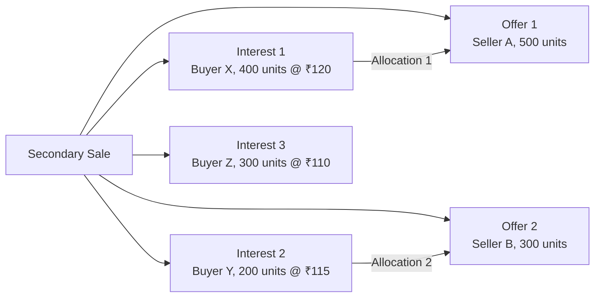
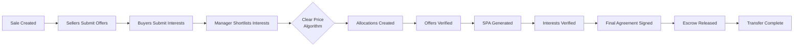
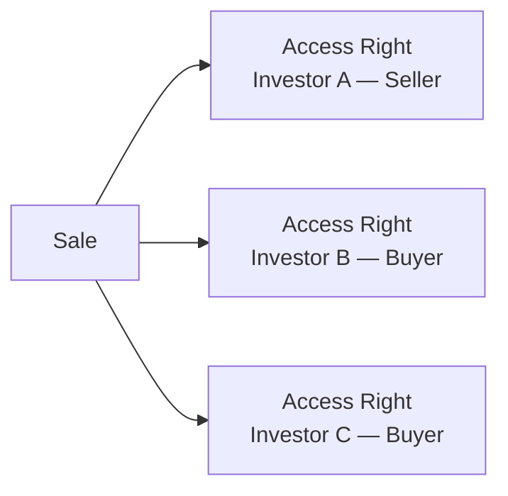
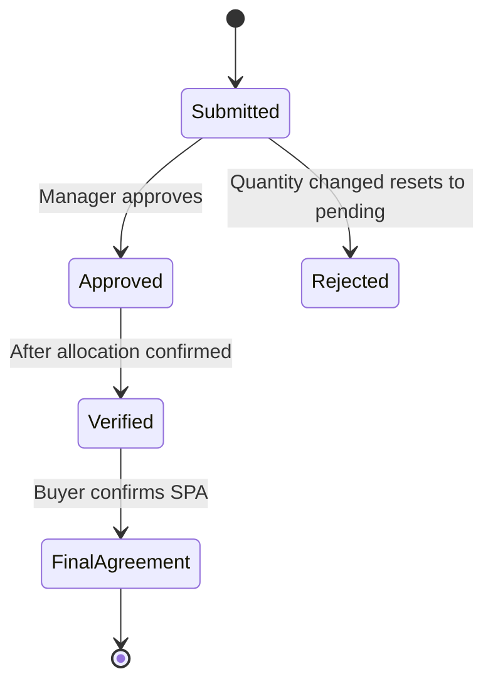
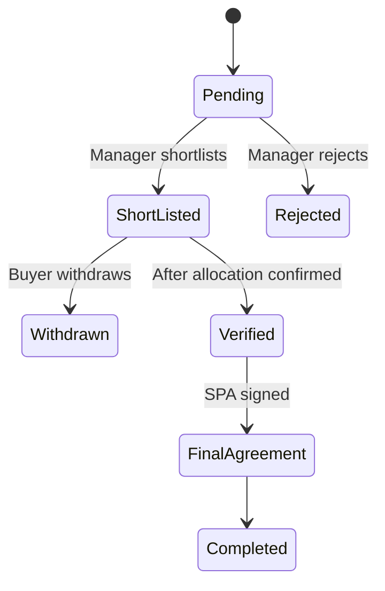
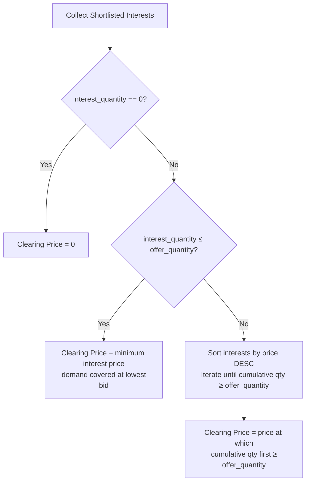

# Secondary Sales User Guide

The secondary sales module provides a two-sided marketplace for transferring fund interests between sellers (existing investors) and buyers (incoming investors or existing LPs acquiring more). This guide covers how to set up a secondary sale, manage offers and interests, run the clearing/allocation process, and generate Shareholder Purchase Agreements (SPAs).

---

## Table of Contents

1. [Key Concepts](#key-concepts)
2. [Marketplace Architecture](#marketplace-architecture)
3. [Secondary Sale Lifecycle](#secondary-sale-lifecycle)
4. [Creating a Secondary Sale](#creating-a-secondary-sale)
5. [Price Types](#price-types)
6. [Sale Types: Regular vs Tranche](#sale-types-regular-vs-tranche)
7. [Access Control: Buyers and Sellers](#access-control-buyers-and-sellers)
8. [Seller Offers](#seller-offers)
9. [Offer Lifecycle](#offer-lifecycle)
10. [Buyer Interests](#buyer-interests)
11. [Interest Lifecycle (Shortlisting)](#interest-lifecycle-shortlisting)
12. [Clearing Price Algorithm](#clearing-price-algorithm)
13. [Allocations](#allocations)
14. [Verification and Final Agreement](#verification-and-final-agreement)
15. [SPA Generation](#spa-generation)
16. [Escrow](#escrow)
17. [Fees](#fees)
18. [Document Templates](#document-templates)
19. [Notifications](#notifications)
20. [Key Fields Reference](#key-fields-reference)
21. [Frequently Asked Questions](#frequently-asked-questions)

---

## Key Concepts

| Term | Meaning |
|---|---|
| **Secondary Sale** | The overall marketplace event with a defined date window |
| **Offer** | A seller's listing of units they wish to sell |
| **Interest** | A buyer's bid to acquire units at a specified price |
| **Allocation** | A match between a specific Offer and Interest |
| **Clearing Price** | The price at which supply and demand clear |
| **Short-Listed** | An interest moved into active consideration for allocation |
| **SPA** | Shareholder Purchase Agreement — the legal transfer document |
| **Escrow** | Buyer's funds held pending transaction completion |

---

## Marketplace Architecture

Sellers submit Offers; Buyers submit Interests. The fund manager then shortlists interests, runs the clearing algorithm, and creates Allocations to match offers with interests.

---

## Secondary Sale Lifecycle

---

## Creating a Secondary Sale

Navigate to **[Entity] → Secondary Sales → New**.

Required fields:

| Field | Notes |
|---|---|
| **Name** | Unique per entity. Max 255 characters |
| **Start Date** | Date when sellers/buyers can begin submitting |
| **End Date** | Last date for submissions |
| **Percent Allowed** | Maximum percentage of units a seller can offer |

Optional but important:

| Field | Notes |
|---|---|
| **Sale Type** | Regular or Tranche (see below) |
| **Price Type** | Fixed Price or Price Range (see below) |
| **Final Price** | Required for Fixed Price type |
| **Min Price / Max Price** | Required for Price Range type |
| **Show Quantity** | Whether to display "Actual" or "Indicative" quantity to buyers |
| **Support Email** | Contact for participant queries |
| **Manage Offers** | Toggle fund manager's ability to add offers on behalf of sellers |
| **Manage Interests** | Toggle fund manager's ability to add interests on behalf of buyers |

---

## Price Types

| Type | Behaviour |
|---|---|
| **Fixed Price** | All offers and interests are at the same fixed price. No price negotiation |
| **Price Range** | A min and max price band is set. Buyers bid within the band; clearing price is computed |

For Fixed Price sales, `min_price` and `max_price` are both set to `final_price` automatically.

For Price Range sales, the clearing price is computed from the shortlisted interests (see Clearing Price Algorithm).

---

## Sale Types: Regular vs Tranche

| Type | Use Case |
|---|---|
| **Regular** | Standard secondary market event |
| **Tranche** | Phased transfer allowing incremental allocations over multiple rounds |

---

## Access Control: Buyers and Sellers

Access to a secondary sale is controlled by **Access Rights** attached to the sale. Each access right specifies:
- The investor (buyer or seller)
- The metadata tag: `Buyer` or `Seller`

Only investors with the appropriate access right can view and submit offers/interests.

To grant access: navigate to **Secondary Sale → Access Rights → Add** and specify the investor and role.

The `buyer_investors` and `seller_investors` helpers return the respective participant lists.

---

## Seller Offers

An **Offer** represents a seller's willingness to sell a specified quantity at a price.

### Creating an Offer

Navigate to **Secondary Sale → Offers → New** (or sellers submit via investor portal).

Key offer fields:

| Field | Notes |
|---|---|
| **Investor** | The seller (must have Seller access to this sale) |
| **Quantity** | Number of units to sell |
| **Price** | Price per unit (overridden to final_price for Fixed Price sales) |
| **PAN** | Seller's tax identifier |
| **Bank Account Number / IFSC** | For settlement |
| **Buyer** (optional) | Direct buyer entity if a specific buyer is pre-agreed |
| **Auto Match** | Whether this offer participates in automatic matching |

The `amount_cents` is auto-computed as `quantity × price × 100`.

### Offer Approval

Changing the quantity resets `approved` to `false`. Fund managers approve offers after verifying the quantity and eligibility. Only approved offers count toward `total_offered_quantity` on the sale.

---

## Offer Lifecycle

- **Submitted** — offer created, `approved = false`
- **Approved** — offer included in total offered quantity
- **Verified** — allocation confirmed; SPA generation triggered
- **Final Agreement** — buyer has acknowledged the SPA

---

## Buyer Interests

An **Interest** represents a buyer's bid to acquire a specified quantity at a price.

### Submitting an Interest

Key interest fields:

| Field | Notes |
|---|---|
| **Investor** | The buyer's seller-side investor record |
| **Interest Entity** | The buying entity (buyer_entity_id) |
| **Buyer Entity Name** | Name of the acquiring entity |
| **Quantity** | Number of units desired |
| **Price** | Bid price (must be within min_price–max_price for Price Range) |
| **PAN** | Buyer's tax identifier |
| **Escrow Deposited** | Whether escrow funds have been deposited |

The `amount_cents` is auto-computed as `quantity × applied_price × 100`.

---

## Interest Lifecycle (Shortlisting)

| Status | Meaning |
|---|---|
| `pending` | Submitted but not yet reviewed |
| `short_listed` | Under active consideration; quantity rolls up to `total_interest_quantity` on the sale |
| `rejected` | Declined by fund manager |
| `withdrawn` | Buyer withdrew their interest |

Only shortlisted interests participate in clearing price computation and allocation.

---

## Clearing Price Algorithm

The clearing price determines the final transaction price for Price Range sales.

**In plain terms:**
- If demand ≤ supply → every buyer gets filled; clearing price is the lowest bid price
- If demand > supply → prioritise highest bidders; clearing price is the marginal bid at which supply runs out

After the clearing price is determined, it is set as `final_price` on the sale.

---

## Allocations

An **Allocation** links a specific Offer to a specific Interest.

| Field | Meaning |
|---|---|
| `offer_id` | The seller's offer being matched |
| `interest_id` | The buyer's interest being satisfied |
| `quantity` | Units allocated in this match |
| `price` | Price at which the allocation occurs |
| `verified` | Whether both sides have confirmed the allocation |

Verifying an allocation automatically marks the corresponding offer **and** interest as verified.

Allocations can be created:
- Manually by the fund manager
- Via the automatic matching engine (for offers with `auto_match = true`)

Custom matching fields can be configured on the sale to enforce specific pairing rules (e.g. matching by geography or investor category).

---

## Verification and Final Agreement

After allocation:

1. **Verify the Offer** — confirm the seller's details (PAN, bank account). Triggers async PAN and bank validation jobs.
2. **Verify the Interest** — confirm the buyer's details. Also triggers async validation.
3. **Final Agreement** — both sides acknowledge the SPA document.

Verification requires `full_name`, `address`, `PAN`, `bank_account_number`, and `ifsc_code` to be present.

---

## SPA Generation

A Shareholder Purchase Agreement is generated automatically when an offer is verified (if a template document tagged **Offer Template** is attached to the sale).

The SPA includes:
- Seller details from the offer
- Buyer details from the interest (via allocation)
- Signatory emails from `seller_signatory_emails` (offer) and `buyer_signatory_emails` (interest)

The generated SPA is stored in the offer's document folder and can be sent for e-signing.

For interests: a separate buyer-side SPA can be generated using the **Interest Template** document type.

---

## Escrow

Buyers can record that their escrow funds have been deposited by setting `escrow_deposited = true` on their interest. This is tracked for operational purposes; the system does not handle actual escrow transfers.

---

## Fees

The secondary sale supports fee computation for advisors:

| Fee Type | Calculation |
|---|---|
| **Per Share** | `allocation_quantity × fee_amount` |
| **Percentage** | `allocation_amount × fee_percentage / 100` |
| **Flat** | Fixed fee regardless of quantity |

Fees are computed per offer using `compute_fees` and aggregated per buyer entity using `compute_payments`.

---

## Document Templates

Documents attached to the secondary sale with specific `owner_tag` values are used as templates:

| Tag | Used For |
|---|---|
| `Offer Template` | SPA generation for sellers |
| `Buyer Template` | SPA generation for buyers |
| `Seller` | General seller documents |
| `Buyer` | General buyer documents |
| `Allocation Template` | Allocation confirmation document |

For each Offer Template, the system automatically adds Header and Footer document slots to the offer's document list.

---

## Notifications

Notification recipients are controlled per sale via `notification_employee_ids`. When an event occurs (new offer, new interest, status change), notifications are sent to:
1. Configured employees on the sale
2. The investor's relationship managers (via RM mappings)
3. The investor's approved users

To suppress email notifications, set `no_offer_emails` or `no_interest_emails` on the sale.

Adhoc notifications can be sent to: All Sellers, All Buyers, Approved Sellers, Verified Sellers, Shortlisted Buyers.

---

## Key Fields Reference

### SecondarySale

| Field | Description |
|---|---|
| `name` | Sale name (unique per entity) |
| `start_date` / `end_date` | Active submission window |
| `sale_type` | Regular or Tranche |
| `price_type` | Fixed Price or Price Range |
| `final_price` | Clearing/fixed price |
| `min_price` / `max_price` | Price band for Range type |
| `percent_allowed` | Max % of units a seller can offer |
| `show_quantity` | Actual or Indicative |
| `allocation_status` | Current allocation state |
| `total_offered_quantity` | Sum of approved offer quantities |
| `total_interest_quantity` | Sum of shortlisted interest quantities |

### Offer

| Field | Description |
|---|---|
| `quantity` | Units offered for sale |
| `price` | Price per unit |
| `approved` | Whether offer is approved by fund manager |
| `verified` | Whether seller details are verified |
| `final_agreement` | Whether seller acknowledged SPA |
| `allocation_quantity` | Units actually allocated |
| `auto_match` | Eligible for automatic matching |

### Interest

| Field | Description |
|---|---|
| `quantity` | Units desired |
| `price` | Bid price |
| `short_listed_status` | pending / short_listed / rejected / withdrawn |
| `verified` | Whether buyer details are verified |
| `final_agreement` | Whether buyer acknowledged SPA |
| `escrow_deposited` | Escrow confirmation flag |
| `allocation_quantity` | Units actually allocated |

---

## Frequently Asked Questions

**Q: Can a buyer also be a seller in the same sale?**
Yes. An investor can have both Buyer and Seller access rights on the same secondary sale, allowing them to simultaneously offer existing units and bid for new ones.

**Q: What happens if the clearing price results in some shortlisted interests not being filled?**
Interests priced below the clearing price remain shortlisted but unallocated. The fund manager can reject or leave them pending. They will not receive an allocation unless additional supply becomes available.

**Q: Can allocations be modified after creation?**
Yes, until either side is verified. Once verified, allocations are effectively locked as the SPA process has begun.

**Q: How do I handle a fixed-price sale?**
Set Price Type to **Fixed Price** and provide the **Final Price**. All offers and interests will be auto-set to that price. The clearing price algorithm does not run.

**Q: Can I run a secondary sale without a template document?**
Yes, but SPA generation will not work. You can still manage the offer/interest/allocation lifecycle without generating SPAs via the system.

**Q: How does auto-match work?**
Offers marked `auto_match = true` are eligible for the automatic matching engine. When triggered, the engine pairs offers and interests based on price compatibility and (optionally) custom matching fields configured on the sale.

**Q: What is a Tranche sale vs Regular?**
A Tranche sale allows the transfer to happen in phases. The allocation and verification process can be repeated across multiple tranches. Use this for large transactions where partial transfers are completed over time.

**Q: Who receives notifications when an offer is submitted?**
The `notification_employee_ids` list on the sale receives notifications. If blank, no employee notifications are sent. The system also notifies the investor's RM mappings.
