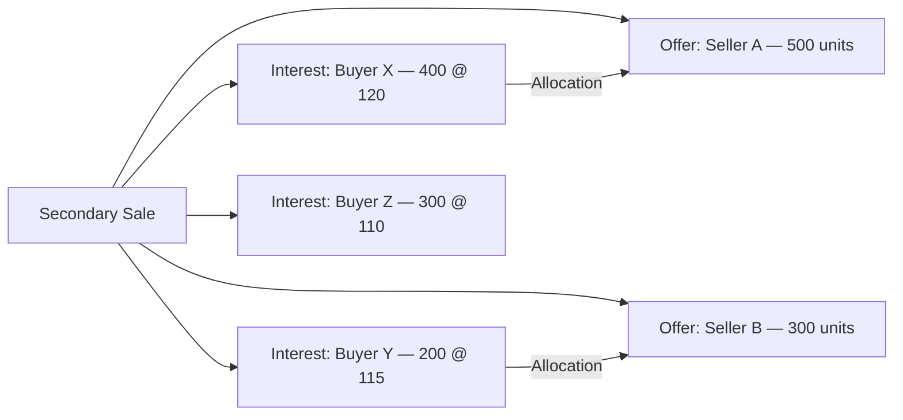
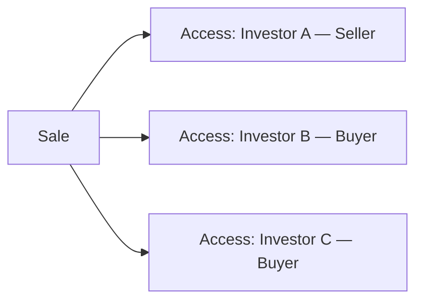
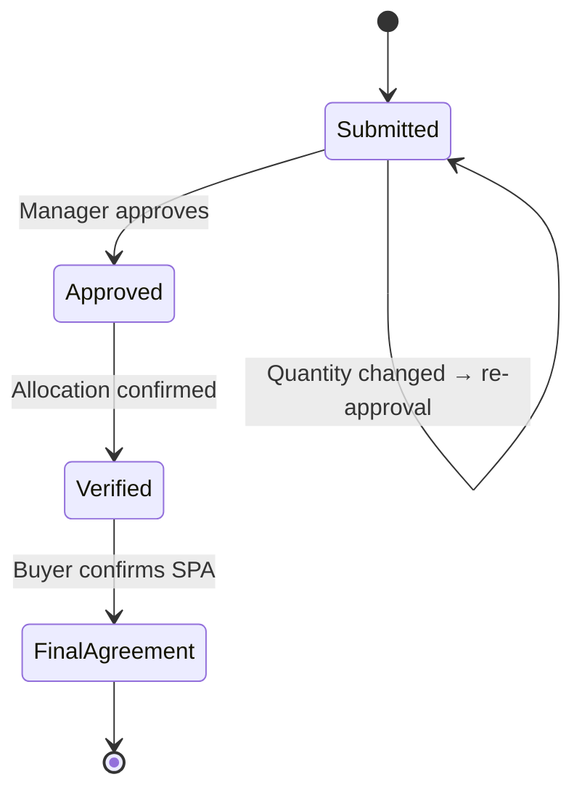
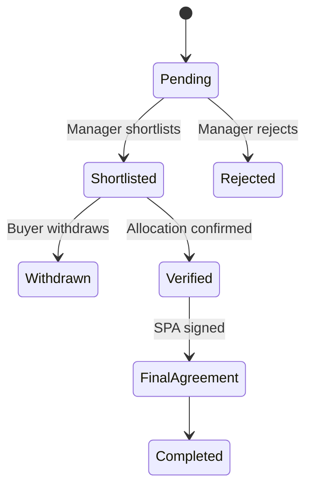
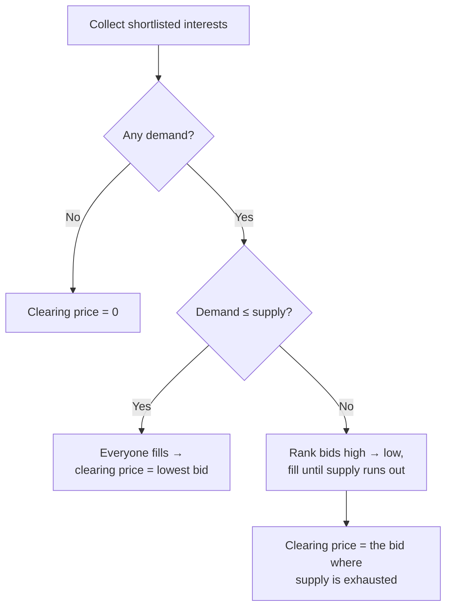

# Secondary Sales User Guide

The secondary sales module is a two-sided marketplace for transferring fund interests between **sellers** (existing investors exiting some or all of their stake) and **buyers** (new investors, or existing LPs buying more). This guide covers setting up a sale, managing offers and interests, running the clearing/allocation process, and generating the purchase agreements (SPAs).

---

## Table of Contents

1. [Key Concepts](#key-concepts)
2. [How the Marketplace Works](#how-the-marketplace-works)
3. [The Sale Lifecycle](#the-sale-lifecycle)
4. [Creating a Secondary Sale](#creating-a-secondary-sale)
5. [Price Types](#price-types)
6. [Sale Types: Regular vs Tranche](#sale-types-regular-vs-tranche)
7. [Giving Buyers and Sellers Access](#giving-buyers-and-sellers-access)
8. [Seller Offers](#seller-offers)
9. [Buyer Interests and Shortlisting](#buyer-interests-and-shortlisting)
10. [The Clearing Price](#the-clearing-price)
11. [Allocations](#allocations)
12. [Verification and Final Agreement](#verification-and-final-agreement)
13. [Generating the SPA](#generating-the-spa)
14. [Escrow](#escrow)
15. [Advisor Fees](#advisor-fees)
16. [Document Templates](#document-templates)
17. [Notifications](#notifications)
18. [Worked Example](#worked-example)
19. [Frequently Asked Questions](#frequently-asked-questions)

---

## Key Concepts

| Term | Meaning |
|------|---------|
| **Secondary Sale** | The overall marketplace event, with a submission window. |
| **Offer** | A seller's listing of units they want to sell. |
| **Interest** | A buyer's bid to acquire units at a price. |
| **Allocation** | A confirmed match between an offer and an interest. |
| **Clearing Price** | The price at which supply and demand balance. |
| **Shortlisted** | An interest moved into active consideration. |
| **SPA** | Share Purchase Agreement — the legal transfer document. |
| **Escrow** | Buyer funds held pending completion. |

---

## How the Marketplace Works

Sellers submit offers; buyers submit interests. The fund manager shortlists interests, determines the clearing price, and creates allocations matching offers to interests.

---

## The Sale Lifecycle

```mermaid
flowchart LR
    A[Sale created] --> B[Sellers submit offers]
    B --> C[Buyers submit interests]
    C --> D[Manager shortlists interests]
    D --> E[Clearing price determined]
    E --> F[Allocations created]
    F --> G[Offers verified]
    G --> H[SPA generated]
    H --> I[Interests verified]
    I --> J[Final agreement signed]
    J --> K[Escrow released]
    K --> L[Transfer complete]
```

---

## Creating a Secondary Sale

Go to **[Entity] → Secondary Sales → New**.

**Required:**

| Field | Notes |
|-------|-------|
| **Name** | Unique within your entity. |
| **Start Date** | When participants can begin submitting. |
| **End Date** | The submission deadline. |
| **Percent Allowed** | The most a seller may offer, as a percentage of their units. |

**Optional but important:**

| Field | Notes |
|-------|-------|
| **Sale Type** | Regular or Tranche. |
| **Price Type** | Fixed Price or Price Range. |
| **Final Price** | Required for Fixed Price. |
| **Min / Max Price** | Required for Price Range. |
| **Show Quantity** | Show buyers the "Actual" or only "Indicative" quantity. |
| **Support Email** | Contact for participant queries. |
| **Manage Offers / Interests** | Whether the fund manager can add offers/interests on participants' behalf. |

---

## Price Types

| Type | Behaviour |
|------|-----------|
| **Fixed Price** | Everything trades at one set price — no negotiation. The min and max are both set to that price. |
| **Price Range** | A min–max band; buyers bid within it and the system computes a clearing price. |

---

## Sale Types: Regular vs Tranche

| Type | Use |
|------|-----|
| **Regular** | A standard one-off secondary event. |
| **Tranche** | A phased transfer, allocating and verifying in multiple rounds — useful for large transactions completed over time. |

---

## Giving Buyers and Sellers Access

Access is granted per participant, each marked as a **Buyer** or a **Seller**. Only investors with the right access can view and submit. Grant access under **Secondary Sale → Access Rights → Add**.

An investor can be granted **both** roles, letting them sell some units and bid for others in the same sale.

---

## Seller Offers

An **offer** is a seller's willingness to sell a quantity at a price. Create one under **Secondary Sale → Offers → New** (or sellers submit via their portal).

| Field | Notes |
|-------|-------|
| **Investor** | The seller (must have Seller access). |
| **Quantity** | Units to sell. |
| **Price** | Price per unit (set to the final price for Fixed Price sales). |
| **Tax ID** | The seller's identifier. |
| **Bank Account / IFSC** | For settlement. |
| **Buyer** (optional) | A pre-agreed direct buyer, if any. |
| **Auto Match** | Whether the offer takes part in automatic matching. |

Changing an offer's quantity sends it back for approval. Fund managers approve offers after checking quantity and eligibility, and only approved offers count toward the total offered.

---

## Buyer Interests and Shortlisting

An **interest** is a buyer's bid for a quantity at a price.

| Field | Notes |
|-------|-------|
| **Investor / Buying Entity** | The buyer. |
| **Quantity** | Units desired. |
| **Price** | The bid (within the band for Price Range sales). |
| **Tax ID** | The buyer's identifier. |
| **Escrow Deposited** | Whether escrow funds are in. |

The fund manager **shortlists** interests for active consideration; only shortlisted interests count toward total demand and take part in clearing and allocation.

---

## The Clearing Price

For Price Range sales, the clearing price is the single price at which the transaction settles.

In plain terms:

- **If demand is at or below supply**, every buyer is filled and the clearing price is the **lowest** accepted bid.
- **If demand exceeds supply**, the **highest** bidders are prioritised, and the clearing price is the marginal bid where supply runs out.

The result becomes the sale's final price.

---

## Allocations

An **allocation** links one offer to one interest, recording the quantity and price of the match and whether both sides have confirmed it. Confirming an allocation marks both the offer and the interest as verified.

Allocations can be created **manually** by the fund manager or by the **automatic matching engine** (for offers set to auto-match). You can configure custom matching rules on the sale to enforce specific pairings — for example matching by geography or investor category.

---

## Verification and Final Agreement

After allocation:

1. **Verify the offer** — confirm the seller's details (tax ID, bank account); identity and bank checks run in the background.
2. **Verify the interest** — confirm the buyer's details, with the same background checks.
3. **Final agreement** — both sides acknowledge the SPA.

Verification needs the participant's full name, address, tax ID, and bank details to be present.

---

## Generating the SPA

A Share Purchase Agreement is generated automatically when an offer is verified, provided an **Offer Template** document is attached to the sale. It pulls the seller's details from the offer, the buyer's from the matched interest, and the signatory emails from each side. The SPA is stored in the offer's folder and can be sent for [e-signing](esigning_user_guide). A separate buyer-side SPA can be produced from a **Buyer Template**.

---

## Escrow

Buyers can record that their escrow funds are in by marking **Escrow Deposited** on their interest. This is tracked for operations; the system doesn't move the money itself.

---

## Advisor Fees

The sale supports advisor fee calculation:

| Fee type | How it's calculated |
|----------|---------------------|
| **Per Share** | Allocated quantity × fee per share. |
| **Percentage** | Allocated amount × fee percentage. |
| **Flat** | A fixed fee regardless of quantity. |

Fees are computed per offer and totalled per buying entity.

---

## Document Templates

Documents attached to the sale with specific owner tags act as templates:

| Tag | Used for |
|-----|----------|
| **Offer Template** | Seller-side SPA generation. |
| **Buyer Template** | Buyer-side SPA generation. |
| **Seller / Buyer** | General party documents. |
| **Allocation Template** | The allocation confirmation document. |

For each Offer Template, the system adds header and footer slots to the offer's documents.

---

## Notifications

You choose which employees are notified per sale. When something happens (a new offer or interest, a status change), notifications go to those employees, the investor's relationship managers, and the investor's approved contacts. You can suppress offer or interest emails on the sale, and send ad-hoc messages to groups such as All Sellers, All Buyers, Approved Sellers, Verified Sellers, or Shortlisted Buyers.

---

## Worked Example

A Price Range sale with a **600-unit** supply (Seller A 500, Seller B 100) and a band of 110–125.

Shortlisted bids:

| Buyer | Quantity | Bid |
|-------|----------|-----|
| Buyer X | 400 | 120 |
| Buyer Y | 200 | 115 |
| Buyer Z | 300 | 110 |

Total demand = 900 units against 600 of supply, so **demand exceeds supply** — highest bidders first:

1. Buyer X (120) takes 400 → 200 units of supply left.
2. Buyer Y (115) takes the remaining 200 → supply exhausted.
3. Buyer Z (110) is not filled.

Supply runs out at Buyer Y's bid, so the **clearing price is 115**, and that becomes the sale's final price. The manager then creates allocations — Buyer X 400 and Buyer Y 200, drawn from Seller A and Seller B's offers — verifies both sides, and SPAs are generated for signing.

If instead total demand had been **500 units (≤ 600 supply)**, everyone would fill and the clearing price would be the **lowest** accepted bid (110).

---

## Frequently Asked Questions

**Can a buyer also be a seller in the same sale?**
Yes — grant the investor both Buyer and Seller access, so they can offer units and bid at the same time.

**What if the clearing price leaves some interests unfilled?**
Bids below the clearing price stay shortlisted but unallocated. The manager can reject them or leave them pending in case more supply appears.

**Can allocations be changed after creation?**
Yes, until either side is verified. Once verified, the SPA process has begun and the allocation is effectively locked.

**How do I run a fixed-price sale?**
Set Price Type to **Fixed Price** and a **Final Price**. All offers and interests use that price and the clearing calculation is skipped.

**Can I run a sale without a template document?**
Yes, but SPAs won't be generated automatically. You can still manage the offer/interest/allocation lifecycle.

**How does auto-match work?**
Offers set to auto-match are eligible for the automatic engine, which pairs offers and interests by price compatibility and any custom matching rules you've configured.

**What's a Tranche sale?**
A phased transfer — allocation and verification can be repeated across rounds, for large transactions completed over time.

**Who is notified when an offer is submitted?**
The employees you've configured on the sale, plus the investor's relationship managers and approved contacts. If no employees are configured, no employee emails are sent.
