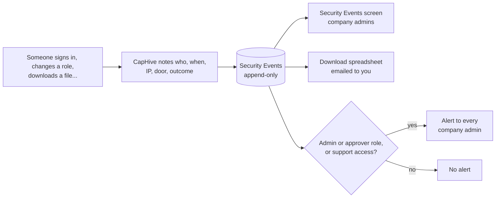
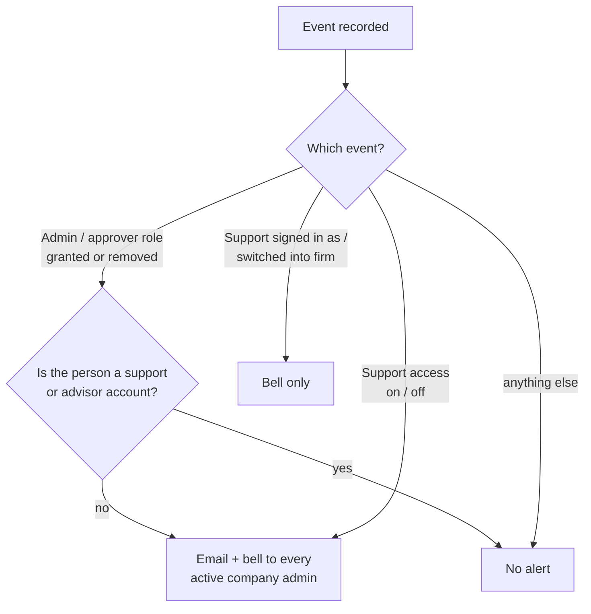

# Security Events User Guide

Security Events is your firm's read-only log of every security-relevant moment: sign-ins and refused sign-ins, two-factor and password changes, role and support-access changes, API keys, signed-out phones, connected apps and data downloads.

> **Where to find it:** Company menu (the house icon at the top right) → [**Security Events**](/security_events). Only **company admins** see it (CapHive support and super users see it too, for the firms they look after). It opens on the last 30 days.

It's written for company admins and compliance reviewers who need to answer "who got in, who was refused, who gave whom more power, and what left the system?"

---

## Table of Contents

1. [Key Concepts](#key-concepts)
2. [How an Event Gets Recorded](#how-an-event-gets-recorded)
3. [What Is Recorded](#what-is-recorded)
4. [Reading the Screen](#reading-the-screen)
5. [Filtering the List](#filtering-the-list)
6. [The "What to do" Popup](#the-what-to-do-popup)
7. [Downloading a Spreadsheet](#downloading-a-spreadsheet)
8. [Alerts to Company Admins](#alerts-to-company-admins)
9. [Worked Examples](#worked-examples)
10. [How Long Events Are Kept](#how-long-events-are-kept)
11. [Frequently Asked Questions](#frequently-asked-questions)
12. [Related Guides](#related-guides)

---

## Key Concepts

| Term | Meaning |
|------|---------|
| **Event** | One security-relevant moment, such as a sign-in, a role granted or a download. One row on the screen. |
| **Group** | The family an event belongs to: **Sign-in**, **Two-factor**, **Account**, **Access**, **Support access**, **Credentials**, **Data export**. |
| **Outcome** | **Succeeded**, or **Failed**: a refused sign-in, a wrong two-factor code, a refused key or link. |
| **Account** | The person the event is about. |
| **Done by** | The person who did it. **System** means an automatic job, or nobody signed in yet (a refused sign-in). |
| **Door** | How the person reached CapHive: the website, the website plus a code, a sign-in link, the mobile app, the API, a mail add-in, a connected app, and so on. |
| **IP** | The internet address the request came from. |
| **Region** | The CapHive region that recorded the event (**IN** or **US**). |
| **Append-only** | Events can't be edited or deleted by anyone, including CapHive. A correction is a new event (a role removed after a role granted). |
| **Fingerprint** | When someone types an email that has no account, the email itself is never stored. Only a one-way fingerprint of it is kept, so you can still search for it. |

### Security Events vs the Audit Trail

- **Audit Trail** answers "what changed in this record?": field-by-field history of funds, investors, documents and so on.
- **Security Events** answers "who got in, who was refused, and who changed access?", with the IP, the door and the outcome.
- The two don't overlap much. Changing a fund's name shows only in the Audit Trail. A wrong password shows only in Security Events.

---

## How an Event Gets Recorded

- Recording never gets in the way of the action. If recording fails, the sign-in or download still goes ahead.
- If a role change is undone before it's saved (the save fails), nothing is recorded.
- An event shows on the screen a few seconds after it happens, not always instantly.

---

## What Is Recorded

| Group | Events (as the **Event** column shows them) |
|-------|--------------------------------------------|
| **Sign-in** | **Signed in**, **Sign-in failed**, for every door: website, website + code, sign-in link, password reset, mobile app, API sign-in, region switch, app to website, mail add-in, connected app. |
| **Two-factor** | **Wrong two-factor code**, **Two-factor switched on**, **Two-factor switched off**, **Two-factor method set**, **Two-factor method reset**. |
| **Account** | **Password changed**, **Password reset requested**, **Phone number changed** (last two digits only), **Account locked**, **Account unlocked**, **Account deactivated**, **Account reactivated**, **Firm deactivated**. |
| **Access** | **Role granted**, **Role revoked** (shown with the role, such as "Role granted: Approver"), **Support access switched on**, **Support access switched off**. |
| **Support access** | **Support signed in as**, **Support session ended**, **Support switched into the firm**, **Support switched back**. |
| **Credentials** | **API key created**, **API key revoked**, **Phone signed out**, **Connected app authorised**. |
| **Data export** | **Data exported**: every spreadsheet download from a list screen, folder downloads, multi-document downloads, Report Builder downloads and firm data dumps. |

Never recorded: passwords, two-factor codes, tokens, full phone numbers, the filters someone used on a download, or the typed email on a refused sign-in with no matching account.

**Role changes are caught from every route.** That includes the user edit form, imports, investor access approvals and support switches. A role given through an import shows up the same way as one ticked on the user form.

---

## Reading the Screen

The page shows four cards, a table and a pager.

### The cards

Each card counts the rows that match the current filter across **all pages**, not only the page you're on.

| Card | Counts |
|------|--------|
| **Failed sign-ins** | Sign-in rows that failed: wrong passwords, refused links, refused tokens. |
| **Role changes** | Roles granted or removed, by any route. |
| **Support access** | CapHive support signing in as one of your users, ending that session, or switching into your firm. |
| **Exports** | Data that left CapHive: spreadsheet, folder, report and data-dump downloads. |

### The table

| Column | What it shows |
|--------|---------------|
| **When** | The date and time, newest first. |
| **Firm** | Only for CapHive support and super users, who see more than one firm. |
| **Event** | What happened. Click it to show only that kind of event. Hover the ⓘ next to it for the details: the role, why a sign-in was refused, the key's name. |
| **Outcome** | A green **Succeeded** or a red **Failed** badge. |
| **Account** | The person the event is about. The name links to their user page. Blank when the event isn't about one person, such as a firm data dump. |
| **Done by** | Who did it. Support visits are marked **(CapHive support)**. When support was signed in as one of your users, the row says *signed in by CapHive support &lt;name&gt;*. |
| **Door** | How they came in. |
| **IP** | Where the request came from. |
| **Region** | **IN** or **US**. |
| **What to do** | A bulb button that opens the [What to do popup](#the-what-to-do-popup). |

25 rows per page. If the list is empty you'll see **No security events in this period. Widen the dates or clear the filter.**

---

## Filtering the List

Click **Filter** to open the filter panel. It stays open whenever a filter is applied, so you can see why the list is short.

| Field | Use it to |
|-------|-----------|
| **From** / **To** | Set the period. Default: the last 30 days. Longest: 13 months. |
| **Group** | Show one family of events, such as **Access**. |
| **Event** | Show one kind, such as **Sign-in failed**. |
| **Outcome** | **Succeeded** or **Failed** only. |
| **Door** | One way in, such as **Mobile app** or **API sign-in**. |
| **Account** | A name or an email. For CapHive support, a **full** email also finds refused sign-ins on an address that has no account. |
| **IP** | An exact address, such as `49.36.12.8`, to see every account tried from one place. |

- **Apply** runs the filter. **Clear** goes back to the last 30 days, everything shown.
- **Clicking an Event name** is a shortcut: the list keeps your dates and other filters and shows only that kind. A chip with the event name and an **×** appears next to **Filter**. Click it to show every kind again.
- A period longer than 13 months is shortened, and the page says *"The period was shortened to the last 13 months — the trail keeps nothing older."*

---

## The "What to do" Popup

Every row has a bulb button under **What to do**. It opens a popup with:

1. **Who and when**: the account, the time, the outcome, the door and the IP.
2. **What happened**: the event and its details (role, reason, key name).
3. **When this is normal** (green): when you'd expect to see this.
4. **If it wasn't expected** (amber): what to do. Or **No action needed** (grey) when there's nothing to check.

A few of the popup's suggestions need someone else's help. Here's how to do them:

| Popup says | How to do it today |
|------------|--------------------|
| Reset their **two-factor method** on their user page | Open the person from **Users** → **Reset 2FA Method** in the Two-Factor Authentication row. |
| Remove or give back a **role** on their user page | Open the person → **Edit** → change their roles → save. |
| Switch **support access** off on their user page | Open the person → **Edit** → turn off **Enable support** → save. |
| **Reset their password** | Company admins have no password-reset button for another user. Ask the person to use **Reset Password** on the sign-in page. |
| **Deactivate** or **reactivate** them on their user page | Company admins have no deactivate switch. Write to support@caphive.com and CapHive support will do it. |
| **Revoke the key** on their API tokens page | Only the key's owner can open their **API tokens** page (from their own profile). Ask them to revoke it, or write to support@caphive.com. |

---

## Downloading a Spreadsheet

Click **Download** (top right). CapHive builds the spreadsheet in the background and **emails it to you**. The page shows *"Your request is being processed. You will receive an email shortly."*

- The spreadsheet holds **every row the current filter shows, across all pages**, not only the page on screen.
- Columns: When, Firm, Group, Event, Details, Outcome, Account (name and email), Done by, On behalf of, Door, IP, Browser, Region, Request id.
- The email is titled **Your security events spreadsheet**. It contains sign-in addresses and names, so keep it inside your firm and delete it after your review.
- CapHive checks your access again when it builds the file. If you lost the company admin role after clicking, you get only what you're allowed to see now.
- Downloading this spreadsheet is itself a spreadsheet download, so it shows up as a **Data exported** event.

---

## Alerts to Company Admins

Some events are worth knowing about the moment they happen. CapHive sends these to **every active company admin of the firm**, including the person who made the change. You can't switch these alerts off.

| Event | Email | Bell |
|-------|:-----:|:----:|
| **Company admin** or **approver** role granted or removed | ✅ | ✅ |
| **Support access switched on / off** for one of your users | ✅ | ✅ |
| CapHive **support signed in as** one of your users | — | ✅ |
| CapHive **support switched into the firm** | — | ✅ |

- The email subject reads *Security alert: Approver role given to Priya Shah* (or similar). It says who did it, the IP, why you got it, and what to do if you didn't expect it. It has an **Open Security Events** button.
- The bell notification uses the same sentence and opens the Security Events page.
- **No alert** for employee or investor roles, sign-in failures, downloads or two-factor changes. Those are only on the screen.
- **No alert** for role changes on CapHive support or investor advisor accounts. Their roles are re-given each time they switch firm or persona, which would flood your inbox. Support switching into your firm still shows in your bell.
- CapHive support users visiting your firm are never on the alert list.

---

## Worked Examples

### Example 1: Someone is guessing a password

- **Situation:** The **Failed sign-ins** card shows 40 for the last 30 days. Usually it's 2 or 3.
- **Step 1.** Click **Filter** → **Event** = **Sign-in failed** → **Apply**. Most rows show the same IP, `203.0.113.7`, over one evening.
- **Step 2.** Click the bulb on one row. The popup says: *"Many for one account, or from an IP you don't recognise, may be someone guessing…"*
- **Step 3.** Put `203.0.113.7` in **IP** → **Apply**. It tried three accounts: two staff members and one email with no account (blank **Account**).
- **Step 4.** One staff member also has an **Account locked** row (reason *too many passwords*). Six wrong passwords in a row lock the account.
- **What to do:** Ask both people whether it was them. Ask them to change their password through **Reset Password** on the sign-in page. Turn on two-factor for them if it's off, and write to support@caphive.com with the IP.

### Example 2: An approver role nobody asked for

- **Situation:** You get an email, *Security alert: Approver role given to Rahul Mehta*. Done by: Anita Rao.
- **Step 1.** Click **Open Security Events**. The row reads **Role granted: Approver**, **Done by** Anita Rao, **Door** Website.
- **Step 2.** Ask Anita. If she made the change on purpose, there's nothing more to do.
- **Step 3.** If not: open Rahul's user page → **Edit** → remove **Approver** → save. A new row **Role revoked: Approver** appears, and every admin gets a second email.
- **Step 4.** The original row stays. Nothing in Security Events can be deleted, so the full story is kept.

### Example 3: A refused sign-in for an email that has no account

- **Situation:** A partner says "I tried to sign in as priya@fund.com and it didn't work", but no account has that email.
- **Step 1.** As a company admin, type `priya@fund.com` in **Account** → **Apply**. Nothing shows.
- **Why:** With no account behind the email, CapHive can't tell which firm the attempt was for, so the row belongs to no firm. Rows with no firm are visible only to CapHive support and super users.
- **Step 2.** Write to support@caphive.com with the email and roughly when they tried. Support types the **full** email in **Account** and finds the attempt through its fingerprint. A partial name won't match a fingerprint.
- **Most likely answer:** The partner's account was created under a different email, or not created yet. Check **Users** (or the stakeholder's users) for the address they actually have.

---

## How Long Events Are Kept

- **13 months**: a full year for the annual review plus a month's margin.
- Every night, events older than that are deleted automatically. Nothing younger is ever deleted.
- That's why the **From** date can't go back further than 13 months.
- CapHive also reviews every region's events every Monday as part of its own security review. That review is internal to CapHive, and no email goes to your firm.

---

## Frequently Asked Questions

### Navigation and getting there

**Where do I find Security Events?**
Open the Company menu (the house icon at the top right) and click [**Security Events**](/security_events). The page opens on the last 30 days of events for your firm. Only company admins see the menu item.

**Why don't I see Security Events in the Company menu?**
Only company admins, CapHive support and super users can open it. Employees, approvers, investors and advisors don't see it, including approvers, whose actions it watches. Ask a company admin in your firm to give you the company admin role if you need it.

**Can investors or advisors see the security events log?**
No. Investors, stakeholder users and investor advisors never see Security Events, even for their own sign-ins. Only your firm's company admins (and CapHive support for the firms it looks after) can open it.

**What is the difference between Security Events and the Audit Trail?**
The Audit Trail shows field-by-field changes to records such as funds, investors and documents. Security Events shows who signed in, who was refused, who changed roles or support access, and what was downloaded, with the IP and how they came in. A wrong password appears only in Security Events.

**Can CapHive support see our security events?**
Yes, but only while your firm lets support in. Support users see the events of firms mapped to them that have support switched on. A firm that turns support off drops out of their view. Super users see every firm.

### Creating, updating and managing security events

**Can I edit or delete a security event?**
No. Nobody can edit or delete a security event, not company admins and not CapHive. A correction is a new event, for example a **Role revoked** row after a **Role granted** row, so the full history stays visible.

**How do I filter security events by person?**
Click **Filter**, type a name or an email in **Account**, and click **Apply**. "Priya Shah" matches first and last name, and one word matches a first name, last name or email. Clear the field to see everyone again.

**How do I see every sign-in attempt from one IP address?**
Click **Filter**, type the exact address (such as 49.36.12.8) in **IP**, and click **Apply**. The list then shows every account tried from that address, successful and refused, which helps spot someone guessing passwords across several accounts.

**How do I see only failed sign-ins?**
Click **Filter**, set **Event** to **Sign-in failed** (or **Outcome** to **Failed** for every kind of failure), and click **Apply**. The **Failed sign-ins** card above the table counts those rows across all pages.

**How do I show only one kind of event quickly?**
Click the event's name in the **Event** column. The list keeps your dates and other filters and shows only that kind. A chip with the event name and an × appears next to **Filter**. Click the chip to show every kind again.

**How do I change the period on Security Events?**
Click **Filter** and set **From** and **To**, then **Apply**. The default is the last 30 days. The longest period is 13 months, which is everything the log keeps. A longer period is shortened, and the page says so.

**How do I download security events to Excel?**
Set the filter you want and click **Download** at the top right. CapHive builds the spreadsheet in the background and emails it to you as **Your security events spreadsheet**. It holds every row the filter shows across all pages, not just the page on screen.

**How do I find a refused sign-in for an email that has no account?**
Company admins can't: with no account behind the email, the attempt belongs to no firm, and only CapHive support and super users see those rows. Write to support@caphive.com with the email and the time. Support searches the full address; only a one-way fingerprint of it is stored.

**Are there bulk actions on Security Events?**
No. Security Events is read-only: there are no bulk actions, no row selection and no edit or delete buttons. You can filter, open the **What to do** popup on each row, and download the filtered rows as a spreadsheet.

### Why use security events

**Why does CapHive keep a security events log?**
It lets your firm answer who got in, who was refused, who gave whom more access, and what data left CapHive, with times, IP addresses and how they came in. That evidence is what security reviews, investor due diligence questionnaires and audits ask for.

**Why should I check Security Events regularly?**
Problems show up here before they cause harm: many failed sign-ins from one IP, an approver role nobody asked for, or an unexpected large download. A short weekly look at the four cards and anything marked **Failed** is usually enough.

**Why can't my firm turn off some security events or alerts?**
The list of events and the admin alerts are fixed by CapHive, so nobody, including someone with bad intent and admin access, can quietly mute the watch on their own firm. Alerts go only for admin, approver and support-access changes, so the volume stays small.

### What happens when I …

**What happens when someone in my firm is given the company admin or approver role?**
A **Role granted** row is recorded, and every active company admin of your firm, including the person who made the change, gets an email titled **Security alert: …** and a bell notification. Removing the role does the same with **Role revoked**. Other roles are recorded without an alert.

**What happens when CapHive support signs in as one of our users?**
A **Support signed in as** row is recorded and every company admin gets a bell notification, but no email. Actions taken during the visit show **(CapHive support)** or *signed in by CapHive support* in **Done by**. A **Support session ended** row is recorded when they finish.

**What happens when CapHive support switches into our firm?**
A **Support switched into the firm** row is recorded and your company admins get a bell notification (no email). Switching back records **Support switched back**. If nobody in your firm asked for help, write to support@caphive.com.

**What happens when someone turns support access on or off for a user?**
Turning **Enable support** on or off on a user's edit form records **Support access switched on** or **Support access switched off**. Every active company admin gets both an email and a bell notification, so an unexpected change is seen at once.

**What happens when I click Download on Security Events?**
The page says *"Your request is being processed. You will receive an email shortly."* and CapHive emails you a spreadsheet of every row your filter shows. Your access is checked again when the file is built. The download is recorded as a **Data exported** event.

**What happens when a user types the wrong password too many times?**
Each wrong password is a **Sign-in failed** row. After 6 in a row the account locks and an **Account locked** row is recorded with the reason *too many passwords*. When the lock clears, **Account unlocked** is recorded. Too many wrong two-factor codes also lock the account.

**What happens when someone downloads a spreadsheet from a list screen?**
Every spreadsheet download from a list screen (capital calls, investors and so on) records a **Data exported** row with the screen it came from. Folder downloads, multi-document downloads, Report Builder downloads and firm data dumps are recorded too. The filters they used aren't stored.

**What happens to old security events?**
Events are kept for 13 months, then deleted automatically at night. That's a full year for the annual review plus a month's margin. Nothing younger is ever deleted, and no person can delete events by hand.

**What happens when I click the bulb in the What to do column?**
A popup opens for that row: who and when, what happened with its details, **When this is normal**, and either **If it wasn't expected** with the step to take, or **No action needed**. It changes nothing; it only explains the event.

### Troubleshooting and edge cases

**Why is the Security Events list empty?**
No events matched the period and filter. The page says *"No security events in this period. Widen the dates or clear the filter."* Click **Clear** to go back to the last 30 days with every event shown, or move **From** earlier.

**Why was my date range shortened on Security Events?**
The log keeps only 13 months, so a longer period is cut to the last 13 months and the page says *"The period was shortened to the last 13 months — the trail keeps nothing older."* Older events no longer exist and can't be recovered.

**Why is the Account column blank on some security events?**
The event isn't about one person. Typical cases are a firm-wide change such as **Firm deactivated** or a firm data dump, or (for CapHive support) a refused sign-in on an email with no account. For those refused sign-ins, only a fingerprint of the typed address is kept.

**Why does Done by say System?**
**System** means an automatic job made the change, or nobody was signed in yet. A refused sign-in, for example, happens before anyone is signed in. It doesn't mean CapHive staff did it; support visits are marked **(CapHive support)**.

**Why didn't I get an email alert for a role change?**
Alerts go only for the company admin and approver roles. Employee, investor and other roles are recorded without an alert. Role changes on CapHive support and investor advisor accounts don't alert either, because those roles are re-given every time they switch. Deactivated admins get no alerts.

**Why did I get a bell notification but no email for a support visit?**
Support signing in as one of your users, or switching into your firm, is announced in the bell only, never by email. Role and support-access changes still send both an email and a bell notification.

**Why don't the cards match the rows on the page?**
The cards count every row the filter matches across **all** pages, while the table shows 25 rows per page. Use the pager, or **Download** for the full list. The cards and the download always cover the same rows.

**Why don't I see an event that just happened?**
Events are written a few seconds after the action, in the background. Refresh the page after a moment. If it still isn't there, check the **From** / **To** dates and any filter chip next to **Filter**.

**The What to do popup says to deactivate a user or reset their password. How do I do that?**
Company admins have no deactivate switch or password-reset button for another person. Ask the person to use **Reset Password** on the sign-in page, and write to support@caphive.com to have an account deactivated or reactivated. Reset a two-factor method with **Reset 2FA Method** on their user page.

**The What to do popup says to revoke an API key. How do I do that?**
Only the key's owner can open their **API tokens** page, from the button on their own profile. Ask the person to revoke the key there, or write to support@caphive.com if they can't. Revoking records an **API key revoked** event.

**Is the downloaded security events spreadsheet safe to share?**
Keep it inside your firm. It contains names, email addresses, IP addresses and browser details. Delete it once your review is done. Text that looks like a spreadsheet formula is stored as plain text, so opening the file never runs anything.

---

## Related Guides

- [User Role Management](user_role_management_user_guide) — the company admin role that opens this screen, and how roles are given and removed.
- [Two-Factor Authentication](two_factor_authentication_user_guide) — switching on and resetting the two-factor methods recorded here.
- [Audit Trail](audit_trail_user_guide) — field-by-field history of records, the companion to this log.
- [Entities](entities_user_guide) — your firm's settings, including support access.
- [LP Mobile App](lp_mobile_app_user_guide) — the phones that appear as **Phone signed out** and the **Mobile app** door.
