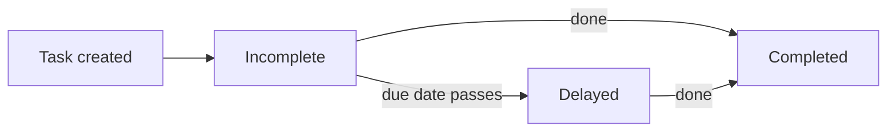
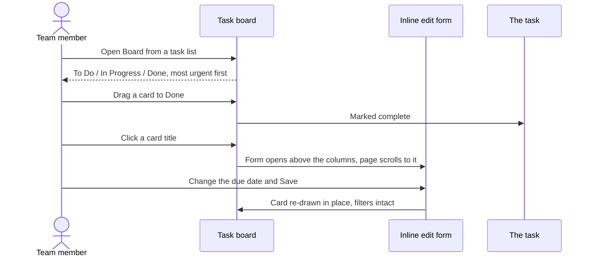
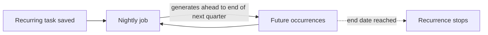

# Tasks User Guide

The **Tasks** module helps your team manage its workload — tracking what's done, what's outstanding, and what's overdue, with recurring tasks, templates for common processes, reminders, and clear categorisation. Work can be viewed as a list or as a Kanban board, including a board covering an entire deal. This guide covers everything from the dashboard to bulk imports.

> **Where to find it:** Sidebar → [**Tasks → All Tasks**](/tasks) or **My Tasks** (also in the profile menu as **My Task**); a fund's, stakeholder's or deal's own tasks are on the **Tasks** tab of that record. Create one with **New Task** and switch views with **Board**. Company admins see all company tasks; other employees see deal tasks and tasks assigned to them.

---

## Table of Contents

1. [The Tasks Dashboard](#the-tasks-dashboard)
2. [The Task Board](#the-task-board)
3. [A Board for a Whole Deal](#a-board-for-a-whole-deal)
4. [Categories](#categories)
5. [Recurring Tasks](#recurring-tasks)
6. [Task Templates](#task-templates)
7. [Notifications and Reminders](#notifications-and-reminders)
8. [Importing Tasks in Bulk](#importing-tasks-in-bulk)
9. [How Tasks Are Organised](#how-tasks-are-organised)
10. [Finding Tasks](#finding-tasks)
11. [Worked Example](#worked-example)
12. [Frequently Asked Questions](#frequently-asked-questions)

---

## The Tasks Dashboard

The Tasks page opens with a summary of where things stand. Each card is clickable and instantly filters the list:

| Card | What it shows |
|------|---------------|
| **Completed** | Tasks finished. |
| **Incomplete** | Tasks still needing action. |
| **Delayed** | Tasks past their due date and not yet done. |
| **Due This Week** | Tasks to prioritise this week. |

---

## The Task Board

Click **Board** on any task list to see the same tasks as a Kanban board: three columns — **To Do**, **In Progress**, **Done** — with one card per task. **List** takes you back. Whatever you had filtered stays filtered, so a board opened from a stakeholder's tasks covers that stakeholder only.

### Moving work along

Drag a card to another column to change its status. Dropping a card in **Done** completes the task, exactly as ticking its checkbox in the list would; dragging it back out reopens it. If a move is rejected, the card springs back and a message explains why.

### What a card shows

The title, who the task is for, the assignee, the due date, and badges for anything notable — **Delayed** in red, the category, the person at the LP the task involves, and any tags.

### Opening a task

- **Click the title** to edit it right there on the board. The form opens above the columns and the page scrolls to it; saving updates the card in place, so you never lose your filters or your position.
- **The ⋮ menu at the bottom-right of a card** offers **Show** (the task's own page), **Edit** (the same inline form) and **Delete** (with a confirmation). Deleting removes just that card and leaves you on the board.

### Filters

Above the columns: **assignee**, **stakeholder**, **contact** (once a stakeholder is chosen), **tag**, **category** (when tasks use categories) and **due date** (Overdue, Due This Week, Due Next Week, Due This Month, Due Next Month). Each one applies immediately.

### How cards are ordered

- **To Do** and **In Progress** read by urgency: most overdue first, then soonest due, with undated tasks at the bottom.
- **Done** reads by most recently completed, and covers the **last 30 days** — deliberately, so months of finished work cannot bury what is active. The full history is always in the list view under **Show All**.

The board shows up to **500 cards** at once. If there are more, it says so and shows the most urgent 500 — narrow it with the filters, or use the list view, which is paginated.

---

## A Board for a Whole Deal

A deal's **Tasks** tab has its own **Board** button. That board is the entire deal: tasks owned by the deal itself *and* every task raised against any investor on it — which is the only view that answers "what is outstanding on this deal?".

- The icon on each card distinguishes deal-level work from work belonging to a particular investor, and the card names which one.
- The filter above the columns lists **the investors on this deal**, so you can narrow to one of them; choosing an investor then lets you filter to a specific contact at that firm.
- The heading names the deal and links back to it.

The same applies to the list view on that tab: **Show All** and **Incomplete** keep the whole deal in scope, investors included.

---

## Categories

Tasks can be tagged to a functional area for easier organisation and reporting:

- **Standard categories:** Finance, Ops, Compliance, IR, Portfolio Company, or Other.
- **Custom:** choose "Other" and enter your own category name.

---

## Recurring Tasks

Automate anything you do on a regular cadence by setting a recurrence rule:

- **Pattern:** Daily, Weekly, Monthly, Quarterly, or Yearly.
- **Repeat every:** how often it repeats (e.g. "every 2 weeks").
- **End Date (Optional):** a date to stop recurring.

Tick **Make Recurring** in the task form to switch it on; the task you save is the first occurrence. Later occurrences are **not** created when you complete one. A nightly job (01:00 server time) generates occurrences ahead of time, up to the end of the quarter about three months out, each with its own due date. Tasks in a recurrence series — including the first one you saved — send no assignment notification.

To stop a series, edit a task and untick **Make Recurring**, or click **Delete Series** on a task's page. Note that **Delete Series** deletes every task in the series *including the task you are viewing*, even though its confirmation says "apart from this task".

---

## Task Templates

Task templates are checklists per record type with relative due dates (e.g. "due in 5 days"), listed on the [**Task Templates**](/task_templates) page (no menu link). Templates exist for:

- Capital commitments and calls
- Distributions and remittances
- KYC (individual and non-individual)
- Offers and interest tracking

The current screens have no button that generates tasks from a template, and the template list is not separated per company, so ask CapHive support before relying on or changing templates.

---

## Notifications and Reminders

- **Save alerts:** every time a task is saved from the form or the completion checkbox, the assignee (and the creator, if the task has no response) gets an in-app notification and email — not only when it is first assigned. Tasks created by import or by a recurrence, and cards moved on the board, send nothing.
- **Multiple reminders:** there is no reminder section on the task form or page, and no screen links to a task's reminder list, so ask CapHive support to open it for you; there, click **New Reminder** for each one. Reminders are date-based, not time-based (e.g. one a week before and one the day before — "one hour before" is not possible).

---

## Importing Tasks in Bulk

For large workloads, use **Import Tasks** to upload a spreadsheet that creates many tasks at once — assigning owners, setting categories, and applying due dates in a single step.

---

## How Tasks Are Organised

Documents attached to a task are automatically filed into folders by the task's category, making them easy to browse within document management:

- **Tasks / Finance**
- **Tasks / Compliance**
- **Tasks / Portfolio Company**
- **Tasks / General** (for tasks with no category)

---

## Finding Tasks

Use the buttons and filter bar above the list to narrow it by:

- **Status** — **Show All** or **Incomplete**, or the **Completed** / **Incomplete** cards.
- **Assignee** — your tasks (**My Tasks**) or a specific team member's.
- **Tags** and **Category** — any tags or category set on the task.
- **Due date** — Overdue, Due This Week, Due Next Week, Due This Month or Due Next Month; the **Delayed** card shows only tasks past their due date.

Company admins see every task; other employees see only tasks on deals and deal investors plus tasks assigned to them — not unassigned tasks outside deals, even ones they created.

---

## Worked Example

Setting up a quarterly compliance review for your team:

1. Create a task "Quarterly compliance review", category **Compliance**, assigned to a colleague.
2. Tick **Make Recurring**, set **Pattern** to **Quarterly**, leave the end date open, and **Save**. Because the task is part of a recurrence series, the colleague is **not** emailed — tell them directly; it shows in their **My Tasks**.
3. Add two reminders on the task's reminder list (see [Notifications and Reminders](#notifications-and-reminders)): one dated **a week before** and one **the day before** the due date.
4. Documents attached to the task are filed under **Tasks / Compliance**.
5. The nightly job generates the coming quarters' occurrences ahead of time; if one is missed, it appears under **Delayed** on the dashboard, highlighted in red.

---

## Frequently Asked Questions

### Navigation and getting there

**Where do I find Tasks in CapHive?**
Sidebar → [**Tasks → All Tasks**](/tasks) for the company-wide list with the **Completed**, **Incomplete**, **Delayed** and **Due This Week** cards. Under **All Tasks** there is a link per category and [**Deal Tasks**](/tasks/deal_tasks). See [The Tasks Dashboard](#the-tasks-dashboard).

**How do I see only the tasks assigned to me?**
Sidebar → **Tasks → My Tasks**, or click your avatar and choose **My Task**. Both open the task list filtered to tasks assigned to you.

**Where are the tasks for a fund, stakeholder or deal?**
Open the record and click its **Tasks** tab: a fund, a stakeholder (investor), a deal, and also commitments, portfolio investments, KPI reports, documents and investment opportunities. The tab lists only that record's tasks and has its own **New Task**, **Board**, **Show All** and **Incomplete** buttons.

**How do I open the Kanban board?**
Click **Board** above any task list; the board opens with the same filters. **List** takes you back. On a deal's **Tasks** tab the board covers the whole deal, including every investor on it. See [The Task Board](#the-task-board).

**Who can see and manage tasks?**
Company admins see and manage every task of the company. Other employees see tasks on deals and deal investors plus tasks assigned to them, and can create tasks that have no owner or whose owner record they may update. Investor advisors cannot open the task list. Support-only tasks are visible to CapHive support users.

### Creating, updating and managing tasks

**How do I create a task?**
Click **New Task** on [**All Tasks**](/tasks) or on a record's **Tasks** tab, then fill in **Details**, **Due Date** (defaults to one week out), **Category**, **Assigned to**, **Tags** and, on a record tab, **For** (the owner). **Save**. Created from a record's tab, the owner is pre-filled and locked to that record.

**How do I assign a task to a team member?**
Choose the person in **Assigned to** on the task form; the list offers your company's employees. They get an in-app notification and an email as soon as the task is saved.

**How do I edit a task?**
Click **Edit** on the task's row or page, or click the card's title on the board to edit it inline. You need the same rights as for creating it. Editing a task also sends the notification again to the assignee (see "What happens when I save or edit a task?").

**How do I mark a task complete?**
Tick the checkbox on the task's row in the list, or drag its card into **Done** on the board. Untick, or drag it out of **Done**, to reopen it.

**How do I delete a task?**
Click **Delete** on the task's page and confirm, or use the card's **⋮ → Delete** on the board. For a recurring task, the task page also has **Delete Series**. See "What happens when I delete a task?" for what is removed.

**How do I make a task recurring?**
Tick **Make Recurring** on the task form and choose **Pattern** (Daily, Weekly, Monthly, Quarterly or Yearly), **Repeat every** (the interval) and an optional **End Date (Optional)**. The task's **Due Date** is the first occurrence. See [Recurring Tasks](#recurring-tasks).

**How do I stop a task recurring?**
Edit the task and untick **Make Recurring**. That task is detached from the series; to remove the future occurrences as well, open any task in the series and click **Delete Series**.

**How do I import tasks in bulk?**
Click **Import Tasks** on [**All Tasks**](/tasks) or a record's **Tasks** tab. The upload form (import type **Task**) takes a spreadsheet with **Description**, **Status**, **Due Date**, **Category**, **Assignee Email**, **Owner Type**, **Owner Name**, **Update Only**, **Recurring**, **Rrule**, **Start Date** and **End Date**; a sample file is linked on the form. See [Importing Tasks in Bulk](#importing-tasks-in-bulk).

**How do I add a reminder to a task?**
There is no reminder section on the task form or page, and no screen links to a task's reminder list, so ask CapHive support to open it; there, click **New Reminder**, entering a **Note**, one or more comma-separated **Email** addresses and a **Due Date**. Reminders are date-based, not time-based.

**How do I get a weekly summary of tasks by email?**
For a fund company, a company admin opens Company menu → **Company Profile**, clicks **Edit** and ticks **Send weekly task digest**. Only employees tagged "Tasks" receive it, and each sees only the tasks they can already open.

### Why use tasks

**Why should I track work in CapHive Tasks rather than a separate to-do tool?**
Tasks sit on the fund, stakeholder, deal or document they concern, so anyone opening that record sees what is outstanding, and the dashboard cards show what is delayed or due this week. Completing a task on a deal investor also records the interaction on that investor.

**What can I do with Tasks?**
Assign follow-ups with due dates and categories, run recurring compliance or reporting chores, see a whole deal's outstanding work on one board, bulk-import checklists, attach documents to a task, and send a Friday digest of completed, due and delayed work to the team.

**Who typically uses Tasks?**
Fund operations, finance, compliance and investor-relations teams track their own follow-ups; deal teams use the deal board to see what is outstanding across investors; company admins review delayed work on the dashboard and through the weekly digest.

**What happens if I don't set a due date or assignee?**
A task without a due date never shows as **Delayed** or **Due This Week** and sits at the bottom of the board columns. A task without an assignee only notifies its creator and is not in anyone's **My Tasks**, and outside deals no employee except a company admin can see it, not even the one who created it.

### What happens when I …

**What happens when I save or edit a task?**
The task is saved on its owner record and appears in [**All Tasks**](/tasks), the owner's **Tasks** tab and the board. After every save the assignee, and the creator if the task has no **Response**, get an in-app notification and an email whose subject is the task details plus its status. Tasks created by import, by a recurrence or moved on the board do not notify.

**What happens when I mark a task complete?**
The task's status becomes done, today's date is stored as its completion date, and it moves to **Completed** in the list and to **Done** on the board. Ticking the checkbox notifies the assignee and creator as above; dragging to **Done** does not. On a deal investor, the completion is recorded as an interaction.

**What happens when I make a task recurring?**
A recurrence rule is saved with the task's details, and the task you saved becomes the first occurrence. A nightly job (01:00 server time) creates the next occurrences up to the end of the quarter roughly three months ahead, each with its own due date. Completing an occurrence does not create the next one early, and generated occurrences send no notification.

**What happens when I delete a task?**
The task and its reminders are deleted and there is no restore screen. No one is notified. **Delete Series** removes the recurrence rule and every task in the series; the confirmation says "apart from this task", but the task you are viewing belongs to the series and is deleted too.

**What happens when I import tasks?**
Each row creates a task (or, with **Update Only** = Yes, updates the task matching the same owner and due date), owned by the named owner, the record you imported from, or your company. Rows with **Recurring** = Yes create a recurrence rule instead. No notifications are sent, and failing rows are reported in the import's results file.

**What happens when a reminder's date arrives?**
The daily morning job, run at 01:30 server time, sends each unsent reminder whose date is today or earlier to every address in its **Email** field that belongs to a CapHive user, as an in-app notification and email. Addresses without a CapHive login are skipped.

**What happens when a task's due date passes?**
Nothing is sent. The task is counted under **Delayed**, gets a red **Delayed** badge, and moves to the top of the board's To Do or In Progress column. If the weekly digest is on, it is listed under delayed work for up to 90 days.

### Troubleshooting and edge cases

**Can I set more than one reminder?**
Yes. Add several reminders on the task's reminder list (ask CapHive support to open it), each with its own date. They are sent on a date, not at a time, so "one hour before" is not possible.

**What happens if I miss a due date?**
The task moves to the **Delayed** category on the dashboard and is highlighted in red in the list.

**How do recurring tasks work?**
A nightly job generates the occurrences of each recurrence rule ahead of time, up to the end of the quarter about three months out, until the rule's end date. They are not generated when you complete the previous one.

**Can I create my own templates?**
Task templates (checklists per record type such as Capital Commitment, Capital Call, KYC or Offer) are listed on the [**Task Templates**](/task_templates) page (no menu link). The list is not separated per company and the current screens have no button that generates tasks from it, so ask CapHive support before relying on or changing templates. See [Task Templates](#task-templates).

**A task I can see in the list is missing from the board's Done column.**
Done is limited to the last 30 days so that finished work cannot crowd out what is active. Use **Show All** in the list view for the full history.

**I completed a task on the board but the card is still in To Do.**
Reload the board. If it persists, the move was rejected — drag it again and read the message that appears.

**Why can't I complete a task from the edit form?**
Completion is done from the list's checkbox or by dragging the card into **Done** on the board; the edit form covers the task's details rather than its state.

**The board says it is only showing the first 500 tasks.**
That is the display limit, and it keeps the most urgent ones. Filter by assignee, stakeholder or tag to narrow it, or use the list view, which is paginated and shows everything.

**A personal task of mine is not on the deal board.**
The deal board shows tasks owned by the deal or by one of its investors. A task owned by *you* is a personal to-do and never appears there — change its owner if it belongs to the deal.

**A colleague cannot see a task I created. Why?**
Employees who are not company admins only see tasks on deals and deal investors and tasks assigned to them. Assign the task to them, or ask a company admin to give them the company admin role.

**My recurring task's assignee was not emailed. Why?**
Tasks that belong to a recurrence series never send the assignment notification, including the first one you saved. Tell the assignee directly or rely on **My Tasks**.

**Why did the assignee get another email when I only changed the due date?**
The notification is sent after every save of a task from the form or the completion checkbox, not only when it is first assigned. Moving a card on the board is the one change that does not email.

**Does the weekly digest arrive for every company?**
No. It runs every Friday (11:30 UTC by default) only for fund companies with **Send weekly task digest** ticked, and only to active employees tagged "Tasks" who have something to report.

## Related Guides

- [Deals Management](deals_management_user_guide) — deal and deal-investor tasks and the whole-deal board.
- [LP CRM](lp_crm_user_guide) — contacts and touch points that tasks can be linked to.
- [Stakeholders (Investors)](investors_user_guide) — the stakeholder page's Tasks tab.
- [Document Management](document_management_user_guide) — attaching tasks to documents and documents to tasks.
- [Workflow Templates](workflow_templates_user_guide) — structured multi-step review flows when a single task is not enough.
- [User Roles](user_role_management_user_guide) — why company admins see every task and employees see fewer.
- [Custom Fields](custom_fields_user_guide) — adding custom fields to the task form.
