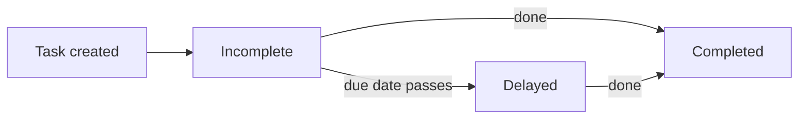

# Tasks User Guide

The **Tasks** module helps your team manage its workload — tracking what's done, what's outstanding, and what's overdue, with recurring tasks, templates for common processes, reminders, and clear categorisation. This guide covers everything from the dashboard to bulk imports.

---

## Table of Contents

1. [The Tasks Dashboard](#the-tasks-dashboard)
2. [Categories](#categories)
3. [Recurring Tasks](#recurring-tasks)
4. [Task Templates](#task-templates)
5. [Notifications and Reminders](#notifications-and-reminders)
6. [Importing Tasks in Bulk](#importing-tasks-in-bulk)
7. [How Tasks Are Organised](#how-tasks-are-organised)
8. [Finding Tasks](#finding-tasks)
9. [Worked Example](#worked-example)
10. [Frequently Asked Questions](#frequently-asked-questions)

---

## The Tasks Dashboard

The Tasks page opens with a summary of where things stand. Each card is clickable and instantly filters the list:

| Card | What it shows |
|------|---------------|
| **Completed** | Tasks finished. |
| **Incomplete** | Tasks still needing action. |
| **Delayed** | Tasks past their due date and not yet done. |
| **Due This Week** | Tasks to prioritise this week. |



---

## Categories

Tasks can be tagged to a functional area for easier organisation and reporting:

- **Standard categories:** Finance, Ops, Compliance, IR, or Other.
- **Custom:** choose "Other" and enter your own category name.

---

## Recurring Tasks

Automate anything you do on a regular cadence by setting a recurrence rule:

- **Frequency:** Daily, Weekly, Monthly, or Yearly.
- **Interval:** how often it repeats (e.g. "every 2 weeks").
- **End condition:** an optional date to stop recurring.

Tick **Make Recurring** in the task form to switch it on. When the current instance is created or completed, the next one is generated automatically.

```mermaid
flowchart LR
    A[Recurring task] --> B[Instance due]
    B -->|created/completed| C[Next instance generated]
    C --> B
    C -.->|end date reached.-> D[Recurrence stops]
```

---

## Task Templates

Templates standardise the steps for common processes, so a whole checklist can be created in one go with sensible due dates pre-filled (e.g. "due in 5 days"). Templates exist for:

- Capital commitments and calls
- Distributions and remittances
- KYC (individual and non-individual)
- Offers and interest tracking

---

## Notifications and Reminders

- **Assignment alerts:** when a task is assigned to someone, they're emailed automatically.
- **Multiple reminders:** set several reminders on a single task to nudge you at different points before the due date (e.g. one day before and one hour before).

---

## Importing Tasks in Bulk

For large workloads, use **Import** to upload a spreadsheet that creates many tasks at once — assigning owners, setting categories, and applying due dates in a single step.

---

## How Tasks Are Organised

Tasks are automatically filed into virtual folders by category, making them easy to browse within document management:

- **Tasks / Finance**
- **Tasks / Compliance**
- **Tasks / General** (for tasks with no category)

---

## Finding Tasks

Use the search and filter panel to narrow the list by:

- **Status** — completed vs. incomplete.
- **Assignee** — your tasks or a specific team member's.
- **Tags** — any custom tags added at creation.
- **Delayed** — only tasks past their due date.

---

## Worked Example

Setting up a quarterly compliance review for your team:

1. Create a task "Quarterly compliance review", category **Compliance**, assigned to a colleague — they're emailed immediately.
2. Tick **Make Recurring**, set frequency **Quarterly**, and leave the end date open.
3. Add two reminders: one **a week before** and one **the day before** the due date.
4. The task files itself under **Tasks / Compliance**.
5. Each quarter, the next instance is generated automatically; if one is missed, it appears under **Delayed** on the dashboard, highlighted in red.

---

## Frequently Asked Questions

**How do I assign a task to a team member?**
Use the "Assigned To" dropdown in the task form. They'll be emailed automatically.

**Can I set more than one reminder?**
Yes — add multiple reminders, each with its own timing (e.g. one day before, one hour before).

**What happens if I miss a due date?**
The task moves to the **Delayed** category on the dashboard and is highlighted in red in the list.

**How do recurring tasks work?**
When you set a recurrence rule, the system generates the next instance automatically once the current one is created or completed.

**Can I create my own templates?**
Yes — build a template for any repeatable process so your team follows the same steps every time.
