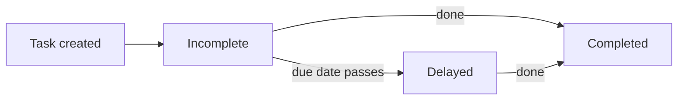
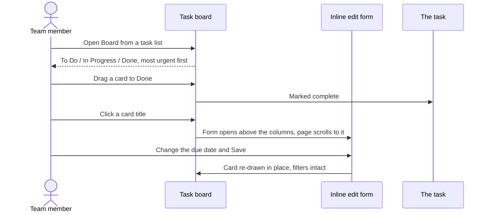

# Tasks User Guide

The **Tasks** module helps your team manage its workload — tracking what's done, what's outstanding, and what's overdue, with recurring tasks, templates for common processes, reminders, and clear categorisation. Work can be viewed as a list or as a Kanban board, including a board covering an entire deal. This guide covers everything from the dashboard to bulk imports.

---

## Table of Contents

1. [The Tasks Dashboard](#the-tasks-dashboard)
2. [The Task Board](#the-task-board)
3. [A Board for a Whole Deal](#a-board-for-a-whole-deal)
4. [Categories](#categories)
5. [Recurring Tasks](#recurring-tasks)
6. [Task Templates](#task-templates)
7. [Notifications and Reminders](#notifications-and-reminders)
8. [Importing Tasks in Bulk](#importing-tasks-in-bulk)
9. [How Tasks Are Organised](#how-tasks-are-organised)
10. [Finding Tasks](#finding-tasks)
11. [Worked Example](#worked-example)
12. [Frequently Asked Questions](#frequently-asked-questions)

---

## The Tasks Dashboard

The Tasks page opens with a summary of where things stand. Each card is clickable and instantly filters the list:

| Card | What it shows |
|------|---------------|
| **Completed** | Tasks finished. |
| **Incomplete** | Tasks still needing action. |
| **Delayed** | Tasks past their due date and not yet done. |
| **Due This Week** | Tasks to prioritise this week. |



---

## The Task Board

Click **Board** on any task list to see the same tasks as a Kanban board: three columns — **To Do**, **In Progress**, **Done** — with one card per task. **List** takes you back. Whatever you had filtered stays filtered, so a board opened from a stakeholder's tasks covers that stakeholder only.

### Moving work along

Drag a card to another column to change its status. Dropping a card in **Done** completes the task, exactly as ticking its checkbox in the list would; dragging it back out reopens it. If a move is rejected, the card springs back and a message explains why.

### What a card shows

The title, who the task is for, the assignee, the due date, and badges for anything notable — **Delayed** in red, the category, the person at the LP the task involves, and any tags.

### Opening a task

- **Click the title** to edit it right there on the board. The form opens above the columns and the page scrolls to it; saving updates the card in place, so you never lose your filters or your position.
- **The ⋮ menu at the bottom-right of a card** offers **Show** (the task's own page), **Edit** (the same inline form) and **Delete** (with a confirmation). Deleting removes just that card and leaves you on the board.

### Filters

Above the columns: **assignee**, **stakeholder**, **contact** (once a stakeholder is chosen) and **tag**. Each one applies immediately.

### How cards are ordered

- **To Do** and **In Progress** read by urgency: most overdue first, then soonest due, with undated tasks at the bottom.
- **Done** reads by most recently completed, and covers the **last 30 days** — deliberately, so months of finished work cannot bury what is active. The full history is always in the list view under **Show All**.

The board shows up to **500 cards** at once. If there are more, it says so and shows the most urgent 500 — narrow it with the filters, or use the list view, which is paginated.



---

## A Board for a Whole Deal

A deal's **Tasks** tab has its own **Board** button. That board is the entire deal: tasks owned by the deal itself *and* every task raised against any investor on it — which is the only view that answers "what is outstanding on this deal?".

- The icon on each card distinguishes deal-level work from work belonging to a particular investor, and the card names which one.
- The filter above the columns lists **the investors on this deal**, so you can narrow to one of them; choosing an investor then lets you filter to a specific contact at that firm.
- The heading names the deal and links back to it.

The same applies to the list view on that tab: **Show All** and **Incomplete** keep the whole deal in scope, investors included.

---

## Categories

Tasks can be tagged to a functional area for easier organisation and reporting:

- **Standard categories:** Finance, Ops, Compliance, IR, or Other.
- **Custom:** choose "Other" and enter your own category name.

---

## Recurring Tasks

Automate anything you do on a regular cadence by setting a recurrence rule:

- **Frequency:** Daily, Weekly, Monthly, or Yearly.
- **Interval:** how often it repeats (e.g. "every 2 weeks").
- **End condition:** an optional date to stop recurring.

Tick **Make Recurring** in the task form to switch it on. When the current instance is created or completed, the next one is generated automatically.

```mermaid
flowchart LR
    A[Recurring task] --> B[Instance due]
    B -->|created/completed| C[Next instance generated]
    C --> B
    C -.->|end date reached.-> D[Recurrence stops]
```

---

## Task Templates

Templates standardise the steps for common processes, so a whole checklist can be created in one go with sensible due dates pre-filled (e.g. "due in 5 days"). Templates exist for:

- Capital commitments and calls
- Distributions and remittances
- KYC (individual and non-individual)
- Offers and interest tracking

---

## Notifications and Reminders

- **Assignment alerts:** when a task is assigned to someone, they're emailed automatically.
- **Multiple reminders:** set several reminders on a single task to nudge you at different points before the due date (e.g. one day before and one hour before).

---

## Importing Tasks in Bulk

For large workloads, use **Import** to upload a spreadsheet that creates many tasks at once — assigning owners, setting categories, and applying due dates in a single step.

---

## How Tasks Are Organised

Tasks are automatically filed into virtual folders by category, making them easy to browse within document management:

- **Tasks / Finance**
- **Tasks / Compliance**
- **Tasks / General** (for tasks with no category)

---

## Finding Tasks

Use the search and filter panel to narrow the list by:

- **Status** — completed vs. incomplete.
- **Assignee** — your tasks or a specific team member's.
- **Tags** — any custom tags added at creation.
- **Delayed** — only tasks past their due date.

---

## Worked Example

Setting up a quarterly compliance review for your team:

1. Create a task "Quarterly compliance review", category **Compliance**, assigned to a colleague — they're emailed immediately.
2. Tick **Make Recurring**, set frequency **Quarterly**, and leave the end date open.
3. Add two reminders: one **a week before** and one **the day before** the due date.
4. The task files itself under **Tasks / Compliance**.
5. Each quarter, the next instance is generated automatically; if one is missed, it appears under **Delayed** on the dashboard, highlighted in red.

---

## Frequently Asked Questions

**How do I assign a task to a team member?**
Use the "Assigned To" dropdown in the task form. They'll be emailed automatically.

**Can I set more than one reminder?**
Yes — add multiple reminders, each with its own timing (e.g. one day before, one hour before).

**What happens if I miss a due date?**
The task moves to the **Delayed** category on the dashboard and is highlighted in red in the list.

**How do recurring tasks work?**
When you set a recurrence rule, the system generates the next instance automatically once the current one is created or completed.

**Can I create my own templates?**
Yes — build a template for any repeatable process so your team follows the same steps every time.

**A task I can see in the list is missing from the board's Done column.**
Done is limited to the last 30 days so that finished work cannot crowd out what is active. Use **Show All** in the list view for the full history.

**I completed a task on the board but the card is still in To Do.**
Reload the board. If it persists, the move was rejected — drag it again and read the message that appears.

**Why can't I complete a task from the edit form?**
Completion is done from the list's checkbox or by dragging the card into **Done** on the board; the edit form covers the task's details rather than its state.

**The board says it is only showing the first 500 tasks.**
That is the display limit, and it keeps the most urgent ones. Filter by assignee, stakeholder or tag to narrow it, or use the list view, which is paginated and shows everything.

**A personal task of mine is not on the deal board.**
The deal board shows tasks owned by the deal or by one of its investors. A task owned by *you* is a personal to-do and never appears there — change its owner if it belongs to the deal.
