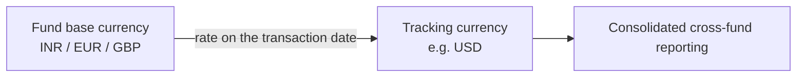

# Tracking Currency Guide

A **tracking currency** is a single reporting currency in which a fund's financial activity is restated, alongside the fund's own base currency. It lets you report consistently across funds that operate in different currencies — for example, viewing an INR fund and a EUR fund side by side, both expressed in USD.

This guide explains what gets converted, which exchange-rate dates are used, and the rules that keep the figures accurate. It's written for finance and reporting teams.

---

## Why a Tracking Currency?

Imagine your firm runs three funds — one in INR, one in EUR, one in GBP — and your investment committee wants one consolidated view in USD. Rather than converting by hand each time, you set a **tracking currency** of USD, and the system automatically keeps a USD figure next to every base-currency figure.

The conversion runs automatically (typically daily) for every fund whose tracking currency differs from its base currency, so the reporting figures are always current.

---

## What Gets Converted

The system restates the key financial records into the tracking currency:

| Area | Tracking figure(s) | What it represents |
|------|--------------------|--------------------|
| **Account entries** | Tracking amount | The entry's value in the tracking currency. |
| **Remittance payments** | Tracking amount | What an investor actually paid. |
| **Capital calls (remittances)** | Tracking call amount, tracking collected amount | The amount requested, and the amount collected. |
| **Distributions** | Tracking net payable, tracking gross payable, tracking reinvestment | The pay-out to investors, before and after deductions, plus any reinvested amount. |
| **Commitment adjustments** | Tracking amount | Any change to an investor's commitment. |
| **Capital commitments** | Tracking committed amount, tracking original committed | The current and original committed amounts. |
| **Portfolio investments** | Tracking cost, tracking FMV | The original investment cost and its current fair market value. |

---

## Which Exchange-Rate Date Is Used

Each record is converted using the rate on the date that best reflects when it actually happened — so the tracking figure mirrors real market conditions at that moment.

| Record | Date used |
|--------|-----------|
| Account entries | The reporting date |
| Remittance payments | The payment date (when money was received) |
| Capital calls | The remittance date (the call's original date) |
| Distributions | The payment date of the distribution |
| Commitment adjustments | The adjustment's "as of" date |
| Capital commitments | The commitment date |
| Portfolio investment cost | The investment date |
| Portfolio investment FMV | The date of the latest valuation |

---

## The Rules That Keep It Accurate

- **Runs automatically.** The conversion runs regularly for any fund whose tracking currency differs from its base currency — no manual step.
- **Percentages aren't converted.** Figures that are percentages (such as "Ownership %") stay as they are — a percentage is currency-neutral, so it keeps a 1:1 value.
- **FMV always refreshes.** Original investment costs are set once, but the tracking FMV is recalculated every run so it always reflects the most recent valuation and the latest rate for that valuation's date.
- **Missing rates are flagged.** If an exchange rate is missing for a needed date, the system skips that record and alerts administrators so the rate can be added — it never guesses.
- **Corrections can be re-applied.** If a historical exchange rate is later corrected, an administrator can force a recalculation so the tracking figures are brought back into line.

---

## Worked Example

A fund's base currency is **INR**; the tracking currency is **USD**.

An investor pays a capital call of **₹10,000,000** on a day when the rate is ₹83 = $1:

> Tracking amount = ₹10,000,000 ÷ 83 = **$120,482**

Later, the fund holds a portfolio investment originally costing **₹50,000,000** (recorded at the rate on the *investment date*), now valued at **₹80,000,000** in the latest valuation. The tracking FMV uses the rate on the *valuation date* — say ₹84 = $1:

> Tracking FMV = ₹80,000,000 ÷ 84 = **$952,381**

Because FMV refreshes every run, the next time a newer valuation or a corrected rate appears, this USD figure updates automatically — while the original cost's tracking value stays fixed to its investment-date rate.

---

## Frequently Asked Questions

**Do I need to set the tracking currency per fund?**
The tracking currency is configured for your organisation/fund. Once set, conversion happens automatically for any fund whose base currency is different.

**Why is a figure missing in the tracking currency?**
Most often, an exchange rate is missing for the relevant date. Administrators are notified; add the rate and the figure will populate on the next run.

**Why didn't an ownership percentage convert?**
Percentages are currency-neutral and deliberately left unchanged.

**A historical rate was wrong and has been fixed — will old figures update?**
Yes, but an administrator needs to force a recalculation so the corrected rate flows through to the affected tracking amounts.
