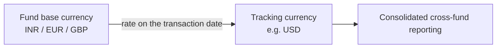

# Tracking Currency Guide

A **tracking currency** is a single reporting currency in which a fund's financial activity is restated, alongside the fund's own base currency. It lets you report consistently across funds that operate in different currencies — for example, viewing an INR fund and a EUR fund side by side, both expressed in USD.

> **Where to find it:** Choose the **Tracking currency** when you create the fund (Sidebar → [**Funds → Funds**](/funds), then create the fund) and load rates under Company menu → [**Exchange Rates**](/exchange_rates). The figures appear in the **Tracking Currency** card on the fund page; refresh them on demand with the fund's **Actions → Misc → Generate Tracking Numbers**. Needs the tracking currency feature enabled for your company and update access on the fund. Changing the tracking currency after creation is **Actions → Misc → Change Tracking Currency**, shown to CapHive support only.

This guide explains what gets converted, which exchange-rate dates are used, and the rules that keep the figures accurate. It's written for finance and reporting teams.

---

## Why a Tracking Currency?

Imagine your firm runs three funds — one in INR, one in EUR, one in GBP — and your investment committee wants one consolidated view in USD. Rather than converting by hand each time, you choose a **tracking currency** of USD on each fund when you create it (it is locked afterwards; only CapHive support can change it), and the system automatically keeps a USD figure next to every base-currency figure.

The conversion runs automatically every night at 01:00 for every fund whose tracking currency differs from its base currency, in companies that have the tracking currency feature enabled.

---

## What Gets Converted

The system restates the key financial records into the tracking currency:

| Area | Tracking figure(s) | What it represents |
|------|--------------------|--------------------|
| **Account entries** | Tracking amount | The entry's value in the tracking currency. |
| **Remittance payments** | Tracking amount | What an investor actually paid. |
| **Capital calls (remittances)** | Tracking call amount, tracking collected amount | The amount requested, and the amount collected. |
| **Distributions** | Tracking net payable, tracking gross payable, tracking reinvestment | The pay-out to investors, before and after deductions, plus any reinvested amount. |
| **Commitment adjustments** | Tracking amount | Any change to an investor's commitment. |
| **Capital commitments** | Tracking committed amount, tracking original committed | The current and original committed amounts. |
| **Portfolio investments** | Tracking cost, tracking FMV | The original investment cost and its current fair market value. |

---

## Which Exchange-Rate Date Is Used

Each record is converted using the rate on the date that best reflects when it actually happened — so the tracking figure mirrors real market conditions at that moment.

| Record | Date used |
|--------|-----------|
| Account entries | The reporting date |
| Remittance payments | The payment date (when money was received) |
| Capital calls | The remittance date (the call's original date) |
| Distributions | The payment date of the distribution |
| Commitment adjustments | The adjustment's "as of" date |
| Capital commitments | The commitment date |
| Portfolio investment cost | The investment date |
| Portfolio investment FMV | The date of the latest valuation |

---

## The Rules That Keep It Accurate

- **Runs automatically.** The conversion runs nightly for any fund whose tracking currency differs from its base currency, provided the tracking currency feature is enabled for your company. A normal run only fills records whose tracking amount is still zero; **Generate Tracking Numbers** runs the same conversion on demand.
- **Percentages aren't converted.** Figures that are percentages (such as "Ownership %") stay as they are — a percentage is currency-neutral, so it keeps a 1:1 value.
- **FMV always refreshes.** Original investment costs are set once, but the tracking FMV is recalculated every run so it always reflects the most recent valuation and the latest rate for that valuation's date.
- **Missing rates are flagged.** If an exchange rate is missing for a needed date, the system skips that record, shows an in-app error alert to the user who triggered the run and emails CapHive support, so the rate can be added — it never guesses.
- **Corrections need support.** If a historical exchange rate is later corrected, already-converted records keep their figures until CapHive support runs a forced regeneration; a normal run does not overwrite them.
- **Changing the currency is a full rebuild.** Once a fund exists its tracking currency cannot be edited on the fund form. CapHive support changes it with **Change Tracking Currency**, which first checks that every needed exchange rate exists (and changes nothing if one is missing), then recalculates every tracking figure and regenerates fund ratios. While that runs, the nightly conversion and allocation runs leave the fund alone.

---

## Worked Example

A fund's base currency is **INR**; the tracking currency is **USD**.

An investor pays a capital call of **₹10,000,000** on a day when the rate is ₹83 = $1:

> Tracking amount = ₹10,000,000 ÷ 83 = **$120,482**

Later, the fund holds a portfolio investment originally costing **₹50,000,000** (recorded at the rate on the *investment date*), now valued at **₹80,000,000** in the latest valuation. The tracking FMV uses the rate on the *valuation date* — say ₹84 = $1:

> Tracking FMV = ₹80,000,000 ÷ 84 = **$952,381**

Because FMV refreshes every run, the next time a newer valuation or a corrected rate appears, this USD figure updates automatically — while the original cost's tracking value stays fixed to its investment-date rate.

---

## Frequently Asked Questions

### Navigation and getting there

**Where do I set a fund's tracking currency?**
In the **Tracking currency** drop-down on the fund form when you create the fund (the list offers your company currency plus every currency that appears in your exchange rates). After the fund is saved the field is locked for everyone, CapHive support included; a change is made only through **Actions → Misc → Change Tracking Currency**. Leave it blank, or equal to the fund currency, if you don't need one.

**Where do I see tracking-currency figures?**
Open the fund (Sidebar → [**Funds → Funds**](/funds), then the fund): users with update access see a **Tracking Currency ([code])** card with committed, called, collected and distributed amounts. Commitments show **Tracking Committed Amount** on their page and **Tracking Committed / Collected / Distributed / Adjusted** as extra columns on the fund's **Commitments** list; distribution payments and portfolio scenarios show tracking figures too. See [What Gets Converted](#what-gets-converted).

**Where do I add the exchange rates it needs?**
Company menu → [**Exchange Rates**](/exchange_rates). Use **New Exchange Rate** for one rate (From = fund currency, To = tracking currency, Rate, As of) or **Import** to upload many. **Show All** lists historical rates; the default view shows only the latest rate per currency pair.

**Where are the buttons to recalculate tracking figures now?**
For one fund: fund page **Actions → Misc → Generate Tracking Numbers**. For every fund in your company: Company menu → **Exchange Rates**, then **Generate Tracking Amounts** on any latest rate row. Both need the tracking currency feature enabled for your company. **Generate Tracking Numbers (Force Regeneration)**, which recalculates figures already converted, is shown to CapHive support only.

**Where is Change Tracking Currency, and why don't I see it?**
It is on the fund page under **Actions → Misc → Change Tracking Currency**, and only CapHive support users with update access on the fund see it. Fund managers cannot change a fund's tracking currency themselves; ask CapHive support, telling them the fund and the new currency (or that it should be removed).

### Creating, updating and managing tracking currency

**Do I need to set the tracking currency per fund?**
Yes. Each fund has its own **Tracking currency**, chosen when the fund is created. Conversion runs for funds whose tracking currency is set and different from the fund currency, and only when the tracking currency feature is enabled for your company.

**How do I set up tracking currency for a fund?**
Ask CapHive support to enable the tracking currency feature for your company, add exchange rates from the fund currency to the tracking currency covering every transaction date, and create the fund with the **Tracking currency** selected. The next nightly run, or **Generate Tracking Numbers**, fills in the figures.

**How do I change or remove a fund's tracking currency?**
Ask CapHive support. They open the fund's **Actions → Misc → Change Tracking Currency**, pick the new currency (or **None** to remove it), type the fund name to confirm and submit. First add exchange rates from the fund currency to the new currency dated on or before the fund's earliest transaction, or the change stops without changing anything.

**How do I correct a wrong historical exchange rate?**
Fix or re-add the rate under Company menu → **Exchange Rates**, then ask CapHive support to run **Generate Tracking Numbers (Force Regeneration)** on the fund. A normal **Generate Tracking Numbers** only fills records whose tracking amount is still zero, so it does not overwrite figures already converted at the wrong rate.

**How do I bulk load exchange rates?**
Company menu → [**Exchange Rates**](/exchange_rates) → **Import**, and upload the sample file with From, To, Rate and As of for each date. Imported rates are then used by the next nightly run or by **Generate Tracking Amounts**.

**What permission do I need?**
The tracking currency feature must be enabled for your company (CapHive support switches it on). **Generate Tracking Numbers** on a fund needs update access on that fund; **Generate Tracking Amounts** on the Exchange Rates page is available to users of your company on the latest rate rows.

### Why use a tracking currency

**Why should I use a tracking currency?**
It keeps a second, consistent reporting-currency figure next to every fund-currency amount, converted at the rate on each transaction's own date. Consolidated reports across funds in INR, EUR and GBP can then be added up in, say, USD without converting by hand or mixing today's rate with historical flows.

**What does a tracking currency let me do?**
Report committed, called, collected and distributed capital across funds in one currency, see portfolio cost and FMV in that currency, compute XIRR and MOIC in the tracking currency on portfolio scenarios, and give an investment committee or parent company figures in its own reporting currency.

**What happens if I don't set one up?**
Everything still works in the fund currency and folio currency, but there are no tracking figures: cross-fund totals in different currencies cannot be added up in CapHive, and anyone needing a single reporting currency must convert exports manually.

**Who typically uses tracking currency?**
Finance and reporting teams at managers running funds in several currencies, and groups whose parent entity reports in a different currency. Tracking figures are a manager-side reporting tool.

### What happens when I …

**What happens every night?**
At 01:00 a background job runs for every fund of companies with the feature enabled. For funds with a distinct tracking currency it converts account entries, remittance payments, remittances, distribution payments, commitment adjustments and commitments whose tracking amount is still zero, at the fund-to-tracking rate on or before each record's date, and refreshes portfolio investment FMV. The related commitment, remittance and fund totals are then refreshed. Funds whose tracking currency is being changed are skipped.

**What happens when I click Generate Tracking Numbers on a fund?**
The same conversion runs straight away for that fund only, and you see "Tracking currency update started, please check back in a few mins." You get in-app progress alerts ending in "Tracking/entity currency updated for fund [name]", plus an in-app error list if any rate was missing. Already-converted records are not recalculated.

**What happens when I click Generate Tracking Amounts on an exchange rate?**
The conversion runs for every fund in your company, not just funds using that currency pair. Funds without a distinct tracking currency only get their portfolio investment figures refreshed. You receive the same in-app progress and error alerts.

**What happens when support changes a fund's tracking currency?**
A background job first checks that an exchange rate from the fund currency to the new currency exists on or before the earliest date of each kind of record; if any is missing it stops, changes nothing and lists the missing rates. Otherwise it saves the new currency (recorded in the fund's audit history against the support user), recalculates every tracking figure at each record's own date and refreshes the fund and commitment totals. The support user gets an in-app alert when it finishes.

**What happens to fund ratios when the tracking currency changes?**
Ratios are regenerated for every end date that already had them, at fund and folio level. Ratios labelled with the old currency, such as "XIRR (EUR)", are replaced by ones labelled with the new currency. Documents and reports already generated or sent to investors are not changed, and neither are fund snapshots.

**What happens when the tracking currency is removed?**
Every tracking figure on the fund is set to zero, including the fund and commitment totals, and ratios labelled with the old tracking currency are removed when ratios are regenerated. The fund then reports in its own currency only. Choosing the fund's own currency as the tracking currency has the same effect.

**What happens while a tracking currency change is running?**
The fund page shows a yellow "Tracking currency change … in progress" banner, tracking figures may be inconsistent, and new allocation runs on the fund are refused. The nightly conversion, **Generate Tracking Numbers** and a second change are all refused or skipped until it completes.

**What happens when I add a new exchange rate?**
Nothing is converted immediately. The rate is marked latest for its currency pair, and it is used by the next nightly run or manual generation for records dated on or after its as-of date that still have no tracking amount. Separately, the new rate can trigger portfolio investment and (if enabled) commitment exchange-rate adjustments.

**What happens if an exchange rate is missing?**
Records on dates with no rate on or before that date are skipped and keep a zero tracking amount; nothing is guessed. The run reports the missing currency pair and dates in an error alert to the user who triggered it and in an error email to CapHive support. Add the rate and run **Generate Tracking Numbers** again.

**Which rate is used if there is none for the exact date?**
The most recent rate from the fund currency to the tracking currency with an as-of date on or before the record's date. Only the direct direction is looked up, so a USD→INR rate is not used for an INR fund tracked in USD; add the INR→USD rate (the **Reverse** button on a rate pre-fills it).

**What happens to percentage account entries?**
Entries whose name contains "Percentage" (such as "Ownership Percentage") are copied 1:1 into the tracking amount instead of being multiplied by the rate, because a percentage is currency-neutral.

### Troubleshooting and edge cases

**Why was a tracking currency change aborted for missing exchange rates?**
The change needs a rate from the fund currency to the new currency dated on or before the earliest record of each kind (account entries, payments, calls, distributions, adjustments, commitments, investments, latest valuations). Add the listed rates under **Exchange Rates** and ask CapHive support to submit the change again. Nothing was changed by the aborted attempt.

**The fund page says the tracking currency change failed - what now?**
The change stopped partway, so tracking figures may be partly recalculated and should not be relied on. A CapHive support user clicks **Retry** on the red banner, which runs the change again to the same currency; it is safe to repeat. Allocation runs stay blocked until it succeeds.

**Why can't I start an allocation run - it says the tracking currency is being changed?**
Allocation runs write tracking amounts, so they are refused while a tracking currency change is running or has failed and awaits a retry. Wait for the change to finish, or ask CapHive support to retry a failed one.

**Why is a figure missing in the tracking currency?**
Most often, no exchange rate from the fund currency to the tracking currency exists on or before that record's date. Add the rate under **Exchange Rates** and run **Generate Tracking Numbers**, or wait for the nightly run. A newly created record also shows zero until the next run.

**Why didn't an ownership percentage convert?**
Percentages are currency-neutral and deliberately left unchanged.

**A historical rate was wrong and has been fixed - will old figures update?**
Not by themselves. Already-converted records keep their tracking amount until a forced regeneration is run, which is only available to CapHive support. Portfolio FMV is the exception: it is refreshed on every run.

**The Tracking Currency card is not on my fund page - why?**
It only shows when the fund has a tracking currency different from its own currency and you have update access on the fund.

**Generate Tracking Numbers does nothing or is refused - why?**
The tracking currency feature is not enabled for your company, or you lack update access on the fund. If it runs but figures stay zero, check the error alert for missing rates.

**The currency I want is not in the Tracking currency list - why?**
The list is built from your company currency plus every From and To currency in your exchange rates. Add an exchange rate from the fund currency to that currency first, then create the fund.

**Do investors see tracking-currency amounts?**
Mostly not. The fund page card and the commitment details are shown only to the fund manager's users, but a distribution payment's page shows **Tracking Currency** and **Tracking Net Payable** to anyone who can open that payment, including the investor.

---

## Related Guides

- [Capital Commitments](capital_commitments_user_guide) - tracking committed, collected, distributed and adjusted amounts per folio.
- [Capital Calls](capital_calls_user_guide) - remittances and payments converted at their call and payment dates.
- [Capital Distributions](capital_distributions_user_guide) - tracking net and gross payable on distribution payments.
- [Portfolio Investments](portfolio_investments_user_guide) - cost and FMV restated in the tracking currency.
- [Account Entries Period Report](account_entries_period_report_user_guide) - reporting on account entries, which carry tracking amounts.
- [Valuations](valuations_user_guide) - the latest valuation date drives the FMV conversion rate.
