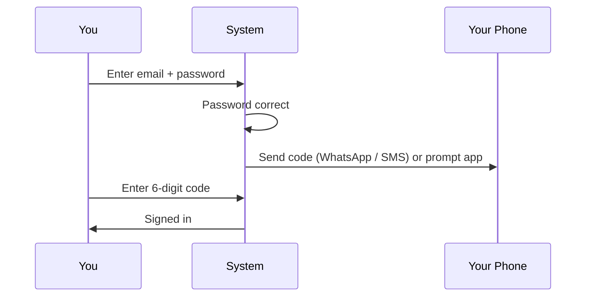
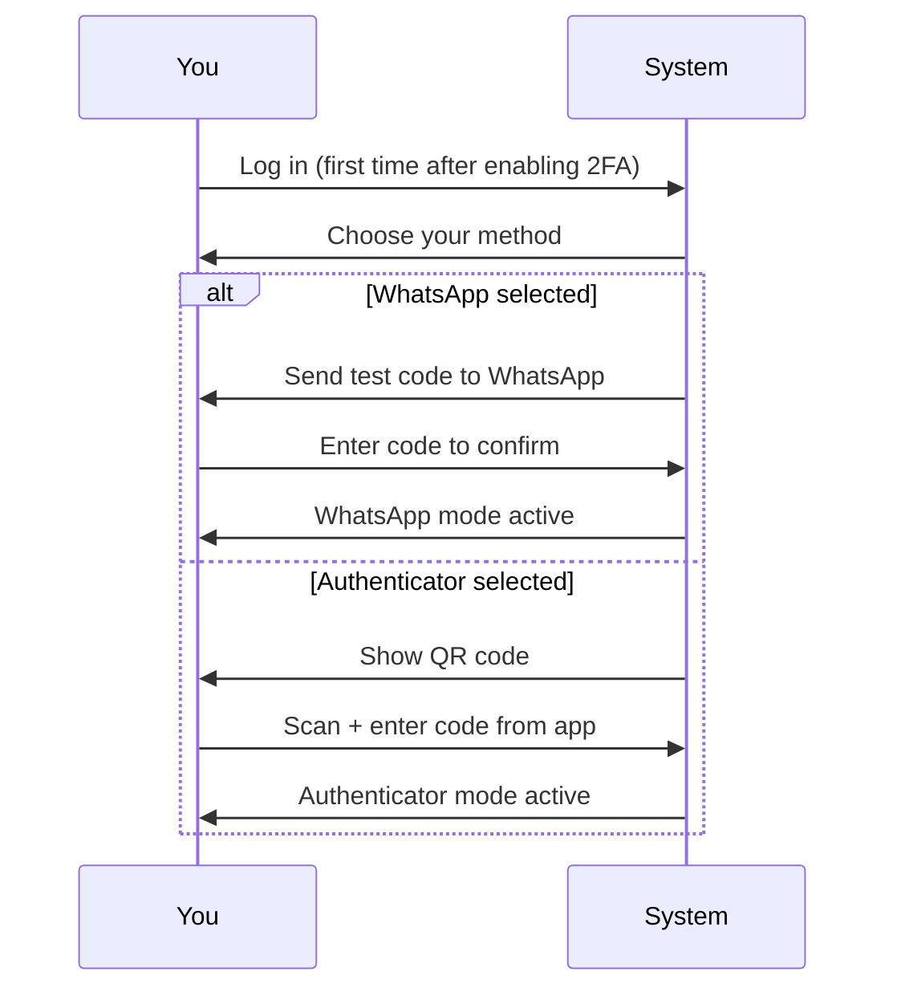
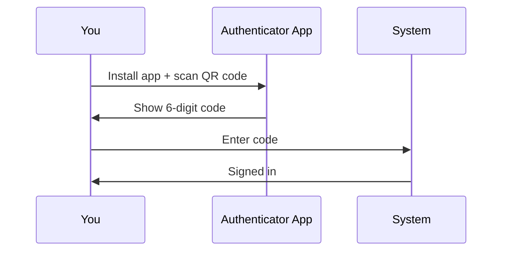

# Two-Factor Authentication User Guide

**Two-Factor Authentication (2FA)** adds an extra layer of security to your account. After entering your password, you will be asked for a one-time code before you are signed in. This guide covers enabling 2FA, choosing your delivery method, and logging in.

> **Where to find it:** Top-right **Profile menu** (your avatar) → **My Profile** → **Edit** → **Enable Two-Factor Authentication**; you then pick and confirm a method at your next sign-in. Anyone can do this for their own account; resetting another user's method needs the **company_admin** role (**Reset 2FA Method** on their profile).

---

## Table of Contents

1. [Overview](#overview)
2. [Enabling 2FA](#enabling-2fa)
3. [Choosing Your Verification Method](#choosing-your-verification-method)
4. [WhatsApp Mode — Setup](#whatsapp-mode-setup)
5. [Authenticator App Mode — Setup](#authenticator-app-mode-setup)
6. [Logging In with 2FA](#logging-in-with-2fa)
7. [Changing Your Verification Method](#changing-your-verification-method)
8. [Disabling 2FA](#disabling-2fa)
9. [Frequently Asked Questions](#frequently-asked-questions)
10. [Related Guides](#related-guides)

---

## Overview

When 2FA is enabled, signing in requires two things:

1. **Something you know** — your password
2. **Something you have** — your phone (WhatsApp message, text message or authenticator app)

---

## Enabling 2FA

You can only enable or disable 2FA for your own account.

1. Go to your **Profile** page (click your avatar in the top-right corner, then **My Profile**)
2. Click **Edit**
3. Switch on **Enable Two-Factor Authentication**
4. Click **Save**

2FA does not take effect immediately. The next time you log in, you will be guided through choosing a verification method and completing setup.

---

## Choosing Your Verification Method

The first time you log in after enabling 2FA, you will see the **Set Up Two-Factor Authentication** screen. Pick an option and click **Continue**:

| Option | How it works | Best for |
|---|---|---|
| **WhatsApp** | A code is automatically sent to your WhatsApp each time you log in | Users who prefer simplicity and always have their phone |
| **Text message (SMS)** | A code is sent to your mobile number by text message each time you log in (only offered where CapHive has text messages switched on for your number) | Users without WhatsApp who still want a code sent to them |
| **Authenticator App** | You read a code from an app on your phone (works offline) | Users who want the most secure option |

> The WhatsApp and text message options only appear if your profile has a mobile number. If your profile has a number but WhatsApp is not enabled on it, the WhatsApp option is shown greyed out; switch on **Whatsapp enabled** on your profile's **Edit** page, or ask your administrator to.

---

## WhatsApp Mode — Setup

1. On the mode selection screen, choose **WhatsApp** and click **Continue**
2. A 6-digit code is immediately sent to your WhatsApp number (click **Didn't get it? Resend code via WhatsApp** if it does not arrive)
3. Enter the code and click **Confirm & Enable 2FA**
4. You are signed in — setup is complete

**Text message (SMS)** works the same way: choose it, click **Continue**, enter the code texted to your phone (or click **Didn't get it? Send another code**) and click **Confirm & Enable 2FA**.

No app to install. No QR code to scan. Each time you log in going forward, a code is sent to your WhatsApp automatically.

> If you lose access to your WhatsApp number, contact your administrator to reset your 2FA method.

---

## Authenticator App Mode — Setup

### Step 1: Install an Authenticator App

If you do not already have one, install any of the following on your phone:

- Google Authenticator (iOS / Android)
- Authy (iOS / Android)
- Microsoft Authenticator (iOS / Android)

### Step 2: Scan the QR Code

The setup page shows a QR code. Open your authenticator app, tap **Add** or **+**, and scan the code. A new entry will appear in the app showing a 6-digit code that refreshes every 30 seconds.

If you cannot scan, tap **Enter key manually** in your app and type the secret key shown on screen.

### Step 3: Enter the Code

Enter the 6-digit code currently shown in your app and click **Confirm & Enable 2FA**.

---

## Logging In with 2FA

### WhatsApp Mode

1. Enter your email and password
2. A code is automatically sent to your WhatsApp
3. Enter the code on the verification screen and click **Verify**
4. If you did not receive the code, click **Resend code via WhatsApp**

In **Text message (SMS)** mode the steps are the same; if the text does not arrive, click **Didn't get it? Send another code**.

### Authenticator App Mode

1. Enter your email and password
2. Open your authenticator app and read the current 6-digit code
3. Enter the code and click **Verify**

### Failed Attempts

After **3 failed attempts**, your session is reset and you must sign in again from the beginning.

Codes refresh every 30 seconds — if one fails, wait for the next one and try again. Make sure your phone's clock is set to automatic (time sync issues cause codes to be rejected).

---

## Changing Your Verification Method

You can switch from WhatsApp to the Authenticator app (or the other way round) at any
time. The change is a **reset**: your current method is removed and you choose a fresh one
the next time you sign in. Two-factor authentication itself stays switched on throughout.

### Changing it yourself

1. Go to your **Profile** page.
2. Next to **Two-Factor Authentication** click **Change 2FA Method**.
3. Read the popup carefully — it lists exactly what will happen:
   - your current method stops working immediately;
   - you are signed out straight away;
   - two-factor stays on — you must pick and confirm a new method to get back in;
   - a confirmation email is sent to you.
4. Have your phone (for WhatsApp / text message) or an authenticator app ready **before**
   you continue.
5. Enter your password, tick the acknowledgement box and click **Reset 2FA Method**.
6. Sign in again. You will land on the method-selection screen with a note that your
   method was reset, choose a new one and set it up as described above.

### Asking your administrator

If you cannot sign in at all (lost phone, changed number, lost authenticator app), your
administrator can do the same reset from your user page with **Reset 2FA Method**. They will see the same popup,
including a reminder to confirm the request really came from you. You receive an email
telling you the reset happened and who did it — **if you did not ask for it, contact your
administrator immediately.** Your next sign-in then asks you to choose a new method.

---

## Disabling 2FA

1. Go to your **Profile** page
2. Click **Edit**
3. Switch off **Enable Two-Factor Authentication**
4. Click **Save**

2FA is immediately disabled. You will no longer be asked for a code at login. Your chosen
method is forgotten at the same time, so if you switch 2FA back on later you will choose a
method again at your next login — delete the old CapHive entry from your authenticator app
if you had one.

> If you cannot log in because you have lost access to your code (no WhatsApp, no text messages, no app, no phone), contact your administrator to reset your 2FA method.

---

## Frequently Asked Questions

### Navigation and getting there

**Where do I turn on two-factor authentication?**
Click your avatar in the top-right corner to open the **Profile menu**, choose **My Profile**, click **Edit**, switch on **Enable Two-Factor Authentication** and save. See [Enabling 2FA](#enabling-2fa).

**Where can I see whether 2FA is on for my account and which method I use?**
Open **Profile menu → My Profile**. The **Two-Factor Authentication** row shows Yes or No and a badge with your method, or **Method not chosen yet** if you have not completed setup.

**Where is the Change 2FA Method button?**
On **My Profile**, next to **Two-Factor Authentication**. It only appears once 2FA is on and a method has been chosen; before that your next sign-in already takes you to method selection.

**Where does an administrator reset 2FA for someone else?**
Open the top-bar [**Company menu → User**](/users), open the person's profile and click **Reset 2FA Method** in the **Two-Factor Authentication** row. See [Asking your administrator](#asking-your-administrator).

**Where is the method-selection screen?**
You cannot open it from a menu. CapHive shows the **Set Up Two-Factor Authentication** screen automatically at sign-in when 2FA is on but no method is set, either the first time or after a reset. See [Choosing Your Verification Method](#choosing-your-verification-method).

### Enabling, changing and disabling 2FA

**How do I enable 2FA?**
Go to **My Profile** → **Edit**, switch on **Enable Two-Factor Authentication** and save. Setup finishes the next time you sign in, when you choose a method and confirm a code.

**Which verification methods can I choose from?**
**WhatsApp**, **Authenticator App**, and **Text message (SMS)** where CapHive has text messages switched on and your mobile number can receive them. The phone options only appear if your profile has a mobile number, and WhatsApp also needs WhatsApp enabled on your profile.

**How do I set up the authenticator app method?**
Choose **Authenticator App** at sign-in, scan the QR code with Google Authenticator, Microsoft Authenticator or Authy, then type the current 6-digit code and click **Confirm & Enable 2FA**. The [Authenticator App Setup Guide](authenticator_app_setup_user_guide) walks through it step by step.

**How do I change my verification method?**
On **My Profile** click **Change 2FA Method**, enter your password, tick the acknowledgement box and click **Reset 2FA Method**. Sign in again and choose a new method. See [Changing Your Verification Method](#changing-your-verification-method).

**How do I turn 2FA off?**
Go to **My Profile** → **Edit**, switch off **Enable Two-Factor Authentication** and save. See [Disabling 2FA](#disabling-2fa).

**How do I make the WhatsApp option available?**
Add your mobile number in **Mobile Phone** on your profile's **Edit** page and switch on **Whatsapp enabled**, which you should only do if that number uses WhatsApp. You can do this yourself or ask a company admin.

**Who can reset someone's 2FA method?**
You can reset your own. A company admin of your organisation or CapHive support can reset yours from your user profile, which is the route to take when you are locked out.

### Why use two-factor authentication

**Why should I turn on 2FA?**
A stolen or guessed password is no longer enough to get into your account; an attacker would also need your phone. CapHive holds investor, fund and banking data, so a second factor protects both you and your organisation.

**Which method should I choose?**
**WhatsApp** is easiest: nothing to install, but you need mobile signal. **Authenticator App** is the most secure and works offline. **Text message** suits users without WhatsApp who still want a code sent to them.

**What happens if I don't enable 2FA?**
You sign in with your password or a magic link alone. Your account keeps working, but it is only as safe as your password and your email inbox.

### What happens when I…

**What happens when I switch on Enable Two-Factor Authentication and save?**
Nothing changes in your current session. At your next sign-in, after your password or magic link, CapHive shows the method-selection screen and you are not signed in until you confirm a code. No email is sent.

**What happens when I confirm a code during setup?**
Your chosen method is saved, you are signed in, and from then on every sign-in asks for a code by that method. Your profile shows the method as a badge in the **Two-Factor Authentication** row.

**What happens when I reset my own 2FA method?**
Your current method stops working immediately, you are signed out, and a confirmation email is sent to you. 2FA stays on, so your next sign-in takes you to method selection with a note that your method was reset.

**What happens when an administrator resets my 2FA method?**
Your old method stops working and you receive an email saying the reset happened and who did it. You stay signed in on any current session, and your next sign-in asks you to choose a new method; if you did not ask for the reset, contact your administrator at once.

**What happens when I switch 2FA off?**
Codes are no longer asked for from your next sign-in, and your chosen method is forgotten. If you switch 2FA back on later you pick a method again, so delete the old CapHive entry from your authenticator app.

**What happens if I enter the wrong code?**
You see "Invalid code" with the number of attempts left. After 3 failed attempts CapHive shows "Too many failed attempts. Please sign in again." and you start again from the sign-in page.

### Troubleshooting and edge cases

**I chose WhatsApp mode but I am not receiving codes.**
Check that your WhatsApp number is correct on your profile and that the phone has signal, then click **Resend code via WhatsApp**. If it still fails, ask your administrator to confirm WhatsApp is enabled on your account and the number is right.

**What if I lose my phone and use WhatsApp or text messages?**
Contact your administrator and ask them to reset your 2FA method. You will pick a new method at your next sign-in, on a new number if needed.

**What if I lose my phone and use an authenticator app?**
If you can still open the app on the old phone, transfer the account to the new phone first; see the [Authenticator App Setup Guide](authenticator_app_setup_user_guide). If the old phone is gone, ask your administrator to reset your 2FA method and set it up again at your next sign-in.

**Does 2FA apply to magic link logins?**
Yes. If 2FA is enabled, you must complete verification after clicking a magic link too, and you land on the linked page once the code is accepted.

**Can an administrator enable 2FA for me without my involvement?**
No. The **Enable Two-Factor Authentication** switch only appears when you edit your own profile, and you must complete the setup yourself at your next sign-in. Administrators can only reset a method you have already chosen.

**Why does the WhatsApp option appear greyed out?**
Your profile has a mobile number but WhatsApp is not enabled on it. Switch on **Whatsapp enabled** on your profile's **Edit** page, or ask your administrator to.

**Why is there no WhatsApp or text message option at all?**
Both phone options are hidden when your profile has no mobile number, because there is nowhere to send a code. Add your number on your profile's **Edit** page, or choose **Authenticator App**.

**Sign-in says "We can't send a verification code to your phone right now". What should I do?**
Your saved method is WhatsApp or text message but your account can no longer receive codes, for example the number was removed or WhatsApp was switched off. Contact your administrator to fix the number or reset your 2FA method.

**My authenticator codes are always rejected. Why?**
The most common cause is the phone's clock being out of sync; set date and time to automatic and try the next code. The [Authenticator App Setup Guide](authenticator_app_setup_user_guide) has more troubleshooting steps.

**Can I undo a 2FA reset?**
No. Once reset, the old method cannot be restored; you set up a method again at your next sign-in, which can be the same type as before.

## Related Guides

- [Authenticator App Setup Guide](authenticator_app_setup_user_guide) — installing an app, scanning the QR code and moving it to a new phone.
- [User Role Management](user_role_management_user_guide) — the company admin role that can reset another user's 2FA method.
- [Entities](entities_user_guide) — your organisation's profile and settings.
- [Audit Trail](audit_trail_user_guide) — where changes to user settings, including 2FA, are recorded.
