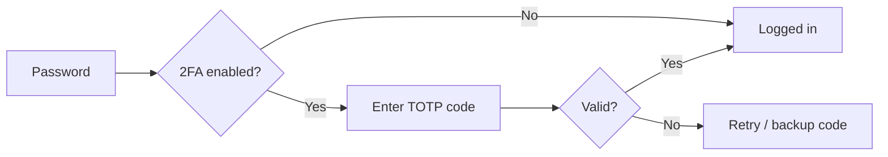
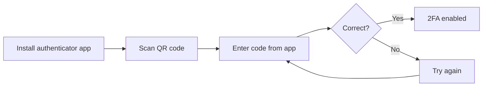

# Two-Factor Authentication User Guide

**Two-Factor Authentication (2FA)** adds an extra layer of security to your account. After entering your password, you'll be asked for a one-time code from an authenticator app, sent via WhatsApp, or one of your backup codes. This guide covers setting up, using, and managing 2FA.

---

## Table of Contents

1. [Overview](#overview)
2. [Enabling 2FA](#enabling-2fa)
3. [Setting Up an Authenticator App](#setting-up-an-authenticator-app)
4. [Logging in with 2FA](#logging-in-with-2fa)
5. [Using Backup Codes](#using-backup-codes)
6. [Receiving Codes via WhatsApp](#receiving-codes-via-whatsapp)
7. [Disabling 2FA](#disabling-2fa)
8. [Worked Example](#worked-example)
9. [Frequently Asked Questions](#frequently-asked-questions)

---

## Overview

When 2FA is enabled, signing in requires two things:

1. **Something you know** — your password
2. **Something you have** — your phone (authenticator app or WhatsApp)

The one-time code is a **TOTP** (Time-based One-Time Password) that refreshes every 30 seconds. It works offline — no internet or cellular connection needed for the authenticator app.



---

## Enabling 2FA

You can only enable or disable 2FA for your own account.

1. Go to your **Profile** page (click your name/avatar in the top-right corner)
2. Click **Edit Profile**
3. Check the **Enable Two-Factor Authentication** checkbox
4. Click **Update**

```
The next time you log in, you'll be guided through the setup process.
```

2FA does not take effect immediately — it activates once you complete the enrollment flow on your next login.

---

## Setting Up an Authenticator App

The first time you log in after enabling 2FA, you'll be taken to the enrollment page.

### Step 1: Install an Authenticator App

If you don't already have one, install any TOTP-compatible app on your phone:

- Google Authenticator (iOS / Android)
- Authy (iOS / Android)
- Microsoft Authenticator (iOS / Android)
- 1Password (if you use it for passwords)

### Step 2: Scan the QR Code

The enrollment page shows a QR code. Open your authenticator app, tap **Add** (or **+**), scan the QR code, and a new entry will appear.

If you can't scan the QR code, you can enter the **secret key** shown on screen manually.

### Step 3: Verify the Setup

Enter the 6-digit code shown in your authenticator app and click **Verify**.



- **If the code is correct:** 2FA is activated, and you'll see your **backup codes** (save these immediately).
- **If the code is wrong:** The page refreshes with an error. Try generating a new code from your app — the codes refresh every 30 seconds.

### Important

> **Write down or download your backup codes before continuing.** Once you leave the backup codes page, they cannot be shown again.

---

## Logging in with 2FA

Once 2FA is set up, every login requires a verification code.

### Standard Login Flow

1. Enter your **email** and **password** on the login page
2. After a valid password, you're redirected to the **2FA verification page**
3. Open your authenticator app and read the 6-digit code
4. Enter the code and click **Verify**
5. If the code is correct, you're logged in

### What if the code doesn't work?

- Codes refresh every 30 seconds — wait and try the new one
- Check that your phone's clock is **set to automatic** (time sync issues cause incorrect codes)
- You can click **Send code via WhatsApp** (if available) to receive the current code by message
- Use a **backup code** as a fallback

### Failed Attempts

After **3 failed attempts**, your session is reset and you'll need to sign in again from the beginning. This prevents brute-force guessing.

---

## Using Backup Codes

When you first enable 2FA, you are given **8 backup codes**. Each code can be used **once**.

**Format:** `XXXXXXXX-XXXXXXXX` (16 hex characters, e.g. `A1B2C3D4-E5F6G7H8`)

### How to use a backup code

1. On the 2FA verification page, enter a backup code instead of a TOTP code
2. The code is consumed and cannot be used again
3. After using a code, visit your profile to **regenerate backup codes** if needed

> **Keep backup codes in a safe place** (password manager, safe, or printed copy). If you lose access to your authenticator app and have no backup codes, you'll need an administrator to disable 2FA for your account.

---

## Receiving Codes via WhatsApp

If your account has a WhatsApp-enabled phone number, you can receive the current TOTP code via WhatsApp.

1. On the 2FA verification page, click **Send code via WhatsApp**
2. The current code is sent to your WhatsApp number
3. Enter the code you received
4. Rate limit: you can request a code via WhatsApp once every **30 seconds**

---

## Disabling 2FA

1. Go to your **Profile** page
2. Click **Edit Profile**
3. Uncheck the **Enable Two-Factor Authentication** checkbox
4. Click **Update**

2FA is now disabled. You'll no longer be asked for a code at login.

> If an administrator needs to disable 2FA for you (e.g. you lost your phone and backup codes), contact your support team.

---

## Worked Example

### Enabling and using 2FA for the first time

1. Log in to your account with your email and password
2. Go to your **Profile** → **Edit Profile**
3. Check **Enable Two-Factor Authentication** and click **Update**
4. **Log out** and log back in with your email and password
5. You're redirected to the **2FA Setup** page showing a QR code
6. Open **Google Authenticator** on your phone, tap **+** → **Scan QR code**
7. A new entry appears — enter the 6-digit code shown on your phone
8. Click **Verify** — you're shown **8 backup codes**
9. **Save the backup codes** (take a screenshot, write them down, or save in a password manager)
10. Click **Continue to Dashboard** — you're now logged in with 2FA active
11. **Next login:** Enter your password, then the 6-digit code from your authenticator app — done

---

## Frequently Asked Questions

**Can I use multiple authenticator apps?**
You can scan the same QR code (or enter the same secret key) into multiple apps on different devices. All will generate the same codes.

**What happens if I lose my phone?**
Use a backup code to log in, then disable 2FA from your profile and re-enable it on a new phone. If you have no backup codes, contact an administrator.

**Does 2FA apply to API logins or magic links?**
Yes — 2FA verification is required for magic link logins if 2FA is enabled. API token authentication bypasses 2FA (the token itself is a second factor).

**Can an administrator enable 2FA for me?**
Administrators can toggle the 2FA setting, but you'll need to complete the QR code enrollment on your next login to set it up.

**Why am I being asked for a 2FA code on every login?**
That's expected behavior. With 2FA enabled, a code is required each time you sign in. If you'd like to remove this requirement, disable 2FA in your profile settings.
