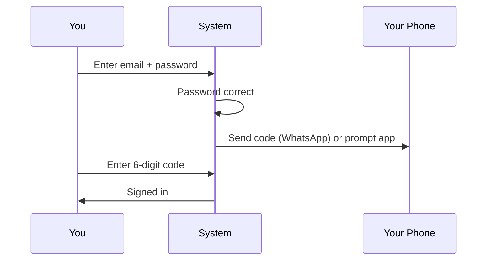
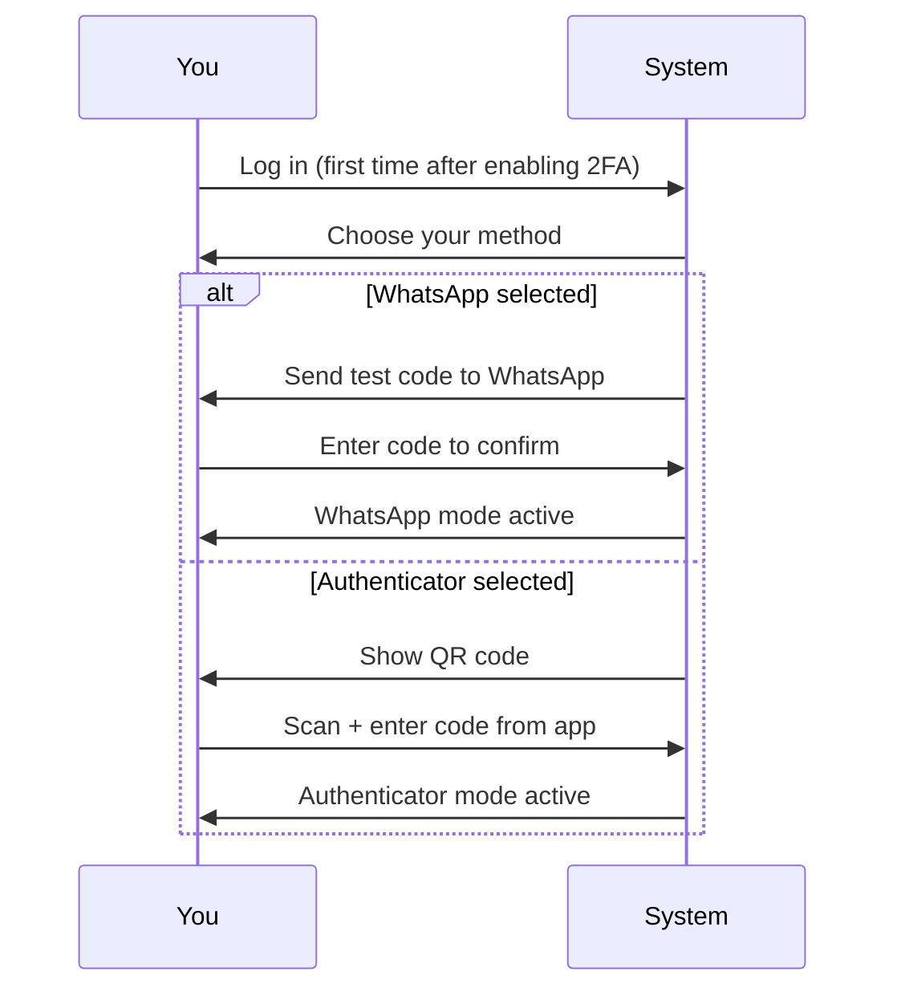
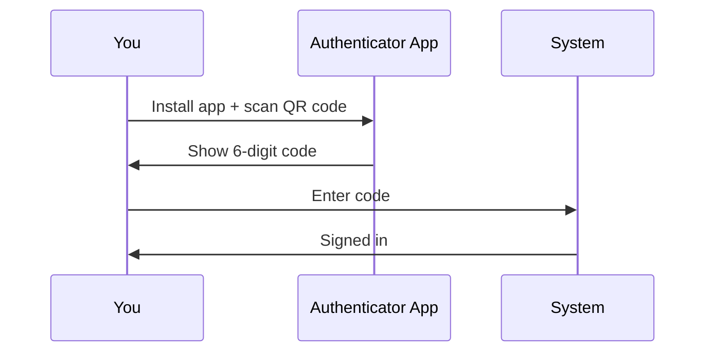

# Two-Factor Authentication User Guide

**Two-Factor Authentication (2FA)** adds an extra layer of security to your account. After entering your password, you will be asked for a one-time code before you are signed in. This guide covers enabling 2FA, choosing your delivery method, and logging in.

---

## Table of Contents

1. [Overview](#overview)
2. [Enabling 2FA](#enabling-2fa)
3. [Choosing Your Verification Method](#choosing-your-verification-method)
4. [WhatsApp Mode — Setup](#whatsapp-mode--setup)
5. [Authenticator App Mode — Setup](#authenticator-app-mode--setup)
6. [Logging In with 2FA](#logging-in-with-2fa)
7. [Changing Your Verification Method](#changing-your-verification-method)
8. [Disabling 2FA](#disabling-2fa)
9. [Frequently Asked Questions](#frequently-asked-questions)

---

## Overview

When 2FA is enabled, signing in requires two things:

1. **Something you know** — your password
2. **Something you have** — your phone (WhatsApp message or authenticator app)

---

## Enabling 2FA

You can only enable or disable 2FA for your own account.

1. Go to your **Profile** page (click your name in the top-right corner)
2. Click **Edit Profile**
3. Check the **Enable Two-Factor Authentication** box
4. Click **Save**

2FA does not take effect immediately. The next time you log in, you will be guided through choosing a verification method and completing setup.

---

## Choosing Your Verification Method

The first time you log in after enabling 2FA, you will see the **Set Up Two-Factor Authentication** screen with two options:

| Option | How it works | Best for |
|---|---|---|
| **WhatsApp** | A code is automatically sent to your WhatsApp each time you log in | Users who prefer simplicity and always have their phone |
| **Authenticator App** | You read a code from an app on your phone (works offline) | Users who want the most secure option |

> If WhatsApp is not enabled for your account, the WhatsApp option will be shown as unavailable. Contact your administrator to enable it.

---

## WhatsApp Mode — Setup

1. On the mode selection screen, choose **WhatsApp**
2. A 6-digit code is immediately sent to your WhatsApp number
3. Enter the code and click **Confirm & Enable 2FA**
4. You are signed in — setup is complete

No app to install. No QR code to scan. Each time you log in going forward, a code is sent to your WhatsApp automatically.

> If you lose access to your WhatsApp number, contact your administrator to reset your 2FA method.

---

## Authenticator App Mode — Setup

### Step 1: Install an Authenticator App

If you do not already have one, install any of the following on your phone:

- Google Authenticator (iOS / Android)
- Authy (iOS / Android)
- Microsoft Authenticator (iOS / Android)

### Step 2: Scan the QR Code

The setup page shows a QR code. Open your authenticator app, tap **Add** or **+**, and scan the code. A new entry will appear in the app showing a 6-digit code that refreshes every 30 seconds.

If you cannot scan, tap **Enter key manually** in your app and type the secret key shown on screen.

### Step 3: Enter the Code

Enter the 6-digit code currently shown in your app and click **Confirm & Enable 2FA**.

---

## Logging In with 2FA

### WhatsApp Mode

1. Enter your email and password
2. A code is automatically sent to your WhatsApp
3. Enter the code on the verification screen and click **Verify**
4. If you did not receive the code, click **Resend code via WhatsApp**

### Authenticator App Mode

1. Enter your email and password
2. Open your authenticator app and read the current 6-digit code
3. Enter the code and click **Verify**
4. If your WhatsApp is also enabled on your account, you may optionally click **Send code via WhatsApp** instead

### Failed Attempts

After **3 failed attempts**, your session is reset and you must sign in again from the beginning.

Codes refresh every 30 seconds — if one fails, wait for the next one and try again. Make sure your phone's clock is set to automatic (time sync issues cause codes to be rejected).

---

## Changing Your Verification Method

You can switch from WhatsApp to the Authenticator app (or the other way round) at any
time. The change is a **reset**: your current method is removed and you choose a fresh one
the next time you sign in. Two-factor authentication itself stays switched on throughout.

### Changing it yourself

1. Go to your **Profile** page.
2. Next to **Two-Factor Authentication** click **Change 2FA Method**.
3. Read the popup carefully — it lists exactly what will happen:
   - your current method stops working immediately;
   - you are signed out straight away;
   - two-factor stays on — you must pick and confirm a new method to get back in;
   - a confirmation email is sent to you.
4. Have your phone (for WhatsApp / text message) or an authenticator app ready **before**
   you continue.
5. Enter your password, tick the acknowledgement box and click **Reset 2FA Method**.
6. Sign in again. You will land on the method-selection screen with a note that your
   method was reset, choose a new one and set it up as described above.

### Asking your administrator

If you cannot sign in at all (lost phone, changed number, lost authenticator app), your
administrator can do the same reset from your user page. They will see the same popup,
including a reminder to confirm the request really came from you. You receive an email
telling you the reset happened and who did it — **if you did not ask for it, contact your
administrator immediately.** Your next sign-in then asks you to choose a new method.

---

## Disabling 2FA

1. Go to your **Profile** page
2. Click **Edit Profile**
3. Uncheck **Enable Two-Factor Authentication**
4. Click **Save**

2FA is immediately disabled. You will no longer be asked for a code at login. Your chosen
method is forgotten at the same time, so if you switch 2FA back on later you will choose a
method again at your next login — delete the old CapHive entry from your authenticator app
if you had one.

> If you cannot log in because you have lost access to your code (no WhatsApp, no app, no phone), contact your administrator to reset your 2FA method.

---

## Frequently Asked Questions

**Can I switch from WhatsApp mode to Authenticator mode (or vice versa)?**
Yes. On your Profile page click **Change 2FA Method**, confirm your password, and you will choose a new method at your next sign-in. See [Changing Your Verification Method](#changing-your-verification-method). If you cannot sign in, ask your administrator to reset it for you.

**I chose WhatsApp mode but I am not receiving codes.**
Check that your WhatsApp number is registered correctly. Ask your administrator to verify that WhatsApp is enabled on your account and that the phone number is correct.

**What if I lose my phone?**
- WhatsApp or text message mode: contact your administrator and ask them to reset your 2FA method. You will pick a new method at your next sign-in.
- Authenticator mode: if you can still open the app on the old phone, transfer the account to the new phone first (see the [Authenticator App Setup Guide](authenticator_app_setup_user_guide)). If the old phone is gone, contact your administrator and ask them to reset your 2FA method; you will set it up again at your next sign-in.

**Does 2FA apply to magic link logins?**
Yes — if 2FA is enabled, you must complete verification after clicking a magic link too.

**Can an administrator enable 2FA for me without my involvement?**
Administrators can toggle the 2FA setting on your account, but you must complete the setup (choose method and confirm) on your own next login.

**Why does the WhatsApp option appear greyed out?**
Your account does not have a WhatsApp-enabled phone number. Contact your administrator to enable it.
