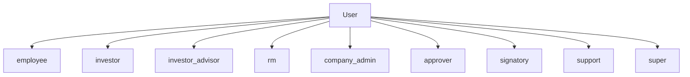
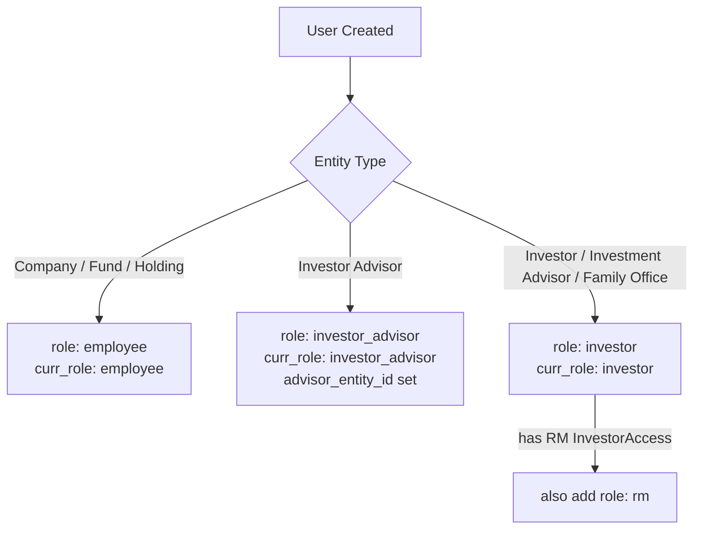
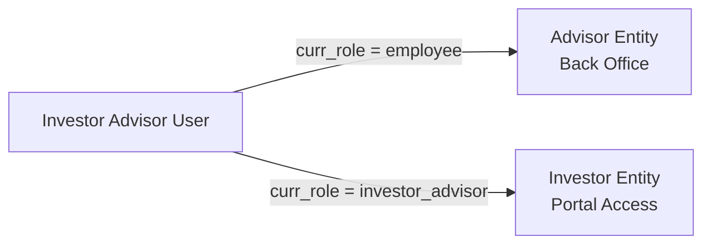

# User and Role Management User Guide

Users in CapHive are employee or investor accounts that can log in, access data, and perform actions. Every user belongs to an entity, and their role determines what they can do within that entity and beyond. This guide covers creating users, understanding the role system, setting up advisor dual-entity access, and using impersonation for support.

---

## Table of Contents

1. [Key Concepts](#key-concepts)
2. [User Roles Overview](#user-roles-overview)
3. [Role Assignment by Entity Type](#role-assignment-by-entity-type)
4. [Creating a User](#creating-a-user)
5. [The curr\_role Field](#the-curr_role-field)
6. [Employee Roles](#employee-roles)
7. [Investor Role](#investor-role)
8. [Investor Advisor Role (Dual-Entity)](#investor-advisor-role-dual-entity)
9. [RM Role](#rm-role)
10. [Support and Super Roles](#support-and-super-roles)
11. [User Permissions](#user-permissions)
12. [Password and Confirmation Flow](#password-and-confirmation-flow)
13. [User Impersonation](#user-impersonation)
14. [Active / Inactive Users](#active--inactive-users)
15. [WhatsApp Notifications](#whatsapp-notifications)
16. [Key Fields Reference](#key-fields-reference)
17. [Frequently Asked Questions](#frequently-asked-questions)

---

## Key Concepts

| Term | Meaning |
|---|---|
| **User** | A login account belonging to an entity |
| **Role** | A Rolify-managed permission label attached to a user |
| **curr\_role** | The active role the user is currently operating under |
| **Entity Type** | Controls which role is assigned at user creation |
| **Advisor Entity** | The second entity an investor advisor can operate as |
| **Impersonation** | Support staff temporarily acting as another user |

---

## User Roles Overview

CapHive uses the **Rolify** gem to manage roles. A user can hold multiple roles, but operates under one `curr_role` at a time.

| Role | Who has it | What it enables |
|---|---|---|
| `employee` | Staff of Company, Fund, or Holding entities | Full back-office access for their entity |
| `investor` | Users of Investor, Investment Advisor, Family Office entities | Investor portal access |
| `investor_advisor` | Users of Investor Advisor entities | Can switch between advisor and investor views |
| `rm` | Investor users with RM category investor access | Relationship manager view |
| `company_admin` | Designated admins within a company entity | Admin-level operations |
| `approver` | Users who participate in approval workflows | Approval actions |
| `signatory` | Users who sign documents | E-sign actions |
| `support` | CapHive support staff | Can impersonate any user |
| `super` | CapHive super admins | Full system access |

---

## Role Assignment by Entity Type

When a user is created, the system auto-assigns a role based on the entity type:

---

## Creating a User

Navigate to **[Entity] → Users → New**.

Required fields:

| Field | Notes |
|---|---|
| **First Name / Last Name** | Used for display and email communications |
| **Email** | Must be valid. Used as login identifier |
| **Entity** | The entity this user belongs to |

Optional:

| Field | Notes |
|---|---|
| **Phone / Call Code** | Used for WhatsApp notifications |
| **Department (dept)** | Team or division label |
| **Tags** | Searchable labels |
| **Signature** | Uploaded image used in e-signed documents |

On creation, the system:
1. Assigns a role based on entity type
2. Sets `curr_role` to the appropriate default
3. Sets `active = true`
4. Checks for any pending InvestorAccess records with this email and links them
5. Sends a confirmation/invitation email (or confirms immediately if password is being set)

---

## The curr\_role Field

`curr_role` tracks which role the user is currently operating under. For most users this never changes. For **investor advisors**, it can switch between `employee` (operating as the advisor entity's employee) and `investor` (operating on behalf of a specific investor entity).

The `advisor_entity_roles` field stores the comma-separated list of roles an advisor can switch between (e.g. `employee,investor_advisor`).

---

## Employee Roles

Users with the `employee` role are staff members of a Company, Fund, or Holding entity. They have back-office access to:
- All investors in their entity
- All funds, capital calls, commitments, and distributions
- Documents, tasks, reports, and approvals

Within the employee role, additional sub-roles control permissions:
- **company_admin** — administrative operations
- **approver** — can act in approval workflows
- **signatory** — can sign documents electronically

These sub-roles (`UPDATABLE_ROLES`) are managed in the Roles admin section.

---

## Investor Role

Users with the `investor` role access the investor portal. Their visibility is scoped to:
- Funds and items for which their investor entity has been granted access rights
- Their own capital commitments, remittances, and distributions
- Documents shared with them

Investor users are typically created via the **Investor Access** workflow (inviting a user to access a specific investor's portal). See the Investor Access guide.

---

## Investor Advisor Role (Dual-Entity)

An investor advisor belongs to an **Investor Advisor** entity and can operate in two contexts:

Key setup fields:

| Field | Description |
|---|---|
| `advisor_entity_id` | Set to the user's entity at creation (locked — never changes) |
| `advisor_entity_roles` | Comma-separated list, e.g. `employee,investor_advisor` |
| `curr_role` | Current active role |

The investor advisor switches entity context via the UI (role switcher). When acting as an investor, Pundit policies check `permissioned_investor_advisor?` to scope visibility.

---

## RM Role

A user gets the `rm` role when they have an InvestorAccess linked to an Investor with `category = RM`. RM users can:
- See investors assigned to them via RM mappings
- Receive notifications routed through RM mapping channels
- Access an RM-specific view of investor portfolios

---

## Support and Super Roles

| Role | Access Level |
|---|---|
| `support` | Can impersonate any user via `no_password_login` (see Impersonation) |
| `super` | Full system access; bypasses entity scoping |

Support users appear in the `support_users` scope. Super users appear in `super_users`.

---

## User Permissions

Users have a **permissions** bitflag (separate from the entity's permissions) that controls individual-level feature access. On creation, all available permissions are granted by default (`User.permissions.keys`).

The `enable_deals` permission on a user also automatically enables `enable_kanban`.

Users also have an `extended_permissions` flag for additional fine-grained controls.

---

## Password and Confirmation Flow

- **New users** receive a Devise confirmation email and must confirm before logging in
- **Password reset** — when a user resets their password, they are **auto-confirmed** (the `confirm_user` callback fires on password change)
- **System-created users** (`system_created = true`) are prompted to reset their password on first login (`reset_password?` returns true when `sign_in_count == 1 && system_created`)
- All Devise emails are sent asynchronously via `deliver_later`

---

## User Impersonation

Support staff can log in as any user without knowing their password. This is done via the `no_password_login` flow in the sessions controller, which:
1. Validates the support user's credentials
2. Sets `session[:support_user_id]` to identify the impersonating user
3. Signs in as the target user

The `support_user_id` accessor on the User model exposes who initiated the impersonation. Impersonation is restricted to users with the `support` role.

> **Audit:** All actions performed during an impersonated session are attributed to the impersonated user, not the support staff member.

---

## Active / Inactive Users

The `active` boolean controls whether a user can log in. It is set to `false` when:
- An entity is disabled (all employees are deactivated in bulk)
- An admin manually deactivates a user

Re-activating a user: set `active = true` and save. If the entity is still disabled, the user will still be blocked from logging in.

---

## WhatsApp Notifications

A user receives WhatsApp notifications when:
- `whatsapp_enabled = true` on the user
- A phone number and call code are set
- The entity has WhatsApp credentials configured (or global credentials are set)

WhatsApp is in addition to email notifications, not a replacement.

---

## Key Fields Reference

| Field | Type | Description |
|---|---|---|
| `email` | String | Login identifier (unique) |
| `first_name` / `last_name` | String | Display name |
| `entity_id` | Integer | Primary entity membership |
| `advisor_entity_id` | Integer | Locked advisor entity (Investor Advisor type only) |
| `advisor_entity_roles` | String | Available roles for advisor switching |
| `curr_role` | String | Currently active role |
| `active` | Boolean | Whether user can log in |
| `system_created` | Boolean | Set when created by admin (triggers password reset prompt) |
| `whatsapp_enabled` | Boolean | Whether WhatsApp notifications are sent |
| `phone` / `call_code` | String | Phone number for WhatsApp |
| `tag_list` | String | Comma-separated searchable tags |
| `dept` | String | Department label |
| `entity_type` | String | Cached from entity.entity_type at creation |
| `permissions` | Bitfield | Individual feature permissions |

---

## Frequently Asked Questions

**Q: Can a user belong to multiple entities?**
Not directly. A user has one `entity_id`. Investor advisors have a second `advisor_entity_id` for dual-entity access. For genuine multi-entity staff, create separate user accounts per entity.

**Q: How do I give an employee admin access?**
Add the `company_admin` role to their user record via **Admin → Users → [User] → Roles**.

**Q: Why isn't my user receiving confirmation emails?**
Check that the entity's `from_email` is configured in Entity Settings. If it is blank, emails will be sent from the default system address which may be spam-filtered.

**Q: What happens when I change a user's password?**
The user is automatically confirmed (if not already), which allows them to log in without the email confirmation step.

**Q: Can I have an investor user who also has employee access to a fund?**
Not within the same account. Create two separate user accounts — one for the investor entity (investor role) and one for the fund entity (employee role).

**Q: How do I deactivate a user without deleting them?**
Set `active = false` on the user record. Their data and history are preserved; they simply cannot log in.

**Q: What is the difference between `company_admin` and `employee` roles?**
All company admins are also employees. The `company_admin` role grants additional administrative capabilities (e.g. managing entity settings, creating other users). Regular employees have operational access but not administrative.
