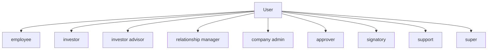
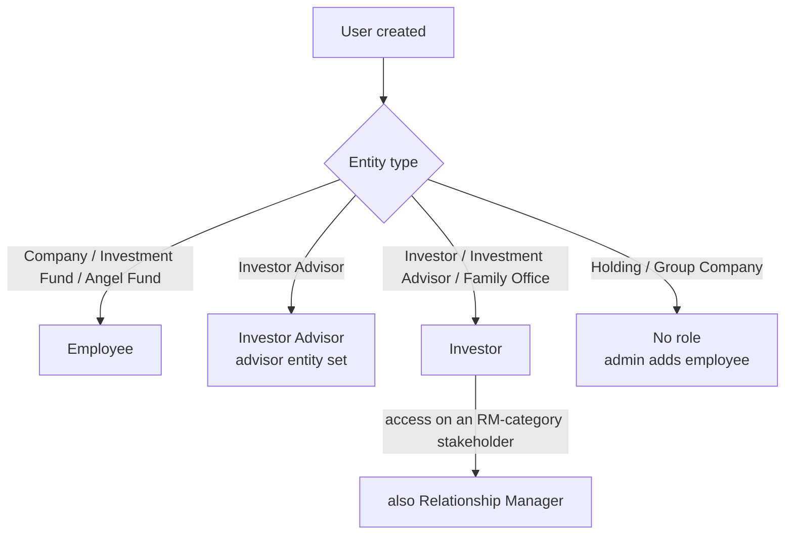
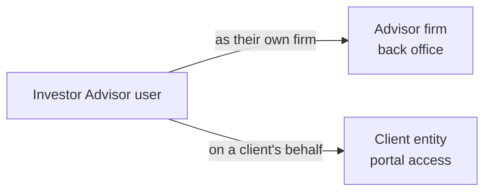

# User and Role Management User Guide

Users are the login accounts — staff and investors — who access CapHive and act within it. Every user belongs to an entity, and their **role** decides what they can do. This guide covers creating users, the role system, advisor dual-access, and impersonation for support.

> **Where to find it:** Company menu (the **house icon** at the top right, tooltip "Company menu") → [**User / Company Employees**](/users) → **New User** creates a staff login; **Edit** on a user sets **Roles**, feature toggles and extended permissions. Needs the company admin role; your own account is under your avatar → **My Profile**.

It's written for administrators.

---

## Table of Contents

1. [Key Concepts](#key-concepts)
2. [The Roles at a Glance](#the-roles-at-a-glance)
3. [Which Role a New User Gets](#which-role-a-new-user-gets)
4. [Creating a User](#creating-a-user)
5. [Staff (Employee) Roles](#staff-employee-roles)
6. [The Investor Role](#the-investor-role)
7. [The Investor Advisor Role (Dual Access)](#the-investor-advisor-role-dual-access)
8. [The Relationship Manager (RM) Role](#the-relationship-manager-rm-role)
9. [Support and Super Roles](#support-and-super-roles)
10. [Per-User Feature Access](#per-user-feature-access)
11. [Joining and Password Setup](#joining-and-password-setup)
12. [Impersonation (Support)](#impersonation-support)
13. [Active and Inactive Users](#active-and-inactive-users)
14. [WhatsApp Notifications](#whatsapp-notifications)
15. [Worked Example](#worked-example)
16. [Frequently Asked Questions](#frequently-asked-questions)
17. [Related Guides](#related-guides)

---

## Key Concepts

| Term | Meaning |
|------|---------|
| **User** | A login account belonging to an entity. |
| **Role** | A permission label that defines what the user can do. |
| **Active role** | The role the user is currently operating under (matters mainly for advisors). |
| **Advisor entity** | The second entity an investor advisor can act as. |
| **Impersonation** | Support staff temporarily acting as another user to help them. |

---

## The Roles at a Glance

A user can hold several roles but operates under one at a time.

| Role | Who has it | What it allows |
|------|------------|----------------|
| **Employee** | Staff of Company, Investment Fund or Angel Fund entities | Full back-office access for their entity. |
| **Investor** | Users of Investor, Investment Advisor, Family Office entities | Investor portal access. |
| **Investor Advisor** | Users of Investor Advisor entities | Switch between advisor and investor views. |
| **Relationship Manager (RM)** | Investor users with access on a stakeholder whose category is RM | A relationship-manager view of their assigned investors. |
| **Company Admin** | Designated admins within a company | Administrative operations. |
| **Approver** | Users in approval workflows | Approve/activate approvals. |
| **Signatory** | Users who sign documents | E-signing (not assignable from the user **Edit** page). |
| **Support** | CapHive support staff | Can log in as a client user through an enabled support mapping. |
| **Super** | CapHive super admins | Full system access. |

---

## Which Role a New User Gets

When you create a user, a role is assigned automatically based on the entity type:

---

## Creating a User

Go to Company menu → [**User / Company Employees**](/users) → **New User**. The user is always created in your own entity; there is no entity field.

**Required:**

| Field | Notes |
|-------|-------|
| **First / Last Name** | For display and emails. |
| **Email** | The login identifier. |
| **Password / Password Confirmation** | The user's initial password. |

**Optional:**

| Field | Notes |
|-------|-------|
| **Mobile Phone / Country Code** | For WhatsApp notifications. |
| **Department** | Team or division label. |
| **Tags** | Labels that help group users for sending notifications. |

On creation, the system assigns the right role, activates the account, and links any Stakeholder User (Investor Access) records already added for that email. No invitation email is sent — share the password, or ask the user to use **Log in with an email link instead** or **Reset Password** on the login page.

---

## Staff (Employee) Roles

Employees are staff of a Company, Fund, or Holding entity, with back-office access to all the entity's investors, funds, calls, commitments, distributions, documents, tasks, reports, and approvals.

Within the employee role, a company admin can add or remove these roles in the **Roles** box on an existing user's **Edit** page (these three are the only roles editable there):

- **Company Admin** — administrative operations (managing settings, creating users).
- **Approver** — can act in approval workflows.
- **Employee** — the base back-office role.

The **Signatory** role cannot be assigned from this page.

---

## The Investor Role

Investor users see the investor portal, scoped to:

- Funds and items their investor entity has been granted access to.
- Their own commitments, capital calls, and distributions.
- Documents shared with them.

Investor users are usually created through the **Investor Access** workflow — see the [Investor Access guide](investor_access_tutorial).

---

## The Investor Advisor Role (Dual Access)

An investor advisor belongs to an **Investor Advisor** entity and can operate in two contexts, switching between them:

The advisor's home entity is fixed when their account is created, and the set of roles they can switch between is configured at the same time. When acting on a client's behalf, they see only what's been explicitly shared with them. See the [Investor Advisor guide](investor_advisor_user_guide).

---

## The Relationship Manager (RM) Role

A user is given the RM role when their account is created, if they already have a Stakeholder User (Investor Access) record on a stakeholder whose **Category** is **RM**. RM users can:

- See the investors assigned to them.
- Receive notifications routed through their RM assignments.
- Use an RM-specific view of investor portfolios.

---

## Support and Super Roles

| Role | Access |
|------|--------|
| **Support** | Can log in as a client user to help troubleshoot, when an enabled support mapping allows it (see below). |
| **Super** | Full system access, across all entities. |

---

## Per-User Feature Access

Beyond the entity-wide feature toggles, each user has their own feature access, granted in full by default. For example, giving a user **Deals** access also enables **kanban boards** for them. This lets you fine-tune what an individual can use within an entity that has a feature switched on.

### KYC toggles on a user

A company admin sees these toggles on a user's **Edit** page. Together they decide which KYCs the user sees on the KYCs list and pages, and which KYC emails they get:

| Toggle | What it gives |
|---|---|
| **Enable Kycs** | Required for everything below; with it off an employee sees no KYCs and gets no KYC emails |
| **Investor Kyc Read** | Every KYC in your organisation, whatever the fund, plus their **KYC Submitted**, **KYC Updated** and **Updates Requested** emails |
| **Investor Kyc Update** | The same as **Investor Kyc Read**, plus editing those KYCs |
| **Investor Kyc Create** / **Delete** / **Approve** | Creating KYCs, and deleting or verifying the KYCs the user can see |

Without **Investor Kyc Read** or **Investor Kyc Update**, an employee sees only KYCs committed to funds they have access to (the fund's **Access** tab) — never a KYC with no commitment yet, since it has no fund to check. Company admins see every KYC regardless. The full rule and matrix are in [Who Can See a KYC and Get Its Emails](investor_kyc_user_guide#who-can-see-a-kyc-and-get-its-emails).

---

## Joining and Password Setup

- **New users** receive no confirmation or invitation email, and there is no account-confirmation step; they can log in as soon as they are created.
- **Staff users created on New User** log in with the password the admin set, or use **Reset Password** / **Log in with an email link instead** on the login page.
- **System-created users** (for example, created behind a Stakeholder User record) are prompted to set their own password on their first login.
- Password-reset and email-link emails are sent in the background.

---

## Impersonation (Support)

Support staff can log in **as** a user without knowing their password, to see exactly what that user sees and help resolve issues.

> **Audit:** actions taken during a logged-in-as session are recorded in the audit trail against the real support user, not the user being viewed. Only CapHive **Support** and **Super** users can do this, from **Click To Login** on the user in the Admin panel, and only when the client has an enabled support mapping whose login-as whitelist includes that support user's email. There is no "view as" feature for fund users.

---

## Active and Inactive Users

A user's **active** flag controls whether they can log in. It's turned off when an entity is deactivated (all its staff are deactivated at once) or when CapHive support sets a user inactive in the Admin panel. Company admins have no active switch on the user form, and users cannot be deleted from CapHive screens. To reactivate, support turns the flag back on — but note that if the entity itself is still disabled, the user remains blocked.

---

## WhatsApp Notifications

A user receives WhatsApp notifications when WhatsApp is enabled on their account, a phone number and call code are set, and WhatsApp credentials are configured (at the entity or platform level). WhatsApp is in addition to email, not a replacement.

---

## Worked Example

Onboarding a new analyst to a fund, and giving them approval rights:

1. **Company menu → User / Company Employees → New User.** Enter the analyst's name, email and an initial password. They're created in the fund's entity as an **Employee**; no invitation email is sent.
2. Share the password, or ask the analyst to use **Reset Password** on the login page to choose their own.
3. To let them act in approval workflows, open the user → **Edit** and add `approver` in **Roles**.
4. Later, the analyst needs to manage the deal pipeline — switch on **Enable Deals** for them, which also enables kanban boards.
5. When they leave, ask CapHive support to set their account to **inactive** — their history is preserved, but they can no longer log in.

---

## Frequently Asked Questions

### Navigation and getting there

**Where do I manage my entity's users?**
Click the **house icon** at the top right (tooltip "Company menu") to open the Company menu, then [**User / Company Employees**](/users). The list shows every login account in your entity with **Show** and **Edit** buttons; company admins also see **New User**.

**Where do I see or edit my own account?**
Click your avatar in the top bar → **My Profile / Account Settings**, then **Edit**. Any user can edit their own name, phone, department, WhatsApp and two-factor settings; roles and feature toggles are only shown to company admins.

**Where are a user's roles and permissions set?**
Company menu → [**User / Company Employees**](/users) → **Edit** on the user. Company admins see a **Roles** box (on existing users only), the feature toggles and, for users who are not company admins, the extended permission toggles such as *Investor Kyc Approve*.

**Where do I add investor logins and advisors?**
Investor logins are added as Stakeholder Users on the stakeholder's **Users** tab (see the [Investor Access guide](investor_access_tutorial)). Advisors are managed from Company menu → [**Advisors / External Company Advisors**](/investor_advisors) (see the [Investor Advisor guide](investor_advisor_user_guide)).

**Where do I switch between my company view and my investments?**
If your account holds both the employee and investor roles, a persona dropdown in the top bar offers **My Company** and **My Investments**. Investor advisors get their own persona dropdown listing the investors they act for.

### Creating, updating and managing users

**How do I let a user see KYCs in every fund?**
Company menu → [**User / Company Employees**](/users) → the user → **Edit**, then switch on **Enable Kycs** and **Investor Kyc Read** (or **Investor Kyc Update** if they should also edit). They then see every KYC in your organisation and get its emails. Only company admins see these toggles. See [KYC toggles on a user](#kyc-toggles-on-a-user).

**How do I create a staff user?**
Company menu → [**User / Company Employees**](/users) → **New User**. Enter **First Name**, **Last Name**, **Email**, optionally country code, **Mobile Phone** and **Department**, set a **Password** and **Password Confirmation**, and click **Save**. The user is always created in your own entity. See [Creating a User](#creating-a-user).

**How do I make someone a company admin or approver?**
Open the user → **Edit**, and in **Roles** add `company_admin`, `approver` or `employee` (or remove them), then **Save**. The Roles box appears only on existing users and only to company admins; other roles such as investor, investor advisor, RM, support and super cannot be changed here.

**How do I limit which modules a user can use?**
On the user's **Edit** page, switch off the feature toggles (for example **Enable Funds**, **Enable Deals**, **Enable Kycs**). Only features enabled for the entity are listed. See [Per-User Feature Access](#per-user-feature-access).

**How do I give an employee rights over stakeholders and KYCs without making them admin?**
On the user's **Edit** page turn on the extended permissions they need: **Investor Create/Read/Update/Destroy** and **Investor Kyc Create/Read/Update/Delete/Approve** (and **Investor Kyc Onboarding**). These toggles are hidden for company admins, who already have every right.

**How do I edit a user?**
Company menu → **User / Company Employees** → **Edit** on the row, change the fields and **Save**. Company admins can edit anyone in their entity; everyone else can edit only their own account.

**How do I deactivate or delete a user?**
Users cannot be deleted from CapHive screens, to preserve their history. Company admins have no deactivate switch on the user form; ask CapHive support to set the user inactive in the Admin panel. Deactivating the whole entity also deactivates every user in it. See [Active and Inactive Users](#active-and-inactive-users).

**How do I reset a user's two-factor authentication?**
Open the user's page and click **Reset 2FA Method** next to the two-factor row (users see **Change 2FA Method** on their own page). It is available to the user, a company admin of the same entity, or support, once a method has been chosen. See the [Two-Factor Authentication guide](two_factor_authentication_user_guide).

**Which permission do I need to manage users?**
Creating users and changing roles, features or extended permissions needs the company admin role. Investor advisors cannot open the user list at all.

### Why roles and permissions matter

**Why use roles and feature toggles instead of giving everyone admin?**
Company admins can see every stakeholder, KYC and access list and change entity settings. Employees with narrower toggles and extended permissions see only the funds and stakeholders they need, which limits mistakes and keeps sensitive investor data on a need-to-know basis.

**What does the approver role let someone do?**
Approvers can approve pending approvals, approve or unapprove documents marked for approval, approve KPI reports and approve shareholder positions. Without the role those buttons do not appear, even for staff who can edit the record.

**What happens if I don't set extended permissions for an employee?**
They can open stakeholder and KYC screens they have been given access to, but cannot create, edit, delete, verify or approve those records, and buttons such as **New Stakeholder**, **Edit** and **Verify** are missing for them.

**Who typically manages users?**
A company admin at the fund or company (often operations or compliance) creates staff accounts and sets their roles. CapHive support handles deactivation, impersonation and entity-level feature switches.

### What happens when I …

**What happens when I turn on Investor Kyc Read for a user?**
They see every KYC in your organisation on the KYCs list and can open each one, whatever the fund and even without fund access. They also start getting the **KYC Submitted**, **KYC Updated** and **Updates Requested** emails for all of them. It does not let them change a KYC; that needs **Investor Kyc Update**.

**What happens when I create a user?**
The account is created in your entity, marked active, given a role from the entity type (employee for companies and funds, investor for investor entities, investor advisor for advisor entities) and all features switched on. Any Stakeholder User records already added for that email are linked to the new account. No invitation email is sent, so share the password or ask them to use **Log in with an email link instead** on the login page.

**What happens when I change a user's roles?**
The selected roles among `company_admin`, `approver` and `employee` are added and any unselected ones removed as soon as you save. The change applies on the user's next page load; nobody is notified.

**What happens when I turn off a feature for a user?**
The matching sidebar menu and screens disappear for that user only; the entity's data is untouched and other users are unaffected. Turning **Enable Deals** on also turns on kanban boards for the user.

**What happens when I change a user's email or phone?**
The login email changes immediately, and the copies of the email and phone held on that person's Stakeholder User (Investor Access) records are updated to match, so investor notifications follow the new address.

**What happens when a user is deactivated?**
They can no longer sign in; their records, notes, tasks and audit history are kept. If the entity is later re-activated, the user stays inactive until support switches them back on.

**What happens when support logs in as a user?**
The support user sees exactly what that user sees. It is only possible when the client has an enabled support mapping that whitelists that support user, and the audit trail records the real support user behind every action. See [Impersonation (Support)](#impersonation-support).

### Troubleshooting and edge cases

**Why does a user see only some KYCs?**
They have neither **Investor Kyc Read** nor **Investor Kyc Update**, so they see only KYCs committed to funds they have access to — not KYCs with no commitment yet (common during onboarding). Turn one of those toggles on from their **Edit** page, or add them on the fund's **Access** tab. If they see no KYCs at all, check **Enable Kycs**.

**Can a user belong to multiple entities?**
Not directly — a user has one home entity. Investor advisors can act for several investors through their advisor persona. For genuine multi-entity staff, create a separate account per entity.

**How do I give an employee admin access?**
Open the user → **Edit** and add `company_admin` in the **Roles** box, then **Save**. You must be a company admin yourself.

**Why isn't my new user receiving an invitation email?**
CapHive does not send one when a user is created. Give them the password you set, or ask them to open the login page and use **Log in with an email link instead** or **Reset Password**; those emails come from the CapHive notification address, so check spam if they do not arrive.

**What happens when I change a user's password?**
The new password works at their next login. Accounts created automatically through Stakeholder User records are asked to set their own password the first time they log in.

**Can one account be both an investor and a fund employee?**
Usually no: an investor login must belong to the stakeholder's own investor entity, so a fund employee cannot be added as a Stakeholder User of another firm. Create a separate account for the person's investor role; accounts that do hold both roles get a **My Company / My Investments** switch in the top bar.

**How do I deactivate a user without deleting them?**
Ask CapHive support to set the account inactive. Their data and history stay; they just can't log in.

**What's the difference between Company Admin and Employee?**
Every company admin is also an employee. Company Admin adds administrative powers (creating users, changing roles and permissions, editing the entity profile, seeing all notes and access lists) on top of normal operational access.

**I cannot see the Roles box or the permission toggles on the Edit page.**
They are shown only to company admins. The **Roles** box also appears only when editing an existing user, not on **New User**, and the feature toggles are hidden when editing an investor login.

**A user has a feature toggled on but still cannot see the menu.**
The feature must also be enabled for the entity, which only CapHive support can switch on; the user toggle cannot grant a feature the entity does not have. See the [Entities guide](entities_user_guide).

**Why does a new user have no role?**
Roles are assigned automatically only for Company, Investment Fund, Angel Fund, Investor Advisor, Investor, Investment Advisor and Family Office entities. Users of other entity types (for example Holding or Group Company) are created without a role, so a company admin must add `employee` from **Edit**.

## Related Guides

- [Entities](entities_user_guide) — the entity every user belongs to and its feature switches.
- [Investor Access & Permissions](investor_access_tutorial) — how investor logins are created and approved.
- [Investor Advisor](investor_advisor_user_guide) — the dual-access advisor role and persona switching.
- [Investors (Stakeholders)](investors_user_guide) — what the Investor Create/Read/Update/Destroy permissions control.
- [Investor KYC](investor_kyc_user_guide) — what the KYC extended permissions control.
- [Two-Factor Authentication](two_factor_authentication_user_guide) — enabling and resetting 2FA for a user.
- [Approvals](approvals_user_guide) — what the approver role unlocks.
