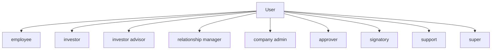
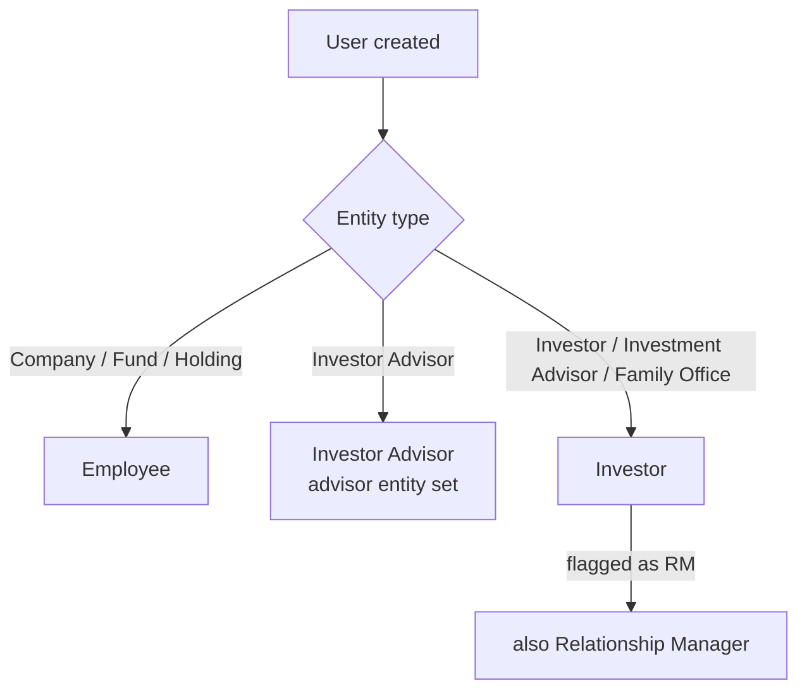
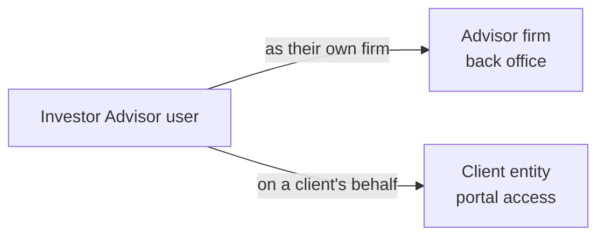
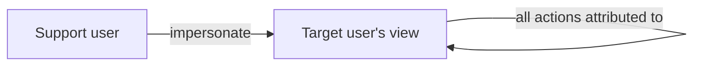

# User and Role Management User Guide

Users are the login accounts — staff and investors — who access CapHive and act within it. Every user belongs to an entity, and their **role** decides what they can do. This guide covers creating users, the role system, advisor dual-access, and impersonation for support.

It's written for administrators.

---

## Table of Contents

1. [Key Concepts](#key-concepts)
2. [The Roles at a Glance](#the-roles-at-a-glance)
3. [Which Role a New User Gets](#which-role-a-new-user-gets)
4. [Creating a User](#creating-a-user)
5. [Staff (Employee) Roles](#staff-employee-roles)
6. [The Investor Role](#the-investor-role)
7. [The Investor Advisor Role (Dual Access)](#the-investor-advisor-role-dual-access)
8. [The Relationship Manager (RM) Role](#the-relationship-manager-rm-role)
9. [Support and Super Roles](#support-and-super-roles)
10. [Per-User Feature Access](#per-user-feature-access)
11. [Joining and Password Setup](#joining-and-password-setup)
12. [Impersonation (Support)](#impersonation-support)
13. [Active and Inactive Users](#active-and-inactive-users)
14. [WhatsApp Notifications](#whatsapp-notifications)
15. [Worked Example](#worked-example)
16. [Frequently Asked Questions](#frequently-asked-questions)

---

## Key Concepts

| Term | Meaning |
|------|---------|
| **User** | A login account belonging to an entity. |
| **Role** | A permission label that defines what the user can do. |
| **Active role** | The role the user is currently operating under (matters mainly for advisors). |
| **Advisor entity** | The second entity an investor advisor can act as. |
| **Impersonation** | Support staff temporarily acting as another user to help them. |

---

## The Roles at a Glance

A user can hold several roles but operates under one at a time.

| Role | Who has it | What it allows |
|------|------------|----------------|
| **Employee** | Staff of Company, Fund, or Holding entities | Full back-office access for their entity. |
| **Investor** | Users of Investor, Investment Advisor, Family Office entities | Investor portal access. |
| **Investor Advisor** | Users of Investor Advisor entities | Switch between advisor and investor views. |
| **Relationship Manager (RM)** | Investor users flagged as RM | A relationship-manager view of their assigned investors. |
| **Company Admin** | Designated admins within a company | Administrative operations. |
| **Approver** | Users in approval workflows | Approve/activate approvals. |
| **Signatory** | Users who sign documents | E-signing. |
| **Support** | CapHive support staff | Can impersonate any user. |
| **Super** | CapHive super admins | Full system access. |

---

## Which Role a New User Gets

When you create a user, a role is assigned automatically based on the entity type:

---

## Creating a User

Go to **[Entity] → Users → New**.

**Required:**

| Field | Notes |
|-------|-------|
| **First / Last Name** | For display and emails. |
| **Email** | The login identifier. |
| **Entity** | The entity the user belongs to. |

**Optional:**

| Field | Notes |
|-------|-------|
| **Phone / Call Code** | For WhatsApp notifications. |
| **Department** | Team or division label. |
| **Tags** | Searchable labels. |
| **Signature** | An image used in e-signed documents. |

On creation, the system assigns the right role, activates the account, links any pending investor-access invitations sent to that email, and emails an invitation (or confirms immediately if a password is being set).

---

## Staff (Employee) Roles

Employees are staff of a Company, Fund, or Holding entity, with back-office access to all the entity's investors, funds, calls, commitments, distributions, documents, tasks, reports, and approvals.

Within the employee role, extra capabilities can be granted:

- **Company Admin** — administrative operations (managing settings, creating users).
- **Approver** — can act in approval workflows.
- **Signatory** — can sign documents electronically.

---

## The Investor Role

Investor users see the investor portal, scoped to:

- Funds and items their investor entity has been granted access to.
- Their own commitments, capital calls, and distributions.
- Documents shared with them.

Investor users are usually created through the **Investor Access** workflow — see the [Investor Access guide](investor_access_tutorial).

---

## The Investor Advisor Role (Dual Access)

An investor advisor belongs to an **Investor Advisor** entity and can operate in two contexts, switching between them:

The advisor's home entity is fixed when their account is created, and the set of roles they can switch between is configured at the same time. When acting on a client's behalf, they see only what's been explicitly shared with them. See the [Investor Advisor guide](investor_advisor_user_guide).

---

## The Relationship Manager (RM) Role

A user becomes an RM when their investor access is flagged as RM. RM users can:

- See the investors assigned to them.
- Receive notifications routed through their RM assignments.
- Use an RM-specific view of investor portfolios.

---

## Support and Super Roles

| Role | Access |
|------|--------|
| **Support** | Can impersonate any user to help troubleshoot (see below). |
| **Super** | Full system access, across all entities. |

---

## Per-User Feature Access

Beyond the entity-wide feature toggles, each user has their own feature access, granted in full by default. For example, giving a user **Deals** access also enables **kanban boards** for them. This lets you fine-tune what an individual can use within an entity that has a feature switched on.

---

## Joining and Password Setup

- **New users** receive a confirmation/invitation email and confirm before logging in.
- **Password reset** also confirms the account, so a user who resets their password can log straight in.
- **Admin-created users** are prompted to set their own password on first login.
- All these emails are sent in the background.

---

## Impersonation (Support)

Support staff can log in **as** a user without knowing their password, to see exactly what that user sees and help resolve issues.

> **Audit:** every action taken during an impersonated session is recorded against the impersonated user, with the support staff member identified as the one who started the session. Impersonation is restricted to the **Support** role.

---

## Active and Inactive Users

A user's **active** flag controls whether they can log in. It's turned off when an entity is disabled (all its staff are deactivated at once) or when an admin deactivates someone. To reactivate, turn the flag back on and save — but note that if the entity itself is still disabled, the user remains blocked.

---

## WhatsApp Notifications

A user receives WhatsApp notifications when WhatsApp is enabled on their account, a phone number and call code are set, and WhatsApp credentials are configured (at the entity or platform level). WhatsApp is in addition to email, not a replacement.

---

## Worked Example

Onboarding a new analyst to a fund, and giving them approval rights:

1. **[Fund] → Users → New.** Enter the analyst's name and email, entity = the fund. They're created as an **Employee** and emailed an invitation.
2. The analyst confirms via email and sets a password.
3. To let them act in approval workflows, add the **Approver** capability to their account.
4. Later, the analyst needs to manage the deal pipeline — grant them **Deals** access, which also enables kanban boards for them.
5. When they leave, set their account to **inactive** — their history is preserved, but they can no longer log in.

---

## Frequently Asked Questions

**Can a user belong to multiple entities?**
Not directly — a user has one home entity. Investor advisors get a second (advisor) entity for dual access. For genuine multi-entity staff, create a separate account per entity.

**How do I give an employee admin access?**
Add the **Company Admin** role to their user record.

**Why isn't my user receiving confirmation emails?**
Check the entity's "From Email" in Settings — if it's blank, mail goes from the default address and may be spam-filtered.

**What happens when I change a user's password?**
The account is confirmed automatically, so they can log in without the separate email-confirmation step.

**Can one account be both an investor and a fund employee?**
No — create two separate accounts, one per entity and role.

**How do I deactivate a user without deleting them?**
Set the account to inactive. Their data and history stay; they just can't log in.

**What's the difference between Company Admin and Employee?**
Every company admin is also an employee. Company Admin adds administrative powers (managing settings, creating users) on top of normal operational access.
