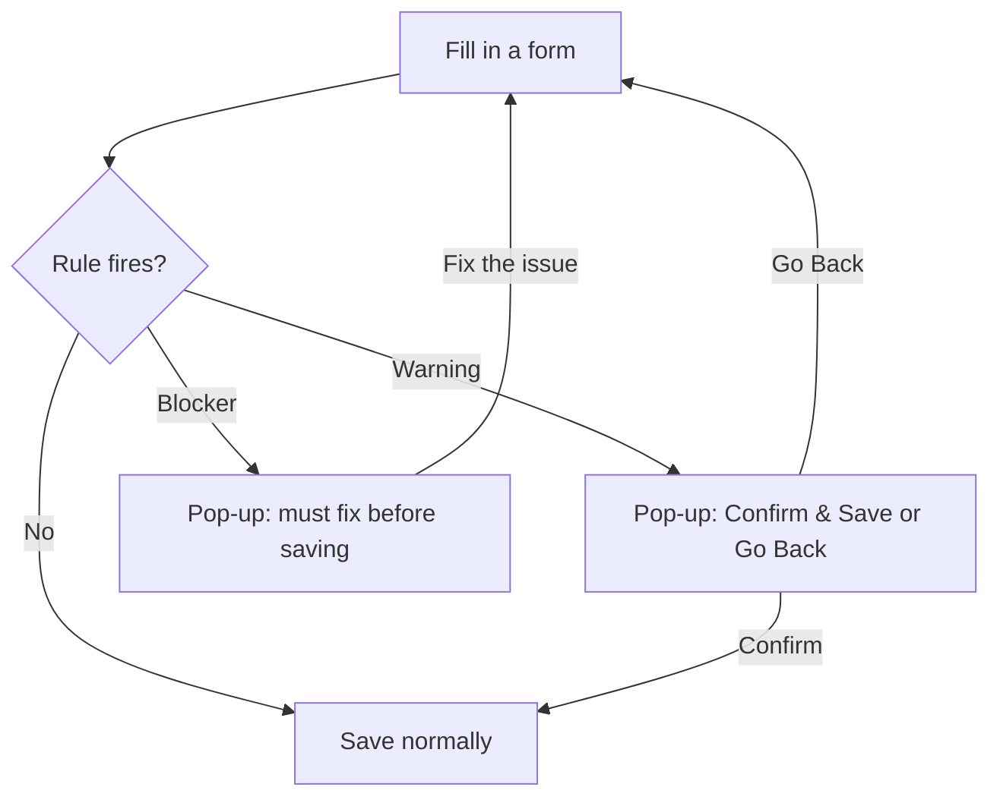

# Validation Rule Engine — User Guide

## What Is This Feature?

The Validation Rule Engine checks your data as you fill in forms and before you save. It can flag two types of issues:

| Severity | What It Means | What You Do |
|----------|--------------|-------------|
| **Warning** | Something looks unusual but is allowed | Read the message, then choose to save anyway or go back and fix it |
| **Blocker** | The data violates a hard rule | You must fix the problem before the record can be saved |

> **Where to find it:** Company menu (house icon, top right) → **Company Profile** → [**Validation Rules**](/validation_rule_overrides) button. Customise a rule with **Set Override** on its row. Needs the *company_admin* role; new custom rules are created by CapHive support in the admin panel.

Rules fire in two places:

- **As you type / leave a field** — a coloured border may appear around the field as early feedback.
- **When you click Save / Generate / Submit** — a pop-up summarises all issues before anything is saved.



---

## Which Forms Are Covered?

| Form / Action | Where To Find It |
|------|-----------------|
| Valuations | Stakeholder page → **Valuations** tab → **New Valuation** / Edit |
| Allocation Run | Fund → **Actions → Account Entries → Allocate Account Entries** |
| Fund Ratios | Fund → **Ratios** tab → **Compute Ratios** |
| Fund Ratio Run Templates | The run forms on [**Ratio Templates**](/fund_ratio_run_templates) |
| Capital Call | **Approve** and **Send Notification** on the capital call page |
| Capital Remittance | **Send Notification** on the remittance page |
| Capital Commitment | Checked after a commitment is created or imported; shown as a warning in the success message or an on-screen alert (no pop-up) |
| Fund Formula | Checked on the server when the formula is saved (blocker only, no pop-up) |

---

## What the Feedback Looks Like

### Field-level indicators (real-time)

While filling in a form, fields with active rules may be highlighted:

- **Yellow border** — a warning rule is firing on this field.
- **Red border** — a blocker rule is firing on this field.

These update automatically as you tab between fields. The border is a best-effort match between the rule name and a form field, so some rules show only in the pop-up; the pop-up on save is the reliable check.

### The confirmation modal (on save)

When you click the save/submit button, a modal appears if any rules fired. The same modal is shared by every covered form and action, so its title mentions approving even when you are saving a valuation or running an allocation.

**Warnings only** — you can still save.

```
┌─────────────────────────────────────────────┐
│ ⚠  Review Before Approving                  │
├─────────────────────────────────────────────┤
│ │ Valuation date 2026-05-11 is not a        │
│   quarter-end date. Please confirm this is  │
│   intentional.                              │
├─────────────────────────────────────────────┤
│         [Go Back]   [Confirm & Save]        │
└─────────────────────────────────────────────┘
```

Click **Confirm & Save** to proceed, or **Go Back** to revise the form.

**Blockers present** — the save button is hidden; you must fix the issue first.

```
┌─────────────────────────────────────────────┐
│ ✕  Cannot Approve — Issues Found            │
├─────────────────────────────────────────────┤
│ │ This allocation run is locked and         │
│   cannot be modified.                       │
├─────────────────────────────────────────────┤
│  Fix the issues above before approving.     │
│                        [Go Back]            │
└─────────────────────────────────────────────┘
```

---

## Default Rules

Some rules are **enabled by default** — they fire for every entity automatically with no setup required. Others are **off by default** and must be explicitly enabled by a Company Admin via an override. As seeded, the capital call, capital remittance, capital commitment and fund formula rules are on; the valuation, allocation run, fund ratio and ratio template rules are off. Thresholds can be adjusted by a Company Admin (see the Admin Setup section below).

### Valuation (off by default)

| Rule | Severity | Default Threshold |
|------|----------|------------------|
| Valuation date is not a quarter-end (Mar 31 / Jun 30 / Sep 30 / Dec 31) | Warning | — |
| Per-share value increased by more than X% vs. the previous valuation for the same instrument | Warning | 50% |
| Per-share value decreased by more than X% vs. the previous valuation for the same instrument | Warning | 50% |

### Allocation Run (off by default)

| Rule | Severity | Default Threshold |
|------|----------|------------------|
| End date is not a quarter-end | Warning | — |
| The allocation run is locked | Blocker | — |
| Portfolio companies have no valuation in the days before the end date | Warning | 30 days |
| FX rates are missing in the days before the end date | Warning | 5 days |
| Required account entries are not found in the days before the end date | Warning | 30 days, entry names you list |

### Fund Ratios (off by default)

| Rule | Severity | Default Threshold |
|------|----------|------------------|
| End date is not a quarter-end | Warning | — |

### Fund Ratio Run Templates (off by default)

| Rule | Severity | Default Threshold |
|------|----------|------------------|
| Run template trigger date is not a quarter-end | Warning | — |

### Capital Calls, Remittances and Commitments (on by default)

| Rule | Severity | Default Threshold |
|------|----------|------------------|
| Call notices have not been generated for some remittances (call **Approve** / **Send Notification**) | Warning | — |
| Generated call notices are pending approval (call **Approve** / **Send Notification**) | Blocker | — |
| Investors on the call have no contact subscribed to Capital Call notifications | Warning | — |
| The commitment's investor has no contact subscribed to Capital Call notifications | Warning | — |
| A call notice has not been generated for the remittance (remittance **Send Notification**) | Warning | — |
| The remittance's generated call notice is pending approval (remittance **Send Notification**) | Blocker | — |

### Fund Formulas (on by default)

| Rule | Severity | Default Threshold |
|------|----------|------------------|
| A Cumulate formula has roll_up disabled | Blocker | — |

---

## Admin Setup

Company Admins can view rules and enable, disable or override them for their company from the **Validation Rules** page. Changes apply immediately to all users in your entity.

Rules that are on by default (see Default Rules above) require no setup — they fire automatically. Use the steps below to opt out of a rule, adjust its thresholds, or enable a rule that is off by default.

### Step 1 — Open the Validation Rules list

1. Open Company menu (house icon, top right) → **Company Profile**.
2. Click the [**Validation Rules**](/validation_rule_overrides) button on the company profile page.

The [**Admin** panel](/admin/validation_rules) is only for CapHive super and support users.

### Step 2 — Review the default rules

The page lists all global default rules grouped by form. Key columns:

| Column | Meaning |
|--------|---------|
| **Rule** | Internal identifier |
| **Description** | What the rule checks |
| **Default Severity** | `warning` or `blocker` |
| **Default Params** | The default thresholds |
| **Status** | Whether the rule is active for your company |
| **Your Override** | What your company has changed, if anything |

Global defaults are read-only; each row has **Set Override** (or **Edit** and **Reset** once an override exists).

### Step 3 — Disable a rule you don't want (opt out)

1. Click **Set Override** on the rule you want to disable.
2. Switch the **Status** toggle off.
3. Click **Save Override**.

The rule is now disabled only for your entity. The global default is untouched.

### Step 3b — Enable a rule that is off by default (opt in)

1. Click **Set Override** on the rule you want to enable.
2. Leave the **Status** toggle on (it starts on).
3. Click **Save Override**.

The rule will now fire for your entity even though it is globally disabled.

### Step 4 — Change a threshold (e.g. the % change limit)

1. Click **Set Override** on the rule (or **Edit** if an override exists).
2. Under **Thresholds**, type the new value in the rule's field (e.g. `pct_threshold` = 25). Only the thresholds you enter change; the rest come from the global default.
3. Optionally pick a **Severity** (escalate a warning to a blocker, or downgrade a blocker to a warning) and/or type a **Custom Message** for your users (`%{field_name}` placeholders are supported).
4. Click **Save Override** — the new threshold applies immediately.

To undo an override, click **Reset** on the rule's row; the rule returns to its global default behaviour.

### Step 5 — Create a rule specific to your entity

Company admins cannot create rules in the app. If you need a rule that no other entity should see, contact CapHive support; they create it in the admin panel with these fields:

- **Name** — a short identifier, e.g. `valuation_must_have_note`
- **Target Model** — e.g. `Valuation`, `AllocationRun`, `FundRatio`, `CapitalCall`
- **Entity** — your entity (blank only for global defaults)
- **Severity** — `warning` or `blocker`
- **Condition Tree** — JSON describing when the rule fires (see examples below)
- **Message Template** — what the user sees (supports `%{field_name}` placeholders)
- **Enabled** — whether the rule is active

Company-specific rules still run, but they are not listed on your **Validation Rules** page, which shows global defaults only.

#### Condition Tree Examples

Check that a date field is a quarter-end:
```json
{
  "op": "AND",
  "conditions": [
    { "field": "valuation_date", "op": "not_quarter_end" }
  ]
}
```

Check that a numeric value is above a threshold stored in params:
```json
{
  "op": "AND",
  "conditions": [
    { "field": "per_share_value_cents", "op": "gt", "param": "min_value" }
  ]
}
```

Combine two conditions with OR:
```json
{
  "op": "OR",
  "conditions": [
    { "field": "value", "op": "lt", "param": "min_value" },
    { "field": "value", "op": "gt", "param": "max_value" }
  ]
}
```

Supported operators: `not_quarter_end`, `eq`, `lt`, `gt`, `blank`, `pct_change_gt`, `pct_change_lt`.

#### Supported Params

Params referenced by the condition tree are stored as JSON on the rule, for example:
```json
{ "min_value": 0, "max_value": 10 }
```

### Step 6 — Test your rule

After enabling or changing a rule:

1. Open the relevant form (e.g. stakeholder page → **Valuations** tab → **New Valuation**).
2. Enter values that should trigger the rule.
3. Tab out of the field — a coloured border may appear (not every rule matches a field).
4. Click Save — the modal should display your rule's message.

If the rule does not fire, check:
- The rule's row shows **Enabled** on the **Validation Rules** page.
- You are on a form or action the rule covers.
- The threshold would really be crossed (e.g. the increase rule compares with the previous valuation of the same instrument).

---

## Worked Example

Your firm wants to be warned whenever a valuation jumps too sharply, but with a tighter tolerance than the default 50%.

**As the Company Admin enabling the rule and tightening the threshold to 25%:**

1. Open Company menu (house icon) → **Company Profile** → **Validation Rules**.
2. Click **Set Override** on `valuation_large_increase`, leave **Status** on (the valuation rules are off by default), enter `25` for `pct_threshold` under **Thresholds**, and click **Save Override**.
3. From now on the warning fires at a 25% jump for your entity only, leaving every other entity on the default.

**As a user entering a valuation:**

1. Open the stakeholder page → **Valuations** tab → **New Valuation**.
2. Enter a per-share value that is 30% higher than the previous valuation for that instrument.
3. Tab out of the field — a **yellow border** may appear.
4. Click **Save** — a pop-up reads *"Per-share value has increased by more than 25% compared to the previous valuation for this instrument. Please confirm."*
5. You either click **Confirm & Save** (it's a genuine markup) or **Go Back** to correct a typo.

---

## Frequently Asked Questions

### Navigation and getting there

**Where do I manage validation rules in CapHive?**
Company menu (house icon, top right) → **Company Profile** → **Validation Rules** button, which opens the [**Validation Rules**](/validation_rule_overrides) page. It lists every global default rule grouped by form, with its default severity, default params, **Status** and **Your Override**. See [Admin Setup](#admin-setup).

**Who can see the Validation Rules page?**
Users with the *company_admin* role (and CapHive super/support users). The **Validation Rules** button on the company profile is hidden for everyone else, and opening the URL directly is refused. Ordinary users only meet the rules as pop-ups on the covered forms.

**Is there an "Admin → Validation Rules" menu for company admins?**
No. The [**Admin** panel](/admin/validation_rules), and the **Validation Rules** / **Rule Overrides** buttons on an entity in [Admin → Entities](/admin/entities), are only for CapHive super and support users. Company admins work from the [**Validation Rules**](/validation_rule_overrides) page.

**Where do rules fire?**
On the **New Valuation** / edit valuation form (stakeholder page → **Valuations** tab), fund page → **Actions → Account Entries → Allocate Account Entries**, **Compute Ratios** on the fund's **Ratios** tab, the run forms on [**Ratio Templates**](/fund_ratio_run_templates), and the **Approve** and **Send Notification** actions on a capital call or remittance. See [Which Forms Are Covered?](#which-forms-are-covered).

**Are any rules checked without a pop-up?**
Yes. Capital commitment rules are checked after a commitment is created or imported and appear as a warning in the success message or an on-screen alert, and the fund formula blocker is enforced when the formula is saved. Blockers on valuations, allocation runs, fund ratios and fund formulas are also re-checked on the server at save time.

### Creating, updating and managing rules

**How do I turn off a default rule for my company?**
On the [**Validation Rules**](/validation_rule_overrides) page click **Set Override** on the rule, switch the **Status** toggle off and click **Save Override**. The row then shows **Disabled** and "Rule disabled" under **Your Override**.

**How do I turn on a rule that is off by default?**
Click **Set Override** on the rule, leave the **Status** toggle on (it starts on) and click **Save Override**. The override's enabled flag wins over the global default for your company.

**How do I change a threshold such as the % change limit?**
Click **Set Override** (or **Edit** if an override exists), type the new number in the rule's field under **Thresholds** (e.g. `pct_threshold` = 25) and click **Save Override**. Only the thresholds you enter change; the rest come from the global default.

**How do I change a rule's severity or message?**
In the same override form pick a **Severity** (make a warning a blocker, or downgrade a blocker to a warning) and/or type a **Custom Message**; `%{field_name}` placeholders are supported. Leave them blank to keep the defaults.

**How do I edit an override?**
On the [**Validation Rules**](/validation_rule_overrides) page click **Edit** on the rule's row, change the status, severity, thresholds or message and click **Save Override**. Each rule can have only one override per company.

**How do I remove an override?**
Click **Reset** on the rule's row and confirm "Remove this override?". The override is deleted and the rule goes back to its global default behaviour, including its default enabled state.

**How do I create a rule that only applies to my company?**
Company admins cannot create rules in the app; custom rules (name, target form, severity, condition tree, message) are created by CapHive super/support users in the admin panel. Contact CapHive support with the check you need. See [Step 5 — Create a rule specific to your entity](#step-5--create-a-rule-specific-to-your-entity).

**Can I bulk import or export rules?**
No. There is no upload or download for rules or overrides; each override is set on the [**Validation Rules**](/validation_rule_overrides) page. CapHive support seeds the default rules centrally.

### Why use validation rules

**Why should I use the Validation Rule Engine?**
It catches common data mistakes at the moment of entry, such as a valuation dated off quarter-end, a per-share value that jumps 60%, missing FX rates before an allocation, or unapproved call notices before a call is approved, instead of discovering them in investor statements later.

**What does it let me do that I cannot do otherwise?**
Tune checks to your firm's policy without code: switch rules on or off, tighten or loosen thresholds, escalate a warning to a hard blocker, and word the message your team sees, all for your company only.

**What happens if I don't configure anything?**
Each global default runs in its default state. As seeded, the capital call, capital remittance, capital commitment and fund formula rules are on; the valuation, allocation run, fund ratio and ratio template rules are off until a company admin enables them with an override.

**Who typically uses validation rules?**
Company admins and fund controllers configure them; fund accountants, operations and valuation teams see the warnings and blockers while entering valuations, running allocations, computing ratios and approving calls.

### What happens when I …

**What happens when I save an override?**
The override is stored for your company only and takes effect on the next evaluation (the next field blur or save) for every user in your company. No one is notified, and other companies keep the global default.

**What happens when I confirm a warning with Confirm & Save?**
The form is resubmitted with a `force_save` flag and the record saves normally. Warnings are not stored on the record or logged, and nobody is notified.

**What happens when a blocker fires?**
The pop-up shows the issue with only **Go Back**, and the save or approval does not go through. If the request reaches the server anyway, the blocker is re-checked there and the save or approval is refused with the rule's message.

**What happens when I click Approve on a capital call and rules fire?**
Blockers (e.g. generated call notices still pending approval) stop the approval with an alert. Warnings (e.g. notices not generated, or investors with no contact subscribed to Capital Call notifications) are shown in the pop-up and, after you confirm, included in the approval's success message.

**What happens if the rule engine itself fails?**
It fails open: if the check cannot be run, the form submits without a pop-up and the server logs the error rather than blocking the save. A broken rule never stops people from working.

### Troubleshooting and edge cases

**I confirmed a warning and saved — will I see it again next time I open the record?**
Not when you open it. The pop-up only appears during a save attempt, and the rules are evaluated fresh each time you save, so an unchanged issue will warn again on the next save.

**Can I override a blocker?**
Not from the form: blockers are enforced on the server and cannot be bypassed with **Confirm & Save**. A company admin can downgrade the rule to a warning or disable it with an override if the rule does not fit your policy.

**A rule is firing incorrectly — what do I do?**
Ask your company admin to adjust its threshold, severity or status with an override on the [**Validation Rules**](/validation_rule_overrides) page. If the condition itself is wrong, contact CapHive support.

**Does disabling a rule affect other entities?**
No. Each company's overrides are isolated. Disabling a rule for your company has no effect on other companies.

**A rule I enabled does not fire.**
Check that the override row shows **Enabled**, that you are on a form the rule covers, and that the threshold would really be crossed (e.g. the increase rule compares with the previous valuation of the same instrument). Rules are evaluated when you leave a field and when you save.

**The field border did not change colour, but the pop-up appeared.**
The coloured border is a best-effort match between the rule name and a form field, so some rules only show in the pop-up. The pop-up on save is the reliable check.

**My company-specific rule is not listed on the Validation Rules page.**
That page lists global default rules only. Custom rules created for your company by CapHive support still run, but can only be viewed or changed in the admin panel by support.

**The pop-up title says "Review Before Approving" on a valuation form.**
The same pop-up is shared by every covered form and action, so its title reads "Review Before Approving" (or "Cannot Approve — Issues Found" when blockers fire) even when you are saving a valuation or running an allocation.

## Related Guides

- [Valuations](valuations_user_guide) — the valuation form where the quarter-end and % change rules fire.
- [Capital Calls](capital_calls_user_guide) — Approve and Send Notification are gated by the call notice rules.
- [Capital Commitments](capital_commitments_user_guide) — commitments warn when no contact is subscribed to call notices.
- [Fund Ratios](fund_ratios_user_guide) — Compute Ratios runs the fund ratio rules.
- [Fund Ratio Run Templates](fund_ratio_run_templates_user_guide) — run triggers check the template quarter-end rule.
- [User Role Management](user_role_management_user_guide) — how to get the company_admin role needed to manage overrides.
