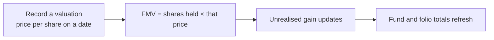
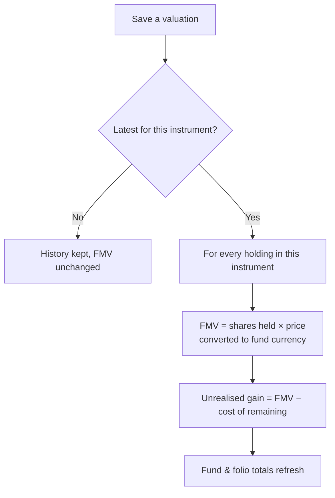

# Valuations User Guide

This guide covers how to record and manage **valuations** for portfolio companies — how they flow through to the fair market value (FMV) of your investments, and how to use the **Value Bridge** to explain what drove performance between two dates.

---

## Table of Contents

1. [What a Valuation Is](#what-a-valuation-is)
2. [Key Terms in Plain English](#key-terms-in-plain-english)
3. [Creating a Valuation](#creating-a-valuation)
4. [Valuation Fields](#valuation-fields)
5. [How Valuations Drive FMV](#how-valuations-drive-fmv)
6. [Synthetic (What-If) Valuations](#synthetic-what-if-valuations)
7. [Custom Fields on Valuations](#custom-fields-on-valuations)
8. [Setting Up the Value Bridge](#setting-up-the-value-bridge)
9. [Using the Value Bridge](#using-the-value-bridge)
10. [How the Value Bridge Works](#how-the-value-bridge-works)
11. [MOIC Mode](#moic-mode)
12. [Finding Valuations](#finding-valuations)
13. [Importing Valuations](#importing-valuations)
14. [Rules to Know](#rules-to-know)
15. [Frequently Asked Questions](#frequently-asked-questions)

---

## What a Valuation Is

A **valuation** records the **price per share (or per unit)** of a specific security held in a portfolio company, as of a given date. It's the single source of truth for the **fair market value (FMV)** of every investment in that security.

Whenever you mark an investment up or down, you create a new valuation. The system always uses the most recent valuation on or before a given date to value the holdings at that date.

---

## Key Terms in Plain English

| Term | Meaning |
|------|---------|
| **Portfolio Company** | The company the fund has invested in. |
| **Investment Instrument** | A specific class of security in that company (e.g. "Equity Shares", "Series A Preferred"). Each has its own valuation history. |
| **Per Share Value** | The price of one unit of the security; multiplied by quantity to get FMV. |
| **Valuation Date** | The date the price takes effect from. |
| **Synthetic** | A what-if valuation for scenario modelling — does **not** affect live FMV. |
| **Latest Valuation** | The most recent real valuation on or before a date — the one that drives FMV. |

---

## Creating a Valuation

**From the portfolio company page:** open the company, go to the **Valuations** tab, click **New Valuation**, fill in the form, and save.

**From the global list:** open **Valuations** in the main menu and click **New**.

**Several instruments at once:** when creating a new valuation you can select **multiple instruments** in one go — a separate valuation is created for each, all with the same date and price. This is handy at quarter-end when marking every instrument in a company at the same time.

---

## Valuation Fields

| Field | Required | Notes |
|-------|----------|-------|
| **Valuation Date** | Yes | When this price takes effect. Only one valuation per instrument per date. |
| **Instrument** | Yes | The security this applies to (specific to the company). |
| **Per Share Value** | Yes | The price per unit. Must be zero or more, stored to high precision. |
| **Valuation** | No | A total enterprise or equity value — informational, not used directly in FMV. |
| **Report** | No | Attach a document, e.g. a third-party valuation report. |
| **Synthetic** | No | Mark as a scenario/what-if; it won't affect live FMV. |
| **Custom Fields** | No | Extra fields your administrator configures (e.g. revenue, EBITDA margin) — needed for the Value Bridge. |

**Currency:** a valuation's currency is the **instrument's** currency, not the fund's. When FMV is computed for a fund in a different currency, the price is converted using the exchange rate on the relevant date.

---

## How Valuations Drive FMV

When you save a real valuation that is the **latest** for its instrument, the system automatically recalculates FMV for every investment in that instrument.

The valuation used for any date is the latest one **on or before** that date — so a valuation dated 31 March applies to every date from 31 March onward until a newer one is entered. Shares held already account for buys, sells, and conversions.

If you **delete** a valuation, the system recomputes all affected investments so no stale FMV remains.

---

## Synthetic (What-If) Valuations

A **synthetic valuation** is a scenario record used for modelling and the Value Bridge. It never triggers FMV updates and is excluded from live calculations:

- Synthetic valuations are hidden from the normal views (tools that need them, like the Value Bridge, show them automatically).
- A synthetic valuation is never treated as the "latest" for FMV.
- Realised gains, totals, and ratios are unaffected.

**Use them for:** modelling a hypothetical exit value, creating an entry snapshot for a value bridge without backdating real marks, or stress-testing ratios under different FMV assumptions.

---

## Custom Fields on Valuations

Valuations can carry custom fields your administrator adds (numeric, text, or calculated). They feed the **Value Bridge**, custom reports, and KPI charts.

### Built-in Value Bridge fields

There's a standard set of value-bridge fields an administrator can add to the valuation form:

| Field | Type | Meaning |
|-------|------|---------|
| **Revenue** | Number | Company revenue at this date. |
| **EBITDA Margin** | Number | EBITDA margin (%). |
| **EBITDA** | Calculated | Revenue × EBITDA margin ÷ 100. |
| **Valuation Multiple** | Number | The EV/EBITDA multiple applied. |
| **Enterprise Value** | Calculated | EBITDA × valuation multiple. |
| **Net Debt** | Number | Debt minus cash. |
| **Equity Value** | Calculated | Enterprise value − net debt. |
| **Debt / Equity Ratios** | Calculated | Net debt and equity value as shares of enterprise value. |

> **Setup:** ask your administrator to enable the Value Bridge fields on the valuation form for your entity. Once done, they appear on every valuation.

---

## Setting Up the Value Bridge

The **Value Bridge** explains how a company's enterprise value changed between two dates by isolating the contribution of each driver — revenue growth, margin change, and multiple re-rating.

1. **Add the custom fields.** Your administrator enables the value-bridge fields on the valuation form. The standard drivers are **Revenue**, **EBITDA Margin**, and **Valuation Multiple**.
2. **Choose the drivers and their order.** The ordered list shown in the bridge is set in **Entity Settings → Value Bridge Columns**, e.g. `Revenue, EBITDA Margin, Valuation Multiple`. Order matters — drivers are applied left to right, each building on the previous.
3. **Fill in the fields on both valuations.** The **entry** (start) and **exit** (end) valuations both need Revenue, EBITDA Margin, Valuation Multiple, and Net Debt. The calculated fields (EBITDA, Enterprise Value, etc.) compute automatically.

---

## Using the Value Bridge

1. Open the **Portfolio Company** and click **Value Bridge**.
2. Choose the **Start Point** (entry valuation) and **End Point** (exit valuation).
3. The bridge renders immediately, as both a table and a waterfall chart.

**The table** shows each metric at entry, the impact of each driver in turn, and the values at exit — colour-coded green (improvement) or red (deterioration). **The waterfall chart** shows the cumulative build-up from entry enterprise value to exit, each driver as a green or red bar.

The dropdowns only show valuations for the same instrument. If you flag specific milestone valuations for the bridge, only those appear — keeping the list to meaningful points (entry, year-ends) rather than every quarterly mark.

---

## How the Value Bridge Works

The bridge isolates **one driver at a time**, holding the others fixed, and measures the resulting change in enterprise value.

Starting from the entry valuation:

1. **Entry** — enterprise value = entry EBITDA × entry multiple.
2. **Revenue impact** — move revenue to its exit value (margin and multiple still at entry), recompute enterprise value; the impact is the change from the previous step.
3. **Margin impact** — now move the EBITDA margin to its exit value (revenue already at exit), recompute; the impact is the further change.
4. **Multiple impact** — finally move the multiple to its exit value (revenue and margin already at exit), recompute; the impact is the final change.
5. **Exit** — all metrics at exit values; this should match the exit valuation's enterprise value.

### Worked example

| | Entry (2023-03-31) | Revenue impact | Margin impact | Multiple impact | Exit (2025-03-31) |
|--|--|--|--|--|--|
| Revenue | 100 | **120** | 120 | 120 | 120 |
| EBITDA Margin | 20% | 20% | **25%** | 25% | 25% |
| EBITDA | 20 | 24 | 30 | 30 | 30 |
| Multiple | 10× | 10× | 10× | **12×** | 12× |
| Enterprise Value | **200** | 240 | 300 | 360 | **360** |
| EV change | — | **+40** | **+60** | **+60** | — |

Total change = 40 + 60 + 60 = **160** (entry 200 → exit 360 ✓).

> **Order matters.** Each driver's impact depends on what's already been applied — revenue growth is measured with margins and multiples still at entry levels. This is a standard sequential decomposition.

---

## MOIC Mode

By default the bridge shows absolute values. Switch to **MOIC mode** to express every number as a multiple of the entry enterprise value:

> MOIC = each value ÷ entry enterprise value

This makes bridges comparable across companies of different sizes — a "+0.20×" revenue impact means revenue growth alone added 0.2× on the entry value. Toggle between **Values** and **MOIC** with the **Basis** dropdown.

---

## Finding Valuations

Open **Valuations** in the main menu to see those you can access. You can narrow the list by:

- **Portfolio company** — automatic when you open a company's Valuations tab.
- **Instrument** — restrict to one security within a company.
- **Date** — on/before/after a date.
- **Synthetic** — show or hide what-if records (hidden by default in most views).
- **Search** — by company name or per-share value.

---

## Importing Valuations

Provide a spreadsheet with these columns:

| Column | Required | Notes |
|--------|----------|-------|
| **Instrument** | Yes | Must already exist on the company. |
| **Portfolio Company** | Yes | Must match an existing company exactly. |
| **Valuation Date** | Yes | The date of the mark. |
| **Per Share Value** | Yes | Price per unit. |
| **Valuation** | No | Total value (informational). |

Add extra columns to populate custom fields (e.g. revenue, EBITDA margin). An identical valuation (same instrument, company, date, price, and total) is skipped, so re-importing is safe. After import, FMV is recalculated for each affected instrument automatically.

---

## Rules to Know

| Rule | Detail |
|------|--------|
| **Date required** | A valuation can't be saved without a date. |
| **Price ≥ 0** | Negative prices aren't allowed; zero is valid (e.g. a write-off). |
| **One per instrument per date** | You can't have two valuations for the same instrument on the same date. |
| **Instrument required** | Every valuation belongs to a specific instrument. |
| **Latest drives FMV** | Only the most recent real valuation on or before a date drives FMV; older ones are kept as history. |
| **Synthetic flag is fixed** | A valuation can't be switched between real and synthetic after it's created, to prevent a scenario record being promoted by accident. |
| **Auto-named** | If you don't name it, it's named "[Instrument] – [Date]". |

---

## Frequently Asked Questions

**Why hasn't FMV updated after I saved a valuation?**
Check that it isn't marked synthetic, that it's the **latest** date for that instrument (editing an older valuation won't change FMV), and that the holdings have the right instrument. FMV updates happen immediately on save.

**Can I enter a valuation in a different currency from the fund?**
Yes. The valuation uses the instrument's currency; FMV is converted to the fund's currency using the rate on the relevant date.

**How do I model a write-off?**
Create a valuation with **Per Share Value = 0** — FMV for that instrument becomes zero from that date onward.

**Can I use the Value Bridge for non-EBITDA companies?**
Yes. The drivers are configurable — your administrator can set up revenue multiples for SaaS, P/E for listed equities, ARR growth for subscriptions, and so on.

**What's the difference between "Valuation" and "Per Share Value"?**
Per Share Value is the operative number (multiplied by quantity for FMV). "Valuation" is an informational total and doesn't feed automated calculations unless a custom-field formula references it.

**A valuation isn't in the Value Bridge dropdown — why?**
If milestone valuations are flagged for the bridge, only flagged ones appear. Flag the valuation you need, or ask your administrator whether the filtering is intentional.

**Can I bulk-update prices for many companies?**
Yes — use the import spreadsheet with one row per company/instrument/date. Each row creates a valuation and recalculates FMV.

**Does deleting a valuation affect historical reporting?**
Deleting one recomputes FMV for affected investments back to that date. Stored fund-ratio snapshots aren't auto-regenerated — regenerate ratios afterwards if you want them to reflect the change.
