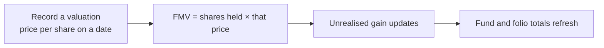
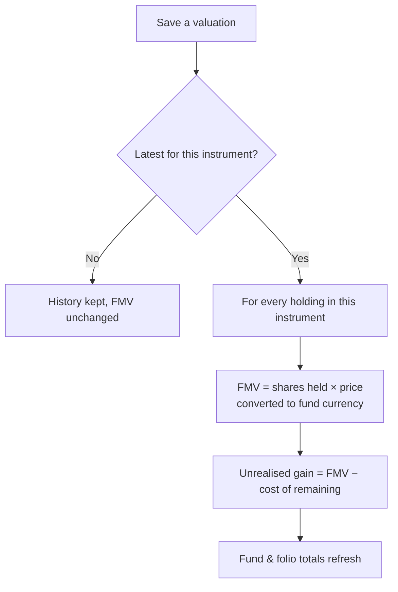

# Valuations User Guide

This guide covers how to record and manage **valuations** for portfolio companies — how they flow through to the fair market value (FMV) of your investments, and how to use the **Value Bridge** to explain what drove performance between two dates.

> **Where to find it:** Sidebar → [**Stakeholders → View Stakeholders**](/investors) → open the portfolio company → **Valuations** tab. Create one with **New Valuation** on that tab; the [global list](/valuations) (sidebar **Investments → Valuations**, shown when your user has the Investments feature) is read-only. You need update rights on the portfolio company (Stakeholder).

---

## Table of Contents

1. [What a Valuation Is](#what-a-valuation-is)
2. [Key Terms in Plain English](#key-terms-in-plain-english)
3. [Creating a Valuation](#creating-a-valuation)
4. [Valuation Fields](#valuation-fields)
5. [How Valuations Drive FMV](#how-valuations-drive-fmv)
6. [Synthetic (What-If) Valuations](#synthetic-what-if-valuations)
7. [Custom Fields on Valuations](#custom-fields-on-valuations)
8. [Setting Up the Value Bridge](#setting-up-the-value-bridge)
9. [Using the Value Bridge](#using-the-value-bridge)
10. [How the Value Bridge Works](#how-the-value-bridge-works)
11. [MOIC Mode](#moic-mode)
12. [Finding Valuations](#finding-valuations)
13. [Importing Valuations](#importing-valuations)
14. [Rules to Know](#rules-to-know)
15. [Frequently Asked Questions](#frequently-asked-questions)

---

## What a Valuation Is

A **valuation** records the **price per share (or per unit)** of a specific security held in a portfolio company, as of a given date. It's the single source of truth for the **fair market value (FMV)** of every investment in that security.

Whenever you mark an investment up or down, you create a new valuation. The system always uses the most recent valuation on or before a given date to value the holdings at that date.

---

## Key Terms in Plain English

| Term | Meaning |
|------|---------|
| **Portfolio Company** | The company the fund has invested in. |
| **Investment Instrument** | A specific class of security in that company (e.g. "Equity Shares", "Series A Preferred"). Each has its own valuation history. |
| **Per Share Value** | The price of one unit of the security; multiplied by quantity to get FMV. |
| **Valuation Date** | The date the price takes effect from. |
| **Synthetic** | A what-if valuation for scenario modelling — does **not** affect live FMV. |
| **Latest Valuation** | The most recent real valuation on or before a date — the one that drives FMV. |

---

## Creating a Valuation

**From the portfolio company page:** open the company, go to the **Valuations** tab, click **New Valuation**, fill in the form, and save.

**From the fund's portfolio:** on the fund's **Portfolio** tab, open an aggregate investment row's menu and choose **Add Valuation**; the form opens pre-filled with the company and instrument. (The global **Valuations** list in the sidebar has no **New Valuation** button.)

**Several instruments at once:** when creating a new valuation you can select **multiple instruments** in one go — a separate valuation is created for each, all with the same date and price. This is handy at quarter-end when marking every instrument in a company at the same time.

---

## Valuation Fields

| Field | Required | Notes |
|-------|----------|-------|
| **Valuation Date** | Yes | When this price takes effect. Only one valuation per instrument per date. |
| **Instrument** | Yes | The security this applies to (specific to the company). |
| **Per Share Value** | Yes | The price per unit. Must be zero or more, stored to high precision. |
| **Valuation** | No | A total enterprise or equity value — informational, not used directly in FMV. |
| **Report** | No | Attach a document, e.g. a third-party valuation report. |
| **Synthetic** | No | Mark as a scenario/what-if; it won't affect live FMV. |
| **Custom Fields** | No | Extra fields your administrator configures (e.g. revenue, EBITDA margin) — needed for the Value Bridge. |

**Currency:** a valuation's currency is the **instrument's** currency, not the fund's. When FMV is computed for a fund in a different currency, the price is converted using the exchange rate on the relevant date.

---

## How Valuations Drive FMV

When you save a real valuation that is the **latest** for its instrument, the system automatically recalculates FMV for every investment in that instrument.

The valuation used for any date is the latest one **on or before** that date — so a valuation dated 31 March applies to every date from 31 March onward until a newer one is entered. Shares held already account for buys, sells, and conversions.

If you **delete** a valuation, the system recomputes all affected investments so no stale FMV remains.

---

## Synthetic (What-If) Valuations

A **synthetic valuation** is a scenario record used for modelling and the Value Bridge. It never triggers FMV updates and is excluded from live calculations:

- Synthetic valuations are hidden from the normal views (tools that need them, like the Value Bridge, show them automatically).
- A synthetic valuation is never treated as the "latest" for FMV.
- Realised gains, totals, and ratios are unaffected.

**Use them for:** modelling a hypothetical exit value, creating an entry snapshot for a value bridge without backdating real marks, or stress-testing ratios under different FMV assumptions.

---

## Custom Fields on Valuations

Valuations can carry custom fields your administrator adds (numeric, text, or calculated). They feed the **Value Bridge**, custom reports, and KPI charts.

### Built-in Value Bridge fields

There's a standard set of value-bridge fields an administrator can add to the valuation form:

| Field | Type | Meaning |
|-------|------|---------|
| **Revenue** | Number | Company revenue at this date. |
| **EBITDA Margin** | Number | EBITDA margin (%). |
| **EBITDA** | Calculated | Revenue × EBITDA margin ÷ 100. |
| **Valuation Multiple** | Number | The EV/EBITDA multiple applied. |
| **Enterprise Value** | Calculated | EBITDA × valuation multiple. |
| **Net Debt** | Number | Debt minus cash. |
| **Equity Value** | Calculated | Enterprise value − net debt. |
| **Debt / Equity Ratios** | Calculated | Net debt and equity value as shares of enterprise value. |

> **Setup:** a company admin adds the Value Bridge fields to the **Valuation** form under Company menu (house icon, top right) → **Customize Forms**. Once done, they appear on every valuation.

---

## Setting Up the Value Bridge

The **Value Bridge** explains how a company's enterprise value changed between two dates by isolating the contribution of each driver — revenue growth, margin change, and multiple re-rating.

1. **Add the custom fields.** A company admin adds the value-bridge fields to the valuation form (**Customize Forms**). The standard drivers are **Revenue**, **EBITDA Margin**, and **Valuation Multiple**.
2. **Choose the drivers and their order.** The ordered list shown in the bridge is the entity's **Value Bridge Columns** setting, e.g. `Revenue, EBITDA Margin, Valuation Multiple`. It is not on the regular settings screens — ask CapHive support to set or change it. Order matters — drivers are applied left to right, each building on the previous.
3. **Fill in the fields on both valuations.** The **entry** (start) and **exit** (end) valuations both need Revenue, EBITDA Margin, Valuation Multiple, and Net Debt. The calculated fields (EBITDA, Enterprise Value, etc.) compute automatically.

---

## Using the Value Bridge

1. Open the **Portfolio Company**, go to its **Valuations** tab and click **Value Bridge**.
2. Choose the **Start Point** (entry valuation) and **End Point** (exit valuation).
3. The bridge renders immediately, as both a table and a waterfall chart.

**The table** shows each metric at entry, the impact of each driver in turn, and the values at exit — colour-coded green (improvement) or red (deterioration). **The waterfall chart** shows the cumulative build-up from entry enterprise value to exit, each driver as a green or red bar.

Pick start and end valuations for the same instrument — if they differ, nothing is computed. If you flag specific milestone valuations for the bridge (a `compute_value_bridge` custom field set to 1), only those appear — keeping the list to meaningful points (entry, year-ends) rather than every quarterly mark.

---

## How the Value Bridge Works

The bridge isolates **one driver at a time**, holding the others fixed, and measures the resulting change in enterprise value.

Starting from the entry valuation:

1. **Entry** — enterprise value = entry EBITDA × entry multiple.
2. **Revenue impact** — move revenue to its exit value (margin and multiple still at entry), recompute enterprise value; the impact is the change from the previous step.
3. **Margin impact** — now move the EBITDA margin to its exit value (revenue already at exit), recompute; the impact is the further change.
4. **Multiple impact** — finally move the multiple to its exit value (revenue and margin already at exit), recompute; the impact is the final change.
5. **Exit** — all metrics at exit values; this should match the exit valuation's enterprise value.

### Worked example

| | Entry (2023-03-31) | Revenue impact | Margin impact | Multiple impact | Exit (2025-03-31) |
|--|--|--|--|--|--|
| Revenue | 100 | **120** | 120 | 120 | 120 |
| EBITDA Margin | 20% | 20% | **25%** | 25% | 25% |
| EBITDA | 20 | 24 | 30 | 30 | 30 |
| Multiple | 10× | 10× | 10× | **12×** | 12× |
| Enterprise Value | **200** | 240 | 300 | 360 | **360** |
| EV change | — | **+40** | **+60** | **+60** | — |

Total change = 40 + 60 + 60 = **160** (entry 200 → exit 360 ✓).

> **Order matters.** Each driver's impact depends on what's already been applied — revenue growth is measured with margins and multiples still at entry levels. This is a standard sequential decomposition.

---

## MOIC Mode

By default the bridge shows absolute values. Switch to **MOIC mode** to express every number as a multiple of the entry enterprise value:

> MOIC = each value ÷ entry enterprise value

This makes bridges comparable across companies of different sizes — a "+0.20×" revenue impact means revenue growth alone added 0.2× on the entry value. Toggle between **Values** and **MOIC** with the **Basis** dropdown.

---

## Finding Valuations

Open a portfolio company's **Valuations** tab, or the global **Valuations** list (Sidebar → **Investments → Valuations**), to see those you can access. You can narrow the list by:

- **Portfolio company** — automatic when you open a company's Valuations tab.
- **Instrument** — restrict to one security within a company.
- **Date** — on/before/after a date.
- **Synthetic** — show or hide what-if records (hidden by default in most views).
- **Search** — by company name or per-share value.

---

## Importing Valuations

Provide a spreadsheet with these columns:

| Column | Required | Notes |
|--------|----------|-------|
| **Instrument** | Yes | Must already exist on the company. |
| **Portfolio Company** | Yes | Must match an existing company exactly. |
| **Valuation Date** | Yes | The date of the mark. |
| **Per Share Value** | Yes | Price per unit. |
| **Valuation** | No | Total value (informational). |

Add extra columns to populate custom fields (e.g. revenue, EBITDA margin). An identical valuation (same instrument, company, date, price, and total) is skipped, so re-importing is safe. After import, FMV is recalculated for each affected instrument automatically.

---

## Rules to Know

| Rule | Detail |
|------|--------|
| **Date required** | A valuation can't be saved without a date. |
| **Price ≥ 0** | Negative prices aren't allowed; zero is valid (e.g. a write-off). |
| **One per instrument per date** | You can't have two valuations for the same instrument on the same date. |
| **Instrument required** | Every valuation belongs to a specific instrument. |
| **Latest drives FMV** | Only the most recent real valuation on or before a date drives FMV; older ones are kept as history. |
| **Synthetic flag is fixed** | A valuation can't be switched between real and synthetic after it's created, to prevent a scenario record being promoted by accident. |
| **Auto-named** | If you don't name it, it's named "[Instrument] – [Date]". |

---

## Frequently Asked Questions

### Navigation and getting there

**Where do I find valuations in CapHive?**
Valuations belong to a portfolio company, which is a **Stakeholder** (investor record) with the category "Portfolio Company". Sidebar → [**Stakeholders → View Stakeholders**](/investors), open the company, then click its **Valuations** tab. See [Finding Valuations](#finding-valuations).

**Is there a global Valuations page?**
Yes, the [global Valuations list](/valuations) shows every valuation you can access. It appears in the sidebar as **Investments → Valuations** for users with the Investments feature (`enable_investments`) and for startup/company logins. Note that the global list has no **New Valuation** button; a valuation is always created from a specific company's **Valuations** tab or from a portfolio investment row.

**How do I reach a valuation from the fund's portfolio?**
Sidebar → [**Funds → Funds**](/funds), open the fund, **Portfolio** tab, then open the row menu on the aggregate investment and choose **Add Valuation**; the form opens pre-filled with the company and instrument. The **Show** action on the same row links to the company and instrument pages.

**Where is the Value Bridge?**
On the portfolio company's **Valuations** tab click **Value Bridge**, then pick the **Start Point** and **End Point** valuations. See [Using the Value Bridge](#using-the-value-bridge).

### Creating, updating and managing valuations

**How do I create a valuation?**
Open the portfolio company → **Valuations** tab → [**New Valuation**](/valuations/new). Enter the valuation date, select one or more instruments, enter the per-share value, optionally attach the valuation report and tick **Synthetic Valuation** for a what-if record, then **Save**. See [Creating a Valuation](#creating-a-valuation) and [Valuation Fields](#valuation-fields).

**How do I edit a valuation?**
Open the valuation (click **Show** on its row in the Valuations tab) and click **Edit**. You can change the date, price, report and custom fields; the **Synthetic** flag cannot be changed after creation. If the edited valuation is the latest for its instrument, FMV is recalculated on save.

**How do I delete a valuation?**
Open the valuation and click **Delete**, then confirm. All investments in that instrument are recomputed so no stale FMV remains. See [How Valuations Drive FMV](#how-valuations-drive-fmv).

**How do I bulk-import valuations?**
On the company's **Valuations** tab click **Upload** (it opens the import form with import type **Valuation** and a sample file), or use Company menu (house icon, top right) → [**Imports**](/import_uploads) and choose **Valuation**. See [Importing Valuations](#importing-valuations).

**How do I export valuations?**
Click **Export All** on the Valuations tab (or on the [global Valuations list](/valuations)) to download the current list as Excel. The **Analytics** button on the same page opens charts for the company's valuation history.

**How do I add fields such as Revenue or EBITDA Margin to the valuation form?**
Custom fields are configured by a company admin under Company menu (house icon, top right) → [**Customize Forms**](/form_types): open (or create) the **Valuation** form type and add the fields. See [Custom Fields on Valuations](#custom-fields-on-valuations).

**Where is the Value Bridge driver order set?**
It is the `value_bridge_cols` entity setting (a comma-separated list such as `Revenue, EBITDA Margin, Valuation Multiple`). There is no field for it on the regular settings screens; it is maintained by CapHive support / super-admins in the Admin console, so ask support to set or change it. See [Setting Up the Value Bridge](#setting-up-the-value-bridge).

**How do I flag milestone valuations for the Value Bridge?**
Add a custom field named `compute_value_bridge` to the Valuation form and set it to 1 on the valuations you want in the **Start Point** / **End Point** dropdowns. When that field exists, only flagged valuations are listed; when it does not, every valuation (including synthetic ones) of the company appears.

**What permission do I need?**
You need update rights on the portfolio company (Stakeholder) to create, edit or delete its valuations; viewing needs only read access to the company. Fund-level read access does not by itself allow adding valuations. Ask your company admin to grant access on the company's **Access Rights** tab.

### Why it matters

**Why should I record valuations in CapHive?**
The latest valuation drives the FMV, unrealised gain, fund ratios (TVPI, RVPI, IRR), LP dashboards and portfolio reports for every fund holding that instrument. Recording marks here means one entry updates every downstream number and keeps a dated audit trail of each mark.

**What can I do with valuations?**
Value holdings at any date, write off positions, run what-if scenarios with synthetic valuations, attach third-party valuation reports, analyse the valuation history with **Analytics**, and explain performance between two dates with the **Value Bridge** (in value or MOIC terms). See [MOIC Mode](#moic-mode).

**What happens if I don't add valuations?**
Each buy creates an opening valuation at cost, so holdings are valued at cost until you add a mark. Gains, ratios and reports then understate or overstate performance, and the Value Bridge has nothing to compare.

**Who typically uses valuations?**
Finance and portfolio teams of the fund manager enter quarterly marks; partners and analysts use the analytics and Value Bridge; LPs see the resulting FMV on their dashboards (they cannot edit valuations).

### What happens when I…

**What happens when I save a new valuation?**
One valuation record is created per instrument you selected (all with the same date and price) and you are returned to the company's **Valuations** tab. If a valuation is the latest-dated real one for its instrument, every open buy of that instrument in every fund of your firm is recomputed straight away: FMV, unrealised gain and the aggregate portfolio rows change, and fund ratios, LP dashboards and portfolio reports read the new value from then on. No one is emailed or notified in-app.

**What happens when I save a valuation dated earlier than the latest one?**
It is stored as history and used for as-of-date views and the Value Bridge, but current FMV does not change because the later valuation still wins. See [How Valuations Drive FMV](#how-valuations-drive-fmv).

**What happens when I edit a valuation?**
The price, date, report and custom fields are updated in place. If it is (or becomes) the latest valuation for the instrument, the affected investments are recomputed on save; the change is written to the audit trail. The **Synthetic** flag cannot be changed, and moving the date onto one already used by another valuation of the same instrument is rejected.

**What happens when I delete a valuation?**
The record is removed permanently and a background job recomputes every investment in that instrument, so FMV falls back to the previous valuation (or to cost if none remains). Stored fund-ratio snapshots are not regenerated automatically. No one is notified.

**What happens when I tick Synthetic?**
The record is saved but never treated as the latest valuation, so no FMV, gain, ratio or report changes; it is hidden from the normal Valuations list and appears only in tools that ask for it, such as the Value Bridge dropdowns. See [Synthetic (What-If) Valuations](#synthetic-what-if-valuations).

**What happens when I upload a valuation spreadsheet?**
Rows are processed in a background job; each new row creates a valuation and triggers the same FMV recompute as a manual entry, identical rows are skipped, and rows with an unknown company or instrument are reported as errors on the import's page under [**Imports**](/import_uploads). You get an in-app alert when the import finishes. See [Importing Valuations](#importing-valuations).

**What happens when I record a buy in the fund portfolio?**
CapHive automatically creates (or overwrites) a valuation for that instrument dated the investment date at the purchase price per share, so every holding has an opening mark. Your later quarterly marks then supersede it.

**What happens when I open the Value Bridge?**
Nothing is written. The bridge reads the entry and exit valuations you pick, applies the drivers in the configured order, and renders the table and waterfall on screen; switching **Basis** to MOIC only changes the display. See [Using the Value Bridge](#using-the-value-bridge).

**What happens if a validation rule fires when I save?**
The valuation rules are off by default; if your company admin has enabled them, a *warning* rule shows a confirmation dialog you can accept with **Confirm & Save**, while a *blocker* rule stops the save until you fix the issue (it cannot be bypassed from the form). See the [Validation Rule Engine](validation_rule_engine_user_guide) guide.

**What happens if I don't add an exchange rate for a foreign-currency instrument?**
The valuation itself saves (it is in the instrument's currency), but FMV in the fund's currency cannot be converted for that date, so fund-level FMV is wrong or missing until you add the rate under Company menu (house icon, top right) → [**Exchange Rates**](/exchange_rates).

### Troubleshooting and edge cases

**Why hasn't FMV updated after I saved a valuation?**
Check that it isn't marked synthetic, that it's the **latest** date for that instrument (editing an older valuation won't change FMV), and that the holdings have the right instrument. FMV updates happen immediately on save.

**Can I enter a valuation in a different currency from the fund?**
Yes. The valuation uses the instrument's currency; FMV is converted to the fund's currency using the rate on the relevant date. Make sure an exchange rate exists for that date (Company menu (house icon, top right) → [**Exchange Rates**](/exchange_rates)).

**How do I model a write-off?**
Create a valuation with **Per Share Value = 0**; FMV for that instrument becomes zero from that date onward.

**Can I use the Value Bridge for non-EBITDA companies?**
Yes. The drivers are configurable: your administrator can set up revenue multiples for SaaS, P/E for listed equities, ARR growth for subscriptions, and so on, by defining the custom fields and the driver list.

**What's the difference between "Valuation" and "Per Share Value"?**
Per Share Value is the operative number (multiplied by quantity for FMV). "Valuation" is an informational total and doesn't feed automated calculations unless a custom-field formula references it.

**A valuation isn't in the Value Bridge dropdown. Why?**
If milestone valuations are flagged for the bridge (the `compute_value_bridge` custom field), only flagged ones appear. Flag the valuation you need, or ask your administrator whether the filtering is intentional.

**The Value Bridge shows the form but no table or chart. Why?**
The start and end valuations must be for the **same instrument**; if they differ, nothing is computed. Both valuations also need the driver fields (Revenue, EBITDA Margin, Valuation Multiple, Net Debt) filled in.

**Can I bulk-update prices for many companies?**
Yes. Use the import spreadsheet with one row per company/instrument/date. Each row creates a valuation and recalculates FMV; identical rows are skipped, so re-importing is safe.

**Why can't I save a second valuation for the same date?**
Only one valuation per instrument per date is allowed. Edit the existing one instead, or use a different date. See [Rules to Know](#rules-to-know).

**Why don't I see synthetic valuations in the list?**
They are hidden by default from the normal views and only appear in tools that need them, such as the Value Bridge dropdowns. See [Synthetic (What-If) Valuations](#synthetic-what-if-valuations).

**Does deleting a valuation affect historical reporting?**
Deleting one recomputes FMV for affected investments back to that date. Stored fund-ratio snapshots aren't auto-regenerated; regenerate ratios afterwards if you want them to reflect the change.

**The New Valuation button is missing. Why?**
Either you opened the [global Valuations list](/valuations) (which never shows it; go to the company's **Valuations** tab), or you do not have update rights on that portfolio company.

**Can I undo a valuation change?**
There is no undo button. Re-edit the valuation with the previous figures (the audit trail under Company menu (house icon, top right) → [**Audit Trail**](/audits?filter=true) shows the old values); FMV recomputes again on save.

**Do investors (LPs) get notified when I change a valuation?**
No. Valuation changes send no emails or notifications; LPs simply see the new FMV on their dashboards and in the next reports you publish.

## Related Guides

- [Portfolio Investments](portfolio_investments_user_guide) — the buys and sells whose FMV these valuations drive.
- [Custom Fields](custom_fields_user_guide) — adding Revenue, EBITDA Margin and other fields to the valuation form.
- [Validation Rule Engine](validation_rule_engine_user_guide) — warning and blocker rules that run when a valuation is saved.
- [Fund Ratios](fund_ratios_user_guide) — TVPI, RVPI and IRR figures that depend on FMV.
- [Portfolio Report Drafts](portfolio_report_drafts_user_guide) — reports that present the valuation history and value bridge.
- [Investors (Stakeholders)](investors_user_guide) — portfolio companies are Stakeholders with the Portfolio Company category.
