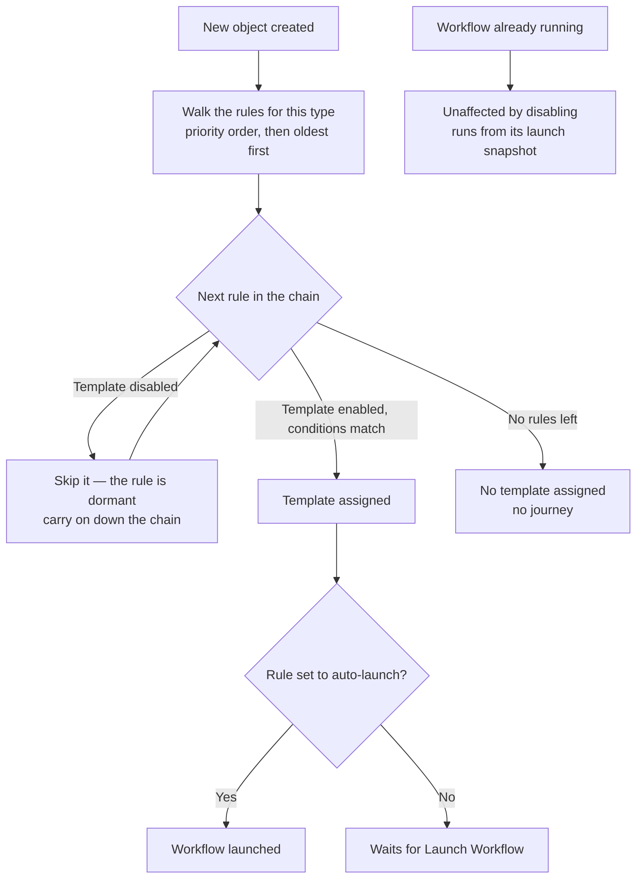
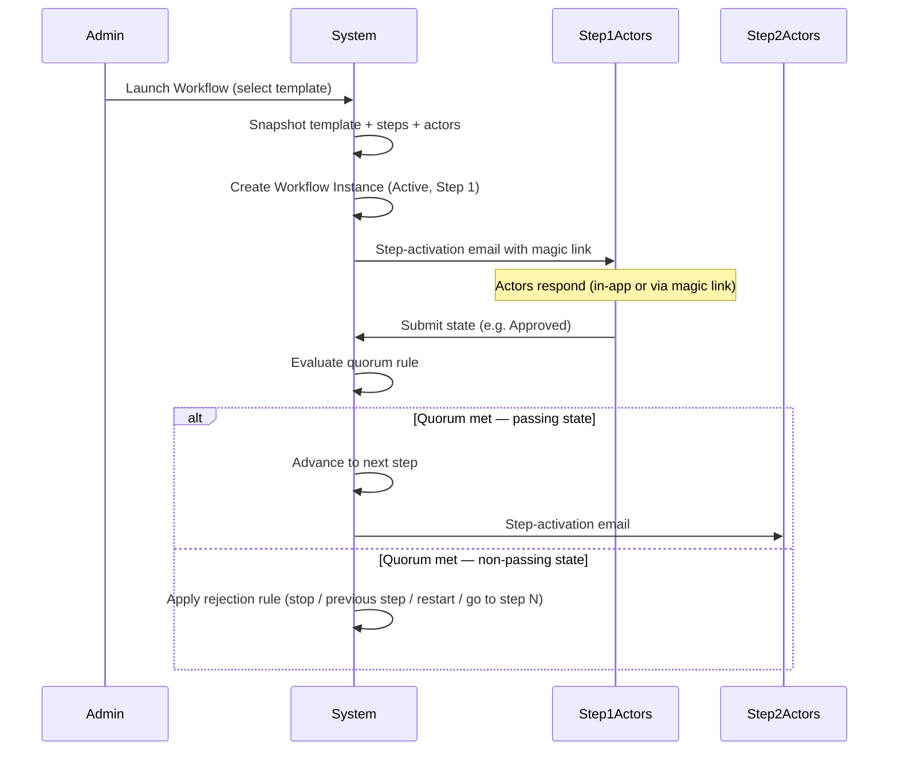
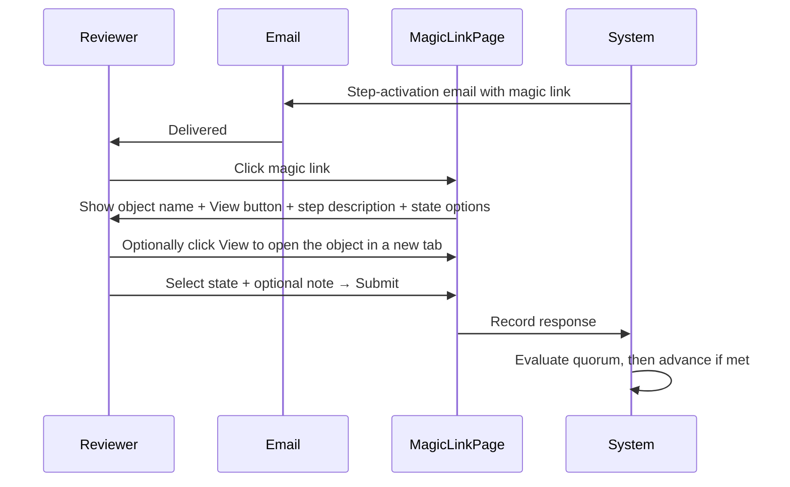
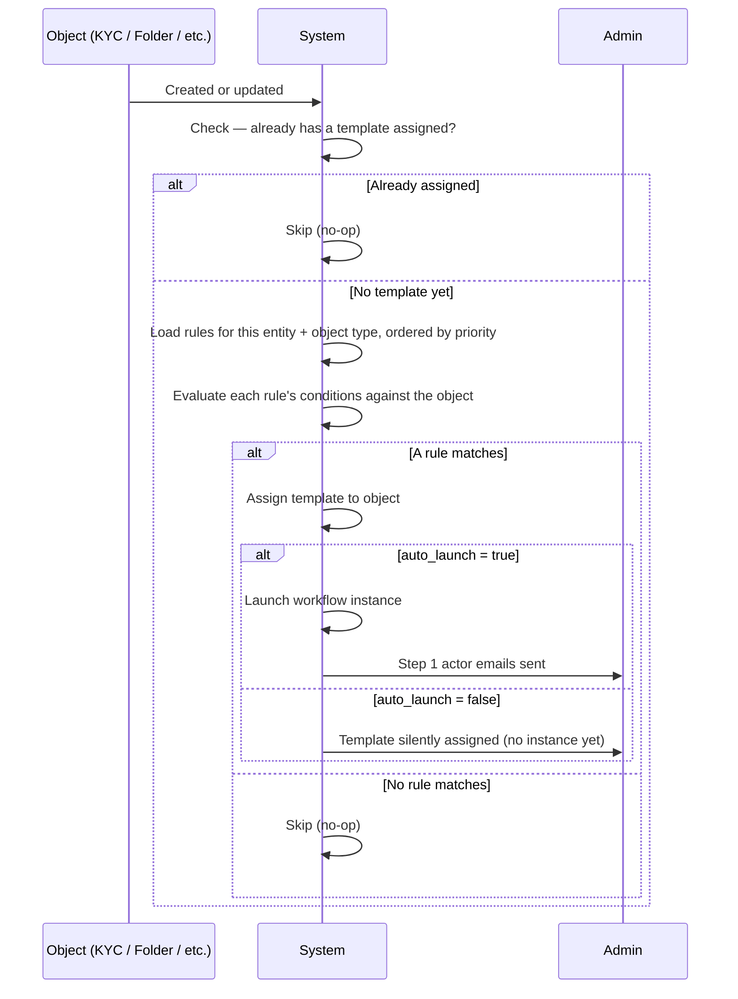
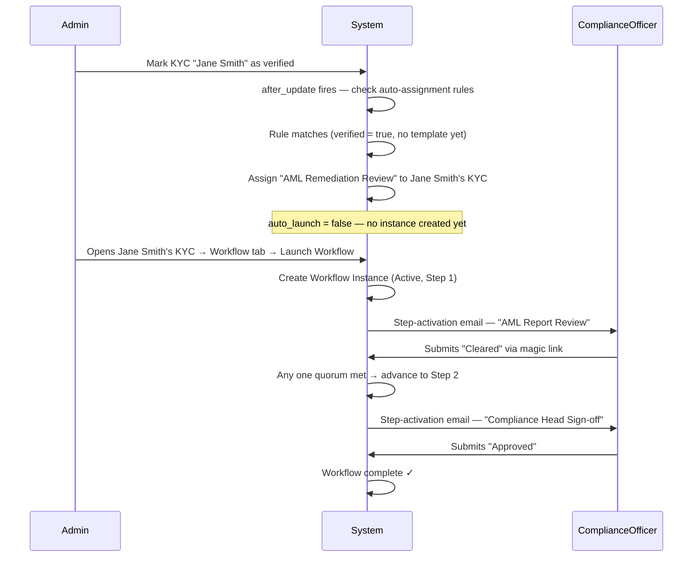

# Workflow Templates & Workflows User Guide

The **Workflow** feature lets you define reusable multi-step review and approval processes ("templates") and run them against any supported object in the platform — folders, stakeholders (investors and portfolio companies), investor KYC records, capital commitments, capital calls, and approvals. Actors assigned to each step respond via an email magic link or directly in the app, and the system advances through the steps automatically based on the quorum rule you configured. Every action is captured in an immutable audit trail.

> **Where to find it:** Templates live on the [**Workflow Templates**](/workflow_templates) page (no sidebar item: open it from this link, or via **Manage templates** in an object's **Launch Workflow** dialog) with **New Template** at the top. Workflows are launched from the **Workflow** tab of a folder, stakeholder, KYC, commitment, capital call or approval. Needs the *Workflow Templates* feature (`enable_workflow_templates`) on your company and the company admin role.

---

## Table of Contents

1. [Key Concepts](#key-concepts)
2. [Roles & Permissions](#roles--permissions)
3. [Creating a Workflow Template](#creating-a-workflow-template)
4. [Configuring Steps](#configuring-steps)
5. [Managing Templates](#managing-templates)
6. [Supported Object Types](#supported-object-types)
7. [Assigning a Template to an Object](#assigning-a-template-to-an-object)
8. [Launching a Workflow](#launching-a-workflow)
9. [Tracking Progress — the Timeline View](#tracking-progress--the-timeline-view)
10. [How Actors Respond](#how-actors-respond)
11. [Quorum Rules & Step Resolution](#quorum-rules--step-resolution)
12. [Rejection Handling](#rejection-handling)
13. [Manual Controls — Reset, Archive, Remind](#manual-controls--reset-archive-remind)
14. [Auto-Reminders](#auto-reminders)
15. [Auto-Assignment Rules](#auto-assignment-rules)
16. [Locking Buttons Until a Workflow Resolves](#locking-buttons-until-a-workflow-resolves)
17. [Breadcrumb Workflow Indicator](#breadcrumb-workflow-indicator)
18. [Audit Trail & CSV Export](#audit-trail--csv-export)
19. [Worked Example](#worked-example)
20. [Frequently Asked Questions](#frequently-asked-questions)

---

## Key Concepts

| Term | Meaning |
|------|---------|
| **Workflow Template** | A named, reusable definition of steps, actors, and rules — the "blueprint." |
| **Step** | A single gate in the template. Has its own actors, quorum rule, allowed states, and rejection rule. |
| **Actor** | An internal user (employee of your organisation) assigned to respond to a step. |
| **State** | The label an actor submits (e.g., "Approved", "Rejected"). The first state in the list is the *passing* state; all others trigger the rejection rule. |
| **Quorum rule** | How many actors must respond before the step resolves: Any One, All, or Majority. |
| **Workflow Instance** | A single run of a template on a specific object. The template is snapshotted at launch so future edits do not affect the running workflow. |
| **Magic link** | A personalised, signed URL emailed to each actor so they can respond without logging in. It never expires by time; it stops accepting responses once the step is no longer current. |
| **Object type** | The kind of record a template applies to — Folder, Stakeholder (Investor), Investor KYC, Capital Commitment, Capital Call, or Approval. |
| **Auto-assignment rule** | A rule that automatically assigns a template (and optionally launches it) when a matching object is created or updated. |
| **Locked button** | A button on an object's page (identified by its label, e.g. "Approve") that a template disables while the object's workflow is incomplete or has failed. |

---

## Roles & Permissions

| Role | What they can do |
|------|-----------------|
| **Company Admin** | Create, edit, and delete workflow templates; configure auto-assignment rules; launch workflows (which assigns the template); reset and archive workflows and set a tiebreaker state; send manual reminders; export audit trails. |
| **Other employees** | View templates and timelines, export audit trails, and respond to steps they are an actor on — both in-app and via magic link in email. |

---

## Creating a Workflow Template

1. Open [**Workflow Templates**](/workflow_templates) — there is no sidebar or menu item; you can also reach it from an object's **Workflow** tab → **Launch Workflow** → **Manage templates**.
2. Click **New Template**.
3. Fill in the template fields:

| Field | Description |
|-------|-------------|
| **Name** | Required. Must be unique within your organisation. |
| **Applies to** | Restricts this template to a specific object type (Folder, Investor, Investor KYC, Capital Commitment, Capital Call, or Approval). Leave blank to allow it on any type. **Cannot be changed once it has been set.** |
| **Description** | Optional free text describing when to use this template. |
| **Auto-reminder interval (days)** | If set, actors who haven't responded will receive an automatic reminder email every N days. Leave blank to disable auto-reminders (individual steps can override this). |
| **Attach document to notification emails** | When enabled, the object's files are attached to step-activation emails (for folders and KYCs). |
| **Locked buttons** | Optional. A comma-separated list of button labels (e.g. `Approve, Edit`) to disable on the object's page while its workflow is incomplete or has failed. See [Locking Buttons Until a Workflow Resolves](#locking-buttons-until-a-workflow-resolves). |

4. Add at least one step (see [Configuring Steps](#configuring-steps)).
5. Click **Save**.

> **Tip:** Setting the "Applies to" type is strongly recommended. It prevents a KYC workflow from accidentally being launched on a folder, and enables auto-assignment rules to target the right objects.

---

## Configuring Steps

Each step in the template represents a sequential gate. Steps run in position order (1, 2, 3, …). You can add, edit, reorder, and delete steps from the template form.

### Step fields

| Field | Description |
|-------|-------------|
| **Name** | Short label for this gate (e.g., "Legal Review", "CFO Sign-off"). |
| **Description** | Optional detail shown to actors when they respond. |
| **Allowable states (comma-separated)** | Response options (e.g., `Approved, Rejected, Needs More Info`). **The first state is always the passing state** — resolving to it advances the workflow to the next step. All other states trigger the rejection rule. |
| **Quorum rule** | See [Quorum Rules](#quorum-rules--step-resolution). |
| **On reject** | What happens when the step resolves to a non-passing state. See [Rejection Handling](#rejection-handling). |
| **Go to step #** | Only used when *On reject* is "Go to step N". Enter the target step position. |
| **Reminder interval override (days)** | Overrides the template-level default for this step. Set to 0 to disable reminders on this step. Leave blank to inherit the template default. |
| **Email actors when this step becomes active** | Untick to skip the "Action Required" email when the step starts. |
| **Actors (entity employees)** | Internal users assigned to this step. Select from your organisation's employees. |

### Step kinds (journeys)

A step can be completed in one of three ways, chosen with **Kind** at the top of the step form:

| Kind | Completed when | Fields used |
|---|---|---|
| **Human** | the actors vote, as described above (the default; every existing step is human) | allowable states, quorum, on reject, actors |
| **System** | its **Check** finds the data in place, e.g. "every call notice is approved". Nobody votes | Check, Skip when, Owner |
| **Acknowledge** | one person with edit rights on the record clicks **Mark reviewed** | Check, Skip when, Owner |

A template that contains a system or acknowledge step is a **journey**: CapHive works out which step it is on from the record's data every time the record is opened, every 15 minutes, and when someone undoes earlier work, so it can move forwards and backwards on its own. The two capital call journeys are seeded for fund managers; see the [Capital Calls guide](capital_calls_user_guide).

| Field | Description |
|---|---|
| **Check** | The question that decides a system or acknowledge step. Only checks for the template's record type are offered. |
| **Skip when** | A check that makes the step "not applicable" for a particular record, e.g. notices on an imported call. |
| **Owner** | Who is reminded when a system or acknowledge step has waited longer than its reminder interval. Blank means the person who created the record. |
| **Unlocks buttons** | Button labels this step unlocks once done. In this release that only adds a warning to those buttons' confirmations. |
| **Keep sign-off when moved back** | When earlier work is undone, votes and confirmations on later steps are reset unless this is ticked. |

In a journey, rejecting a human step does not end the workflow: the step stays current with the rejection note and the actors can vote again.

---

## Managing Templates

### Template list

The **Workflow Templates** list shows each template's name, its status (**Enabled** or **Disabled**), the object type it applies to, a numbered list of its steps, how many auto-assignment rules it has, and whether it attaches documents to emails. Each row has an edit (pencil), enable/disable (pause or play) and delete (bin) button. A disabled template's name is greyed out.

### Editing a template

Open [**Workflow Templates**](/workflow_templates), click the template name, then **Edit Template**. Changes to steps, actors and rules do **not** affect any workflow instances that are already running — those are locked to the snapshot taken at launch. The **Locked buttons** list is the exception: it is read from the live template, so a change applies to running workflows immediately.

Note that the **Applies to** type cannot be changed once the template has been saved.

### Enabling and disabling a template

Disabling retires a template without losing it or its history. Use the **Disable** button on the template's page, or the pause button on its row in the list; both ask you to confirm first, and the page then shows a **Disabled** banner.

While a template is disabled:

- **No new object is assigned to it, but its rules step aside rather than block.** Its auto-assignment rules stay exactly as they are and go **dormant**: a record they would have matched is passed down the chain, so the next matching rule for that record type applies instead. A record gets no template only when no enabled template's rule matches it. The rules resume their place the moment you enable the template again — nothing is edited or deleted.
- **For a journey template (capital calls, capital distributions, investor KYC) that means new records get no journey at all** — no step bar, no "What's needed now" panel and no task reminders.
- **It is not offered in the Launch Workflow dialog**, and a workflow cannot be launched on it even if an object was assigned to it earlier.
- **Workflows already running carry on unchanged.** A running workflow follows the snapshot taken when it launched, so its steps, actors, reminders and timeline are unaffected, and it can still be completed, reset or archived.
- **Nothing is deleted.** The template, its steps, its rules and every past run stay on the page, and **Enable** puts it straight back into use.

Enabling again applies to records created from then on; records created while the template was disabled are not given a workflow retrospectively.

On [**Workflow Templates**](/workflow_templates), the **Set up journeys** menu shows a journey kind as *disabled* rather than *set up* when its seeded templates have been disabled, because new records are getting no journey. Running the setup again never re-enables them — that stays your decision.

### Deleting a template

A template can only be deleted if:
- It is not currently assigned to any object.
- It has no workflow runs at all (active, complete, rejected, or archived).

If either condition is not met, you will see an error telling you to disable it instead. Archiving runs does not remove them, and there is no button to remove a template assignment from an object, so in practice a template that has ever been assigned or launched cannot be deleted from the UI — **disable** it, which stops it being used while keeping its history.

---

## Supported Object Types

Workflows can be run on any of the following record types:

| Object type | Where to find it |
|-------------|-----------------|
| **Folder** | Data room folders in the Documents section. |
| **Stakeholder (Investor)** | Stakeholder pages, including portfolio companies. |
| **Investor KYC** | KYC records under the Investors section. |
| **Capital Commitment** | Commitment records under a fund's investor list. |
| **Capital Call** | Capital call records under a fund's Capital Calls tab. |
| **Approval** | Approval items in the Approvals section. |

When creating a template you can leave "Applies to" blank to allow the template on any type, or restrict it to one type for stricter governance. A type-restricted template cannot be assigned to the wrong kind of object.

---

## Assigning a Template to an Object

An object gets a workflow template assigned when a workflow is launched on it or when an auto-assignment rule matches it. Assignment can happen in these ways:

### 1. Manually at launch time

Open the object, go to its **Workflow** tab, and click **Launch Workflow**. The launch dialog's **Select Review Template** dropdown lists templates that apply to this object's type (or to any type); a template that has auto-assignment rules for the type is listed only if at least one rule matches this record. Selecting a template here both assigns it and immediately launches the workflow.

### 2. No separate assign screen

There is no edit or settings page for pre-assigning a template without launching, and no button to remove an assignment. Launching a different template on the object replaces the assignment.

### 3. Automatically via auto-assignment rules

Admins can configure rules on a template that automatically assign it (and optionally launch a workflow instance) when a matching object is created or updated. See [Auto-Assignment Rules](#auto-assignment-rules).

---

## Launching a Workflow

1. Open the object (folder, stakeholder, KYC, commitment, capital call, or approval).
2. Go to the **Workflow** tab (company admins only).
3. Click **Launch Workflow** (visible only when no workflow is currently active on this object and at least one template fits it).
4. Select the template in **Select Review Template**.
5. Click **Launch Workflow**.

**What happens immediately on launch:**
- The template is snapshotted — future edits to the template will not affect this run.
- The workflow instance is created and set to **Active**, at Step 1.
- Every actor assigned to Step 1 receives a step-activation email with a personalised magic link (if **Email actors when this step becomes active** is on for that step).

Only one workflow can be active on an object at a time.

---

## Tracking Progress — the Timeline View

Click the workflow link in the object's Workflow tab (or use the [breadcrumb indicator](#breadcrumb-workflow-indicator)) to open the full timeline page.

The header card shows:
- A button linking to the **workflow template** used, so you can quickly review the template definition.
- The date the workflow was launched.
- The current status badge (Active, Complete, Rejected, Archived).
- The name of the object the workflow is running on, linked back to that object's page.
- Admin action buttons (**Remind**, **Reset**, **Archive**) when the workflow is active.

### Step pipeline

The pipeline shows every step with a visual indicator:

- **Blue filled circle** — current active step.
- **Green check** — step has been resolved (passed).
- **Grey outline** — step not yet reached.

Completed steps show the resolved state badge plus the individual actor responses beneath them.

### Actor responses panel

Below the pipeline, a table lists every actor assigned to the current step:

| Column | Meaning |
|--------|---------|
| Actor | The assigned user's name. |
| Response | Their current state badge or "Pending" if they haven't responded. |
| When | How long ago they responded. |
| Note | Any free-text note they attached. |

### Tiebreaker panel

If every actor has responded and the quorum rule cannot resolve the step (no agreed state for **All**, no majority for **Majority**), a **Tiebreaker needed** alert appears. Company admins use the form in that alert to set the final state manually.

---

## How Actors Respond

### In-app response

Actors who are logged in will see a **Your Response** card on the workflow timeline view. They select a state and optionally add a note, then submit.

### Magic link (email)

Every step-activation email contains a personalised magic link. Actors click it and land on a lightweight page — no login required — where they:

1. See the object's name with a **View** button to open the full record in a new tab (so they can review it in context before responding).
2. Read the step description (if any).
3. Select a state using visual card buttons.
4. Optionally add a note.
5. Click **Submit Response**.

Magic links never expire by time; once the step is no longer current (or the workflow is no longer active) the link shows a "moved on" page with the actor's earlier response. Each actor can respond **once** per step — a second submission is refused with "has already responded to this step". Actors can respond again only if the step is reset, restarted or sent back.

---

## Quorum Rules & Step Resolution

| Rule | Behaviour |
|------|-----------|
| **Any one** | The first actor to respond resolves the step immediately. |
| **All** | Every actor must respond before the step can resolve; it resolves if they all agree, otherwise a tiebreaker is needed. |
| **Majority** | More than half of the actors must respond with the same state. Ties require an admin tiebreaker. |

**Resolution logic:** The step resolves to the passing state (first in the states list) if the quorum condition is met with that state. If a non-passing state meets the quorum, the rejection rule fires.

---

## Rejection Handling

| Rule | What happens |
|------|-------------|
| **Stop** | The workflow ends immediately with status **Rejected**. |
| **Previous step** | The workflow reverts to the immediately preceding step. Current responses are archived so actors can re-vote. At step 1, the workflow stops. |
| **Restart** | All responses across all steps are archived and the workflow resets to step 1. Step 1 actors are notified again. |
| **Go to step N** | The workflow jumps to the specified step (or ends as **Rejected** if step N does not exist). Current responses are archived. |

In every case, the actors of the step the workflow moves to are emailed.

---

## Manual Controls — Reset, Archive, Remind

These appear on the timeline view for company admins when a workflow is active (**Reset to Step 1** and **Archive** are also on the object's **Workflow** tab):

### Reset to Step 1

Resets the workflow to step 1, archives all current actor responses, and adds a "reset" entry to the audit trail. Step 1 actors **are** emailed again (if that step emails on activation).

### Archive

Ends the workflow immediately with status **Archived**. The full history is preserved.

### Remind (Send Reminder)

Immediately emails every actor on the current step who has not yet responded, with a fresh link. A reminder entry is written to the audit trail per actor; if everyone has responded, nothing is sent.

---

## Auto-Reminders

If `Reminder interval (days)` is set on the template (or overridden on individual steps), the system automatically sends reminder emails to pending actors on a daily background job.

**Logic:**
1. The job runs daily at 06:00.
2. For each active workflow, it checks the current step's effective reminder interval (the step override, or the template default).
3. If the interval has elapsed since the last automatic reminder (or the run's last change), it sends reminder emails to every actor who has not yet responded, and adds an audit-trail entry.

Setting the step's reminder interval to **0** disables auto-reminders for that step even if the template has a non-zero default.

---

## Auto-Assignment Rules

Auto-assignment rules let you automatically assign a workflow template to an object the moment it is created or reaches a certain state — without any manual action from an admin.

### Where to configure rules

1. Go to **Workflow Templates** and open the template you want to auto-assign.
2. Scroll to the **Auto-assignment Rules** panel at the bottom of the template page.
3. Click **Add Rule**.

### Rule fields

| Field | Description |
|-------|-------------|
| **Applies to** | Inherited from the template's type. Read-only. |
| **Priority (lower number runs first)** | When multiple rules match, the one with the lowest priority number wins. |
| **Conditions (JSON)** | An optional list of attribute/operator/value checks. If left empty, the rule matches every object of the correct type (catch-all). |
| **Automatically launch a workflow instance after assigning the template** | When ticked, a workflow instance is launched immediately after the template is assigned — no admin action required. |

A template with rules for a type also appears in the **Launch Workflow** dialog only for records that match at least one of its rules.

### Rule status — can this rule ever win?

Rules for one record type form a single chain across **every** template: they are walked in priority order (lowest number first, and oldest first where two share a priority), and the first rule that applies assigns its template. Nothing else is tried after that. Because the rules live on separate template pages, a rule that can never be reached looks exactly like one that fires every day — so each row in the **Auto-assignment Rules** table carries a **Status**:

| Status | Meaning | What to do |
|--------|---------|-----------|
| **Active** | The rule can win for some record. | Nothing. |
| **Dormant** | Its template is disabled, so the rule is skipped and the next matching rule for the type applies. | Nothing, unless you want the template back — **Enable** restores the rule's place in the chain untouched. |
| **Shadowed** | An earlier rule always matches first, so no record ever reaches this one. The badge names and links the rule that blocks it. | Open the blocking rule and either give it conditions, raise its priority number, or delete it. You cannot out-prioritise it from this side: the lowest priority number allowed is 0. |
| **No template** | The rule points at a template that no longer exists. | Delete the rule. |

A rule is called **Shadowed** only when an earlier rule is a catch-all (no conditions), or asks for exactly the same conditions. Two rules with different conditions both stay **Active**, even if one is in practice narrower than the other.

On [**Workflow Templates**](/workflow_templates), a warning appears above the list for any record type where **every** rule is dormant: *"New folders get no workflow"*. That is the one case where records match a rule and still end up with nothing, and it cannot be seen from any single template's page.

### How conditions work

Each condition checks a single field on the object:

| Operator | Matches when… |
|----------|--------------|
| `eq` | The field equals the value. |
| `not_eq` | The field does not equal the value. |
| `gt` / `lt` / `gte` / `lte` | The field is greater/less than the value (numeric). |
| `in` / `not_in` | The field is (or isn't) one of a list of values. |
| `present` | The field has any non-blank value. |
| `blank` | The field is empty or null. |

All conditions in a rule must match simultaneously (AND logic). An empty conditions list always matches.

### When rules are evaluated

Rules are evaluated in two situations:

1. **When a new object is created** — immediately after it is saved for the first time.
2. **When an existing object is updated** — while rules exist for its type and the object does not already have a template assigned.

This means you can configure a rule like "assign the AML Remediation Review to any Investor KYC where `verified` equals `true`" and it will trigger both when a KYC is created already-verified and when an existing KYC is later marked as verified.

Once a template is assigned, the rule will not re-trigger on further updates — the object already has an assignment.

### Example rules

| Use case | Type | Condition | Auto-launch |
|----------|------|-----------|-------------|
| Assign AML review to all verified KYCs | Investor KYC | `verified eq true` | No |
| Auto-launch IC vote on every new Approval | Approval | *(none — catch-all)* | Yes |
| Assign LP data room review to folders named "Q3 2026" | Folder | `name eq Q3 2026` | No |

---

## Locking Buttons Until a Workflow Resolves

Some templates need to prevent certain actions on an object until its review process finishes successfully — for example, blocking the **Approve** button on a capital call until its approval workflow completes, or blocking the **Edit** button on an investor KYC record while a review is in progress.

### How it works

When creating or editing a template, use the **Locked buttons** field to list one or more button labels — typed exactly as they appear on the object's page (e.g. `Approve`, `Edit`, `Delete`). Separate multiple labels with commas.

While an object's current workflow instance is:

- **Incomplete** — still in progress, or
- **Failed** — rejected,

every listed button appears greyed out and cannot be clicked. Hovering over a locked button shows a short message explaining that it is blocked by an unresolved workflow.

Once the workflow **completes successfully**, the buttons return to normal automatically — no admin action needed.

### Important notes

- **Opt-in per object.** An object that has never had a workflow launched against it is never locked, regardless of what a template's Locked buttons field says — the lock only takes effect once a workflow instance actually exists for that object.
- **Type the label exactly.** Match the button's on-screen text precisely, including capitalisation and spacing.
- **Currently available on:** Capital Call and Investor KYC pages, and only for buttons the page has marked as lockable (see the FAQ for the list). Other labels are ignored, and other object types (Folder, Stakeholder, Capital Commitment, Approval) do not yet support locking buttons this way.
- **Read from the live template.** Unlike steps and actors, the Locked buttons list is not snapshotted at launch, so editing it changes running workflows immediately.
- **This is a safeguard, not access control.** Locking a button changes what you see and can click on the page. It is meant to prevent accidental clicks during an in-progress review, not to serve as a security restriction.

---

## Breadcrumb Workflow Indicator

When you are viewing an object (folder, stakeholder, KYC, commitment, capital call, or approval) that has an **active workflow instance**, a small kanban icon appears in the breadcrumb bar at the top of the page. Clicking it takes you directly to the workflow timeline for that object, without having to navigate to the Workflow tab first.

The icon is not shown when there is no active instance.

---

## Audit Trail & CSV Export

Every actor vote and every system event (step advancement, rejection, reset, reminder) is recorded in an immutable audit trail at the bottom of the timeline view.

| Column | Meaning |
|--------|---------|
| When | Timestamp of the event (UTC). |
| Step | The step position this event belongs to. |
| Actor | Who submitted the vote (or "System" for automatic events). |
| State | The state submitted or resolved to. |
| Channel | How the response was submitted: Dashboard (in-app), Email magic link, or Auto reminder. |
| Note | Free-text note attached to the response. |

Archived responses (from resets or reverts) are shown with reduced opacity and an "archived" badge — preserved for audit but not counted toward the active quorum.

### Export to CSV

Click **Export CSV** in the audit trail card header to download the full history as a CSV file named `workflow_audit_<id>_<date>.csv`.

---

## Worked Example

**Scenario:** All newly verified investor KYC records should automatically go through an AML remediation review.

**Setup:**
1. Create a template "AML Remediation Review" with `Applies to = Investor KYC` and two steps: "AML Report Review" (states `Cleared, Escalate`, any one actor) and "Compliance Head Sign-off" (states `Approved, Rejected`, any one actor).
2. On the template's show page, add an auto-assignment rule: condition `verified eq true`, auto-launch off, priority 0.

**What happens when a KYC is marked verified:**

---

## Frequently Asked Questions

**What is the difference between a human, system and acknowledge step?**
A human step is completed by its actors voting. A system step completes on its own when its check finds the data in place, and an acknowledge step when one person clicks **Mark reviewed**. A template with system or acknowledge steps is a journey that CapHive keeps up to date from the record's data. See [Step kinds (journeys)](#step-kinds-journeys).

**Why did a journey step's votes disappear?**
Someone undid earlier work on the record, so sign-offs on later steps given before the change were reset, and their approvers were emailed. Tick **Keep sign-off when moved back** on a step to keep its votes in that case.

### Navigation and getting there

**Where do I find Workflow Templates in CapHive?**
There is no sidebar or menu item. Open [**Workflow Templates**](/workflow_templates) directly, or open any supported object's **Workflow** tab and click **Launch Workflow** → **Manage templates** (or **Create a template** when none exist yet). See [Creating a Workflow Template](#creating-a-workflow-template).

**Where is the Workflow tab on an object?**
It is a tab on the object's page: a folder, a stakeholder (investor, also portfolio companies), an investor KYC, a capital commitment, a capital call or an approval. Only company admins see it, and only when workflow templates are enabled for your company.

**Where do I see a running workflow's progress?**
On the object's **Workflow** tab click **View Full Workflow Timeline**, or the workflow icon in the breadcrumb bar; the workflow's timeline opens. Past runs are listed on the same tab with a **View** link. All runs of your company are also listed on [**Workflow Instances**](/workflow_instances) (no menu link). See [Tracking Progress — the Timeline View](#tracking-progress--the-timeline-view).

**How does an actor find the step they need to respond to?**
From the "Action Required: <template> – <step>" email, whose link opens a response page without login. Logged-in actors also get a highlighted step button in the breadcrumb bar of the object's page, and a **Your Response** card on the timeline page.

**Who can manage workflows?**
Company admins of a company with *Workflow Templates* enabled create, edit and delete templates and auto-assignment rules, launch workflows, and use **Remind**, **Reset**, **Archive** and the tiebreaker. Other employees of the company can view templates and timelines, and respond when they are an actor on the current step. See [Roles & Permissions](#roles--permissions).

**The Workflow tab or Launch Workflow button is missing. Why?**
The tab needs the company admin role and the *Workflow Templates* feature (ask CapHive support). **Launch Workflow** also hides while a workflow is active on the object, and when no template fits: templates must apply to this object type (or to any type) and, if they have auto-assignment rules for the type, at least one rule must match this record.

### Creating, updating and managing workflows

**How do I create a workflow template?**
On [**Workflow Templates**](/workflow_templates) click [**New Template**](/workflow_templates/new), enter **Name**, **Applies to**, **Description**, **Auto-reminder interval (days)**, **Attach document to notification emails** and **Locked buttons**, add one or more steps, and save. See [Creating a Workflow Template](#creating-a-workflow-template).

**How do I add or change steps?**
Steps can be added on the template form, or from the template page with **Add Step**. Each step has a **Name**, **Description**, **Allowable states (comma-separated)** (the first is the passing state), **Quorum rule**, **On reject** (with **Go to step #**), **Reminder interval override (days)**, **Email actors when this step becomes active** and **Actors (entity employees)**. See [Configuring Steps](#configuring-steps).

**How do I edit a template?**
Open it from [**Workflow Templates**](/workflow_templates) and click **Edit Template**. Everything can change except **Applies to** once it has been set. Running workflows keep the steps, actors and rules they were launched with. See [Editing a template](#editing-a-template).

**How do I stop a template being used without deleting it?**
Disable it: open it from [**Workflow Templates**](/workflow_templates) and click **Disable**, or press the pause button on its row in the list, then confirm. It keeps its steps, rules and history, stops being assigned or launched on anything new, and **Enable** brings it back. See [Enabling and disabling a template](#enabling-and-disabling-a-template).

**How do I delete a template?**
Open it and click **Delete**. It is refused while the template is assigned to any object or has any workflow run (active, complete, rejected or archived) — disable it instead. See [Deleting a template](#deleting-a-template).

**Why disable a template rather than delete it or empty its steps?**
Deleting is refused once a template has ever been assigned or launched, because its runs are part of the audit trail. Disabling is the supported way to retire one: nothing new starts on it, everything it has already done stays readable, and you can reverse it with one click. Deleting its rules instead would lose how it was targeted, and emptying its steps would leave live workflows pointing at a template that no longer makes sense.

**How do I launch a workflow on an object?**
Open the object → **Workflow** tab → **Launch Workflow**, choose a template in **Select Review Template** and click **Launch Workflow**. The chosen template becomes the object's assigned template. See [Launching a Workflow](#launching-a-workflow).

**How do I respond to a workflow step?**
Click the link in the step email, pick a state on the card buttons, optionally add a note and click **Submit Response**; or, logged in, use **Your Response** on the timeline or the step button in the object's breadcrumb bar. See [How Actors Respond](#how-actors-respond).

**How do I set up auto-assignment rules?**
Open the template and, in **Auto-assignment Rules**, click **Add Rule**. Set **Priority (lower number runs first)**, the **Conditions (JSON)** list of attribute/operator/value checks, and tick **Automatically launch a workflow instance after assigning the template** if it should start on its own. See [Auto-Assignment Rules](#auto-assignment-rules).

**How do I remind, reset or archive a running workflow?**
Open the timeline page and click **Remind**, **Reset** or **Archive** in the header; **Reset to Step 1** and **Archive** are also on the object's **Workflow** tab. They appear only while the workflow is active and only for company admins. See [Manual Controls — Reset, Archive, Remind](#manual-controls--reset-archive-remind).

**How do I export a workflow's history?**
On the timeline page click **Export CSV** in the **Audit Trail** card. It downloads `workflow_audit_<id>_<date>.csv`; any employee of the company who can open the timeline can export it.

### Why use workflows

**Why should I use Workflow Templates?**
They turn an internal review (legal, compliance, IC sign-off) into a defined sequence of steps with named reviewers and quorum rules, instead of chasing approvals by email. Every response and system action is logged, reminders are automatic, and key buttons can stay locked until the review passes.

**What can I do with a workflow that I cannot do otherwise?**
Require several reviewers in order before a capital call is approved or a KYC is edited, let reviewers answer from an email link without logging in, send a rejected item back one step or to a chosen step, auto-start reviews on new or updated records, and export a per-response audit trail.

**Who typically uses workflows?**
Company admins design templates and launch or supervise runs; compliance officers, legal counsel, CFOs and investment-committee members act as step reviewers. Auditors use the timeline and the CSV export as evidence of who approved what and when.

**What happens if I don't use a workflow?**
Nothing is blocked: objects work as normal, locked buttons never apply to an object that has never had a workflow launched, and reviews happen outside CapHive with no recorded trail.

### What happens when I …

**What happens when I save a template?**
The template and its steps are stored for your company and appear on [**Workflow Templates**](/workflow_templates) and in the Launch dialog of matching objects. Nothing is launched and no one is notified. Its auto-assignment rules start applying to objects created or updated afterwards.

**What happens when I disable a template?**
Nothing new is assigned to it or launched on it, and its auto-assignment rules go dormant: a record they would have matched falls through to the next matching rule for that type instead, and gets nothing only when no enabled template's rule matches it. The confirmation dialog names the template that will take over before you confirm. Where no rule takes over on a journey type, new capital calls, distributions or KYCs get no journey, step bar or task reminders. It disappears from the **Launch Workflow** dialog, and a workflow cannot be launched on it even where an object was assigned to it earlier. Workflows already running are untouched and can still be completed, reset or archived, and nothing is deleted. See [Enabling and disabling a template](#enabling-and-disabling-a-template).

**What happens when I enable a template again?**
It is available immediately: its rules start assigning it to records created or updated from then on, and it is offered in the **Launch Workflow** dialog again. Records created while it was disabled are not given a workflow retrospectively — launch one on them from their **Workflow** tab if you want one.

**What happens when I launch a workflow?**
The template is assigned to the object, a copy of its steps, actors and rules is stored with the run, and the run starts as **Active** at the first step. Each actor on that step gets an "Action Required" email with a personal response link (if **Email actors when this step becomes active** is on), with the object's files attached for folders and KYCs when the template says so.

**What happens when an actor responds?**
The response is saved and the step is re-evaluated. **Any one** resolves on the first response; **All** waits for every actor and resolves if they agree; **Majority** resolves once one state has more than half of the actors. If the resolved state is the first allowed state the workflow moves to the next step (or completes); otherwise the step's **On reject** rule runs.

**What happens when a step passes?**
The run moves to the next step and that step's actors get the "Action Required" email, or, after the last step, the run is marked **Complete** and locked buttons on the object are released. No one is emailed when the workflow completes.

**What happens when a step is rejected?**
**Stop** marks the run **Rejected** (locked buttons stay locked). **Previous step** archives that step's responses and goes back one step (or rejects at step 1). **Restart** archives all responses and returns to step 1. **Go to step N** archives the step's responses and jumps to step N (or rejects if N does not exist). Actors of the step it moves to are emailed.

**What happens when I click Remind?**
Every actor on the current step who has not responded gets a "Reminder: <template> – <step>" email with a fresh link, and a reminder entry is added to the audit trail per actor. If everyone has responded, nothing is sent.

**What happens when I click Reset?**
All active responses are archived, the run returns to step 1 with a "reset" entry in the audit trail, and the step 1 actors are emailed again (if that step emails on activation). See [Reset to Step 1](#reset-to-step-1).

**What happens when I archive a workflow?**
The run is marked **Archived** and stops; its history stays on the timeline and in the export, and its email links show that the workflow has moved on. It cannot be reactivated, but you can launch a new run. Locked buttons are released unless an earlier, non-archived run on the object was rejected or is still incomplete.

**What happens when auto-reminders are due?**
A job at 06:00 each day checks every active run. When the current step's interval (the step override, or the template default) has passed since the last automatic reminder or the run's last change, each actor who has not responded gets a reminder email and an audit-trail entry. An interval of 0 or blank sends none.

**What happens when an auto-assignment rule matches?**
When an object without an assigned template is created, or updated while rules exist for its type, the lowest-priority-number matching rule assigns its template. With auto-launch on, the workflow launches immediately and step 1 actors are emailed; otherwise the template just becomes the default choice in **Launch Workflow**.

### Troubleshooting and edge cases

**Can I edit a template while a workflow is running?**
Yes. Edits to steps and actors do not affect running instances — those are locked to the snapshot taken at launch. The **Locked buttons** list is the exception: it is read from the live template, so a change applies to running workflows immediately.

**Can an actor change their response?**
No. Each actor can respond once per step; a second submission is refused with "has already responded to this step". If the step is reset, restarted or sent back, earlier responses are archived and the actor can respond again. Once the step advances, the link shows that the workflow has moved on.

**Do magic links expire?**
Not by time. A link stops accepting responses when its step is no longer the current step or the workflow is no longer active, and then shows a "moved on" page with the actor's earlier response.

**Can I see the object while responding via email?**
Yes. The magic link page includes a **View** button next to the object's name. Clicking it opens the full record in a new tab so you can review the details before submitting your response.

**Can I use the same template for different object types?**
Only if the template's "Applies to" field is left blank (untyped). Once a type is set on a template, it can only be assigned to objects of that type.

**Can I remove a template assignment from an object?**
There is no remove button. Launching a different template on the object replaces the assignment. Because assignments stay in place, a template that has ever been assigned cannot be deleted from the UI; disable it instead.

**A new capital call, distribution or KYC got no journey. Why?**
One of three things. The company's journeys were never set up — use **Set up journeys** on [**Workflow Templates**](/workflow_templates). Or every auto-assignment rule for that record type belongs to a **disabled** template, in which case each rule is skipped and nothing is left to assign; the template list shows a warning saying exactly that, the **Status** column shows which templates are off, and the **Set up journeys** menu shows the kind as *disabled*. Or the journey template has no rule of its own, so nothing points at it — check its **Auto-assignment Rules** tab, and whether the rule you added shows as **Shadowed**. Enabling a template, or fixing a rule, gives journeys to records created from then on; a record created while nothing matched picks one up the next time it is saved.

**A template is disabled but its workflows are still running and sending reminders. Is that expected?**
Yes. Disabling only stops new work: a run already under way follows the snapshot taken when it launched, so it keeps advancing, reminding and completing. Archive the run if you want it to stop.

**My new rule shows as Shadowed. Why, and how do I fix it?**
Because an earlier rule in the chain always matches first, so no record ever reaches yours. Rules for a record type are walked across all templates in priority order, lowest number first, and where two rules share a priority the older one wins — so a catch-all rule created before yours at the same priority takes every record. The badge names the blocking rule and links its template. Fix it from that side: give the blocking rule conditions so it stops matching everything, raise its priority number so it runs later, or delete it. Lowering your own rule's priority cannot help, because 0 is the lowest number allowed. Nothing is assigned differently until you change one of the two rules.

**Will auto-assignment trigger again on an object that already has a template?**
No. Rules only run for objects with no assigned template, so once a template is assigned (manually or by a rule) further updates never re-assign or re-launch.

**What happens if no auto-assignment rule matches?**
Nothing — the object simply has no template assigned. An admin can still launch any template whose rules (if any) match the object.

**Can I run multiple workflows on the same object simultaneously?**
No. Only one active workflow instance per object at a time. Archive or complete the current one before launching another.

**Can I assign actors from a different organisation?**
No. Actors must be employees of the same organisation. External reviewers can only respond if they are first added as a user in your organisation.

**How do I know if a step needs a tiebreaker?**
A yellow "Tiebreaker needed" alert appears on the timeline view once every actor has responded without a single agreed (All) or majority (Majority) state. Company admins use the form in that alert to set the final state, which then passes or rejects the step as usual.

**Is the audit trail tamper-proof?**
The audit trail is append-only. Resets and archives preserve all history — responses are archived rather than deleted.

**Can capital calls use workflows?**
Yes. Capital Call is a supported object type — you can assign a template to a capital call and run a review before it is approved and notices are sent to investors, the same way you would for a folder or KYC record.

**Why is a button on an object's page greyed out and won't respond to clicks?**
It is most likely a locked button — the object has a workflow assigned that lists this button in its Locked buttons field, and that workflow hasn't completed successfully yet. Hover over the button to see the explanation, or check the object's Workflow tab to see the instance's current status. See [Locking Buttons Until a Workflow Resolves](#locking-buttons-until-a-workflow-resolves).

**Which button labels can be locked?**
Only buttons the page has marked as lockable. On a capital call: **Edit**, **Delete**, **Generate Documents**, **Approve**, **Unapprove**, **Send Notification**, **Allocate Units** and **Recompute Call**. On an investor KYC: **Edit**, **Delete**, **Updates Required**, **Request Updates**, **Generate Docs**, **Validate Document Data** and **Generate AML Report**. Other labels are ignored.

**The actors of a step were not emailed. Why?**
Either **Email actors when this step becomes active** is unticked on that step, or the actor list was empty or changed after launch (runs use the actors captured at launch). Use **Remind** to email pending actors, or share the timeline link with them.

## Related Guides

- [Approvals](approvals_user_guide) — an approval's Workflow tab adds an internal review before it is sent.
- [Capital Calls](capital_calls_user_guide) — locking Approve and Send Notification until a call review passes.
- [Investor KYC](investor_kyc_user_guide) — running AML or compliance reviews on KYC records.
- [Capital Commitments](capital_commitments_user_guide) — reviewing commitments through the Workflow tab.
- [Data Rooms (GP)](data_rooms_gp_user_guide) — reviewing a data room folder before sharing it.
- [User Roles](user_role_management_user_guide) — the company admin role needed to manage workflows.
- [Audit Trail](audit_trail_user_guide) — the company-wide change log, separate from a workflow's own audit trail.
