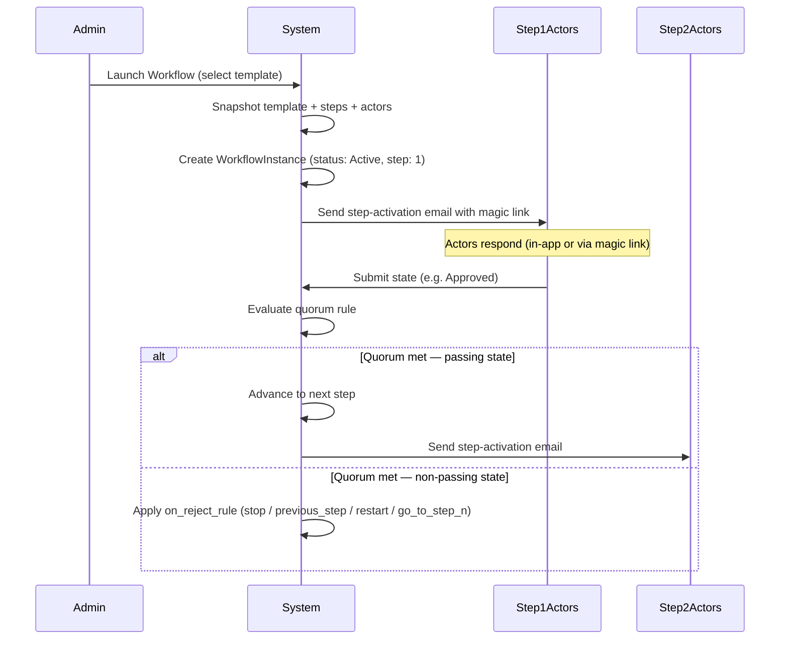
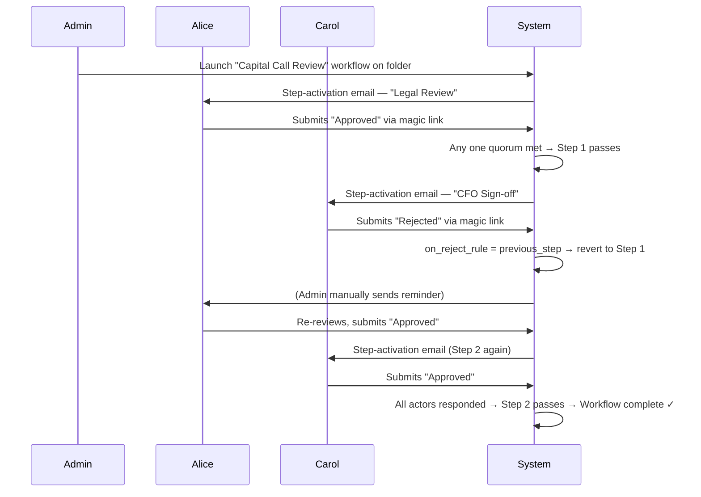

# Workflow Templates & Workflows User Guide

The **Workflow** feature lets you define reusable multi-step review and approval processes ("templates") and then run them ("launch an instance") against any folder. Actors assigned to each step respond via email magic link or directly in the app, and the system advances through the steps automatically based on the quorum rule you configured. Every action is captured in an immutable audit trail.

---

## Table of Contents

1. [Key Concepts](#key-concepts)
2. [Roles & Permissions](#roles--permissions)
3. [Creating a Workflow Template](#creating-a-workflow-template)
4. [Configuring Steps](#configuring-steps)
5. [Managing Templates](#managing-templates)
6. [Assigning a Template to a Folder](#assigning-a-template-to-a-folder)
7. [Launching a Workflow](#launching-a-workflow)
8. [Tracking Progress — the Timeline View](#tracking-progress--the-timeline-view)
9. [How Actors Respond](#how-actors-respond)
10. [Quorum Rules & Step Resolution](#quorum-rules--step-resolution)
11. [Rejection Handling](#rejection-handling)
12. [Manual Controls — Reset, Archive, Remind](#manual-controls--reset-archive-remind)
13. [Auto-Reminders](#auto-reminders)
14. [Audit Trail & CSV Export](#audit-trail--csv-export)
15. [Worked Example](#worked-example)
16. [Frequently Asked Questions](#frequently-asked-questions)

---

## Key Concepts

| Term | Meaning |
|------|---------|
| **Workflow Template** | A named, reusable definition of steps, actors, and rules — the "blueprint." |
| **Step** | A single gate in the template. Has its own actors, quorum rule, allowed states, and rejection rule. |
| **Actor** | An internal user (employee of your organisation) assigned to respond to a step. |
| **State** | The label an actor submits (e.g., "Approved", "Rejected"). The first state in the list is the *passing* state; all others trigger the rejection rule. |
| **Quorum rule** | How many actors must respond before the step resolves: Any One, All, or Majority. |
| **Workflow Instance** | A single run of a template on a specific folder. The template is snapshotted at launch so future edits to the template do not affect the running workflow. |
| **Magic link** | A personalised, signed URL emailed to each actor so they can respond without logging in. The link becomes invalid once the step advances. |

---

## Roles & Permissions

| Role | What they can do |
|------|-----------------|
| **Company Admin** | Create, edit, and delete workflow templates; assign templates to folders; launch, reset, archive, and advance workflows; send manual reminders; export audit trails. |
| **Regular user (actor)** | Respond to steps they are assigned to — both in-app and via magic link in email. |

---

## Creating a Workflow Template

1. Navigate to **Workflow Templates** from the main navigation.
2. Click **New Workflow Template**.
3. Fill in the template fields:

| Field | Description |
|-------|-------------|
| **Name** | Required. Must be unique within your organisation. |
| **Description** | Optional free text describing when to use this template. |
| **Reminder interval (days)** | If set, actors who haven't responded will receive an automatic reminder email every N days. Leave blank to disable auto-reminders for all steps (individual steps can override this). |
| **Attach documents in email** | When enabled, all documents in the folder are attached to every step-activation and reminder email sent for this workflow. |

4. Add at least one step (see [Configuring Steps](#configuring-steps)).
5. Click **Create Workflow Template**.

---

## Configuring Steps

Each step in the template represents a sequential gate. Steps run in position order (1, 2, 3, …). You can add, edit, reorder, and delete steps from the template form.

### Step fields

| Field | Description |
|-------|-------------|
| **Name** | Short label for this gate (e.g., "Legal Review", "CFO Sign-off"). |
| **Description** | Optional detail shown to actors when they respond. |
| **States** | Comma-separated list of response options (e.g., `Approved, Rejected, Needs More Info`). **The first state is always the passing state** — choosing it advances the workflow to the next step. All other states trigger the rejection rule. |
| **Quorum rule** | See [Quorum Rules](#quorum-rules--step-resolution). |
| **On reject rule** | What happens when the step resolves to a non-passing state. See [Rejection Handling](#rejection-handling). |
| **Jump to step** | Only shown when *On reject rule* is "Go to step N". Enter the target step position. |
| **Reminder interval (days)** | Overrides the template-level default for this step specifically. Set to 0 to disable reminders on this step. Leave blank to inherit the template default. |
| **Actors** | Internal users assigned to this step. Select from your organisation's members. |

> **Tip:** Actors must be employees (members) of your organisation. External parties can only respond via the magic link in their email — they cannot be assigned as actors.

---

## Managing Templates

### Editing a template

Navigate to **Workflow Templates**, click the template name, then **Edit**. Changes to a template do **not** affect any workflow instances that are already running — those are locked to the snapshot taken at launch.

### Deleting a template

A template can only be deleted if:
- It is not currently assigned to any folder.
- It has no associated workflow history (completed, rejected, or archived instances).

If either condition is not met, you will see an error. Remove the template from all folders and archive all instances first.

---

## Assigning a Template to a Folder

A folder must have a workflow template assigned before a workflow can be launched on it.

1. Open the folder.
2. Go to the **Workflow** tab.
3. If no workflow is active, a **Launch Workflow** button appears — clicking it opens a modal where you can select (or change) the template at launch time, which also updates the folder's assigned template.

Alternatively, if you want to pre-assign a template without launching immediately, use the folder's edit/settings page.

To remove a template from a folder without launching, clear the template assignment from the folder settings.

---

## Launching a Workflow

1. Open the folder and click the **Workflow** tab.
2. Click **Launch Workflow** (visible only when no workflow is currently active on this folder).
3. Select the review template from the dropdown (or confirm the pre-assigned one).
4. Click **Launch Workflow**.

**What happens immediately on launch:**
- The template is snapshotted — future edits to the template will not affect this run.
- The workflow instance is created and set to **Active**, at Step 1.
- Every actor assigned to Step 1 receives a step-activation email containing a personalised magic link.

Only one workflow can be active on a folder at a time. If you try to launch while one is running you will see an error.

---

## Tracking Progress — the Timeline View

Click **View Full Workflow Timeline** on the Workflow tab (or navigate directly via the workflow instance link) to open the full detail page.

### Step pipeline

The pipeline at the top shows every step in the workflow with a visual indicator:

- **Blue filled circle** — current active step.
- **Green check** — step has been resolved (passed).
- **Grey outline** — step not yet reached.

Completed steps show the resolved state badge (green for Approved, red for Rejected, etc.) plus the individual actor responses beneath it.

### Actor responses panel

Below the pipeline, when the workflow is active, a table lists every actor assigned to the current step with their response status:

| Column | Meaning |
|--------|---------|
| Actor | The assigned user's name. |
| Response | Their current state badge (e.g., Approved) or a "Pending" badge if they haven't responded yet. |
| When | How long ago they responded. |
| Note | Any free-text note they attached to their response. |

### Tiebreaker panel

If actors submit conflicting responses and the quorum rule cannot automatically resolve them (e.g., a tied majority vote), a **Tiebreaker needed** alert appears. Admins can use the advance form to set the final state manually and unblock the workflow.

---

## How Actors Respond

### In-app response

Actors who are logged in will see a **Your Response** card on the workflow timeline view. They select a state from the list and optionally add a note, then submit.

### Magic link (email)

Every step-activation email contains a personalised magic link. Actors click it and land on a lightweight standalone page — no login required — where they:

1. See the folder name, template name, and their actor identity.
2. Read the step description (if any).
3. Select a state using visual card buttons.
4. Optionally add a note.
5. Click **Submit Response**.

The magic link is signed with the actor's ID, instance ID, and step position. It becomes invalid (shows a "Moved on" page) as soon as the step advances. If an actor changes their mind, they can resubmit using a new state link from the same email — the **last submission wins** (earlier responses for that step are archived).

---

## Quorum Rules & Step Resolution

The quorum rule determines when the system considers a step complete and evaluates the outcome:

| Rule | Behaviour |
|------|-----------|
| **Any one** | The first actor to respond resolves the step immediately. Other actors' subsequent responses are ignored (or archived if the step has already advanced). |
| **All** | Every actor must respond before the step can resolve. The final resolution state is derived once all responses are in. |
| **Majority** | More than half of the actors must respond with the same state. If votes are tied or no majority emerges, an admin tiebreaker is required. |

**Resolution logic:** The step resolves to the *passing state* (first in the states list) if the quorum condition is met with that state. If any non-passing state meets the quorum, the on_reject_rule fires.

---

## Rejection Handling

When a step resolves to a **non-passing state**, the `On reject rule` determines what happens next:

| Rule | What happens |
|------|-------------|
| **Stop** | The workflow ends immediately with status **Rejected**. |
| **Previous step** | The workflow reverts to the immediately preceding step. Actor responses on the current step are archived so actors can re-vote. If the rejection happens at step 1, the workflow stops. |
| **Restart** | All actor responses across all steps are archived and the workflow resets to step 1. Step 1 actors are notified again. |
| **Go to step N** | The workflow jumps to the specified step. Responses for the current step are archived. |

---

## Manual Controls — Reset, Archive, Remind

These buttons appear on the workflow timeline view for admins when a workflow is active:

### Reset to Step 1

Resets the workflow to step 1. All current actor responses are archived (kept in the audit trail but no longer active). Step 1 actors are **not** automatically re-notified — use **Send Reminder** or launch a new instance if needed.

Use case: the wrong template was launched, or a significant change was made and you want everyone to re-review from the beginning.

### Archive

Immediately ends the workflow and sets its status to **Archived**. The workflow history is preserved. Use this when you want to close a workflow without completing it (e.g., the deal fell through).

### Remind (Send Reminder)

Immediately sends a reminder email to every actor on the current step who has not yet responded. A `manual reminder sent by <admin>` entry is written to the audit trail. Only available while the workflow is active.

---

## Auto-Reminders

If `reminder_interval_days` is set on the template (or overridden on individual steps), the system automatically sends reminder emails to pending actors on a daily background job.

**Reminder scheduling logic:**
1. The job runs daily.
2. For each active workflow instance, it checks the current step's effective reminder interval (step override → template default → no reminders if neither is set).
3. It calculates the time since the last reminder (or since launch, if no reminder has been sent yet).
4. If that interval has elapsed, it sends reminder emails to every actor who has not yet responded and records a `reminder_sent` state change in the audit trail.

Setting `reminder_interval_days` to `0` on a step disables auto-reminders for that step, even if the template has a non-zero default.

---

## Audit Trail & CSV Export

Every actor vote and every system event (step advancement, rejection, reset, reminder) is recorded in an immutable audit trail visible at the bottom of the timeline view.

| Column | Meaning |
|--------|---------|
| When | Timestamp of the event (UTC). |
| Step | The step position this event belongs to. |
| Actor | Who submitted the vote (or "System" for automatic events). |
| State | The state submitted or resolved to. |
| Channel | How the response was submitted: Dashboard (in-app), Email magic link, or Auto reminder. |
| Note | Free-text note attached to the response. |

Archived responses (from resets or reverts) are shown with reduced opacity and an "archived" badge — they are preserved for audit purposes but are not counted toward the active quorum.

### Export to CSV

Click **Export CSV** in the audit trail card header to download a CSV file containing all actor votes and resolution events sorted by timestamp. The file is named `workflow_audit_<instance_id>_<date>.csv`.

---

## Worked Example

**Scenario:** A fund manager needs a two-stage review before releasing a capital call document.

**Step 1 — Legal Review (Any one actor, stop on reject):**
- Actors: Alice (Legal), Bob (Legal)
- States: `Approved, Rejected`
- Either Alice or Bob can approve. If either rejects, the workflow stops.

**Step 2 — CFO Sign-off (All actors required, previous step on reject):**
- Actors: Carol (CFO)
- States: `Approved, Rejected`
- Carol must approve. If Carol rejects, the workflow returns to Step 1 for re-review.

**Flow:**

---

## Frequently Asked Questions

**Can I edit a template while a workflow is running?**
Yes. Edits to the template do not affect running instances — the template is snapshotted at launch. The snapshot is displayed in the timeline view under the template name.

**Can an actor change their response?**
Yes, before the step advances. They can click a different state link in the same email — the last submission replaces the earlier one. Once the step advances, the magic link becomes invalid.

**What happens if I delete a user who is an actor?**
The snapshot retains the user ID. The workflow continues, but the magic link for that user will not resolve to a valid actor and their slot in the actor table will show a blank name. Remove and re-add actors by resetting the workflow and updating the template before re-launching.

**Can I run multiple workflows on the same folder simultaneously?**
No. Only one active workflow instance per folder is allowed at a time. You must archive or complete the current one before launching another.

**Can I assign actors from a different organisation?**
No. Actors must be employees (users) of the same organisation that owns the workflow template. External reviewers can only be sent a magic link if they are first added as a user in your organisation.

**How do I know if a step needs a tiebreaker?**
A yellow warning alert labelled "Tiebreaker needed" will appear on the timeline view. Admins can use the advance form to select the final state manually.

**Is the audit trail tamper-proof?**
The audit trail is append-only at the database level. Resetting or archiving a workflow archives existing responses rather than deleting them, so the full history is always preserved.
