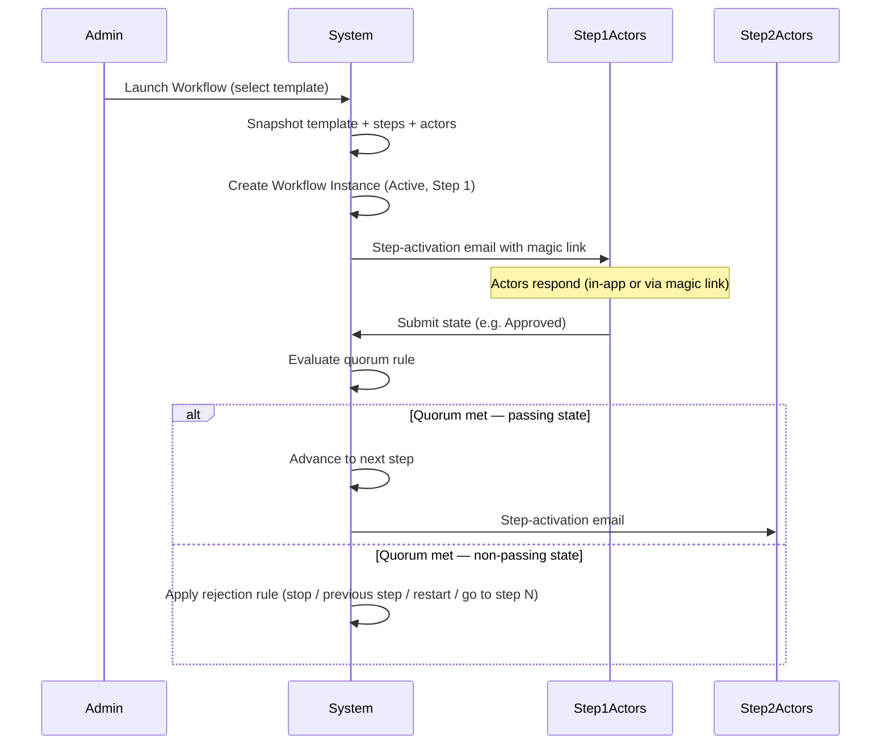
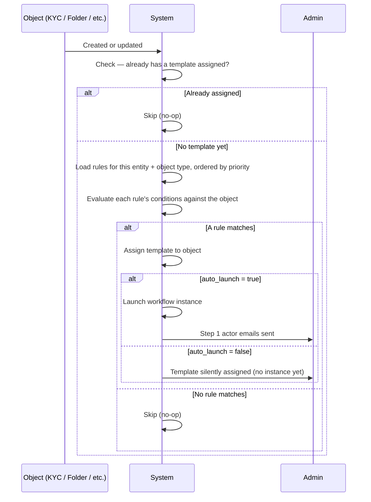
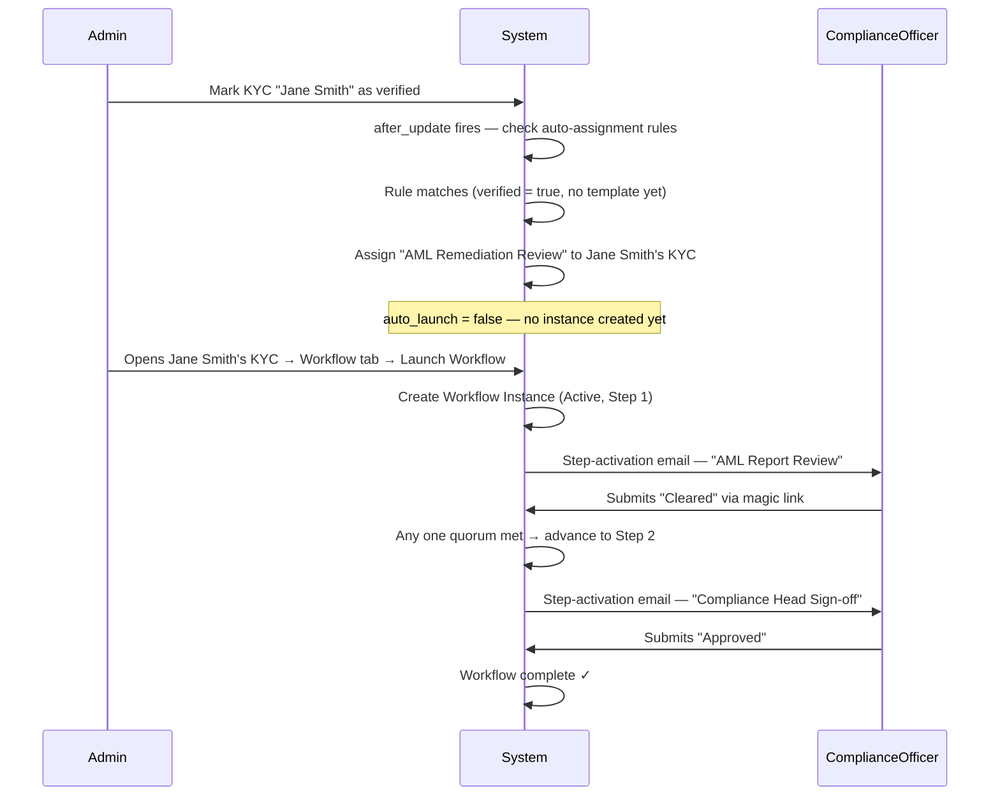

# Workflow Templates & Workflows User Guide

The **Workflow** feature lets you define reusable multi-step review and approval processes ("templates") and run them against any supported object in the platform — folders, investor KYC records, capital commitments, capital calls, and approvals. Actors assigned to each step respond via an email magic link or directly in the app, and the system advances through the steps automatically based on the quorum rule you configured. Every action is captured in an immutable audit trail.

---

## Table of Contents

1. [Key Concepts](#key-concepts)
2. [Roles & Permissions](#roles--permissions)
3. [Creating a Workflow Template](#creating-a-workflow-template)
4. [Configuring Steps](#configuring-steps)
5. [Managing Templates](#managing-templates)
6. [Supported Object Types](#supported-object-types)
7. [Assigning a Template to an Object](#assigning-a-template-to-an-object)
8. [Launching a Workflow](#launching-a-workflow)
9. [Tracking Progress — the Timeline View](#tracking-progress--the-timeline-view)
10. [How Actors Respond](#how-actors-respond)
11. [Quorum Rules & Step Resolution](#quorum-rules--step-resolution)
12. [Rejection Handling](#rejection-handling)
13. [Manual Controls — Reset, Archive, Remind](#manual-controls--reset-archive-remind)
14. [Auto-Reminders](#auto-reminders)
15. [Auto-Assignment Rules](#auto-assignment-rules)
16. [Locking Buttons Until a Workflow Resolves](#locking-buttons-until-a-workflow-resolves)
17. [Breadcrumb Workflow Indicator](#breadcrumb-workflow-indicator)
18. [Audit Trail & CSV Export](#audit-trail--csv-export)
19. [Worked Example](#worked-example)
20. [Frequently Asked Questions](#frequently-asked-questions)

---

## Key Concepts

| Term | Meaning |
|------|---------|
| **Workflow Template** | A named, reusable definition of steps, actors, and rules — the "blueprint." |
| **Step** | A single gate in the template. Has its own actors, quorum rule, allowed states, and rejection rule. |
| **Actor** | An internal user (employee of your organisation) assigned to respond to a step. |
| **State** | The label an actor submits (e.g., "Approved", "Rejected"). The first state in the list is the *passing* state; all others trigger the rejection rule. |
| **Quorum rule** | How many actors must respond before the step resolves: Any One, All, or Majority. |
| **Workflow Instance** | A single run of a template on a specific object. The template is snapshotted at launch so future edits do not affect the running workflow. |
| **Magic link** | A personalised, signed URL emailed to each actor so they can respond without logging in. The link becomes invalid once the step advances. |
| **Object type** | The kind of record a template applies to — Folder, Investor KYC, Capital Commitment, Capital Call, or Approval. |
| **Auto-assignment rule** | A rule that automatically assigns a template (and optionally launches it) when a matching object is created or updated. |
| **Locked button** | A button on an object's page (identified by its label, e.g. "Approve") that a template disables while the object's workflow is incomplete or has failed. |

---

## Roles & Permissions

| Role | What they can do |
|------|-----------------|
| **Company Admin** | Create, edit, and delete workflow templates; configure auto-assignment rules; assign templates to objects; launch, reset, archive, and advance workflows; send manual reminders; export audit trails. |
| **Regular user (actor)** | Respond to steps they are assigned to — both in-app and via magic link in email. |

---

## Creating a Workflow Template

1. Navigate to **Workflow Templates** from the main navigation.
2. Click **New Template**.
3. Fill in the template fields:

| Field | Description |
|-------|-------------|
| **Name** | Required. Must be unique within your organisation. |
| **Applies to** | Restricts this template to a specific object type (Folder, Investor KYC, Capital Commitment, Capital Call, or Approval). Leave blank to allow it on any type. **Cannot be changed after the template is saved.** |
| **Description** | Optional free text describing when to use this template. |
| **Reminder interval (days)** | If set, actors who haven't responded will receive an automatic reminder email every N days. Leave blank to disable auto-reminders for all steps (individual steps can override this). |
| **Attach documents in email** | When enabled, relevant documents are attached to every step-activation and reminder email for this workflow. |
| **Locked buttons** | Optional. A comma-separated list of button labels (e.g. `Approve, Edit`) to disable on the object's page while its workflow is incomplete or has failed. See [Locking Buttons Until a Workflow Resolves](#locking-buttons-until-a-workflow-resolves). |

4. Add at least one step (see [Configuring Steps](#configuring-steps)).
5. Click **Save**.

> **Tip:** Setting the "Applies to" type is strongly recommended. It prevents a KYC workflow from accidentally being launched on a folder, and enables auto-assignment rules to target the right objects.

---

## Configuring Steps

Each step in the template represents a sequential gate. Steps run in position order (1, 2, 3, …). You can add, edit, reorder, and delete steps from the template form.

### Step fields

| Field | Description |
|-------|-------------|
| **Name** | Short label for this gate (e.g., "Legal Review", "CFO Sign-off"). |
| **Description** | Optional detail shown to actors when they respond. |
| **States** | Comma-separated list of response options (e.g., `Approved, Rejected, Needs More Info`). **The first state is always the passing state** — choosing it advances the workflow to the next step. All other states trigger the rejection rule. |
| **Quorum rule** | See [Quorum Rules](#quorum-rules--step-resolution). |
| **On reject rule** | What happens when the step resolves to a non-passing state. See [Rejection Handling](#rejection-handling). |
| **Jump to step** | Only shown when *On reject rule* is "Go to step N". Enter the target step position. |
| **Reminder interval (days)** | Overrides the template-level default for this step. Set to 0 to disable reminders on this step. Leave blank to inherit the template default. |
| **Actors** | Internal users assigned to this step. Select from your organisation's members. |

---

## Managing Templates

### Template list

The **Workflow Templates** list shows each template's name, the object type it applies to, a numbered list of its steps, how many objects it is currently assigned to, and whether it attaches documents to emails.

### Editing a template

Navigate to **Workflow Templates**, click the template name, then **Edit Template**. Changes to a template do **not** affect any workflow instances that are already running — those are locked to the snapshot taken at launch.

Note that the **Applies to** type cannot be changed once the template has been saved.

### Deleting a template

A template can only be deleted if:
- It is not currently assigned to any object.
- It has no associated workflow history (completed, rejected, or archived instances).

If either condition is not met, you will see an error. Remove the template from all objects and archive all instances first.

---

## Supported Object Types

Workflows can be run on any of the following record types:

| Object type | Where to find it |
|-------------|-----------------|
| **Folder** | Data room folders in the Documents section. |
| **Investor KYC** | KYC records under the Investors section. |
| **Capital Commitment** | Commitment records under a fund's investor list. |
| **Capital Call** | Capital call records under a fund's Capital Calls tab. |
| **Approval** | Approval items in the Approvals section. |

When creating a template you can leave "Applies to" blank to allow the template on any type, or restrict it to one type for stricter governance. A type-restricted template cannot be assigned to the wrong kind of object.

---

## Assigning a Template to an Object

An object must have a workflow template assigned before a workflow can be launched on it. Assignment can happen in three ways:

### 1. Manually at launch time

Open the object, go to its **Workflow** tab (or the equivalent panel), and click **Launch Workflow**. The launch modal includes a template dropdown filtered to templates that match this object's type. Selecting a template here both assigns it and immediately launches the workflow.

### 2. Manually via the object's settings

Some objects support pre-assigning a template from an edit or settings page without launching immediately.

### 3. Automatically via auto-assignment rules

Admins can configure rules on a template that automatically assign it (and optionally launch a workflow instance) when a matching object is created or updated. See [Auto-Assignment Rules](#auto-assignment-rules).

---

## Launching a Workflow

1. Open the object (folder, KYC, commitment, capital call, or approval).
2. Go to the **Workflow** tab or panel.
3. Click **Launch Workflow** (visible only when no workflow is currently active on this object).
4. Select the review template from the dropdown.
5. Click **Launch Workflow**.

**What happens immediately on launch:**
- The template is snapshotted — future edits to the template will not affect this run.
- The workflow instance is created and set to **Active**, at Step 1.
- Every actor assigned to Step 1 receives a step-activation email with a personalised magic link.

Only one workflow can be active on an object at a time.



---

## Tracking Progress — the Timeline View

Click the workflow link in the object's Workflow tab (or use the [breadcrumb indicator](#breadcrumb-workflow-indicator)) to open the full timeline page.

The header card shows:
- A button linking to the **workflow template** used, so you can quickly review the template definition.
- The date the workflow was launched.
- The current status badge (Active, Complete, Rejected, Archived).
- The name of the object the workflow is running on, linked back to that object's page.
- Admin action buttons (Remind, Reset, Archive, Advance) when the workflow is active.

### Step pipeline

The pipeline shows every step with a visual indicator:

- **Blue filled circle** — current active step.
- **Green check** — step has been resolved (passed).
- **Grey outline** — step not yet reached.

Completed steps show the resolved state badge plus the individual actor responses beneath them.

### Actor responses panel

Below the pipeline, a table lists every actor assigned to the current step:

| Column | Meaning |
|--------|---------|
| Actor | The assigned user's name. |
| Response | Their current state badge or "Pending" if they haven't responded. |
| When | How long ago they responded. |
| Note | Any free-text note they attached. |

### Tiebreaker panel

If actors submit conflicting responses and the quorum rule cannot automatically resolve them, a **Tiebreaker needed** alert appears. Admins can use the advance form to set the final state manually.

---

## How Actors Respond

### In-app response

Actors who are logged in will see a **Your Response** card on the workflow timeline view. They select a state and optionally add a note, then submit.

### Magic link (email)

Every step-activation email contains a personalised magic link. Actors click it and land on a lightweight page — no login required — where they:

1. See the object's name with a **View** button to open the full record in a new tab (so they can review it in context before responding).
2. Read the step description (if any).
3. Select a state using visual card buttons.
4. Optionally add a note.
5. Click **Submit Response**.

The magic link becomes invalid once the step advances. If an actor changes their mind before the step advances, they can resubmit — the **last submission wins**.

```mermaid
sequenceDiagram
  participant Actor
  participant Email
  participant MagicLinkPage
  participant System

  System->>Email: Step-activation email with magic link
  Email->>Actor: Delivered
  Actor->>MagicLinkPage: Click magic link
  MagicLinkPage->>Actor: Show object name + View button + step description + state options
  Actor->>MagicLinkPage: Optionally click View to open the object in a new tab
  Actor->>MagicLinkPage: Select state + optional note → Submit
  MagicLinkPage->>System: Record response
  System->>System: Evaluate quorum; advance if met
```

---

## Quorum Rules & Step Resolution

| Rule | Behaviour |
|------|-----------|
| **Any one** | The first actor to respond resolves the step immediately. |
| **All** | Every actor must respond before the step can resolve. |
| **Majority** | More than half of the actors must respond with the same state. Ties require an admin tiebreaker. |

**Resolution logic:** The step resolves to the passing state (first in the states list) if the quorum condition is met with that state. If a non-passing state meets the quorum, the rejection rule fires.

---

## Rejection Handling

| Rule | What happens |
|------|-------------|
| **Stop** | The workflow ends immediately with status **Rejected**. |
| **Previous step** | The workflow reverts to the immediately preceding step. Current responses are archived so actors can re-vote. At step 1, the workflow stops. |
| **Restart** | All responses across all steps are archived and the workflow resets to step 1. Step 1 actors are notified again. |
| **Go to step N** | The workflow jumps to the specified step. Current responses are archived. |

---

## Manual Controls — Reset, Archive, Remind

These appear on the timeline view for admins when a workflow is active:

### Reset to Step 1

Resets the workflow to step 1 and archives all current actor responses. Step 1 actors are **not** automatically re-notified — use **Send Reminder** after resetting.

### Archive

Ends the workflow immediately with status **Archived**. The full history is preserved.

### Remind (Send Reminder)

Immediately emails every actor on the current step who has not yet responded. A manual reminder entry is written to the audit trail.

---

## Auto-Reminders

If `Reminder interval (days)` is set on the template (or overridden on individual steps), the system automatically sends reminder emails to pending actors on a daily background job.

**Logic:**
1. The job runs daily.
2. For each active workflow, it checks the current step's effective reminder interval.
3. If the interval has elapsed since the last reminder (or since launch), it sends reminder emails to every actor who has not yet responded.

Setting the step's reminder interval to **0** disables auto-reminders for that step even if the template has a non-zero default.

---

## Auto-Assignment Rules

Auto-assignment rules let you automatically assign a workflow template to an object the moment it is created or reaches a certain state — without any manual action from an admin.

### Where to configure rules

1. Go to **Workflow Templates** and open the template you want to auto-assign.
2. Scroll to the **Auto-assignment Rules** panel at the bottom of the template page.
3. Click **Add Rule**.

### Rule fields

| Field | Description |
|-------|-------------|
| **Applies to** | Inherited from the template's type. Read-only. |
| **Priority** | Lower number = higher priority. When multiple rules match, the one with the lowest priority number wins. |
| **Conditions** | An optional set of attribute checks. If left empty, the rule matches every new object of the correct type (catch-all). |
| **Auto-launch** | When enabled, a workflow instance is launched immediately after the template is assigned — no admin action required. |

### How conditions work

Each condition checks a single field on the object:

| Operator | Matches when… |
|----------|--------------|
| `eq` | The field equals the value. |
| `not_eq` | The field does not equal the value. |
| `gt` / `lt` / `gte` / `lte` | The field is greater/less than the value (numeric). |
| `in` / `not_in` | The field is (or isn't) one of a list of values. |
| `present` | The field has any non-blank value. |
| `blank` | The field is empty or null. |

All conditions in a rule must match simultaneously (AND logic). An empty conditions list always matches.

### When rules are evaluated

Rules are evaluated in two situations:

1. **When a new object is created** — immediately after it is saved for the first time.
2. **When an existing object is updated** — if the update changes any field that a condition checks and the object does not already have a template assigned.

This means you can configure a rule like "assign the AML Remediation Review to any Investor KYC where `verified` equals `true`" and it will trigger both when a KYC is created already-verified and when an existing KYC is later marked as verified.

Once a template is assigned, the rule will not re-trigger on further updates — the object already has an assignment.



### Example rules

| Use case | Type | Condition | Auto-launch |
|----------|------|-----------|-------------|
| Assign AML review to all verified KYCs | Investor KYC | `verified eq true` | No |
| Auto-launch IC vote on every new Approval | Approval | *(none — catch-all)* | Yes |
| Assign LP data room review to folders named "Q3 2026" | Folder | `name eq Q3 2026` | No |

---

## Locking Buttons Until a Workflow Resolves

Some templates need to prevent certain actions on an object until its review process finishes successfully — for example, blocking the **Approve** button on a capital call until its approval workflow completes, or blocking the **Edit** button on an investor KYC record while a review is in progress.

### How it works

When creating or editing a template, use the **Locked buttons** field to list one or more button labels — typed exactly as they appear on the object's page (e.g. `Approve`, `Edit`, `Delete`). Separate multiple labels with commas.

While an object's current workflow instance is:

- **Incomplete** — still in progress, or
- **Failed** — rejected,

every listed button appears greyed out and cannot be clicked. Hovering over a locked button shows a short message explaining that it is blocked by an unresolved workflow.

Once the workflow **completes successfully**, the buttons return to normal automatically — no admin action needed.

### Important notes

- **Opt-in per object.** An object that has never had a workflow launched against it is never locked, regardless of what a template's Locked buttons field says — the lock only takes effect once a workflow instance actually exists for that object.
- **Type the label exactly.** Match the button's on-screen text precisely, including capitalisation and spacing.
- **Currently available on:** Capital Call and Investor KYC pages. Other object types (Folder, Capital Commitment, Approval) do not yet support locking buttons this way.
- **This is a safeguard, not access control.** Locking a button changes what you see and can click on the page. It is meant to prevent accidental clicks during an in-progress review, not to serve as a security restriction.

---

## Breadcrumb Workflow Indicator

When you are viewing an object (folder, KYC, commitment, capital call, or approval) that has an **active workflow instance**, a small kanban icon appears in the breadcrumb bar at the top of the page. Clicking it takes you directly to the workflow timeline for that object, without having to navigate to the Workflow tab first.

The icon is not shown when there is no active instance.

---

## Audit Trail & CSV Export

Every actor vote and every system event (step advancement, rejection, reset, reminder) is recorded in an immutable audit trail at the bottom of the timeline view.

| Column | Meaning |
|--------|---------|
| When | Timestamp of the event (UTC). |
| Step | The step position this event belongs to. |
| Actor | Who submitted the vote (or "System" for automatic events). |
| State | The state submitted or resolved to. |
| Channel | How the response was submitted: Dashboard (in-app), Email magic link, or Auto reminder. |
| Note | Free-text note attached to the response. |

Archived responses (from resets or reverts) are shown with reduced opacity and an "archived" badge — preserved for audit but not counted toward the active quorum.

### Export to CSV

Click **Export CSV** in the audit trail card header to download the full history as a CSV file named `workflow_audit_<id>_<date>.csv`.

---

## Worked Example

**Scenario:** All newly verified investor KYC records should automatically go through an AML remediation review.

**Setup:**
1. Create a template "AML Remediation Review" with `Applies to = Investor KYC` and two steps: "AML Report Review" (any one actor) and "Compliance Head Sign-off" (any one actor).
2. On the template's show page, add an auto-assignment rule: condition `verified eq true`, auto-launch off, priority 0.

**What happens when a KYC is marked verified:**



---

## Frequently Asked Questions

**Can I edit a template while a workflow is running?**
Yes. Edits do not affect running instances — those are locked to the snapshot taken at launch.

**Can an actor change their response?**
Yes, before the step advances. They can resubmit using the same email link — the last submission replaces the earlier one. Once the step advances, the magic link is invalid.

**Can I see the object while responding via email?**
Yes. The magic link page includes a **View** button next to the object's name. Clicking it opens the full record in a new tab so you can review the details before submitting your response.

**Can I use the same template for different object types?**
Only if the template's "Applies to" field is left blank (untyped). Once a type is set on a template, it can only be assigned to objects of that type.

**Will auto-assignment trigger if I remove and re-add a template?**
Yes — if you remove the template assignment from an object and then update the object in a way that matches a rule, the rule will fire again and re-assign the template.

**What happens if no auto-assignment rule matches?**
Nothing — the object simply has no template assigned. An admin can assign one manually at any time.

**Can I run multiple workflows on the same object simultaneously?**
No. Only one active workflow instance per object at a time. Archive or complete the current one before launching another.

**Can I assign actors from a different organisation?**
No. Actors must be employees of the same organisation. External reviewers can only respond if they are first added as a user in your organisation.

**How do I know if a step needs a tiebreaker?**
A yellow "Tiebreaker needed" alert appears on the timeline view. Admins can use the advance form to select the final state manually.

**Is the audit trail tamper-proof?**
The audit trail is append-only. Resets and archives preserve all history — responses are archived rather than deleted.

**Can capital calls use workflows?**
Yes. Capital Call is a supported object type — you can assign a template to a capital call and run a review before it is approved and notices are sent to investors, the same way you would for a folder or KYC record.

**Why is a button on an object's page greyed out and won't respond to clicks?**
It is most likely a locked button — the object has a workflow assigned that lists this button in its Locked buttons field, and that workflow hasn't completed successfully yet. Hover over the button to see the explanation, or check the object's Workflow tab to see the instance's current status. See [Locking Buttons Until a Workflow Resolves](#locking-buttons-until-a-workflow-resolves).
