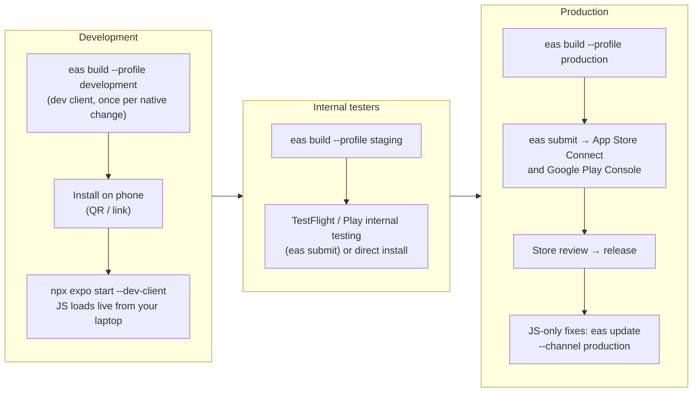

# Deploying the CapHive LP app to phones

How the app gets onto a phone — for development, for internal testers, and for the stores — and
what the Rails side needs in each region. Change: `openspec/changes/lp-mobile-app`.



## One-time setup

| What | Where | Notes |
|---|---|---|
| Expo account + project | Done: `@caphive/caphive-lp` (project id in `app.json`) | `npx eas-cli@latest login` with an account in the **caphive** organisation |
| Apple Developer account | developer.apple.com | Needed for any iPhone build, including dev builds. Bundle ids: `com.caphive.lp` (staging AND production — one app, see below), `com.caphive.lp.development` (dev client) |
| Google Play Console | play.google.com/console | Package names as above |
| iOS push key (APNs) | `npx eas-cli credentials` → iOS → Push Notifications | EAS creates/uploads it; Expo's push service then reaches iPhones |
| Android push (FCM v1) | Firebase project → service-account key → `eas credentials` → Android → FCM V1 | Without it Android phones get no push |
| Expo access token (server) | expo.dev → Access tokens; enable *enhanced push security* | Goes into Rails credentials below |

## Rails side, per region (IN and US separately — never share values)

1. Deploy the code and run the migrations (`mobile_devices`, `mobile_push_deliveries`).
2. Add to that region's credentials (development uses `MOBILE_PUSH_ENABLED=true` in `.env.development`
   instead, which pushes without a token):
   ```yaml
   mobile:
     expo_access_token: "<token from expo.dev>"   # without it push is simply off in that region
     min_app_version: "1.0.0"                     # raise it to force an app update (HTTP 426)
   ```
3. Sidekiq registers `ExpoPushReceiptsJob` (every 15 minutes) on boot — nothing to schedule by hand.
4. `CROSS_INSTANCE_SECRET` must be configured (it already is for cross-region login); the app's
   "open on website" links use it.
5. Run `bin/rails guide_faqs:import_markdown REFRESH=1` so the app's user guide FAQs reach FAQ Manager.

## Development: on your own phone

The app uses native modules (secure storage, biometrics, push, SVG), so use a **development build**
rather than Expo Go.

```bash
cd mobile
npx eas-cli@latest build --profile development --platform android   # or ios (register the phone first:
                                                                    #   npx eas-cli device:create)
# install the build from the QR code / link EAS prints — once per native dependency change

# Rails must be reachable from the phone: bind to the LAN, and point the app at your laptop's IP
bin/rails s -b 0.0.0.0 -p 3000                                       # repo root
EXPO_PUBLIC_API_URL=http://192.168.1.20:3000 npx expo start --dev-client
```

Open the dev build on the phone and pick the laptop's server; JavaScript changes reload live.
On a Mac with Xcode / a PC with Android Studio you can instead build locally:
`npx expo run:ios --device` / `npx expo run:android --device`.

Quick look without a phone: the web review build (see `README.md`) — no push, Face ID or secure storage.

## One app, every environment

Since `lp-mobile-multi-site`, no build has server addresses baked in. Every build lists the
environments in `src/api/config.ts` — **CapHive** (production) and **Staging** — plus a typed-in
**Custom** address, and asks the chosen environment for its regions (`GET /api/mobile/v1/sites`,
the server's `SITES`). Investors see only CapHive; a long press on the CapHive name on the site
screen reveals Staging and Custom.

The `staging` and `production` profiles therefore build the SAME app (`com.caphive.lp`, "CapHive");
the only difference is that a staging build opens on Staging with the test environments revealed.
Installing a staging APK replaces a production install of the app and vice versa. The
`development` profile stays a separate app (a dev client loading JavaScript from a laptop).

## Internal testers (staging)

```bash
npx eas-cli@latest build --profile staging --platform all            # opens on Staging (dev.altconnects.com/.us)
npx eas-cli@latest submit --profile production --platform ios        # → TestFlight (internal group)
npx eas-cli@latest submit --profile production --platform android    # → Play internal testing track
```

Seed the staging region with fictional data for testers: `RAILS_ENV=staging bin/rails mobile:seed_demo`.
Run the Maestro flows against this build: `maestro test e2e/`, then the QA checklist.

## Production

```bash
npx eas-cli@latest build --profile production --platform all         # opens on CapHive (app.caphive.com/.us)
npx eas-cli@latest submit --profile production --platform all
```

Then, in App Store Connect and Play Console: store listing, screenshots, privacy answers (no tracking;
collects name/email for sign-in), and the Face ID purpose text (already in `app.config`). Release after review.

**Updates.** JavaScript-only changes ship over the air without store review:
`npx eas-cli@latest update --channel production --message "…"`. Anything that adds or changes a native
module needs a new store build. To retire an old build, raise `mobile.min_app_version` in each region's
credentials — older apps then show **Please update CapHive to continue**.

**Rollback.** Revert the OTA update (`eas update:rollback`), or for the server side remove
`mobile.expo_access_token` to stop push in a region; signing every phone out:
`MobileDevice.live.find_each { |d| d.revoke!(reason: "rollback") }`.
