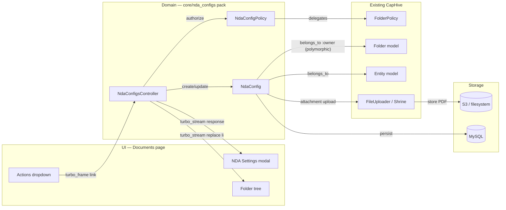
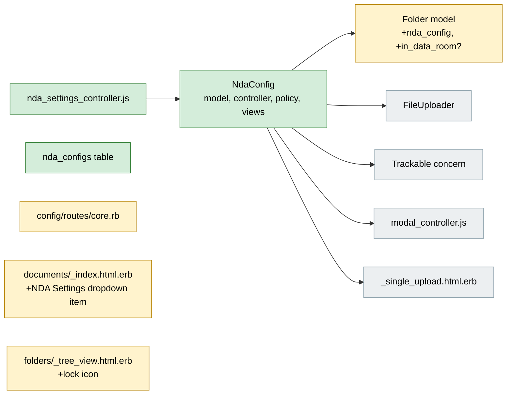
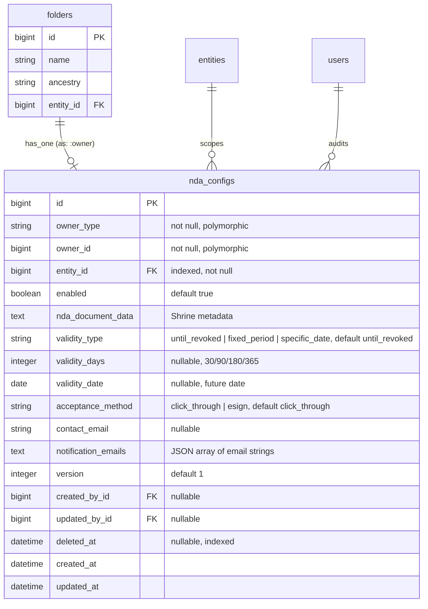
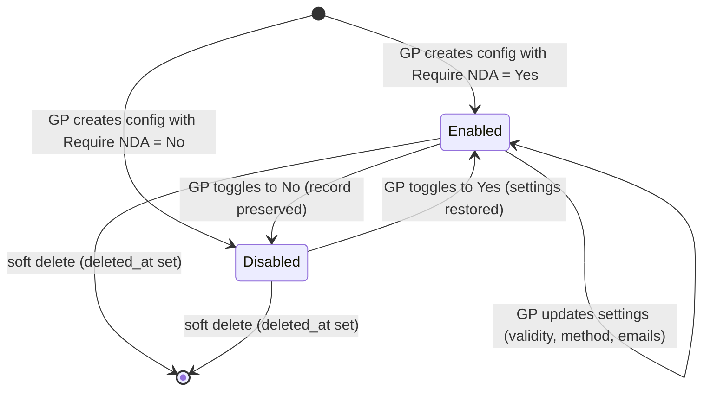
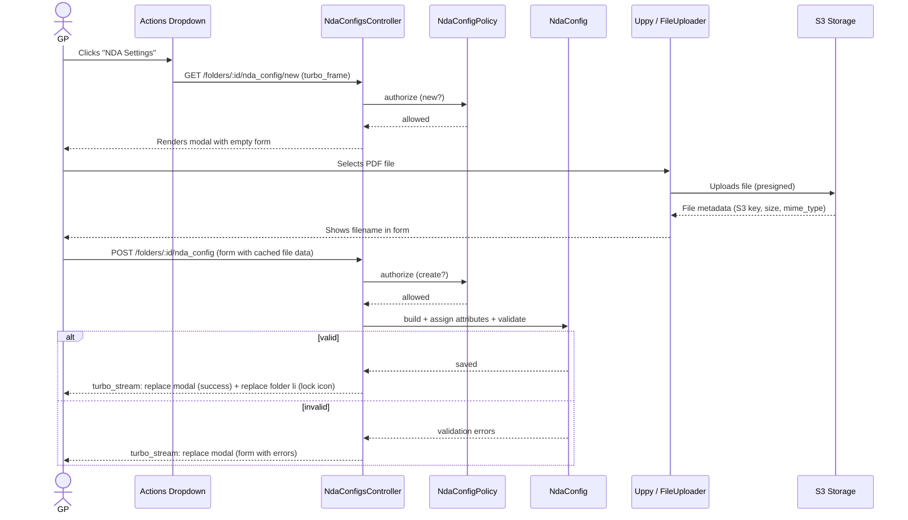
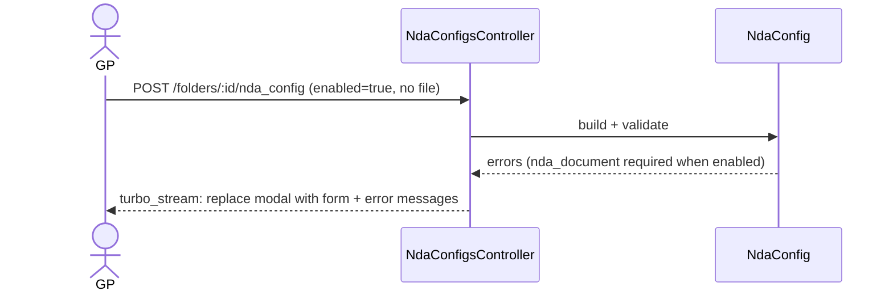
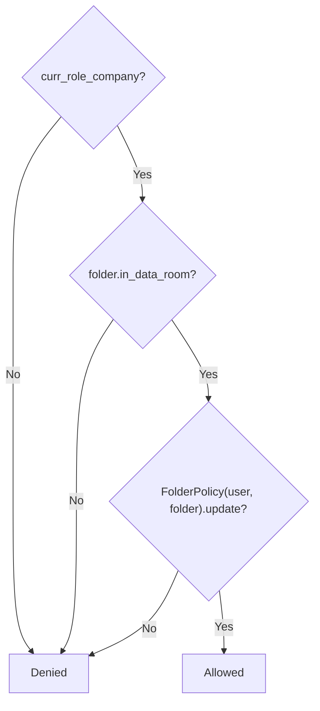
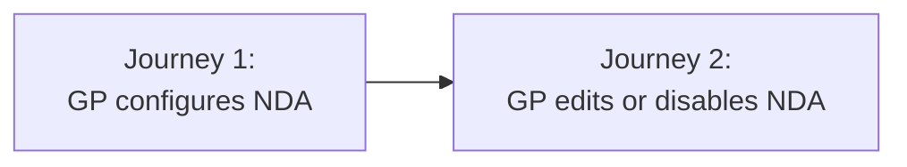

# NDA Data Room Module 1: NDA Configuration & Folder Setup — Design

> **Audience:** Engineering team.
> **Companion documents:** [Proposal](proposal.md) · [Spec](specs/)

> **Planning phase — no code changes.** This document explains HOW the proposal will be built.
> Do not edit application code while writing it; implementation happens later, in the tasks phase.

> **Design, not code.** Explain the design with mermaid diagrams and tables. Do NOT paste Ruby/JS
> class bodies, migrations, route blocks or policy code. Put real class, method, table and path
> names inside the diagrams and tables instead.

---

## Contents

- [Overview](#overview)
- [Architecture](#architecture)
  - [Component Boundaries](#component-boundaries)
  - [Class Diagram](#class-diagram)
  - [Change Footprint](#change-footprint)
- [Data Model and States](#data-model-and-states)
  - [Data Model](#data-model)
  - [State Transitions](#state-transitions)
- [Behaviour](#behaviour)
  - [Pipeline / Flow](#pipeline--flow)
  - [Sequence Diagrams](#sequence-diagrams)
  - [Worked Examples](#worked-examples)
- [Key Components](#key-components)
- [Controllers and Routes](#controllers-and-routes)
- [Policy](#policy)
- [UI Changes](#ui-changes)
  - [At a glance](#at-a-glance)
  - [Journey 1: GP configures NDA on a folder](#journey-1-gp-configures-nda-on-a-folder)
  - [Journey 2: GP edits or disables NDA](#journey-2-gp-edits-or-disables-nda)
  - [Build notes (for implementers)](#build-notes-for-implementers)
- [Cross-cutting Concerns](#cross-cutting-concerns)
  - [Transactions and Queries](#transactions-and-queries)
  - [Exception Handling and Monitoring](#exception-handling-and-monitoring)
  - [Performance and Security](#performance-and-security)
- [Design Decisions](#design-decisions)
- [Testing](#testing)
- [Risks and Open Questions](#risks-and-open-questions)

---

## Overview

Adds a polymorphic `NdaConfig` model (`belongs_to :owner, polymorphic: true` — owner is `Folder`
in Module 1) with a CRUD controller rendered as a remote Bootstrap modal on the Documents page.
The model lives in its own pack (`core/nda_configs`) so it can serve any owner type without
coupling to the folders pack. Follows the existing remote modal pattern from the Investors index
(`turbo_frame_tag` placeholder + `modal_controller.js`) extended with Turbo Stream responses for
the lock icon update. File upload uses Uppy via the existing `_single_upload.html.erb` partial.

---

## Architecture

### Component Boundaries



| From → To | Contract | Direction rule |
|---|---|---|
| UI → Controller | Turbo Frame request via `data-turbo-frame` link | UI never writes records directly |
| Controller → Policy | `authorize @nda_config` before every mutation | Controller never skips authorization |
| Controller → Model | `build` / `update` with permitted params | Model owns all validation |
| Model → FileUploader | `FileUploader::Attachment(:nda_document)` | Uploader is generic; PDF validation is on the model |
| Controller → UI | Turbo Stream response replaces modal frame + folder `<li>` | No full page reload on save |

### Class Diagram

```mermaid
classDiagram
    direction LR
    namespace UI_Boundary {
        class NdaConfigsController {
            <<Controller>>
            +new()
            +create()
            +edit()
            +update()
            -set_owner()
        }
        class NdaSettingsController_JS {
            <<Stimulus>>
            +toggleEnabled()
            +toggleValidity()
            +fileSelected()
        }
    }
    namespace Domain_Boundary {
        class NdaConfig {
            <<Model>>
            owner_type
            owner_id
            enabled
            validity_type
            validity_days
            validity_date
            acceptance_method
            contact_email
            notification_emails
            version
            +nda_document_must_be_pdf()
        }
        class NdaConfigPolicy {
            <<Policy>>
            +manageable?() bool
        }
    }
    namespace Domain_Boundary_Concerns {
        class WithNda {
            <<Concern>>
            +nda_config
            +nda_required?() bool
        }
    }
    namespace Existing_Boundary {
        class Folder {
            <<Model>>
            +in_data_room?() bool
            +data_room_root?() bool
        }
        class FolderPolicy {
            <<Policy>>
            +update?() bool
        }
    }
    NdaConfigsController --> NdaConfigPolicy : authorize
    NdaConfigsController --> NdaConfig : create / update
    NdaConfigPolicy --> FolderPolicy : delegates update?
    NdaConfig --> Folder : belongs_to :owner (polymorphic)
    Folder ..|> WithNda : includes
    WithNda --> NdaConfig : has_one :nda_config, as: :owner
```

### Change Footprint

New code lives in `app/packs/core/nda_configs/` (model, controller, policy, views) and
`app/javascript/controllers/` (Stimulus).



---

## Data Model and States

### Data Model



**Indexes:** unique composite `nda_configs[owner_type, owner_id]`, index `nda_configs[entity_id]`,
index `nda_configs[deleted_at]`

| Column | Why |
|---|---|
| `owner_type` + `owner_id` | Polymorphic association — allows NDA attachment to any model (Folder, InvestmentOpportunity, etc.) |
| `entity_id` | Direct multi-tenant scoping — avoids joins through owner for entity-scoped queries |
| `nda_document_data` | `text` column (not JSON) — Shrine convention across the codebase, stores serialized JSON with S3 key, size, mime_type |
| `notification_emails` | `text` column storing JSON array — small list (2-5 emails), no relational queries needed, follows `esign_emails` pattern on commitments |
| `version` | Incremented on NDA doc replacement (Module 4). Stored from day one so acceptance records can reference which version was signed |

**New concern:**

- `WithNda` concern in `app/packs/core/nda_configs/models/concerns/with_nda.rb` — encapsulates
  `has_one :nda_config, as: :owner, class_name: "NdaConfig", dependent: :destroy` and
  `nda_required?` (returns `nda_config&.enabled? || false`). Any model that needs NDA includes
  this concern. Follows the `WithDataRoom`, `WithFolder`, `WithAccessRights` pattern.

**Changes to existing models:**

- `Folder` gains `include WithNda` — adds `nda_config` association and `nda_required?`
- `Folder` gains `in_data_room?` — memoized, walks ancestry chain looking for `data_room_root?`
- `Folder` gains `data_room_root?` — checks `name == "Data Room" && parent&.system?`
- No changes to `Entity`, `User`, `FileUploader`, or any other existing model

### State Transitions

NdaConfig has a simple enabled/disabled lifecycle (no multi-state workflow):



States are stored: `enabled` boolean on the record. `deleted_at` is a separate lifecycle
managed by `acts_as_paranoid` (via `Trackable` concern).

---

## Behaviour

### Pipeline / Flow

N/A — no multi-branch processing. The controller is straightforward CRUD.

### Sequence Diagrams

**Happy path — GP creates NDA configuration:**



**Error flow — GP submits without NDA document:**



### Worked Examples

**ID legend:** **H** = Happy path · **E** = Edge case · **X** = Error (exception) case.

**Shared setup:**

| Record | Name | Key data |
|---|---|---|
| Entity | Alpha Capital | `enable_data_rooms: true`, no e-sign provider configured |
| Entity | Beta Fund | `enable_data_rooms: true`, Zoho Sign configured |
| User (GP) | gp_admin | `curr_role_company? = true`, entity = Alpha Capital |
| User (LP) | lp_user | `curr_role_company? = false`, entity = Alpha Capital |
| Folder | Data Room | `system? parent`, entity = Alpha Capital, `in_data_room? = true` |
| Folder | Deal Pipeline | child of Data Room, `in_data_room? = true` |
| Folder | Fund Reports | NOT in Data Room (sibling of Data Room under root) |

#### Happy Path

| # | Scenario | Given | When | Then | Spec scenario | Feature |
|---|---|---|---|---|---|---|
| H1 | GP enables NDA with all fields | gp_admin on Deal Pipeline, no existing config | Creates config: enabled=true, PDF uploaded, validity=fixed_period 90 days, click_through, contact_email, notification_emails | Config created, lock icon appears on Deal Pipeline | Create new NDA configuration | `nda_configuration.feature` |
| H2 | GP opens NDA Settings on configured folder | Deal Pipeline has NDA config | Opens NDA Settings modal | Modal shows pre-filled values | Modal opens for a folder with existing NDA | `nda_configuration.feature` |
| H3 | GP updates validity type | Deal Pipeline has NDA config with until_revoked | Changes validity to specific_date 2027-06-30 | Config updated, updated_by set | Update existing NDA configuration | `nda_configuration.feature` |
| H4 | GP disables NDA | Deal Pipeline has enabled NDA config | Toggles to No, saves | Config retained with enabled=false, lock icon removed | Disable NDA keeps the record | `nda_configuration.feature` |
| H5 | GP re-enables NDA | Deal Pipeline has disabled NDA config | Toggles to Yes | Form shows previously saved settings | Re-enable NDA shows preserved settings | `nda_configuration.feature` |
| H6 | NDA Settings visible for Data Room folder | gp_admin viewing Documents for Deal Pipeline | Opens Actions dropdown | "NDA Settings" item visible | GP sees NDA Settings for a Data Room folder | `nda_configuration.feature` |
| H7 | Lock icon has tooltip | Deal Pipeline has enabled NDA | GP hovers lock icon | Tooltip shows "NDA required" | Lock icon has tooltip | `nda_configuration.feature` |

#### Edge Cases

| # | Scenario | Given | When | Then | Spec scenario | Feature |
|---|---|---|---|---|---|---|
| E1 | NDA Settings hidden for non-Data Room folder | gp_admin viewing Documents for Fund Reports | Opens Actions dropdown | "NDA Settings" not in dropdown | NDA Settings hidden for non-Data Room folders | `nda_configuration.feature` |
| E2 | E-sign disabled when no provider | Alpha Capital has no e-sign provider | GP opens NDA Settings | E-sign radio disabled with "Configure an e-sign provider in Entity Settings" | E-sign disabled without provider | `nda_configuration.feature` |
| E3 | E-sign enabled when provider configured | Beta Fund has Zoho Sign configured | GP opens NDA Settings | E-sign radio enabled and selectable | E-sign available when entity has provider | `nda_configuration.feature` |
| E4 | Duplicate config prevented | Deal Pipeline already has NDA config | Second config creation attempted | Fails due to unique composite constraint on [owner_type, owner_id] | Duplicate config prevented | `nda_configuration.feature` |
| E5 | Data Room root folder detected | Checking the "Data Room" folder | Calls `in_data_room?` | Returns true | Data Room root folder detected | `nda_configuration.feature` |
| E6 | Entity root folder not in Data Room | Checking the entity root (system) folder | Calls `in_data_room?` | Returns false | Entity root folder not in Data Room | `nda_configuration.feature` |

#### Error Cases

| # | Scenario | Given | When | Then (what the user sees, who is alerted) | Spec scenario | Feature |
|---|---|---|---|---|---|---|
| X1 | Save without document when enabled | GP toggles NDA to Yes, no file uploaded | Saves | Modal re-renders with error: "NDA document is required" | Save blocked without document | `nda_configuration.feature` |
| X2 | Invalid contact email | GP enters "not-an-email" in contact email | Saves | Modal re-renders with error on contact email | Invalid contact email rejected | `nda_configuration.feature` |
| X3 | Past specific date | GP selects specific_date with yesterday's date | Saves | Modal re-renders with error: "date must be in the future" | Specific date requires a future date | `nda_configuration.feature` |
| X4 | LP denied NDA config access | lp_user accesses NDA config endpoint directly | POST /folders/:id/nda_config | Pundit::NotAuthorizedError, redirected | LP user denied NDA configuration access | `nda_configuration.feature` |
| X5 | GP denied on non-Data Room folder | gp_admin attempts NDA config on Fund Reports | POST /folders/:id/nda_config | Pundit::NotAuthorizedError, redirected | GP cannot configure NDA on a non-Data Room folder | `nda_configuration.feature` |
| X6 | Non-PDF file rejected | GP uploads a .docx file | Saves | Modal re-renders with error: "NDA document must be a PDF" | Non-PDF rejected | `nda_configuration.feature` |

---

## Key Components

N/A — no services or jobs in Module 1. The controller is a thin CRUD wrapper that delegates
validation to the model and authorization to the policy.

---

## Controllers and Routes

Routes are added to `config/routes/core.rb` (lines 203-210) inside the existing `resources :folders` block:

| Verb and path | Action | Does | Responds with |
|---|---|---|---|
| `GET /folders/:folder_id/nda_config/new` | `new` | Builds or loads existing config, authorizes | Turbo Frame: modal with form |
| `POST /folders/:folder_id/nda_config` | `create` | Builds config, sets created_by/updated_by, authorizes, validates, saves | turbo_stream: replace modal + replace folder `<li>` |
| `GET /folders/:folder_id/nda_config/edit` | `edit` | Loads config, authorizes | Turbo Frame: modal with pre-filled form |
| `PATCH /folders/:folder_id/nda_config` | `update` | Sets updated_by, authorizes, validates, saves | turbo_stream: replace modal + replace folder `<li>` |

Singular `resource :nda_config` (not `resources`) — one config per owner.

Entity scoping enforced: controller verifies `@owner.entity_id == current_user.entity_id`
via `before_action :set_owner`. The `set_owner` method resolves the owner from route params
(e.g., `folder_id` for folders, `investment_opportunity_id` for IOs in future modules).

---

## Policy

| Role | Access |
|---|---|
| GP/admin (`curr_role_company?`) with folder update rights on a Data Room folder | Full access (new, create, edit, update) |
| GP/admin on a non-Data Room folder | Denied |
| GP/admin without folder update rights | Denied |
| LP user | Denied |



**Multi-tenancy:** `entity_id` is stored directly on `NdaConfig`, set from
`owner.entity_id` via `before_validation`. Controller additionally verifies
`@owner.entity_id == current_user.entity_id` in `set_owner` before_action. Cross-tenant
requests are denied before reaching the policy.

---

## UI Changes

### At a glance

| Where in CapHive | Today | After this change | Who sees it |
|---|---|---|---|
| Documents page → Actions dropdown | No NDA option | "NDA Settings" item (Data Room folders only) | GP/admin |
| Documents page → folder tree | Plain folder names | Lock icon next to NDA-protected folders | GP/admin |
| Documents page → modal | No NDA modal | NDA Settings modal (Settings tab + Status placeholder) | GP/admin |



### Journey 1: GP configures NDA on a folder

**Step 1 — Entry point:** GP selects a Data Room folder, clicks Actions dropdown.

```
Documents page — Actions dropdown
┌──────────────────────────────────┐
│ 📄 New Document                  │
│ 📁 New Folder                    │
│ ⬆️  Bulk Upload                   │
│ ─────────────────────────────── │
│ 🔍 Filter Documents              │
│ ─────────────────────────────── │
│ 📥 Download Folder               │
│ ─────────────────────────────── │
│ ① 🔒 NDA Settings                │
└──────────────────────────────────┘
```

**Step 2 — Modal opens with form:**

```
NDA Settings — Deal Pipeline
┌─────────────────────────────────────────────────────┐
│  ② [Settings]  [Status]                          ✕  │
│                                                     │
│  Require NDA before access                          │
│  ③ ○ No  ● Yes                                     │
│                                                     │
│  NDA Document (PDF)                                 │
│  ④ [Upload NDA Document]                            │
│     NDA_2026.pdf  (245 KB)                          │
│                                                     │
│  Validity                                           │
│  ⑤ ● Until revoked                                 │
│    ○ Fixed period: [6 months]                       │
│    ○ Specific date: [dd/mm/yyyy]                    │
│                                                     │
│  Acceptance Method                                  │
│  ⑥ ● Click-through  ○ Electronic signature          │
│                                                     │
│  Contact Email                                      │
│  ⑦ [legal@firm.com]                                 │
│                                                     │
│  Notification Recipients                            │
│  ⑧ [ops@firm.com, legal@firm.com]                   │
│                                                     │
│           [Cancel]        ⑨ [Save Settings]          │
└─────────────────────────────────────────────────────┘
```

**Step 3 — After save:** lock icon appears in tree.

```
Folder tree (left panel)
┌───────────────────────────┐
│ ▼ Data Room               │
│   ⑩ 🔒 Deal Pipeline      │
│      TechCo Acquisition   │
│   Fund Financials         │
│   Marketing Materials     │
└───────────────────────────┘
```

| Step | The user... | They see |
|---|---|---|
| 1 | Clicks ① "NDA Settings" in Actions dropdown | Modal opens on the same page |
| 2 | Sees ② Settings tab active, Status tab disabled | Settings tab shows the NDA form |
| 3 | Toggles ③ to "Yes" | Form fields ④–⑧ expand (no server round-trip) |
| 4 | Clicks ④ upload, selects PDF | Filename and size appear below upload button |
| 5 | Sets ⑤ validity, ⑥ method, ⑦ contact email, ⑧ notification emails | Fields accept input, e-sign disabled if no Zoho Sign |
| 6 | Clicks ⑨ "Save Settings" | Modal shows success, ⑩ lock icon appears in folder tree |

### Journey 2: GP edits or disables NDA

| Step | The user... | They see |
|---|---|---|
| 1 | Opens NDA Settings on a configured folder | Modal with pre-filled values |
| 2 | Changes validity to "Specific date", picks a future date | Sub-field appears with date picker |
| 3 | Clicks "Save Settings" | Modal shows success, config updated |
| 4 | Toggles "Require NDA" to No, saves | Lock icon disappears from tree, config preserved |
| 5 | Reopens NDA Settings later | Toggle shows No, switching to Yes reveals preserved settings |

### Build notes (for implementers)

| Interaction | Screen update |
|---|---|
| Click "NDA Settings" in dropdown | `turbo_frame_tag "nda_settings_modal"` loads modal content from server via GET. `modal_controller.js` (existing) auto-shows the Bootstrap modal on `connect()`. |
| Toggle Require NDA Yes/No | `nda_settings_controller.js` (new Stimulus) toggles field visibility client-side. No server round-trip. |
| Select validity type | Same Stimulus controller shows/hides sub-fields (fixed period dropdown, date picker). |
| Upload NDA document | `_single_upload.html.erb` partial with `single-upload` Stimulus controller (existing). Uppy uploads file to S3 via presigned URL, stores metadata in hidden `nda_document_data` field. |
| Save Settings (create/update) | Form submits as POST/PATCH. Controller responds with `turbo_stream` format: (1) `turbo_stream.replace "nda_settings_modal"` with success state, (2) `turbo_stream.replace "folder_#{folder.id}"` targeting the `<li id="folder_{id}">` in the tree to add/remove lock icon. Flash via `WithTurboFlash` concern (auto-appended). |
| Validation error on save | Controller responds with `turbo_stream.replace "nda_settings_modal"` with form + error messages. |
| Close modal | `modal_controller.js` `disconnect()` hides Bootstrap modal. |

**Key frame IDs:**
- `nda_settings_modal` — the Turbo Frame placeholder for the modal (added to Documents page)
- `folder_{id}` — existing `<li>` IDs in the folder tree, targeted by Turbo Stream for lock icon

**No new Turbo Frame needed on the folder tree.** The tree already renders each folder as
`<li id="folder_{id}">`. The Turbo Stream `replace` action targets this `<li>` directly to
re-render it with or without the lock icon.

---

## Cross-cutting Concerns

### Transactions and Queries

| What is read | When | N+1 risk | How it stays cheap |
|---|---|---|---|
| `Folder` ancestry chain for `in_data_room?` | Modal open, NDA Settings visibility check | No — single folder's ancestors | Memoized `@_in_data_room` per request |
| `NdaConfig` for each folder in tree | Tree rendering (lock icon) | Yes — without eager loading | `@folders.includes(:nda_config)` on the tree query |
| `EntitySetting.esign_provider` | Modal render (e-sign radio state) | No — single record | Already loaded via `current_entity` |

| Operation | In a transaction? | Why |
|---|---|---|
| Create NdaConfig | Yes (Rails default) | Single table insert, no multi-table coordination needed |
| Update NdaConfig | Yes (Rails default) | Single table update |
| File upload (Uppy → S3) | No | Upload happens before form submit via Uppy; only metadata saved in transaction |

### Exception Handling and Monitoring

| Failure scenario | Who is alerted | Channel | Detail |
|---|---|---|---|
| Uppy file upload fails (S3 error) | User | In-modal error | Uppy shows retry UI; form cannot submit without file metadata |
| Shrine background promotion fails | Support (via Noticed) | Error tracker | `DestroyShrineJob` / promotion job failure — standard Shrine error handling |
| Validation error on save | User | In-modal errors | Form re-renders with field-level error messages |

### Performance and Security

- **Volume:** Low — NDA configuration is a GP admin action, not a high-frequency operation.
  Expect tens of configs per entity, not thousands.
- **Background vs inline:** All work is inline (synchronous). File upload is the only async
  piece (Uppy → S3), handled client-side before form submit.
- **Tenant isolation:** `entity_id` on config + controller-level entity check. Cross-tenant
  access denied before reaching the model.
- **Input sanitisation:** `notification_emails` validated as array of email strings. Contact
  email validated as email format. Neither is interpolated into queries.
- **File security:** NDA document goes through `FileUploader` (Shrine). PDF-only validation
  added at model level via custom `nda_document_must_be_pdf` method — first model in the
  codebase to do per-model content type validation.

---

## Design Decisions

1. **Polymorphic `NdaConfig`, not columns on `Folder`** — Separate model with polymorphic
   `belongs_to :owner` keeps NDA concerns out of the heavily-used Folder model, allows soft
   delete independently, supports eager loading, and enables future attachment to any model
   (e.g., `InvestmentOpportunity`). Follows the established `AccessRight`, `Reminder`, `Task`,
   `Note` polymorphic pattern in the codebase. Alternative: adding columns to `folders` —
   rejected because it bloats the table and couples NDA to a single model.

2. **`enabled` boolean, not "delete row to disable"** — Preserves config when GP toggles NDA
   off. Soft delete (`deleted_at` via `Trackable`) is for actual removal. Alternative:
   deleting the row — rejected because GP would lose settings and need to re-enter them.

3. **`in_data_room?` via ancestor traversal, not a cached boolean** — Walks the ancestry
   chain with memoization. ~50 ancestors for a typical tree is acceptable. Alternative:
   `in_data_room` boolean column on folders — deferred, can be added if performance becomes
   an issue.

4. **`nda_document_data` as `text`, not `json`** — Follows the Shrine convention used by all
   other models in the codebase (`file_data`, `logo_data`, `signature_data`, etc.). Shrine
   stores serialized JSON in a text column. Alternative: `json` column type — rejected to
   stay consistent with existing pattern.

5. **`notification_emails` as text (JSON array), not a join table** — Small list (2-5
   emails), no relational queries needed. Follows the `esign_emails` pattern on commitments.

6. **Hybrid remote modal pattern** — Combines existing Pattern A (remote modal via Turbo
   Frame + `modal_controller.js`) with Pattern C (Turbo Stream responses). This is the first
   modal on the Documents page. Alternative: static Bootstrap modal with `turbo: false` (full
   page submit) — rejected because lock icon update requires in-place tree update without
   page reload.

7. **Lock icon via Turbo Stream targeting `<li id="folder_{id}">`** — The folder tree has no
   Turbo Frame wrapper, but each folder renders as `<li id="folder_{id}">`. Turbo Stream
   `replace` targets this element directly. Alternative: wrapping the tree in a Turbo Frame
   — rejected because it risks breaking existing tree navigation behavior.

8. **PDF validation at model level, not in FileUploader** — FileUploader is generic (allows
   ~30 MIME types) and shared by all models. No model currently does per-model content type
   validation. Adding a custom `nda_document_must_be_pdf` validation on `NdaConfig` is
   the cleanest approach. Alternative: creating a new `PdfUploader` subclass — rejected as
   over-engineering for one use case.

9. **`include Trackable.new`, not direct `acts_as_paranoid`** — `Trackable` is the standard
   concern used across the codebase (Folder, InvestorAdvisor, etc.). It calls
   `acts_as_paranoid` internally and adds audit trail. Alternative: direct
   `acts_as_paranoid` — rejected to stay consistent.

10. **E-sign option visible from day one, disabled if no Zoho Sign** — All modules ship
    together (single phase build). Zoho Sign only — Digio has no e-sign, DocuSign is too
    expensive. Zoho Sign integration being built separately.

11. **File upload via Uppy (existing `_single_upload.html.erb`)** — Reuses the established
    Uppy upload pattern with `single-upload` Stimulus controller. File goes to S3 first, then
    form submits metadata only. Alternative: Active Storage direct uploads — not used anywhere
    in the codebase.

---

## Testing

Cucumber only (`features/data_room/nda_configuration.feature`). The Feature column in Worked
Examples maps every scenario to this file. Shared setup uses existing factory patterns for
Entity, User, Folder. New step definitions needed for NDA-specific actions (enable NDA, upload
document, check lock icon). Reuse existing steps for login, navigation, dropdown interaction.
Tag: `@nda`.

---

## Risks and Open Questions

- [Turbo Stream `replace` on `<li>` may not preserve tree expand/collapse state] →
  Mitigation: the `treeview` Stimulus controller re-expands ancestors on `connect()`. If the
  `<li>` replace triggers a re-init, verify that expand state is preserved. Test during
  implementation.

- [First modal on Documents page — no prior art to follow] → Mitigation: the remote modal
  pattern exists on the Investors page. Apply the same `turbo_frame_tag` placeholder +
  `modal_controller.js` approach. Test Uppy file upload inside the modal specifically.

- [Uppy upload inside a Turbo Frame modal has not been done before] → Mitigation: Uppy
  uploads to S3 independently of the form context. The hidden field approach should work
  inside a modal. Test early in implementation.

| # | Open question | Current thinking | Status |
|---|---|---|---|
| — | All three original open questions resolved | Routes in `config/routes/core.rb`. Modal uses hybrid remote modal + Turbo Stream. PDF validation at model level. | **Resolved** |
