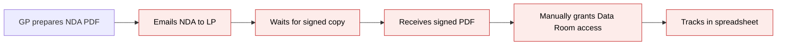
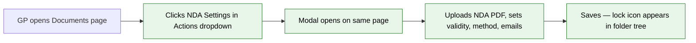
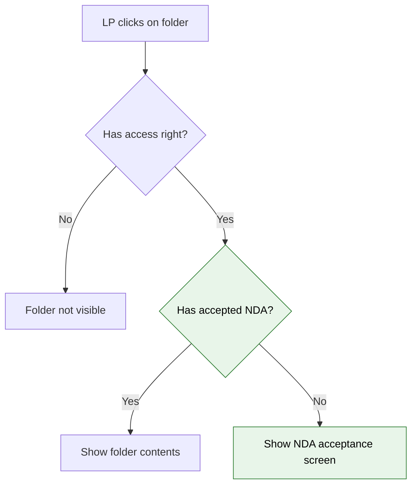

# NDA Data Room — Module 1: NDA Configuration & Folder Setup

> **Audience:** Business team, product, QA, support — non-technical.
> **Companion document:** [Design](design.md)

> **Planning phase — no code changes.** This document proposes and explains the change. Do not
> edit application code while writing it; implementation happens later, in the tasks phase.

---

## Why

When a fund manager (GP) needs an NDA before an investor (LP) views Data Room documents, the
entire process is manual: email a PDF, wait for the signed copy via an external tool, manually
grant Data Room access, and hope someone tracks it all in a spreadsheet. There is no record of
acceptance inside CapHive, no version tracking, no expiry management, and no way to see at a
glance which folders are NDA-protected.

Module 1 introduces the ability for a GP to **configure an NDA requirement on any Data Room
folder** directly from the Documents page they already use. The GP uploads the NDA document,
defines validity, chooses an acceptance method (click-through or e-sign via Zoho Sign), sets a
contact email, and specifies notification recipients — all from a single modal without leaving
the page. A lock icon in the folder tree gives instant visibility into which folders are
protected.

This module covers **GP-side configuration only**. The LP acceptance flow (Module 2), status
dashboard (Module 3), expiry processing (Module 4), inheritance (Module 5), e-sign embed
(Module 6), DocShare gate (Module 7), and notifications (Module 8) are separate modules.

### The Two-Key Model

Today, access to a Data Room folder requires **one key**: an access right grant. This module
introduces a **second key**: NDA acceptance.

- **Access right** = key to the building (existing)
- **NDA acceptance** = key to the room inside the building (new)

Both keys are required. Having access rights but no NDA acceptance means the user reaches the
folder but sees the NDA acceptance screen instead of documents. Having NDA acceptance but no
access rights means the user never reaches the folder at all.

## What Changes

- **New model `NdaConfig`** — a polymorphic one-to-one configuration record (belongs to any
  owner — `Folder` in Module 1, `InvestmentOpportunity` in a future module). Stores the NDA
  toggle, uploaded NDA document (PDF via Shrine/FileUploader), validity settings (until revoked
  / fixed period / specific date), acceptance method (click-through / e-sign), contact email,
  and notification recipient emails (JSON array). Soft-deletable via `acts_as_paranoid`.
- **New controller `NdaConfigsController`** — CRUD for the NDA config, rendered as a Turbo
  Frame modal on the Documents page. Resolves the owner from route params (folder in Module 1).
  Handles create, edit, update with form validation. Turbo Stream responses update both the
  modal and the folder tree (lock icon) without full page reload.
- **New Pundit policy `NdaConfigPolicy`** — gates access to company admin users who can
  manage the parent owner, and only for Data Room folders (in Module 1).
- **New Stimulus controller `nda_settings_controller.js`** — client-side toggle behavior in the
  modal: show/hide form fields based on NDA enabled state and validity type, file upload preview.
- **Documents page change** — "NDA Settings" item added to the Actions dropdown, visible only for
  Data Room folders and GP/admin users. Requires the `enable_data_rooms` feature flag.
- **Folder tree change** — lock icon next to NDA-protected folders, GP-only, with "NDA required"
  tooltip.
- **Folder model additions** — `has_one :nda_config, as: :owner`, `nda_required?`,
  `in_data_room?`, and `data_room_root?` methods.
- **Routes** — singular nested `resource :nda_config` under folders (new/create/edit/update).
  When NDA is added to other models (e.g., InvestmentOpportunity), a parallel nested route is
  added — the same controller resolves the owner from route params.

### Flow Diagram

**Current flow — GP NDA process (manual):**



**New flow — GP NDA configuration (Module 1):**



**Two-key access check (after Module 1 + Module 2):**



---

## User Stories

### US-1: Enable NDA Requirement on a Data Room Folder

**As a** fund manager (GP),
**I want** to require NDA acceptance on a specific Data Room sub-folder,
**So that** investors must agree to confidentiality terms before viewing the folder's documents.

**Acceptance criteria:**
- On the Documents page, when a Data Room folder is selected, the Actions dropdown shows an "NDA Settings" option
- "NDA Settings" does NOT appear for folders outside the Data Room (e.g., Fund folders, Portfolio Company folders)
- Clicking "NDA Settings" opens a modal on the same page — no navigation away
- The modal has a "Require NDA before access" toggle (Yes/No)
- When set to "Yes", the GP must upload an NDA document (PDF) before saving
- When set to "No" (or toggled off), the folder behaves as it does today — access rights only
- A lock icon appears next to the folder name in the folder tree when NDA is enabled

### US-2: Upload NDA Document

**As a** fund manager,
**I want** to upload the NDA document (PDF) that investors will need to read and accept,
**So that** each investor sees the exact legal terms I require.

**Acceptance criteria:**
- The NDA Settings modal has a file upload field for the NDA document
- Accepted format: PDF
- The uploaded file is stored securely (same storage as other CapHive documents)
- The GP can preview the uploaded NDA before saving
- The GP can replace the uploaded NDA with a different file (before any LP has accepted)
- The file name and upload date are displayed after upload

### US-3: Configure NDA Validity

**As a** fund manager,
**I want** to define how long an NDA acceptance remains valid,
**So that** I can require periodic re-acceptance for sensitive or time-limited materials.

**Acceptance criteria:**
- The NDA Settings modal offers three validity options:
  - **Until revoked** — acceptance is permanent unless the GP manually revokes it
  - **Fixed period** — acceptance expires a set number of days/months after the individual LP's sign date (options: 30 days, 90 days, 6 months, 12 months)
  - **Specific expiry date** — all acceptances expire on the same calendar date regardless of when signed
- Default is "Until revoked"
- For "Fixed period", each LP's expiry is calculated from their own acceptance date (e.g., GP sets "6 months" — LP A signs 1 Jan, expires 1 Jul; LP B signs 15 Mar, expires 15 Sep)
- For "Specific expiry date", the GP picks a date from a date picker
- The chosen validity is displayed clearly after saving

### US-4: Choose Acceptance Method

**As a** fund manager,
**I want** to choose whether investors accept via a simple checkbox (click-through) or a formal electronic signature,
**So that** I can match the acceptance method to the legal requirements of the situation.

**Acceptance criteria:**
- The NDA Settings modal offers two acceptance methods:
  - **Click-through** — LP reads the NDA and checks a checkbox to accept (like accepting Terms & Conditions)
  - **Electronic signature** — LP formally signs the NDA via Zoho Sign, producing a legally signed PDF
- Default is "Click-through"
- The e-sign option is only available if the entity has Zoho Sign configured in Entity Settings. If not configured, the option is visible but disabled with a message: "Configure an e-sign provider in Entity Settings to enable this option."
- The e-sign provider is **not** chosen per folder — it uses the entity-level Zoho Sign configuration. The choice per folder is only click-through vs e-sign.
- A brief description below each option explains the difference (click-through = lighter, faster; e-sign = legally stronger, produces signed document)

### US-5: Set Contact Email

**As a** fund manager,
**I want** to provide a contact email that investors see if they decline the NDA,
**So that** investors who have questions about the NDA know who to reach out to.

**Acceptance criteria:**
- The NDA Settings modal has a "Contact email" field
- This email is displayed to investors who decline the NDA: "Please accept the NDA to view documents, or contact [contact email] if you have questions"
- The field accepts a valid email address
- Optional — if left blank, the decline message shows without a contact email

### US-6: Configure Notification Recipients

**As a** fund manager,
**I want** to specify which team members should receive notifications about NDA events (acceptance, decline, expiry),
**So that** the right people on my team stay informed without complex per-event configuration.

**Acceptance criteria:**
- The NDA Settings modal has a "Notification recipients" field
- The GP enters one or more employee email addresses (team members)
- All NDA event notifications for this folder go to these recipients (no per-event-type selection — simplified model)
- Events include: LP accepts, LP declines, NDA expiry approaching, NDA expired
- If no recipients are entered, no team notifications are sent (the system still records the events)
- The GP can update the recipient list at any time

### US-7: Visual Indicator in Folder Tree

**As a** fund manager,
**I want** to see at a glance which Data Room folders have an NDA requirement,
**So that** I can quickly identify protected folders without opening each one's settings.

**Acceptance criteria:**
- A lock icon appears next to NDA-protected folders in the folder tree (left panel of the Documents page)
- The icon appears for folders that have their own NDA set
- Folders that inherit an NDA from a parent (Module 5) show a faded or smaller lock icon — distinct from "own NDA"
- Folders without NDA show no icon (unchanged from today)
- The icon is visible to GP/admin users only — LPs do not see it

**Example:**
```
▼ Data Room
  🔒 Deal Pipeline               ← NDA set on this folder
     TechCo Acquisition           ← no NDA (or inherited — Module 5)
     HealthCo Series B            ← no NDA (or inherited — Module 5)
  🔒 Fund Financials              ← different NDA set here
     Q3 Report                    ← no NDA (or inherited — Module 5)
  Marketing Materials             ← no NDA
```

---

## UI Behavior

### Entry Point: Where to Find NDA Settings

NDA Settings lives inside the **existing Actions dropdown** on the Documents page. No new page, no new navigation. The GP stays where they already work.

**Before (current state):**
```
⚙ Actions ▼
┌──────────────────────────────────┐
│ 📄 New Document                  │
│ 📁 New Folder                    │
│ ⬆️  Bulk Upload                   │
│ ─────────────────────────────── │
│ 🔍 Filter Documents              │
│ ─────────────────────────────── │
│ 📥 Download Folder               │
└──────────────────────────────────┘
```

**After (with NDA feature):**
```
⚙ Actions ▼
┌──────────────────────────────────┐
│ 📄 New Document                  │
│ 📁 New Folder                    │
│ ⬆️  Bulk Upload                   │
│ ─────────────────────────────── │
│ 🔍 Filter Documents              │
│ ─────────────────────────────── │
│ 📥 Download Folder               │
│ ─────────────────────────────── │
│ 🔒 NDA Settings                  │  ← NEW
└──────────────────────────────────┘
```

**Visibility rules:**
- "NDA Settings" appears **only** when the currently selected folder is inside the Data Room (or is the Data Room folder itself)
- It does NOT appear for non-Data Room folders (Fund folders, Portfolio Company folders, etc.)
- It is visible only to GP/admin users — LPs never see it
- It requires the `enable_data_rooms` feature flag to be active on the entity

### NDA Settings Modal — Settings Tab

When the GP clicks "NDA Settings", a modal opens on the same page. Module 1 covers the **Settings tab** (the Status tab is Module 3).

```
┌─────────────────────────────────────────────────────┐
│  NDA Settings — [Folder Name]                    ✕  │
│                                                     │
│  ┌──────────┐  ┌──────────┐                         │
│  │ Settings │  │ Status   │                         │
│  └──────────┘  └──────────┘                         │
│                                                     │
│  Require NDA before access                          │
│  ┌─────────────────────────────────────┐            │
│  │  ○ No (default — access rights only)│            │
│  │  ● Yes                              │            │
│  └─────────────────────────────────────┘            │
│                                                     │
│  NDA Document (PDF)                                 │
│  ┌─────────────────────────────────────┐            │
│  │  📎 Upload NDA Document             │            │
│  │  ──────────────────────────────     │            │
│  │  NDA_Confidentiality_2026.pdf       │            │
│  │  Uploaded: 26 Sep 2026   [Preview]  │            │
│  └─────────────────────────────────────┘            │
│                                                     │
│  Validity                                           │
│  ┌─────────────────────────────────────┐            │
│  │  ● Until revoked                    │            │
│  │  ○ Fixed period: [6 months ▼]       │            │
│  │  ○ Specific date: [dd/mm/yyyy]      │            │
│  └─────────────────────────────────────┘            │
│                                                     │
│  Acceptance Method                                  │
│  ┌─────────────────────────────────────┐            │
│  │  ● Click-through acceptance         │            │
│  │    (LP checks a checkbox to accept) │            │
│  │  ○ Electronic signature             │            │
│  │    (LP signs via Zoho Sign)         │            │
│  │    ⚙ Change provider in Entity      │            │
│  │      Settings → E-Sign              │            │
│  └─────────────────────────────────────┘            │
│                                                     │
│  Contact Email (shown on decline)                   │
│  ┌─────────────────────────────────────┐            │
│  │  legal@gpfirm.com                   │            │
│  └─────────────────────────────────────┘            │
│                                                     │
│  Notification Recipients                            │
│  ┌─────────────────────────────────────┐            │
│  │  ops@gpfirm.com, legal@gpfirm.com  │            │
│  │  (All NDA events go to these emails)│            │
│  └─────────────────────────────────────┘            │
│                                                     │
│           [Cancel]        [Save Settings]            │
│                                                     │
└─────────────────────────────────────────────────────┘
```

**Behavior notes:**
- When "Require NDA" is set to "No", the rest of the form is collapsed/hidden — only the toggle is shown
- When toggled to "Yes", the form expands to show all fields
- NDA document upload is required when "Yes" is selected — Save is disabled until a file is uploaded
- After saving, the modal stays open so the GP can switch to the Status tab (Module 3)
- If the folder already has NDA configured, the modal loads with existing values pre-filled

### Folder Tree — Lock Icon

After saving NDA settings on a folder, the folder tree in the left panel updates to show a lock icon:

- The icon appears immediately after saving (no page refresh needed)
- The lock icon is a small, unobtrusive indicator beside the folder name
- It is visible only on the GP/admin side — LPs see the standard folder tree
- Hovering over the lock icon shows a tooltip: "NDA required"

---

## What This Feature Does NOT Cover

| Excluded | Covered In |
|---|---|
| LP acceptance flow (seeing the NDA, accepting/declining) | Module 2 |
| Status dashboard (viewing who accepted/declined/pending) | Module 3 |
| Expiry processing (scheduled jobs checking for expired acceptances) | Module 4 |
| New NDA version upload and re-acceptance logic | Module 4 |
| NDA inheritance from parent to child folders | Module 5 |
| Electronic signature embed (using Zoho Sign) | Module 6 |
| DocShare NDA gate (unauthenticated document sharing) | Module 7 |
| Sending reminder and notification emails | Module 8 |

Module 1 stores the notification recipient emails and acceptance method choice, but the actual
sending of notifications (Module 8) and the e-sign widget flow (Module 6) are separate modules.
The GP can configure these settings now; they take effect when those modules are built.

---

## Validation Rules

| Field | Rule | Default |
|---|---|---|
| Require NDA | Required | No |
| NDA Document | Required when "Require NDA" = Yes. Must be PDF. | — |
| Validity | Required when "Require NDA" = Yes | Until revoked |
| Fixed period duration | Required when validity = "Fixed period". Options: 30 days, 90 days, 6 months, 12 months | — |
| Specific expiry date | Required when validity = "Specific date". Must be a future date | — |
| Acceptance method | Required when "Require NDA" = Yes | Click-through |
| Contact email | Optional. Must be valid email format if provided | — |
| Notification recipients | Optional. Each entry must be valid email format | — |

---

## Behavior Rules

| Scenario | What User Sees |
|---|---|
| GP enables NDA and saves | Lock icon appears in folder tree; modal stays open |
| GP disables NDA (toggle to No) | Config preserved (not deleted); lock icon disappears; LP access restored immediately |
| GP re-enables NDA after disabling | Previously saved settings (document, validity, etc.) are pre-filled |
| GP changes validity on existing config | Affects future acceptances only — existing valid acceptances retain original validity |
| GP changes acceptance method on existing config | Affects future acceptances only — LPs who already accepted are not asked again |
| GP replaces NDA document | Treated as new version (Module 4) |
| Folder is not in Data Room | "NDA Settings" not visible in Actions dropdown |
| LP user views Documents page | "NDA Settings" not visible; no lock icons shown |

---

## Resolved Design Decisions

| # | Decision | Resolution |
|---|---|---|
| 1 | **Stakeholder vs user-level NDA** | **User-level only for v1.** Each user must accept the NDA individually. Stakeholder-level deferred — can be added later without data model changes. |
| 2 | **E-sign provider** | **Zoho Sign only.** Digio has no e-sign capability. DocuSign is too expensive. Zoho Sign integration being built separately. NDA feature consumes Zoho Sign when configured at entity level. |
| 3 | **E-sign in Settings tab from day one** | Yes — show both options. All modules ship together (single phase build). If entity has no Zoho Sign configured, show the option disabled with "Configure an e-sign provider in Entity Settings." |
| 4 | **NDA on Data Room root folder** | Yes — allow NDA on the root "Data Room" folder itself. Acts as a blanket NDA for the entire Data Room. Sub-folders inherit by default, can override or opt out (Module 5). |
| 5 | **NDA scope** | Available for all Data Room folders — entity-level AND model-level (Fund, Deal, IO). No artificial restriction. |
| 6 | **NDA inheritance: replace, not stack** | A child folder with its own NDA uses **only its own NDA** — it does not also require the parent's. Each folder resolves to exactly one effective NDA. Acceptance tied to the NDA configuration, not a specific folder. |
| 7 | **Contact email vs notification recipients** | Two separate fields serving different purposes. Contact email = shown to LP on decline screen. Notification recipients = internal GP team emails that receive all NDA event notifications. |

---

## Capabilities

### New Capabilities
- `nda-folder-config`: GP-facing NDA configuration on Data Room folders — the polymorphic
  NdaConfig model (owner = Folder in Module 1), CRUD controller, Pundit policy, modal UI with
  file upload and form validation, folder tree lock icon, and the `in_data_room?` gate.

### Modified Capabilities

(none)

---

## Impact

- **Models:**
  - New `NdaConfig` in `app/packs/core/nda_configs/models/` — polymorphic (`belongs_to :owner,
    polymorphic: true`). In Module 1, owner is always a `Folder`.
  - `Folder` gains `has_one :nda_config, as: :owner`, `nda_required?`, `in_data_room?`,
    `data_room_root?`.
- **Migration:** new `nda_configs` table with polymorphic `owner_type`/`owner_id` columns,
  unique composite index on `[owner_type, owner_id]`, soft delete column, Shrine JSON column,
  and audit columns.
- **Controller:** new `NdaConfigsController` in `app/packs/core/nda_configs/controllers/`.
  Resolves owner from route params (`folder_id` in Module 1).
- **Policy:** new `NdaConfigPolicy` in `app/packs/core/nda_configs/policies/`.
- **Views:**
  - New modal partial `_modal.html.erb` and form `_form.html.erb` in
    `app/packs/core/nda_configs/views/nda_configs/`.
  - Modified `documents/_index.html.erb` — new "NDA Settings" dropdown item.
  - Modified `folders/_tree_view.html.erb` — lock icon for NDA folders.
- **JavaScript:** new `nda_settings_controller.js` in `app/javascript/controllers/`.
- **Routes:** nested singular resource under folders in `config/routes/`.
- **Tests:** Cucumber features (no RSpec). Model validation, controller authorization, policy
  checks, UI behavior.

---

## Benefits

1. **Eliminates manual NDA workflow** — no more emailing PDFs, tracking signed copies in spreadsheets, and manually granting access after receiving signatures
2. **Integrated with existing workflow** — GPs configure NDA from the same Documents page they already use, via the same Actions dropdown they already know
3. **No training needed** — one new menu item, one modal, familiar form fields
4. **Flexible validity options** — GPs can match the validity to the sensitivity of the material (permanent for standard NDAs, time-limited for deal-specific ones)
5. **Choice of acceptance method** — lighter click-through for speed, formal e-sign via Zoho Sign for legal strength
6. **Visual clarity** — lock icons in the folder tree give instant visibility into which folders are protected
7. **Non-disruptive** — folders without NDA work exactly as they do today; the feature is additive, not a change to existing behavior

---

## FAQ

| Question | Answer |
|---|---|
| Who can configure NDA on a folder? | Only GP/admin users with folder management rights. LPs never see the NDA Settings option. |
| Which folders can have NDA? | Any folder inside a Data Room — entity-level or model-level (Fund, Deal, IO). Non-Data Room folders cannot have NDA. |
| What happens when NDA is disabled? | All configuration is preserved (not deleted). LPs immediately regain access. The GP can re-enable later with settings pre-filled. |
| Does NDA replace access rights? | No — NDA is an additional layer. Both access rights AND NDA acceptance are required. NDA without access rights means the folder is invisible. |
| Which e-sign provider is used? | Zoho Sign only. Configured at the entity level in Entity Settings. If not configured, the e-sign option is visible but disabled. |
| Can different folders have different NDAs? | Yes — each folder gets its own independent NDA configuration (different document, validity, acceptance method). |
| What happens to existing Data Rooms? | Nothing changes. NDA is opt-in per folder. Existing folders without NDA work exactly as before. |
| Is there a file size limit for the NDA PDF? | Same as existing document upload limits in the system. |

---

## Design Principles

- **Polymorphic NdaConfig from day one** — `NdaConfig` uses `belongs_to :owner, polymorphic:
  true` so NDA can be attached to any model without future migrations. Module 1 owner = Folder.
  Confirmed use case: InvestmentOpportunity (reviewer feedback on PR #1750). Adding NDA to a
  new model is one `has_one :nda_config, as: :owner` line — zero schema changes.
- **Single controller, multiple owner types** — `NdaConfigsController` resolves the owner from
  route params. Module 1 only handles `folder_id`. Future modules add parallel nested routes
  (e.g., under `investment_opportunities`) with an `elsif` branch in `set_owner`.
- **Reuse FileUploader** — NDA document storage uses the existing Shrine/FileUploader pattern.
- **Reuse Turbo Frame modal pattern** — follows existing modal patterns on the Documents page.
- **`in_data_room?` performance** — ancestor traversal with memoization is acceptable for
  Module 1 (~50 folders). A cached boolean column can be added later if needed.
- **E-sign readiness** — Module 1 stores the acceptance method choice but does not implement
  the signing flow. The `acceptance_method` field supports both methods without schema changes
  when Module 6 is built.
