# NDA Inheritance — Design

> **Audience:** Engineering team.
> **Companion documents:** [Proposal](proposal.md) · [Spec](specs/)

> **Planning phase — no code changes.** This document explains HOW the proposal will be built.
> Do not edit application code while writing it; implementation happens later, in the tasks phase.

> **Design, not code.** Explain the design with mermaid diagrams and tables. Do NOT paste Ruby/JS
> class bodies, migrations, route blocks or policy code. Put real class, method, table and path
> names inside the diagrams and tables instead.

> **Scale to the change.** Sections marked **CORE** are always present. Sections marked
> **CONDITIONAL** say when they apply. When one doesn't apply, keep the heading and write a single
> line: `N/A — <reason>`. A small change should produce a short document.

> **No repetition.** Each fact lives in one section. The proposal owns *what users see and the
> business rules*, the spec owns *requirements*, and this document owns *how*. Link instead of
> restating.

---

## Contents

- [Overview](#overview)
- [Architecture](#architecture)
  - [Component Boundaries](#component-boundaries)
  - [Class Diagram](#class-diagram)
  - [Change Footprint](#change-footprint)
- [Data Model and States](#data-model-and-states)
  - [Data Model](#data-model)
  - [State Transitions](#state-transitions)
- [Behaviour](#behaviour)
  - [Pipeline / Flow](#pipeline--flow)
  - [Sequence Diagrams](#sequence-diagrams)
  - [Worked Examples](#worked-examples)
- [Key Components](#key-components)
  - [Decision Flows](#decision-flows)
- [Controllers and Routes](#controllers-and-routes)
- [Policy](#policy)
- [UI Changes](#ui-changes)
  - [At a glance](#at-a-glance)
  - [Journey 1: GP views inherited folder NDA settings](#journey-1-gp-views-inherited-folder-nda-settings)
  - [Journey 2: GP overrides or opts out a child folder](#journey-2-gp-overrides-or-opts-out-a-child-folder)
  - [Journey 3: GP reverts from own NDA to parent](#journey-3-gp-reverts-from-own-nda-to-parent)
  - [Build notes (for implementers)](#build-notes-for-implementers)
- [Cross-cutting Concerns](#cross-cutting-concerns)
  - [Transactions and Queries](#transactions-and-queries)
  - [Exception Handling and Monitoring](#exception-handling-and-monitoring)
  - [Performance and Security](#performance-and-security)
- [Design Decisions](#design-decisions)
- [Testing](#testing)
- [Risks and Open Questions](#risks-and-open-questions)

---

## Overview

Adds NDA inheritance to the Data Room folder tree so that setting an NDA on a parent folder
automatically covers all child folders. Follows the existing pattern of the `ancestry` gem's
tree traversal for resolution, the polymorphic `NdaConfig` one-to-one association from Module 1
(via the `WithNda` concern), and the Turbo-modal pattern already used by the `NdaConfigsController`.
The `NdaInheritanceResolver` service provides zero-query batch resolution for tree rendering.

---

## Architecture

### Component Boundaries

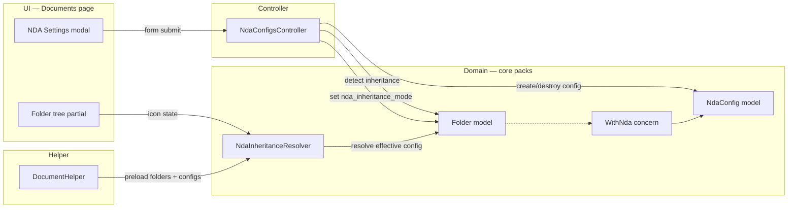

| From → To | Contract | Direction rule |
|---|---|---|
| Modal → Controller | `inheritance_choice` param (use_parent / set_own / opt_out) + NDA config params | UI never writes records directly |
| Controller → Folder | Sets `nda_inheritance_mode`, calls `effective_nda_config` | Controller orchestrates transitions |
| Controller → NdaConfig | Creates/soft-deletes config on override/revert | Through Folder association via WithNda |
| Helper → Resolver | Passes preloaded folder tree | Resolver is read-only, stateless |
| Resolver → Folder | Reads `nda_inheritance_mode`, `nda_config` | In-memory only, no DB calls |
| Tree → Resolver | Calls `effective_config_for`, `source_folder_for` | View reads, never writes |

### Class Diagram

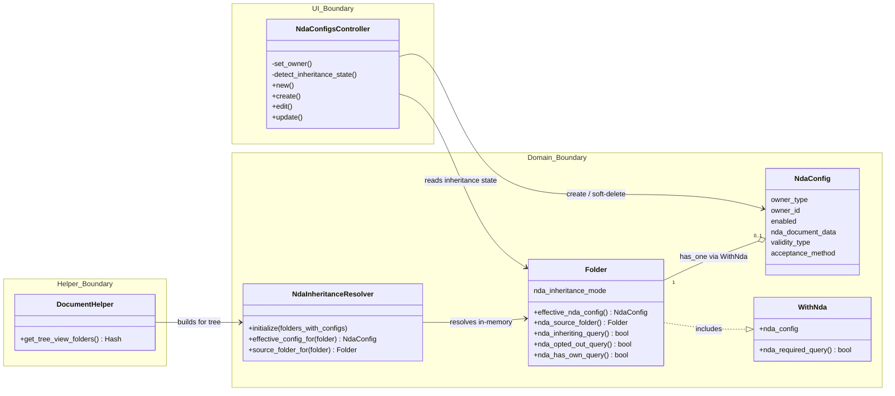

### Change Footprint

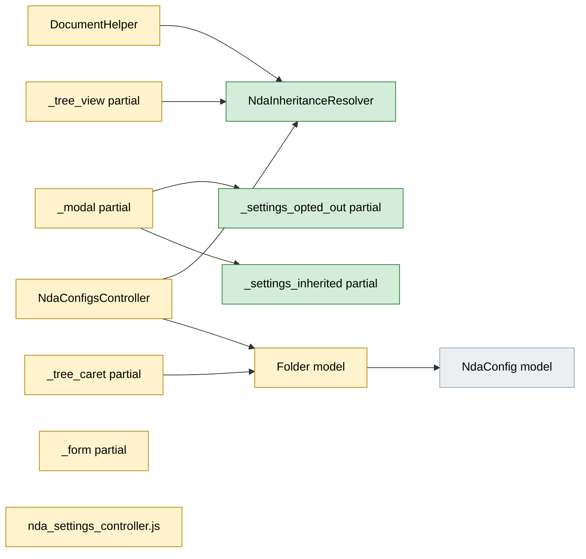

---

## Data Model and States

### Data Model

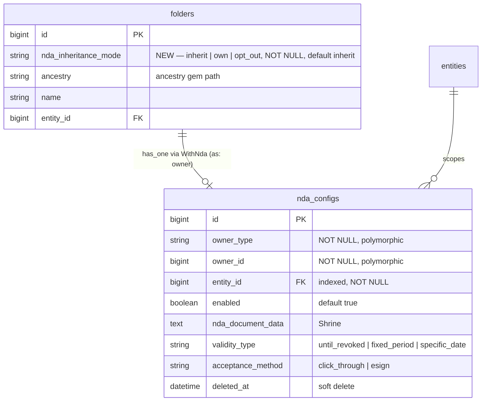

**Indexes:** `idx_folders_nda_inheritance_mode` on `folders(nda_inheritance_mode)` for queries
filtering by mode.

| Column | Why |
|---|---|
| `nda_inheritance_mode` | Cannot be derived from presence/absence of `NdaConfig` because opt-out needs explicit representation — absence is ambiguous (inheriting vs opted out). |

**Changes to existing models:**
- `Folder` gains: `nda_inheritance_mode` column, `NDA_INHERITANCE_MODES` constant,
  validation on `nda_inheritance_mode`, `effective_nda_config` method (recursive ancestry walk
  with opt-out check), `nda_source_folder` method (returns the folder owning the effective
  config), `nda_inheriting?`, `nda_opted_out?`, `nda_has_own?` convenience methods.
- `NdaConfig` — unchanged from Module 1.

### State Transitions

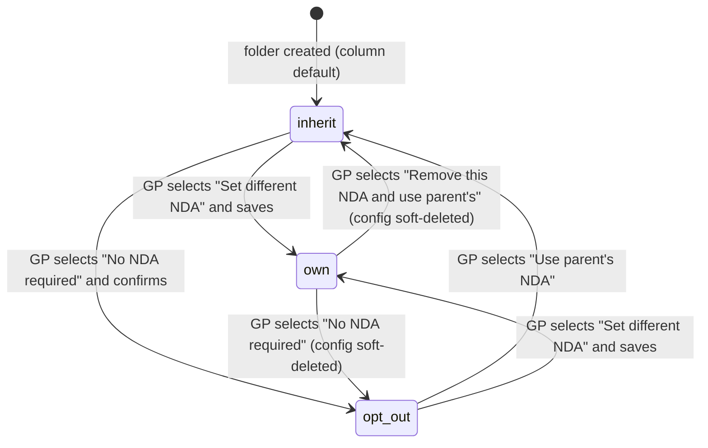

All states are stored in `folders.nda_inheritance_mode`. The `own` state is also accompanied by
a `NdaConfig` record; transitions away from `own` soft-delete that record.

---

## Behaviour

### Pipeline / Flow

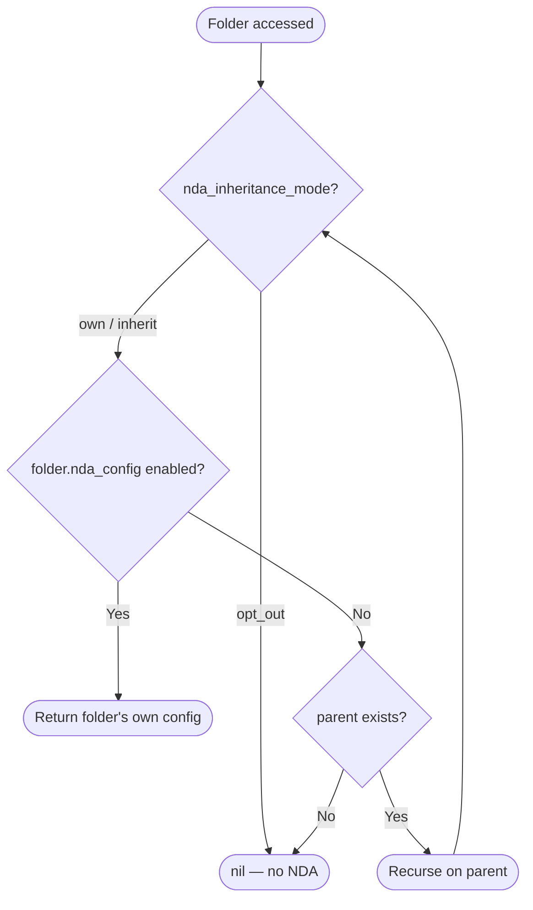

### Sequence Diagrams

**Happy path — GP opens NDA Settings on an inherited folder:**

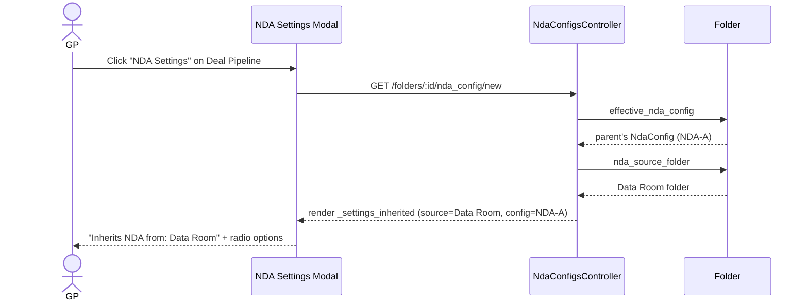

**GP overrides a child folder with different NDA:**

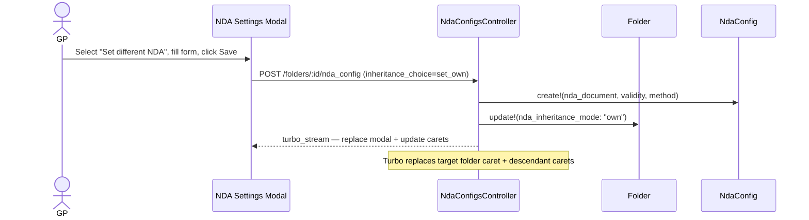

**GP opts a folder out:**

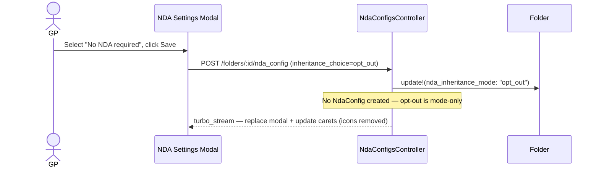

**GP reverts from own to parent's NDA:**

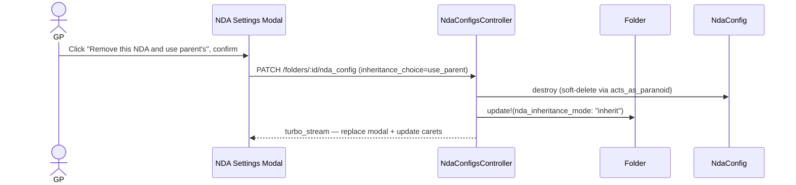

### Worked Examples

**ID legend:** **H** = Happy path · **E** = Edge case · **X** = Error (exception) case. IDs are
referenced from tasks.md and Cucumber scenario names.

**Shared setup:**

| Record | Name | Key data |
|---|---|---|
| Entity | Alpha Capital | `enable_data_rooms: true` |
| Folder | Data Room | Root Data Room folder, child of system folder |
| NdaConfig | NDA-A | On "Data Room" (owner_type=Folder, owner_id=Data Room.id), `enabled: true`, validity: until_revoked, method: click_through |
| Folder | Deal Pipeline | Child of Data Room, `nda_inheritance_mode: inherit` |
| Folder | TechCo Acquisition | Child of Deal Pipeline, `nda_inheritance_mode: inherit` |
| Folder | Fund Financials | Child of Data Room, `nda_inheritance_mode: own` |
| NdaConfig | NDA-B | On "Fund Financials" (owner_type=Folder, owner_id=Fund Financials.id), `enabled: true`, validity: 180 days, method: click_through |
| Folder | Q3 Report | Child of Fund Financials, `nda_inheritance_mode: inherit` |
| Folder | Marketing | Child of Data Room, `nda_inheritance_mode: opt_out` |
| Folder | Press Releases | Child of Marketing, `nda_inheritance_mode: inherit` |
| User | GP User | Employee, `curr_role_employee?: true`, folder management rights |
| User | LP User | Investor user, `curr_role_employee?: false`, has access right to all folders |

#### Happy Path

| # | Scenario | Given | When | Then | Spec scenario | Feature |
|---|---|---|---|---|---|---|
| H1 | Direct child inherits parent NDA | Data Room has NDA-A; Deal Pipeline inherits | LP navigates to Deal Pipeline | NDA-A acceptance screen shown | Direct child inherits parent NDA | nda_inheritance.feature |
| H2 | Grandchild inherits grandparent NDA | Data Room has NDA-A; TechCo inherits via Deal Pipeline | LP navigates to TechCo Acquisition | NDA-A acceptance screen shown | Grandchild inherits grandparent NDA | nda_inheritance.feature |
| H3 | Accepting on parent covers inheriting child | LP accepts NDA-A on Data Room | LP navigates to Deal Pipeline | Folder contents shown (already accepted) | Accepting on parent covers inheriting child | nda_inheritance.feature |
| H4 | Accepting on child covers parent (same config) | LP accepts NDA-A via Deal Pipeline screen | LP navigates to Data Room | Folder contents shown (already accepted) | Accepting on child covers parent (same config) | nda_inheritance.feature |
| H5 | GP views inherited Settings tab | Deal Pipeline inherits NDA-A | GP opens NDA Settings on Deal Pipeline | Shows "Inherits NDA from: Data Room" + read-only details + 3 radios | Inherited folder Settings tab | nda_inheritance.feature |
| H6 | GP overrides with different NDA | Deal Pipeline inherits NDA-A | GP selects "Set different NDA", uploads NDA-C, saves | New NdaConfig created, mode=own, solid lock shown | Override creates own config | nda_inheritance.feature |
| H7 | GP opts out a folder | Deal Pipeline inherits NDA-A | GP selects "No NDA required", confirms, saves | mode=opt_out, no lock icon, LP sees docs directly | Opt-out with confirmation | nda_inheritance.feature |
| H8 | New folder auto-inherits | Data Room has NDA-A | GP creates "New Deal" inside Data Room | mode=inherit, lock + "(Inherited)" shown | New folder inherits parent NDA | nda_inheritance.feature |
| H9 | GP reverts from own to parent | Fund Financials has NDA-B; Data Room has NDA-A | GP clicks "Remove this NDA and use parent's" | NDA-B soft-deleted, mode=inherit, inherits NDA-A | GP reverts from own to parent NDA | nda_inheritance.feature |

#### Edge Cases

| # | Scenario | Given | When | Then | Spec scenario | Feature |
|---|---|---|---|---|---|---|
| E1 | Child override — grandchild inherits child not grandparent | Data Room has NDA-A; Fund Fin. has NDA-B | LP navigates to Q3 Report | NDA-B shown (not NDA-A) | Grandchild inherits child's override not grandparent's | nda_inheritance.feature |
| E2 | Child of opted-out folder has no NDA | Marketing opted out; Press Releases inherits | LP navigates to Press Releases | Folder contents shown (no NDA) | Child of opted-out folder has no NDA | nda_inheritance.feature |
| E3 | Child of opted-out folder can have own NDA | Marketing opted out; "Sensitive" child has NDA-C | LP navigates to Sensitive Materials | NDA-C acceptance screen shown | Child of opted-out folder can have own NDA | nda_inheritance.feature |
| E4 | No NDA in ancestry | Folder tree with no NDA configs anywhere | LP navigates to any folder | Folder contents shown directly | No NDA in ancestry | nda_inheritance.feature |
| E5 | New folder inside opted-out parent | Marketing opted out | GP creates "Campaign" inside Marketing | mode=inherit, effective_nda_config=nil, no icon | New folder inside opted-out parent has no NDA | nda_inheritance.feature |
| E6 | Different configs require separate acceptance | LP accepted NDA-A | LP navigates to Fund Financials (NDA-B) | NDA-B acceptance screen shown | Different configs require separate acceptance | nda_inheritance.feature |
| E7 | Removing parent NDA uncascades | Data Room has NDA-A; Deal Pipeline inherits; Fund Fin. has own; Marketing opted out | GP disables NDA on Data Room | Deal Pipeline loses NDA; Fund Fin. keeps NDA-B; Marketing unchanged | Disabling parent NDA removes inherited NDA from children | nda_inheritance.feature |
| E8 | Own folder with parent — Settings shows revert | Fund Fin. has NDA-B; Data Room has NDA-A | GP opens NDA Settings on Fund Financials | Module 1 form + "Remove this NDA and use parent's" link | Own NDA folder with parent NDA shows revert option | nda_inheritance.feature |
| E9 | Opted-out folder Settings tab | Marketing opted out; Data Room has NDA-A | GP opens NDA Settings on Marketing | Opted-out variant, "No NDA required" selected | Opted-out folder Settings tab | nda_inheritance.feature |
| E10 | Existing acceptances preserved on revert | Users accepted NDA-B on Fund Financials | GP reverts Fund Fin. to parent NDA-A | NDA-B records preserved; LP sees NDA-A screen | Existing acceptances preserved on revert | nda_inheritance.feature |

#### Error Cases

| # | Scenario | Given | When | Then (what the user sees, who is alerted) | Spec scenario | Feature |
|---|---|---|---|---|---|---|
| X1 | LP cannot access NDA Settings | LP user logged in | LP navigates to NDA Settings URL directly | Pundit authorization denied | LP cannot change inheritance mode | nda_inheritance.feature |
| X2 | GP without folder rights cannot change mode | GP without folder management rights | GP tries to change inheritance mode | Pundit authorization denied | GP can change inheritance mode | nda_inheritance.feature |

---

## Key Components

| Component | Responsibility | Notes |
|---|---|---|
| `NdaInheritanceResolver` | Batch-resolves effective NDA config and source folder for all folders in a tree. Used by the folder tree partial to avoid N+1 queries. | Stateless, read-only. Receives preloaded folders with configs. O(N) with memoization. Lives in `app/packs/core/nda_configs/services/`. |

### Decision Flows

**Inheritance resolution (which NDA applies to a folder):**

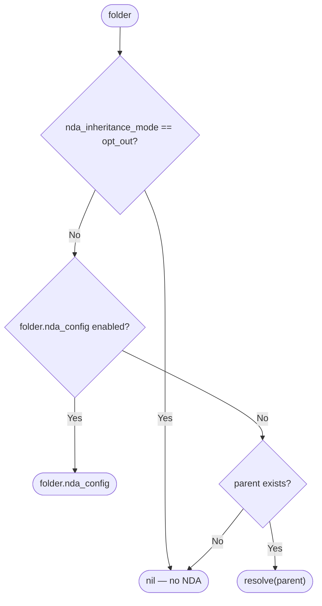

**Controller: which Settings tab variant to render:**

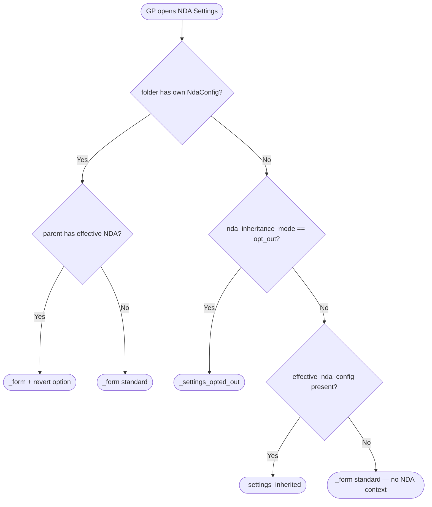

---

## Controllers and Routes

No new routes. The existing singular `resource :nda_config` nested under `resources :folders`
handles all states via conditional logic in the `NdaConfigsController`.

| Verb and path | Action | Does | Responds with |
|---|---|---|---|
| `GET /folders/:folder_id/nda_config/new` | `new` | Detects inheritance state via `detect_inheritance_state`; builds or loads config | Turbo Frame: _modal with appropriate variant |
| `POST /folders/:folder_id/nda_config` | `create` | Handles `inheritance_choice`: create config (set_own), set opt_out, or set inherit | Turbo Stream: clear modal + update carets |
| `GET /folders/:folder_id/nda_config/edit` | `edit` | Loads existing config; detects parent NDA for revert option | Turbo Frame: _modal with _form + optional revert |
| `PATCH /folders/:folder_id/nda_config` | `update` | Handles `inheritance_choice`: update config, revert to parent (soft-delete + inherit), or opt out (soft-delete + opt_out) | Turbo Stream: clear modal + update carets |

---

## Policy

| Role | Access |
|---|---|
| GP/Admin with folder management rights | Full access: view inheritance state, override, opt-out, revert |
| GP/Admin without folder management rights | Cannot access NDA Settings (Pundit denies) |
| LP / Investor user | Cannot access NDA Settings. Does not see lock icons or "(Inherited)" labels in folder tree |

**Multi-tenancy:** `entity_id` scoping enforced via `set_owner` before filter in the
`NdaConfigsController` — resolves owner via `Folder.find(params[:folder_id])` and checks
`@owner.entity_id == current_user.entity_id`. Same mechanism as Module 1.

---

## UI Changes

### At a glance

| Where in CapHive | Today | After this change | Who sees it |
|---|---|---|---|
| Documents page — folder tree | Solid lock icon on folders with own NdaConfig | Solid lock for own NDA; solid lock + "(Inherited)" for inherited NDA; no icon for opted out | GP/Admin only |
| Documents page — NDA Settings modal, Settings tab | Single form variant (Module 1 config) | Three variants: inherited (read-only + radios), opted-out (radios), own-with-parent (form + revert link) | GP/Admin only |
| Documents page — NDA Settings modal, Status tab | Shows config's status data | On inherited folders, heading: "Showing NDA status for: [Source Folder]" | GP/Admin only |

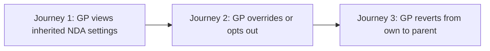

### Journey 1: GP views inherited folder NDA settings

```
Folder tree (left panel)                NDA Settings modal (right)
+-----------------------------------+   +-------------------------------------------+
|  > Data Room                      |   |  NDA Settings -- Deal Pipeline          X |
|    🔒 Deal Pipeline        <-- ① |   |  +----------+  +----------+               |
|       🔒 (Inherited) TechCo      |   |  | Settings |  | Status   |               |
|    🔒 Fund Financials             |   |  +----------+  +----------+               |
|       🔒 (Inherited) Q3 Report   |   |                                           |
|    Marketing                      |   |  ② i This folder inherits NDA from:      |
+-----------------------------------+   |       Data Room                           |
                                        |                                           |
                                        |  ③ NDA: Confidentiality_Agreement.pdf     |
                                        |     Validity: Until revoked               |
                                        |     Method: Click-through                 |
                                        |     (Settings from Data Room)             |
                                        |                                           |
                                        |  ④ What would you like to do?             |
                                        |     (*) Use parent's NDA (current)        |
                                        |     ( ) Set different NDA for this folder  |
                                        |     ( ) No NDA required for this folder   |
                                        |                                           |
                                        |                      ⑤ [Cancel] [Save]   |
                                        +-------------------------------------------+
```

| Step | The user... | They see |
|---|---|---|
| 1 | Clicks Actions > NDA Settings on Deal Pipeline ① | Modal opens via Turbo Frame |
| 2 | Reads the header ② | "This folder inherits NDA from: Data Room" |
| 3 | Reviews parent's NDA details ③ | Read-only: document name, validity, method |
| 4 | Reviews the three options ④ | "Use parent's NDA" is pre-selected |
| 5 | Clicks Cancel ⑤ | Modal closes, no change |

### Journey 2: GP overrides or opts out a child folder

**Override path:**

| Step | The user... | They see |
|---|---|---|
| 1 | Selects "Set different NDA for this folder" ④ | Full Module 1 config form expands below the radios |
| 2 | Uploads a new NDA document, sets validity and method | Standard Module 1 form fields |
| 3 | Clicks Save ⑤ | Modal closes. Folder tree: Deal Pipeline changes from lock+"(Inherited)" to solid lock (own NDA) |

**Opt-out path:**

| Step | The user... | They see |
|---|---|---|
| 1 | Selects "No NDA required for this folder" ④ | Radio selected |
| 2 | Clicks Save ⑤ | Confirmation prompt: "LPs will be able to access this folder without accepting an NDA. Are you sure?" |
| 3 | Confirms | Modal closes. Folder tree: Deal Pipeline loses lock icon entirely |

### Journey 3: GP reverts from own NDA to parent

```
NDA Settings -- Fund Financials
+-------------------------------------------+
|  [Standard Module 1 NDA config form]      |
|                                           |
|  ---------------------------------------- |
|  ① i Parent folder "Data Room" also       |
|       has an NDA configured.              |
|     ② [Remove this NDA and use parent's]  |
+-------------------------------------------+
```

| Step | The user... | They see |
|---|---|---|
| 1 | Sees the parent NDA info ① | "Parent folder Data Room also has an NDA configured" — only visible when parent has NDA |
| 2 | Clicks "Remove this NDA and use parent's" ② | Confirmation prompt |
| 3 | Confirms | Modal closes. Folder tree: Fund Financials changes from solid lock to lock + "(Inherited)". Own NDA-B is soft-deleted. |

### Build notes (for implementers)

| Interaction | Screen update |
|---|---|
| GP opens NDA Settings on any folder | Modal loaded via Turbo Frame (`turbo_frame: "nda_settings_modal"`). `NdaConfigsController` detects state via `detect_inheritance_state` and renders the appropriate partial. |
| GP saves inheritance choice | Turbo Stream response: (1) clear modal frame, (2) replace target folder's caret `folder_caret_<id>`, (3) replace descendant folder carets affected by the change, (4) flash notice via `WithTurboFlash`. |
| Radio "Set different NDA" selected | Stimulus controller (`nda_settings_controller.js`) toggles visibility of the inline Module 1 form. Bootstrap collapse or `d-none` toggle. |
| Radio "No NDA required" + Save | Client-side `data-turbo-confirm` on the form triggers browser confirmation before submit. |
| Folder tree icons | `_tree_view.html.erb` uses `@nda_resolver` (passed from `DocumentHelper`). `_tree_caret.html.erb` (Turbo Stream single-folder update) uses `folder.effective_nda_config` and `folder.nda_source_folder` directly — max 2-3 hops, acceptable. |
| Inherited lock label | `<span class="text-muted small ms-1">(Inherited)</span>` after the `ti ti-lock text-warning` icon. GP-only guard. |

---

## Cross-cutting Concerns

### Transactions and Queries

| What is read | When | N+1 risk | How it stays cheap |
|---|---|---|---|
| All folders + nda_configs for tree | Folder tree render | Yes (without resolver) | `NdaInheritanceResolver` preloads subtree with `.includes(:nda_config)` — one query. `get_tree_view_folders` already does this `.includes(:nda_config)` (added in Module 1). |
| Single folder's ancestry for effective config | NDA gate check (Module 2), NDA Settings modal open | Yes (recursive parent walk) | Max 3 levels deep in practice. 2-3 queries at most. Acceptable. |
| Descendant folders for Turbo Stream caret updates | After inheritance mode change | No | `@folder.descendants.where(nda_inheritance_mode: "inherit")` — one indexed query. Small result set (10-30 folders max). |

| Operation | In a transaction? | Why |
|---|---|---|
| Override: create NdaConfig + set mode=own | Yes | Both writes must succeed together |
| Revert: soft-delete NdaConfig + set mode=inherit | Yes | Avoid orphaned config or wrong mode |
| Opt-out: set mode=opt_out (+ soft-delete config if exists) | Yes | Consistent state |

### Exception Handling and Monitoring

N/A — no background jobs, no external API calls. All operations are synchronous controller
actions. Validation errors are handled inline (re-render form with errors). Pundit denials
redirect with flash.

### Performance and Security

- **Volume:** Data Room trees are typically 10-30 folders, max 3 levels deep. The
  `NdaInheritanceResolver` handles this in O(N) in memory with one preloaded query.
- **Folder tree caret updates:** worst case, opt-out on a parent with 20 inheriting descendants
  emits 20 `turbo_stream.replace` tags. Acceptable for this scale.
- **Tenant isolation:** `entity_id` scoping on folder lookup via `set_owner` in the controller.
  Same pattern as Module 1.
- **Authorization:** `NdaConfigPolicy#manageable?` guards all actions. LP users cannot access
  NDA Settings.
- **Opt-out confirmation:** prevents accidental NDA removal. Client-side `data-turbo-confirm`.
- **Soft-delete audit trail:** reverted NdaConfig records and their acceptances are preserved
  via `acts_as_paranoid` (Trackable concern).

---

## Design Decisions

1. **Single column `nda_inheritance_mode` on `folders`, not a separate table.** Alternative:
   a join table `folder_nda_inheritances`. Rejected because: one column with three values is
   simpler, no new model needed, and the state is intrinsic to the folder.

2. **Recursive `effective_nda_config` walk, not a materialized column.** Alternative: store
   `effective_nda_config_id` on each folder and update it on every change. Rejected because: the
   recursive walk is max 3 hops, and a materialized column requires cascading updates (fragile,
   race-prone). The walk is stateless and always correct.

3. **`NdaInheritanceResolver` for batch tree rendering, not eager-loading ancestors.** Alternative:
   preload ancestors for each folder. Rejected because: the resolver preloads the entire subtree
   in one query and resolves in memory — O(N) total, versus O(N * depth) for ancestor loading.

4. **Reuse `new` controller action for inherited folders, not a separate `show` action.**
   Alternative: add a `show` action to render inherited/opted-out state. Rejected because: no
   new routes needed — `new` already detects whether a config exists. Adding an inheritance
   check is a small conditional, not a new flow.

5. **Opt-out as a mode flag, not a disabled `NdaConfig`.** Alternative: create a
   `NdaConfig` with `enabled: false` for opt-out. Rejected because: absence of config is
   already the state for "inheriting" — a disabled config makes that ambiguous. The mode flag is
   explicit.

6. **Lock icon + "(Inherited)" text label, not a different icon glyph.** Alternative: use
   `ti ti-lock-open` or reduced opacity. Rejected because: a text label is unambiguous. A
   different icon or opacity could be missed or misinterpreted. The user confirmed this choice.

7. **Turbo Stream cascading to descendant carets, not a full page reload.** Alternative: reload
   the page after save. Rejected because: the existing Module 1 pattern uses Turbo Stream for
   the single caret. Extending to descendants maintains the same UX (no reload). The descendant
   set is small.

8. **Soft-delete on revert, not hard-delete.** Alternative: permanently destroy the
   `NdaConfig`. Rejected because: acceptance records reference the config. Soft-delete
   preserves them for audit. Same pattern as the rest of the app (`Trackable` / `acts_as_paranoid`).

9. **Resolver lives in `core/nda_configs/services/`, not `core/folders/services/`.** Alternative:
   keep it in the folders pack. Rejected because: the resolver operates on `NdaConfig` records
   and will serve future polymorphic owners (InvestmentOpportunity). Co-locating with the NdaConfig
   pack keeps NDA-related services together.

---

## Testing

Cucumber only. Single feature file: `features/core/nda_inheritance.feature`. Step
definitions reuse existing Data Room steps for folder setup and LP navigation. New steps needed
for: inheritance mode assertions, lock icon assertions (solid vs inherited label vs no icon),
Settings tab variant assertions, and Turbo Stream caret update checks. Tag: `@nda`.
Reuse `nda_config_steps.rb` from Module 1 for config creation. New file:
`nda_inheritance_steps.rb` for inheritance-specific steps. Deduplicate the "there is a child
folder" step shared between the two step files.

---

## Risks and Open Questions

- [Turbo Stream caret updates for large descendant sets] → Mitigated: Data Room trees are 10-30
  folders max. Even emitting 30 `turbo_stream.replace` tags is well within acceptable limits.
- [Soft-deleted config acceptances become orphaned on revert] → Acceptable: acceptance records
  are historical and remain valid for audit. LP sees the new effective NDA on next visit. No
  data loss.
- [GP may not realize children are affected by inheritance changes] → Mitigated: the
  "(Inherited)" label and folder tree icon updates make the cascade visible. No additional
  confirmation beyond the opt-out prompt needed for v1.
- [Duplicate step definitions between `nda_config_steps.rb` and `nda_inheritance_steps.rb`] →
  Mitigated: deduplicate the "there is a child folder" step into a shared step file or reuse
  the existing folders step definition.

| # | Open question | Current thinking | Status |
|---|---|---|---|
| — | No open questions | All questions resolved during exploration | Decided |
