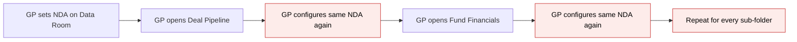
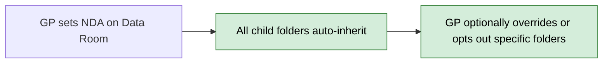
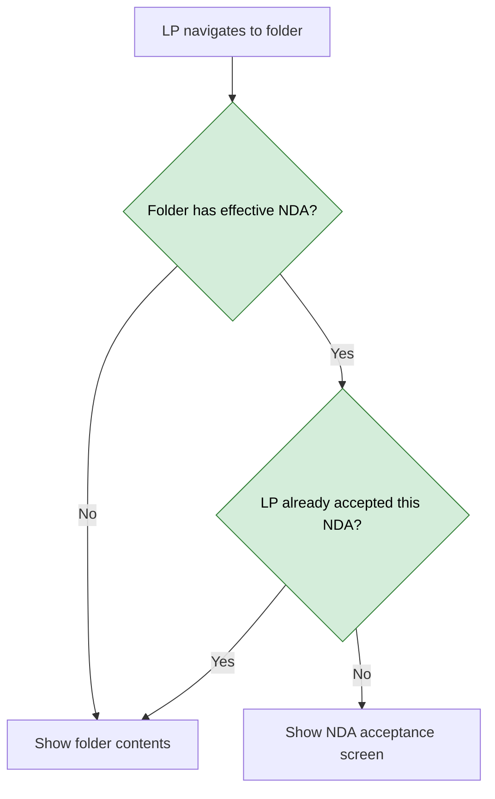

# NDA Inheritance — Proposal

> **Audience:** Business team, product, QA, support — non-technical.
> **Companion document:** [Design](design.md)

> **Planning phase — no code changes.** This document proposes and explains the change. Do not
> edit application code while writing it; implementation happens later, in the tasks phase.

---

## Why

Today a GP must open each Data Room folder individually and configure the same NDA — same
document, same validity, same acceptance method — over and over. With a tree of 10–30 folders
that is tedious, error-prone, and breaks down as the structure grows. Module 5 makes NDA flow
downward automatically: set it on a parent and every child folder is covered — no extra
configuration.

---

## What Changes

- **Automatic inheritance** — when the GP sets an NDA on a parent folder (Module 1), every
  child folder is automatically covered by the same NDA. No action needed.
- **Three folder states** — every Data Room folder is in one of three states:
  - **Own NDA** — has its own NDA configuration (set by the GP).
  - **Inherited** — uses an ancestor's NDA. No own configuration.
  - **Opted out** — explicitly no NDA, even if parent has one.
- **Replace, not stack** — if a child folder has its own NDA, it replaces the parent's entirely.
  The LP does NOT accept both. Each folder resolves to exactly one effective NDA (or none).
- **Cross-folder coverage** — accepting NDA-A on one folder covers all other folders that use
  the same NDA-A. The LP is never asked to accept the same NDA twice.
- **Opt-out stops the chain** — if a folder is opted out, its children also have no NDA (unless
  they set their own). The opt-out is a deliberate "no NDA here" decision.
- **Folder tree indicators** — solid lock icon for own NDA; solid lock + "(Inherited)" text
  label for inherited NDA; no icon for opted out or no NDA. GP-only. Tooltip on inherited lock:
  "Inherits NDA from: [Source Folder Name]."
- **Inherited folder Settings tab** — shows which folder the NDA comes from, the NDA details
  read-only, and three radio options: use parent's NDA, set different NDA, no NDA required.
- **New folders auto-inherit** — creating a folder inside an NDA-protected parent automatically
  inherits the NDA.
- **Removing parent NDA uncascades** — disabling NDA on a parent removes inherited NDA from
  children. Children with own NDA or opted out are unaffected.

### Flow Diagram

**GP configures NDA on a folder (Before — without inheritance):**



**GP configures NDA on a folder (After — with inheritance):**



**LP encounters an inherited folder (After):**



---

## User Stories

### US-5.1: Child Folder Inherits Parent NDA Automatically

**As a** fund manager,
**When** I set an NDA on a Data Room folder,
**I want** all sub-folders inside it to automatically require the same NDA,
**So that** I don't have to configure NDA on each sub-folder individually.

**Acceptance criteria:**
- When the GP sets an NDA on a folder (Module 1), all child folders (and their children, recursively) are automatically covered by the same NDA
- No action is needed by the GP — inheritance is the default behavior
- New folders created inside an NDA-protected parent also inherit the NDA automatically
- The inherited NDA uses the parent's configuration: same document, same validity, same acceptance method, same contact email
- LPs accessing any inherited folder are subject to the same NDA acceptance requirement

### US-5.2: GP Sees Inheritance Status on Child Folder

**As a** fund manager,
**When** I open NDA Settings on a child folder that inherits its NDA from a parent,
**I want** to see clearly that the NDA is inherited and from which folder,
**So that** I understand the current state without confusion.

**Acceptance criteria:**
- When the GP opens NDA Settings on a folder that inherits an NDA, the Settings tab shows:
  - A clear message: "This folder inherits NDA from: [Parent Folder Name]"
  - The parent's NDA details shown read-only (document name, validity, acceptance method)
  - Three radio options:
    - **Use parent's NDA** (selected by default) — keep inheriting
    - **Set different NDA for this folder** — expands the full NDA configuration form
    - **No NDA required for this folder** — opts out
- The GP does not need to understand technical concepts — they just see which folder the NDA comes from and can choose what to do

### US-5.3: GP Overrides Child Folder with Different NDA

**As a** fund manager,
**I want** to set a different NDA on a specific sub-folder,
**So that** I can require a separate NDA for particularly sensitive material while the rest of the Data Room uses the parent's NDA.

**Acceptance criteria:**
- The GP selects "Set different NDA for this folder" in the inherited NDA settings
- The full NDA configuration form expands (same form as Module 1: upload document, set validity, choose method, etc.)
- On saving, this folder gets its own NDA configuration — it no longer uses the parent's
- **Replace, not stack** — LPs accessing this folder only need to accept the child's NDA. The parent's NDA is not also required
- Children of this folder now inherit **this folder's NDA**, not the grandparent's
- The folder tree shows a solid lock icon (own NDA) instead of lock + "(Inherited)"

### US-5.4: GP Opts Child Folder Out of NDA

**As a** fund manager,
**I want** to remove the NDA requirement on a specific sub-folder,
**So that** less sensitive folders within a protected parent can be accessed without NDA acceptance.

**Acceptance criteria:**
- The GP selects "No NDA required for this folder" in the inherited NDA settings
- A confirmation prompt warns: "LPs will be able to access this folder without accepting an NDA. Are you sure?"
- On saving, this folder no longer requires NDA — LPs with access rights see documents immediately
- Children of this opted-out folder also have no NDA unless they have their own NDA set
- The folder tree shows no lock icon for this folder

### US-5.5: GP Removes NDA from Parent Folder

**As a** fund manager,
**When** I disable or remove the NDA on a parent folder,
**I want** all child folders that were inheriting it to also lose their NDA requirement,
**So that** the change cascades correctly without leaving orphaned NDA requirements.

**Acceptance criteria:**
- When the GP disables NDA on a parent folder (toggles "Require NDA" to No), all inheriting children lose NDA
- Children with their **own** NDA (override) are NOT affected — they keep their configuration
- Children that were opted out are NOT affected (already without NDA)
- The lock icons in the folder tree update: inherited locks disappear, own locks remain
- Example:
  ```
  Before:                                     After GP disables NDA on Data Room:
  Data Room        → NDA-A (own) 🔒           Data Room        → no NDA (no icon)
    Deal Pipeline  → NDA-A (inherited) 🔒      Deal Pipeline  → no NDA (no icon)
    Fund Fin.      → NDA-B (own) 🔒             Fund Fin.      → NDA-B (own) 🔒
    Marketing      → opted out (no icon)        Marketing      → opted out (no icon)
  ```

### US-5.6: Acceptance Covers All Folders with Same NDA

**As an** investor (LP),
**When** I accept an NDA on one folder,
**I want** to be automatically covered on all other folders that use the same NDA,
**So that** I am not asked to accept the same NDA multiple times.

**Acceptance criteria:**
- Acceptance is tied to the NDA configuration, not to a specific folder
- Accepting NDA-A on "Data Room" covers "Deal Pipeline" (which inherits NDA-A) — LP goes straight to documents
- Visiting "Fund Financials" (own NDA-B) still shows NDA-B's acceptance screen — different NDA
- One acceptance per NDA configuration, regardless of how many folders use it

### US-5.7: GP Reverts from Own NDA to Parent's NDA

**As a** fund manager,
**When** a child folder has its own NDA but I decide it should use the parent's instead,
**I want** to revert to the parent's NDA easily,
**So that** I can simplify the configuration without recreating settings.

**Acceptance criteria:**
- When a folder has its own NDA and the parent also has an NDA, the Settings tab shows an option: "Remove this NDA and use parent's"
- On confirmation, the folder's own NDA is removed and the folder inherits the parent's NDA
- The folder tree changes from solid lock to lock + "(Inherited)"
- Existing acceptances for the removed NDA are preserved for audit
- LPs visiting this folder now see the parent's NDA (if they haven't accepted it)

---

## UI Behavior

### Folder Tree — Inheritance Indicators

```
Documents page — left panel folder tree (GP view)

+-----------------------------------------------+
|  > Data Room                                   |
|    🔒 Deal Pipeline                            |
|       🔒 (Inherited) TechCo Acquisition        |
|       🔒 (Inherited) HealthCo Series B         |
|    🔒 Fund Financials                          |
|       🔒 (Inherited) Q3 Report                 |
|    Marketing Materials                         |
+-----------------------------------------------+
```

**Behavior notes:**
- Solid lock (🔒) alone = this folder has its own NDA configuration
- Solid lock + "(Inherited)" text = this folder inherits NDA from an ancestor
- No icon = no NDA requirement (or opted out)
- Icons and "(Inherited)" label are visible to GP/admin only — LPs do not see them
- Hovering over an inherited lock shows tooltip: "Inherits NDA from: [Source Folder Name]"
- Tooltip resolves the actual source folder — could be parent or grandparent

### NDA Settings Modal — Inherited Folder

```
NDA Settings -- TechCo Acquisition
+-----------------------------------------------------+
|  +----------+  +----------+                          |
|  | Settings |  | Status   |                          |
|  +----------+  +----------+                          |
|                                                      |
|  i  This folder inherits NDA from: Deal Pipeline     |
|                                                      |
|  NDA: Confidentiality_Agreement.pdf                  |
|  Validity: 6 months | Method: Click-through          |
|  (These settings come from Deal Pipeline)            |
|                                                      |
|  What would you like to do?                          |
|  +----------------------------------------------+   |
|  |  (*) Use parent's NDA (current)               |   |
|  |  ( ) Set different NDA for this folder        |   |
|  |  ( ) No NDA required for this folder          |   |
|  +----------------------------------------------+   |
|                                                      |
|                                   [Cancel] [Save]    |
+-----------------------------------------------------+
```

**Behavior notes:**
- Selecting "Set different NDA" expands the full Module 1 config form below the radio buttons
- Selecting "No NDA required" triggers a confirmation prompt on Save
- The parent's NDA details are always read-only — the GP cannot edit the parent's NDA from a child folder
- Save updates the folder tree icons via Turbo Stream (no page reload)

### NDA Settings Modal — Own NDA with Parent NDA

```
NDA Settings -- Fund Financials
+-----------------------------------------------------+
|  +----------+  +----------+                          |
|  | Settings |  | Status   |                          |
|  +----------+  +----------+                          |
|                                                      |
|  [Standard Module 1 NDA config form]                 |
|                                                      |
|  ------------------------------------------------   |
|  i  Parent folder "Data Room" also has an NDA.       |
|     [Remove this NDA and use parent's]               |
+-----------------------------------------------------+
```

**Behavior notes:**
- The "Remove this NDA and use parent's" link only appears when the parent has an NDA
- Clicking it triggers a confirmation prompt, then reverts to inherited state

### NDA Settings Modal — Opted-Out Folder

```
NDA Settings -- Marketing
+-----------------------------------------------------+
|  +----------+  +----------+                          |
|  | Settings |  | Status   |                          |
|  +----------+  +----------+                          |
|                                                      |
|  i  Parent folder "Data Room" has an NDA,            |
|     but this folder is opted out.                    |
|                                                      |
|  What would you like to do?                          |
|  +----------------------------------------------+   |
|  |  ( ) Use parent's NDA                         |   |
|  |  ( ) Set different NDA for this folder        |   |
|  |  (*) No NDA required (current)                |   |
|  +----------------------------------------------+   |
|                                                      |
|                                   [Cancel] [Save]    |
+-----------------------------------------------------+
```

### Status Tab on Inherited Folder

When the GP opens the Status tab on a folder that inherits its NDA, the heading clarifies:
"Showing NDA status for: [Source Folder Name]." The status data is from the parent's NDA config.

---

## What This Feature Does NOT Cover

| Excluded | Covered In |
|---|---|
| Creating the NDA configuration (upload, validity, method) | Module 1 |
| LP acceptance screen (showing NDA, accepting/declining) | Module 2 |
| Status dashboard management (filter, export, exemptions) | Module 3 |
| Expiry handling for inherited NDAs | Module 4 |
| E-sign acceptance on inherited folders | Module 6 |
| Notifications for inheritance change events | Module 8 |

---

## Validation Rules

| Field | Rule | Default |
|---|---|---|
| Inheritance mode | Must be one of: inherit, own, opt_out | inherit |
| Override NDA (when "Set different NDA" selected) | Same validation as Module 1: PDF required, validity type required, acceptance method required | — |

---

## Behavior Rules

| Scenario | What User Sees |
|---|---|
| GP opens NDA Settings on a folder with no NDA in ancestry | Standard Module 1 form (no inheritance context) |
| GP opens NDA Settings on a folder that inherits NDA | Inherited variant: source folder, read-only details, three radio options |
| GP opens NDA Settings on an opted-out folder with parent NDA | Opted-out variant: parent info, "opted out" message, three radio options |
| GP opens NDA Settings on own-NDA folder whose parent also has NDA | Standard Module 1 form + "Remove this NDA and use parent's" option |
| GP opens NDA Settings on own-NDA folder with no parent NDA | Standard Module 1 form (no revert option) |
| GP selects "Set different NDA" on inherited folder | Full Module 1 config form expands inline below the radio buttons |
| GP selects "No NDA required" and clicks Save | Confirmation prompt: "LPs will be able to access this folder without accepting an NDA. Are you sure?" |
| GP creates a new folder inside NDA-protected parent | New folder auto-inherits (lock + "(Inherited)" appears in tree) |
| GP creates a new folder inside opted-out parent | New folder inherits nothing (no lock icon) |
| GP disables NDA on parent (Module 1 toggle) | All inheriting children lose NDA, own-NDA children unaffected, opted-out children unaffected |
| LP visits an inherited folder without having accepted the NDA | NDA acceptance screen shown (same as Module 2) |
| LP visits an inherited folder after accepting the same NDA elsewhere | Folder contents shown directly (already accepted) |
| GP reverts from own NDA to parent's | Own config removed, folder inherits parent's NDA, lock changes to inherited |

---

## Resolved Design Decisions

| # | Decision | Resolution |
|---|---|---|
| 1 | Replace or stack — should child NDA add to parent's? | **Replace.** Child override replaces parent NDA entirely. LP never accepts both. Each folder resolves to exactly one effective NDA. |
| 2 | How to represent opt-out — disabled config vs explicit flag? | **Explicit flag** (`nda_inheritance_mode = opt_out`). A disabled config is ambiguous (is it "off" or "opted out"?). Opt-out needs its own state. |
| 3 | Lock icon for inherited folders — muted color vs text label? | **Same amber lock + "(Inherited)" text label.** Clearer than relying on color alone. |
| 4 | Should opt-out show a different icon (e.g., crossed-out lock)? | **No icon.** Simpler. GP can open NDA Settings to see opt-out state. Visual noise for a rare state. |
| 5 | NDA on Data Room root — required or optional? | **Optional.** GP decides which folders need NDA. Not forced at root. |
| 6 | Stakeholder vs user-level NDA acceptance? | **User-level only for v1.** Each user accepts individually. Stakeholder-level deferred — can be added later without data model changes. |
| 7 | Controller routing — new action for inherited folders? | **Reuse `new` action.** Controller detects inheritance state and renders the appropriate variant. No new routes. |
| 8 | Status tab on inherited folder — whose data? | **Parent config's data.** Heading clarifies "Showing NDA status for: [Source Folder]." Same data because acceptance is tied to the config, not the folder. |

---

## Capabilities

### New Capabilities
- `nda-inheritance`: NDA flows from parent to child folders automatically. Three states per
  folder (own, inherited, opted out). Replace-not-stack rule. Folder tree indicators with
  "(Inherited)" label. Settings tab inheritance variant with override/opt-out UI. Cross-folder
  acceptance coverage. Auto-inherit on new folder creation. Natural uncascade on parent NDA
  removal.

### Modified Capabilities
- `nda-folder-config` (Module 1): Settings tab adapts for inherited folders — shows inheritance
  source and radio options instead of the full form. Own-NDA folders with parent NDA show a
  "revert to parent's" option.

---

## Impact

- **Folders table** — one new column added (`nda_inheritance_mode` — three values, defaults to "inherit")
- **NDA Settings modal** — three new UI variants for inherited, opted-out, and own-with-parent states
- **Folder tree** — lock icon logic updated to show "(Inherited)" text label for inherited folders with tooltip
- **NDA Settings controller** — extended to detect inheritance state and handle override/opt-out/revert transitions
- **No new pages or routes** — all changes within the existing NDA Settings modal and folder tree
- **No changes to LP acceptance flow** — Module 2's NDA gate works unchanged; the inheritance resolution is transparent to it
- **Data migration** — existing folders with NDA configs are backfilled to `nda_inheritance_mode = own`

---

## Benefits

1. **Set once, protect everything** — the GP sets NDA on a parent folder and all children are automatically covered without additional work
2. **Flexible control** — any child folder can override with a different NDA or opt out entirely
3. **No NDA fatigue for LPs** — accepting NDA-A once covers all folders using that same NDA, so the LP is never asked to accept the same NDA twice
4. **Clear visual indicators** — solid lock + "(Inherited)" text in the folder tree makes inheritance immediately visible to the GP
5. **Simple mental model** — "replace, not stack" means each folder has exactly one NDA (or none). No confusion about which NDAs apply

---

## FAQ

| Question | Answer |
|---|---|
| Who can change inheritance settings? | Only GPs/admins with folder management rights. LPs never see inheritance controls. |
| Does the LP know the NDA is inherited? | No. The LP sees the NDA acceptance screen the same way regardless of whether the NDA is owned by the folder or inherited. |
| What happens to existing folders when this ships? | All folders default to "inherit" mode. Folders that already have their own NDA config are backfilled to "own" mode. No behavior change for existing setups. |
| Can the GP set NDA on the Data Room root? | Yes — it's optional. If set, all sub-folders inherit unless overridden or opted out. |
| What if the GP removes the parent's NDA? | All inheriting children naturally lose their NDA. Children with own NDA are unaffected. The folder tree updates to reflect the change. |
| Does this affect notifications? | No — Module 8 handles notifications. This module only handles the inheritance logic and UI. |
| Can the GP undo an opt-out? | Yes — open NDA Settings and switch to "Use parent's NDA" or "Set different NDA." |
| Does moving a folder to a different parent change its NDA? | Yes — the folder re-evaluates its inheritance from the new parent. If the new parent has a different NDA, the folder inherits that one. |

---

## Design Principle for the Next Phase

The inheritance resolution (`effective_nda_config`) is a 3-line recursive walk up the ancestry
tree. Resist the temptation to add complexity — the tree depth is at most 3 levels in practice.
For the folder tree rendering (batch resolution), a simple in-memory resolver that preloads the
subtree avoids N+1 queries without adding a new abstraction. Reuse the existing NDA Settings
modal and controller — conditional rendering, not a separate flow. The polymorphic `NdaConfig`
model and `NdaConfigsController` from Module 1 serve all inheritance transitions — no new
controller or model needed.
