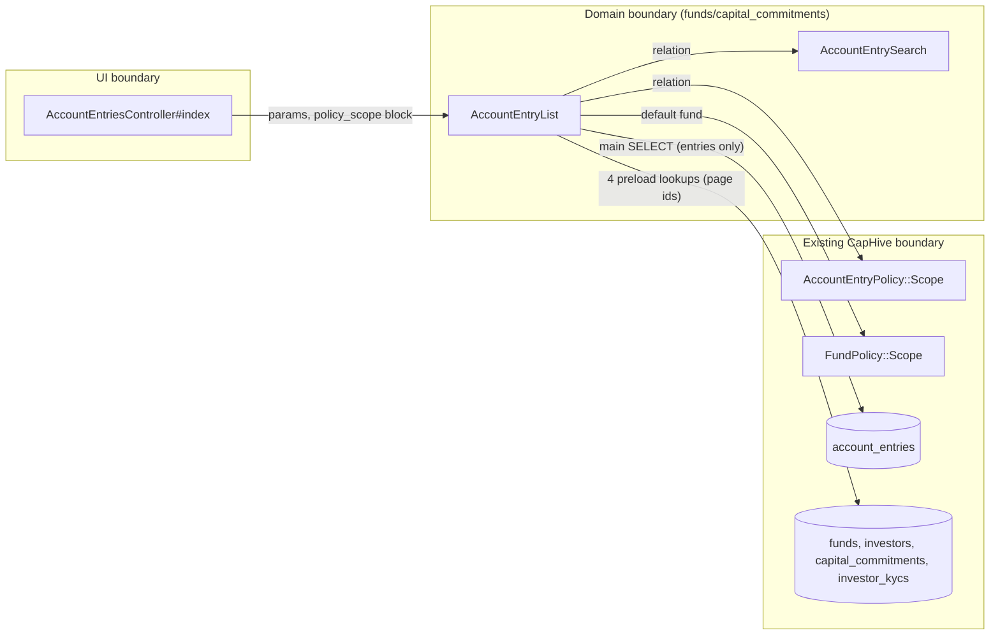
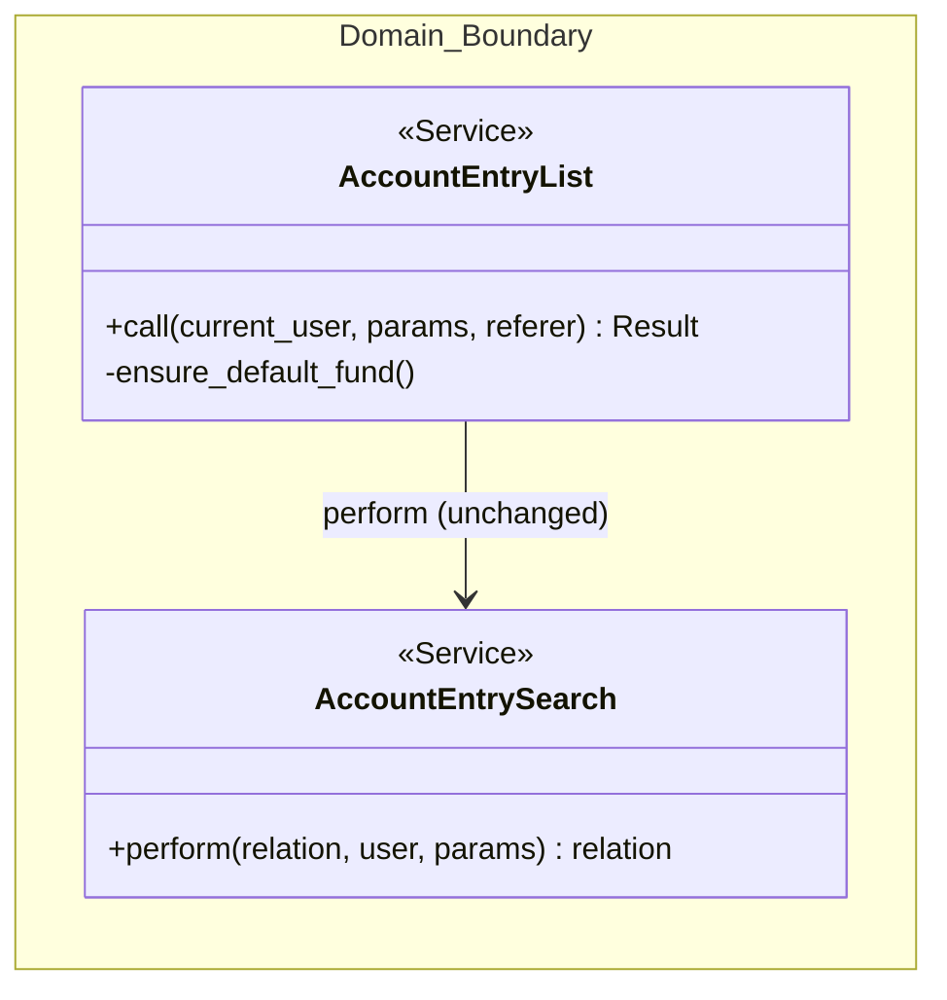
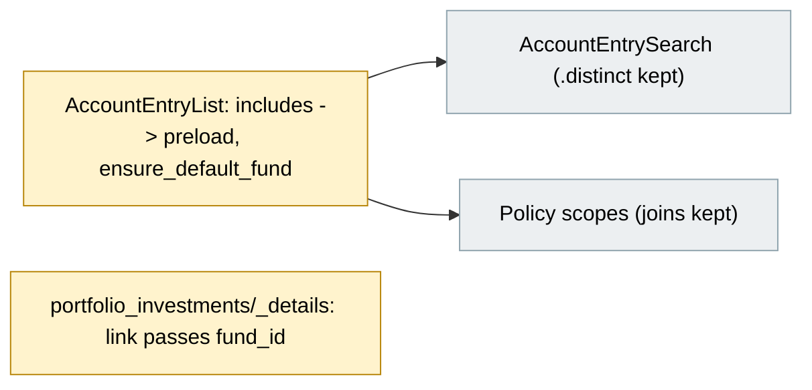
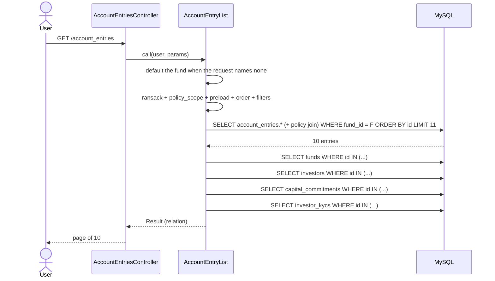

# Account Entries Index Query Fix — Design

> **Audience:** Engineering team.
> **Companion documents:** [Proposal](proposal.md) · [Spec](specs/)

> **Status:** implemented on branch `ae-query-optimisation`. Open: EXPLAIN on a production replica (task 3.2) and QA (3.3).

---

## Contents

- [Overview](#overview)
- [Architecture](#architecture)
  - [Component Boundaries](#component-boundaries)
  - [Class Diagram](#class-diagram)
  - [Change Footprint](#change-footprint)
- [Data Model and States](#data-model-and-states)
  - [Data Model](#data-model)
  - [State Transitions](#state-transitions)
- [Behaviour](#behaviour)
  - [Pipeline / Flow](#pipeline--flow)
  - [Sequence Diagrams](#sequence-diagrams)
  - [Worked Examples](#worked-examples)
- [Key Components](#key-components)
- [Controllers and Routes](#controllers-and-routes)
- [Policy](#policy)
- [UI Changes](#ui-changes)
- [Cross-cutting Concerns](#cross-cutting-concerns)
  - [Transactions and Queries](#transactions-and-queries)
  - [Exception Handling and Monitoring](#exception-handling-and-monitoring)
  - [Performance and Security](#performance-and-security)
- [Design Decisions](#design-decisions)
- [Testing](#testing)
- [Risks and Open Questions](#risks-and-open-questions)

---

## Overview

`AccountEntryList` adds `includes(:fund, :investor, capital_commitment: :investor_kyc)` after the
policy scope has already joined `funds` and filtered on `funds.entity_id`. Rails then promotes
`includes` to `eager_load`, producing one giant `SELECT ... t0_r0..t4_r62` over five tables.
The fix swaps `includes` for `preload`, the existing Rails pattern for "fetch associations in
separate `WHERE id IN (...)` queries". The list rows also read `account_entry.investor_kyc` (a
`has_one :through`), which the nested `capital_commitment: :investor_kyc` preload does not fill,
so `:investor_kyc` is preloaded at the top level as well; without it the look-ups grew with the
page size.

The second change narrows what the query reads. The report opened on every fund of the entity.
A new `ensure_default_fund` step, next to the existing `ensure_default_filters`, selects the first
fund the user can access when the request names none. Anything the user selects is left alone,
including several funds and the "All Funds" option of the fund filter. With a single `fund_id`
the database can use the `fund_id` indexes on `account_entries` instead of walking the primary key.

---

## Architecture

### Component Boundaries

| From → To                            | Contract                                                                  | Direction rule                                 |
| ------------------------------------ | ------------------------------------------------------------------------- | ---------------------------------------------- |
| Controller → AccountEntryList        | params + policy_scope block                                               | Policy scope always applied                    |
| AccountEntryList → Fund policy scope | `Pundit.policy_scope!(user, Fund)`                                        | Default fund is always one the user may access |
| AccountEntryList → DB                | main query on `account_entries` joined only as needed by the policy scope | No association columns in the main SELECT      |
| AccountEntryList → DB                | preload `WHERE id IN (page ids)` per association                          | Runs only for rows on the page                 |

### Class Diagram

### Change Footprint

---

## Data Model and States

### Data Model

N/A — no tables or columns change.

### State Transitions

N/A — no status or lifecycle.

---

## Behaviour

### Pipeline / Flow

`ensure_default_fund` runs once per request, before `AccountEntry.ransack` is built:

1. If the request has a top-level `fund_id` key, stop. A blank value is the "All Funds"
   option of the top filter (`fund_id=`), which the user chose on purpose; a fresh page load
   has no `fund_id` key at all.
2. If the request is already narrowed by a top-level `capital_commitment_id`, `investor_id`,
   `import_upload_id`, `folio_id` or `parent_id`, stop: it returns a small slice of the ledger
   whichever fund it is in (an import's entries, one folio, one investor).
3. If a `fund_id` condition, or one of those narrowing attributes, exists in `params[:q]`
   (either ransack shape, read the way `ensure_default_filters` reads `reporting_date`), stop.
4. Otherwise take the first fund of the Fund policy scope in the fund ordering (`Fund.ordered`:
   `position`, then `created_at`, then id) and set `params[:fund_id]`. No fund available: set
   nothing.

When the default was applied, the page shows a notice above the list: "Showing account entries
of fund X. Choose "All Funds" in the Fund Name filter to see every fund." It is not shown when
the user picked a fund or All Funds. The service reports this as `Result#fund_defaulted`.

Writing it into `params[:fund_id]` is the same as the user picking the fund in the top
"Fund Name" filter: that filter shows the fund's name instead of "All Funds", and links built
from the params (paging, "Delete Results", "New Account Entry") carry the same fund.

### Sequence Diagrams

### Worked Examples

**ID legend:** **H** = Happy path · **E** = Edge case · **X** = Error (exception) case.

**Shared setup:**

| Record        | Name       | Key data                                        |
| ------------- | ---------- | ----------------------------------------------- |
| Entity        | Urban      | Investment Fund, company_admin user             |
| Fund          | Alpha Fund | first fund, entries "Alpha Fee"                 |
| Fund          | Beta Fund  | second fund, entries "Beta Fee"                 |
| Commitment    | Folio 101  | investor "Acme Capital" with KYC                |
| Employee      | Eve        | employee of Urban with access to Beta Fund only |
| Second entity | Other Co   | company_admin, own fund and entries             |

#### Happy Path

| #   | Scenario              | Given                                  | When                                   | Then                                                                                                         | Spec scenario                    | Feature                                            |
| --- | --------------------- | -------------------------------------- | -------------------------------------- | ------------------------------------------------------------------------------------------------------------ | -------------------------------- | -------------------------------------------------- |
| H1  | Details shown on rows | Entries with commitment, investor, KYC | Admin opens list                       | Row shows fund, investor, folio and KYC details                                                              | Related details still shown      | features/fund/account_entries_index_query.feature  |
| H2  | Main query is narrow  | Same data                              | Admin opens list capturing SQL         | No SELECT contains both account_entries and funds/investors/capital_commitments/investor_kycs column aliases | No wide join on the main request | same                                               |
| H3  | Default to first fund | Alpha (lower id) and Beta              | Admin opens list with no fund selected | Only Alpha entries; filter shows Alpha                                                                       | No fund chosen                   | features/fund/account_entries_default_fund.feature |
| H4  | One fund chosen       | Same                                   | Admin chooses Beta                     | Only Beta entries                                                                                            | User picks a fund                | same                                               |

#### Edge Cases

| #   | Scenario                          | Given                               | When                                                             | Then                                                                           | Spec scenario                              | Feature                                            |
| --- | --------------------------------- | ----------------------------------- | ---------------------------------------------------------------- | ------------------------------------------------------------------------------ | ------------------------------------------ | -------------------------------------------------- |
| E1  | Entry without investor/commitment | Fund-level entry with no commitment | Admin opens list                                                 | Row listed with blank commitment/investor                                      | Entry without optional relations           | features/fund/account_entries_index_query.feature  |
| E2  | Look-ups constant in page size    | 12 entries on their own folios      | Open the feed at 5 and at 10 per page                            | Same number of related look-ups                                                | Look-ups bounded by page size              | same                                               |
| E3  | Employee with fund access         | Eve (Beta only)                     | Employee opens list                                              | Only Beta entries, no duplicates                                               | Employee with limited fund access          | same                                               |
| E4  | Several funds chosen              | Alpha and Beta                      | Admin filters with fund in Alpha, Beta                           | Alpha Fee and Beta Fee both listed                                             | User picks several funds                   | features/fund/account_entries_default_fund.feature |
| E5  | Employee default                  | Eve (Beta only)                     | Eve opens list with no fund                                      | Beta entries, not an empty Alpha list                                          | Employee default is a fund they can access | same                                               |
| E6  | Entity without funds              | Entity with no funds                | Admin opens list                                                 | Empty list                                                                     | Entity without funds                       | same                                               |
| E7  | All Funds chosen on purpose       | Alpha and Beta                      | Admin opens list with a blank `fund_id` (the "All Funds" option) | Alpha Fee and Beta Fee both listed; Delete Results and Export All name no fund | User chooses All Funds                     | same                                               |
| E8  | Actions follow the shown fund     | Alpha and Beta                      | Admin opens list with no fund                                    | Delete Results and Export All links name Alpha                                 | No fund chosen                             | same                                               |

#### Error Cases

| #   | Scenario               | Given                         | When              | Then (what the user sees, who is alerted) | Spec scenario          | Feature                                            |
| --- | ---------------------- | ----------------------------- | ----------------- | ----------------------------------------- | ---------------------- | -------------------------------------------------- |
| X1  | Other entity user      | Other Co admin                | Opens list        | None of Urban's entries shown             | Other entity's data    | features/fund/account_entries_index_query.feature  |
| X2  | Fund of another entity | Urban admin, Other Co fund id | Chooses that fund | Empty list; not replaced by Alpha         | Fund of another entity | features/fund/account_entries_default_fund.feature |

---

## Key Components

| Component                                             | Responsibility                                                                                     | Notes                                                                                                                                    |
| ----------------------------------------------------- | -------------------------------------------------------------------------------------------------- | ---------------------------------------------------------------------------------------------------------------------------------------- |
| `AccountEntryList#call`                               | Builds the filtered relation                                                                       | `includes` becomes `preload`; calls `ensure_default_fund` before building ransack                                                        |
| `AccountEntryList#ensure_default_fund` (new, private) | Selects the first accessible fund when the request has no `fund_id` key and no `fund_id` condition | Writes `params[:fund_id]`, as if the user had picked the fund in the top Fund Name filter. A blank `fund_id` ("All Funds") is left alone |
| `AccountEntrySearch.perform`                          | Applies search and `.distinct`                                                                     | Unchanged in this change, see Risks                                                                                                      |

---

## Controllers and Routes

No route, action or list-view change. One link changes:
`portfolio_investments/_details.html.erb` now passes `fund_id: portfolio_investment.fund_id`, because
it was the only caller that named a parent record without a fund.

---

## Policy

| Role          | Access                               |
| ------------- | ------------------------------------ |
| Company admin | Entries of own entity's funds        |
| Employee      | Entries of funds with granted access |
| Investor      | No access (`index?` is false)        |

**Multi-tenancy:** unchanged. The default fund comes from the Fund policy scope, so a user is never
defaulted to a fund they cannot access. Policy scopes on entries still join `funds` and filter by
entity; preload runs only on ids already returned by the scoped query.

---

## UI Changes

No template changes, but because the default is written into `params[:fund_id]` the page behaves as when a fund is picked:

- The top "Fund Name" filter shows the fund's name, and there is no separate "Fund equals" row.
- The Download button is a dropdown with "Export All", and "New Account Entry" is pre-filled with the fund.
- "Delete Results" and "Export All" carry the fund, so they act on the fund shown (they used to act on every matching entry of the entity).
- Choosing "All Funds" in the filter submits a blank `fund_id`, which is respected: every fund is listed and those actions name no fund.

---

## Cross-cutting Concerns

### Transactions and Queries

| What is read                                 | When                       | N+1 risk | How it stays cheap                             |
| -------------------------------------------- | -------------------------- | -------- | ---------------------------------------------- |
| first accessible fund                        | only when no fund is named | No       | one `LIMIT 1` query by primary key             |
| fund, investor, commitment, KYC for the page | each list load             | No       | preload batches one `IN` query per association |

No writes.

### Exception Handling and Monitoring

N/A — no new failure modes.

### Performance and Security

- Main query selects 34 account_entries columns instead of 240 columns across 5 tables (34 + 56 funds + 27 investors + 60 commitments + 63 investor KYCs, as seen in the development log).
- A single `fund_id` equality lets MySQL use the `fund_id` indexes instead of walking the primary key for the first 11 rows.
- Security unchanged: scope and authorization untouched.

---

## Design Decisions

1. **`preload` instead of `includes`** — one-word change, uses Rails' built-in batching. Alternative: `eager_load` with narrowed `select`. Rejected: still joins five tables and still needs DISTINCT.
2. **Keep policy joins untouched** — scopes are shared by every account entry consumer. Alternative: rewrite scope to `EXISTS`. Rejected: larger blast radius, not needed for this fix.
3. **Default the fund, do not enforce it** — the default is a starting point; users may pick any funds. Alternative: allow one fund only, with an alert. Rejected: it needed rewriting both ransack param shapes and special cases for lists scoped to one record, for a rule the business did not need.
4. **Write the default as `params[:fund_id]`** — the top Fund Name filter shows the fund's name, and there is no second "Fund equals" row. It behaves exactly as when the user picks the fund, including `@fund` being set and the "New Account Entry" and "Export All" dropdown appearing. Alternative: `q[fund_id_eq]`. Rejected: the top filter kept saying "All Funds" while a separate "Fund equals 1" row showed the id.
5. **Default is the first fund the user can access, in the fund ordering** — `Fund.ordered` (position, then created_at) is the order the business already uses for funds; the lowest id is often an old or master fund. An employee never lands on an empty list. Alternative: `entity.funds.first`, which ignores access rights.
6. **Do not default a request that is already narrowed** — the import upload page, investor and folio pages load the list with only `import_upload_id`, `investor_id` or `folio_id`; defaulting would hide their rows when the first fund is not theirs. Narrowing attributes: `capital_commitment_id`, `investor_id`, `import_upload_id`, `folio_id`, `parent_id`. The portfolio investment link still names its fund as well, which is harmless.
7. **A present `fund_id` key means the user chose** — `@params.key?(:fund_id)`, not `.present?`. The "All Funds" option submits `fund_id=`, so a blank value must not be replaced by the default. A fresh page load (menu link, bookmark) has no key. Alternative: drop "All Funds" from the dropdown. Rejected: it lives in a partial shared by many reports.
8. **Tell the user which fund is shown** — a notice when, and only when, the default was applied, so a user with several funds is not left wondering where the rest went.
9. **Leave `AccountEntrySearch` `.distinct` in place** — removing it is a behaviour risk for the employee join (see Risks). Deferred until measured.

---

## Testing

Cucumber only. `features/fund/account_entries_index_query.feature` reuses the SQL-capture approach
from `features/step_definitions/account_entry_report_performance.rb`. `features/fund/account_entries_default_fund.feature`
covers the default, "All Funds", the user-selected cases and the links the page builds. Existing login and fund/entry setup steps are reused.

One existing step changed: `I download all the AEs` in `features/step_definitions/account_entry.rb` now clicks
"Export All" when the Download button is a dropdown, which is how the page renders once a fund is in the params.
The regression features `account_entries.feature` and `account_entry_report_performance.feature` pass.

---

## Risks and Open Questions

- **Selecting every fund is still allowed** ("All Funds", or several funds), and still reads the whole entity. The default removes the common case, not the heavy one. The development log of that path shows the narrow main query plus four look-ups, but dev data says nothing about the production plan → measure with `EXPLAIN ANALYZE`, then decide whether to limit funds.
- **The `.distinct` also comes from `AccountEntrySearch.perform`** (`account_entries.distinct` is always applied), not only from Rails' eager loading. After this change the DISTINCT is over `account_entries.*` only (about 34 columns including text/JSON) instead of 240 across the joined tables, which should shrink the temp table a lot but may not remove it → measure on a production replica.
- **ORDER BY id LIMIT plan** can still walk the primary key if the optimizer ignores the `fund_id` index for a large fund → follow-ups (entity filter on `account_entries`) if measurement shows it.
- **Links with no fund** now land on the first fund. Only the portfolio investment link was affected and is fixed. After deleting a single entry the controller redirects to the list of that entry's fund.
- **Grouped, pivot and time-series views** open on the default fund too, so they no longer total across funds unless the user selects them. Time series no longer reports "Please select a fund" when the fund was defaulted (the notice names the fund instead); its folio and date checks are unchanged. The pivot no longer calls `.includes(:fund)` itself: it already strips includes and only plucks.
- **Delete Results and Export All follow the fund shown.** On a default page they act on the first fund only, where before they acted on every matching entry of the entity. From "All Funds" they act on everything, as before.
- A ransack sort on an associated column adds its own join, so ordering by such a column still works but may be heavier → covered by keeping existing behaviour, verify manually.

| #   | Open question                                                         | Current thinking                                                 | Status                           |
| --- | --------------------------------------------------------------------- | ---------------------------------------------------------------- | -------------------------------- |
| 1   | Drop `.distinct` in `AccountEntrySearch` when no search term is given | Likely safe for admin role; employee join needs checking         | Deferred, decide after measuring |
| 2   | Limit the number of funds a user may select                           | Business decision; not done here                                 | Deferred                         |
| 3   | Which fund counts as "first"                                          | First in `Fund.ordered` the user can access                      | Decided                          |
