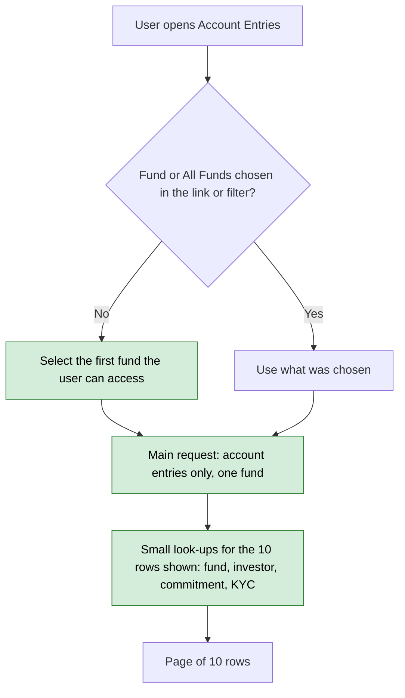

# Account Entries Index Query Fix — Proposal

> **Audience:** Business team, product, QA, support — non-technical.
> **Companion document:** [Design](design.md)

---

## Why

Opening Reports → Account Entries for a large fund entity makes the database build very large
temporary tables. On production one such request ran for about 8 minutes and temporary storage
grew to roughly 13 GB. Two things cause it:

- The page loads each row together with its fund, investor, commitment and KYC details in one
  oversized database request, instead of fetching them separately.
- The report opens on **all funds of the entity**, so the database has to sort and de-duplicate
  millions of rows from every fund before it can show 10.

## What Changes

- The related fund, investor, commitment and KYC details are fetched afterwards in small batches
  for just the rows on the page. Same rows, same order, same columns.
- The report opens on **the first fund the user can access** (fund ordering), the fund filter shows
  it as selected, and a notice says which fund is shown. The user can pick a different fund,
  several funds, or "All Funds", exactly as before.
- A list already narrowed to an import, investor, folio, commitment or parent is not given a
  default fund.
- The portfolio investment page's link to its account entries now names its fund, so it keeps
  listing its own entries.
- "Delete Results" and "Export All" act on the fund shown, so on a default page they cover the
  first fund only.
- No permission, column or message changes.

---

## User Stories

### US-1: Account Entries list loads quickly for large entities

**As a** fund admin with millions of account entries,
**I want** the Account Entries list to open without a long wait,
**So that** I can review entries without the system slowing down for everyone else.

**Acceptance criteria:**
- For the fund shown, the list has the same rows, order, columns and paging as before.
- Fund, investor, commitment and investor KYC details still appear on every row.
- Filters, search, sorting and export behave as before.

### US-2: Production database stays healthy

**As a** support engineer,
**I want** this page to stop producing multi-GB temporary tables in its usual use,
**So that** the database does not run out of temporary space.

**Acceptance criteria:**
- The main database request behind the list no longer joins the fund, investor, commitment or
  KYC tables to read their columns.
- Opening the report without choosing a fund reads one fund, not the whole entity.

### US-3: Report opens on one fund

**As a** fund admin of an entity with several funds,
**I want** the Account Entries report to open on my first fund,
**So that** it loads fast instead of reading every fund's entries at once.

**Acceptance criteria:**
- With no fund selected, only the first fund's entries are listed and the filter shows that fund.
- An employee gets the first fund they have access to, not one they cannot see.
- A fund, or several funds, the user selects is used as given.
- Choosing "All Funds" in the filter lists every fund, as before.

---

## UI Behavior

The page looks the same, except that the fund filter is pre-set to the first fund when the user
did not choose one. Because a fund is then selected, the Download button is a menu with
"Export All", and "New Account Entry" is pre-filled with that fund.

---

## What This Feature Does NOT Cover

| Excluded | Covered In |
|---|---|
| Stopping users from selecting several funds or every fund | Not done on purpose. A user who selects all funds can still get a slow request |
| Filtering directly on the entry's own entity instead of through the fund | Later change, if still needed after measuring |
| Removing the de-duplication step ("distinct") on the list query | Later change, decided after measuring (see design) |
| The 15M-row balance totals queries and the exports/backups seen in the slow log | Separate investigations |

---

## Behavior Rules

| Scenario | What User Sees |
|---|---|
| Open Account Entries, no fund chosen | First fund's entries, filter shows that fund |
| Employee opens it, no fund chosen | First fund the employee can access |
| Choose one fund, or several | Exactly those funds' entries |
| Choose "All Funds" | Every fund's entries, as before (this can still be slow) |
| "Delete Results" or "Export All" on a default page | Acts on the first fund shown only |
| Link that already names a fund | That fund, as before |
| Entity has no funds | Empty list |
| Choose a fund of another entity | Empty list |

---

## Resolved Design Decisions

| # | Decision | Resolution |
|---|---|---|
| 1 | Scope of this change | Change how related details are fetched, and open on one fund. Nothing is enforced |
| 2 | Several funds | Allowed. The default is a starting point, not a limit |
| 3 | Which fund is "first" | The first fund the user can access in the fund ordering (position, then creation date) |
| 4 | Links that carry no fund | Narrowed lists (import, investor, folio, commitment, parent) are left alone. The Reports menu link is the case the default is for |

---

## Capabilities

### New Capabilities

- `funds/account-entries-index-query`: the Account Entries list reads its rows with a narrow database request and opens on one fund unless the user chooses otherwise.

### Modified Capabilities

None.

---

## Impact

- The Account Entries list page under Reports, including its grouped, pivot and time-series views and the grid's JSON feed.
- Users who relied on the list opening on all funds now see the first fund and choose "All Funds" in the filter.
- "Delete Results" and "Export All" on the list now cover the fund shown. Anyone who deleted or exported across all funds from the default page must choose "All Funds" first.
- Production database load and temporary storage. No data, migration or permission impact.

---

## FAQ

| Question | Answer |
|---|---|
| Will users notice any difference? | Speed, and a pre-selected fund |
| Can I still see several funds together? | Yes, by selecting them in the filter |
| Can I still see every fund? | Yes, choose "All Funds" in the fund filter. It is respected, not replaced by the default |
| Does this stop the slow request completely? | No. Selecting every fund is still allowed and still heavy. The default removes the common case |
| Which fund is the default? | The first fund the user can access |
| Are exports affected? | Exports keep the parameters of the page they start from. From a default page that is the first fund; from "All Funds" it is everything |
| What does "Delete Results" delete? | The results of the fund shown. Choose "All Funds" first to cover every fund |
