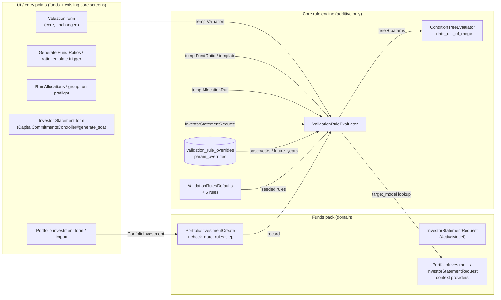
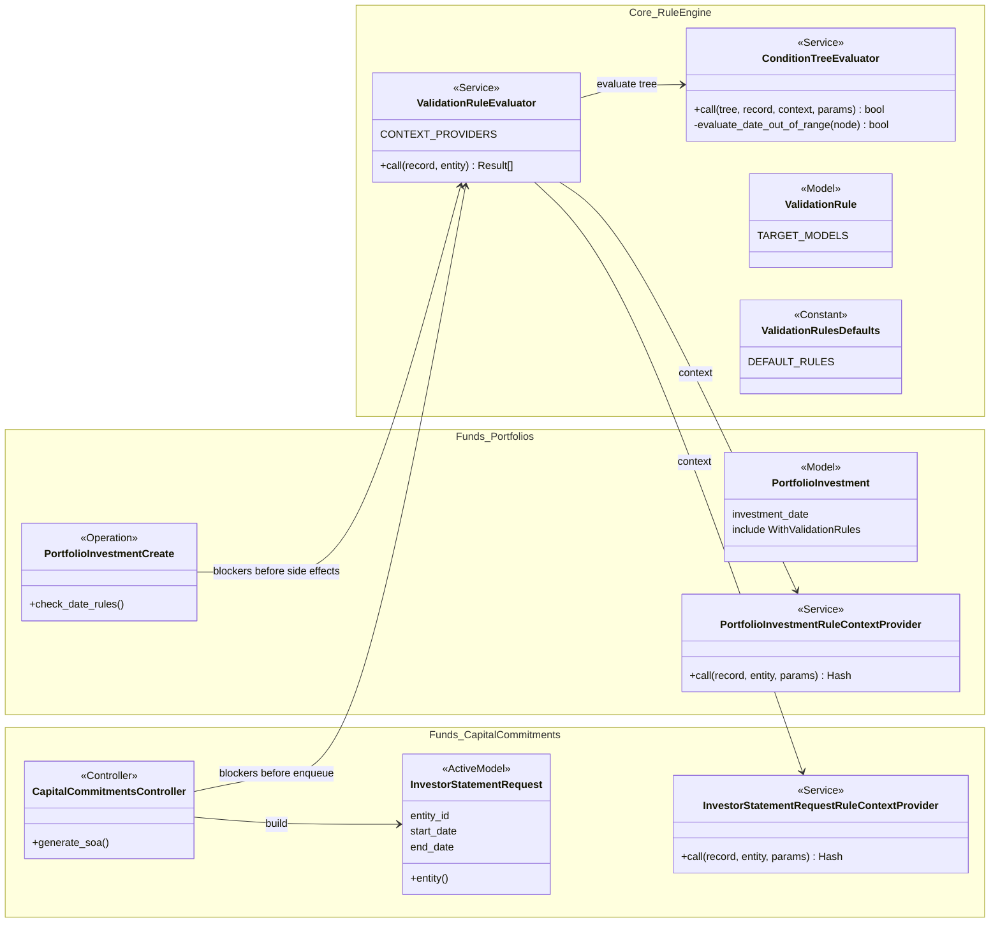
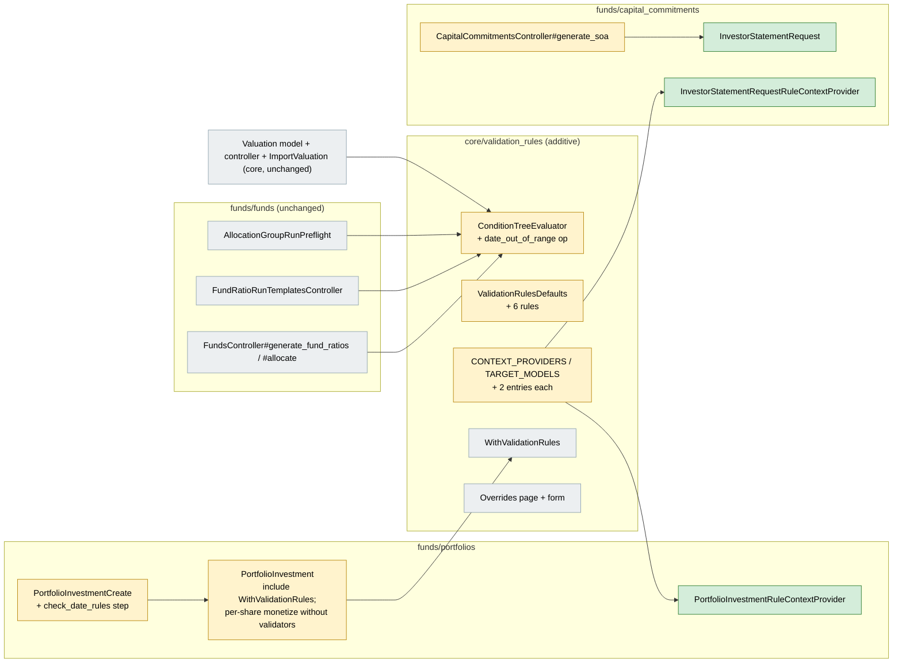
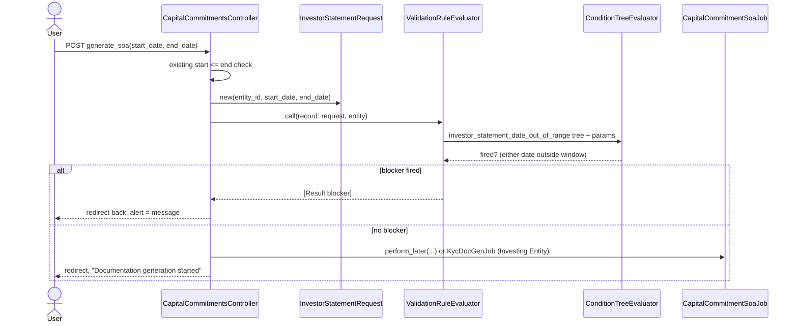
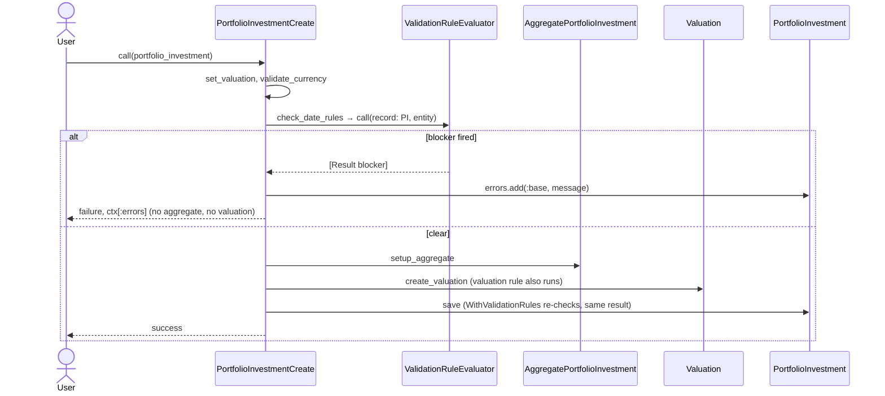
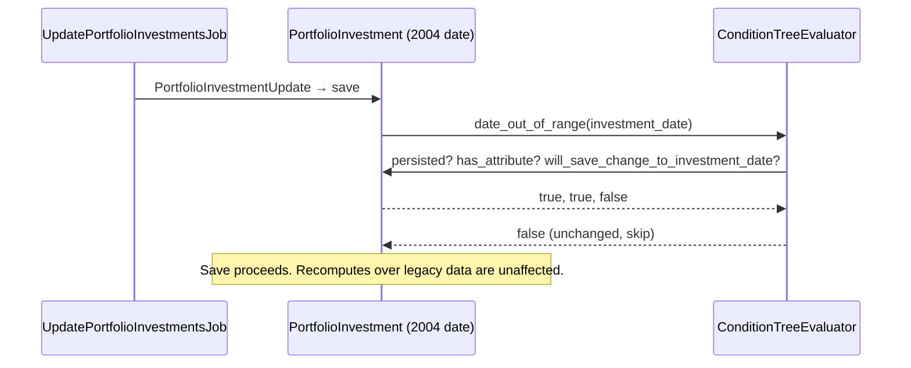
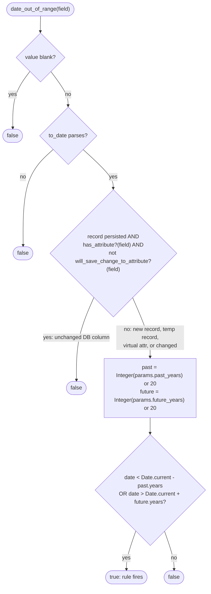
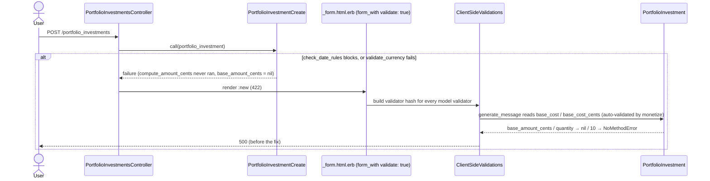

# Date Range Sanity Checks — Design

> **Audience:** Engineering team.
> **Companion documents:** [Proposal](proposal.md) · [Spec](specs/validation-rules/date-range-sanity/spec.md)

> **Planning phase — no code changes.** This document explains HOW the proposal will be built.
> Do not edit application code while writing it; implementation happens later, in the tasks phase.

---

## Contents

- [Overview](#overview)
- [Architecture](#architecture)
  - [Component Boundaries](#component-boundaries)
  - [Class Diagram](#class-diagram)
  - [Change Footprint](#change-footprint)
- [Data Model and States](#data-model-and-states)
  - [Data Model](#data-model)
  - [State Transitions](#state-transitions)
- [Behaviour](#behaviour)
  - [Pipeline / Flow](#pipeline--flow)
  - [Sequence Diagrams](#sequence-diagrams)
  - [Worked Examples](#worked-examples)
- [Key Components](#key-components)
  - [Decision Flows](#decision-flows)
- [Controllers and Routes](#controllers-and-routes)
- [Policy](#policy)
- [UI Changes](#ui-changes)
  - [At a glance](#at-a-glance)
  - [Journey 1: A user enters an out-of-window date](#journey-1-a-user-enters-an-out-of-window-date)
  - [Journey 2: An admin widens the window](#journey-2-an-admin-widens-the-window)
  - [Build notes (for implementers)](#build-notes-for-implementers)
- [Cross-cutting Concerns](#cross-cutting-concerns)
  - [Transactions and Queries](#transactions-and-queries)
  - [Exception Handling and Monitoring](#exception-handling-and-monitoring)
  - [Performance and Security](#performance-and-security)
- [Bug Fix: Portfolio Investment Form Re-render](#bug-fix-portfolio-investment-form-re-render)
- [Design Decisions](#design-decisions)
- [Testing](#testing)
- [Risks and Open Questions](#risks-and-open-questions)

---

## Overview

This change adds one new leaf operator, `date_out_of_range`, to the existing ValidationRule engine, along with six default blocker rules. Each rule's `past_years` / `future_years` params can be overridden per entity through `ValidationRuleOverride`, like any other rule. It follows the capital call and remittance wiring pattern: context providers live in the funds pack, and core only gets additive registrations. No core model, controller or view is edited.

---

## Architecture

### Component Boundaries



| From → To | Contract | Direction rule |
|---|---|---|
| Entry points → `ValidationRuleEvaluator` | `call(record:, entity:)` → `[Result]`; the caller acts on `blocker?` / `warning?` | Callers never read the rules or params themselves |
| `ValidationRuleEvaluator` → context providers | `call(record:, entity:, params:)` → `Hash` | Providers are read-only and return `{}` for the new models |
| `ValidationRuleEvaluator` → `ConditionTreeEvaluator` | `tree`, `record`, `params` (defaults merged with overrides) | The operator is pure: it reads `Date.current` and does no DB access |
| Funds pack → core registries | One-line entries in `CONTEXT_PROVIDERS` and `TARGET_MODELS` | Core names funds classes by constant only, as for `CapitalCallRuleContextProvider` |

### Class Diagram



### Change Footprint

New code lives in `funds/portfolios` and `funds/capital_commitments`. Core gets additive edits in `core/validation_rules` only.



---

## Data Model and States

### Data Model

N/A. There are no tables or columns. Configuration reuses `validation_rules.params` and `validation_rule_overrides.param_overrides` (JSON), and the new rules are seeded rows.

### State Transitions

N/A. This change has no lifecycle or stored status. Rule enable/disable is the existing override toggle.

---

## Behaviour

### Pipeline / Flow

N/A. The decision is a single operator; see [Decision Flows](#decision-flows).

### Sequence Diagrams

**Happy path and block: Investor Statement (the only new controller wiring)**



**Portfolio investment create: the rule fires before any side effects**



**Legacy record edit: the "only changed" rule**



### Worked Examples

**ID legend:** **H** = Happy path · **E** = Edge case · **X** = Error (exception) case. The date examples use today = 2026-09-30, so the default window is 2006-09-30 … 2046-09-30.

**Shared setup:**

| Record | Name | Key data |
|---|---|---|
| Entity | RuleTestFirm | Investment Fund, INR, company_admin user; default rules seeded |
| Entity | OtherFirm | Second entity with no overrides |
| Fund | RuleTestFund | INR |
| Portfolio company + instrument | Acme / Stock | Unlisted equity |
| Capital commitment | Investor A on RuleTestFund | Has investor KYC |

#### Happy Path

| # | Scenario | Given | When | Then | Spec scenario | Feature |
|---|---|---|---|---|---|---|
| H1 | In-window valuation | Defaults | Evaluate Valuation `valuation_date` = 5 years ago | `valuation_date_out_of_range` does not fire | Date inside the window is accepted | `features/fund/date_range_sanity_rules.feature` |
| H2 | Boundary dates | Defaults | Evaluate Valuation at exactly today−20y, then at today+20y | Does not fire | Boundary dates are accepted | `features/fund/date_range_sanity_rules.feature` |
| H3 | Investor Statement in range | Defaults | Submit Investor Statement for 1 year ago → today | `CapitalCommitmentSoaJob` enqueued | Investor Statement with in-range dates | `features/fund/date_range_sanity_investor_statement.feature` |
| H4 | Widened window for one entity | RuleTestFirm override `past_years=30` on valuation rule | Evaluate Valuation 25 years ago for RuleTestFirm, then for OtherFirm | Does not fire for RuleTestFirm; fires for OtherFirm | Entity widens the past window | `features/fund/date_range_sanity_rules.feature` |
| H5 | Rules disabled | RuleTestFirm disables `portfolio_investment_date_out_of_range` and `valuation_date_out_of_range` | Create PI dated 50 years ago | Saves | Entity disables the check | `features/fund/date_range_sanity_portfolio_investment.feature` |
| H6 | Legacy PI edit | PI saved (rules skipped) with date 25 years ago | Change `notes` and save | Saves | Legacy portfolio investment remains editable | `features/fund/date_range_sanity_portfolio_investment.feature` |

#### Edge Cases

| # | Scenario | Given | When | Then | Spec scenario | Feature |
|---|---|---|---|---|---|---|
| E1 | Blank date | Defaults | Evaluate AllocationRun with `end_date` blank | Rule does not fire | Blank date is not checked | `features/fund/date_range_sanity_rules.feature` |
| E2 | Garbage param | Override `past_years="abc"` | Evaluate Valuation 21 years ago | Fires (falls back to 20) | Invalid configured value falls back to default | `features/fund/date_range_sanity_rules.feature` |
| E3 | Downgrade to warning | Override severity `warning` on valuation rule | Submit valuation form dated 0224-03-31 (@javascript) | Warning modal with "Confirm & Save" | Entity downgrades to a warning | `features/fund/date_range_sanity_rules.feature` |
| E4 | Group run preflight | Allocation group run for end date today+25y | Run preflight | Blocker message listed | Allocation group run with out-of-range dates | `features/fund/date_range_sanity_rules.feature` |
| E5 | Template trigger by tag | Two templates tagged `q3` | Trigger tag with end date today+25y | Nothing enqueued; both skipped | Fund ratio run templates triggered by tag with an out-of-range end date | `features/fund/date_range_sanity_rules.feature` |

#### Error Cases

| # | Scenario | Given | When | Then (what the user sees, who is alerted) | Spec scenario | Feature |
|---|---|---|---|---|---|---|
| X1 | Too far past | Defaults | Evaluate Valuation 21 years ago | Fires as blocker; message includes the date, "20" and "20" | Date too far in the past is rejected; Default behaviour for an entity with no overrides | `features/fund/date_range_sanity_rules.feature` |
| X2 | Too far future | Defaults | Evaluate FundRatio `end_date` = today+21y | Fires as blocker | Date too far in the future is rejected | `features/fund/date_range_sanity_rules.feature` |
| X3 | Valuation form | Defaults | Submit new valuation dated 0224-03-31 (@javascript) | Form re-rendered with "Cannot save: Valuation date 0224-03-31 must be within …" | Valuation with an out-of-range date | `features/fund/date_range_sanity_rules.feature` |
| X4 | Valuation import | Import file with row dated 2204-03-31 plus 1 valid row | Run import | Bad row errors with the rule message; valid row imported | Valuation import row with an out-of-range date | `features/fund/date_range_sanity_rules.feature` |
| X5 | PI create | Defaults | `PortfolioInvestmentCreate` with date today+21y | Failure with rule message; no AggregatePortfolioInvestment or Valuation created | Portfolio investment with an out-of-range date | `features/fund/date_range_sanity_portfolio_investment.feature` |
| X6 | PI import | Import file with 1 valid row, then a row dated 0224-01-15 | Run import | Bad row errors; the valid row before it is imported (PI imports stop at the first failed row) | Portfolio investment import row with an out-of-range date | `features/fund/date_range_sanity_portfolio_investment.feature` |
| X12 | PI rule off, valuation rule on | RuleTestFirm disables only `portfolio_investment_date_out_of_range` | Create PI dated 50 years ago | Failure with the valuation rule's message; no PI saved | Portfolio investment creates are also checked by the valuation rule | `features/fund/date_range_sanity_portfolio_investment.feature` |
| X13 | PI form re-render (date) | Defaults | Submit the new portfolio investment form dated 26 years ago | Form re-rendered (422) with the investment date message; no PI saved. Regression for the staging 500, see [Bug Fix: Portfolio Investment Form Re-render](#bug-fix-portfolio-investment-form-re-render) | Portfolio investment with an out-of-range date | `features/fund/date_range_sanity_portfolio_investment.feature` |
| X14 | PI form re-render (currency) | Instrument in EUR, fund in INR, no EUR→INR exchange rate anywhere | Submit the new portfolio investment form dated 1 year ago | Form re-rendered (422) with "Exchange rate EUR->INR not found"; no PI saved. The pre-existing path through the same crash | Portfolio investment with an out-of-range date (failure re-render) | `features/fund/date_range_sanity_portfolio_investment.feature` |
| X7 | Change legacy date | PI dated 10 years ago | Update `investment_date` to 25 years ago | Save rejected with the rule message | Changing a legacy date is checked | `features/fund/date_range_sanity_portfolio_investment.feature` |
| X8 | Generate Fund Ratios | Defaults | Submit form with end date today−30y (@javascript) | Alert with the rule message; no `FundRatiosJob` enqueued | Generate fund ratios with an out-of-range end date | `features/fund/date_range_sanity_rules.feature` |
| X9 | Template single trigger | One template | Trigger with end date today+25y | Alert "Cannot enqueue …"; nothing enqueued | Fund ratio run template triggered with an out-of-range end date | `features/fund/date_range_sanity_rules.feature` |
| X10 | Manual allocation | Defaults | POST allocate with start 0224-01-01 | Alert; no AllocationRun row, no `AccountEntryAllocationJob` | Manual allocation run with an out-of-range start date | `features/fund/date_range_sanity_rules.feature` |
| X11 | Investor Statement | Defaults | Submit Investor Statement with end date today+25y | Alert; no `CapitalCommitmentSoaJob` / `KycDocGenJob` | Investor Statement with an out-of-range end date | `features/fund/date_range_sanity_investor_statement.feature` |

Every spec scenario appears at least once in the Spec scenario column: 24 spec scenarios map to 25 rows: X1 covers two, and X13 and X14 are extra rows for "Portfolio investment with an out-of-range date" (form re-render regressions).

---

## Key Components

| Component | Responsibility | Notes |
|---|---|---|
| `ConditionTreeEvaluator#evaluate_date_out_of_range` (core, new private method + `when` branch) | Decide whether one field's date is outside the window | Pure: coerces params with `Integer(v, exception: false) \|\| 20`; bounds are inclusive; `to_date` failure → false |
| `ValidationRulesDefaults::DEFAULT_RULES` (core, +6 entries) | Rule definitions: `valuation_`, `portfolio_investment_`, `fund_ratio_`, `fund_ratio_run_template_`, `allocation_run_` and `investor_statement_` + `date_out_of_range` | All `severity: "blocker"`, `enabled: true`, `params: {"past_years"=>20,"future_years"=>20}`. Two-date rules use `OR` over `start_date` / `end_date` |
| `PortfolioInvestmentRuleContextProvider` (funds/portfolios, new) | Registry requirement | Returns `{}` |
| `PortfolioInvestmentCreate#check_date_rules` (funds/portfolios, new step) | Run blockers before `setup_aggregate` / `create_valuation` | Adds messages to `errors[:base]`, sets `ctx[:errors]` and fails, so later steps never run |
| `InvestorStatementRequest` (funds/capital_commitments, new) | Non-persisted rule target for the SOA form dates | `ActiveModel::Model` + `ActiveModel::Attributes`; `entity` reader |
| `InvestorStatementRequestRuleContextProvider` (funds/capital_commitments, new) | Registry requirement | Returns `{}` |

### Decision Flows



The `has_attribute?` guard matters because `FundRatioRunTemplate#trigger_end_date` is an `attr_accessor` set on a *persisted* template. Without the guard, dirty tracking would report "unchanged" and the rule would never fire.

---

## Controllers and Routes

No routes are added or changed. One action changes:

| Verb and path | Action | Does | Responds with |
|---|---|---|---|
| `POST /capital_commitments/:id/generate_soa` (existing) | `CapitalCommitmentsController#generate_soa` | After the existing start ≤ end check, builds `InvestorStatementRequest` and evaluates blockers before either job branch | Redirect back with `alert` on blockers; otherwise unchanged |

---

## Policy

No change. Every entry point keeps its existing `authorize` call.

| Role | Access |
|---|---|
| company_admin | Edit rule overrides (existing `ValidationRuleOverridePolicy`) |
| Fund users | Unchanged; they only see the new messages |
| Investors | Unaffected |

**Multi-tenancy:** `ValidationRuleEvaluator` resolves overrides by `entity` only. `InvestorStatementRequest.entity_id` comes from `@capital_commitment.entity_id`, never from params.

---

## UI Changes

### At a glance

| Where in CapHive | Today | After this change | Who sees it |
|---|---|---|---|
| Valuation form / import | Any date saves | Out-of-window date rejected with a message | Fund users |
| Portfolio investment form / import | Any date saves | Rejected with a message | Fund users |
| Generate Fund Ratios, ratio template trigger, Run Allocations | Job starts | Alert; no job | Fund accountants |
| Capital commitment → Investor Statement | Job starts | Alert; no job | Fund users |
| Entity → Validation Rules | Existing rules | Six new "… Date Out Of Range" rules with `past_years` / `future_years` | Company admins |


### Journey 1: A user enters an out-of-window date

The screens and messages are the proposal's [UI Behavior](proposal.md#ui-behavior) mockups. The only new part is the message text, which comes from each rule's `message_template`.

| Step | The user… | They see |
|---|---|---|
| 1 | Enters `0224-03-31` and saves or runs | Form re-rendered, or redirect back, with a red alert naming the date and the window |
| 2 | Corrects the date and resubmits | Normal success |

### Journey 2: An admin widens the window

```
Entity → Validation Rules → Valuation Date Out Of Range → Edit
┌──────────────────────────────────────────────┐
│ ① Enabled      [x]                           │
│ ② Severity     [ Blocker ▾ ]                 │
│ ③ past_years   [ 30 ]   default: 20          │
│   future_years [    ]   default: 20          │
│ ④ [ Save ]                                   │
└──────────────────────────────────────────────┘
```

| Step | The user… | They see |
|---|---|---|
| 1 | Opens the rule's override form | ①–③ prefilled from the rule defaults (existing form) |
| 2 | Sets ③ `past_years` to 30 and clicks ④ | The list shows `past_years: 30` for this entity |
| 3 | Re-enters the 25-years-ago valuation | It saves |

### Build notes (for implementers)

| Interaction | Screen update |
|---|---|
| Investor Statement block | Plain redirect with flash `alert`, as with the existing "Please provide valid start and end dates" |
| Valuation warning (downgraded) | Existing Stimulus rule-validation modal; no change |

---

## Cross-cutting Concerns

### Transactions and Queries

| What is read | When | N+1 risk | How it stays cheap |
|---|---|---|---|
| Global rules + this entity's overrides for the target model | Each evaluation (existing behaviour) | For `FundRatiosJob`, one lookup per saved ratio (already true today) | Two indexed queries; the new op itself does no queries |

| Operation | In a transaction? | Why |
|---|---|---|
| `PortfolioInvestmentCreate` date check | Runs before any write | Keeps the failure side-effect free, so no rollback is needed |

### Exception Handling and Monitoring

| Failure scenario | Who is alerted | Channel | Detail |
|---|---|---|---|
| Rule engine raises during a model save | Nobody; logged | Rails log | Existing `WithValidationRules` rescue lets the save through (fail-open, unchanged) |
| Import row rejected | Uploading user | Existing import error report | Row message = rule message |

### Performance and Security

- **Performance:** O(1) date comparison per rule. There are no new queries beyond the existing per-evaluation rule lookup.
- **Security:** `param_overrides` are coerced with `Integer()`, never `eval`'d or interpolated into SQL. Message interpolation uses the existing `%{}` formatting. The entity is always derived from the record.

---

## Bug Fix: Portfolio Investment Form Re-render

**Symptom (staging, V9.2.100 build).** Submitting the new portfolio investment form with investment date `2000-10-06` returned a 500, `undefined method '/' for nil` at `PortfolioInvestment#base_cost_cents` (`portfolio_investment.rb:217`), instead of re-rendering the form with the date message. Reproduced locally (X13), and also through the pre-existing missing-exchange-rate path (X14).

**Cause.** A failure *before* `compute_amount_cents` leaves `base_amount_cents` nil, and re-rendering `:new` then computes a per-share value from it:



- `monetize` adds a `MoneyValidator` and a `NumericalityValidator` to every attribute it declares, including the **computed** per-share getters `base_cost_cents`, `sale_price_per_share_cents` and `cost_of_sold_per_share_cents`. These are not columns and are never entered.
- `form_with(..., validate: true)` (client_side_validations) builds a message for every model validator. To do that it reads each attribute's value, which runs the division.
- **Why tests missed it:** X5 calls `PortfolioInvestmentCreate` directly and never renders the form.

**Fix** (`app/packs/funds/portfolios/models/portfolio_investment.rb`). Move the three computed attributes out of their shared `monetize` lists into separate declarations with `disable_validation: true`, keeping the same `with_currency` lambdas:

| Attribute | Currency rule (unchanged) | Validators before → after |
|---|---|---|
| `base_cost_cents` / `base_cost` | `investment_instrument&.currency \|\| fund.currency` | Numericality + Money → none |
| `sale_price_per_share_cents` / `sale_price_per_share` | `fund.currency` | Numericality + Money → none |
| `cost_of_sold_per_share_cents` / `cost_of_sold_per_share` | `fund.currency` | Numericality + Money → none |

**What is unchanged:**
- **Getter bodies,** including the existing `: 0` for zero or negative quantity. No nil guard or new default is added, so a path that skipped `compute_amount_cents` still fails loudly in real calculations.
- **The Money objects** returned by `base_cost`, `sale_price_per_share` and `cost_of_sold_per_share`, with the same currencies.
- **Every calculation that uses them:**
  - `create_valuation` (valuation `per_share_value_cents`)
  - `PortfolioComputations` (`instrument_currency_cost_of_remaining_cents`)
  - `StockConverter`
  - the show page and the AI assistant data manager
- **Validators on the real amount columns,** such as `base_amount` and `amount_cents`, which keep theirs.

**Alternatives rejected:**

| Alternative | Why rejected |
|---|---|
| Nil-guard `base_cost_cents` (return 0) | A silent 0 could be saved as a valuation's per-share value if amounts were ever skipped |
| Nil-guard returning nil | Fixes `base_cost` only; the sell-side getters keep the same latent crash |
| Run `check_date_rules` after `compute_amount_cents` | A typo'd year has no exchange rate, so cross-currency instruments would show "no exchange rate" instead of the date message |
| Compute amounts in the controller before re-rendering | Same exchange-rate lookup problem, and duplicates operation logic in the controller |
| Drop `validate: true` from the form | Removes client-side checks for every field |

**Related, not part of this fix.** `PortfolioInvestmentCreate#handle_currency_errors` stores `ctx[:errors]` as an Array. `ImportPortfolioInvestment` does `raise result[:errors]`, so an import row with a missing exchange rate raises `TypeError` instead of the message. Fix it by joining the messages into a String, as `handle_date_rule_errors` and `handle_errors` already do.

---

## Design Decisions

1. **ValidationRule engine over a standalone validator.** The alternative was an ActiveModel `DateRangeValidator` in the funds pack. It was rejected because it would duplicate per-entity config, severity and admin UI, and it could not cover Valuation without touching core.
2. **Additive-only core edits.** Core gets a new op plus data and registry entries, and no core model or controller changes. The alternative was a `to_prepare` include from the funds pack, which was rejected as hidden coupling. KYC document generation (core controller) is deferred.
3. **"Only changed" inside the operator.** The alternative was a separate `changed` leaf per rule, rejected because every rule author would have to remember it. The `has_attribute?` guard keeps virtual attributes checked.
4. **`InvestorStatementRequest` over validating inside the jobs.** Validating in `CapitalCommitmentSoaJob` gives no immediate feedback. That job is also called by `run_formulas.rb` with AllocationRun dates that are already checked.
5. **Early step in `PortfolioInvestmentCreate`.** Relying on the model save alone would fail after `setup_aggregate` / `create_valuation`, with the valuation rule's message and possible orphan rows.
6. **One rule per input, not one entity-wide setting.** The alternative was a new entity setting column, which needs a core migration and UI. Six overrides is acceptable, as recorded in the proposal FAQ.
7. **No validators on computed per-share money attributes.** Their values are derived from validated columns, so validating them adds nothing, and it makes the form compute them before the amounts exist. See [Bug Fix: Portfolio Investment Form Re-render](#bug-fix-portfolio-investment-form-re-render) for the rejected alternatives.

---

## Testing

- Three new feature files, one per implementation phase (rules, portfolio investment, Investor Statement), as named in the Worked Examples Feature column. Each has one scenario per row, named with its ID (e.g. `X5: …`).
- Reuse the steps in `features/step_definitions/validation_rules.rb`: seeding, overrides, "evaluated for a Valuation/AllocationRun/FundRatio", "fires as", "message includes", and the valuation form and fund ratios form steps.
- New steps in `features/step_definitions/date_range_sanity.rb`:
  - relative-date placeholders (`<21 years ago>`, `<today+20y>`)
  - PortfolioInvestment and Investor Statement evaluation/submission
  - template triggers
  - an "enqueued no job" assertion using `ActiveJob::Base.queue_adapter`
- X13 and X14 submit the real form through the controller (Warden test login on an `ActionDispatch::Integration::Session`, the pattern in `capital_call_journey_steps.rb`), so they render the view and need no browser. Calling the operation directly, as X5 does, cannot catch view-level failures.
- Run with `TEST_ENV_NUMBER=$RANDOM` and Redis up. Compute placeholder dates from `Date.current` at step time rather than freezing time; `travel_to` interferes with @javascript sessions. The Worked Examples dates assume today = 2026-09-30 for illustration only.

---

## Risks and Open Questions

- [The valuation edit form checks a `dup` (a non-persisted copy), so "only changed" cannot apply there] → Documented in the spec and proposal FAQ. Fixing it needs a core controller edit, so it is out of scope. It only affects valuations more than 20 years old; `past_years` is the workaround.
- [Existing customers with genuine pre-2006 data hit blockers on new entries] → Release note plus per-rule override. Rollback is to disable the six global rules.
- [New rules missing because `rules:seed_defaults` wasn't run on deploy] → Listed in the release checklist task. Without seeding, nothing is blocked (fails safe).
- [Creating a buy PI also creates a valuation on the investment date, so the valuation rule applies too] → Accepted: an auto-created valuation pollutes valuation history like a typed one. To back-date buys, an entity widens or disables both the Portfolio Investment and Valuation rules (H5, X12).
- [Rejected creates re-render forms that may compute derived values before the operation has computed them (the staging 500)] → Fixed for portfolio investments (decision 7). X13 and X14 render the form so any recurrence fails a test. Other forms that re-render after an early operation failure should be checked the same way.
- [Cross-fund ratio runs evaluate against a temp FundRatio of the current fund only] → Same as today's quarter-end rule. Acceptable, because the date is shared across funds.

| # | Open question | Current thinking | Status |
|---|---|---|---|
| 1 | Add KYC doc-gen dates in a follow-up that touches core? | Yes, if product wants it; reuse `InvestorStatementRequest` (or generalise it) | Deferred |
