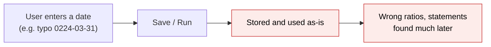
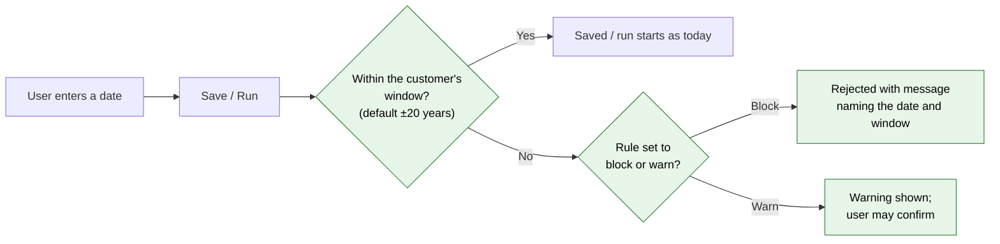

# Date Range Sanity Checks — Proposal

> **Audience:** Business team, product, QA, support — non-technical.
> **Companion document:** [Design](design.md)

> **Planning phase — no code changes.** This document proposes and explains the change. Do not
> edit application code while writing it; implementation happens later, in the tasks phase.

---

## Why

Today the app accepts any date. A year typed as `0224` instead of `2024`, or `2204`, goes straight into a valuation, a portfolio investment, a fund ratio run, an allocation run (the run that applies fund formulas) or an Investor Statement. These dates quietly corrupt ratio history (for example, IRR spread over centuries), allocation periods and generated statements, and they are hard to spot and clean up later. The app should reject dates that are obviously wrong at the moment they are entered.

## What Changes

The app gets a "reasonable date window": by default, **no more than 20 years before or 20 years after today**. A date outside the window is rejected, and the user sees a message that explains why.

- A new check applies to:
  - Valuation date
  - Portfolio investment date
  - Fund ratio end date (Generate Fund Ratios, and the trigger date on ratio run templates)
  - Allocation run start and end dates (running fund formulas: manual runs, template runs and group runs)
  - Investor Statement start and end dates on a capital commitment
- The check is **on by default for every customer** and **blocks** the save or run.
- Each customer (entity) can adjust it on the existing **Validation Rules** page, separately for each item listed above:
  - change "years in the past" and "years in the future" (default 20 and 20)
  - turn the block into a warning that can be confirmed
  - switch the check off
- There is no fixed cut-off year such as "not before 2000". The window moves with today's date.
- Existing records are safe: editing another field on an old record does not trigger the check. Only a new date, or a date being changed, is checked.
- **BREAKING (behaviour):** saves, imports and runs that use out-of-window dates, which were accepted silently until now, are now rejected with a message.

### Flow Diagram

Entering a date (valuation, portfolio investment, fund ratios, allocation run, Investor Statement):

**Before:** any date is accepted.



**After:** dates outside the window are stopped at entry.



---

## User Stories

### US-1: Stop a mistyped valuation date

**As a** fund operations user,
**I want** a valuation dated far in the past or future to be rejected,
**So that** a typo can't distort fund NAV and ratio history.

**Acceptance criteria:**
- Saving a valuation dated `0224-03-31`, or dated 21 years after today, shows "Cannot save: Valuation date … must be within 20 years before and 20 years after today." The valuation is not saved.
- A valuation dated exactly 20 years before today, or exactly 20 years after today, saves normally.
- A row with such a date in a valuation import fails with the same message, and the other rows import normally.

### US-2: Stop a mistyped portfolio investment date

**As a** fund operations user,
**I want** portfolio investments with out-of-window dates to be rejected,
**So that** holdings, cost and IRR are not computed from impossible dates.

**Acceptance criteria:**
- Saving a new portfolio investment dated 21 years after today shows the message on the form and does not save.
- An import row with such a date fails with the message, and the other rows import normally.
- Editing only the notes of an existing investment whose stored date is 25 years old saves normally.

### US-3: Stop fund ratios and allocation runs over impossible periods

**As a** fund accountant,
**I want** Generate Fund Ratios and Run Allocations to refuse out-of-window dates,
**So that** a background job isn't started over a nonsense period.

**Acceptance criteria:**
- Generate Fund Ratios with an end date 30 years ago returns to the form with the message as an alert, and no calculation is started.
- Run Allocations with a start date of `0224-01-01` returns with the message, and no allocation run is created.
- A group run that includes such dates lists the message as a blocker in its pre-run checks.
- Triggering a fund ratio run template (one, or all templates for a tag) with an out-of-window end date enqueues nothing. A single trigger shows the message.

### US-4: Stop an Investor Statement over an impossible period

**As a** fund operations user,
**I want** Investor Statement generation on a capital commitment to refuse out-of-window dates,
**So that** investors never receive a statement covering centuries.

**Acceptance criteria:**
- Submitting the Investor Statement form with an end date 25 years after today returns with the message as an alert, and no statement is generated.
- Dates inside the window generate the statement as they do today.

### US-5: Customer adjusts the window

**As a** company admin,
**I want** to change the allowed years, or relax or turn off the check for my entity,
**So that** genuine older data (for example, a 2003-vintage fund) can still be entered.

**Acceptance criteria:**
- On **Validation Rules**, each "… Date Out Of Range" rule shows the `past_years` and `future_years` fields, with the note "default: 20".
- Setting `past_years = 30` on the valuation rule lets that entity save a valuation dated 25 years ago. Other entities are still blocked.
- Changing the severity to Warning shows a confirmable warning instead of a block, wherever that screen already supports warnings (the valuation form).
- Turning the rule off removes the check for that entity only.

---

## UI Behavior

### Blocked save (valuation form example)

```
┌─────────────────────────────────────────────────────────────────┐
│  New Valuation                                                  │
│ ┌─────────────────────────────────────────────────────────────┐ │
│ │ ⚠ Cannot save: Valuation date 0224-03-31 must be within 20  │ │
│ │   years before and 20 years after today.                    │ │
│ └─────────────────────────────────────────────────────────────┘ │
│  Valuation Date  [ 0224-03-31 ]                                 │
│  Per Share Value [ 125.00     ]                                 │
│                                         [ Save ]                │
└─────────────────────────────────────────────────────────────────┘
```

**Behavior notes:**
- The form re-renders with the entered values kept, so the user fixes the date and saves again.
- Portfolio investment forms show the same message in their error list.

### Blocked run (Generate Fund Ratios / Run Allocations / Investor Statement)

```
┌─────────────────────────────────────────────────────────────────┐
│ ⚠ Fund ratio end date 1996-03-31 must be within 20 years before │
│   and 20 years after today.                                     │
│  Generate Fund Ratios — Alpha Fund I                            │
│  End Date [ 1996-03-31 ]   Type [ Fund ▾ ]      [ Generate ]    │
└─────────────────────────────────────────────────────────────────┘
```

**Behavior notes:**
- The user returns to the same form with a red alert, and no background job is started.

### Validation Rules page (configure per entity)

```
┌─────────────────────────────────────────────────────────────────┐
│  Validation Rules                                               │
│  Valuation                                                      │
│  ┌───────────────────────────────┬──────────┬────────┬────────┐ │
│  │ Rule                          │ Severity │ Status │        │ │
│  │ Valuation Date Out Of Range   │ Blocker  │Enabled │[Edit]  │ │
│  │   past_years: 20 future_years: 20                          │ │
│  └───────────────────────────────┴──────────┴────────┴────────┘ │
│                                                                 │
│  Edit override                                                  │
│  Enabled        [x]                                             │
│  Severity       [ Blocker ▾ ]                                   │
│  past_years     [ 30 ]   default: 20                            │
│  future_years   [    ]   default: 20                            │
│                                     [ Cancel ] [ Save ]         │
└─────────────────────────────────────────────────────────────────┘
```

**Behavior notes:**
- This is the existing page and form. The new rules appear alongside the current ones, grouped by record type.

---

## What This Feature Does NOT Cover

| Excluded | Covered In |
|---|---|
| Investor KYC document generation (single and bulk) start/end dates | Follow-up change (lives in the shared core area this change deliberately leaves untouched) |
| Date pickers greying out out-of-window dates in the browser | Possible follow-up; this change checks on save/run only |
| Cleaning up existing out-of-window data | Not planned; existing records are left as they are |
| Other dates (capital calls, remittances, distributions, account entries, KPIs) | Future changes can reuse the same rule type |
| One "global" window setting per entity that applies to all rules at once | Not planned; each rule is configured on its own (see FAQ) |
| Scenario / what-if investments | Out of scope |

---

## Validation Rules

| Field | Rule | Default |
|---|---|---|
| Valuation date | Within `past_years` before and `future_years` after today, inclusive | 20 / 20, Blocker, On |
| Portfolio investment date | Same | 20 / 20, Blocker, On |
| Fund ratio end date | Same | 20 / 20, Blocker, On |
| Fund ratio run template trigger date | Same | 20 / 20, Blocker, On |
| Allocation run start date and end date | Both must be in the window | 20 / 20, Blocker, On |
| Investor Statement start date and end date (capital commitment) | Both must be in the window | 20 / 20, Blocker, On |
| `past_years`, `future_years` override value | Whole number; a blank or invalid value falls back to 20 | 20 |

---

## Behavior Rules

| Scenario | What User Sees |
|---|---|
| Date inside the window | No change from today |
| Date exactly 20 years back/forward | Accepted |
| Date outside the window, rule is Blocker | Save or run refused; message names the date and the window |
| Date outside the window, rule is Warning | Valuation form: confirm-and-save modal. Run forms: proceeds (these forms do not show warnings today) |
| Rule switched off for the entity | No check |
| Date left blank | No date-window message; the existing "required" checks still apply |
| Editing another field on a record with an old stored date | Saves normally (portfolio investments, imports, API). **Exception:** editing an out-of-window valuation *through the valuation form* is checked (see FAQ) |
| Import row out of window | That row fails with the message; the other rows succeed |
| New portfolio investment refused (date out of window, or no exchange rate for the instrument's currency) | The form comes back with the message and the entered values; nothing is saved |

---

## Resolved Design Decisions

| # | Decision | Resolution |
|---|---|---|
| 1 | Fixed floor (e.g. 1 Jan 2000) or rolling window? | Rolling window only, ±N years from today. No floor. |
| 2 | Block or warn? | Block by default. Each entity can downgrade to a warning. |
| 3 | Configurable per entity? | Yes: years, severity and on/off, per rule, on the existing Validation Rules page. |
| 4 | Where do settings live? | The existing rule overrides, so there is no new settings page and no data migration. |
| 5 | Minimise changes to the shared "core" area | Only additive entries to the shared rule engine. No changes to core screens, models or controllers. KYC document generation is therefore deferred. |
| 6 | Old records | Only new or changed dates are checked, with the valuation-form exception noted above. |
| 7 | Error page when a new portfolio investment is refused (found in staging testing) | Fixed in this change: the form now shows the message. See below. |

---

## Issue Found in Staging Testing

**What happened.** On staging, saving a new portfolio investment with a date outside the window (for example, 6 Oct 2000) showed an error page ("undefined method '/' for nil") instead of the date message. The date check itself worked: it correctly refused the investment, and nothing was saved.

**Why.** When an investment is refused, the app shows the form again with the message. While drawing the form, the page also tried to work out the investment's "cost per share" (amount ÷ quantity). For a refused investment the amount hasn't been calculated yet, because the refusal happens first, so the division failed and the page crashed.

**It wasn't only the date check.** The same crash already happened when a new investment was refused for a missing exchange rate ("Exchange rate GBP->USD not found"). That case was rare, because a rate entered by any customer counts. The date check made the crash easy to hit.

**The fix.** The form no longer works out the per-share values while it is being shown again. These values (cost per share, sale price per share, cost of sold per share) are always calculated from the amounts and are never typed in, so there was nothing to check on the form.

**What did not change.** How amounts, per-share values, valuations and gains are calculated. The per-share values are worked out exactly as before wherever they are used: the investment page, the valuation created for a buy, stock conversions and reports. Nothing is set to zero or skipped.

**What users see now.**
- Date out of window → the form comes back with *"Investment date 2000-10-06 must be within 20 years before and 20 years after today."*
- Missing exchange rate → the form comes back with *"Investment instrument Exchange rate GBP->USD not found"*.

The same fix also prevents this crash for a refused **sell** entry.

---

## Capabilities

### New Capabilities

- `validation-rules/date-range-sanity`: Per-entity configurable checks that valuation, portfolio investment, fund ratio, allocation run and Investor Statement dates fall within ±N years of today.

### Modified Capabilities

<!-- None. No existing spec covers the validation rule engine or these records. -->

---

## Impact

- **Validation Rules page:** six new rules appear, enabled for all entities.
- **Valuation form and valuation import:** out-of-window dates are rejected.
- **Portfolio investment form, API and import:** out-of-window dates are rejected. This is the first time portfolio investments take part in validation rules.
- **Generate Fund Ratios, fund ratio run templates, Run Allocations, allocation group runs:** refused with an alert.
- **Capital commitment Investor Statement form:** refused with an alert.
- **Release / deploy:** the standard "seed validation rules" step must run so that the new rules exist.

---

## Benefits

1. Typos in years are caught immediately, not weeks later in a statement or a ratio report.
2. Investors never receive statements covering impossible periods.
3. Background jobs are not wasted on nonsense periods.
4. Each customer can tune the window to fit genuinely old funds without asking engineering.

---

## FAQ

| Question | Answer |
|---|---|
| Who can change the window? | Company admins, on the existing Validation Rules page (Entity → Validation Rules). |
| Is it on for everyone right away? | Yes, as soon as the release's rule-seeding step runs. The default is ±20 years, as a blocker. |
| We manage a fund from 2003. Will our data break? | Existing records stay as they are, and editing their other fields is fine. New or changed dates older than 20 years are blocked. Raise `past_years` for the relevant rule (for example, to 30), or switch that rule off. Adding a buy also adds a valuation on the same date, so to back-date portfolio investments, change both the Portfolio Investment and the Valuation rules. |
| Can I set the window once for everything? | Not in this change. Each of the six rules has its own setting, so you may need to edit up to six rules. |
| Why is editing an old valuation through the form blocked? | The valuation form checks the whole valuation, not just what changed. This is rare, because it only affects valuations dated more than 20 years ago. Raise `past_years` on the valuation rule if it happens. See design.md. |
| What about KYC document generation dates? | Not covered in this change; planned as a follow-up. |
| Does this affect notifications or billing? | No. |
| How is it rolled back? | Switch the six rules off, which is a configuration change and needs no code deploy. |

---

## Design Principle for the Next Phase

- Reuse the existing Validation Rules engine, override page, blocker/warning handling and import error reporting. Do not build a parallel validator or a new settings screen.
- Complexity risks for design to address head-on:
  - Keep edits to the shared core area **additive only**: one new date check, rule definitions, and one-line registrations. Everything else lives in the funds area, following the existing capital call and remittance rule wiring.
  - Investor Statement dates are not a saved record, so design must choose the smallest way to run the rule engine on them without adding code to core.
  - The "only changed dates" behaviour must work with the valuation form's existing pre-check, or its limitation must be documented.
