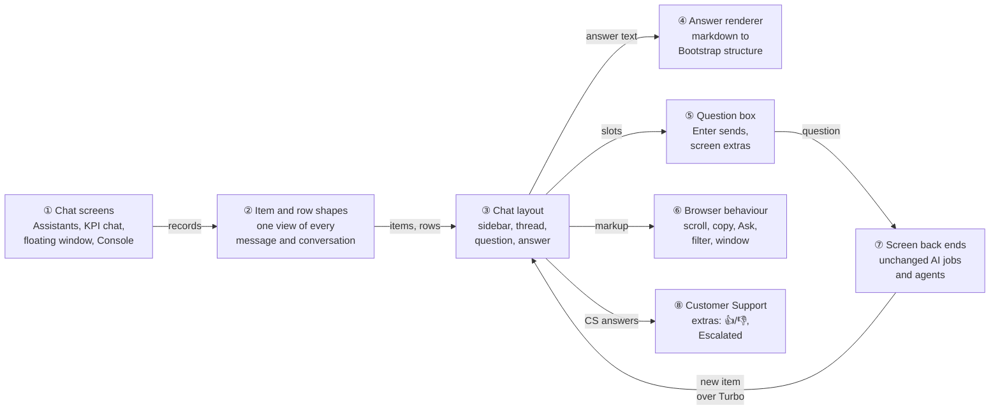
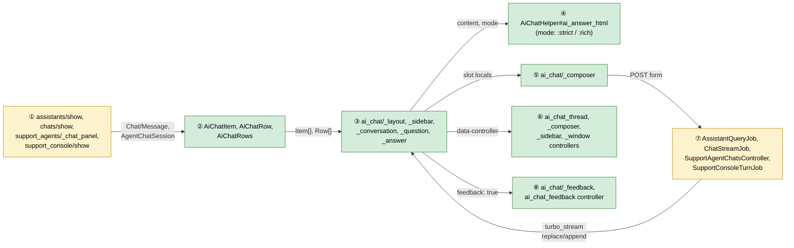
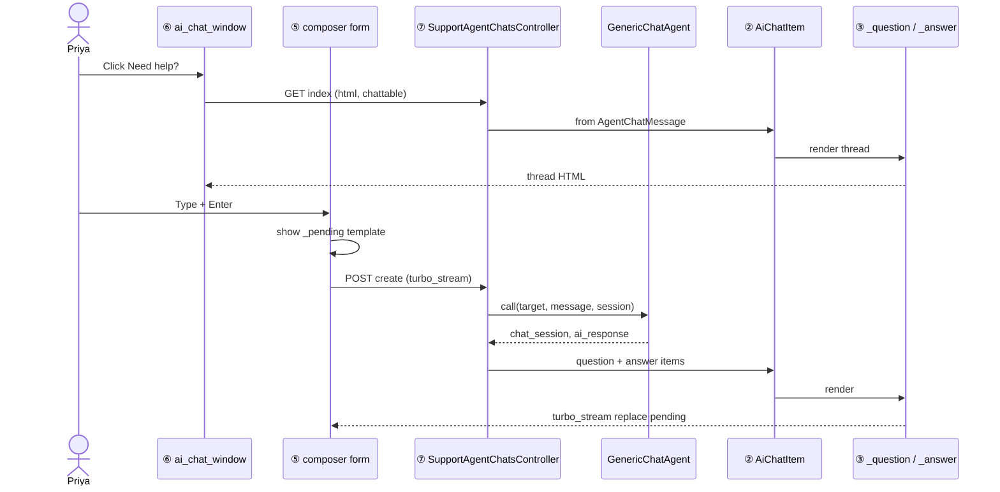
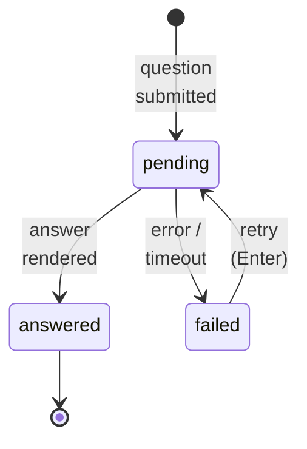
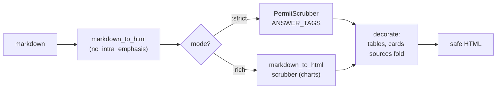
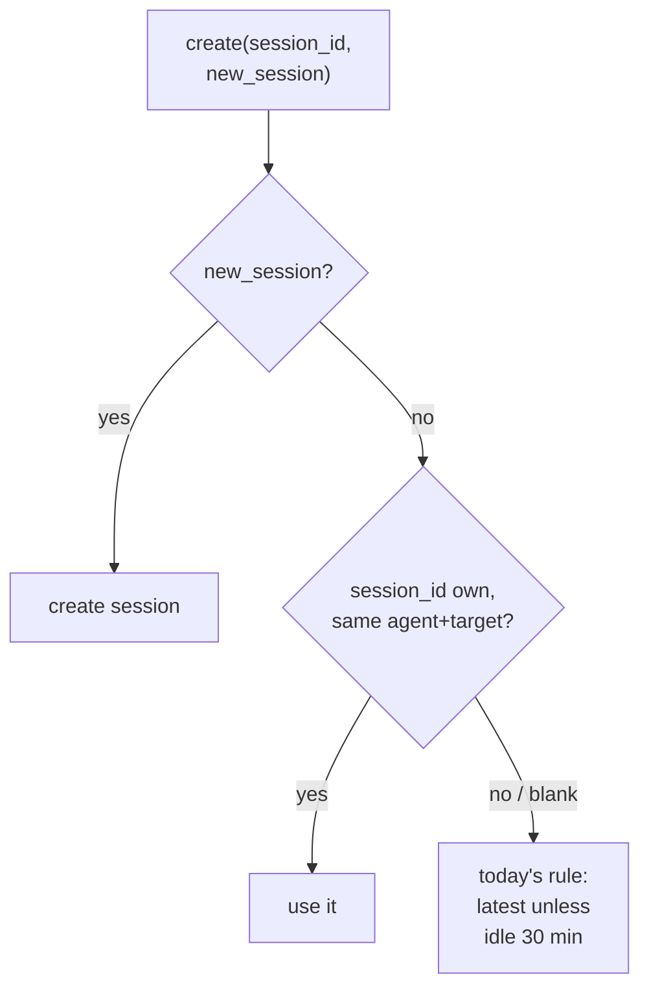
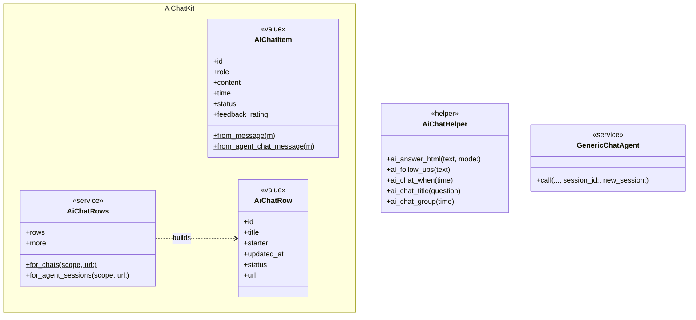

# AI Chat Kit — Design

> **Audience:** Engineering team.
> **Companion documents:** [Proposal](proposal.md) · [Spec](specs/ai-chat-kit/spec.md) · [LLD](lld.md)

> **Planning phase — no code changes.** This document explains HOW the proposal will be built.
> Do not edit application code while writing it; implementation happens later, in the tasks phase.

---

## Contents

- [1. The idea](#1-the-idea)
  - [What this adds](#what-this-adds)
  - [The idea in one picture](#the-idea-in-one-picture)
  - [Walkthrough: one example, start to finish](#walkthrough-one-example-start-to-finish)
  - [Key ideas](#key-ideas)
  - [FAQ](#faq)
- [2. The same picture with real names](#2-the-same-picture-with-real-names)
  - [Picture](#picture)
  - [What each box does](#what-each-box-does)
  - [One run, end to end](#one-run-end-to-end)
  - [Lifecycles](#lifecycles)
  - [What users see](#what-users-see)
  - [Design decisions](#design-decisions)
  - [FAQ](#faq-1)
- [3. One card per box](#3-one-card-per-box)
  - [① Chat screens](#-chat-screens)
  - [② Item and row shapes](#-item-and-row-shapes)
  - [③ Chat layout](#-chat-layout)
  - [④ Answer renderer](#-answer-renderer)
  - [⑤ Question box](#-question-box)
  - [⑥ Browser behaviour](#-browser-behaviour)
  - [⑦ Screen back ends](#-screen-back-ends)
  - [⑧ Customer Support extras](#-customer-support-extras)
- [4. Reference](#4-reference)
  - [Class diagram](#class-diagram)
  - [Data model and schema changes](#data-model-and-schema-changes)
  - [Component contracts](#component-contracts)
  - [Notifications](#notifications)
  - [Cross-cutting concerns](#cross-cutting-concerns)
  - [Worked examples](#worked-examples)
  - [Testing](#testing)
  - [Risks and open questions](#risks-and-open-questions)
  - [FAQ](#faq-2)

---

## 1. The idea

### What this adds

The Support Console's screen parts — conversation sidebar, question bubble, structured answer, rounded
question box and their small browser controllers — become a generic **chat kit**. Three more screens
render through it: the Assistants page, the KPI analysis chat and the floating agent window (every
agent, LP chat and Customer Support agent included). It follows the pattern the Support Console already
uses: server-rendered partials, updated live over Turbo Streams.

### The idea in one picture



| # | Box | In one line |
|---|---|---|
| ① | Chat screens | Each screen loads its own conversations and messages, as today |
| ② | Item and row shapes | Turns two different message stores into one simple shape the kit draws |
| ③ | Chat layout | The Support Console's sidebar, thread, question and answer partials, made generic |
| ④ | Answer renderer | One renderer with two modes: strict (Console) and rich (charts allowed) |
| ⑤ | Question box | One rounded box; each screen plugs in its extra (mic, document picker, model, Stop) |
| ⑥ | Browser behaviour | Small Stimulus controllers shared by every screen, plus the floating window's shell |
| ⑦ | Screen back ends | The AI jobs and agents that answer — unchanged, only their output partial changes |
| ⑧ | Customer Support extras | The 👍/👎 row and Escalated badge, shown only for the Customer Support agent |

### Walkthrough: one example, start to finish

**Setup.** Golden Angels has Priya (fund manager), Fund I, the investor record Acme Robotics, the
Portfolio Assistant agent (chat on, suggestions "Show fill rate across deals", "Which deals need
attention?") and the Customer Support agent. Kavya is an LP in Fund I with the LP assistant on her
dashboard. **Legend:** ✓ done, ⏳ working, ✗ failed; **bold** = the current step.

| # | When | What happens | Behind the scenes | Result |
|---|---|---|---|---|
| 1 | 10:40 | Priya opens Fund I › Assistant | ① `assistants#show` loads her Fund I chats; ② rows; ③ draws sidebar, empty thread | Sidebar: 2 rows (Today · "Call 2 fill…", Older · "NAV for Q2…"); thread: "Hello, Priya" |
| 2 | 10:42 | She asks "Which LPs are overdue on Call 3?" | ⑤ form posts; ⑦ `AssistantsController#ask` returns ③ question + pending answer; `AssistantQueryJob` queued | Question bubble ✓<br/>**Thinking… ⏳** |
| 3 | 10:42:20 | The job finishes | ⑦ job broadcasts ③ answer (④ rich) to replace the pending one | Question ✓<br/>**Answer ✓** — 3-row table in a card, ₹75,00,000 total |
| 4 | 10:45 | On Acme Robotics she clicks Need help? › suggestion › **Ask** | ⑥ window opens; ⑥ `askNow` submits ⑤; ⑦ `SupportAgentChatsController#create` runs `GenericChatAgent` | Question ✓<br/>**Thinking… ⏳** (pending shown from a template) |
| 5 | 10:45:30 | The agent fails: provider DNS error | ⑦ create responds with ③ failed item; ⑤ question restored | Question ✓<br/>**Answer ✗ Not answered — "AI service is temporarily unreachable (network/DNS). Please try again shortly."** |
| 6 | 10:47 | She presses Enter again (mistake fixed by retry) | Same as row 4, now succeeds | Question ✓<br/>**Answer ✓** |
| 7 | 10:50 | Customer Support agent: she clicks 👎, types "Wrong fund", Send | ⑧ PATCH `feedback` (existing endpoint) | **👎 filled, "Thanks for your feedback"** |
| 8 | 11:00 | Kavya opens Need help? on her dashboard | ① window with `chattable: current_user`; ② rows only where analyst = Kavya | **Kit window, her 1 earlier conversation listed** |

**Key moment (row 3):**

```
│ Which LPs are overdue on Call 3? ▢ │
│ Three LPs are overdue on Call 3, ₹75,00,000 in all.   (₹40,00,000 + ₹25,00,000 + ₹10,00,000)
│ ┌ Investor ─────┬ Called ─────┬ Overdue ──┐
│ │ Mehta Family  │ ₹40,00,000  │ ₹40,00,000│
│ │ Rao Trust     │ ₹25,00,000  │ ₹25,00,000│
│ │ Iyer HUF      │ ₹10,00,000  │ ₹10,00,000│
│ └───────────────┴─────────────┴───────────┘
│ ▢ Copy · 10:42
```

**What to notice**
- Every screen keeps its own back end (⑦); only the partial it renders changes.
- The kit never reads `Chat`/`Message` or `AgentChatSession`/`AgentChatMessage` directly — ② does.
- A failure is an item with status `failed`, drawn the same way on every screen (row 5).
- 👍/👎 is a slot on the answer, filled only for the Customer Support agent (row 7).

### Key ideas

| Idea | In one line | Card |
|---|---|---|
| Two stores, one shape | `AiChatItem` / `AiChatRow` adapt both message stores | [②](#-item-and-row-shapes) |
| Extract, don't redesign | The Console's partials and controllers become the kit; the Console renders through it | [③](#-chat-layout) |
| One renderer, two modes | `:strict` keeps X24 for the Console; `:rich` keeps charts for the others | [④](#-answer-renderer) |
| Slots, not forks | Mic, document picker, model, Stop, Export, 👍/👎 plug into fixed slots | [⑤](#-question-box), [⑧](#-customer-support-extras) |
| Back ends untouched | Jobs and agents keep their logic; they render kit partials instead | [⑦](#-screen-back-ends) |

### FAQ

| Question | Answer |
|---|---|
| Why not move every screen onto `AgentChatSession`? | That is a data migration and changes the AI back ends; this phase is UI only. ② bridges the two stores instead. |
| Why server-rendered for the floating window, not keep it in JS? | Answers then go through ④ exactly like every other screen; today's window builds bubbles in JS with its own markdown path. |
| Does the Support Console change? | Only internally — it renders the kit partials; its 140 scenarios must stay green. |
| What about the AI-written cards (Summary, Key figures, follow-ups)? | ④ already draws them when an answer has those headings; the other assistants start writing them in the AI phase. |

---

## 2. The same picture with real names

### Picture



- ① *Each screen's view gathers its conversations and messages and renders the kit layout.*
- ② *Read-only value objects built from either message store; no new tables.*
- ③ *The Support Console's partials, renamed and parameterised.*
- ④ *`SupportConsoleHelper`'s pipeline moved here (that helper is removed); the Console calls it with `:strict`.*
- ⑤ *The Console's composer with named slots.*
- ⑥ *The Console's controllers renamed, plus `ai_chat_window` (the floating shell).*
- ⑦ *Existing jobs/controllers; they now render ③ partials.*
- ⑧ *Today's 👍/👎 JS moved into its own controller; same PATCH endpoint.*

### What each box does

| # | Box | Real parts | What it does | When it runs | What it decides | Details |
|---|---|---|---|---|---|---|
| ① | Chat screens | `assistants/show`, `chats/show`, `support_agents/_chat_panel` (9 hosts unchanged), `support_console/show` | Loads conversations + messages, picks mode and slots | Page / frame load | Which conversations a user sees (existing scoping) | [Card ①](#-chat-screens) |
| ② | Item and row shapes | `AiChatItem`, `AiChatRow`, `AiChatRows` | Adapts `Message` / `AgentChatMessage` and `Chat` / `AgentChatSession` | Inside ① | Title (first question, quotes trimmed), status, starter | [Card ②](#-item-and-row-shapes) |
| ③ | Chat layout | `ai_chat/_layout`, `_sidebar`, `_conversation`, `_question`, `_answer`, `_empty_state`, `_pending` | Draws the screen | Every render and broadcast | Nothing — presentation only | [Card ③](#-chat-layout) |
| ④ | Answer renderer | `AiChatHelper#ai_answer_html`, `#ai_follow_ups` | Markdown → sanitised → Bootstrap structure | Per answer render | What markup survives (by mode) | [Card ④](#-answer-renderer) |
| ⑤ | Question box | `ai_chat/_composer` | Rounded box + slots | Every render | Ask vs working state | [Card ⑤](#-question-box) |
| ⑥ | Browser behaviour | `ai_chat_thread_controller`, `ai_chat_composer_controller`, `ai_chat_sidebar_controller`, `ai_chat_window_controller` | Scroll-follow, tables, copy, Ask/fill, Enter, filter, drag/resize/maximise | In the browser | Whether a submit is allowed (one at a time) | [Card ⑥](#-browser-behaviour) |
| ⑦ | Screen back ends | `AssistantsController#ask/#transcribe`, `AssistantQueryJob`, `ChatsController#send_message`, `ChatStreamJob`, `Message`, `SupportAgentChatsController`, `GenericChatAgent` | Answers questions (unchanged) and renders ③ | Per question | Session to continue (see [decision 6](#design-decisions)) | [Card ⑦](#-screen-back-ends) |
| ⑧ | Customer Support extras | `ai_chat/_feedback`, `ai_chat_feedback_controller`, `SupportAgentChatFeedbacksController#update` (unchanged) | 👍/👎 + note; Escalated badge | CS agent answers / rows | Whether to show the row (`CustomerSupportAgent` only) | [Card ⑧](#-customer-support-extras) |

### One run, end to end



### Lifecycles

An answer item's status (derived, never stored as a new column):



| Screen | `pending` comes from | `answered` / `failed` comes from |
|---|---|---|
| Assistants | `AssistantsController#ask` response (pending frame) | `AssistantQueryJob` broadcast (answer or `error`) |
| KPI chat | `ChatsController#send_message` response (pending `chat_response_<request_id>`) | `ChatStreamJob` re-renders it while streaming (running), then answered / failed; fallback text when blank |
| Floating window | `_pending` template inserted by ⑤ on submit | `SupportAgentChatsController#create` turbo_stream (answer or error) |
| Support Console | `metadata.turn_status` queued/running (stored, unchanged) | `SupportConsoleTurnJob` (unchanged) |

`AgentChatSession.status` (`active` / `escalated` / `resolved`) is stored and unchanged; ② maps
`escalated` to the Escalated badge.

### What users see

| Screen | Before | After |
|---|---|---|
| Assistants page | Header + History `<select>`, bubbles with robot avatar, pill box + mic | Kit layout: sidebar, Console-style thread, kit box with mic slot, Export in header |
| KPI chat | Full-width bubbles with "AI"/"You" circles, input-group + paper plane | Kit layout with sidebar of the report's chats, document picker slot |
| Floating window | Blue header bar, JS bubbles, History list, Font Awesome/Bootstrap Icons | White kit header, kit thread, Conversations view = kit rows, Tabler icons |
| Customer Support agent | As floating window + 👍/👎 | As floating window + kit 👍/👎 row |

Main journey (floating window, Customer Support agent), with callouts:

```
┌─ ① Customer Support ────────── ② [Conversations] [New] [⤢] [✕] ┐
│                                     How do I issue a call? ③ ▢   │
│ ④ Go to Fund › Capital Calls › New, pick the fund…               │
│ ▢ Copy · 10:50   ⑤ 👍 👎                                         │
│ ⑥ ┌ Wrong fund                                   [Send] ┐       │
│ ┌──────────────────────────────────────────────── (↑) ┐ ⑦       │
│ │ Ask Customer Support                                │         │
│ └─────────────────────────────────────────────────────┘         │
└──────────────────────────────────────────────────────────────────┘
```

| Step | The user… | They see |
|---|---|---|
| ① | opens Need help? | The kit window titled with the agent's name |
| ② | clicks Conversations | Kit rows; an escalated one with **Escalated** |
| ③ | reads the question | Grey bubble on the right |
| ④ | reads the answer | Plain text, tables in cards |
| ⑤ | clicks 👎 | 👎 filled red |
| ⑥ | types a note, Send | "Thanks for your feedback" |
| ⑦ | presses Enter on a new question | Question bubble, then "Thinking…" |

### Design decisions

| # | Choice | Alternative | Why the alternative was rejected |
|---|---|---|---|
| 1 | Extract the Console's partials/controllers into `ai_chat/` and render the Console through them | Build a new kit and leave the Console alone | Two copies of the same UI drift; the Console's tests then guard the kit for free |
| 2 | `AiChatItem`/`Row` value objects | A shared `ChatMessage` concern on both models | A concern would touch two models (and the LP/WhatsApp paths); value objects are view-only |
| 3 | Floating window rendered on the server (turbo_stream), `agent_chat_controller.js` deleted | Restyle the JS-built bubbles | Answers would bypass ④; two markdown paths again |
| 4 | Keep `support_agents/_chat_panel` as the partial name, rewrite its body | New partial, edit the 9 hosts | No host changes, smaller diff |
| 5 | `SupportAgentChatsController` answers HTML/turbo_stream only; JSON removed | Keep JSON alongside | Only `agent_chat_controller.js` consumed it (checked: no mobile/API caller); two paths would rot |
| 6 | **Floating window passes `session_id` / `new_session` to `GenericChatAgent`** | Keep today's rule (latest session unless idle 30 min) | The kit shows a conversation list and New chat; with today's rule a question asked in a reopened or new conversation lands in a different one. Default (no params) keeps today's rule, so WhatsApp is unchanged. **Confirmed with product (31 Oct 2026).** |
| 7 | One renderer with `mode:` | Two helpers | Same decoration code; only the sanitiser differs |
| 8 | Conversation lists capped at 50 with "50+" | Unbounded (today on Assistants and the window) | Matches the Console; avoids loading every chat |

### FAQ

| Question | Answer |
|---|---|
| Why rename `support_console_thread` etc. instead of reusing the names? | The names would be wrong on four other screens; the Console's steps that assert `data-action` strings are updated in the same phase. |
| What if an old browser tab still has `agent_chat_controller` cached? | The window markup changes with the deploy; a stale tab's JSON calls get HTML back and fail visibly — a reload fixes it. |
| Why is the Console's composer Stop not on other screens? | They have no stop endpoint today; ⑤'s Stop slot is only filled by the Console. |

---

## 3. One card per box

> Same order and numbers as the picture.

### ① Chat screens

Each screen keeps its route, controller and authorisation; its view now renders `ai_chat/_layout`
with its rows, items, mode and slots.

| Owns | Reads / receives | Produces |
|---|---|---|
| Which conversations and messages to show; header actions | Existing policies and scopes | `ai_chat/_layout` locals |

| Screen | Conversations (rows) | Messages (items) | Mode | Slots |
|---|---|---|---|---|
| `assistants#show` | `Chat` where user, entity, `assistant_type`, owner — as today's `@chats`, newest 50 | `@chat.messages` user/assistant | `:rich` | header: owner link + Export menu; composer: mic + hint; empty: `DESCRIPTION` |
| `chats#show` | `policy_scope(Chat)` with the same owner as `@chat` (the Analysis tab's list), newest 50 | `@chat.messages` | `:rich` | composer: document picker when owner has PDF/CSV documents |
| `support_agents/_chat_panel` | `AgentChatSession` for agent, chattable, `analyst_id: current_user` | `agent_chat_messages` (+ feedback) | `:rich` | header: Conversations/New/Maximise/Close; empty: `sample_questions`; answer: feedback when `CustomerSupportAgent` |
| `support_console/show` | unchanged (`conversations_for`) | unchanged | `:strict` | composer: model + Stop; answer: follow-ups/Ask |

Role → access (unchanged; listed so tests cover it):

| Role | Assistants | KPI chat | Floating window | Scoping |
|---|---|---|---|---|
| Fund manager (assistant access) | `AssistantPolicy#show?` | `ChatPolicy` | `SupportAgentPolicy#show?` | `entity_id: current_user.entity_id`; `analyst_id: current_user.id` |
| Investor (LP) | — | — | `SupportAgentPolicy#show?` for `LpAssistantAgent` | `analyst_id: current_user.id`, `chattable: current_user` |
| Other entity's user | refused | refused (`ChatPolicy`) | refused / empty | as today |

**Worked examples:** H2, H5, H6, H8, E6, E13, X7, X8.

**FAQ**

| Question | Answer |
|---|---|
| Does the KPI Analysis tab's table list change? | No — it still lists chats; opening one shows the kit page with the same chats in its sidebar. |
| Why cap the Assistants list at 50? | It loads every chat today; the Console's cap and "50+" footer apply. |

### ② Item and row shapes

Read-only value objects so ③ never touches either message store.

| Owns | Reads / receives | Produces |
|---|---|---|
| Field mapping, title trimming, status mapping | `Message`, `AgentChatMessage` (+ `feedback`), `Chat`, `AgentChatSession` | `AiChatItem`, `AiChatRow` |

| Field | From `Message` / `Chat` | From `AgentChatMessage` / `AgentChatSession` |
|---|---|---|
| `role` | `role` | `role` |
| `content` | `content` | `content` |
| `time` | `created_at` | `created_at` |
| `status` | `pending` when assistant and content blank, else `answered` | `metadata.turn_status` mapped (Console), else `answered` |
| `feedback_rating` | — | `feedback&.rating` |
| Row `title` | first user message (grouped query), else `chat.name`, else "New conversation" | first user message (grouped query) |
| Row `starter` | `chat.user.full_name` | `analyst.full_name` |
| Row `status` | — | `escalated` → Escalated badge; turn status for the Console |

**Worked examples:** E2, E3, H7, H10.

**FAQ**

| Question | Answer |
|---|---|
| Why not decorate the records (Draper)? | Two unrelated models; a plain `Data` value is simpler and testable. |
| N+1 risk? | Titles come from one grouped `MIN(id)` query per screen, like `SupportConsoleController#first_questions`. |

### ③ Chat layout

The Console's partials moved to `ai_chat/` and parameterised by locals.

| Owns | Reads / receives | Produces |
|---|---|---|
| Markup, Bootstrap classes, DOM ids | `rows`, `items`, `mode`, slots | HTML; Turbo frame `ai-chat-thread` |

| Partial | From | Notes |
|---|---|---|
| `ai_chat/_layout` | `support_console/show` panes | Sidebar + section; `variant: :page` or `:window` |
| `ai_chat/_sidebar`, `_conversation` | `show` aside + `_conversation` | Groups, search, New chat, footer count |
| `ai_chat/_question`, `_answer` | `_message` | Answer: badge, body via ④, Copy/time, steps fold (Console only), `feedback` slot |
| `ai_chat/_empty_state` | new | Greeting/description + suggestion button groups (same markup as follow-ups) |
| `ai_chat/_pending` | `_message` running branch | "Thinking…" line; also emitted as a `<template>` for ⑥ |

**Worked examples:** H1, H2, E1.

**FAQ**

| Question | Answer |
|---|---|
| Do Console DOM ids change? | No — the Console passes its ids (`support-console-messages`, …) as locals, so its tests still find them. |

### ④ Answer renderer

| Owns | Reads / receives | Produces |
|---|---|---|
| Sanitising + Bootstrap decoration | answer markdown, `mode` | Safe HTML |



| Mode | Used by | Allowed beyond text | Ask buttons / follow-ups |
|---|---|---|---|
| `:strict` | Support Console | `href`/`title` only (X24) | Yes (Console) |
| `:rich` | Assistants, KPI chat, floating window | `img`, `canvas`, chart `data-*` as `markdown_to_html` allows today | Questions-card Ask only when the screen opts in (AI phase) |

**Worked examples:** E7, E8, X5, X6.

**FAQ**

| Question | Answer |
|---|---|
| Does `:rich` loosen anything? | No — it is exactly `markdown_to_html`'s allow-list today, plus our fixed classes. |

### ⑤ Question box

| Owns | Reads / receives | Produces |
|---|---|---|
| Box markup, send/working state, slots | `form` url/method/params, `running`, slot blocks | Form submission |

| Slot | Filled by |
|---|---|
| `extras` (left of send) | mic (Assistants), document picker (KPI), model select (Console) |
| `send` | Ask (all); Stop (Console only, while running) |
| `above` | follow-ups (Console) |
| `footer` | hint line (Assistants), data/code footer (Console) |

**Worked examples:** H3, E4, E5, E17.

**FAQ**

| Question | Answer |
|---|---|
| How does the mic still work? | `voice_chat_controller` keeps recording/transcribing only; the transcribed text is posted to `/assistants/transcribe`, which returns the same kit question + pending frame. |

### ⑥ Browser behaviour

| Controller | From | Responsibility |
|---|---|---|
| `ai_chat_thread_controller` | `support_console_thread_controller` | Follow scroll, jump-to-latest, number-column alignment, keep folds open, Copy, `askNow` |
| `ai_chat_composer_controller` | `support_console_controller` | Enter/Shift+Enter, resize, `fill`, block double submit, insert `_pending` template on submit (window) |
| `ai_chat_sidebar_controller` | `support_console_sidebar_controller` | Filter, active row, add new row, collapse, Ctrl+K |
| `ai_chat_window_controller` | window parts of `agent_chat_controller` | Bubble toggle, drag, resize, maximise, Conversations view, close; `data-turbo-temporary` kept |

`voice_chat_controller` loses its message rendering (keeps recording); `ppt_export_controller` and
`slideshow_controller` read answers by `[data-ai-chat-answer]` instead of `.assistant-message-card`.
`agent_chat_controller.js` and `faq_thread_controller`'s use on `chats/show` are removed (FAQ threads
keep `faq_thread_controller`).

**Worked examples:** H4, H11, H12.

**FAQ**

| Question | Answer |
|---|---|
| Why is `ai_chat_window` separate from the thread controller? | Only the floating window has a shell; the page screens don't. |

### ⑦ Screen back ends

| Back end | Change |
|---|---|
| `AssistantsController#ask`, `#transcribe` | Render `ai_chat` question + pending (Turbo Stream append) instead of `assistants/_ask_frame` |
| `AssistantQueryJob` | Broadcast `ai_chat/_answer` (answered or failed) replacing the pending id; drop `broadcast_hide_spinner` |
| `ChatsController#send_message`, `ChatStreamJob` | Same pattern as the Assistants page: the response appends the question + pending answer; the job takes a `request_id` and replaces `chat_response_<request_id>` with the answer so far (running) at sentence/line ends, then the finished or failed answer, and re-renders the box. **Found during phase 3:** `Chat#enable_broadcast` is an in-memory flag nothing sets, so `Message`'s own broadcasts never fired and answers only appeared after a reload — the request-id path fixes that without touching `Message`. `messages/_message` renders the kit; `messages/_streamed_markdown` and `chats/_chat_box` are removed |
| `SupportAgentChatsController` | `index`/`sessions` → HTML (kit thread / rows); `create` → turbo_stream (question + answer or failed item); passes `session_id`/`new_session` |
| `GenericChatAgent` | Optional `session_id:` (must match agent, chattable, analyst) and `new_session:`; defaults keep today's rule |
| `SupportConsoleTurnJob` | None (renders the same partial names via `_message` wrapper) |



**Worked examples:** H3, H5, H6, E9, E10, X1–X4, X7.

**FAQ**

| Question | Answer |
|---|---|
| Does WhatsApp change? | No — it calls `GenericChatAgent` without the new keywords. |
| Is the LLM call still inside the web request for the window? | Yes, as today; moving it to a job is the AI phase's call. |

### ⑧ Customer Support extras

| Owns | Reads / receives | Produces |
|---|---|---|
| 👍/👎 row, note box, Escalated badge | `feedback_rating`, session `status` | PATCH to `feedback_support_agent_chat_path` (unchanged contract `{rating}` / `{notes}`) |

Shown only when the window's agent is `CustomerSupportAgent` (today's `feedbackEnabled` rule).
Escalation itself stays in `EscalateToHumanTool` / `CustomerSupportEscalationService` (record, session
status, `CustomerSupportEscalationMailer`) — untouched.

**Worked examples:** H9, H10, E12, X9.

**FAQ**

| Question | Answer |
|---|---|
| Does the review queue change? | No — same `AgentChatMessageFeedback` rows, same endpoint. |

---

## 4. Reference

### Class diagram



### Data model and schema changes

N/A — no tables or columns change. ② reads existing `chats`, `messages`, `agent_chat_sessions`,
`agent_chat_messages`, `agent_chat_message_feedbacks`.

### Component contracts

| From → To | Contract | Direction rule |
|---|---|---|
| ① → ② | `AiChatRows.for_*(records, url:)`, `AiChatItem.from_*(record)` | ① never passes records to ③ |
| ② → ③ | locals `rows:`, `items:` (arrays of value objects) | ③ reads values only |
| ③ → ④ | `ai_answer_html(content, mode:)` | Mode chosen by ①, never by content |
| ③ → ⑤ | captured slot locals `before:`, `above:`, `extras:`, `stop_button:`, `footer:` | Slots hold fixed app markup only |
| ③ → ⑥ | `data-controller` / `data-action` names in the table in ⑥ | Answers' own markup never carries `data-*` (④ strips it) |
| ⑤ → ⑦ | Existing routes; window adds `session_id`, `new_session` params | Params validated in ⑦ |
| ⑦ → ③ | Turbo Stream `append`/`replace` of `_question`/`_answer` by DOM id | Ids from `dom_id` / request id |
| ③ → ⑧ | `feedback: true` local on `_answer` | Only for `CustomerSupportAgent` |

### Notifications

This change sends, adds, changes and suppresses **no** notification, for either audience:

| Notification | Trigger | Recipients | Channel | Customisable | Default | Sent once? |
|---|---|---|---|---|---|---|
| CS escalation email (`CustomerSupportEscalationMailer#escalation_created`) | Customer Support agent calls `EscalateToHumanTool` | CapHive CS team (unchanged) | Email | No (internal) | On (unchanged) | One per escalation record (unchanged) |
| KPI chat stream error alert (`ChatStreamJob#send_notification`) | Streaming raises | The chat's user (unchanged) | In-app | No | On (unchanged) | Per failure (unchanged) |

Investors: the LP chat sends no notification today or after. Internal users: the two above are
unchanged; nothing new is sent when a question or answer is rendered.

### Cross-cutting concerns

#### Transactions and queries

Row titles: one grouped `MIN(id)` on `messages` / `agent_chat_messages` per list, then one `pluck` — as
`SupportConsoleController#first_questions`. Lists `LIMIT 50` ordered by `updated_at`. Replaces the
window's per-session `agent_chat_messages` queries (today an N+1 in `sessions`).

#### Exception handling and monitoring

Unchanged: `SupportAgentChatsController` keeps its connectivity-error mapping (now rendered as a
failed item); `AssistantQueryJob` timeout/error → failed item; `ChatStreamJob` keeps its alert.

#### Performance and security

- ④ `:strict` keeps the Console's X24 guarantees; `:rich` is today's allow-list — no loosening.
- No new endpoints for investors; the window's endpoints keep `authorize @support_agent, :show?` and
  `analyst_id: current_user.id` scoping. `session_id` is honoured only when it matches the agent,
  chattable and analyst.
- Existing, unchanged: `find_chattable` constantizes `chattable_type` from params (see Risks).

### Worked examples

Shared setup:

| Item | Value |
|---|---|
| Entity | Golden Angels (`Investment Fund`); second entity Beta Capital |
| Users | Priya Sharma (Golden Angels, assistant + agent access); Arjun (Beta Capital); Kavya (investor user, LP in Fund I) |
| Records | Fund I; investor Acme Robotics; KPI report "Q3 2026" for Acme with one PDF |
| Agents | Portfolio Assistant agent (chat on, 2 sample questions); Customer Support agent; LP assistant |
| AI | All LLM calls stubbed (assistant `run`, `GenericChatAgent`, `Chat#ask`) |

#### Happy Path

| # | Scenario | Given | When | Then | Spec scenario | Feature |
|---|---|---|---|---|---|---|
| H1 | Console unchanged on the kit | Console suite | run | 140 scenarios green, ids unchanged | Support Console unchanged | `features/support_console/*` |
| H2 | Assistants sidebar | Priya has 2 Fund I chats (today 09:15, 28/10) | opens Fund I › Assistant | 2 rows under Today/Older, "Priya Sharma · 09:15" | Assistants page uses the shared chat; Rows show question, who and when | `ai_chat/assistants_page.feature` |
| H3 | Assistants ask | Fund I assistant | asks "Which LPs are overdue on Call 3?" | question bubble + "Thinking…"; job runs; answer with table in a card | Table answer; Thinking line; Enter sends | `ai_chat/assistants_page.feature` |
| H4 | Export reads kit answers | a conversation with a table answer | page renders | answers carry `data-ai-chat-answer` with the table inside | Export PowerPoint after the change | `ai_chat/assistants_page.feature` |
| H5 | KPI chat on the kit | Q3 2026 report chat with 1 earlier message | opens it, sends "Summarise revenue" | kit layout, sidebar with the report's chats, streamed answer in kit answer | Assistants page uses the shared chat (KPI) | `ai_chat/kpi_chat.feature` |
| H6 | Floating window ask | Acme page, Portfolio Assistant agent | opens window, asks | kit question + answer; no 👍/👎 | Ask a suggestion; Other agents have no rating | `ai_chat/floating_window.feature` |
| H7 | Window conversations | 2 sessions on Acme | clicks Conversations | 2 kit rows, first question · who · when | Rows show question, who and when | `ai_chat/floating_window.feature` |
| H8 | LP chat | Kavya, 1 own session; another investor's session exists | opens Need help? on her dashboard | kit window, 1 row only | LP chat uses the shared chat; Only the user's own conversations | `ai_chat/floating_window.feature` |
| H9 | CS feedback | CS answer | clicks 👎, note "Wrong fund", Send; reopens | `AgentChatMessageFeedback` negative + note; 👎 filled on reopen | Rate down with a note; Earlier rating shown | `ai_chat/customer_support.feature` |
| H10 | Escalated row | CS session status `escalated` | opens Conversations | row shows "Escalated" | Escalated conversation | `ai_chat/customer_support.feature` |
| H11 | Suggestion buttons | empty window with 2 sample questions | renders | each has a text button (`fill`) and an Ask (`askNow`) carrying the question | Ask a suggestion; Fill from a suggestion | `ai_chat/floating_window.feature` |
| H19 | Assistants page layout answer | an answer with Summary, Key figures, Questions, Follow-ups | opens the page | Summary card, stat card, Ask on the question, follow-ups above the box | Questions and answers; Suggested questions | `ai_chat/answer_layout.feature` |
| H20 | Record chat layout answer | same | opens the chat | same cards and follow-ups | Questions and answers | `ai_chat/answer_layout.feature` |
| H21 | Window layout answer | same | opens the window | same cards, Ask and follow-ups | Questions and answers | `ai_chat/answer_layout.feature` |
| H22 | Assistants asked for the layout | a Fund Assistant | answers | instructions end with `AiChatAnswerLayout` | Screens that use the shared chat | `ai_chat/answer_layout.feature` |
| H12 | Maximise markup | window | renders | Maximise control and sidebar container present | Maximise the floating window | `ai_chat/floating_window.feature` |

#### Edge Cases

| # | Scenario | Given | When | Then | Spec scenario | Feature |
|---|---|---|---|---|---|---|
| E1 | First visit | Priya has no Fund I chats | opens assistant | one row "New conversation" (the page creates the chat on open); greeting "Hello, Priya" | No conversations | `ai_chat/assistants_page.feature` |
| E2 | Quoted first question | session first question `"Why is TSTF2 overpaid?"` | lists | title without quotes | Rows show question, who and when | `ai_chat/floating_window.feature` |
| E3 | Date by locale | conversation last changed 28/10/2026 | lists under `en` and `en-US` | 28/10/2026 / 10/28/2026 | Older conversation shows a date | `ai_chat/assistants_page.feature` |
| E4 | Blank question | window | posts blank message | nothing created, no answer item | Blank question | `ai_chat/floating_window.feature` |
| E5 | No documents | KPI report without PDF/CSV | opens chat | no document picker | Document picker kept | `ai_chat/kpi_chat.feature` |
| E6 | Assistant without owner | FundAssistant (no record) | opens | header without record link; sidebar of FundAssistant chats | Assistants page uses the shared chat | `ai_chat/assistants_page.feature` |
| E7 | Snake_case answer | answer "KMH_01 … KMH_01" | renders `:rich` | no `<em>` | Snake_case names | `ai_chat/assistants_page.feature` |
| E8 | Chart in rich, stripped in strict | answer with chart `canvas` markup | renders `:rich` / `:strict` | kept / stripped | Questions and answers (allowed content) | `ai_chat/answer_rendering.feature` |
| E9 | New chat starts a session | window, latest session 5 min old | New chat, asks | a new `AgentChatSession` | Rows show question, who and when | `ai_chat/floating_window.feature` |
| E10 | Reopened conversation continues | 2 sessions, older one opened | asks | message added to the older session | Reopened conversation continues | `ai_chat/floating_window.feature` |
| E11 | No params keeps today's rule | `GenericChatAgent.call` without keywords (WhatsApp) | called | latest session unless idle 30 min | Screens that use the shared chat (WhatsApp unchanged) | `ai_chat/floating_window.feature` |
| E12 | Non-CS agent no feedback | Portfolio Assistant answer | renders | no 👍/👎 | Other agents have no rating | `ai_chat/customer_support.feature` |
| E13 | Window scoped to record | sessions on Acme and Beta Robotics | opens on Acme | only Acme's rows | Only the user's own conversations | `ai_chat/floating_window.feature` |
| E14 | 51 conversations | Priya has 51 Fund I chats | opens | 50 rows, "50+ conversations" | Conversation list | `ai_chat/assistants_page.feature` |
| E15 | KPI blank answer fallback | stream ends with blank content | final broadcast | answer shows the fallback text | Thinking line | `ai_chat/kpi_chat.feature` |
| E16 | Icons | each kit screen | renders | no `fa-`/`bi-` classes | No Font Awesome or Bootstrap Icons | `ai_chat/assistants_page.feature`, `floating_window.feature`, `kpi_chat.feature` |
| E18 | Idle conversation not continued | latest window conversation last active 2 hours ago | opens the window | a new, empty conversation; the old one listed | Idle conversation not continued by default | `ai_chat/floating_window.feature` |
| E19 | Agents: layout on the web, not WhatsApp | an agent's instructions | built for `web` / `whatsapp` | include / omit `AiChatAnswerLayout` | Screens that use the shared chat | `ai_chat/answer_layout.feature` |
| E20 | Record chat instructions not saved | a record chat | a question is sent | `with_instructions(layout, persist: false)` | Screens that use the shared chat | `ai_chat/answer_layout.feature` |
| E17 | Voice path | `/assistants/transcribe` (stubbed transcription "Call 3 status") | posts audio | kit question "Call 3 status" + pending | Enter sends | `ai_chat/assistants_page.feature` |

#### Error Cases

| # | Scenario | Given | When | Then | Spec scenario | Feature |
|---|---|---|---|---|---|---|
| X1 | Provider unreachable | `GenericChatAgent` raises `SocketError` | asks in window | "Not answered" + "AI service is temporarily unreachable (network/DNS). Please try again shortly."; question returned | Provider unreachable | `ai_chat/floating_window.feature` |
| X2 | Agent failure | `GenericChatAgent` returns failure | asks | "Not answered" + "Chat agent execution failed" | Provider unreachable | `ai_chat/floating_window.feature` |
| X3 | Assistant timeout | assistant `run` exceeds `TIMEOUT` | job runs | failed item "The request timed out. Please try again or refine your query." | Thinking line | `ai_chat/assistants_page.feature` |
| X4 | KPI stream error | `Chat#ask` raises | job runs | alert sent to the chat's user (unchanged) | Thinking line | `ai_chat/kpi_chat.feature` |
| X5 | Strict still strips | Console answer with `<p class="d-none" data-controller="x">` | renders | no class/data kept (X24/X36 green) | Questions and answers | `support_console/ask.feature` (existing) |
| X6 | Rich strips scripts | answer with `<script>` and `onerror=` | renders `:rich` | removed | Questions and answers | `ai_chat/answer_rendering.feature` |
| X7 | Other user's session id | Kavya posts `session_id` of another investor's session | asks | not used; her own session gets the message | Only the user's own conversations | `ai_chat/floating_window.feature` |
| X8 | Other entity's chat | Arjun (Beta) opens a Golden Angels `chats#show` | requests | refused as today | Only the user's own conversations | `ai_chat/kpi_chat.feature` |
| X39 | Strict link text stays text | Console answer `[&lt;img src=x onerror=…&gt;](/funds/1)` | renders `:strict` | the link becomes escaped text, no `` (found in review; existed in the Console) | Questions and answers | `ai_chat/answer_rendering.feature` |
| X40 | Rich answer cannot take page ids | answer with `<div id="assistant-composer" data-controller="ai-chat-window">` | renders `:rich` | no `id`, no `data-*` except the chart renderer's | Questions and answers | `ai_chat/answer_rendering.feature` |
| X41 | Another record's document | `send_message` with another tenant's `document_id` | job runs | the model is asked with no document (only the chat record's documents are used) | Document picker kept | `ai_chat/kpi_chat.feature` |
| X42 | Colleague's assistant chat | a colleague's `chat_id` | Priya opens it | not shown (own chats only) | Only the user's own conversations | `ai_chat/assistants_page.feature` |
| X43 | Window fails twice | AI unreachable | asks, fails, asks again | each failure moves off the pending ids, so the next pending answer is replaced | Provider unreachable | `ai_chat/floating_window.feature` |
| X44 | Asking an agent without access | another entity's user | posts a question | refused (Pundit), not a 500; nothing saved | Only the user's own conversations | `ai_chat/floating_window.feature` |
| X9 | Feedback on another's message | Arjun PATCHes feedback for Priya's message | requests | refused as today | Rate down with a note | `ai_chat/customer_support.feature` |

### Testing

Cucumber only, rack_test for markup and endpoints (as the Console's features), LLM calls stubbed. New
step file `features/step_definitions/ai_chat_steps.rb` with the shared setup; the Console's steps that
assert `support-console-*` controller names are updated in the phase that renames them. Every scenario
carries a `# H3 — Happy path: …` comment; code comments name the IDs of the paths they implement.

### Risks and open questions

- **Session choice in the window (decision 6, confirmed).** The window now names the conversation a
  question belongs to; a `session_id` that is not the user's own (same agent, record, channel) is
  ignored. Mitigation: defaults keep today's rule for every other caller (E11); X7 covers misuse.
- **Export / slides rely on DOM classes.** Mitigation: H4 asserts the `data-ai-chat-answer` hook the
  exporters read; QA exports one deck.
- **Removing the window's JSON.** Mitigation: verified only `agent_chat_controller.js` calls it; the
  mobile app and WhatsApp do not.
- **Investor-facing window.** Mitigation: H8, X7 cover scoping; QA runs the role sweep as Kavya.
- **Existing (not introduced):** `find_chattable` constantizes `params[:chattable_type]`. Out of scope
  (UI phase); recommend an allow-list (`Investor`, `Entity`, `User`, `AiPortfolioReport`,
  `SupportAgent`) as a follow-up.
- **Synchronous LLM call in the window's request** (existing): long answers hold a web worker; kept as
  today.
- **Answer broadcast racing the HTTP response** (Assistants page, record chat): if the job finishes
  before the browser receives the response that adds the pending answer, the answer broadcast finds
  nothing to replace and "Thinking…" stays until a reload. The box is no longer locked by the response
  (review fix), so the user can ask again; the window is unaffected (its answer is the response).
  Rare (the job must finish within the response's round trip); a follow-up could have the page fetch
  the answer when a pending one outlives its job.

### FAQ

| Question | Answer |
|---|---|
| Why no schema change? | Every field the kit shows already exists; ② only maps it. |
| What is the rollback? | Revert the deploy; no data changes. |
| Can phases ship separately? | Yes — Console → kit first (no visible change), then each screen independently. |
