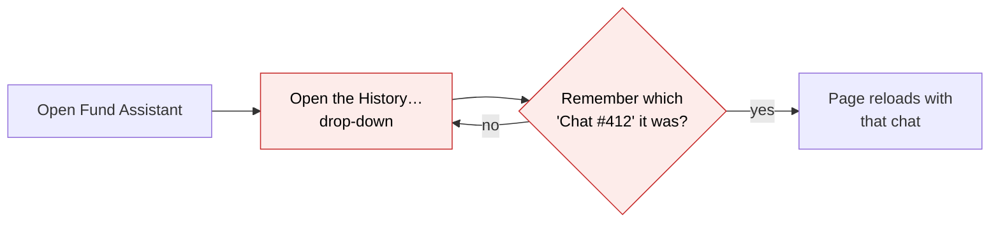
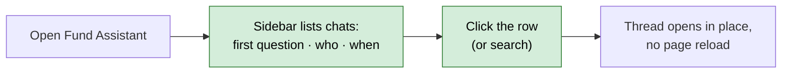
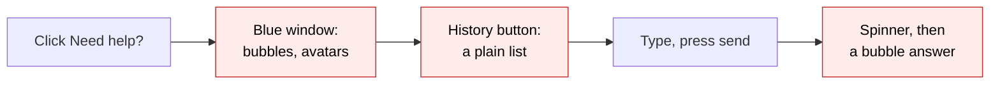
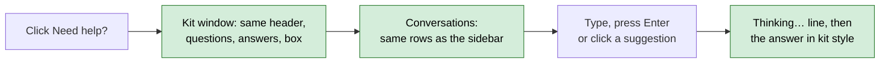
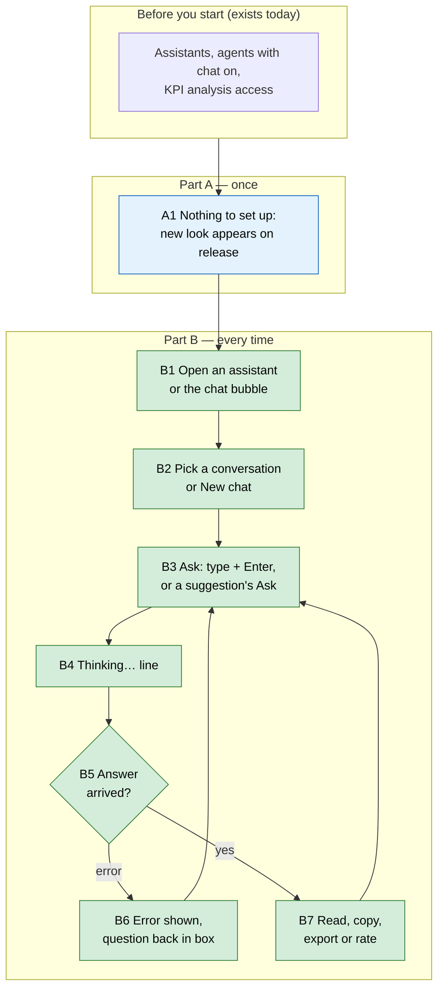

# AI Chat Kit — one look and feel for the fund manager's AI chats — Proposal

> **Audience:** Business team, product, QA, support — non-technical.
> **Companion document:** [Design](design.md)
> **New to this? Start with the [Workflow Journey](#workflow-journey)** — every action, in order, from start to the outcome.

> **Planning phase — no code changes.** This document proposes and explains the change. Do not
> edit application code while writing it; implementation happens later, in the tasks phase.

---

## Why

CapHive has five AI chat screens, built at different times, and each looks and behaves
differently: different bubbles, icons, input boxes, history lists and "thinking" indicators. The
Support Console (shipped October 2026) is the newest and the one users found clearest, so the
fund manager's other three chat screens should look and work the same way — one chat to learn,
not four.

This change is **UI only**. What the assistants say is not changed here; that is the next phase.

## What Changes

The Support Console's screen is turned into a shared **chat kit** (the same parts, reused), and
three fund-manager chat screens move onto it:

| # | Screen | Who uses it | Where it opens |
|---|---|---|---|
| 1 | **Assistants page** — Fund, Specific Fund, Portfolio, Portfolio Company and Capital Commitment assistants | Fund managers | "Assistant" buttons on the funds list, a fund, the portfolio list, a portfolio company, a commitment |
| 2 | **KPI analysis chat** | Fund managers / portfolio analysts | KPI report › Analysis tab › a chat |
| 3 | **Floating agent chat** — every agent with chat: the Portfolio Assistant agent, the **Customer Support agent**, the **LP chat** (LP assistant) and the rest | Fund managers, admins, **investors (LP chat)** | The round "Need help?" bubble on investor pages, the fund manager's and portfolio dashboards, the investor's dashboard (LP chat), AI portfolio reports, agent pages |

On each of them, after this change:

- **Conversations in a sidebar**, newest first, grouped Today / Yesterday / Previous 7 days / Older,
  each row showing the first question, who asked it and when, with search and a **New chat** button
  — replacing the "History…" drop-down (1), the separate chat list (2) and the "History" toggle (3).
- **Questions** in a soft grey bubble on the right; **answers** as plain text across the column (no
  bubble, no robot avatar), with tables in a bordered card, notes as a callout, code in a shaded
  panel, a **Copy** button and the time on hover.
- **One question box**: rounded, Enter sends, Shift+Enter adds a line, it grows as you type, and the
  send button turns into a "working" state while an answer is on its way.
- **One "working" line** while the assistant thinks ("Thinking…" with a pulsing dot), instead of
  bouncing dots, a spinner or the word *Thinking…* in italics.
- **Suggested questions** (the agents' "Try one of these") become the same buttons as the Support
  Console's follow-ups: click the text to put it in the box, click **Ask** to send it.
- **One icon set and one font**: Tabler icons only (today Font Awesome and Bootstrap Icons are mixed
  in), one text size, regular weight, theme colours only.
- Each screen **keeps its own extras** in the same places: the Assistants page's Export menu
  (AI Slides, Export PowerPoint, Efficiency Report) and microphone; the KPI chat's document picker;
  the floating chat's drag, resize, maximise and close.
- The **Support Console** moves onto the same kit first, with **no visible change**.

**Investors see the change too:** the **LP chat** — the "Need help?" bubble on an investor's dashboard
— moves onto the kit like the other floating chats. Only its look changes: what the LP assistant can
see and answer is decided by its back end, which this change does not touch.

**The Customer Support agent keeps its extras** on the kit, working exactly as today:
- **👍/👎 on each answer** — the chosen one filled (👍 blue, 👎 red), the note box after 👎 with
  "Thanks for your feedback", earlier ratings shown when a conversation is reopened, ratings and notes
  reaching the CS feedback review queue;
- **pass to a human** — when the assistant hands the conversation to the CapHive support team, the
  team is emailed and the conversation shows an **Escalated** badge in the conversation list.

**Not changed:** the FAQ threads, the mobile app and WhatsApp.

### Flow Diagram

Opening an earlier conversation on the Assistants page — today it is a drop-down that reloads the page.





Asking in the floating agent chat — today the window is a separate design with its own history list.





---

## Workflow Journey

### Who is involved

| Person | Role | What they do in the journey |
|---|---|---|
| Priya | Fund manager at Golden Angels (has the Assistant and support-agent access she has today) | Uses the Fund Assistant, the floating Portfolio Assistant agent and the KPI analysis chat |
| Ravi | Admin at Golden Angels | Opens an agent's own page to try its chat |
| Kavya | Investor (LP) in Golden Angels Fund I | Uses the LP chat on her dashboard — now in the kit's window |

### The journey on one page



### Before you start

| Needed | Why | Where it comes from |
|---|---|---|
| Access to the Assistants (today's permission) | To open screen 1 | Unchanged — the same role that sees the "Assistant" buttons today |
| A support agent with chat turned on (e.g. Portfolio Assistant agent) | To see the floating bubble (screen 3) | The agent's settings page, as today |
| Analyse permission on a KPI report | To open the Analysis tab (screen 2) | Unchanged |

### Part A — once

| Step | Who | Where | Action | What the system does | What you see |
|---|---|---|---|---|---|
| A1 | — | — | Nothing to switch on | The three screens use the kit from the release onwards; earlier conversations show in the new sidebar | The new layout the next time a screen is opened |

### Part B — every time

| Step | Who | Where | Action | What the system does | What you see |
|---|---|---|---|---|---|
| B1 | Priya | Fund › Golden Angels Fund I › **Assistant** | Clicks the button | Opens the Specific Fund Assistant for Fund I | Sidebar of her earlier Fund I chats on the left; an empty thread with "Hello, Priya" and what the assistant can do |
| B2 | Priya | Sidebar | Clicks "Which LPs are overdue on Call 3?" (Today · 10:42) | Loads that conversation into the thread, no page reload | The earlier questions and answers; the row tinted as open |
| B3 | Priya | Question box | Types "And on Call 4?" and presses Enter | Sends the question | Her question in a grey bubble on the right; the box clears; the send button shows it is working |
| B4 | — | Thread | — | The assistant works on the answer | "Thinking…" with a pulsing dot under her question |
| B5 | — | Thread | — | The answer arrives | The answer across the column, its table in a bordered card, Copy and the time on hover |
| B6 | — | Thread | — | If the assistant fails or times out | A red "Not answered" note with the reason; her question is put back in the box to retry |
| B7 | Priya | Header › **Export** › Export PowerPoint | Clicks it | Exports the conversation, as today | The download, as today |
| B8 | Priya | Investor › Acme Robotics › **Need help?** bubble | Clicks it | Opens the Portfolio Assistant agent's window | The kit window: header with the agent's name, Conversations / New / Maximise / Close; "Try one of these" suggestions |
| B9 | Priya | Window › suggestion "Show fill rate across deals" › **Ask** | Clicks Ask | Sends it | Same as B3–B5, inside the window |
| B10 | Priya | Window › **Conversations** | Clicks it | Lists this record's earlier conversations with the same rows as the sidebar | Rows with first question · who · when; clicking one loads it |
| B11 | Priya | KPI report Q3 › Analysis › a chat | Opens it | Opens the KPI chat on the kit | Sidebar of the report's chats; thread; box with the document picker beside it |
| B12 | Kavya | Her investor dashboard › **Need help?** | Opens the LP chat, clicks the suggestion "What is my unfunded commitment?" › **Ask** | The LP assistant answers from her own records only, as today | The kit window (same as B8–B10); her answer, e.g. "Your unfunded commitment in Golden Angels Fund I is ₹30,00,000 (₹1,00,00,000 committed − ₹70,00,000 called)." |
| B13 | Priya | Dashboard › Customer Support agent › an answer › 👎 | Rates it, types "Wrong fund" in the note box, clicks Send | Records the rating and note for the CS feedback review queue, as today | 👎 filled red under the answer, then "Thanks for your feedback" |
| B14 | Priya | Customer Support agent window | Types "I need to talk to someone about my capital call notice" | The assistant passes the conversation to the CapHive support team (escalation record, team emailed), as today | The assistant's reply saying a person will follow up; under **Conversations** the row shows an **Escalated** badge |

### What you see

The Specific Fund Assistant for Golden Angels Fund I (₹ figures are the fund's; the table adds up:
₹40,00,000 + ₹25,00,000 + ₹10,00,000 = ₹75,00,000 overdue).

```
┌─ Golden Angels Fund I · Fund Assistant ───────────────────────────────── [Export ▾] ┐
│ [✎ New chat]  [◧] │                                                                  │
│ (🔍 Search chats) │                         Which LPs are overdue on Call 3?  ▢      │
│ Today             │                                                                  │
│ ┃ Which LPs are…  │ Three LPs are overdue on Call 3, ₹75,00,000 in all.              │
│ ┃ Priya · 10:42   │ ┌────────────────┬──────────────┬───────────┐                     │
│   Call 2 fill…    │ │ Investor       │ Called       │ Overdue   │                     │
│   Priya · 09:15   │ ├────────────────┼──────────────┼───────────┤                     │
│ Older             │ │ Mehta Family   │ ₹40,00,000   │ ₹40,00,000│                     │
│   NAV for Q2…     │ │ Rao Trust      │ ₹25,00,000   │ ₹25,00,000│                     │
│   Priya · 28/10/… │ │ Iyer HUF       │ ₹10,00,000   │ ₹10,00,000│                     │
│                   │ └────────────────┴──────────────┴───────────┘                     │
│                   │ ▢ Copy · 10:43                                                   │
│                   │ ┌──────────────────────────────────────────────────── 🎤  (↑) ┐  │
│ 4 conversations   │ │ Ask anything about Golden Angels Fund I                      │  │
└───────────────────┴─┴──────────────────────────────────────────────────────────────┴──┘
```

### What goes wrong

Priya asks the Portfolio Assistant agent a question while the AI provider is unreachable. Today the
floating window shows "Failed to send message. Please try again." in red and her text is gone. On the
kit, the answer shows the red **Not answered** note with the same reason, and her question is put back
in the box — she presses Enter to retry once the provider is back.

### Summary: the minimum actions

| # | Action | Who | How often |
|---|---|---|---|
| 1 | Nothing to set up | — | — |
| 2 | Open an assistant / the chat bubble / a KPI chat | Priya | Every time |
| 3 | Ask (Enter, or a suggestion's Ask) | Priya | Every question |

---

## User Stories

### US-1: One chat to learn

**As a** fund manager,
**I want** the Assistants page, the floating agent chat and the KPI analysis chat to look and work
like the Support Console,
**So that** I learn one chat, not four.

**Acceptance criteria:**
- Questions show in a grey bubble on the right; answers show without a bubble or avatar.
- Tables in answers sit in a bordered card; notes show as a callout; code in a shaded panel.
- Every answer has Copy and its time, shown on hover.
- The question box is the rounded kit box: Enter sends, Shift+Enter adds a line.
- Only Tabler icons appear; no Font Awesome or Bootstrap Icons in these three screens.

### US-2: Find an earlier conversation

**As a** fund manager,
**I want** my earlier conversations listed by first question, who asked and when,
**So that** I can reopen one without guessing which "Chat #412" it was.

**Acceptance criteria:**
- The Assistants page and the KPI chat show a sidebar: New chat, search, groups Today / Yesterday /
  Previous 7 days / Older, rows "first question" over "name · time today or date".
- The floating window shows the same rows under **Conversations**.
- Clicking a row opens it without a full page reload; the open row is tinted.
- The list shows only the conversations the user sees today (the same owner record and assistant).

### US-3: Ask a suggested question in one click

**As a** fund manager,
**I want** an agent's "Try one of these" questions to have an **Ask** button,
**So that** I do not retype or copy-paste them.

**Acceptance criteria:**
- Clicking the question text puts it in the box; clicking **Ask** sends it straight away.
- While an answer is being worked on, Ask is disabled.

### US-4: Keep each screen's own tools

**As a** fund manager,
**I want** the Export menu, microphone, document picker, window controls and feedback to stay,
**So that** nothing I use today disappears.

**Acceptance criteria:**
- Assistants page: Export (AI Slides, Chat Slides, Export PowerPoint, Efficiency Report) in the
  header; the microphone in the box; hold-to-speak works as today.
- KPI chat: the document picker beside the box when the report has PDF/CSV documents.
- Floating window: drag, resize, maximise, close, as today.
- Customer Support agent: 👍/👎 and the note box under each answer, and the Escalated badge on a
  conversation passed to a human (US-6).

### US-5: Investors get the same chat

**As an** investor,
**I want** my dashboard's chat to look and work like the rest of CapHive's chats,
**So that** it is as clear as the fund manager's.

**Acceptance criteria:**
- The LP dashboard's "Need help?" window uses the kit window (US-1, US-2, US-3 apply).
- The LP assistant answers exactly what it answers today; an investor still sees only their own
  records, and only conversations they started.
- The LP assistant on its own agent page (an admin trying it) uses the same kit window.

### US-6: The Customer Support agent keeps 👍/👎 and pass to a human

**As a** fund manager using the Customer Support agent,
**I want** to rate answers and be passed to a person when the assistant cannot help,
**So that** I keep what I have today, in the new window.

**Acceptance criteria:**
- Every Customer Support agent answer shows 👍 and 👎 under it; the chosen one is filled (👍 blue,
  👎 red); choosing 👎 opens a note box with Send; after Send, "Thanks for your feedback".
- Earlier ratings show as filled when a conversation is reopened.
- Ratings and notes reach the CS feedback review queue as today (same records, same queue).
- When the assistant passes the conversation to a human, the CapHive support team is emailed as
  today and the conversation's row shows an **Escalated** badge (warning colour).
- No other agent shows 👍/👎 (as today).

---

## UI Behavior

### Assistants page (screen 1)

See the mockup in [What you see](#what-you-see).

**Behavior notes:**
- The header shows the assistant and its record ("Golden Angels Fund I · Fund Assistant", the record
  linked), with **Export ▾** on the right.
- Opening a conversation and New chat update only the thread (no full page reload); the address bar
  follows, so a reload opens the same conversation.
- The empty thread shows "Hello, Priya" and the assistant's description, as today's welcome text.
- The microphone sits inside the box next to send; hold-to-speak and the hint line are kept.

### Floating agent window (screen 3)

```
┌─ Portfolio Assistant ─────────── [Conversations] [New] [⤢] [✕] ┐
│                                                                 │
│   Try one of these                                              │
│   [ Show fill rate across deals | ↑ Ask ]                       │
│   [ Which deals need attention? | ↑ Ask ]                       │
│                                                                 │
│ ┌────────────────────────────────────────────────────── (↑) ┐   │
│ │ Ask Portfolio Assistant                                   │   │
│ └───────────────────────────────────────────────────────────┘   │
└─────────────────────────────────────────────────────────────────┘
```

**Behavior notes:**
- The header uses the kit's plain style (white, one font) instead of the solid blue bar.
- **Conversations** swaps the thread for the list of this record's conversations (kit rows); picking
  one returns to the thread. **Maximise** widens the window and shows the list as a sidebar.
- The bubble ("Need help? Ask Portfolio Assistant") stays where it is.

### KPI analysis chat (screen 2)

**Behavior notes:**
- The page uses the kit layout with a sidebar of the report's chats; the document picker sits to the
  left of the send button.
- Answers stream in as today; the kit's blinking cursor follows the text while they do.

---

## What This Feature Does NOT Cover

| Excluded | Covered In |
|---|---|
| What the assistants say: Summary / Key figures cards, follow-ups, "Where this comes from", step-by-step progress | Next phase (AI) — each assistant's prompt adopts the Support Console's answer layout |
| The Customer Support agent's window (👍/👎, note box, pass to a human, Escalated badge) | Unchanged |
| FAQ threads (customer-support FAQ bot page) | Not in this change |
| Mobile app and WhatsApp chats | Unchanged |
| Stopping an answer mid-way on these three screens | Not available today; not added |
| Choosing the model per question (Support Console's Sonnet/Opus) | Support Console only |

---

## Validation Rules

| Field | Rule | Default |
|---|---|---|
| Question box | Blank or whitespace-only is not sent | — |
| Question box | Same length limit each screen has today | Unchanged |
| Ask on a suggestion | Disabled while an answer is being worked on | Enabled |

---

## Behavior Rules

| Scenario | What User Sees |
|---|---|
| No earlier conversations | Sidebar says "No conversations yet."; the thread shows the welcome text |
| Answer fails (provider down, timeout) | Red **Not answered** note with the reason; the question back in the box |
| Answer has a wide table | The table scrolls sideways inside its card |
| Customer Support agent answer | 👍 / 👎 under it; 👎 opens the note box |
| Conversation passed to a human | **Escalated** badge on its row in the conversation list |
| Any other agent's answer | No 👍 / 👎 (as today) |
| Answer contains snake_case names (`fund_id`) | No stray italics (fixed in October for all chats) |
| Many conversations | The list shows the most recent (same limit as today); search filters within it |
| Floating window, small screen | The window keeps today's size rules; the conversation list replaces the thread |
| LP opens their dashboard chat | The kit window; their own conversations only; answers as today |

---

## Resolved Design Decisions

| # | Decision | Resolution |
|---|---|---|
| 1 | Which screens move | Assistants page, KPI analysis chat, floating agent chat (fund-manager side). FAQ threads not in this change. |
| 2 | LP chat | Moves onto the kit with the other floating chats (decided after confirming it has no 👍/👎 or pass-to-a-human). Only the window changes; the LP assistant's data scope is untouched. |
| 3 | AI-written structure (cards, follow-ups, sources, steps) | Next phase; this phase styles what the assistants already write. |
| 4 | Support Console | Moves onto the kit first with no visible change; its tests guard that. |
| 5 | Agent "Try one of these" | Become kit suggestion buttons with text-to-box and Ask. |
| 6 | Customer Support agent (👍/👎, pass to a human) | Moves onto the kit and keeps both: the rating row and note box sit under each answer in the kit's style and save through today's feedback endpoint; an escalated conversation shows an **Escalated** badge in the list. The escalation itself (record, email) is the assistant's back end and is not touched. |

---

## Capabilities

### New Capabilities

- `ai-chat-kit`: the shared look and behaviour of the fund manager's AI chat screens — conversation
  list, question and answer presentation, question box, working and error states, suggestions — and
  which screens use it (Assistants page, KPI analysis chat, every floating agent chat including the
  LP chat and the Customer Support agent with its 👍/👎 and Escalated badge).

### Modified Capabilities

<!-- None: the Support Console's requirements do not change; it only adopts the shared parts. -->

---

## Impact

- **Screens:** the Assistants page (all five assistants), the KPI report Analysis chat, the floating
  agent window on investor pages, the portfolio dashboards, the investor's (LP) dashboard, the AI
  portfolio report, agent pages, the fund manager's dashboard (Customer Support agent), and —
  invisibly — the Support Console.
- **Not affected:** how 👍/👎 is stored and reviewed, how a conversation is passed to a human and
  who is emailed, FAQ threads, the mobile app, WhatsApp, every assistant's answers and tools, permissions,
  stored conversations.
- **Data:** none. Existing conversations show in the new list as they are.

---

## Benefits

1. One chat to learn across the fund manager's AI screens.
2. Earlier conversations are findable by their first question, who asked and when.
3. Suggested questions are one click away (Ask), not copy-paste.
4. Cleaner screens: one font, one icon set, theme colours, tables that fit.
5. The next phase (better-structured answers) lands on all screens at once, because they share the
   answer presentation.

---

## FAQ

| Question | Answer |
|---|---|
| Does this change what the assistants answer? | No. Only how questions, answers and history are shown. Answer structure is the next phase. |
| Will investors (LPs) see any change? | Yes, in look only: their dashboard chat uses the kit window. What it answers, and what they can see, is unchanged. |
| Do earlier conversations carry over? | Yes. They appear in the new list, grouped by when they last changed. |
| Do Export / PowerPoint / slides / the microphone still work? | Yes, from the same places on the screen as today (header and question box). |
| Is anything switched on per fund or per entity? | No. The new look applies to everyone using these screens from the release. |
| Do 👍/👎 and "pass to a human" still work? | Yes. The Customer Support agent keeps both in the new window: ratings and notes reach the same review queue, and a hand-off still emails the CapHive support team and marks the conversation **Escalated**. |
| Does the LP chat have 👍/👎 or pass-to-a-human? | No — those belong to the fund manager's Customer Support agent. The LP chat never had them, so it loses nothing by moving. |
| Are notifications affected? | No email, in-app alert or WhatsApp message is added, changed or removed. The pass-to-a-human email to the CS team is sent exactly as today. |
| Does the Support Console change? | Not visibly. It now shares its parts with the other screens. |
| Can an answer be stopped mid-way on these screens? | No — not possible today and not added. |

---

## Design Principle for the Next Phase

- **Reuse, don't redraw.** The kit is the Support Console's own parts made generic — no new visual
  design, no second set of partials.
- **Three message stores, one look.** The screens keep their own back ends (the Assistants and KPI
  chats store messages one way, the floating window and Support Console another); the kit must
  render both without merging them. Flag: a thin "message view" shape, not a new model.
- **The floating window builds its messages in the browser today.** Moving it onto server-rendered
  kit parts is the riskiest piece. The Customer Support agent's 👍/👎 must keep saving through
  today's feedback endpoint and records, and escalation stays entirely in its back end — the kit
  only shows the rating row and the Escalated badge.
- **The LP chat is investor-facing.** Its new endpoints must keep exactly today's access rules: an
  investor reaches only their own conversations, and the LP assistant's data scope is not touched.
- **Strict vs rich answers.** The Support Console's answer cleaner is strict (no images or charts);
  report insights and assistants may show charts. One answer renderer with a mode, not two copies.
