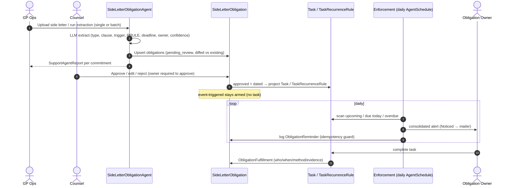

# Design — Side Letter Obligation Agent

## Context

Side letters are plain `Document` rows today (commitment folder or fund Data Room); `grep -ri covenant` returns no application code. The platform already provides the three hardest pieces:

- **SupportAgent framework** — `agent_type` string constantizes to a Trailblazer operation subclassing `SupportAgentService`; config UI is driven by `FormType(name: "SupportAgent", tag: agent_type)` custom fields; `AgentSchedule` + `AgentRunnerJob` handle scheduled runs; `SupportAgentReport` + Turbo step UI handle reporting; `KycDocExtractorAgent` is the direct analogue for document→structured-field LLM extraction.
- **Recurring tasks** — `TaskRecurrenceRule` (iCal RRULE, ice_cube) + nightly `RecurringTaskGeneratorJob` materializing occurrences 3 months ahead.
- **Notifications** — Noticed-based notifier/mailer stack with per-entity delivery config.

What does **not** exist: any structured obligation record, and any due-date-driven task alerting (`TaskNotifier` fires on create/update only; the `Reminder` path is unexposed on tasks and its notifier is mis-wired to `InvestorKycMailer`).

Product reference: `docs/gtm/us_gtm/side_letter_obligations.md`.

## Goals / Non-Goals

**Goals:**
- Structured, auditable record of every side letter obligation per capital commitment.
- LLM extraction that is **never trusted directly** — everything lands in `pending_review` behind a counsel approval gate.
- Approved date-driven obligations become tasks (recurring where applicable) with guaranteed upcoming/due/overdue alerts.
- Event-triggered obligations visible as "armed" matrix rows a human can fire.
- Full reuse of existing machinery: SupportAgent registration/scheduling/reporting, TaskRecurrenceRule, Noticed.

**Non-Goals:**
- MFN comparison/dashboards (columns exist; UI deferred).
- Automatic firing of event-triggered obligations from platform events (deal close, key person change).
- Fee-notice enforcement hooks.
- Fixing the generic task `Reminder` wiring — obligation alerting is self-contained in the enforcement run.
- LPA term-sheet extraction / fund-document chat (`ai_document_intelligence.md`, P2).

## Decisions

### D1 — First-class `SideLetterObligation` model, not "tasks only"
Tasks cannot represent standby (event-triggered/ongoing) obligations, review state, source clauses, or fulfillment history. The obligation record is the source of truth; tasks are projections of its dated instances. Alternative considered: extraction straight into tasks + report JSON (à la `KycDocExtractorAgent`) — rejected because rejected/waived/standby obligations would be invisible or lost, and there would be no audit trail.

### D2 — Anchor `SideLetter` on `CapitalCommitment`
A side letter is negotiated per commitment/close; the commitment already carries fund + investor + folio, a document folder (`WithFolder`), and custom-field support. The us_gtm doc's original investor+fund anchoring is achieved via delegation. Fund- and investor-level rollups are queries through the commitment.

### D3 — Naming: "obligation", not "covenant"
`private_credit_funds.md` reserves `LoanCovenant` for credit covenants; using `SideLetterObligation` here avoids a future model collision and matches side-letter market vocabulary. UI copy may mention "covenants" as a synonym.

### D4 — One agent, two modes (mirrors `PortfolioCompanyAgent`)
`SideLetterObligationAgent < SupportAgentService` (Trailblazer `step` DSL, per repo convention for new services) with `execution_mode`-style dispatch:
- **Extraction mode** — per-commitment: find document by configured `side_letter_doc_label` (name-match pattern shared with `KycDocExtractorAgent`/`required_docs`), extract text via the `FolderDocumentExtractor` pattern, one LLM call per document via `ctx[:llm]` (`LlmService.ruby_llm_chat`), parse with the standard fence-stripping idiom, upsert `SideLetter` + `pending_review` obligations, emit `SupportAgentReport`.
- **Enforcement mode** — entity-wide daily run via `AgentSchedule`: scan approved obligations' projected tasks for upcoming (`reminder_days_before`), due-today, and overdue (`overdue_escalation_days` cadence); send one consolidated notification per owner; log each as `ObligationReminder`.
`targets(entity_id)` returns commitments having the configured side-letter document; `self.process_batch` handles both modes like `PortfolioCompanyAgent` does. Alternative considered: two separate agent types — rejected; doubles registration surface and splits config.

### D5 — Review gate is a state machine on `SideLetterObligation`
`review_status: pending_review → approved | rejected`. Projection (tasks/rules) happens **only** on the `approved` transition; reject/waive tears projections down. Approval requires an owner (`owner_user_id` or `owner_team`). Extracted obligations with no `source_clause` are discarded at parse time, not persisted.

### D6 — Task projection details
- Calendar-driven: create `TaskRecurrenceRule` from `frequency_rrule` with `task_template_payload` carrying owner/assignee/category; store `task_recurrence_rule_id` on the obligation. Recurring instances already suppress create-notifications, which is what we want — alerts come from enforcement, not creation.
- One-time: single `Task` with `due_date = next_due_date`.
- Projected tasks: `owner = SideLetterObligation` (polymorphic), `assigned_to = owner_user_id`, `category = "Compliance"`. Task completion hook (`after_commit` on status→done for obligation-owned tasks) creates `ObligationFulfillment` and advances `status` for one-time obligations.
- Firing an armed obligation = manual action creating a dated `Task` (e.g. key-person notice due in N business days).

### D7 — Alerting stays inside the agent; no new global cron
Enforcement is a scheduled agent run, not a new task-wide due-date scanner — smaller blast radius, per-entity opt-in via agent enable + license flag, and consistent with how `PortfolioCompanyAgent` sends consolidated KPI reminders. New `ObligationAlertNotifier < BaseNotifier` + `SideLetterObligationMailer < SupportAgentBaseMailer`; recipients = obligation owner, escalations additionally to the agent's `notify_tag` group. Every send logged as `ObligationReminder` (also the idempotency guard: one `upcoming`/`due` alert per obligation per due date; `overdue` re-sent only after the escalation interval).

### D8 — Re-extraction diffs, never overwrites
Extraction keys obligations by (side_letter, source_clause, obligation_type). Existing `approved` obligations are never mutated; changed extractions surface as new `pending_review` rows flagged as deltas for counsel. `SideLetterExtractionRun`-style bookkeeping lives in the `SupportAgentReport` json rather than a new model.

### D9 — Registration follows every existing convention
`AGENT_TYPES` entry (≤30 chars: `SideLetterObligationAgent`), `SUPPORT_AGENT_FORM_CONFIGS` entry (category "Ops") with form custom fields for `side_letter_doc_label`, `auto_extract_on_upload`, `default_reminder_days_before`, `overdue_escalation_days`, `notify_tag`; entity bitflag **appended to the end** of the `flag :support_agents` array (bitmask corruption otherwise); `AgentReportsQuery` method + report tab on the show page; Pundit policy methods for every new controller action; user-guide mapping.

### D10 — Matrix UI
New pack `funds/side_letters` with `SideLettersController`/`SideLetterObligationsController` (Pundit-policied), a per-fund matrix view (Ransack filters: type, owner team, due range, review status, MFN flag), and the agent report tab rendering the same partial. Styles in SCSS files, shared partials, no font-size reductions, modals outside ToggleCards — per repo UI conventions.

## Flow

## Risks / Trade-offs

- [LLM misses or hallucinates obligations] → mandatory review gate; source-clause citation required to persist; confidence stored; manual entry path always available; UC target is "counsel reviews in hours, not weeks", not zero-touch.
- [`SchedulerPollingJob` has no cron registration in `config/initializers/sidekiq.rb`] → enforcement depends on it; verify how `AgentSchedule`s fire in production and register the poller if genuinely missing. Tracked as an explicit task.
- [Side letters uploaded to fund Data Room instead of commitment folders] → extraction looks up documents on the commitment by label; if tenant practice differs, "missing side letter" is emitted as info (not blocking) and the doc-label config plus manual `SideLetter` creation covers the gap.
- [Duplicate alerts on reruns/retries] → `ObligationReminder` uniqueness guard per (obligation, kind, due date/escalation window).
- [Task deletion breaking projections] → obligation-owned tasks flagged; deleting series via existing `destroy_series` clears `task_recurrence_rule_id` and reverts obligation to needing re-projection; covered in Cucumber features.
- [SQLite test env vs MySQL prod] → all queries dialect-portable; RRULE logic exercised via ice_cube, not SQL.

## Open Questions

- Confirm production wiring for `SchedulerPollingJob` (may already run via infra not visible in repo).
- Whether `auto_extract_on_upload` ships in MVP or extraction stays manual/batch-only at launch (default config: off).
- Owner-team → user resolution for alerts when `owner_user_id` is blank (proposal: fall back to `notify_tag` group).
