# Capital Call Journey — Design

> **Audience:** Engineering team.
> **Companion documents:** [Proposal](proposal.md) · [Spec](specs/)

> **Planning phase — no code changes.** This document explains HOW the proposal will be built.
> Do not edit application code while writing it; implementation happens later, in the tasks phase.

> **Design, not code.** Explain the design with mermaid diagrams and tables. Do NOT paste Ruby/JS
> class bodies, migrations, route blocks or policy code. Put real class, method, table and path
> names inside the diagrams and tables instead.

> **How to read this.** Part 1 is the idea as one numbered picture. Part 2 redraws the same picture
> with real names. Part 3 has one card per box, in the same order. Part 4 is reference. Stop at the
> depth you need. The numbers ①–⑨ mean the same box everywhere.

---

## Contents

- [1. The idea](#1-the-idea)
  - [What this adds](#what-this-adds)
  - [The idea in one picture](#the-idea-in-one-picture)
  - [Walkthrough: one call, start to finish](#walkthrough-one-call-start-to-finish)
    - [Week 1: getting the notices out](#week-1-getting-the-notices-out)
    - [The mistake](#the-mistake)
    - [Collecting the money](#collecting-the-money)
    - [What to notice](#what-to-notice)
  - [Six ideas to hold on to](#six-ideas-to-hold-on-to)
- [2. The same picture with real names](#2-the-same-picture-with-real-names)
  - [Picture](#picture)
  - [What each box does](#what-each-box-does)
  - [One call, end to end](#one-call-end-to-end)
  - [What starts an evaluation, and what the evaluator does](#what-starts-an-evaluation-and-what-the-evaluator-does)
  - [Lifecycles](#lifecycles)
    - [A task's status (what each mark in the step bar means)](#a-tasks-status-what-each-mark-in-the-step-bar-means)
    - [The journey's status](#the-journeys-status)
  - [What users see](#what-users-see)
    - [At a glance](#at-a-glance)
    - [Journey 2: Ops runs a call with the step bar](#journey-2-ops-runs-a-call-with-the-step-bar)
  - [Design decisions](#design-decisions)
- [3. One card per box](#3-one-card-per-box)
  - [① Journey template](#①-journey-template)
  - [② Call data and ③ Checks](#②-call-data-and-③-checks)
    - [What a check is, in one minute](#what-a-check-is-in-one-minute)
  - [④ Evaluator](#④-evaluator)
  - [⑤ Step bar and panel](#⑤-step-bar-and-panel)
  - [⑥ History](#⑥-history)
  - [⑦ People](#⑦-people)
  - [⑧ Undoing actions](#⑧-undoing-actions)
  - [⑨ Ticks](#⑨-ticks)
- [4. Reference](#4-reference)
  - [Class diagram](#class-diagram)
  - [Data model and schema changes](#data-model-and-schema-changes)
  - [Component contracts](#component-contracts)
  - [Cross-cutting concerns](#cross-cutting-concerns)
    - [Transactions and queries](#transactions-and-queries)
    - [Exception handling and monitoring](#exception-handling-and-monitoring)
    - [Performance and security](#performance-and-security)
  - [Worked examples](#worked-examples)
    - [Happy Path](#happy-path)
    - [Edge Cases](#edge-cases)
    - [Error Cases](#error-cases)
  - [Testing](#testing)
  - [Risks and open questions](#risks-and-open-questions)

---

## 1. The idea

### What this adds

The existing workflow engine (`app/packs/core/workflow_templates`) gains two new step kinds. **System**
steps pass from a registered data check. **Acknowledge** steps pass on a single confirmation. A new
`WorkflowEvaluator` re-derives `current_step_position` from those checks, moving forwards or backwards. It
also handles step invalidation, sign-off resets and owner reminders. Capital calls get two seeded journey
templates, launched through the existing auto-assignment rules, plus a step bar and panel on the call page.
The design follows the engine's existing patterns:

- Trailblazer operations with row locks (`WorkflowAdvancer`);
- frozen `template_snapshot`;
- `WorkflowStateChange` as the audit trail;
- `WorkflowAutoReminderJob` on sidekiq-cron;
- `WorkflowAutoAssignmentRule.auto_launch`.

### The idea in one picture

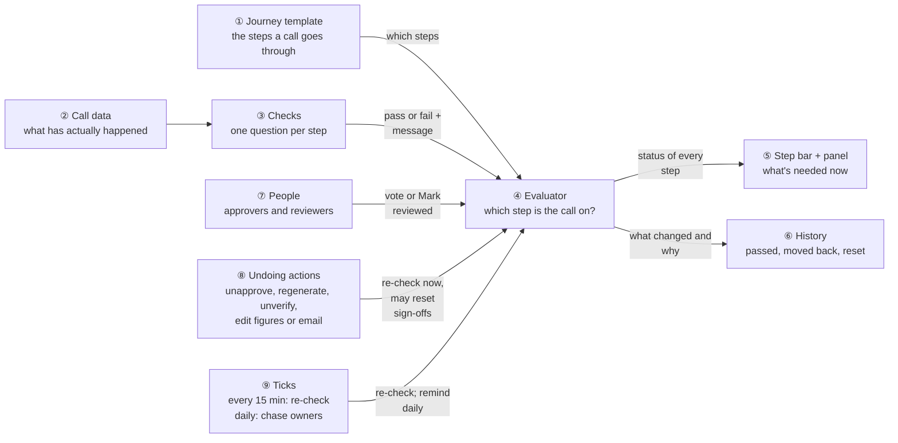

### Walkthrough: one call, start to finish

**The setup.** Alpha Capital uses the **Full** journey, with one extra human step their admin added: a
**CFO sign-off** by Arjun before the call is approved, with a 1-day reminder interval. Priya (ops) runs the call
and has the approver role, so she can approve and unapprove. Times are IST; the daily reminder job runs
at 06:00 IST (00:30 UTC). Alpha Fund I has a call
notice template. 40 investors are on the call; one of them has *Skip Doc Gen* set, so **39 notices**
go out.

**How to read the step bar.** One symbol per step, in this order:

| # | 1 | 2 | 3 | 4 | 5 | 6 | 7 | 8 | 9 | 10 | 11 | 12 |
|---|---|---|---|---|---|---|---|---|---|---|---|---|
| Step | Create remittances | Add call notice template | Generate notices | Approve notices | Review email | Check preview | **CFO sign-off** | Approve call | Send notices | Collect payments | Verify remittances | Allocate units |
| Kind | system | system | system | system | ack | ack | human | system | system | system | system | system |

The **#** column numbers moments in the story, not journey steps; a and b split one moment into "the work
finishes" and "the journey catches up". In the **Step bar after** column every step is listed as a **task** with its mark:

| Mark | Means |
|---|---|
| ✓ | done |
| **●** | **we are here**: the call is waiting on this task. It is *not* done yet |
| ○ | later; not reached yet |
| **↺** | **back here**: this task was done, but something was undone, so it must be done again |

The step we are at is also in **bold**. Several steps can turn ✓ in one row when
their checks already pass (row 2b). Circled numbers in "Behind the scenes" are the
picture's boxes, written as *name (number)*: the template (①), checks (③), the evaluator (④), the
panel (⑤), history (⑥), people (⑦), undoing actions (⑧) and the ticks (⑨).

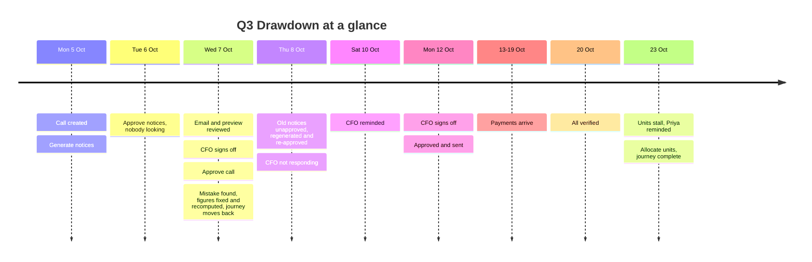

#### Week 1: getting the notices out

| # | When | What happens | Behind the scenes | Step&nbsp;bar&nbsp;after&nbsp;&nbsp;&nbsp;&nbsp;&nbsp;&nbsp;&nbsp;&nbsp;&nbsp;&nbsp;&nbsp;&nbsp; |
|---|---|---|---|---|
| 1 | Mon 5 Oct 09:00 | Priya creates **Q3 Drawdown** at 10% of commitment | The auto-assign rule launches the Full journey from the journey template (①). The remittances are **not** made yet: the remittance job is only queued and runs in the background. Priya lands on the call page, and that view asks the evaluator (④): 0 remittances so far, so the first step is the one waiting | **●&nbsp;Create&nbsp;remittances**<br>○&nbsp;Add&nbsp;call&nbsp;notice&nbsp;template<br>○&nbsp;Generate&nbsp;notices<br>○&nbsp;Approve&nbsp;notices<br>○&nbsp;Review&nbsp;email<br>○&nbsp;Check&nbsp;preview<br>○&nbsp;CFO&nbsp;sign-off<br>○&nbsp;Approve&nbsp;call<br>○&nbsp;Send&nbsp;notices<br>○&nbsp;Collect&nbsp;payments<br>○&nbsp;Verify&nbsp;remittances<br>○&nbsp;Allocate&nbsp;units |
| 2a | Mon 09:02 | The remittance job finishes (40 remittances) | Nothing tells the journey yet. If Priya reloads the page now, the page view asks the evaluator (④) and she sees row 2b's result straight away | Same as row 1 |
| 2b | Mon 09:15 | The 15-minute tick runs | The tick (⑨) asks the evaluator (④), which runs the checks (③) one step at a time: remittances 40 of 40 ✓. **Add call notice template ✓ in the same pass**, because the fund already had one, so that step has nothing to wait for. Notices 0 of 39 ✗, so the walk stops there | ✓&nbsp;Create&nbsp;remittances<br>✓&nbsp;Add&nbsp;call&nbsp;notice&nbsp;template<br>**●&nbsp;Generate&nbsp;notices**<br>○&nbsp;Approve&nbsp;notices<br>○&nbsp;Review&nbsp;email<br>○&nbsp;Check&nbsp;preview<br>○&nbsp;CFO&nbsp;sign-off<br>○&nbsp;Approve&nbsp;call<br>○&nbsp;Send&nbsp;notices<br>○&nbsp;Collect&nbsp;payments<br>○&nbsp;Verify&nbsp;remittances<br>○&nbsp;Allocate&nbsp;units |
| 3 | Mon 09:20 | Priya clicks **Generate Documents**; 39 notices are made | The doc job always asks the evaluator (④) when it finishes, because it can *replace* notices, which is an undoing action. Generate notices ✓; now 0 of 39 approved | ✓&nbsp;Create&nbsp;remittances<br>✓&nbsp;Add&nbsp;call&nbsp;notice&nbsp;template<br>✓&nbsp;Generate&nbsp;notices<br>**●&nbsp;Approve&nbsp;notices**<br>○&nbsp;Review&nbsp;email<br>○&nbsp;Check&nbsp;preview<br>○&nbsp;CFO&nbsp;sign-off<br>○&nbsp;Approve&nbsp;call<br>○&nbsp;Send&nbsp;notices<br>○&nbsp;Collect&nbsp;payments<br>○&nbsp;Verify&nbsp;remittances<br>○&nbsp;Allocate&nbsp;units |
| 4 | Mon–Tue | Priya approves 25 notices on the Documents screen | **Nothing is told.** Document approval has no hook | Same as row 3 |
| 5 | Tue 11:00 | Arjun opens the call page | Viewing the page asks the evaluator (④). The panel (⑤) says: *"14 of 39 call notices await approval — View notices to approve →"* | ✓&nbsp;Create&nbsp;remittances<br>✓&nbsp;Add&nbsp;call&nbsp;notice&nbsp;template<br>✓&nbsp;Generate&nbsp;notices<br>**●&nbsp;Approve&nbsp;notices**<br>○&nbsp;Review&nbsp;email<br>○&nbsp;Check&nbsp;preview<br>○&nbsp;CFO&nbsp;sign-off<br>○&nbsp;Approve&nbsp;call<br>○&nbsp;Send&nbsp;notices<br>○&nbsp;Collect&nbsp;payments<br>○&nbsp;Verify&nbsp;remittances<br>○&nbsp;Allocate&nbsp;units |
| 6 | Tue 16:00 | Priya approves the last 14. Nobody looks at the call afterwards | Nothing is told | Same as row 5 |
| 7 | Tue 6 Oct 16:15 | The next 15-minute tick | The tick (⑨) asks the evaluator (④). Approve notices ✓, **stamped Tue 16:00** (from the data, not 16:15). Review email is current *since Tue 16:00*. The history (⑥) records both | ✓&nbsp;Create&nbsp;remittances<br>✓&nbsp;Add&nbsp;call&nbsp;notice&nbsp;template<br>✓&nbsp;Generate&nbsp;notices<br>✓&nbsp;Approve&nbsp;notices<br>**●&nbsp;Review&nbsp;email**<br>○&nbsp;Check&nbsp;preview<br>○&nbsp;CFO&nbsp;sign-off<br>○&nbsp;Approve&nbsp;call<br>○&nbsp;Send&nbsp;notices<br>○&nbsp;Collect&nbsp;payments<br>○&nbsp;Verify&nbsp;remittances<br>○&nbsp;Allocate&nbsp;units |
| 8 | Wed 7 Oct 09:00 | Priya opens the call, reads the call email, clicks **Mark reviewed**; opens the preview, clicks **Mark reviewed** again | Each **Mark reviewed** is recorded (people, ⑦) and asks the evaluator (④). Both ack steps ✓. The CFO sign-off becomes current, so Arjun gets a *"your sign-off is needed"* email | ✓&nbsp;Create&nbsp;remittances<br>✓&nbsp;Add&nbsp;call&nbsp;notice&nbsp;template<br>✓&nbsp;Generate&nbsp;notices<br>✓&nbsp;Approve&nbsp;notices<br>✓&nbsp;Review&nbsp;email<br>✓&nbsp;Check&nbsp;preview<br>**●&nbsp;CFO&nbsp;sign-off**<br>○&nbsp;Approve&nbsp;call<br>○&nbsp;Send&nbsp;notices<br>○&nbsp;Collect&nbsp;payments<br>○&nbsp;Verify&nbsp;remittances<br>○&nbsp;Allocate&nbsp;units |
| 9 | Wed 11:00 | Arjun approves the sign-off from the email link | His vote goes through the existing vote path (people, ⑦), which then asks the evaluator (④). CFO ✓; Approve call is current | ✓&nbsp;Create&nbsp;remittances<br>✓&nbsp;Add&nbsp;call&nbsp;notice&nbsp;template<br>✓&nbsp;Generate&nbsp;notices<br>✓&nbsp;Approve&nbsp;notices<br>✓&nbsp;Review&nbsp;email<br>✓&nbsp;Check&nbsp;preview<br>✓&nbsp;CFO&nbsp;sign-off<br>**●&nbsp;Approve&nbsp;call**<br>○&nbsp;Send&nbsp;notices<br>○&nbsp;Collect&nbsp;payments<br>○&nbsp;Verify&nbsp;remittances<br>○&nbsp;Allocate&nbsp;units |
| 10 | Wed 11:30 | Arjun clicks **Approve** | The confirmation shows its usual message (the dialog doesn't repeat the journey). Approving reloads the call page, which asks the evaluator (④): approved ✓; Send notices is current, *"39 notices not yet sent"* | ✓&nbsp;Create&nbsp;remittances<br>✓&nbsp;Add&nbsp;call&nbsp;notice&nbsp;template<br>✓&nbsp;Generate&nbsp;notices<br>✓&nbsp;Approve&nbsp;notices<br>✓&nbsp;Review&nbsp;email<br>✓&nbsp;Check&nbsp;preview<br>✓&nbsp;CFO&nbsp;sign-off<br>✓&nbsp;Approve&nbsp;call<br>**●&nbsp;Send&nbsp;notices**<br>○&nbsp;Collect&nbsp;payments<br>○&nbsp;Verify&nbsp;remittances<br>○&nbsp;Allocate&nbsp;units |

#### The mistake

| # | When | What happens | Behind the scenes | Step&nbsp;bar&nbsp;after&nbsp;&nbsp;&nbsp;&nbsp;&nbsp;&nbsp;&nbsp;&nbsp;&nbsp;&nbsp;&nbsp;&nbsp; |
|---|---|---|---|---|
| 11 | Wed 12:00 | Before sending, Priya notices the call should be **12%**, not 10%. She clicks **Unapprove** (she has the approver role) | An undoing action: it asks the evaluator (④) immediately with `cause: undo`. Approve call moves back ↺. The CFO sign-off comes *before* Approve call, so it is not reset by this. The history (⑥) records *"unapproved by Priya"* | ✓&nbsp;Create&nbsp;remittances<br>✓&nbsp;Add&nbsp;call&nbsp;notice&nbsp;template<br>✓&nbsp;Generate&nbsp;notices<br>✓&nbsp;Approve&nbsp;notices<br>✓&nbsp;Review&nbsp;email<br>✓&nbsp;Check&nbsp;preview<br>✓&nbsp;CFO&nbsp;sign-off<br>**↺&nbsp;Approve&nbsp;call**<br>○&nbsp;Send&nbsp;notices<br>○&nbsp;Collect&nbsp;payments<br>○&nbsp;Verify&nbsp;remittances<br>○&nbsp;Allocate&nbsp;units |
| 12 | Wed 12:02 | Priya edits the call to 12% | An undoing action (⑧): the figures changed. Editing the call does **not** change the 40 existing remittances (only **Recompute Call** does), and the notices were made from the old amounts. So the edit **invalidates** Create remittances and Generate notices. The evaluator (④) moves back to the first step, and because a person did it, later sign-offs are **reset**: both email reviews and Arjun's CFO vote are archived. Arjun gets *"your sign-off was reset"* | **↺&nbsp;Create&nbsp;remittances**<br>○&nbsp;Add&nbsp;call&nbsp;notice&nbsp;template<br>○&nbsp;Generate&nbsp;notices<br>○&nbsp;Approve&nbsp;notices<br>○&nbsp;Review&nbsp;email<br>○&nbsp;Check&nbsp;preview<br>○&nbsp;CFO&nbsp;sign-off<br>○&nbsp;Approve&nbsp;call<br>○&nbsp;Send&nbsp;notices<br>○&nbsp;Collect&nbsp;payments<br>○&nbsp;Verify&nbsp;remittances<br>○&nbsp;Allocate&nbsp;units |
| 12b | Wed 12:05 | Priya clicks **Recompute Call**; the 40 remittances are recalculated at 12% | Recompute is an undoing action too. When it finishes without errors it records a *recomputed* event and invalidates Generate notices (the amounts just changed), then asks the evaluator (④) with `cause: undo`. The recomputed event is newer than the 12:02 edit, so Create remittances ✓; Add call notice template ✓; Generate notices is current ↺ until the notices are regenerated | ✓&nbsp;Create&nbsp;remittances<br>✓&nbsp;Add&nbsp;call&nbsp;notice&nbsp;template<br>**↺&nbsp;Generate&nbsp;notices**<br>○&nbsp;Approve&nbsp;notices<br>○&nbsp;Review&nbsp;email<br>○&nbsp;Check&nbsp;preview<br>○&nbsp;CFO&nbsp;sign-off<br>○&nbsp;Approve&nbsp;call<br>○&nbsp;Send&nbsp;notices<br>○&nbsp;Collect&nbsp;payments<br>○&nbsp;Verify&nbsp;remittances<br>○&nbsp;Allocate&nbsp;units |

What Priya sees right after row 12:

```
┌──────────────────────────────────────────────────────────────────────────────┐
│ ↺ Moved back to "Create remittances" — call figures changed by Priya S on    │
│   07/10/2026 12:02. CFO sign-off was reset; Arjun M has been told.           │
├──────────────────────────────────────────────────────────────────────────────┤
│ ↺ Create remittances  ○ Add call notice template  ○ Generate notices  ○ …    │
├──────────────────────────────────────────────────────────────────────────────┤
│ WHAT'S NEEDED NOW · step 1 of 12 · owner: Priya S · current for 0 days       │
│ Remittances were calculated before the call figures changed — recompute.     │
│                                                       [ Recompute Call → ]   │
└──────────────────────────────────────────────────────────────────────────────┘
```

| # | When | What happens | Behind the scenes | Step&nbsp;bar&nbsp;after&nbsp;&nbsp;&nbsp;&nbsp;&nbsp;&nbsp;&nbsp;&nbsp;&nbsp;&nbsp;&nbsp;&nbsp; |
|---|---|---|---|---|
| 13a | Wed 12:08 | The panel says *"Notices were generated before the remittances changed — unapprove them on the Documents screen, then click Generate Documents"*. Priya bulk-**unapproves** the 39 old notices | Unapproving a notice is an undoing action, so it asks the evaluator (④) with `cause: undo`. Nothing new moves back: the journey is already at Generate notices | ✓&nbsp;Create&nbsp;remittances<br>✓&nbsp;Add&nbsp;call&nbsp;notice&nbsp;template<br>**↺&nbsp;Generate&nbsp;notices**<br>○&nbsp;Approve&nbsp;notices<br>○&nbsp;Review&nbsp;email<br>○&nbsp;Check&nbsp;preview<br>○&nbsp;CFO&nbsp;sign-off<br>○&nbsp;Approve&nbsp;call<br>○&nbsp;Send&nbsp;notices<br>○&nbsp;Collect&nbsp;payments<br>○&nbsp;Verify&nbsp;remittances<br>○&nbsp;Allocate&nbsp;units |
| 13b | Wed 12:10 | Priya clicks **Generate Documents** | The old notices are no longer approved, so the doc job replaces them, then asks the evaluator (④). All 39 notices are newer than the 12:05 recompute (the checks (③) compare their `fresh_since`), so Generate notices ✓. The new notices are unapproved | ✓&nbsp;Create&nbsp;remittances<br>✓&nbsp;Add&nbsp;call&nbsp;notice&nbsp;template<br>✓&nbsp;Generate&nbsp;notices<br>**●&nbsp;Approve&nbsp;notices**<br>○&nbsp;Review&nbsp;email<br>○&nbsp;Check&nbsp;preview<br>○&nbsp;CFO&nbsp;sign-off<br>○&nbsp;Approve&nbsp;call<br>○&nbsp;Send&nbsp;notices<br>○&nbsp;Collect&nbsp;payments<br>○&nbsp;Verify&nbsp;remittances<br>○&nbsp;Allocate&nbsp;units |
| 14 | Thu 8 Oct 10:00 | Priya bulk-approves all 39, opens the call, re-does both **Mark reviewed** | The page view asks the evaluator (④): approved ✓. Her acks pass again because they are newer than the reset. The CFO step is current again, and Arjun is emailed | ✓&nbsp;Create&nbsp;remittances<br>✓&nbsp;Add&nbsp;call&nbsp;notice&nbsp;template<br>✓&nbsp;Generate&nbsp;notices<br>✓&nbsp;Approve&nbsp;notices<br>✓&nbsp;Review&nbsp;email<br>✓&nbsp;Check&nbsp;preview<br>**●&nbsp;CFO&nbsp;sign-off**<br>○&nbsp;Approve&nbsp;call<br>○&nbsp;Send&nbsp;notices<br>○&nbsp;Collect&nbsp;payments<br>○&nbsp;Verify&nbsp;remittances<br>○&nbsp;Allocate&nbsp;units |
| 15 | Thu 8 – Sat 10 Oct | Arjun is travelling and doesn't respond | Fri 06:00: the daily reminder job (⑨) checks, but his step has only waited 20 hours, under the CFO step's 1-day interval, so no reminder. **Sat 06:00**: 44 hours, so the existing approver reminder emails Arjun | Same as row 14 |
| 16a | Mon 12 Oct 10:00 | Arjun signs off; Priya approves and clicks **Send Notification** | His vote (people, ⑦) asks the evaluator (④): CFO ✓. The page reload after Approve asks the evaluator (④): Approve call ✓. The send job starts | ✓&nbsp;Create&nbsp;remittances<br>✓&nbsp;Add&nbsp;call&nbsp;notice&nbsp;template<br>✓&nbsp;Generate&nbsp;notices<br>✓&nbsp;Approve&nbsp;notices<br>✓&nbsp;Review&nbsp;email<br>✓&nbsp;Check&nbsp;preview<br>✓&nbsp;CFO&nbsp;sign-off<br>✓&nbsp;Approve&nbsp;call<br>**●&nbsp;Send&nbsp;notices**<br>○&nbsp;Collect&nbsp;payments<br>○&nbsp;Verify&nbsp;remittances<br>○&nbsp;Allocate&nbsp;units |
| 16b | Mon 12 Oct 10:15 | The send job has finished; the next tick runs | The tick (⑨) asks the evaluator (④): 39 sent ✓ (the skip-doc-gen investor is excluded by design) | ✓&nbsp;Create&nbsp;remittances<br>✓&nbsp;Add&nbsp;call&nbsp;notice&nbsp;template<br>✓&nbsp;Generate&nbsp;notices<br>✓&nbsp;Approve&nbsp;notices<br>✓&nbsp;Review&nbsp;email<br>✓&nbsp;Check&nbsp;preview<br>✓&nbsp;CFO&nbsp;sign-off<br>✓&nbsp;Approve&nbsp;call<br>✓&nbsp;Send&nbsp;notices<br>**●&nbsp;Collect&nbsp;payments**<br>○&nbsp;Verify&nbsp;remittances<br>○&nbsp;Allocate&nbsp;units |

#### Collecting the money

| # | When | What happens | Behind the scenes | Step&nbsp;bar&nbsp;after&nbsp;&nbsp;&nbsp;&nbsp;&nbsp;&nbsp;&nbsp;&nbsp;&nbsp;&nbsp;&nbsp;&nbsp; |
|---|---|---|---|---|
| 17 | 13–19 Oct | Payments are recorded as they arrive | No hook. Anyone opening the call sees the panel (⑤) showing *"Collected 62%"*, and so on. The last payment lands Mon 20 Oct 15:00 | Same as row 16b (the panel's *Collected %* rises as payments land) |
| 18 | Mon 19 Oct 15:15 | Next tick | The tick (⑨) asks the evaluator (④): Collect payments ✓, **stamped 19 Oct 15:00**. Verify remittances is current | ✓&nbsp;Create&nbsp;remittances<br>✓&nbsp;Add&nbsp;call&nbsp;notice&nbsp;template<br>✓&nbsp;Generate&nbsp;notices<br>✓&nbsp;Approve&nbsp;notices<br>✓&nbsp;Review&nbsp;email<br>✓&nbsp;Check&nbsp;preview<br>✓&nbsp;CFO&nbsp;sign-off<br>✓&nbsp;Approve&nbsp;call<br>✓&nbsp;Send&nbsp;notices<br>✓&nbsp;Collect&nbsp;payments<br>**●&nbsp;Verify&nbsp;remittances**<br>○&nbsp;Allocate&nbsp;units |
| 19 | Tue 20 Oct 16:00 | Priya verifies all 40 remittances | Verifying is not an undoing action, so it doesn't tell the journey; her page reload (or the next tick) asks the evaluator (④). Verified ✓; Allocate units is current *since 20 Oct 16:00* | ✓&nbsp;Create&nbsp;remittances<br>✓&nbsp;Add&nbsp;call&nbsp;notice&nbsp;template<br>✓&nbsp;Generate&nbsp;notices<br>✓&nbsp;Approve&nbsp;notices<br>✓&nbsp;Review&nbsp;email<br>✓&nbsp;Check&nbsp;preview<br>✓&nbsp;CFO&nbsp;sign-off<br>✓&nbsp;Approve&nbsp;call<br>✓&nbsp;Send&nbsp;notices<br>✓&nbsp;Collect&nbsp;payments<br>✓&nbsp;Verify&nbsp;remittances<br>**●&nbsp;Allocate&nbsp;units** |
| 20 | Fri 23 Oct 06:00 | Nobody has allocated units | The daily reminder job (⑨) asks the evaluator (④); the step is still current. Allocate units has waited 2 days 14 hours, past its 2-day interval, so the job emails the owner, Priya: *"Allocate units — 40 verified remittances have no units yet"*. (Thu 06:00 was only 1 day 14 hours: too early) | Same as row 19 |
| 21a | Fri 23 Oct 09:30 | Priya clicks **Allocate Units**; the units job runs | Nothing tells the journey yet | Same as row 19 |
| 21b | Fri 23 Oct 09:45 | The next tick | The tick (⑨) asks the evaluator (④). All ✓: **journey complete**, `completed_at` recorded (stamped from the newest fund unit, about 09:31) | ✓&nbsp;Create&nbsp;remittances<br>✓&nbsp;Add&nbsp;call&nbsp;notice&nbsp;template<br>✓&nbsp;Generate&nbsp;notices<br>✓&nbsp;Approve&nbsp;notices<br>✓&nbsp;Review&nbsp;email<br>✓&nbsp;Check&nbsp;preview<br>✓&nbsp;CFO&nbsp;sign-off<br>✓&nbsp;Approve&nbsp;call<br>✓&nbsp;Send&nbsp;notices<br>✓&nbsp;Collect&nbsp;payments<br>✓&nbsp;Verify&nbsp;remittances<br>✓&nbsp;Allocate&nbsp;units |

#### What to notice

- **Nobody ticked a system step by hand.** People did their normal work (generate, approve, pay, verify), and
  the journey followed. The only clicks the journey added are the two **Mark reviewed**s (rows 8 and 14).
- **Most work never tells the journey, and that's fine.** Rows 2a, 4, 6, 16a's send, 17, 19 and 21a told nobody. A page
  view or the 15-minute tick caught up (rows 2b, 7, 16b, 18, 21b), and the times in history are still the real ones.
- **Undo is the one thing that is always told** (rows 11, 12, 12b and 13a), because a sign-off on the 10%
  figures must not survive into the 12% call, and notices made before the recompute must not count.
- **Arjun is asked twice** (rows 8 and 14) because the figures he approved changed in between. That's the
  point of resetting sign-offs.
- **Reminders went to the right person:** the human approver for a human step (row 15), and the step
  owner for a system step (row 20).

### Six ideas to hold on to

| # | Idea | In one line | Card |
|---|---|---|---|
| 1 | Three kinds of step | **Human** steps are voted on, as today. **System** steps pass when a data check passes. **Acknowledge** steps pass on one "Mark reviewed" click | [①](#①-journey-template), [⑦](#⑦-people) |
| 2 | Worked out, not ticked | The evaluator re-derives the current step from the data every time. Stored results are only a cache | [④](#④-evaluator) |
| 3 | Moving back | When data stops satisfying a step, the journey moves back and records why. Only a user's undoing action resets later sign-offs | [④](#④-evaluator), [⑧](#⑧-undoing-actions) |
| 4 | Invalidation | For staleness the data can't show (figures or email edited), the action marks steps invalid, and they need newer evidence | [⑧](#⑧-undoing-actions) |
| 5 | Advisory now, blocking later | Steps name the buttons they unlock. This phase only warns in the Approve and Send confirmations | [⑤](#⑤-step-bar-and-panel) |
| 6 | Existing workflows untouched | Only instances containing a non-human step take any new code path | [④](#④-evaluator) |

**FAQ**

| Question | Answer |
|---|---|
| Is this a new feature or a change to workflows? | Both. The workflow engine gains new step kinds, and capital calls are its first user. |
| Does anything block users? | No. This phase only shows and warns. Blocking is Phase 4. |
| Which box is the risky one? | ④ Evaluator. It is the only part that moves the journey backwards and resets sign-offs. |

---

## 2. The same picture with real names

### Picture

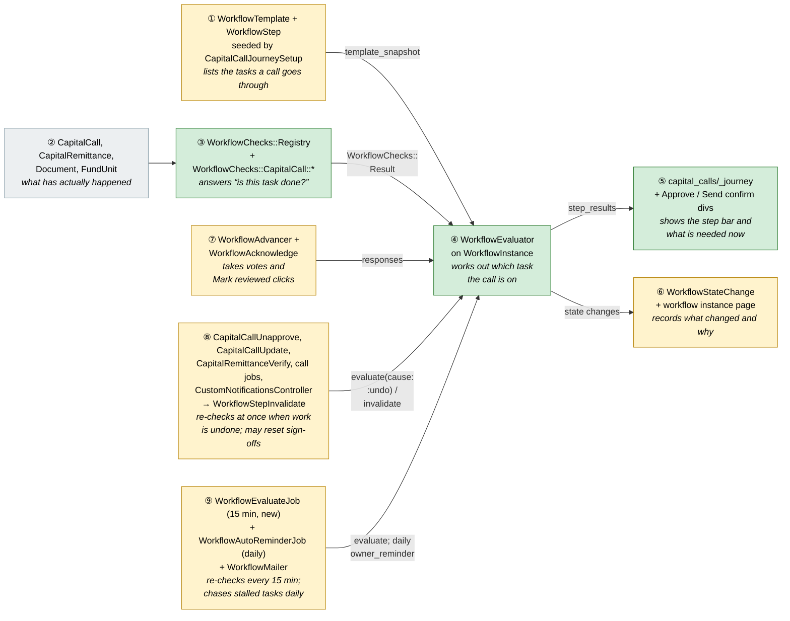

Each box: the real classes, then *in italics* what it does in one line. Click a box (or use the **Details**
links in the table below) to jump to its card in Part 3. Colour = footprint: **green** new, **amber**
modified, **grey** reused unchanged. Exact files are in [lld.md File Map](lld.md#file-map).

### What each box does

| # | Box | Real parts | What it does | When it runs | What it decides | Details |
|---|---|---|---|---|---|---|
| ① | Journey template | `WorkflowTemplate`, `WorkflowStep` (new `kind`, `check_key`, `skip_key`, owner, `unlocks`, `keep_on_regress`); seeded Full and Light; launched by the existing `WorkflowAutoAssignmentRule` | Defines the steps; frozen into `template_snapshot` when a call's journey launches | Once per entity (rollout), once per call (launch) | Which steps exist, of which kind, checked by what | [card ① →](#①-journey-template) |
| ② | Call data | Existing capital call tables | Nothing new. It is what the checks read | — | — | [card ② →](#②-call-data-and-③-checks) |
| ③ | Checks | `WorkflowChecks::Registry`, one small class per check key | Answers one question each ("are all notices approved?") with a message and a link | Every evaluation | Pass or fail, plus when it started passing and how fresh its evidence time | [card ③ →](#②-call-data-and-③-checks) |
| ④ | Evaluator | `WorkflowEvaluator` on `WorkflowInstance` | Walks the steps in order and finds the first one not passed | Page view, undoing actions, after a vote or confirmation, every 15 minutes | Current step; moved back or not; whose sign-offs to reset | [card ④ →](#④-evaluator) |
| ⑤ | Step bar + panel | `capital_calls/_journey` partial | Shows the journey and what's needed now; "Mark reviewed" | Call page view | — (display only) | [card ⑤ →](#⑤-step-bar-and-panel) |
| ⑥ | History | `WorkflowStateChange` rows; workflow instance page | Records passed / moved back / invalidated / reminded with who and why | Written by ④ | — | [card ⑥ →](#⑥-history) |
| ⑦ | People | `WorkflowAdvancer` (existing votes), `WorkflowAcknowledge` (new) | Human votes and single confirmations feed the evaluator | When someone votes or clicks | — (the evaluator decides) | [card ⑦ →](#⑦-people) |
| ⑧ | Undoing actions | Hooks in Unapprove, Update, Verify, the doc-gen / bulk jobs and the notification editor; `WorkflowStepInvalidate` | Re-check immediately with `cause: :undo`; mark stale steps invalid | Inside the action | Which steps become stale | [card ⑧ →](#⑧-undoing-actions) |
| ⑨ | Ticks | `WorkflowEvaluateJob` (new, every 15 min), `WorkflowAutoReminderJob` (existing, daily), `WorkflowMailer` | The tick re-checks every journey; the daily job re-checks, then reminds | Every 15 min / daily | Whether a step became current (notify its approvers); whether a reminder is due | [card ⑨ →](#⑨-ticks) |

**FAQ**

| Question | Answer |
|---|---|
| Why are ① ⑥ ⑦ ⑧ ⑨ amber? | They already exist. Each gains a small addition; their existing behaviour is unchanged. |
| Why a 15-minute tick instead of hooking every action? | Many writes skip callbacks (`update_column`, `update_all`, imports), and hooking every payment or approval path is code that can miss one. The tick catches all forward progress within 15 minutes, and approvers are told promptly. Only undoing actions keep a hook, because they must never be missed. |

### One call, end to end

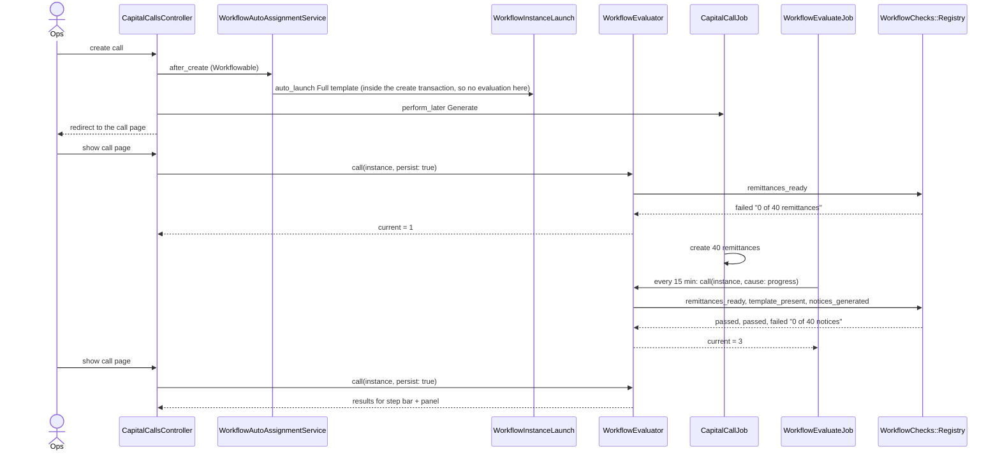

### What starts an evaluation, and what the evaluator does

The evaluator (④) never runs by itself. Something has to ask it. Five things do, and they all call
the **same** `WorkflowEvaluator`. Only two things differ between them: whether it was an **undoing**
action (which allows sign-offs to be reset), and what happens with the answer afterwards.

**1. Who asks the evaluator**

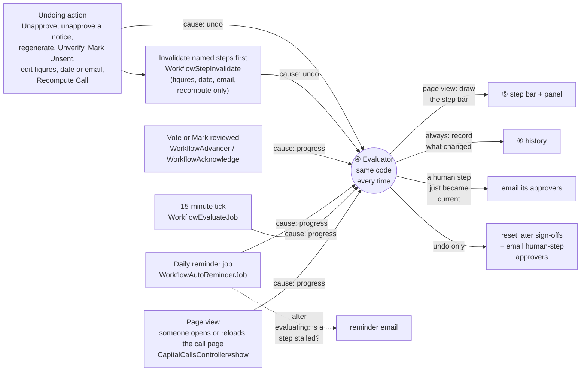

| Who asks | When | Cause | What happens with the answer |
|---|---|---|---|
| Page view | whenever someone opens or reloads the call | progress | Saved if changed, then drawn as the step bar and panel. The person always sees the truth |
| 15-minute tick | every 15 minutes, journeys only | progress | Saved if changed. Nothing is drawn. Its job is to notice progress nobody looked at and to email approvers promptly |
| Daily reminder job | once a day | progress | Saved if changed, then it decides whether a stalled step's owner or approver needs a reminder |
| Vote or Mark reviewed | when a person acts on a journey step | progress | The journey moves on straight away. If that makes a human step current, its approvers are emailed |
| Undoing action | inside the action itself, or at the end of the job that carries it out | **undo** | The only trigger that may reset later sign-offs. Figures, date, email and recompute edits first mark named steps stale (invalidate) |
| Doc job, first generation | when Generate Documents finishes and replaced nothing | progress | Immediate feedback after a long job; the same job uses `undo` when it replaced notices |

**2. What the evaluator does, in five steps**

Step 5's emails go to the approvers of a human task that has just become current, and to anyone whose
sign-off was reset.

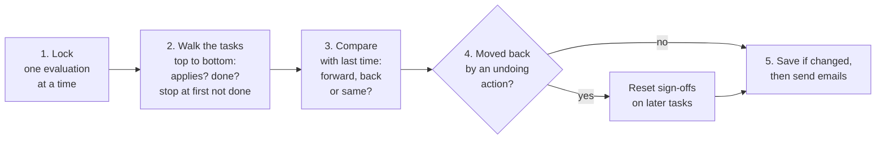

Step 2 is the heart of it. "Is it done?" means something different for each kind of task:

| Kind of task | "Done" means | Example |
|---|---|---|
| System | its check (③) says yes, on evidence newer than any invalidation | Approve notices: no generated notice is unapproved |
| Acknowledge | someone clicked **Mark reviewed**, and that click hasn't been reset | Review email |
| Human | the approvers' votes reach the step's quorum | CFO sign-off |
| Any kind | does not apply (its skip rule says so) → shown n/a and skipped over | Send notices on an imported call |

The full flowchart with class names is in [card ④](#④-evaluator).

**3. Page reload vs tick, side by side** (walkthrough rows 2a/2b)

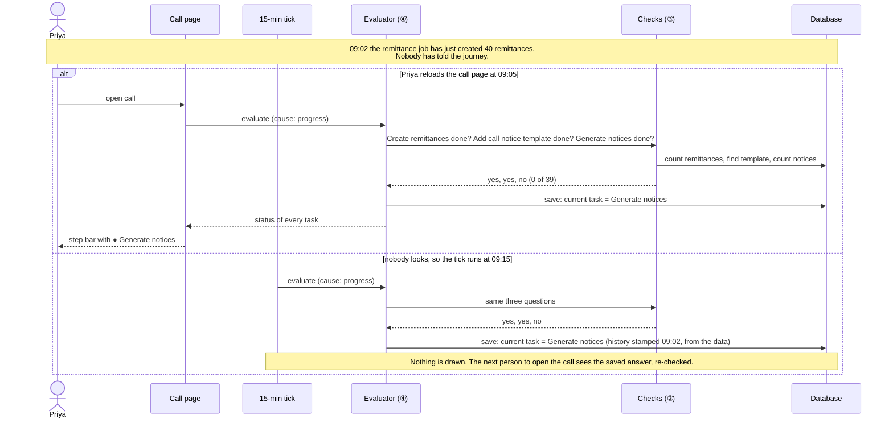

**Trace: two walkthrough rows through the five steps**

| Evaluator step | Row 2b: the tick, after remittances were made | Row 12: Priya edits the call to 12% |
|---|---|---|
| Who asked, with what cause | the tick (⑨), `progress` | the edit (an undoing action, ⑧), `undo`, after invalidating Create remittances and Generate notices |
| 1. Lock | lock the Q3 Drawdown journey | same |
| 2. Walk | Create remittances: done (40 of 40). Add call notice template: done (the fund has one). Generate notices: **not done**, so stop | Create remittances: the check passes, but the remittances are older than the 12:02 invalidation, so **not done**. Stop at the first task |
| 3. Compare | last time we were at task 1, now task 3: moved **forward** | last time we were at task 8 (Approve call), now task 1: moved **back** |
| 4. Reset? | no, it moved forward | yes: moved back and caused by an undo. Review email, Check preview and CFO sign-off are reset |
| 5. Save and email | save task 3, history "passed" for tasks 1 and 2. No emails (task 3 isn't a human task) | save task 1, history "moved back: call figures changed by Priya". Email Arjun "your sign-off was reset" |

### Lifecycles

There are two lifecycles. Each **task** in a call's journey has a status, which is what the step bar
shows. The **journey as a whole** also has a status: in progress, complete, and so on.

#### A task's status (what each mark in the step bar means)

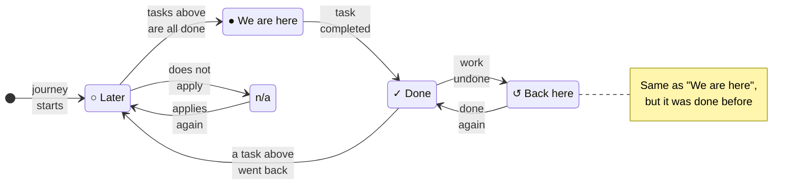

**The states**

| Mark | State | Means | Example (walkthrough row) |
|---|---|---|---|
| ○ | Later | Not reached yet: some task above it is not done | Row 1: every task except Create remittances |
| ● | We are here | The first task that isn't done. The call is waiting on it. Only one task is ever here | Row 1: Create remittances |
| ✓ | Done | Completed, and still true | Row 2b: Create remittances, Add call notice template |
| ↺ | Back here | "We are here" again for a task that was done before, because something was undone. Shown so people know it's a redo, not new work | Row 11: Approve call after Unapprove |
| n/a | Not applicable | This call doesn't need the task, so it is skipped over and never blocks | E3: Send notices on an imported call |

**What moves a task from one state to another**

| From → To | What causes it | Example |
|---|---|---|
| (start) → Later | the journey launches; every task starts here | Row 1 |
| Later → We are here | every task above it is done or n/a | Row 2b: Generate notices becomes current once remittances and template are done |
| We are here → Done | its check passes (system), someone clicks Mark reviewed (acknowledge), or the approvers vote yes (human) | Row 7: Approve notices |
| Done → Back here | it stops being true. Either the data changed (Unapprove, Unverify) or an undoing action marked it stale (figures edit, Recompute, email edit) | Row 11, Row 12 |
| Back here → Done | it is completed again | Row 12b: Create remittances after Recompute |
| Done → Later | a task **above** it went back, so it is no longer reached. If the cause was an undoing action, its sign-off is also cleared | Row 12: Review email, Check preview and CFO sign-off drop back to ○ and their sign-offs are reset |
| Later ↔ n/a | its skip rule changes, e.g. a call is switched to not send notifications | E3 |

**Stored or worked out?** Worked out. The evaluator recalculates every task's state each time it runs.
The last answer is saved in `step_results` only so the instance page can show it, and so the next run can
tell whether anything moved back.

#### The journey's status

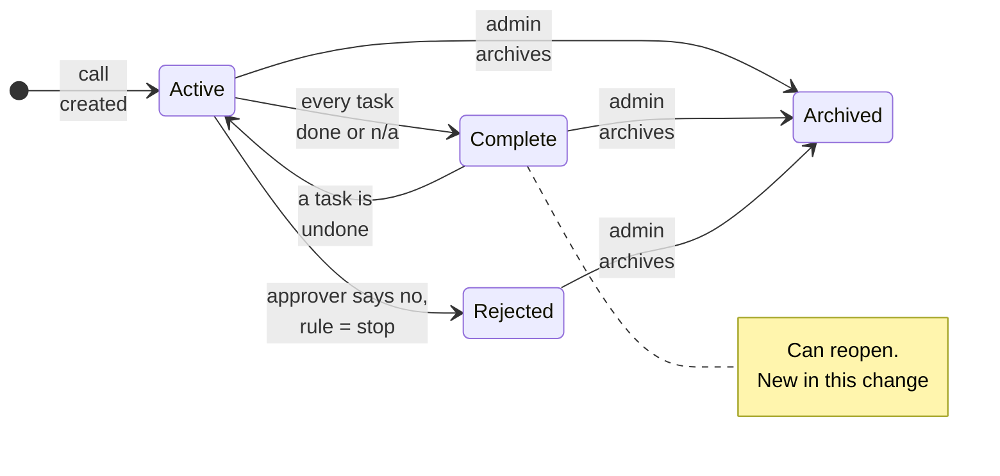

| State | Means | Example |
|---|---|---|
| Active | The call is somewhere in its journey; one task is "We are here" | Rows 1–21a |
| Complete | Every task is done or n/a. `completed_at` records when | Row 21b |
| Rejected | An approver voted no on a human task whose rule says "stop". Existing behaviour | not in the walkthrough |
| Archived | An admin archived the journey (existing). Nothing changes it after this | rollback, or replacing a journey |

| From → To | What causes it | Notes |
|---|---|---|
| (start) → Active | the call is created and the auto-assign rule launches the journey | existing launch |
| Active → Complete | an evaluation finds no task left to do | Row 21b |
| **Complete → Active** | an evaluation finds a task no longer done, e.g. a remittance is unverified after the journey finished | **New.** Only journeys can reopen; existing approval workflows never do (E18) |
| Active → Rejected | an approver rejects a human task whose rule is "stop" | existing rule; seeded journeys use "previous step" instead |
| any → Archived | admin action | existing |

**Stored or worked out?** Stored, in `workflow_instances.status`, because other screens and the existing
workflow features read it directly.

**FAQ**

| Question | Answer |
|---|---|
| Is a step's status stored? | Only as a cache in `step_results`. The truth is re-derived on every evaluation. |
| Can a completed journey reopen? | Yes, but only journeys (instances with non-human steps), e.g. after an Unverify. Approval workflows never reopen. |

### What users see

#### At a glance

| Where in CapHive | Today | After this change | Who sees it |
|---|---|---|---|
| Capital call page, top | Stats cards, Actions menu | Step bar, "What's needed now" panel, moved-back banner | Employees who can view the call |
| Approve / Send confirmations | Fixed message + rule warnings | Unchanged — the panel on the page shows the journey | Approver / sender |
| Workflow step editor | Name, states, quorum, reject rule, actors | Plus kind, check, skip, owner, unlocks, keep sign-off | Company admin |
| Workflow instance page | Human step pipeline + history | Pipeline shows system/ack status; history shows passed/regressed/invalidated/reminded | Admin, actors |
| Email | Step activation, actor reminder | Plus owner reminder, sign-off reset | Step owners, approvers |

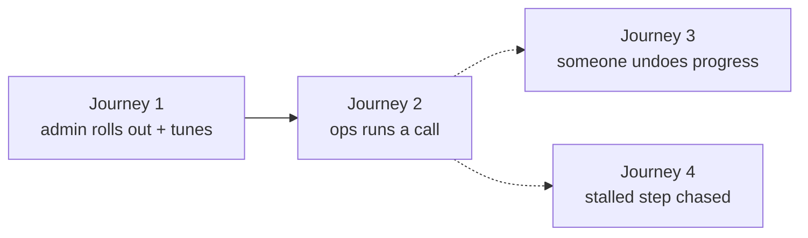

#### Journey 2: Ops runs a call with the step bar

Wireframe: [proposal → Capital call page](proposal.md#capital-call-page--step-bar-and-whats-needed-now).
Callouts: ① step bar, ② panel heading (step, owner, age), ③ status line, ④ action link or Mark reviewed,
⑤ readiness warnings.

| Step | The user… | They see |
|---|---|---|
| 1 | Creates the call | ① Create remittances current, then passed once the job finishes |
| 2 | Generates notices | ③ "0 of 40 generated" → passes; Approve notices current |
| 3 | Clicks ④ View notices to approve → | Clicks the Actions menu's **View Generated Notices To Approve**: a new window opens on the call's notices still awaiting approval |
| 4 | Approves notices, returns | ① Approve notices ✓; ④ becomes Mark reviewed for Review email |
| 5 | Approves the call | confirmation unchanged; the step bar above shows anything outstanding |
| 6 | Watches payments | ③ "Collected 62%"; later ✓ Collect payments, Verify remittances, Allocate units; panel "Journey complete" |

Journey 1 (admin setup) is in card ①, Journey 3 (undo) in card ⑧, Journey 4 (stalled step) in card ⑨.

**FAQ**

| Question | Answer |
|---|---|
| Where is the full screen mockup? | In the [proposal](proposal.md#ui-behavior); this section only walks the journeys. |

### Design decisions

1. **Upgrade the workflow engine instead of building a separate journey feature.** The user's choice. It
   reuses snapshot, history, reminders, magic links and admin screens. The alternative, a code-defined
   journey with no stored instance, was rejected because it duplicates the history, reminder and approval
   machinery.
2. **Store last results, derive truth.** `step_results` is a cache. Every page view re-evaluates. The
   alternative was writing step state on each domain event, which drifts whenever an event is missed.
3. **Explicit invalidation for staleness that no check can see.** Editing figures leaves old notices in
   place, and editing a template changes nothing the acks can read. The undoing action names the steps it
   invalidates, and the evidence must be newer than that. This one mechanism also replaces per-check
   "updated after confirmation" logic. The alternative, timestamps compared inside each check, was
   rejected as scattered and fragile because a remittance's `updated_at` moves on every payment.
4. **Only `cause: :undo` resets sign-offs** (agreed in explore, C5). A deploy or a console fix never
   wipes approvals.
5. **Forward progress is caught by a 15-minute tick plus page views.** `WorkflowEvaluateJob` evaluates every
   journey every 15 minutes, so approvers of a newly current human step are emailed promptly and
   "complete" shows within minutes, even when nobody views the call. The alternative was hooking every
   payment, document approval, bulk and import path. That is more code and more ways to miss one, and
   several of those paths skip callbacks. Only undoing actions keep explicit hooks, because correctness
   depends on them (card ⑧). Pass times come from the data, so tick frequency affects promptness, not
   accuracy.
6. **Default journey chosen by the existing auto-assignment rule.** There is no new "default template"
   setting. Admins switch by editing the rule. Seeding adds a second, higher-priority rule that sends imported
   calls (`manual_generation` = true) to Light, because they are never approved or notified in the app. Switching
   one call to the other journey is out of scope.
7. **Acknowledge confirmations reuse `WorkflowActorResponse`.** There is no new table. State is
   "Reviewed", and archiving equals invalidation.
8. **Owner null means record default owner.** This avoids an owner-type column. A call's default owner
   is its creator, from the audit trail. There is no new `created_by` column on `capital_calls`.
9. **The gate is advisory for evaluated instances.** `workflow_gated?` returns false and the
   confirmations don't repeat the journey (the panel is on the page; a copy in the dialog went stale
   under real-time updates, so it was removed). Phase 4 adds a template `enforcement` flag rather than
   changing this method's meaning again.
10. **Journeys require `enable_workflow_templates`.** The rollout turns the flag on for seeded entities
    (shown in the dry run). The alternative, a separate journey flag, was rejected because admins need
    the workflow screens to edit journeys anyway.
11. **Sign-offs are reset by start time, not by "did the pointer move".** An undoing action records when it
    started; its evaluation clears later sign-offs given before that time. The alternative, resetting only
    when this run sees the pointer move back, misses resets whenever a tick or page view ran mid-job.
12. **Recompute leaves a marker.** A successful Recompute Call (no row errors) writes a `recomputed` history
    entry; Create remittances passes again on that marker. Comparing remittance `updated_at` was rejected:
    Rails does not touch rows whose values didn't change, and Recompute rescues errors row by row.
13. **Create remittances counts commitments in the call's closes with a positive committed amount.**
    The generator skips zero commitments and adds remittances for commitments admitted later, so a
    count "as of creation" was wrong: checked against production data, it disagreed with reality on
    96 of the last 200 generated calls (78 had *more* remittances than commitments at creation).
    The positive-amount rule passes on 180 of 200; the other 20 genuinely lack remittances.
14. **Approved notices are never replaced automatically** (user's choice). After a figures change the panel
    asks the user to unapprove them on the Documents screen; unapproving a notice is an undoing action.
15. **Review email and Check preview become n/a once Send notices passes**, so a skipped review can never
    block completion, and a fund-level email edit only affects calls that haven't sent yet. A review that was
    actually confirmed (and not invalidated since) stays **passed** — the skip stands in for a missing review,
    it never erases a real one (E29).
16. **Rejecting a human step in a journey is "vote again", not "stop".** The step stays current with the
    rejection note; the journey never enters `rejected`, which the evaluator would otherwise strand. Admin
    advance and reset are followed by an evaluation, so the data has the last word.
17. **Pass times are stamped once.** `passed_since` is recorded at the moment a step first passes and never
    re-derived, so later payments or edits can't move history.
18. **The owner is read from the live template step**, falling back to the snapshot if the step was deleted,
    so fixing an owner in the template fixes in-flight calls.
19. **Check keys are permanent.** A key is never removed or renamed while a snapshot uses it; a changed
    meaning gets a new key.
20. **Uploads count as finished** when no import that created the call's remittances is still running
    (`status` blank and `processed_row_count < total_rows_count`, created within the last day) and none
    failed. A failed import keeps Create remittances current with "Remittance upload failed — fix and re-import".
21. **The panel's action drives the control that already exists**, it does not re-implement it. Most
    tasks are done by a button on the call page itself, so a link there would only reload the page the
    user is on. A check names that control in `action_target` (a DOM id, or `#tab` to open) and
    `journey_action_controller.js` clicks it, so its confirm popup, rule-validation modal and workflow
    gate all run once, where they live. `action_path` stays as the fallback for when the control is not
    rendered (policy) or the task really is on another screen (Add call notice template, Approve
    notices). A gated (disabled) control is revealed with its blocked reason instead of clicked (H18).
22. **One evaluation per call in bulk jobs.** The per-remittance Unverify hook is suppressed inside the bulk
    toggle job, which evaluates each affected call once at the end.

**FAQ**

| Question | Answer |
|---|---|
| Which decision is the easiest to reverse later? | Decision 9 (advisory gate). Phase 4 adds an enforcement flag without changing the evaluator. |

---

## 3. One card per box

> Same order and numbers as the picture. Each card: what it is, what it owns, its diagrams, its
> worked examples and its FAQ.

### ① Journey template

The list of steps a call goes through. It reuses `WorkflowTemplate` and `WorkflowStep`; steps gain a kind, a check, a skip rule, an owner, unlocks and an opt-out.

| Owns | Reads / receives | Produces |
|---|---|---|
| `workflow_templates.system_key`; new `workflow_steps` columns ([schema](#data-model-and-schema-changes)) | Admin edits in the step editor; `CapitalCallJourneySetup` | `template_snapshot` on launch |

**Full and Light step lists:** see [spec → Seeded journeys](specs/funds/capital-call-journey/spec.md).

| Component | Responsibility | Notes |
|---|---|---|
| `CapitalCallJourneySetup` | Idempotently seed both templates (keyed by `system_key`) and one catch-all auto-launch rule; enable `enable_workflow_templates` | Never updates an existing template; returns a report for dry run |
| `capital_call_journeys:rollout` rake | Per entity: seed the two templates, the auto-launch rule and the flag. Never touches existing calls | Dry run by default; `EXECUTE=1` writes; `ENTITY_ID` optional |

**Admin journey:**

```
Workflow Templates
┌───────────────────────────────────────────────────────────────┐
│ ① Capital Call — Full: Notify Investors   11 steps  [Edit]    │
│ ① Capital Call — Light: Record Only        4 steps  [Edit]    │
│ ② Auto-assign: Capital Call → Full (all calls, auto-launch)   │
└───────────────────────────────────────────────────────────────┘
Edit step  ③ Kind (•)System ( )Acknowledge ( )Human
           ④ Check [Call notices approved ▼]  Skip [Notices n/a ▼]
           ⑤ Owner [Call creator ▼]  Reminder [2] days
           ⑥ Unlocks [Approve]   [ ] Keep sign-off when moved back
```

| Step | The user… | They see |
|---|---|---|
| 1 | Opens Workflow Templates after rollout | ① both journeys, with step descriptions |
| 2 | Wants Light as the default | ② edits the auto-assign rule's template to Light |
| 3 | Adds a CFO sign-off | new step, ③ Human, picks Arjun, position 7 |
| 4 | Tunes a check step | ④ only Capital Call checks offered; ⑤ owner and interval; ⑥ unlocks |

**Worked examples:** H1, H10, H11, E1, E14, E15, X1, X2

**FAQ**

| Question | Answer |
|---|---|
| Why not a new "journey" table instead of new step columns? | A journey *is* a workflow with different step kinds. New columns let it reuse snapshot, history, reminders, magic links and the admin screens (Decision 1). |
| Why key seeded templates by `system_key` and not by name? | Admins can rename them. Re-running the rollout must still find them, so it neither duplicates nor overwrites. |
| Does editing a template change calls already in progress? | No. Each journey runs on the snapshot taken at launch, as today. |
| How does a company make Light its default? | Edit the existing auto-assign rule to point at Light. There is no new setting (Decision 6). |

### ② Call data and ③ Checks

Checks are small read-only classes, one per question, registered by key. The engine never names `CapitalCall`; it asks the registry.

| Owns | Reads / receives | Produces |
|---|---|---|
| Registry; `WorkflowChecks::Result`; one class per check key | The call and its remittances, documents and fund units | pass/fail, message, action link, `passed_since`, `fresh_since` |

#### What a check is, in one minute

A **check** is one yes/no question about the call's data, plus a sentence a person can act on. The
evaluator (④) asks the check of each task in turn. The check only *answers*; the evaluator decides
what the answer means for the journey.

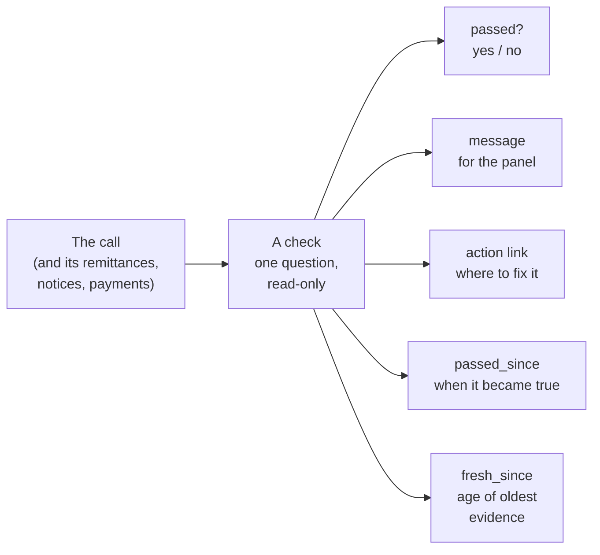

**Five short examples** (Q3 Drawdown, from the walkthrough):

| # | Task | Question the check asks | What it looks at | Answer | Panel shows |
|---|---|---|---|---|---|
| 1 | Create remittances | Does every commitment in the call's closes with a positive amount have a remittance? | count of investors (40) vs count of remittances (12, job still running) | **no** | "12 of 40 remittances created" |
| 2 | Create remittances, a few minutes later | same | 40 vs 40 | **yes**, `passed_since` = 09:02 (newest remittance) | ✓ on the step bar |
| 3 | Approve notices | Is any generated notice still unapproved? | notices on this call where approved = false (14) | **no** | "14 of 39 call notices await approval" + **View notices to approve →** |
| 4 | Generate notices, after the 12% edit | Does every remittance that should get a notice have one? | 39 of 39 exist, but the oldest (`fresh_since`) is from 09:20 and the edit invalidated the task at 12:02 | the check says **yes**; the evaluator treats it as **not done** because the evidence is older than the invalidation | "Notices were generated before the remittances changed — regenerate" |
| 5 | Send notices on an imported call | *Skip check:* is this call imported, or set not to notify? | `manual_generation` = true | **yes, skip** | greyed "n/a — Notices are not sent for imported calls" |

**What the examples show:**

- **One question each.** Example 1 doesn't care about notices; example 3 doesn't care about remittances.
- **Counts, not rows.** Each answer is one or two database counts, so a 5,000-investor call is as fast as
  a 40-investor one.
- **The message is the point.** "no" alone wouldn't help Priya; "14 of 39 await approval" plus a link does.
- **The check reports; the evaluator judges.** In example 4 the check honestly says the notices exist. It
  is the evaluator that compares `fresh_since` with the invalidation and says "not done".
- **Skip checks are just checks** whose "yes" means "this task doesn't apply" (example 5).

**What a check never does:** change data, send email, look at other tasks, or know where the journey is.

**Acknowledge tasks** (Review email, Check preview) usually have a check that always says yes. What makes
them done is the person's **Mark reviewed** click, which the evaluator looks for separately.

**Adding a check** later, e.g. for distributions, means writing one small class and registering its key.
Nothing in the engine changes.


| Component | Responsibility | Notes |
|---|---|---|
| `WorkflowChecks::Registry` | Map `check_key` to a check object and list keys per workflowable type | Keys are constants registered at boot; unknown key → step shows "Unknown check" (X6 path) |
| `WorkflowChecks::CapitalCall::*` | One small object per question, returning a `Result` | Counts and `exists?` only, with `MAX`/`MIN` timestamps folded into the same query (see below) |
| `WorkflowChecks::CapitalCall.warnings` | Readiness warnings for the panel (no subscriber, skip_doc_gen) | Reuses `CapitalCallRuleContextProvider#investors_without_notification_subscribers`, the same source as the approve-time validation rule |

**Is a system step passed?**

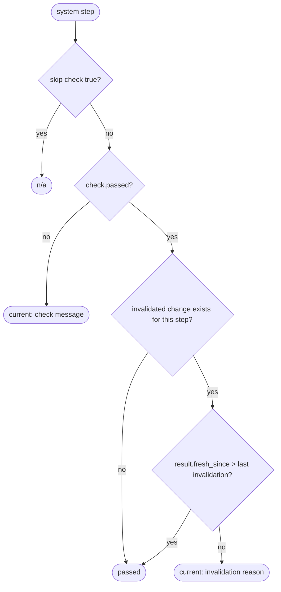

**When did a check start passing?** Each check also returns `passed_since` (newest evidence) and
`fresh_since` (oldest evidence, used only after an invalidation):

| Step | `passed_since` from | Quality |
|---|---|---|
| Create remittances | MAX remittance `updated_at` (`fresh_since` = MIN `updated_at`, so a Recompute after a figures edit is what passes it again) | exact for generation; later-only after recompute |
| Add call notice template | template `created_at` | exact |
| Generate notices | MAX generated notice `created_at` (`fresh_since` = MIN) | exact |
| Approve notices | MAX generated notice `updated_at` (no `approved_at` column) | approximate, later-only |
| Review email / Check preview | confirmation `responded_at` | exact |
| Human sign-off | vote `responded_at` | exact |
| Approve call | the audit row that set `approved` to true | exact |
| Send notices | none (`notification_sent` is set with `update_column`) | falls back to detection time |
| Collect payments | MAX payment `created_at` (the task reads each remittance's own collected amount: the call's `collected_amount` only counts verified remittances) | exact |
| Verify remittances | MAX remittance `updated_at` (no `verified_at` column) | approximate, later-only |
| Allocate units | MAX fund unit `created_at` | exact |

"Later-only" means the approximation can be later than the truth but never earlier, which is the
safe direction: a reminder may come slightly late, never early.

**Worked examples:** H2, H3, E3, E4, E5, E6, E19, E20, E21, E22, E23, E25, E27, X6, H15

**FAQ**

| Question | Answer |
|---|---|
| Why one class per check instead of one big method? | Each check stays small, testable alone and selectable in the step editor; adding a distribution check later is a new class, not an edit. |
| What are `passed_since` and `fresh_since`? | `passed_since` is when the step started passing: the **newest** evidence, because a step passes when its last missing piece arrives. `fresh_since` is the **oldest** evidence, used after an invalidation: one stale notice is enough to fail, so all evidence must be newer than the edit (card ⑧). |
| Why not just use the time the evaluator noticed? | If nobody looks for three days, history and reminders would be three days late. The data knows when things happened, so the evaluator asks it. |
| What if the data has no timestamp? | "Send notices" has none (`update_column`), so that step falls back to the time it was noticed, as before. |
| Will checks slow the call page on big calls? | No. Each is a count or `exists?` query; nothing loads remittance rows (E19). |
| Why do the readiness warnings stop after sending? | They are only actionable before sending, and the subscriber query they reuse is relatively heavy. |

### ④ Evaluator

The heart of the change: walk the steps in order, find the first one not passed, and handle moving back.

| Owns | Reads / receives | Produces |
|---|---|---|
| `workflow_instances.step_results`, `current_step_since`, `completed_at` | Snapshot steps, check results, active responses, last invalidations | Current position, instance status, state changes, archived responses, queued mails |

**How one evaluation runs:**

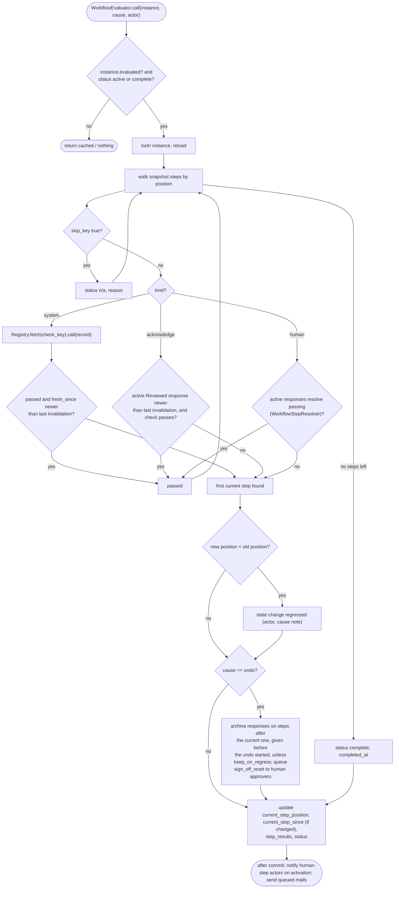

**Which sign-offs are reset?** The rule looks at *when each sign-off was given*, not at whether the
pointer moved in this run. A tick or page view during a long undo job (Recompute, regeneration, bulk unverify)
may already have recorded the move back passively; the job's own `cause: undo` evaluation must still reset
the sign-offs given before the job started (E10c).

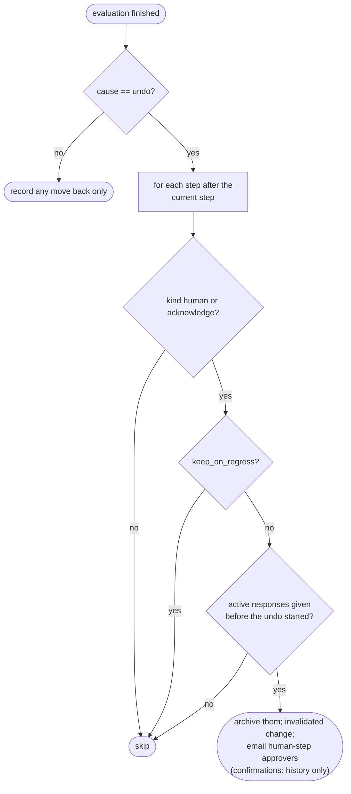

| Component | Responsibility | Notes |
|---|---|---|
| `WorkflowEvaluator` (Trailblazer op) | Walk the steps, derive the pointer and status, detect moves back, archive later sign-offs on `cause: :undo`, persist `step_results`, queue mails | Locks the instance row like `WorkflowAdvancer`. Callers must not wrap it in their own transaction. Idempotent: re-running with unchanged data writes nothing. `persist: false` for read-only renders |

**How times are stamped.** When a step passes, the evaluator records "passed at" and the next step's
`current_step_since` from the check's `passed_since`, not from the clock, with three rules:

1. **No timestamp → detection time.** Exactly the behaviour without this rule.
2. **Never earlier than the previous step passed.** A template uploaded months ago doesn't make
   "Add call notice template" look months old: a step can't become current before the step ahead of it
   passed.
3. **Never later than now.** This guards against clock skew between servers.

**Worked examples:** H7, H8, E7, E8, E9, E10, E11, E18, H15

**FAQ**

| Question | Answer |
|---|---|
| Why re-derive every time instead of updating state on each event? | Missed events would leave the journey wrong for good. Re-deriving self-corrects on the next view (Decision 2). |
| Does the panel update without reloading? | Yes. When an evaluation changes the journey (e.g. notice generation finishing in Sidekiq), the evaluator broadcasts over ActionCable and every open call page reloads just the panel, each as its own user. Only real changes broadcast, so the 15-minute tick doesn't refresh idle pages. |
| Why does it write on a page view (GET)? | So moves back found by viewing are recorded. It writes only when something changed, under a row lock. GET requests read from the replica, so the call page runs the evaluation on the writing connection (`connected_to(role: :writing)`, as `DealsController` does) and renders from the results in memory. |
| Can it break existing KYC or commitment workflows? | No. It returns immediately unless the instance has a non-human step; those features run unchanged as the regression guard. |
| Why reset only on undoing actions? | A deploy or console fix must never wipe approvals; only a person undoing work should (Decision 4). |
| If nobody views a call for days, is its history wrong? | No. Pass times and "current since" come from the data (`passed_since`), so a late evaluation still records when things actually happened. |

### ⑤ Step bar and panel

What users see on the call page, plus the advisory list in the Approve and Send confirmations.

| Owns | Reads / receives | Produces |
|---|---|---|
| `capital_calls/_journey` partial; `acknowledge` route | `step_results` from ④; readiness warnings from ③ | The page; "Mark reviewed" requests to ⑦ |

**Routes:**

| Verb and path | Action | Does | Responds with |
|---|---|---|---|
| `POST /workflow_instances/:id/acknowledge` | `WorkflowInstancesController#acknowledge` (new member) | authorise `policy(instance.workflowable).update?`, run `WorkflowAcknowledge` with `step_position` | redirect back to the record with flash; Turbo replaces the journey frame |
| `GET /capital_calls/:id` | `CapitalCallsController#show` (existing) | evaluate the call's instance, assign `@journey` | existing page plus the journey partial |
| `PATCH /workflow_templates/:template_id/workflow_steps/:id` | existing `WorkflowStepsController#update` | `step_params` permits `kind`, `check_key`, `skip_key`, `owner_user_id`, `unlocks`, `keep_on_regress` | existing |

**Build notes:**

| Interaction | Screen update |
|---|---|
| Call page load | `capital_calls/_journey` partial inside `turbo_frame_tag "capital_call_journey"`, inserted after `_capital_call_stats` in `show.html.erb` |
| Mark reviewed | `button_to` acknowledge; responds with Turbo Stream replacing the journey frame |
| Approve / Send confirm | unchanged: they don't repeat the journey, which is in the panel above |
| Step editor | show/hide human vs system/ack fields with the existing form-toggle Stimulus pattern; no new controller |
| Gate | `workflow_gate_controller.js` unchanged; evaluated instances return empty labels in this phase |

**Worked examples:** H3, H12, E2, E6, X5

**FAQ**

| Question | Answer |
|---|---|
| Why only warn and not block Approve? | This phase is advisory by agreement; blocking (Phase 4) adds an `enforcement` flag on the template rather than changing this behaviour. |
| Why not reuse the workflow gate to disable buttons? | The existing gate locks until the *whole* workflow completes, which would deadlock Approve at step 7 of 11 (C1). |
| What does a call without a journey show? | Exactly today's page. |

### ⑥ History

Every journey event is a `WorkflowStateChange` row in the existing audit trail, shown on the workflow instance page and in the moved-back banner.

| Owns | Reads / receives | Produces |
|---|---|---|
| New `to_state` values; `system` channel; one index | Writes from ④, ⑧ and ⑨ | Banner text; instance page history |

The new event types and the index are in [schema → workflow_state_changes](#data-model-and-schema-changes).

**Worked examples:** E7, E11

**FAQ**

| Question | Answer |
|---|---|
| Why not a new journey-events table? | The existing table already holds per-step, per-actor events with notes; adding values needs no DDL. |
| How do I tell a person's action from the system's? | Evaluator-written rows use the new `system` channel and carry the triggering actor when there is one. |

### ⑦ People

Votes work exactly as today. Acknowledge is a single "Mark reviewed" by anyone who can update the call.

| Owns | Reads / receives | Produces |
|---|---|---|
| `WorkflowAcknowledge`; one line in `WorkflowAdvancer` | Votes (UI, magic link); Mark reviewed | `WorkflowActorResponse` rows; an evaluation |

| Component | Responsibility | Notes |
|---|---|---|
| `WorkflowAcknowledge` | Create a `WorkflowActorResponse(state: "Reviewed")` for the current ack step, then evaluate | Replaces any previous archived response; uniqueness rule on active responses already holds |

**Who can do what:**

| Role | Access |
|---|---|
| Employee with view on the call | Sees the step bar, panel and banner |
| Employee with update on the call | Plus "Mark reviewed" on acknowledge steps |
| Approver (human-step actor) | Votes on human journey steps as today (workflow instance page, magic link) |
| Company admin (with `enable_workflow_templates`) | Edits journey templates and steps, auto-assignment rules (existing policies) |
| Investor | None |

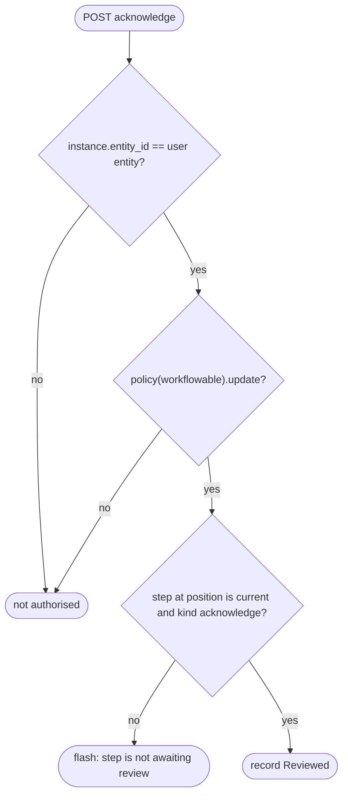

**Multi-tenancy:**
- Instances are loaded through the existing `WorkflowInstancePolicy::Scope`, which is entity-scoped.
- Check keys only read through the workflowable record, so they never cross entities.
- Seeding runs per entity, and templates, rules and owners are validated against the template's
  `entity_id`.

**Worked examples:** H4, H8, E9, E26, X3

**FAQ**

| Question | Answer |
|---|---|
| Why store a confirmation as a workflow response? | It already has actor, time, state and archiving, so resetting a confirmation is just archiving it (Decision 7). |
| Who can Mark reviewed? | Anyone with update rights on the call; it is not tied to named approvers. |
| What happens when an approver rejects a journey step? | The step stays current showing "Rejected by Arjun M: <note>", votes are archived so the approvers can vote again, and the journey stays active (Decision 16). |

### ⑧ Undoing actions

The fixed list of actions that can undo progress. Each re-checks the journey inside the action, so a quick undo-and-redo cannot slip past (C4).

| Owns | Reads / receives | Produces |
|---|---|---|
| `WorkflowStepInvalidate`; hooks in the listed services and jobs | The action and its user | `invalidated` changes; an evaluation with `cause: :undo` |

The list of actions is in [spec → Undoing actions update the journey immediately](specs/funds/capital-call-journey/spec.md).

**A figures edit resets the CFO sign-off:**

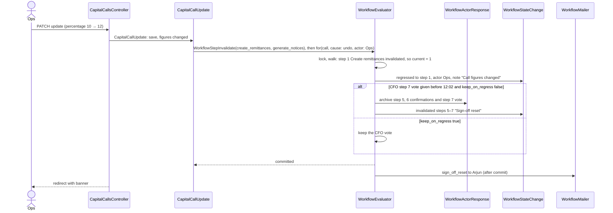

**After the edit: recompute, unapprove the old notices, regenerate:**

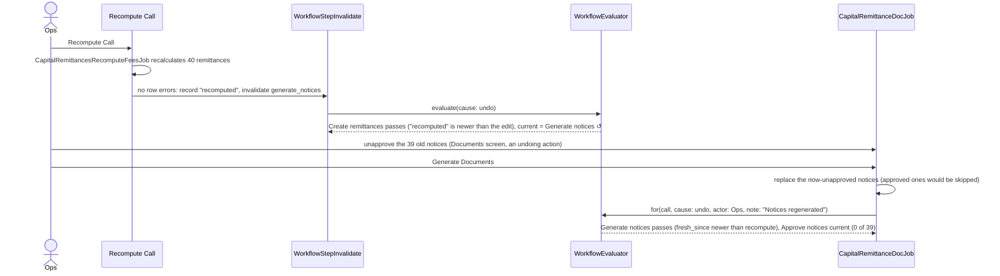

| Component | Responsibility | Notes |
|---|---|---|
| `WorkflowStepInvalidate` | Write an `invalidated` change for each snapshot step whose `check_key` matches, archive ack responses for those steps, then evaluate with `cause: :undo` | Ack responses are archived here, not in the check |

**What users see:**

| Step | The user… | They see |
|---|---|---|
| 1 | Priya clicks Unapprove | redirect; banner "↺ Moved back to Approve call — unapproved by Priya …" |
| 2 | Arjun (CFO) | gets "Your sign-off was reset" email with reason and link |
| 3 | Anyone opens the instance page | history: regressed (Priya, Unapproved), invalidated (CFO sign-off reset) |

**Worked examples:** E7, E8, E10, E12, E13, E17, E18 (and the walkthrough, rows 11–13)

**FAQ**

| Question | Answer |
|---|---|
| Why must undoing actions evaluate immediately? | If unapprove and re-approve both happen before anyone views the call, a lazy check never sees the gap and a stale sign-off survives (C4, E10). |
| Why invalidate instead of letting the check notice? | Editing figures leaves the old notices in place, so no data shows they are stale. The action has to say so (Decision 3). |
| What if the evaluation fails inside the action? | The action still succeeds, Sentry is alerted, and the next view records the move back. Only the sign-off reset is lost (risk listed). |

### ⑨ Ticks

Two scheduled jobs. A new 15-minute tick (`WorkflowEvaluateJob`) re-checks every journey so progress made without anyone looking is picked up and approvers are told promptly. The existing daily reminder job re-checks too, then sends reminders.

| Tick | Runs | Does | Never does |
|---|---|---|---|
| `WorkflowEvaluateJob` (new) | every 15 min | evaluates every active journey, and complete ones for 30 days after completion (`cause: :progress`); sends step-activation emails for human steps it makes current | send reminders; reset sign-offs; touch human-only workflows |
| `WorkflowAutoReminderJob` (existing) | daily | evaluates, then reminds owners of stalled system/ack steps and approvers of stalled human steps, timing both from `current_step_since` (today it uses `instance.updated_at`, which every evaluation moves) | reset sign-offs |

| Owns | Reads / receives | Produces |
|---|---|---|
| `WorkflowEvaluateJob` + its cron entry; owner reminder branch in `WorkflowAutoReminderJob`; `WorkflowMailer#owner_reminder`, `#sign_off_reset` | Active and complete journeys | Reminder emails; `owner_reminded` changes |

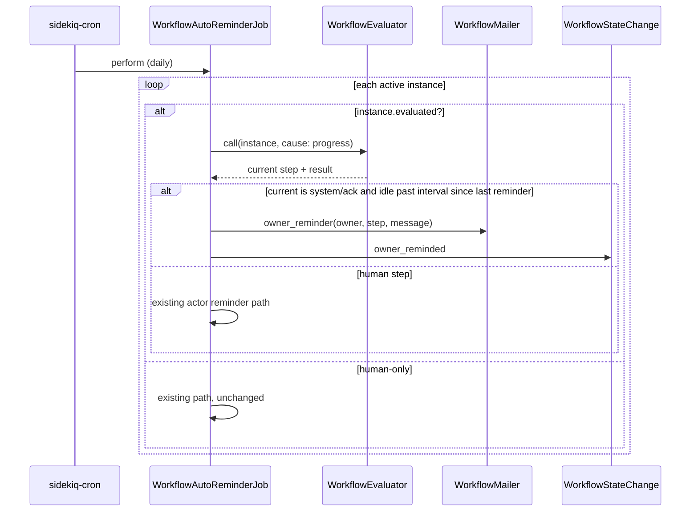

**Who is the owner reminded?**

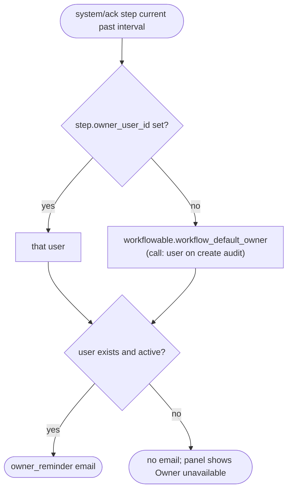

| Component | Responsibility | Notes |
|---|---|---|
| `WorkflowAutoReminderJob` (modified) | Evaluate evaluated instances first; remind the owner on idle system/ack steps; existing actor path for human steps | Owner reminder interval measured from `max(current_step_since, last owner_reminded)` |
| `WorkflowEvaluateJob` (new) | Every 15 minutes, evaluate each active or complete instance whose snapshot has a non-human step | sidekiq-cron `*/15 * * * *`; per-instance lock; idempotent; no retries (the next tick is the retry); never `cause: :undo` |

**Worked examples:** H9, H15, H16, H17, E16, X4

**FAQ**

| Question | Answer |
|---|---|
| Why the owner and not the approvers? | System steps have no approvers. Someone has to own "notices still unapproved" (C3). |
| Why 15 minutes? | Short enough that an approver hears within a quarter-hour; long enough to cost nothing (tens of open journeys at a time). Pass times come from the data, so the interval affects promptness only. |
| Does the tick ever reset sign-offs? | No. It is a passive evaluation; only an undoing action resets (card ⑧). |
| Can someone get two reminders in a day? | No. A reminder is sent only if the last one for that step is older than the interval. |
| Who is the owner by default? | The call's creator, from the audit trail. A named user can be set per step. |
| Is the reminder late if nobody opened the call? | No. The interval runs from `current_step_since`, which is stamped from the data, so the job reminds on time (H15). |


---

## 4. Reference

> Whole-system material that spans several boxes.

### Class diagram

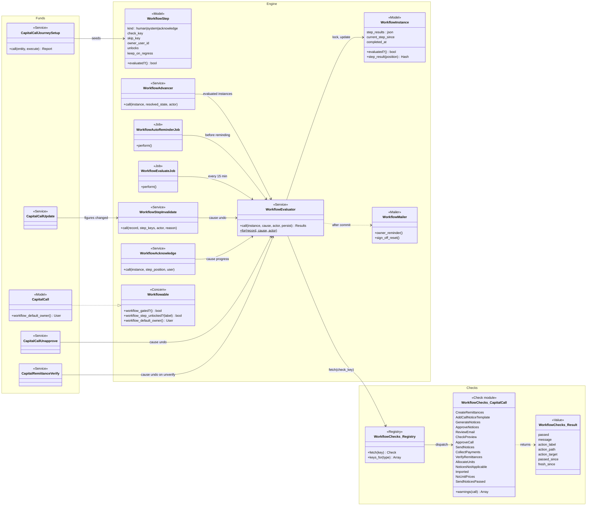

### Data model and schema changes

```mermaid
erDiagram
    workflow_templates ||--o{ workflow_steps : "has"
    workflow_templates ||--o{ workflow_instances : "launched as"
    workflow_instances ||--o{ workflow_state_changes : "history"
    workflow_instances ||--o{ workflow_actor_responses : "votes / acks"
    users ||--o{ workflow_steps : "owns (optional)"

    workflow_templates {
        bigint id PK
        bigint entity_id FK
        string name
        string workflowable_type
        string system_key "NEW nullable: capital_call_full | capital_call_light"
    }
    workflow_steps {
        bigint id PK
        bigint workflow_template_id FK
        int position
        string states "system: Passed; acknowledge: Reviewed"
        int kind "NEW default 0: human 0 | system 1 | acknowledge 2"
        string check_key "NEW nullable"
        string skip_key "NEW nullable"
        bigint owner_user_id "NEW nullable FK users; null = record default owner"
        string unlocks "NEW nullable CSV of button labels"
        boolean keep_on_regress "NEW default false"
    }
    workflow_instances {
        bigint id PK
        int current_step_position
        int status "active | complete | rejected | archived"
        json template_snapshot "steps now carry the NEW step fields"
        json step_results "NEW nullable: last evaluation per position"
        datetime current_step_since "NEW nullable"
        datetime completed_at "NEW nullable"
    }
    workflow_state_changes {
        bigint id PK
        int step_position
        string to_state "adds passed | skipped | regressed | invalidated | reopened | owner_reminded"
        int channel "adds system 3"
        bigint actor_id "nullable"
        text note "reason, e.g. Unapproved"
    }
    workflow_actor_responses {
        bigint id PK
        int step_position
        string state "acknowledge steps use Reviewed"
        boolean archived "reset sign-offs are archived, not deleted"
        datetime responded_at
    }
```

**Indexes:** unique `workflow_templates[entity_id, system_key]` (nulls allowed, many);
`workflow_state_changes[workflow_instance_id, step_position, to_state]` for the "last invalidation" lookup.

**Schema changes**

No new tables. Four existing workflow tables change. Today they can only describe "people vote on a
step, the pointer moves forward on the vote". The journey needs steps that complete from data, can move
backwards, and have an owner who is chased.

**`workflow_templates`** (existing): seeded journey templates need a stable identity that survives an
admin renaming them.

| Column / index | What changed | Why it's needed |
|---|---|---|
| `system_key` | Added: nullable string, `capital_call_full` \| `capital_call_light` | Seeding must be idempotent. Re-running the rollout finds the template by key, not name, so an admin's rename or edits are never duplicated or overwritten (spec: Re-running seeding). Also how the UI and setup recognise a template as a journey |
| unique `[entity_id, system_key]` | New index | Guarantees one Full and one Light journey per entity even if two rollouts race. NULLs are allowed, so ordinary admin templates are unaffected |

**`workflow_steps`** (existing): today every step is a human vote. Steps now need to say *how* they
complete, *what* decides it, *who* is chased, and *what* they unlock.

| Column / index | What changed | Why it's needed |
|---|---|---|
| `kind` | Added: integer enum, default 0 (`human`); 1 `system`, 2 `acknowledge` | The core of the upgrade. It tells the evaluator whether a step completes from votes, a data check or one confirmation. Default `human` makes every existing step behave exactly as before (spec: Existing steps default to human) |
| `check_key` | Added: nullable string | Names the registered data check that decides a system or acknowledge step, e.g. `capital_call.notices_approved`. Stored as a key, not code, so admins can pick it from a list and the snapshot stays plain data |
| `skip_key` | Added: nullable string | Names the check that makes a step not applicable, e.g. imported calls skip the notice steps. Without it, imported calls (59% in prod) would look permanently stuck (C6) |
| `owner_user_id` | Added: nullable FK `users`, indexed | System steps have no voters, so the reminder job had no one to email (C3). Null means "the record's default owner" (the call's creator), so most steps need no setting |
| `unlocks` | Added: nullable string (CSV of button labels) | Per-step gating. Today's gate keeps buttons locked until the whole workflow completes, which would deadlock an 11-step journey at Approve (C1). In this phase it only drives the advisory warnings in the Approve and Send confirmations |
| `keep_on_regress` | Added: boolean, default false | Opt-out from the default "reset later sign-offs when an undoing action moves the journey back", for steps where re-approval would just be noise (spec: Keep sign-off opt-out) |

**`workflow_instances`** (existing): an instance now has to remember what it last saw, so it can tell
that it moved backwards and how long a step has been stuck.

| Column / index | What changed | Why it's needed |
|---|---|---|
| `step_results` | Added: nullable json | Last evaluation per step (status, message, link). Comparing it with the new evaluation is how a move back is detected and recorded. It also lets the instance page render without re-running checks. It is a cache, not the source of truth |
| `current_step_since` | Added: nullable datetime | When the current step became current. The owner reminder interval and "current for N days" are measured from it. `updated_at` can't be used, because it changes on every evaluation write |
| `completed_at` | Added: nullable datetime | Journeys can now reopen (`complete → active`, e.g. after an Unverify), so `status` alone loses when it last completed. Shown as "Journey complete on …". The tick also stops checking a journey 30 days after this |
| `evaluated` | Added: boolean, default false, set at launch when the snapshot has a non-human step | Lets the tick select journeys with one indexed query instead of parsing every snapshot's JSON, and makes the "never touch human-only workflows" guard a column check |
| `[evaluated, status]` | New index | The tick's selection: evaluated, and active or recently complete |

**`workflow_state_changes`** (existing): no new columns. It becomes the journey's history, holding new
event types and a new `system` channel.

| Column / index | What changed | Why it's needed |
|---|---|---|
| `to_state` values | Changed: adds `passed`, `skipped`, `regressed`, `invalidated`, `reopened`, `owner_reminded`, `recomputed`, `rejected_step` (free-text column, no DDL) | Records every journey event in the existing audit trail rather than a new table. The banner and history read from it (spec: Move back recorded) |
| `channel` enum | Changed: adds `system: 3` | Distinguishes evaluator-written events from UI, magic-link and reminder events, so "who did this" is never mistaken for a person |
| `[workflow_instance_id, step_position, to_state]` | New index | Each evaluation looks up the latest `invalidated` change per step. Without the index that lookup scans the instance's whole history on every page view |

**`workflow_actor_responses`** (existing): unchanged. Acknowledge confirmations are stored as responses
with state `Reviewed`, and resetting a sign-off archives them (`archived = true`), so no schema change is
needed (Design decision 7).

**Changes to existing models:**
- `WorkflowStep`:
  - `enum :kind`, `prefix: :kind`;
  - validations: check required for system/ack, check and skip keys must be in `WorkflowChecks::Registry.keys_for(template.workflowable_type)`, the owner belongs to the entity;
  - `evaluated?` is true when the kind is not human.
- `WorkflowInstance`:
  - `evaluated?` is true when any snapshot step has a non-human kind;
  - `step_result(position)`.
- `WorkflowInstanceLaunch#build_snapshot` copies the six new step fields.
- `Workflowable`:
  - `workflow_gated?` returns false for evaluated instances (advisory only in this phase);
  - new methods `workflow_step_unlocked?(label)` and `workflow_default_owner`;
  - human-only instances keep the current code path unchanged.
- `CapitalCall#workflow_default_owner` returns the user on the call's `create` audit (Trackable/audited), else nil.
- `WorkflowStateChange.channel` adds `system: 3`.

### Component contracts

| From → To | Contract | Direction rule |
|---|---|---|
| UI → Evaluator | `WorkflowEvaluator.call(instance:, persist: true)` returns per-step results for rendering | UI never writes step state itself |
| UI → WorkflowAcknowledge | instance + step position + current user | Authorised against `policy(workflowable).update?` |
| Evaluator → Registry → checks | `check_key` string → `WorkflowChecks::Result` | Checks are read-only and know nothing of the engine |
| Undoing actions → Evaluator | `WorkflowEvaluator.for(record, cause: :undo, actor:)` | Only the fixed undoing list calls in with `undo`. The only other capital-call callers are the call page (`progress`) and the doc job on a first generation (`progress`) |
| Tick → Evaluator | `WorkflowEvaluateJob` every 15 min, `cause: :progress` | Never resets sign-offs; skips human-only instances |
| Capital call actions → Invalidator | record + step keys + actor + reason | No-op when the record has no journey |
| Advancer → Evaluator | instance, after a human step resolves | Existing human-only instances never reach the evaluator (guard) |
| Evaluator → Mailer | sign-off reset notice; owner reminder | Sent after the transaction commits (same rule as `WorkflowAdvancer`) |
| Setup → Engine | creates `WorkflowTemplate` + steps + `WorkflowAutoAssignmentRule` | Idempotent on `workflow_templates.system_key` |

### Cross-cutting concerns

#### Transactions and queries

| What is read | When | N+1 risk | How it stays cheap |
|---|---|---|---|
| 10 capital call checks | each evaluation | No | each one is 1–2 aggregate queries (`count`, `exists?`, `sum`) on indexed `capital_call_id` |
| Generated/unapproved notices | Generate notices / approved | No | `remittance_documents.generated` count and `not_approved.exists?`, with MIN(`created_at`) for `fresh_since` and MAX for `passed_since` |
| skip_doc_gen commitments | notifiable counts, warnings | No | SQL JSON predicate on `capital_commitments.json_fields`, one join (LLD fixes the expression) |
| Allocate units | step 11 | No | `verified` remittances `where.not(id: FundUnit owner_id subquery).exists?` |
| Last invalidation per step | each evaluation | No | one grouped query on `workflow_state_changes` per instance |
| Call creator | owner fallback | No | first `create` audit for the call (indexed on auditable) |
| Reminder job | daily, all active instances | Bounded | about 16 calls per month platform-wide; evaluation per instance is about 15 queries |
| Tick (`WorkflowEvaluateJob`) | every 15 min, journeys only | Bounded | tens of open journeys × about 15 small queries. Selected by `workflow_instances.evaluated` and status (active, or complete within 30 days); human-only workflows never match |

| Operation | In a transaction? | Why |
|---|---|---|
| Evaluate: pointer, step_results, state changes, response archiving | Yes, under `instance.lock!` | concurrent evaluations (page view + job) must not double-record a move back |
| Mails after evaluation | No, after commit | same rule as `WorkflowAdvancer#notify_if_moved` |
| Undoing action + its evaluation | No shared transaction | the action commits first, then evaluation runs. If evaluation fails, the action stands and the next page view catches up (only the sign-off reset is lost; see Risks) |
| Seeding per entity | Yes, per entity | templates, steps and rule all or nothing |

#### Exception handling and monitoring

| Failure scenario | Who is alerted | Channel | Detail |
|---|---|---|---|
| A check raises | Support | Sentry; step shows "Could not check this step" | the evaluator rescues per step and stops the walk at that step, so the pointer never moves past an unknown |
| Evaluation fails inside an undoing action | Support | Sentry; action still succeeds | logged with record id and cause; next evaluation records a passive regression |
| Owner unavailable | Admin (via panel) | In-app panel text | no email sent |
| Reminder mail fails | Support | Sidekiq retry, then Sentry | existing mailer retry behaviour |
| Rollout fails for one entity | Operator | rake output | per-entity transaction; continues with the next entity, summary lists failures |

#### Performance and security

- Volume is low: about 16 new calls a month, and tens of in-flight journeys at a time, since only new calls get one. Evaluation is
  inline on page view, around 15 small queries, and never loads remittance rows (CLAUDE.md large-table
  rules).
- Check keys are looked up in a fixed registry, never `constantize`d from user input. The acknowledge
  endpoint authorises against the record's own policy. Entity scoping is unchanged.

### Worked examples

**ID legend:** **H** = Happy path · **E** = Edge case · **X** = Error (exception) case. IDs are
referenced from tasks.md and Cucumber scenario names.

**Shared setup:**

| Record | Name | Key data |
|---|---|---|
| Entity | Alpha Capital | `enable_workflow_templates` on; journeys seeded; Full is default |
| Users | Priya (ops, creates calls), Arjun (CFO, approver), Vik (read-only employee), Admin | Priya and Arjun have update rights; Arjun has `approver` |
| Fund | Alpha Fund I | INR; fund-level "Call Template" document; fund capital call custom notification |
| Commitments | 40 | all KYC verified; 1 with `skip_doc_gen` = yes; 2 investors with no Capital Call subscriber |
| Call | Q3 Drawdown | 10% of commitment, closes All, created by Priya, unit prices set |
| Legacy template | KYC Review | human-only, 2 steps, `gated_button_labels` "Approve" on InvestorKyc |

#### Happy Path

| # | Scenario | Given | When | Then | Spec scenario | Feature |
|---|---|---|---|---|---|---|
| H1 | Seed an entity | Alpha Capital without journeys | `capital_call_journeys:rollout ENTITY_ID=… EXECUTE=1` | Full (11 steps) and Light (4 steps) exist, owners null (call creator), one catch-all auto-launch rule → Full | Seeding a new entity | features/fund/capital_call_journey_rollout.feature |
| H2 | New call launches Full | seeded entity | Priya creates Q3 Drawdown | instance launched; after generation, steps 1–2 passed, current = Generate notices | New call; Several system steps pass at once | features/fund/capital_call_journey.feature |
| H3 | Panel while notices partly approved | 40 notices generated, 12 approved | Priya opens call | current = Approve notices, "28 of 40 call notices await approval", "View notices to approve →" opens filtered documents | Notices partly approved | features/fund/capital_call_journey_ui.feature |
| H4 | Acknowledge email review | notices all approved | Priya clicks Mark reviewed on Review email, then Check preview | both passed with Priya + time; current = Approve call | Confirming a step | features/core/workflow_evaluated_steps.feature |
| H5 | Approve then send moves on | steps 1–6 passed | Arjun approves; Priya sends notification | after the next tick: Approve call and Send notices passed (39 sent, 1 skip_doc_gen excluded); current = Collect payments | Sent notices picked up | features/fund/capital_call_journey.feature |
| H6 | Payment completes collection | last payment recorded | Priya opens call | Collect payments passed; current = Verify remittances | Payment recorded | features/fund/capital_call_journey.feature |
| H7 | Journey completes | all verified; Priya allocates units | the next tick runs | status complete, `completed_at` set, panel "Journey complete" | All steps passed; Journey complete | features/fund/capital_call_journey.feature |
| H8 | Human step after system steps | Admin adds human "CFO sign-off" at position 7 (Arjun); notices approved and acks done | Arjun approves CFO sign-off while call already approved | pointer passes step 7 and the already-passing Approve call in one evaluation | Human step after system steps | features/core/workflow_evaluated_steps.feature |
| H9 | Owner reminder | Approve notices current 3 days, interval 2 | reminder job runs | Priya gets "Approve notices — 28 of 40…" email; `owner_reminded` change written | Owner reminded | features/core/workflow_ticks_and_reminders.feature |
| H10 | Call created after rollout | Alpha Capital rolled out yesterday | Priya creates a call | the Full journey is launched for it | Call created after rollout | features/fund/capital_call_journey_rollout.feature |
| H11 | Dry run | 3 entities without journeys | rollout without EXECUTE | per-entity list of templates, rule and flag it would create; no rows written | Dry run | features/fund/capital_call_journey_rollout.feature |
| H12 | Advisory only on Approve | notices all approved; Review email current | Arjun clicks Approve | the confirmation has no journey section; confirming approves the call | Approve with an outstanding task | features/fund/capital_call_journey_ui.feature |
| H14 | Guide lint | user guide updated | `UserGuideLint` run | Full (11) and Light (4) steps documented, FAQ lint passes | Guide covers every step | UserGuideLint (rake), not Cucumber |
| H15 | Late detection still timed correctly | Approve notices current; Review email has a 2-day reminder interval; Priya approves the last notice Mon 10:00; nobody opens the call | the 15-minute tick and the daily reminder runs happen as normal | Mon 10:15 tick: step 4 recorded passed at Mon 10:00 and Review email current since Mon 10:00. Wed 00:30 run: 1 day 14½ hours, so no reminder. Thu 00:30 run: owner reminder sent | Step completed while nobody was looking | features/core/workflow_ticks_and_reminders.feature |
| H16 | Tick tells an approver without anyone viewing | Admin moved CFO sign-off to directly after Approve notices; 38 of 39 notices approved | Priya approves the last notice on the Documents screen at 16:00 and logs off | by 16:15 the tick makes CFO sign-off current and Arjun receives the step-activation email | Approver notified without anyone viewing | features/core/workflow_ticks_and_reminders.feature |
| H17 | Tick skips approval workflows | KYC Review (human-only) active | tick runs | instance untouched, no queries beyond the journey filter | Human-only workflows untouched by the tick | features/core/workflow_ticks_and_reminders.feature |
| H18 | Panel action runs the real button | Call ready, current task Approve call | Priya clicks "Approve" in the panel | the page's own Approve button is scrolled to, flashed and clicked — its confirmation modal opens; nothing navigates. A workflow-gated Approve is flashed with its blocked reason instead | The panel action runs the call's own Approve button | features/fund/capital_call_journey_ui.feature |

#### Edge Cases

| # | Scenario | Given | When | Then | Spec scenario | Feature |
|---|---|---|---|---|---|---|
| E1 | Existing steps are human | KYC Review template from before deploy | migration runs | its steps have kind human; KYC Review approve/reject/reminders unchanged; no step bar | Existing steps default to human; Human-only approval chain | features/core/workflow_step_kinds.feature |
| E2 | Legacy gate unchanged | KYC Review active on an InvestorKyc | user opens KYC page | Approve disabled as today | Legacy gating preserved | features/core/workflow_button_gating.feature |
| E3 | Imported call | call created by importer (`manual_generation`) | launch + evaluate | steps 2–6 and 8 n/a with "Notices are not sent for imported calls" on hover | Imported call; Not-applicable reason; Skipped step does not block | features/fund/capital_call_journey.feature |
| E4 | No unit prices | call without unit prices, all verified | evaluate | Allocate units n/a; journey complete | Skipped step does not block | features/fund/capital_call_journey.feature |
| E5 | Missing template | fund has no Call Template | evaluate | current = Add call notice template, "The fund has no call notice template" + link | Missing template | features/fund/capital_call_journey.feature |
| E6 | Readiness warnings | 2 investors with no subscriber, 1 skip_doc_gen | open call at Approve notices, then after Send notices passes | both warnings shown before sending; none after | Readiness warnings | features/fund/capital_call_journey_ui.feature |
| E7 | Notices unapproved and regenerated | all notices approved, acks done | Priya unapproves the notices on the Documents screen, then runs Generate Documents | after unapproving: Approve notices current ↺ "Notices unapproved by Priya"; both review confirmations (given before) are reset; after regenerating: still Approve notices (new notices unapproved) | Regenerating notices; Move back recorded | features/fund/capital_call_journey_undo.feature |
| E8 | Figures edit resets the CFO sign-off | CFO sign-off (position 7) given | Priya edits percentage | Create remittances current ↺; Arjun's vote archived; Arjun emailed "your sign-off was reset" | Undoing action clears later sign-off | features/fund/capital_call_journey_undo.feature |
| E9 | keep_on_regress | as E8 but the CFO step has keep_on_regress | Priya edits percentage, recomputes, regenerates, re-approves | CFO vote kept; CFO step passes again without a new vote | Keep sign-off opt-out | features/core/workflow_evaluated_steps.feature |
| E10 | Undo and redo before anyone looks | CFO sign-off given; all notices approved | Priya unapproves one notice and re-approves it a minute later; nobody views the call; no tick in between | a `regressed` change was written at the unapprove; Arjun's vote was archived | Undo and redo between page views | features/fund/capital_call_journey_undo.feature |
| E10b | Unapprove resets only later sign-offs | CFO sign-off given; call approved | Priya unapproves the call | Approve call current ↺; CFO vote **kept** (it comes before Approve call); banner "Moved back to Approve call — unapproved by Priya" | Unapprove moves back | features/fund/capital_call_journey_undo.feature |
| E10c | Tick during a long undo job | Recompute is running on a 2,000-remittance call; CFO sign-off given | a tick evaluates mid-job (records the move back passively), then the job finishes | the job's own `cause: undo` evaluation still archives the CFO vote, because it was given before the recompute started | Passive evaluation during a long undo job | features/core/workflow_evaluated_steps.feature |
| E11 | Passive move back | Collect payments passed; a payment is deleted from the console (no hook) | Priya opens call | Collect payments current ↺, `regressed` change with no actor; no responses archived | Passive move back does not clear sign-off | features/core/workflow_evaluated_steps.feature |
| E12 | Email template edited | Review email + Check preview passed | Priya edits the fund's CapitalCall custom notification | both acks invalidated, responses archived, "Email template changed after review" | Email template edited; Confirmation invalidated by later change | features/fund/capital_call_journey_undo.feature |
| E13 | Figures edited | notices generated and approved | Priya changes percentage 10 → 12, then runs Recompute Call | after the edit: Create remittances current ↺ "Remittances were calculated before the call figures changed — recompute". After Recompute: Generate notices current ↺ "Notices were generated before the remittances changed — regenerate" | Figures edited after notices generated; Recompute after figures change; System step invalidated | features/fund/capital_call_journey_undo.feature |
| E14 | Re-seeding | Admin added CFO step to Full | rollout re-run | no duplicate templates; CFO step kept | Re-running seeding | features/fund/capital_call_journey_rollout.feature |
| E15 | Existing call untouched | a call created yesterday, approved, 20 of 40 verified | rollout EXECUTE=1 | no instance for that call; its page shows no step bar | Existing call untouched | features/fund/capital_call_journey_rollout.feature |
| E16 | No interval | step and template have no reminder interval | reminder job | nothing sent | No interval, no reminder | features/core/workflow_ticks_and_reminders.feature |
| E17 | Invalidate without journey | call with no instance | Priya edits percentage | no error; nothing written | Invalidating an unlaunched or human-only workflow | features/fund/capital_call_journey_undo.feature |
| E18 | Unverify reopens completed journey | journey complete | Priya unverifies one remittance | status active (reopened), current = Verify remittances ↺ | Move back recorded | features/fund/capital_call_journey_undo.feature |
| E19 | Large call | call with 5,000 remittances (factory bulk insert) | open call page | page renders; query log shows no full remittance load (counts only) | Large call | features/fund/capital_call_journey.feature |
| E20 | Unverified KYC blocks generation | 2 investors' KYC unverified | Generate Documents | 37 notices generated; Generate notices stays current "2 investors have unverified KYC — notices are not generated for them" | Unverified KYC blocks notices | features/fund/capital_call_journey.feature |
| E21 | Uploaded call | Upload-basis call; Priya imports a file with 25 of the fund's 40 investors | the import finishes | Create remittances ✓ (25 uploaded, import complete); while the import is still running it shows "Remittance upload in progress" | Uploaded remittances | features/fund/capital_call_journey.feature |
| E22 | Light journey | Light is the call's journey | remittances created, paid, verified, units allocated | step bar shows only the 4 Light tasks; journey completes | Light journey | features/fund/capital_call_journey.feature |
| E23 | Call set not to notify | Full journey; "send call notice" off | first evaluation | Add call notice template … Check preview and Send notices show n/a "This call is set to not notify investors" | Call set not to notify | features/fund/capital_call_journey.feature |
| E24 | Email edit after sending | call A sent, call B not yet sent, same fund | Priya edits the fund's CapitalCall email | call B's review tasks are invalidated; call A unchanged | Email edit after sending | features/fund/capital_call_journey_undo.feature |
| E25 | Imported calls get Light | seeded entity | a call is imported | Light journey launched | Imported calls get Light | features/fund/capital_call_journey.feature |
| E26 | Rejected journey step | CFO sign-off current | Arjun rejects with "Fee looks wrong" | step stays current "Rejected by Arjun M: Fee looks wrong"; journey active; Arjun can vote again | Rejected journey step | features/core/workflow_evaluated_steps.feature |
| E27 | Skip-doc-gen warning | 1 commitment with Skip Doc Gen | open call before sending | "1 commitment has Skip Doc Gen set and will not be emailed" | Skip-doc-gen warning | features/fund/capital_call_journey_ui.feature |
| E28 | Sent notices picked up | Send Notification clicked; job finishes 10:05 | next tick 10:15 | Send notices passed; Collect payments current | Sent notices picked up | features/fund/capital_call_journey.feature |
| E29 | Confirmed review survives sending | Review email + Check preview marked reviewed by Priya | notices sent; next evaluation | both stay passed "Reviewed by Priya" (not n/a); their `passed` history rows carry Priya as actor, channel ui, from_state current | Confirmed review survives sending | features/fund/capital_call_journey.feature |

#### Error Cases

| # | Scenario | Given | When | Then (what the user sees, who is alerted) | Spec scenario | Feature |
|---|---|---|---|---|---|---|
| X1 | System step without check | Admin edits a Full step | sets kind System, blank check, Save | form error "Check must be a Capital Call check" | System step requires a valid check | features/core/workflow_step_kinds.feature |
| X2 | Check list scoped | Admin edits a step on a Capital Call template | opens Check list | only `capital_call.*` keys offered; posting `investor_kyc.*` is rejected | Check list is limited to the template's record type | features/core/workflow_step_kinds.feature |
| X3 | Read-only user | Vik views call with Review email current | looks at panel; POSTs acknowledge directly | no button; request refused (Pundit, flash "not authorised") | Read-only user cannot confirm | features/core/workflow_evaluated_steps.feature |
| X4 | Owner unavailable | step owner user deactivated | reminder job / page view | no email; panel "Owner unavailable — update the journey template" | Owner left the company | features/core/workflow_ticks_and_reminders.feature |
| X5 | Unseeded entity | entity never rolled out | create call | no instance; call page as today | Entity without seeded journeys | features/fund/capital_call_journey.feature |
| X6 | Check raises | a check raises (e.g. bad data) | evaluation | step shows "Could not check this step — support has been notified"; error reported to Sentry; the walk stops at that step | A check fails with an error | features/core/workflow_evaluated_steps.feature |

Every spec scenario appears in the Spec scenario column above.

### Testing

Cucumber only, one feature file per implementation phase (the Feature column above):

- **Engine:** `features/core/workflow_step_kinds.feature`, `workflow_evaluated_steps.feature`,
  `workflow_ticks_and_reminders.feature` (new); `workflow_button_gating.feature` (extended).
- **Capital calls:** `features/fund/capital_call_journey.feature`, `capital_call_journey_ui.feature`,
  `capital_call_journey_undo.feature`, `capital_call_journey_rollout.feature` (new).
- **Run unchanged** as the regression guard for human-only behaviour: the existing `features/core/workflow_*.feature`.
- **Step definitions:** engine scenarios use a test-only check (`test.flag`, reading a `json_fields` key) so
  they need no capital call. Capital call scenarios reuse the call, remittance and document steps in
  `capital_call.rb` and the workflow steps in `workflow_*_steps.rb`; a shared Background seeds Alpha Capital
  via `CapitalCallJourneySetup`. Time travel uses `travel_to` for intervals. E19 uses the existing
  `sql_query_counter.rb` helper. Tests run on SQLite, so no MySQL-only SQL ([LLD Review Summary, item 4](lld.md#review-summary)).

### Risks and open questions

- [Evaluator bug moves the pointer on human-only workflows] → `evaluated?` guard at every entry point,
  and the existing workflow features run unchanged as the regression suite (E1, E2).
- [Undoing action commits but evaluation fails, so the sign-off is not reset] → Sentry alert. The next
  passive evaluation records the move back, and support can use the existing "Reset to step 1" control.
  This is accepted for the advisory phase. Revisit it before Phase 4.
- [skip_doc_gen lives in JSON, so the SQL predicate may disagree with `skip_doc_gen?`] → LLD pins one
  shared expression, and a feature compares the counts with the Ruby method on the shared setup.
- [Concurrent evaluations (page view + job) double-write history] → row lock plus "no change, no write".
- [Engine has never run in prod] → hardening tasks: concurrency, reminder idempotency, magic links on
  journey instances.
- [Check semantics change on deploy (C5)] → passive moves back never reset sign-offs. Key semantics are
  documented in the registry.

| # | Open question | Current thinking | Status |
|---|---|---|---|
| 1 | Should rejecting a human journey step stop the whole journey? | Resolved: no, it means "vote again" (Decision 16) | Resolved |
| 2 | Show the step bar on the call index (per row)? | Not in this phase; cached `step_results` makes it cheap later | Deferred |

**FAQ**

| Question | Answer |
|---|---|
| Where do I start reviewing? | Read Parts 1-2, then the cards for the boxes you own. Use this part only to check a specific class, column or test case. |
| Why is the schema here and not in the cards? | Several cards share the same tables. Keeping one schema view avoids repeating it, and each card links here. |
