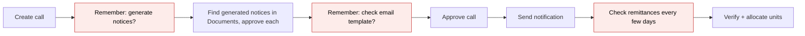
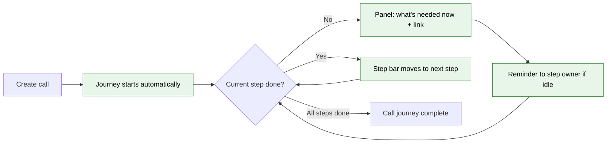
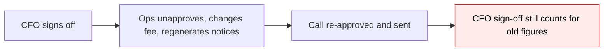
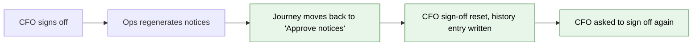

# Capital Call Journey — Proposal

> **Audience:** Business team, product, QA, support — non-technical.
> **Companion document:** [Design](design.md)

> **Planning phase — no code changes.** This document proposes and explains the change. Do not
> edit application code while writing it; implementation happens later, in the tasks phase.

---

## Why

Running a capital call takes a dozen steps: remittances, call notice template, generating and approving
notices, reviewing the email, approving the call, sending, collecting, verifying and allocating units.
These steps are spread over several screens and menus. Nothing on the call tells the user where the call
stands or what to do next, so steps get missed. Typical misses are approving a call with unapproved
notices, investors nobody is subscribed for, or a call that sits stalled for days with no one noticing.
Today the app has four partial readiness tools: a readiness agent, approval-time validation warnings,
an approval workflow that disables buttons, and next-step tasks. None of them shows the whole journey.

## What Changes

The app learns the capital call sequence, works out which step each call is on from the call's own data,
and shows it on the call page together with what is needed next.

Think of it as a **flight tracker for a call**. Nobody has to tick boxes to move it along. The tracker
reads what has actually happened, such as "40 of 40 notices approved", and moves the call forward. If
something is undone, the tracker moves the call back and says why. For example, regenerating the notices
puts the "Approve notices" step back to not done.

- The **existing approval workflow feature is upgraded** so a workflow step can be completed in one of
  three ways:
  - **by data**, called a *system step*, e.g. "all remittances verified";
  - **by a person confirming**, called an *acknowledge step*, e.g. "I reviewed the email";
  - **by approvers voting**, called a *human step*, which is the existing behaviour and is unchanged.
- **Two ready-made journeys are seeded for every company:**
  - **Full: Notify Investors** has 11 steps, for calls that send notices to investors.
  - **Light: Record Only** has 4 steps, for calls that are only recorded.
  - Admins pick which journey applies and can edit either one in the existing workflow screens, e.g. to
    add a CFO sign-off.
- The **call page gets a step bar and a "What's needed now" panel**, with a direct link to the screen
  that resolves the current step.
- The **Approve and Send Notification confirmations list any earlier steps that are not done**. This is
  advice only in this release. Nothing is blocked, because blocking is a later phase.
- **Stalled steps send reminders** to the step's owner, by default the person who created the call.
- **If an action undoes progress, approvals given after that point are reset**, and approvers are asked
  again. The actions that do this are Unapprove, unapproving a notice, regenerating notices, marking
  notices unsent, unverifying a remittance, changing the call percentage, closes or date, Recompute Call,
  and editing the call email. The history shows what was reset and why.
- **Approved notices are never replaced automatically** (as today). If the figures change after notices
  were approved, the panel tells the user to unapprove them on the Documents screen, then regenerate.
- **Imported calls get the Light journey by default**, and calls set to "don't notify" skip the notice and
  email steps, showing them as "not applicable" with the reason. Neither appears stuck.
- **Existing approval workflows keep working exactly as today.** Production has none set up yet, so no
  company's current setup changes.

### Flow Diagram

Running a call: before, the user works out the order from the Actions menu and the user guide.



After: the call page shows the current step, what is needed and a link to do it. Stalls trigger reminders.



Undoing progress: before, nothing notices it and earlier approvals silently still count.



After: the journey moves back, resets the later sign-off and records why.



---

## User Stories

### US-1: See where the call is

**As a** fund operations user,
**I want** the call page to show which step the call is on and what that step needs,
**So that** I don't have to work out the sequence from memory or the user guide.

**Acceptance criteria:**
- A step bar at the top of the call page shows each step of the call's journey as a task, marked as one
  of: done ✓, we are here ● (the task the call is waiting on, not done yet), later ○, not applicable
  (greyed, "n/a"), or back here ↺ (was done, must be done again).
- The "What's needed now" panel shows:
  - the current step's name;
  - a one-line status from the data, e.g. "28 of 40 call notices await approval";
  - a button that opens the screen that resolves it, e.g. "View notices to approve →".
- Opening the call page always shows up-to-date status. No refresh button is needed.
- When every step is done, the panel shows "Journey complete" with the completion date.

### US-2: Journey starts by itself

**As a** fund operations user,
**I want** every new call to get the right journey automatically,
**So that** I never have to set it up per call.

**Acceptance criteria:**
- A new call gets the company's default journey, Full or Light, as chosen by the company admin.
- Only calls created after the rollout get a journey. Every existing call, finished or not, gets no
  journey and its page looks exactly as today.
- Imported calls get the Light journey by default.

### US-3: Confirm steps that leave no trace

**As a** fund operations user,
**I want** to mark "Review email" and "Check preview" as done,
**So that** the journey knows I reviewed something the data cannot show.

**Acceptance criteria:**
- Acknowledge steps show a "Mark reviewed" button in the panel.
- Clicking it records who confirmed and when, and the journey moves on.
- If the call's email template is edited afterwards, both steps go back to not done with the note
  "Email template changed after review".

### US-4: Know when progress is undone

**As a** fund manager or approver,
**I want** the journey to move back and reset later sign-offs when someone undoes earlier work,
**So that** my approval never stands for figures or documents I did not see.

**Acceptance criteria:**
- After an action that undoes progress, the step bar shows the earlier step as current again, marked ↺.
  These actions are Unapprove, Generate Documents again, Mark Notification Unsent, Unverify, changing
  percentage called or closes, Recompute Call, and editing the call email.
- A banner reads: "Moved back to *Approve notices* — notices regenerated by Priya on 02/10/2026".
- Sign-offs and confirmations on later steps are cleared unless the admin marked that step "Keep
  sign-off when moved back". Their approvers are notified that they need to act again.
- When the journey moves back only because data changed some other way, e.g. after a system update, the
  history records it but no sign-off is cleared.

### US-5: Stalled steps get chased

**As a** fund operations lead,
**I want** the owner of a stalled step to get a reminder,
**So that** calls don't sit unnoticed before the due date.

**Acceptance criteria:**
- Each system step has an owner, set in the journey template: a named user, or "the call's creator"
  (the default).
- If a step stays current longer than its reminder interval, the owner gets an email with the step
  name, the status line and a link to the call.
- Reminders repeat at the same interval until the step is done.

### US-6: Warnings at the moment of decision

**As a** user about to approve a call or send its notification,
**I want** the confirmation to list any earlier steps that are not done,
**So that** I make the decision knowingly.

**Acceptance criteria:**
- The Approve confirmation lists each step before "Approve call" that is not done, with its status line.
- The Send Notification confirmation does the same for steps before "Send notices".
- The user can still proceed. Nothing is blocked in this release.

### US-7: Admin chooses and adjusts the journey

**As a** company admin,
**I want** to choose Full or Light as the default journey and edit its steps,
**So that** the journey matches how our company actually runs calls.

**Acceptance criteria:**
- Both journeys appear in the existing Workflow Templates list, with a description of each step.
- In the step editor an admin can:
  - set a step's kind: human, system or acknowledge;
  - pick its check from a list limited to capital call checks;
  - set its owner, its reminder interval and "Keep sign-off when moved back";
  - add human approval steps with named approvers, as today.
- Changes apply to calls whose journey starts after the change. Calls already in progress keep the
  steps they started with.

### US-8: Existing workflows unchanged

**As a** company already using approval workflows (KYC, commitments, folders, KPI reviews),
**I want** my workflows to behave exactly as before,
**So that** this release carries no risk for me.

**Acceptance criteria:**
- Every existing step is a human step. Approval, rejection, reminders, magic links and button disabling
  work as before.

---

## UI Behavior

### Capital call page — step bar and "What's needed now"

```
┌──────────────────────────────────────────────────────────────────────────────┐
│ Q3 2026 Drawdown                    Journey: Full — Notify Investors  [View] │
│                                                                              │
│ ✓ Create remittances  ✓ Add call notice template  ✓ Generate notices         │
│ ● Approve notices  ○ Review email  ○ Check preview  ○ Approve call           │
│ ○ Send notices  ○ Collect payments  ○ Verify remittances  ○ Allocate units   │
├──────────────────────────────────────────────────────────────────────────────┤
│ WHAT'S NEEDED NOW · step 4 of 11 · owner: Priya S · current for 3 days       │
│                                                                              │
│ 28 of 40 call notices are waiting for approval.     [ View notices to approve → ]     │
│                                                                              │
│ ⚠ 2 investors have nobody subscribed to Capital Call emails                  │
│ ℹ 1 commitment has Skip Doc Gen set and will not be emailed                  │
└──────────────────────────────────────────────────────────────────────────────┘
```

**Behavior notes:**
- Steps that are not applicable to this call are shown greyed with "n/a". Hovering shows why, e.g.
  "Notices are not sent for imported calls".
- An acknowledge step shows a `[ Mark reviewed ]` button instead of a link.
- A human approval step shows the approvers and who has already responded, with a link to the workflow
  page where they vote, as today.
- Clicking a done step shows when it was completed. A step that moved back shows when and why.
- Calls without a journey show nothing new.

### Banner after moving back

```
┌──────────────────────────────────────────────────────────────────────────────┐
│ ↺ Moved back to "Approve notices" — notices regenerated by Priya S on        │
│   02/10/2026 14:05. CFO sign-off was reset; Arjun M has been asked again.    │
└──────────────────────────────────────────────────────────────────────────────┘
```

### Approve confirmation (unchanged)

The Approve and Send Notification confirmations are not changed: the step bar and panel are on the same
page, so the dialog does not repeat which tasks are outstanding. *(Revised during implementation — the
first version listed them, and that copy went stale when the panel updated in real time.)*

### Workflow step editor (existing screen, new fields)

```
┌──────────────────────────────────────────────────────────────┐
│ Edit step 4                                                  │
│ Name            [ Approve notices                       ]    │
│ Kind            (•) System  ( ) Acknowledge  ( ) Human       │
│ Check           [ Call notices approved               ▼ ]    │
│ Skip when       [ Notices not applicable              ▼ ]    │
│ Owner           [ Call creator                        ▼ ]    │
│ Reminder every  [ 2 ] days                                   │
│ Unlocks buttons [ Approve                                ]   │
│ [ ] Keep sign-off when moved back                            │
│                                         [ Cancel ] [ Save ]  │
└──────────────────────────────────────────────────────────────┘
```

**Behavior notes:**
- The "Check" and "Skip when" lists only offer checks for the template's record type, here Capital Call.
- For human steps, the existing fields show (approvers, voting rule, what happens on rejection) and
  Check, Skip when and Owner are hidden.

---

## What This Feature Does NOT Cover

| Excluded | Covered In |
|---|---|
| Disabling Approve / Send until earlier steps are done (blocking mode) | Phase 4 |
| Journeys for capital distributions | Phase 3 |
| AI comparison with the previous call and fee suggestions | Phase 5 |
| Journeys for calls that existed before the rollout | Not planned; existing calls stay as today, only new calls get a journey |
| Fixing the imported-call "Send Notification does nothing" gap | Separate fix; the journey only makes it visible |
| A company running two workflows on one call at once | Not planned; approvals are added as steps inside the journey |

---

## Validation Rules

| Field | Rule | Default |
|---|---|---|
| Step kind | One of Human, System, Acknowledge | Human (all existing steps) |
| Check (system/acknowledge) | Required; must be a check for the template's record type | — |
| Skip when | Optional; must be a check for the template's record type | none |
| Owner (system/acknowledge) | A user of this company, or "Call creator" | Call creator |
| Approvers (human) | Required, as today | — |
| Unlocks buttons | Optional comma-separated button labels | none |
| Keep sign-off when moved back | Yes / No | No |
| Default journey for capital calls | Full or Light; one per company | Full |

---

## Behavior Rules

| Scenario | What User Sees |
|---|---|
| New call created | Journey starts; step bar shows the first step as current |
| Remittances still generating | "12 of 40 remittances created" |
| Fund has no call notice template | "The fund has no call notice template" + link to the fund's templates |
| All notices approved | Step moves on to "Review email" (Full) |
| Call email edited after "Review email" | Step moves back; "Email template changed after review" |
| Percentage or closes changed after remittances exist | "Remittances were calculated before the call figures changed — recompute" |
| Recompute Call run after notices generated | "Notices were generated before the remittances changed — unapprove them on the Documents screen, then click Generate Documents" |
| Upload-basis call, import still running | "Remittance upload in progress" |
| Upload-basis call, import failed | "Remittance upload failed — fix and re-import" |
| Approver rejects a journey sign-off | Task stays current: "Rejected by Arjun M: <note>"; they can vote again |
| Fund email edited after a call was sent | That call is unchanged; only calls not yet sent ask for a new review |
| Some investors' KYC not verified | "Generate notices" stays current: "2 investors have unverified KYC — notices are not generated for them" |
| Approve call | Step "Approve call" ✓; panel moves to "Send notices" |
| Unapprove clicked | Journey moves back to "Approve call"; sign-offs on later tasks reset; banner shown |
| Imported call | Gets the Light journey (no notice, email or approval tasks) |
| Call set to not send notifications | Notice and email steps n/a: "This call is set to not notify investors" |
| No unit prices on the call | "Allocate units" n/a: "No unit prices set on this call" |
| Remittances created as already verified | Collect payments and Verify remittances ✓ immediately |
| Step current longer than its interval | Owner gets a reminder email; panel shows "current for N days" |
| Call that existed before the rollout | No journey, no step bar |
| Existing KYC / commitment approval workflow | Behaves exactly as today |

---

## Resolved Design Decisions

| # | Decision | Resolution |
|---|---|---|
| 1 | Build a new journey feature or reuse workflows? | Reuse and upgrade the existing workflow feature |
| 2 | Advise or block? | Advise only now; designed so blocking can be switched on later |
| 3 | Button disabling is currently all-or-nothing until the whole workflow finishes, which would deadlock an 11-step journey | Each step can name the buttons it unlocks. The old behaviour stays for templates that don't use this |
| 4 | Only one workflow can run on a call | The journey is the call's workflow. Approvals become steps inside it. Production has no workflows yet, so nothing is migrated |
| 5 | Who gets reminded about a stalled system step? | The step's owner (default: call creator) |
| 6 | A quick undo-and-redo could slip past unnoticed | Actions that undo progress check the journey immediately, not on the next page view |
| 7 | Could a software update reset sign-offs? | No. Only a user's undoing action resets sign-offs; other moves back are recorded only |
| 8 | Reset later sign-offs when moved back? | Yes by default; per-step "Keep sign-off when moved back" opt-out |
| 9 | Imported / no-notify calls | Their notice steps are "not applicable" with a reason |
| 10 | Which calls get a journey? | Only calls created after the rollout. Existing calls are never given one |
| 11 | One template or two? | Two, Full and Light, each fully documented in the user guide |

---

## Capabilities

### New Capabilities

- `workflows/evaluated-workflow-steps`: Workflow steps that complete from data (system) or a single
  confirmation (acknowledge) alongside human votes. Covers automatic forward and backward movement,
  per-step button unlocking, step owners and reminders, and sign-off reset on undoing actions.
- `funds/capital-call-journey`: The Full and Light capital call journeys, their checks and skip rules,
  automatic launch for new calls only, the step bar and "What's needed now" panel, and the
  warnings in the Approve and Send confirmations.

### Modified Capabilities

None. No existing spec covers workflows or capital calls.

---

## Impact

- **Workflow templates** (settings): step editor gains kind, check, skip, owner, unlocks and keep-sign-off
  fields; templates list gains the two seeded journeys.
- **Workflow instance page**: shows system and acknowledge steps and moved-back history entries.
- **Capital call page**: new step bar, panel and banner; Approve and Send confirmations gain a warnings
  section.
- **Capital call actions**: actions that undo progress (Unapprove, regenerating notices, Mark
  Notification Unsent, Unverify, editing the call's figures or email, Recompute Call) update the journey
  immediately.
  Everything else (approving notices, payments, sending, verifying, allocating units) is picked up
  within 15 minutes by a background check, or straight away when someone opens the call.
- **Emails**: new "step needs attention" reminder and "sign-off reset" notice; existing workflow emails
  unchanged.
- **User guide**: new Capital Call Journey section documenting both journeys step by step; workflow
  guide updated with the new step kinds.
- **One-off rollout task**: seeds both journeys and the auto-launch rule per company. It does not touch
  existing calls.

---

## Benefits

1. Users see at a glance where every call is and exactly what to do next, with a direct link.
2. Missed steps, like unapproved notices or a template never reviewed, show up before approval, not
   after sending.
3. Stalled calls are chased automatically before the due date.
4. Approvals stay meaningful: a sign-off never silently survives a change to the figures.
5. The two most common ways of running calls work out of the box, and each company can adjust them
   without engineering help.
6. The same foundation will serve distributions and blocking mode later, with no second system.

---

## FAQ

| Question | Answer |
|---|---|
| Who sees the step bar? | Anyone who can view the capital call. Marking a step reviewed needs edit rights on the call. |
| Does this stop me approving or sending? | No. In this release it only warns. Blocking is a later phase. |
| Will investors notice anything? | No. Nothing is sent to investors by the journey; only internal reminders. |
| What happens to existing calls? | Nothing. Only calls created after the rollout get a journey; existing calls keep today's page, even ones still in progress. |
| We already use workflows for KYC. Will they change? | No. Those are human steps and behave exactly as today. |
| We don't approve calls in the app. Will our calls look stuck? | Not if your admin selects the Light journey, which has no approval or sending steps. |
| Can we add a CFO sign-off? | Yes. Add a human step to your journey template with the CFO as approver. |
| Why did my sign-off disappear? | Someone undid earlier work, e.g. regenerated notices. The banner and history say who, what and when. |
| Does a template change affect calls already in progress? | No. Calls keep the steps they started with; new calls get the updated template. |
| Is there an extra cost? | No. |

---

## Design Principle for the Next Phase

- **Reuse, don't parallel.** The journey must be the existing workflow feature with new step kinds,
  not a second step engine. Existing readiness checks, in the call notice readiness agent and in the
  approve-time validation rules, should be reused by the checks, not duplicated.
- **Risk: the step pointer moving both ways.** Today a workflow only ever moves forward, on a vote.
  Moving backwards, resetting sign-offs and staying correct under concurrent votes is the hardest part.
  Keep it in one place that is called from a short, explicit list of undoing actions.
- **Risk: performance on large calls.** Checks must count in the database, never load all remittances or
  documents (project rule on large tables).
- **Risk: existing workflows.** Human-only templates must take exactly the same code path as today.
  Design the new behaviour so it only switches on when a template contains a non-human step.
- **Keep checks small.** One check = one question with a status line and a link. No check should know
  about another.
