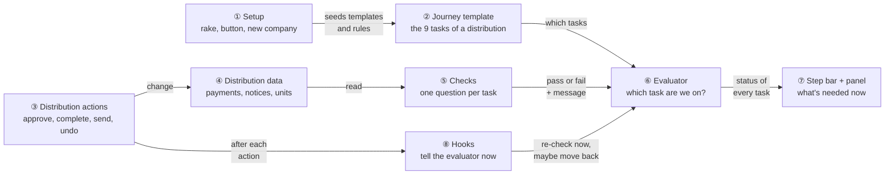
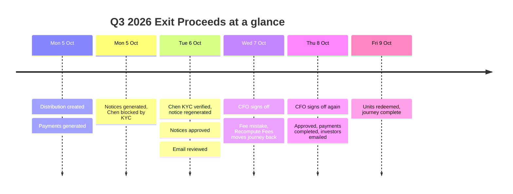
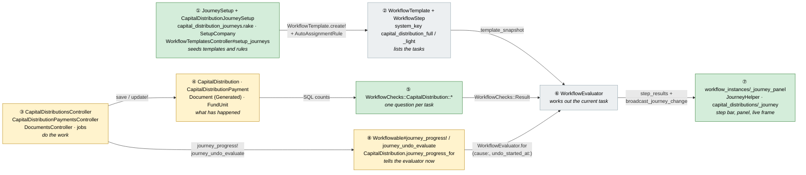
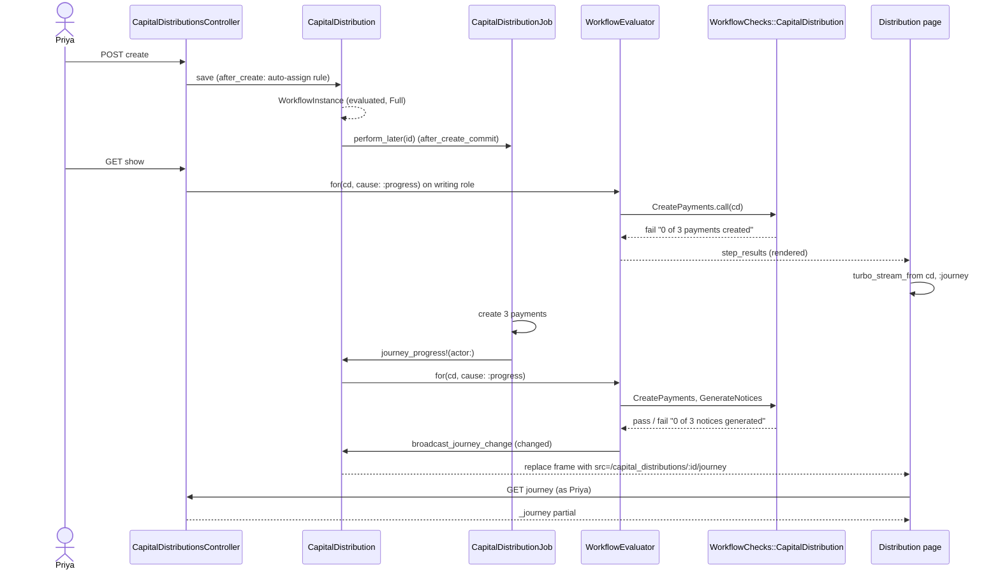
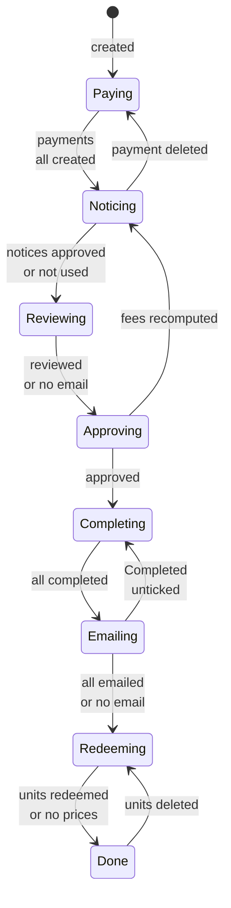
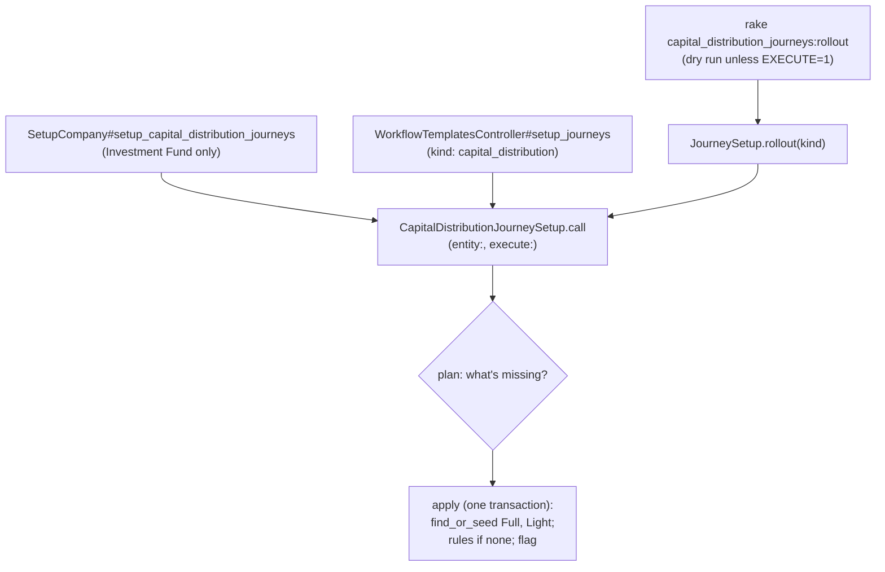
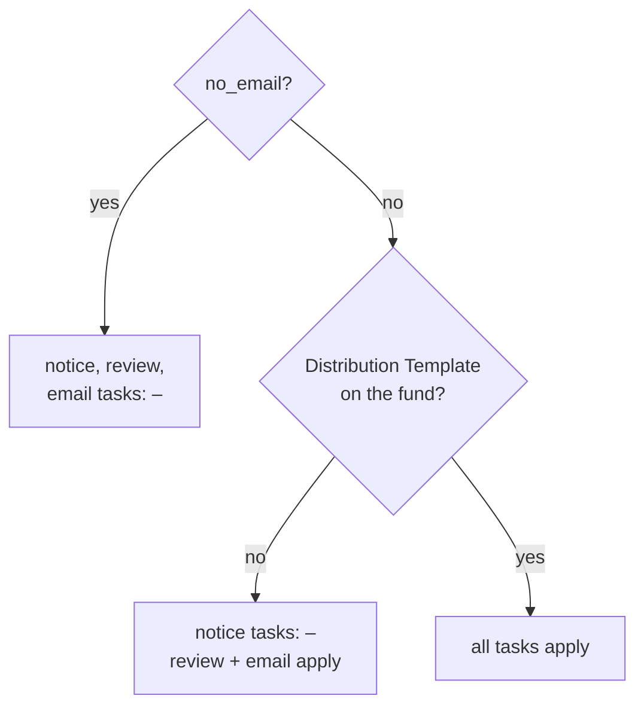
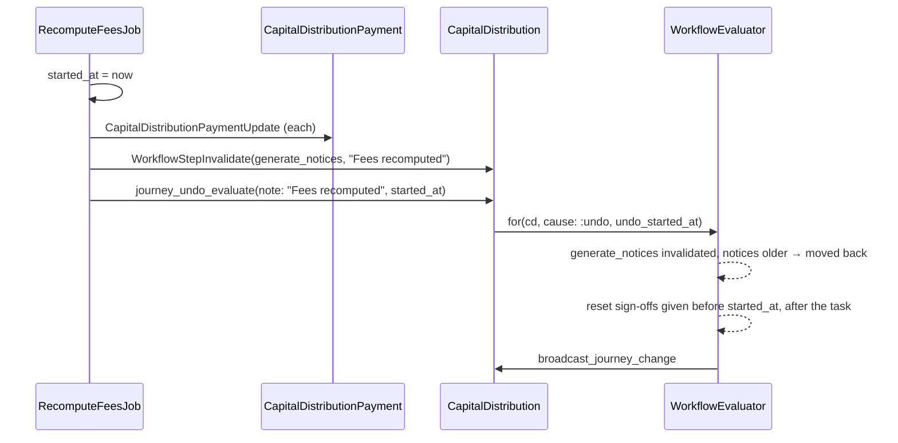
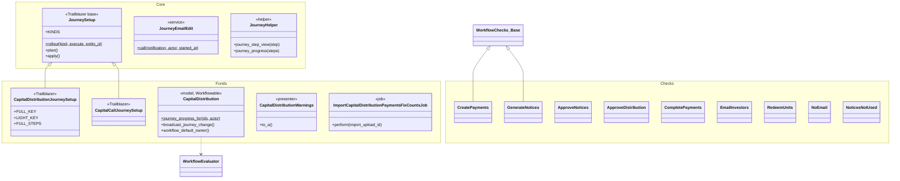

# Capital Distribution Journey — Design

> **Audience:** Engineering team.
> **Companion documents:** [Proposal](proposal.md) · [Spec](specs/) · [LLD](lld.md) · [QA checklist](qa-checklist.md)

> **Planning phase — no code changes.** This document explains HOW the proposal will be built.
> Do not edit application code while writing it; implementation happens later, in the tasks phase.

> **Builds on** the capital call journey ([design](../2026-10-02-capital-call-journey/design.md)). The evaluated-workflow
> engine (step kinds, checks registry, `WorkflowEvaluator`, history, undo, ticks, reminders, real-time
> broadcast) is reused **unchanged**; this document only covers what a second record type adds, and the
> one-time move of the call's panel and setup into the shared workflow pack.

---

## Contents

- [1. The idea](#1-the-idea)
  - [What this adds](#what-this-adds)
  - [The idea in one picture](#the-idea-in-one-picture)
  - [Walkthrough: one distribution, start to finish](#walkthrough-one-distribution-start-to-finish)
  - [Key ideas](#key-ideas)
- [2. The same picture with real names](#2-the-same-picture-with-real-names)
  - [Picture](#picture)
  - [What each box does](#what-each-box-does)
  - [One distribution, end to end](#one-distribution-end-to-end)
  - [Lifecycles](#lifecycles)
  - [What users see](#what-users-see)
  - [Design decisions](#design-decisions)
- [3. One card per box](#3-one-card-per-box)
  - [① Setup](#①-setup)
  - [② Journey template](#②-journey-template)
  - [③ Distribution actions](#③-distribution-actions)
  - [④ Distribution data and ⑤ Checks](#④-distribution-data-and-⑤-checks)
  - [⑥ Evaluator](#⑥-evaluator)
  - [⑦ Step bar and panel](#⑦-step-bar-and-panel)
  - [⑧ Hooks](#⑧-hooks)
- [4. Reference](#4-reference)
  - [Class diagram](#class-diagram)
  - [Data model and schema changes](#data-model-and-schema-changes)
  - [Component contracts](#component-contracts)
  - [Cross-cutting concerns](#cross-cutting-concerns)
  - [Worked examples](#worked-examples)
  - [Testing](#testing)
  - [Risks and open questions](#risks-and-open-questions)

---

## 1. The idea

### What this adds

Capital distributions get the same data-driven journey capital calls have: a seeded Full / Light template,
one read-only check per task, the shared evaluator working out the current task, and the step bar + "What's
needed now" panel on the distribution page, kept live over Turbo Streams. It follows the capital call
journey exactly, and makes the call's panel, helper, setup and email-edit handling generic so both types
share one copy. Four small fixes to distribution approval, completion, wording and two jobs ride along.

### The idea in one picture



### Walkthrough: one distribution, start to finish

**The setup.** Acme Capital has run setup (①). Its admin added a **CFO sign-off** (Rahul, Approver) to the
Full template before "Approve distribution". **Growth Fund II** has a Distribution Template and three
investors — Asha Ventures, Birla Family Trust and Chen Holdings — each committed ₹1 Cr. Priya (ops, Approver)
creates **Q3 2026 Exit Proceeds**: income ₹30,00,000 on a Commitment Percentage basis, unit price ₹100 for
class A units. Chen Holdings' KYC is not verified yet.

**How to read the step bar.** Every task is listed by name with its mark:

| Mark | Means |
|---|---|
| ✓ | done |
| **●** | **we are here**: waiting on this task, it is *not* done yet |
| ○ | later; not reached yet |
| – | not applicable to this distribution |
| **↺** | **back here**: this task was done, but something was undone |

Circled numbers in "Behind the scenes" are the picture's boxes: setup (①), template (②), actions (③), data
(④), checks (⑤), evaluator (⑥), panel (⑦) and hooks (⑧).



#### Day 1: payments and notices

| # | When | What happens | Behind the scenes | Step&nbsp;bar&nbsp;after&nbsp;&nbsp;&nbsp;&nbsp;&nbsp;&nbsp;&nbsp;&nbsp;&nbsp;&nbsp;&nbsp;&nbsp;&nbsp;&nbsp; |
|---|---|---|---|---|
| 1 | Mon 09:00 | Priya saves the distribution | The auto-assign rule launches Full from the template (②). Payment generation is queued. Priya lands on the page, which asks the evaluator (⑥): 0 of 3 payments | **●&nbsp;Create&nbsp;payments**<br>○&nbsp;Generate&nbsp;notices<br>○&nbsp;Approve&nbsp;notices<br>○&nbsp;Review&nbsp;email<br>○&nbsp;Check&nbsp;preview<br>○&nbsp;CFO&nbsp;sign-off<br>○&nbsp;Approve&nbsp;distribution<br>○&nbsp;Mark&nbsp;payments&nbsp;completed<br>○&nbsp;Email&nbsp;investors<br>○&nbsp;Redeem&nbsp;units |
| 2 | Mon 09:01 | The payment job finishes | The job's hook (⑧) asks the evaluator (⑥); the checks (⑤) see 3 of 3 payments. The page updates itself | ✓&nbsp;Create&nbsp;payments<br>**●&nbsp;Generate&nbsp;notices**<br>rest ○ |
| 3 | Mon 09:10 | Priya clicks the panel's "Generate Documents" | The panel (⑦) clicks the Actions menu item (③). The doc job makes 2 notices; Chen's is refused (KYC). Its hook (⑧) re-checks | **●&nbsp;Generate&nbsp;notices** — "1 investor has unverified KYC — notices are not generated for them"<br>rest as row 2 |
| 4 | Mon–Tue | **Stall.** Nothing changes overnight | The 15-minute tick re-checks with the same result, so nothing is written. The daily reminder emails Priya, the task owner | Same as row 3 |

#### Day 2–3: approval, and a mistake

| # | When | What happens | Behind the scenes | Step&nbsp;bar&nbsp;after&nbsp;&nbsp;&nbsp;&nbsp;&nbsp;&nbsp;&nbsp;&nbsp;&nbsp;&nbsp;&nbsp;&nbsp;&nbsp;&nbsp; |
|---|---|---|---|---|
| 5 | Tue 10:00 | Chen's KYC is verified; Priya generates again | Only Chen's notice is made (approved notices are never replaced). Hook (⑧): 3 of 3 | ✓&nbsp;Create&nbsp;payments<br>✓&nbsp;Generate&nbsp;notices<br>**●&nbsp;Approve&nbsp;notices**<br>rest ○ |
| 6 | Tue 10:05 | Priya clicks "View notices to approve", approves all 3 in the new window | The bulk approve job's hook (⑧) re-checks this distribution once. The original window updates | ✓&nbsp;Create&nbsp;payments<br>✓&nbsp;Generate&nbsp;notices<br>✓&nbsp;Approve&nbsp;notices<br>**●&nbsp;Review&nbsp;email**<br>rest ○ |
| 7 | Tue 10:20 | Priya marks Review email and Check preview reviewed | Acknowledge steps record who and when | … ✓&nbsp;Review&nbsp;email<br>✓&nbsp;Check&nbsp;preview<br>**●&nbsp;CFO&nbsp;sign-off**<br>rest ○ |
| 8 | Wed 09:00 | Rahul signs off | A human step vote; evaluator moves on | … ✓&nbsp;CFO&nbsp;sign-off<br>**●&nbsp;Approve&nbsp;distribution**<br>rest ○ |
| 9 | Wed 09:30 | **Mistake.** A missed expense entry is added; Priya clicks Recompute Fees | The recompute job takes `started_at` first, rewrites net payable, marks Generate notices invalidated ("Fees recomputed"), then `journey_undo_evaluate` (⑧). The existing notices predate the invalidation, so the evaluator (⑥) moves back and resets Rahul's sign-off | ✓&nbsp;Create&nbsp;payments<br>**↺&nbsp;Generate&nbsp;notices** — "Moved back — Fees recomputed by Priya"<br>○&nbsp;Approve&nbsp;notices … ○&nbsp;CFO&nbsp;sign-off (reset) … |

> After an invalidation, Generate notices passes again only when every notice is newer than it: the check's
> `fresh_since` is the oldest notice (the engine's existing rule, as for calls' Recompute Call).

#### Day 4–5: money out

| # | When | What happens | Behind the scenes | Step&nbsp;bar&nbsp;after&nbsp;&nbsp;&nbsp;&nbsp;&nbsp;&nbsp;&nbsp;&nbsp;&nbsp;&nbsp;&nbsp;&nbsp;&nbsp;&nbsp; |
|---|---|---|---|---|
| 10 | Thu | Priya unapproves the 3 old notices, regenerates, re-approves; reviews; Rahul signs off again | Each step's hook (⑧) re-checks | ✓ up to CFO sign-off<br>**●&nbsp;Approve&nbsp;distribution** |
| 11 | Thu 15:00 | Priya clicks the panel's "Approve" | Panel (⑦) clicks the real Approve (③), which now needs the Approver role. Hook (⑧) | … ✓&nbsp;Approve&nbsp;distribution<br>**●&nbsp;Mark&nbsp;payments&nbsp;completed** |
| 12 | Thu 15:05 | Panel → "Mark Payments Completed" | Hook (⑧) | … ✓&nbsp;Mark&nbsp;payments&nbsp;completed<br>**●&nbsp;Email&nbsp;investors** |
| 13 | Thu 15:10 | Panel → "Send Payment Notifications" | The notification job's hook (⑧) at the end. Warnings disappear | … ✓&nbsp;Email&nbsp;investors<br>**●&nbsp;Redeem&nbsp;units** |
| 14 | Fri 10:00 | Panel → "Redeem Units" | `FundUnitsJob` hook (⑧): 3 of 3 payments have units | All ✓ — journey complete |

**The key moment (row 9)** as Priya sees it:

```
┌ ↺ Moved back to "Generate notices" — Fees recomputed by Priya on 07/10/2026 09:30. ─────┐
│ ⌁ Journey  Capital Distribution — Full: Notify Investors            1 of 10 done  10%    │
│ ✓ Create payments ─ ↺ Generate notices ─ ○ Approve notices ─ ○ Review email ─ …          │
│ What's needed now: Generate notices — Fees recomputed                                    │
│                                                      [ Generate Documents → ]            │
└──────────────────────────────────────────────────────────────────────────────────────────┘
```

**What to notice**
- Nothing about the distribution was stored for the journey: every mark comes from payments, notices,
  flags and units (④), so the tracker can't drift from reality.
- Every forward step updated the page at once because the action's hook (⑧) re-checked; the 15-minute
  tick only matters for things no hook sees.
- Undo (row 9) moved back *and* reset the later sign-off, because the hook captured `started_at` first.
- The stall (row 4) wrote nothing: identical results are not written or broadcast.

### Key ideas

| # | Idea | In one line | Card |
|---|---|---|---|
| 1 | Same engine, second type | Distribution checks plug into the registry; the evaluator is untouched | [⑥](#⑥-evaluator) |
| 2 | Notices are optional | Notice tasks are not applicable without a Distribution Template | [④⑤](#④-distribution-data-and-⑤-checks) |
| 3 | Complete before email | The app only emails completed payments, so the order is the reverse of calls | [②](#②-journey-template) |
| 4 | One panel, one setup | The call's panel, helper, setup and email-edit move to the workflow pack and are shared | [⑦](#⑦-step-bar-and-panel), [①](#①-setup) |
| 5 | Every action tells the journey | Progress and undo hooks in each job/controller; bulk ones once per distribution | [⑧](#⑧-hooks) |

**FAQ**

| Question | Answer |
|---|---|
| Does anything block users? | Only the two agreed fixes: Approve needs the Approver role, and bulk completion needs approval. The journey itself is advisory. |
| Why not just reuse the readiness agent? | It's a point-in-time AI report run on demand; the journey is continuous, cheap, and drives the page. The panel's warnings reuse the agent's bank-details rule. |
| Why doesn't approval come after "Email investors" like calls' "Send notices"? | It doesn't — approval is before both. Only *completing* and *emailing* swap order, because emailing requires a completed payment. |
| What if a company never runs setup? | Nothing changes for them; distributions launch no journey. |

---

## 2. The same picture with real names

### Picture



### What each box does

| # | Box | Real parts | What it does | When it runs | What it decides | Details |
|---|---|---|---|---|---|---|
| ① | Setup | `JourneySetup` (new base), `CapitalDistributionJourneySetup`, `CapitalCallJourneySetup` (now a subclass), rake, `SetupCompany`, `WorkflowTemplatesController#setup_journeys` | Seeds Full/Light templates, two rules, the permission | Rake, new fund company, button | What's missing for this entity | [①](#①-setup) |
| ② | Journey template | `WorkflowTemplate`, `WorkflowStep` (existing) | Holds the 9 / 3 tasks and their check keys | At launch (snapshotted) | Task order and kinds | [②](#②-journey-template) |
| ③ | Distribution actions | Distribution and payment controllers, doc/notification/units/recompute jobs, documents approval | Changes data; four fixes live here | User clicks, jobs | Who may approve / complete | [③](#③-distribution-actions) |
| ④⑤ | Data + checks | 10 task checks + 4 skip checks + `CapitalDistributionWarnings` | Answer "is this task done?" from data | Every evaluation | Pass/fail, message, button target | [④⑤](#④-distribution-data-and-⑤-checks) |
| ⑥ | Evaluator | `WorkflowEvaluator` (unchanged) | Walks tasks, writes `step_results`, history, broadcasts | Page view, hooks, tick | Current task, moved back, resets | [⑥](#⑥-evaluator) |
| ⑦ | Step bar + panel | Shared `_journey_panel`, `JourneyHelper`, `journey_action_controller.js`, per-type `_journey` wrapper | Draws the journey; live via `turbo_stream_from` | Page render, broadcast refetch | What the user sees | [⑦](#⑦-step-bar-and-panel) |
| ⑧ | Hooks | `journey_progress!`, `journey_undo_evaluate`, `journey_progress_for`, `JourneyEmailEdit` | Re-check after every action | End of each action/job | Progress vs undo | [⑧](#⑧-hooks) |

### One distribution, end to end



### Lifecycles

Task and journey status are the engine's, unchanged — see the call design's
[Lifecycles](../2026-10-02-capital-call-journey/design.md#lifecycles). The distribution adds no stored status; its
derived "where is it" is:



All states are **derived** by the checks from ④; none are stored on the distribution.

### What users see

**At a glance**

| Screen | Change |
|---|---|
| Distribution page | Step bar + panel above the details (only with a journey); Workflow tab for admins; Actions menu items get DOM ids; new "View Generated Notices To Approve"; Approve hidden for non-approvers |
| Distribution form | Send Notification hint corrected |
| Documents screen | Filter by distribution; approval hint banner when opened from the new link |
| Workflow Templates | "Set up capital distribution journeys" button beside the call one |
| Capital call page | Looks the same (panel now rendered from the shared partial) |

**Journey 2: Ops runs a distribution with the step bar**

```
┌ Q3 2026 Exit Proceeds ──────────────────────────── [Edit] [Delete] [Actions ▾]③ ┐
│ ┌ ⌁ Journey  Full: Notify Investors   5 of 10 done ▓▓▓▓▓░░░░░ 50%  [View]①     ┐ │
│ │ ✓ Create payments ─ ✓ Generate notices ─ ✓ Approve notices ─ ✓ Review email ─  │ │
│ │ ✓ Check preview ─ ● CFO sign-off ─ ○ Approve distribution ─ …              ②  │ │
│ │ What's needed now: CFO sign-off — waiting for Rahul           [Open →]④      │ │
│ │ ⚠ 1 investor has nobody subscribed to Distribution emails      ⑤            │ │
│ └───────────────────────────────────────────────────────────────────────────────┘ │
│ Stats …   Details …   [Payments] [Notification] [Workflow]⑥                        │
└──────────────────────────────────────────────────────────────────────────────────┘
```

| Step | The user… | They see |
|---|---|---|
| J2.1 | opens a new distribution | ① header with template name and progress, ② the step bar |
| J2.2 | leaves the page open while payments generate | the bar moves on without a reload |
| J2.3 | clicks ④ on "Approve notices" | a new window with this distribution's unapproved notices |
| J2.4 | clicks Mark reviewed on "Review email" | the bar moves to Check preview |
| J2.5 | clicks ④ on "Approve distribution" | the Actions menu ③ opens, Approve flashes, its confirm appears |
| J2.6 | reads ⑤ | warnings until investors are emailed |
| J2.7 | opens ⑥ (admin) | the journey's workflow instance |

### Design decisions

| # | Choice | Alternative | Why rejected |
|---|---|---|---|
| 1 | Reuse `WorkflowEvaluator` and the check framework unchanged | Distribution-specific tracker | Duplicates the engine, history, undo and ticks |
| 2 | Move the call's `_journey.html.erb` body to a shared `workflow_instances/_journey_panel` with locals; keep a 3-line `_journey` per type | Copy the 169-line partial | Two copies drift; `WorkflowInstancesController#render_journey_frame` already finds `<plural>/_journey` by convention, so the wrapper keeps that contract |
| 3 | Rename `CapitalCallJourneyHelper` → `JourneyHelper` in the workflow pack; keep the `cc-` CSS classes | New helper per type | Helper is 100% generic; CSS rename would churn the call's SCSS for nothing |
| 4 | `JourneySetup` base (plan/apply/find_or_seed) + per-type subclass declaring keys, names, steps, light rule | Copy `CapitalCallJourneySetup` | ~80 identical lines |
| 5 | One `setup_journeys` action with a whitelisted `kind` (`JourneySetup::KINDS`); a button per kind with ids `setup_<kind>_journeys_btn` | A second action `setup_capital_distribution_journeys` | Second action duplicates controller, policy and view logic; ids keep the call's existing test working |
| 6 | New rake `capital_distribution_journeys:rollout`; both rake tasks call `JourneySetup.rollout(kind)` | One task with KIND= | Keeps the documented call command working; the shared runner keeps them identical |
| 7 | Notice tasks are n/a when the fund has no Distribution Template (commitment templates only override a fund template by name, so they never apply alone) | Require a template like calls | Prod: 7 funds have one; most distributions email without notices — a required template would stall nearly every journey |
| 8 | Drop "Add notice template" as a task | Keep it like calls | With rule 7 it could only ever be ✓ or –, never actionable |
| 9 | "Email investors" instead of "Send notices" | Same name as calls | The email often has no notice attached |
| 10 | Generalise `CapitalCallJourneyEmailEdit` → `JourneyEmailEdit` with a per-type config | Second copy for distributions | Same logic, different class names and keys |
| 11 | Figure changes (Recompute Fees, date change, a payment's amounts edited) invalidate Generate notices via `WorkflowStepInvalidate`; the check returns `fresh_since` = oldest notice | Compare notices with payments' `updated_at` | Marking payments completed also bumps `updated_at`, which would move every journey back at step 7; invalidation is the engine's existing mechanism and is what calls' recompute uses |
| 12 | Bulk completion check moves into `payments_completed?` (approved) and the menu uses the same method | Keep two policy methods | Two methods for one action is how the gap appeared |
| 13 | No `approved_at` column; Approve check reads the latest audit (as calls do) | Add a column | Audits already exist; no migration |
| 15 | Both Full journeys (calls and distributions) are seeded with a **CFO sign-off** human step with no approvers, before the Approve step; an approval step with no approvers is n/a (`WorkflowEvaluator#skip_result`); setup adds the step to an older Full template that lacks it | Pick the approver in the setup dialog | User's choice: admins pick the approver by editing the step. Approvers are frozen into each journey at launch, so an empty step must not block — journeys launched before the pick would otherwise wait forever |
| 14 | The per-type journey plumbing is shared: `Workflowable.has_journey` (broadcast via `polymorphic_path(record, action: :journey)`, creator as default owner, `journey_progress_for`), `WithJourneyPanel` (`evaluate_journey` / `render_journey_panel` for show and the `journey` action), `WorkflowablePolicyMethods` (`journey?`, `assign_workflow?`, which 7 policies had copied) | Copy them per type, as the call journey had | ~50 lines repeated per type; a new journey type now needs only checks, a setup table, hooks, button ids and a 3-line `_journey` wrapper |

**FAQ**

| Question | Answer |
|---|---|
| Will moving the call's partial change the call page? | No markup changes: the call's `_journey` passes the same frame id, warnings and tooltip as locals. The call UI feature is the regression guard (task 1.x). |
| Why keep `cc-` CSS prefixes for distributions? | They're the journey's styles, not call-specific ones; renaming is churn. |
| Is invalidating Generate notices the same as calls? | Yes — calls' Recompute Fees and figure edits invalidate `capital_call.generate_notices` the same way. |
| Does `setup_journeys` accept any class name? | No. `kind` must be a key of `JourneySetup::KINDS`; nothing is constantized from params. |

---

## 3. One card per box

### ① Setup

**What it is.** One idempotent service per journey kind on a shared base, run from three entry points.

| Owns | Reads / receives | Produces |
|---|---|---|
| Template + rule seeding, permission flag | `entity`, `execute:` | `ctx[:report]` `{templates:, rules:, flag:}`; records when executing |



| Concern | Decision |
|---|---|
| Idempotency | `find_or_seed` by `[entity_id, system_key]`; rules only when the entity has no `CapitalDistribution` rule |
| Transaction | One per entity; rake rescues per entity and reports failures |
| Rules | Light: `manual_generation eq true`, priority 10; Full: no conditions, priority 100; both `auto_launch: true` |
| Access | `WorkflowTemplatePolicy#setup_journeys?` = `create?` and entity type "Investment Fund" |

**Worked examples:** H1, H10, E20, X3.

**FAQ**

| Question | Answer |
|---|---|
| Does setup touch existing distributions? | No; rules only fire on create. |
| Why does the button stay visible once done? | So admins can see the state; it shows disabled with a tick (same as calls). |
| What if the call setup ran but not distribution? | Each kind plans independently; the call button shows "✓ set up", the distribution one is active. |

### ② Journey template

**What it is.** The seeded tasks. Key prefix `capital_distribution.`.

| Owns | Reads / receives | Produces |
|---|---|---|
| Task order, kind, check/skip keys, descriptions | Admin edits | `template_snapshot` at launch |

| # | Task | Kind | check_key | skip_key | Light? |
|---|---|---|---|---|---|
| 1 | Create payments | system | `create_payments` | — | ✓ |
| 2 | Generate notices | system | `generate_notices` | `notices_not_used` | |
| 3 | Approve notices | system | `approve_notices` | `notices_not_used` | |
| 4 | Review email | acknowledge | `review_email` | `review_not_needed` | |
| 5 | Check preview | acknowledge | `check_preview` | `review_not_needed` | |
| 6 | Approve distribution | system | `approve_distribution` | `imported` | |
| 7 | Mark payments completed | system | `complete_payments` | — | ✓ |
| 8 | Email investors | system | `email_investors` | `no_email` | |
| 9 | Redeem units | system | `redeem_units` | `no_unit_prices` | ✓ |

`unlocks` is left empty (advisory only). `reminder_interval_days: 2`. Owner: `workflow_default_owner` = creator
from the create audit (as calls).

**Worked examples:** H1, H2, H9.

**FAQ**

| Question | Answer |
|---|---|
| Why does Approve have an `imported` skip when imported ones get Light? | An admin can repoint rules; an imported distribution on Full must still be able to finish. |
| Can admins reorder tasks? | Yes, via Workflow Templates; checks don't depend on order. |

### ③ Distribution actions

**What it is.** Existing controllers and jobs; this change adds DOM ids, one link, hooks (⑧) and four fixes.

| Owns | Reads / receives | Produces |
|---|---|---|
| Who may do what; the actual changes | User requests, job args | Changed ④; a hook call |

**DOM ids added** (`capital_distributions/show.html.erb`): `capital_distribution_approve_btn`,
`capital_distribution_generate_docs_btn`, `capital_distribution_payments_completed_btn`,
`capital_distribution_notify_btn`, `capital_distribution_redeem_units_btn`,
`capital_distribution_view_notices_to_approve_btn` (new link, `target: _blank`), existing
`capital_distribution_recompute_fees_btn`; tab `#payments-tab`.

**Fixes**

| Fix | Where | Decision |
|---|---|---|
| Approver role | `CapitalDistributionPolicy#approve?` | `!approved && update? && user.has_cached_role?(:approver)` (same as calls) |
| Bulk completion | `#payments_completed?` | `update? && record.approved`; `mark_payments_completed?` removed, view calls `payments_completed?` |
| Hint | `capital_distributions/_form.html.erb` | Text per proposal |
| Job error path | `CapitalDistributionJob` | Model passes `user_id:` when known (none from after_create → logs); error path uses `User.find_by` and skips the email when nil |
| Recompute message | `CapitalDistributionPaymentRecomputeFeesJob` | Load the distribution before the first alert |

**Access**

| Role | View journey | Mark reviewed | Approve | Complete (bulk) | Setup button |
|---|---|---|---|---|---|
| Company admin + Approver | ✓ | ✓ | ✓ | ✓ when approved | ✓ |
| Employee with update, no Approver | ✓ | ✓ | ✗ | ✓ when approved | ✗ |
| Employee read-only | ✓ | ✗ | ✗ | ✗ | ✗ |
| Investor | ✗ (no panel for investors) | ✗ | ✗ | ✗ | ✗ |
| Other entity | ✗ (`belongs_to_entity?`) | ✗ | ✗ | ✗ | ✗ |

**Worked examples:** H5, E22, E23, X1, X2, X4, X5.

**FAQ**

| Question | Answer |
|---|---|
| Does the single-payment "Mark Payment Completed" now need approval? | No — not agreed; only the bulk action. |
| Why change `approve?` here and not add a rule in the journey? | It's the agreed fix; the journey stays advisory. |

### ④ Distribution data and ⑤ Checks

**What it is.** Read-only check classes in `app/packs/funds/capital_distributions/workflow_checks/capital_distribution/`,
namespace `WorkflowChecks::CapitalDistribution`, registered in `config/initializers/workflow_checks.rb`.

| Owns | Reads / receives | Produces |
|---|---|---|
| The rule per task | ④ via SQL counts | `WorkflowChecks::Result` |

| Check | Pass rule | Fail message (example) | Button (label → target) |
|---|---|---|---|
| `create_payments` | Generated basis: every commitment the fund had when the distribution was created has a payment (what `CapitalDistributionJob` iterated). Upload basis: payments exist, no import upload in progress (<1 day) or failed | "2 of 3 payments created" / "No payments uploaded yet" / "Payment upload failed — fix and re-import" | "View payments" → `#payments-tab` |
| `generate_notices` | Every emailable payment has a Generated notice (`fresh_since` = oldest notice, so after an invalidation only newer notices satisfy it) | "1 investor has unverified KYC — notices are not generated for them" / after invalidation: "Fees recomputed" | "Generate Documents" → `capital_distribution_generate_docs_btn` |
| `approve_notices` | No unapproved Generated notice on the payments | "2 of 3 notices await approval" | "View notices to approve" → `capital_distribution_view_notices_to_approve_btn` |
| `review_email` / `check_preview` | Acknowledge (pass = offer link) | — | "Open the notification" → `#custom-notification-tab` |
| `approve_distribution` | `approved` (time from latest audit) | "The distribution is not approved yet" | "Approve" → `capital_distribution_approve_btn` |
| `complete_payments` | Payments exist and none incomplete | "2 of 3 payments marked completed" | "Mark Payments Completed" → `capital_distribution_payments_completed_btn` |
| `email_investors` | Emailable completed payments exist and none has `notification_sent = false` | "2 of 3 investors emailed" | "Send Payment Notifications" → `capital_distribution_notify_btn` |
| `redeem_units` | Every completed payment with `cost_of_investment_with_fees_cents > 0` and a commitment `unit_type` has a FundUnit | "2 of 3 payments have redeemed units" | "Redeem Units" → `capital_distribution_redeem_units_btn` |
| `no_email` (skip) | `manual_generation` or `!send_notification_on_complete` or every payment's commitment skips doc gen | "Investors are not emailed for this distribution" / "Imported distribution" / "Every commitment is set to Skip Doc Gen" | — |
| `notices_not_used` (skip) | `no_email` passes, or no "Distribution Template" on the fund | "No distribution notice template" | — |
| `review_not_needed` (skip) | `no_email` passes, or `email_investors` passes | "Investors have already been emailed" | — |
| `imported` (skip) | `manual_generation` | "Imported distribution" | — |
| `no_unit_prices` (skip) | `unit_prices` blank | "The distribution has no unit prices" | — |

Warnings (`WorkflowChecks::CapitalDistributionWarnings`, until `email_investors` passes or `no_email`):
Skip Doc Gen count; investors with no `notification_users(fund, with_tag: "Distribution")`; KYCs with no
`bank_account_number` (same rule as `DistributionReadinessAgent#verify_bank_details`).



| Concern | Decision |
|---|---|
| Determinism | Paths use plain ransack params (`capital_distribution_id_eq`), never `RansackQueryBuilder.multiple` |
| Hygiene | Counts/exists only; `skip_doc_gen` filtered via `CapitalCommitment.skip_doc_gen_ids` (as calls) |
| Namespace | Inside `WorkflowChecks::CapitalDistribution`, the model is `::CapitalDistribution` |

**Worked examples:** H2, H3, H6, H7, H8, E1–E7.

**FAQ**

| Question | Answer |
|---|---|
| Why only commitments that existed when the distribution was created? | That's what `CapitalDistributionJob` iterated. A commitment admitted later isn't paid by this distribution, and there's no button to add its payment, so counting it would stall the task for good. |
| Why not the same rule for Upload? | Upload distributions often pay a subset (prod: 113 of 120), so "has payments and upload finished" is the only sound rule. |
| Why not detect stale notices from payment timestamps? | Completing a payment bumps `updated_at` too; only an explicit invalidation by the figure-changing action is reliable. |
| What if units can't be redeemed for a payment with no unit type? | It's excluded, matching `DefaultUnitAllocationEngine#allocate_distribution_payment`. |

### ⑥ Evaluator

**What it is.** `WorkflowEvaluator`, unchanged — see the call design's [④ Evaluator](../2026-10-02-capital-call-journey/design.md#④-evaluator).

| Owns | Reads / receives | Produces |
|---|---|---|
| Current task, history, resets, broadcast | snapshot, check results, `cause`, `undo_started_at` | `step_results`, `ctx[:changed]`, `broadcast_journey_change` |

Only additions are on the record: `CapitalDistribution` includes `Workflowable` and adds itself to
`WorkflowTemplate::WORKFLOWABLE_TYPE_OPTIONS` and `WorkflowInstancesController::ALLOWED_WORKFLOWABLE_TYPES`.

**Worked examples:** all H rows.

**FAQ**

| Question | Answer |
|---|---|
| Does the 15-minute tick pick up distributions? | Yes; `WorkflowEvaluateJob` evaluates every live evaluated instance regardless of type. |

### ⑦ Step bar and panel

**What it is.** The shared partial and helper, a per-type wrapper, the `journey` endpoint and the stream.

| Owns | Reads / receives | Produces |
|---|---|---|
| Rendering, live refresh | `record`, `journey`, `instance`, `frame_id`, `warnings`, `warning_tip` | HTML in `turbo_frame_tag frame_id` |

| Piece | Decision |
|---|---|
| Shared partial | `app/packs/core/workflow_templates/views/workflow_instances/_journey_panel.html.erb` (call's body, frame id and warnings from locals) |
| Wrappers | `capital_calls/_journey` and `capital_distributions/_journey` render it with their frame id and warnings |
| Route | `GET /capital_distributions/:id/journey` → `#journey`, policy `journey?` = `show?` |
| Show | Evaluate on `connected_to(role: :writing)`; `turbo_stream_from @capital_distribution, :journey if @journey.present?` |
| Broadcast | `CapitalDistribution#broadcast_journey_change` replaces `capital_distribution_journey` with an empty frame whose `src` is the journey route |
| Workflow tab | `_details.html.erb` adds the tab when `assign_workflow?` (company admin + flag), like calls |

**Worked examples:** H3, H4, H5, E6, E16, E17, E22, X6.

**FAQ**

| Question | Answer |
|---|---|
| Why refetch rather than broadcast HTML? | The panel depends on the viewer's rights (Approve visible or not). |
| Investors? | Investors don't see the panel; the `if` in show is also guarded by `!curr_role_investor?`. |

### ⑧ Hooks

**What it is.** One call at the end of every action that can change a task.

| Owns | Reads / receives | Produces |
|---|---|---|
| Progress vs undo choice per action | distribution(s), actor, `started_at` | evaluator run |

| Action | Where | Hook |
|---|---|---|
| Payments generated | `CapitalDistributionJob#perform` end | `journey_progress!` |
| Payments imported | new `ImportCapitalDistributionPaymentsFixCountsJob` (found by `ImportUtil` naming) | `journey_progress_for(ids)` |
| Payment added | payments `#create` | `journey_progress!` |
| Payment edited | payments `#update` | invalidate Generate notices if amounts/date changed; then `journey_undo_evaluate(started_at:)` (moves back only if a task now fails) |
| Payment deleted | payments `#destroy` | `journey_undo_evaluate` |
| Approve | distributions `#approve` | `journey_progress!` |
| Complete (bulk / single) | both `#payments_completed` | `journey_progress!` |
| Notices generated | `CapitalDistributionPaymentDocJob#evaluate_journey` | undo if notices existed, else progress |
| Notice approved / unapproved | `DocumentsController` single update, `DocumentApprovalJob`, `DocumentsBulkActionJob` | `Document.distribution_ids_for_notices` → `journey_progress_for` / `journey_undo_evaluate` |
| Emails sent | `CapitalDistributionPaymentNotificationJob` end; payments `#send_notification` | `journey_progress!` |
| Units redeemed | `FundUnitsJob` (owner_type CapitalDistribution) | `journey_progress!` |
| Units deleted | `FundUnitsBulkActionJob` delete | `journey_undo_evaluate` per distribution |
| Fees recomputed | `CapitalDistributionPaymentRecomputeFeesJob` (`started_at` at start) | invalidate Generate notices ("Fees recomputed") when notices exist; `journey_undo_evaluate(note: "Fees recomputed")` |
| Date changed | `CapitalDistributionDateChangeJob` → passes its `started_at` to recompute | covered by recompute's undo |
| Email edited | `CustomNotificationsController` → `JourneyEmailEdit` (call + distribution configs) | invalidate review keys + undo |



**Worked examples:** H6, H7, H8, E8–E15, E18, E19, E21.

**FAQ**

| Question | Answer |
|---|---|
| Why is payment edit always an undo-evaluate? | It may untick Completed or change amounts; `journey_undo_evaluate` only records a move-back when a task actually regressed, otherwise it's a progress run. |
| Do hooks slow down actions for old distributions? | `journey_progress!` returns after one indexed lookup when there's no instance; bulk paths filter ids in SQL first. |
| Could a missed hook leave the page stale? | Only until the 15-minute tick. |

---

## 4. Reference

### Class diagram



Also changed: `Document` (+ `capital_distribution_id` ransacker, `distribution_ids_for_notices`),
`CapitalDistributionPolicy` (`approve?`, `payments_completed?`, `journey?`, `assign_workflow?`),
`WorkflowTemplatePolicy#setup_journeys?`, `CapitalDistributionsController#journey`.

### Data model and schema changes

N/A — no tables or columns change. Journey state lives in the existing `workflow_templates`,
`workflow_steps`, `workflow_instances` and `workflow_auto_assignment_rules` rows with
`workflowable_type = "CapitalDistribution"`.

### Component contracts

| From → To | Contract | Direction rule |
|---|---|---|
| ① → ② | `JourneySetup#apply` creates templates/steps/rules | Only when missing |
| ② → ⑥ | `template_snapshot` frozen at launch | Read-only |
| ③ → ④ | Existing saves/updates | Unchanged except fixes |
| ③ → ⑧ | `journey_progress!(actor:)` / `journey_undo_evaluate(note:, started_at:, actor:)` / `journey_progress_for(ids, actor:)` | Never raise into the action |
| ④ → ⑤ | SQL counts via associations | Read-only |
| ⑤ → ⑥ | `WorkflowChecks::Result(passed, message, action_label, action_path, action_target, passed_since, fresh_since)` | Deterministic for identical data |
| ⑧ → ⑥ | `WorkflowEvaluator.for(record, cause:, actor:, note:, undo_started_at:)` | — |
| ⑥ → ⑦ | `step_results`; `broadcast_journey_change` only when `ctx[:changed]` | Viewer refetches |

### Cross-cutting concerns

#### Transactions and queries

- Setup: one transaction per entity. Hooks run after the action's own transaction.
- Payment-level counts use `capital_distribution_payments.capital_distribution_id` (indexed). Notice
  queries use `documents (owner_type, owner_id)`; the new ransacker is a correlated subquery like
  `capital_call_id` and is only used on the filtered Documents link.
- `Document.distribution_ids_for_notices` plucks `distinct capital_distribution_id` in SQL before approving.

#### Exception handling and monitoring

Hooks never raise (engine contract); failures go to `ExceptionNotifier`. The `CapitalDistributionJob`
error path no longer raises on a nil user. No new `Noticed` notifications; reminders reuse the engine's.

#### Performance and security

- Distributions without a journey: one indexed `workflow_instances` lookup per hook.
- `kind` param whitelisted; checks registered at boot, never constantized from input.
- The `journey` endpoint authorizes `journey?` (= `show?`), entity-scoped by `FundBasePolicy`.

### Worked examples

**Shared setup**

| Item | Value |
|---|---|
| Entity | Acme Capital (Investment Fund), set up |
| Users | Priya — company_admin + approver; Rahul — approver (CFO); Ken — employee with update, no approver |
| Fund | Growth Fund II, INR, Distribution Template on the fund, class A unit price ₹100 |
| Investors | Asha Ventures, Birla Family Trust, Chen Holdings — ₹1 Cr each, verified KYC unless stated |
| Distribution | Q3 2026 Exit Proceeds — income ₹30,00,000, cost of investment ₹15,00,000, Commitment Percentage |

#### Happy Path

| # | Scenario | Given | When | Then | Spec scenario | Feature |
|---|---|---|---|---|---|---|
| H1 | Rake seeds an entity | Acme not set up | rollout dry run, then `EXECUTE=1` | dry run writes nothing; execute creates Full (9), Light (3), 2 rules, flag | Setting up an entity; Dry run | capital_distribution_journey_rollout |
| H2 | New distribution gets Full and passes Create payments | Acme set up | Priya creates Q3 and the payment job runs | Full launched; bar: ✓ Create payments, ● Generate notices | Setting up an entity | capital_distribution_journey |
| H3 | Panel while notices partly approved | 3 notices, 1 approved | open page | "Approve notices: 2 of 3 notices await approval"; button clicks `capital_distribution_view_notices_to_approve_btn` | Panel while notices are partly approved | capital_distribution_journey_ui |
| H4 | Mark reviewed | notices approved | Mark reviewed on Review email | "Check preview" current | Panel button runs the real control | capital_distribution_journey_ui |
| H5 | Panel Approve | reviewed | Priya clicks panel "Approve", confirms | approved; ● Mark payments completed | Approver; Panel button runs the real control | capital_distribution_journey_ui |
| H6 | Complete payments | approved | Mark Payments Completed | ● Email investors | Panel button runs the real control | capital_distribution_journey |
| H7 | Email investors | completed | Send Payment Notifications job runs | ● Redeem units; warnings gone | Warnings until emailed | capital_distribution_journey |
| H8 | Redeem units completes journey | emailed | FundUnitsJob runs | all ✓, instance completed | Setting up an entity | capital_distribution_journey |
| H9 | Imported distribution gets Light | Acme set up | distribution import | Light: Create payments, Mark payments completed, Redeem units | Imported distribution gets Light | capital_distribution_journey |
| H10 | Setup from UI | Acme not set up | Priya clicks "Set up capital distribution journeys", confirms | notice text per spec; button disabled "✓ Capital distribution journeys set up" | Setup from the UI | capital_distribution_journey_rollout |

#### Edge Cases

| # | Scenario | Given | When | Then | Spec scenario | Feature |
|---|---|---|---|---|---|---|
| E1 | No template | fund has no Distribution Template | open page | Generate / Approve notices "–" "No distribution notice template" | Notices not used | capital_distribution_journey |
| E2 | Send Notification off | flag off | open page | notice, review, email tasks "–" "Investors are not emailed for this distribution" | Notices not used | capital_distribution_journey |
| E3 | All skip doc gen | every commitment skip_doc_gen | open page | same tasks "–" "Every commitment is set to Skip Doc Gen" | Notices not used | capital_distribution_journey |
| E4 | Upload basis | Upload basis, no payments; then failed upload | open page | "No payments uploaded yet"; then "Payment upload failed — fix and re-import" | Setting up an entity | capital_distribution_journey |
| E5 | KYC blocks a notice | Chen KYC unverified | generate notices | "1 investor has unverified KYC — notices are not generated for them" | Panel while notices are partly approved | capital_distribution_journey |
| E6 | Warnings | 1 skip_doc_gen, 1 investor without subscribers | open page; then email investors | both warnings; gone after emailing | Warnings until emailed | capital_distribution_journey_ui |
| E7 | No unit prices | unit_prices blank | open page | Redeem units "–" | Setting up an entity | capital_distribution_journey |
| E8 | Recompute after CFO sign-off | CFO step added, signed off | Recompute Fees | moved back to Generate notices, "Fees recomputed"; CFO sign-off pending | Recompute Fees after approval | capital_distribution_journey |
| E9 | Untick Completed | at Email investors | untick one payment | back to Mark payments completed | Unticking Completed | capital_distribution_journey |
| E10 | Delete a payment | at Approve notices | delete Chen's payment | back to Create payments | Recompute Fees after approval | capital_distribution_journey |
| E11 | Regenerate notices | notices approved for 1 | Generate Documents again | Approve notices current; history "Notices regenerated" | Recompute Fees after approval | capital_distribution_journey |
| E12 | Unapprove a notice | at Review email | unapprove one notice | back to Approve notices | Recompute Fees after approval | capital_distribution_journey |
| E13 | Delete units | journey complete | delete one fund unit | back to Redeem units | Recompute Fees after approval | capital_distribution_journey |
| E14 | Email edited | Review email confirmed, not emailed; second distribution already emailed | edit fund-level distribution email | first: Review email + Check preview pending "Email template changed after review"; second unchanged | Email edited after review | capital_distribution_journey |
| E15 | Date change | at Approve distribution | change distribution date | moved back to Generate notices with "Fees recomputed" | Recompute Fees after approval | capital_distribution_journey |
| E16 | Live: doc job | page open at Generate notices | doc job finishes | bar updates without reload | Notices generated in the background | capital_distribution_journey_ui |
| E17 | Live: colleague | page open at Mark payments completed | Rahul completes in another session | bar updates without reload | A colleague completes payments | capital_distribution_journey_ui |
| E18 | Date-range approval | notices on 2 journeys | Approve documents by date range | each distribution re-checked once | Approving notices by date range | capital_distribution_journey |
| E19 | No journey, no work | distribution created before setup | approve its notices / complete payments | no evaluation; behaves as today | No journey, no work; Existing distribution; Entity not set up | capital_distribution_journey |
| E20 | Re-run keeps edits | CFO step added to Full | setup again | no duplicates, step kept | Re-running setup keeps edits | capital_distribution_journey_rollout |
| E21 | Delete with journey | journey, no units | Delete | distribution deleted | Delete | capital_distribution_journey |
| E22 | Notices link | 2 unapproved notices | Actions → View Generated Notices To Approve | new window, only this distribution's unapproved notices; original page stays | Opening the notices to approve | capital_distribution_journey_ui |
| E24 | CFO sign-off with no approver | Full seeded with the CFO sign-off, no approver picked | a distribution reaches it | CFO sign-off shows n/a "No approver set — pick one on this step in the journey template"; Approve distribution is current | Seeded distribution journeys | capital_distribution_journey |
| E25 | CFO sign-off added to an older Full template | Full template seeded before the CFO step existed | setup runs again (rake or button) | dry run says "add CFO sign-off to the Full journey"; the step is inserted before Approve distribution with no approver | Re-running setup keeps edits | capital_distribution_journey_rollout |
| E23 | Hint wording | — | open new distribution form | hint text per spec | Form hint | capital_distribution_fixes |

#### Error Cases

| # | Scenario | Given | When | Then | Spec scenario | Feature |
|---|---|---|---|---|---|---|
| X1 | Non-approver | Ken (no approver role) | opens Actions; posts approve directly | no Approve item; request refused, not approved | User without the role | capital_distribution_fixes |
| X2 | Bulk complete unapproved | unapproved distribution | PATCH payments_completed | "Access Denied"; no payment completed | Direct request on unapproved | capital_distribution_fixes |
| X3 | Non-admin setup | Ken | opens Workflow Templates; posts setup_journeys | no button; refused | Not offered to others | capital_distribution_journey_rollout |
| X4 | Generation error, no user | a payment fails validation, job enqueued from create | job runs | error logged; job does not raise again | Generation error with no user | capital_distribution_fixes |
| X5 | Recompute message | — | Recompute Fees | first progress message names the distribution | Generation error with no user | capital_distribution_fixes |
| X6 | Other entity | user of another entity | GET journey URL | access denied | Existing distribution | capital_distribution_journey_ui |

### Testing

Cucumber only. Shared setup in `features/step_definitions/capital_distribution_journey_steps.rb` (new),
reusing `capital_distribution.rb` and the call journey's generic steps (step bar table, panel, Mark reviewed,
live-update marker, spy pattern). Four features: `capital_distribution_journey`, `_ui`, `_rollout`,
`capital_distribution_fixes`. Regression: the three call journey features and `capital_distributions.feature`.

### Risks and open questions

- **Approver role is BREAKING** for 3 companies whose non-approver users approved distributions → release
  note + support assigns the role before deploy (list from prod query in lld.md).
- **Shared panel refactor could change the call page** → call UI feature + journey feature run in phase 1
  before any distribution work.
- **`documents` is a large table** → hooks pluck distinct distribution ids from the already-filtered
  approval scope; no new scans.
- **Approved notices are never replaced by regeneration** → after an invalidation the panel message says to
  unapprove them first (same as calls); documented in the user guide FAQ.

**FAQ**

| Question | Answer |
|---|---|
| Why no migration at all? | Everything the checks need already exists; approval time comes from audits. |
| Why not test the engine again? | It's unchanged; the call features cover it. |
