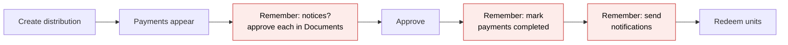
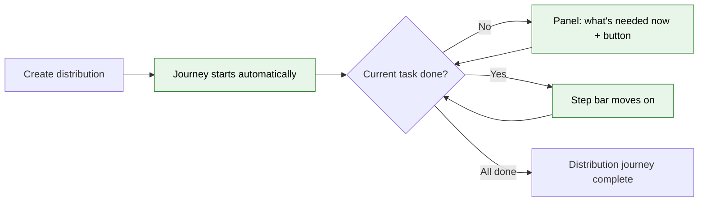
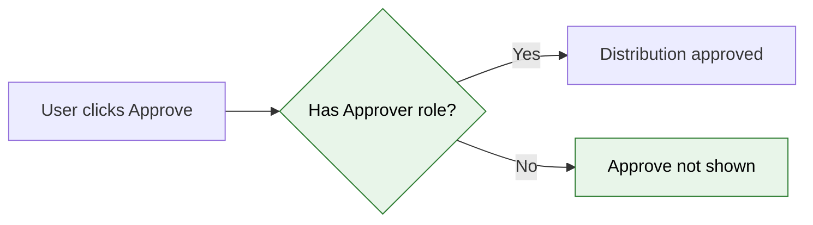

# Capital Distribution Journey — Proposal

> **Audience:** Business team, product, QA, support — non-technical.
> **Companion document:** [Design](design.md)

> **Planning phase — no code changes.** This document proposes and explains the change. Do not
> edit application code while writing it; implementation happens later, in the tasks phase.

---

## Why

Running a distribution means creating payments, optionally generating and approving notices, checking the
email, approving, marking payments completed, emailing investors and redeeming units. The steps are spread
over the Actions menu, the Documents screen and each payment's page. Nothing on the distribution says
where it stands or what to do next. In production, distributions sit approved with payments never marked
completed, or completed with investors never emailed. The capital call already has a journey that solves
exactly this; distributions do not.

## What Changes

The capital call journey (step bar + "What's needed now" panel, worked out from the record's own data) is
extended to capital distributions. The engine, screens and setup are the same ones calls use: nothing is
learned twice.

- **Two ready-made distribution journeys are seeded per company:**
  - **Full: Notify Investors** — 9 tasks, for distributions that email investors.
  - **Light: Record Only** — 3 tasks, for imported distributions (they can never email investors).
  - Imported distributions get Light, every other new distribution gets Full. Admins can edit either
    in the existing Workflow Templates screens, e.g. to add a CFO sign-off.
- **The distribution page gets the step bar and "What's needed now" panel**, with a button that runs the
  real control on the page (Approve, Generate Documents, Mark Payments Completed, Send Payment
  Notifications, Redeem Units), and a Workflow tab.
- **Notices are optional for distributions.** Most funds email investors with no notice attached (only 7
  funds in production have a Distribution Template). When a fund has no Distribution Template, the
  "Generate notices" and "Approve notices" tasks show as **not applicable** instead of blocking.
- **A new "View Generated Notices To Approve" link** in the distribution's Actions menu opens the
  distribution's unapproved notices on the Documents screen, in a new window.
- **The page updates by itself** when payments are generated, notices are generated or approved, payments
  are completed, emails go out, or units are redeemed — including when someone else does it.
- **Undoing moves the journey back**: Recompute Fees, changing the distribution date, unticking a
  payment's Completed box, deleting a payment, regenerating or unapproving a notice, deleting redeemed
  units, and editing the distribution email.
- **Set up three ways**, all running the same setup: a rake task (dry run by default), automatically for
  new fund companies, and a **"Set up capital distribution journeys"** button on the Workflow Templates
  page.
- **Four fixes to the existing distribution screens** (agreed with product):
  1. **Mark Payments Completed is refused for an unapproved distribution** by the server, not just hidden
     in the menu.
  2. **BREAKING — Approve needs the Approver role**, the same as capital calls. Users who approved
     distributions without that role (seen in 3 companies in production) must be given it.
  3. **The "Send Notification" checkbox hint is corrected.** It said investors are emailed when a payment
     is completed; nothing sends automatically. It now says sending happens from Actions → Send Payment
     Notifications.
  4. **Two background-job bugs are fixed**: payment generation could crash while reporting its own error,
     and Recompute Fees' first progress message named no distribution.
- **Existing distributions are untouched.** Only distributions created after setup get a journey.

### Flow Diagram

Running a distribution: before, the user works out the order from the Actions menu and the guide.



After: the page shows the current task, what it needs and a button that does it.



Approving: before, anyone with update rights could approve. After, only Approvers.



---

## User Stories

### US-1: See where the distribution is

**As a** fund operations user,
**I want** the distribution page to show which task the distribution is on and what it needs,
**So that** I don't have to remember the order or hunt through menus.

**Acceptance criteria:**
- The page shows every task by name with a mark: ✓ done, ● current, ○ not yet, – not applicable.
- The "What's needed now" panel names the current task, a specific message (e.g. "2 of 3 payments marked
  completed") and a button.
- The button runs the control on the page that does the work (e.g. it opens the Actions menu and clicks
  "Mark Payments Completed", which shows its usual confirmation).

### US-2: Notices only when the fund uses them

**As a** fund operations user whose fund emails investors without a notice,
**I want** the notice tasks to be marked not applicable,
**So that** the journey is not stuck waiting for something we never do.

**Acceptance criteria:**
- With no Distribution Template on the fund, "Generate notices" and "Approve
  notices" show "–" with the reason "No distribution notice template".
- Adding a template later makes both tasks applicable on the next check.

### US-3: Approve notices from the distribution

**As a** fund operations user,
**I want** a link to only this distribution's notices that still need approval,
**So that** I approve them without filtering the Documents screen by hand.

**Acceptance criteria:**
- Actions → "View Generated Notices To Approve" opens Documents, in a new window, filtered to this
  distribution's generated, unapproved notices, with the approval hint banner.
- The journey's "Approve notices" button clicks this link.

### US-4: Live updates

**As a** fund operations user with the distribution open,
**I want** the step bar to update when background work finishes or a colleague acts,
**So that** I never act on a stale page.

**Acceptance criteria:**
- After "Generate Documents" finishes, the bar moves from "Generate notices" to "Approve notices" without a
  reload.
- When a colleague marks payments completed elsewhere, the bar moves on.

### US-5: Undo moves the journey back

**As a** fund operations user,
**I want** the journey to move back when I undo something and say why,
**So that** later sign-offs are not counted for figures that changed.

**Acceptance criteria:**
- Recompute Fees after approval puts the journey back to the first task the new figures affect and shows
  "Moved back to … — Fees recomputed".
- A CFO sign-off step after that point is reset and the CFO is asked again.

### US-6: Set up journeys for my company

**As a** company admin of a fund company,
**I want** a "Set up capital distribution journeys" button on Workflow Templates,
**So that** I don't need a developer to turn the feature on.

**Acceptance criteria:**
- The confirmation lists what will be added; afterwards a notice says what was added.
- Once set up, the button shows "✓ Capital distribution journeys set up", disabled.
- Non-admins and non-fund companies don't see it.

### US-7: Only approvers approve

**As a** fund controller,
**I want** distribution approval limited to the Approver role, as for calls,
**So that** a payout cannot be approved by any employee with edit rights.

**Acceptance criteria:**
- A user without the Approver role does not see Actions → Approve, and a direct request is refused.

### US-8: Completion needs approval

**As a** fund controller,
**I want** "Mark Payments Completed" refused on an unapproved distribution,
**So that** a direct request cannot bypass the hidden menu item.

**Acceptance criteria:**
- A direct request on an unapproved distribution is refused with "Access Denied", and
  no payment changes.

---

## UI Behavior

### Distribution page — journey panel

```
┌────────────────────────────────────────────────────────────────────────────────────┐
│ ⌁ Journey  Capital Distribution — Full: Notify Investors      4 of 8 done  50%  [View]│
│                                                                                    │
│ ✓ Create payments ─ – Generate notices ─ – Approve notices ─ ✓ Review email ─        │
│ ✓ Check preview ─ ● Approve distribution ─ ○ Mark payments completed ─               │
│ ○ Email investors ─ ○ Redeem units                                                  │
│                                                                                    │
│ ┌ What's needed now ───────────────────────────────────────────────────────────┐    │
│ │ Approve distribution: The distribution is not approved yet     [ Approve → ]  │    │
│ └──────────────────────────────────────────────────────────────────────────────┘    │
│ ⚠ 1 commitment has Skip Doc Gen set and will not be emailed                        │
│ ⚠ 1 investor has nobody subscribed to Distribution emails                          │
└────────────────────────────────────────────────────────────────────────────────────┘
```

**Behavior notes:**
- Shown only on distributions that have a journey. Older distributions look exactly as today.
- The panel button opens the Actions menu, highlights the control and clicks it, so its own confirmation
  runs. A control that is shown but disabled gets a tooltip saying why. A control the user may not use at
  all (e.g. Approve without the Approver role) is not on the page, so the button falls back to a plain
  link — the same behaviour as the call journey.
- Warnings show until every investor who should be emailed has been.
- Hovering a task shows how it is checked ("Checked automatically", "Needs your review", "Needs sign-off").

### Workflow Templates page — setup buttons

```
┌───────────────────────────────────────────────────────────────────────────────────────┐
│ Workflow Templates     ⓘ  [✓ Capital call journeys set up] [Set up capital distribution  │
│                                                              journeys] [New Template]  │
└───────────────────────────────────────────────────────────────────────────────────────┘
```

**Behavior notes:**
- One button per journey kind, each with its own confirm and its own "✓ set up" state.

---

## What This Feature Does NOT Cover

| Excluded | Covered In |
|---|---|
| Unapprove for distributions | A later change (product decision) |
| Blocking actions until earlier tasks are done | A later phase for all journeys |
| Journeys on distributions created before setup | Not planned |
| Requiring approval before completing a **single** payment | Not planned; only the bulk action is fixed |
| Automatic emails when a payment is completed | Not planned; the hint wording is corrected instead |
| AI comparison with the previous distribution | Later phase |

---

## Validation Rules

| Field | Rule | Default |
|---|---|---|
| Approve (distribution) | Only users with the Approver role and update rights; distribution not yet approved | — |
| Mark Payments Completed (bulk) | Distribution must be approved | — |
| Setup button | Company admin of an "Investment Fund" company | — |
| Send Notification checkbox | Unchanged; hint text corrected | On |

---

## Behavior Rules

| Scenario | What User Sees |
|---|---|
| Fund has no Distribution Template | "Generate notices" and "Approve notices" show "–", tooltip "No distribution notice template" |
| Send Notification unticked | Notice, review and email tasks show "–", "Investors are not emailed for this distribution" |
| Every commitment has Skip Doc Gen | Same as above with "Every commitment is set to Skip Doc Gen" |
| Payments still generating | "Create payments: 2 of 3 payments created" |
| Upload basis, no payments yet | "Create payments: No payments uploaded yet", button opens the Payments tab |
| Payment upload failed | "Create payments: Payment upload failed — fix and re-import" |
| 1 of 3 notices approved | "Approve notices: 2 of 3 notices await approval", button "View notices to approve" |
| 2 of 3 payments completed | "Mark payments completed: 2 of 3 payments marked completed" |
| 1 investor not yet emailed | "Email investors: 2 of 3 investors emailed" |
| No unit prices | "Redeem units" shows "–", "The distribution has no unit prices" |
| Units redeemed for 2 of 3 payments | "Redeem units: 2 of 3 payments have redeemed units" |
| Recompute Fees after approval | Amber banner "Moved back to "…" — Fees recomputed by Priya on 19/08/2026 10:12." |
| Setup clicked | "Capital distribution journeys set up: Full and Light journeys, auto-assignment rules. New distributions will get a journey." |
| Setup already done | Disabled "✓ Capital distribution journeys set up" |
| Non-approver opens Actions | No "Approve" item |
| Direct Mark Payments Completed on unapproved | "Access Denied" |
| Send Notification checkbox hint | "Allow emailing investors about this distribution. Emails are sent from Actions → Send Payment Notifications." |

---

## Resolved Design Decisions

| # | Decision | Resolution |
|---|---|---|
| 1 | Which problems in today's distribution code does this change fix? | Bulk-complete server check, Approver role on Approve, Send Notification hint wording, two job bugs. Not Unapprove. |
| 2 | Hint: fix wording or make completion auto-send? | Fix wording. Auto-send would email investors before the review tasks. |
| 3 | Is a notice template required? | No. Notice tasks are not applicable when the fund has no Distribution Template — production data shows most funds send without notices. |
| 4 | Order of completing and emailing | Mark payments completed comes before Email investors: the app only emails a completed payment. (Calls are the other way round.) |
| 5 | Which distributions get which journey? | Imported → Light; everything else → Full; only distributions created after setup. |
| 6 | One setup button or one per kind? | One per kind, side by side, sharing one setup mechanism. |

---

## Capabilities

### New Capabilities

- `funds/capital-distribution-journey`: the distribution journeys (tasks, not-applicable rules, panel,
  live updates, undo, setup) and the four fixes to distribution approval, completion and the
  notification hint.

### Modified Capabilities

None. The evaluated-workflow engine (`workflows/evaluated-workflow-steps`, in the capital-call-journey
change) is reused unchanged.

---

## Impact

- The distribution page (panel, Actions menu ids, new notices link, Workflow tab).
- The distribution and payment screens' Approve, Mark Payments Completed and notification wording.
- The Documents screen (filter by distribution, approval hint) and document approval.
- Background work for payments, notices, emails, fees and units.
- The Workflow Templates page (second setup button), new-company setup, and a rollout task.
- The capital call journey's panel and setup are shared with distributions (same look, same behaviour).
- User guide for capital distributions.

---

## Benefits

1. Users see at a glance where every new distribution stands and what to do next.
2. Fewer missed steps: completing payments, emailing investors and redeeming units no longer depend on
   memory.
3. Funds that don't use notices are not nagged about them.
4. Approval of a payout is limited to approvers, as for calls.
5. The page stays current without reloading, even when colleagues act.

---

## FAQ

| Question | Answer |
|---|---|
| Who sees the journey? | Anyone who can view the distribution; buttons still follow each user's rights. |
| Does it block anything? | No. It advises only. (The Approver role and approval-before-completion fixes do block, by design.) |
| What happens to existing distributions? | Nothing. Only distributions created after setup get a journey. |
| Do I have to set anything up? | A company admin clicks "Set up capital distribution journeys" once, or support runs the rollout. New fund companies get it automatically. |
| Will investors get extra emails? | No. Nothing new is sent to investors. Reminders about stalled tasks go to the task owner. |
| Who loses the ability to approve? | Users without the Approver role. Production shows 3 companies where such users approved distributions; they need the role before release. |
| What if we don't use notices? | Without a Distribution Template the notice tasks show as not applicable. |
| Can we change the tasks? | Yes, in Workflow Templates, like the call journeys. See [design](design.md). |

---

## Design Principle for the Next Phase

Reuse, don't copy. The call journey's panel partial, helper and setup service are call-named but almost
entirely generic; the design must move them to the shared workflow pack once and let both calls and
distributions use them, rather than duplicating ~400 lines. The engine itself stays untouched. The risky
items to address explicitly: (a) the shared panel must not change the call page, (b) document-approval
hooks must stay cheap for non-notice documents, (c) the Approver-role change needs a rollout note.
