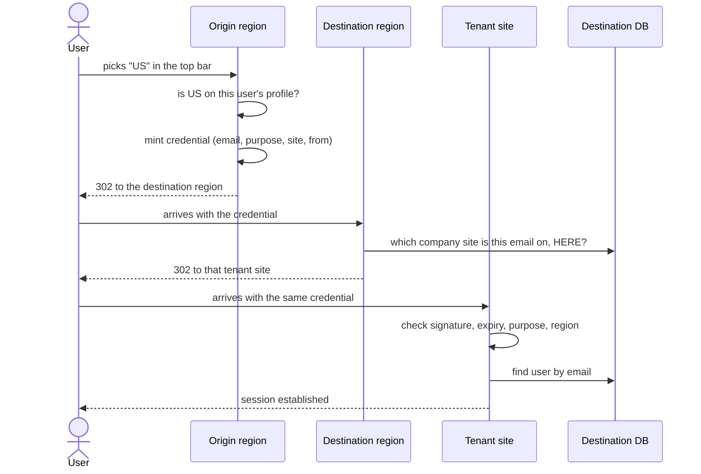
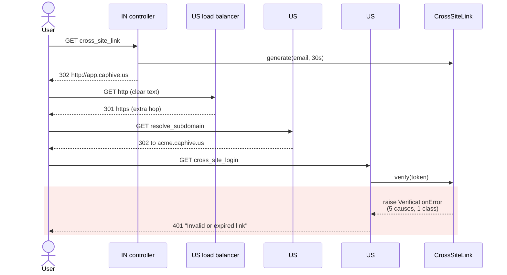
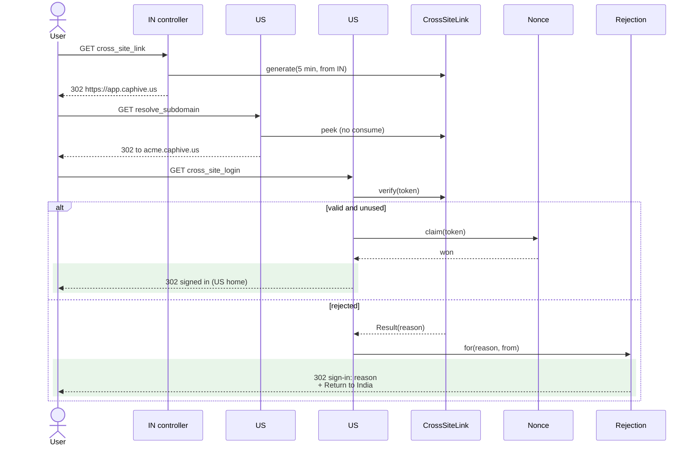

# Region switch fails with "Invalid or expired link" — Report

> **Audience:** The developer fixing this, and the reviewer checking the fix.
> **Companion documents:** [QA checklist](qa-checklist.md) · [Tasks](tasks.md) · [Spec](specs/)

> **Planning phase — no code changes.** This document diagnoses the bug and plans the fix.

> **Evidence, not guesses.** Every claim in Root Cause carries a `file.rb:LINE` that was opened.
> Those line numbers are **as of `f66ace76a`, before the fix** — the lines they point at no longer
> exist afterwards, which is the point. Read them with `git show f66ace76a:<path>`.

---

## Summary

A user who belongs to both regions picks the other region from the top-bar dropdown and lands on
a bare white page reading **"Invalid or expired link"**. The hand-off credential that carries
their identity across is valid for **30 seconds** but has to survive four network round trips
between Mumbai and Virginia before anyone checks it, and because its expiry is an absolute
timestamp written by one region's clock and compared against the other's, any slow moment or
clock drift burns the whole budget.

---

## The Feature — how it is meant to work

### The idea

CapHive runs as **two fully independent deployments**: `app.caphive.com` in Mumbai and
`app.caphive.us` in Virginia. They are not two servers behind one load balancer — they are two
applications, with **separate databases, separate encrypted credentials and separate Redis**,
built that way for data-residency reasons. A user's row in the India database and their row in
the US database are different rows, with different primary keys.

Some people legitimately work with both — a fund administrator whose firm has entities in both
jurisdictions. Making them keep two passwords and sign in twice would be the obvious design and
a bad one. So the region selector in the top bar does something more interesting: it hands the
user's **identity** across the gap, and the destination region signs them in on the strength of
it.

The mechanism is a **signed bearer credential**. The origin region writes down who the user is,
signs that statement with a secret both regions hold, and puts it in the URL it redirects the
browser to. The destination region checks the signature, believes the statement, finds that
person in *its own* database, and establishes a session.

The crucial design property is that **nothing is shared at runtime**. There is no shared session
store, no shared database, no server-to-server call between the regions during a login. One
region cannot query the other — by design, that is the whole point of the split. All the
destination region ever receives is a string in a query parameter, and everything it needs to
trust that string is already in it. That is why the credential is self-describing, and why its
integrity rests entirely on a signature rather than on a lookup.

The identity carried across is the **email address**, not a user id. Ids are per-database and
mean nothing on the other side; the email is the one stable key both regions agree on. This is
also what the multi-region user sync keys on, so the two mechanisms line up.

### How it fits together

Three HTTP hops, each on a different host, with no server-to-server traffic anywhere:

Why three hops and not one: the origin region does not know, and must not guess, which company
subdomain the user belongs to in the destination region. Their firm may be `srv.caphive.com` in
India and `acme.caphive.us` in the US. Only the destination region can answer that, from its own
`entities` table — so the middle hop exists purely to ask that question and redirect onward.

| Part | Responsibility | Talks to |
|---|---|---|
| `_sites.html.erb` (top bar) | Offers the regions this user may switch to | `User#switchable_region_codes` |
| `UsersController#cross_site_link` | Authorises the destination, mints the credential, redirects | `SiteRegistry`, `CrossSiteLink`, `UserPolicy` |
| `CrossSiteLink` | Forges and reads the credential — signing, expiry, purpose, destination | `CROSS_INSTANCE_SECRET` |
| `UsersController#redirect_to_subdomain` | Resolves the user's company site **in this region** and forwards | `CrossSiteLink#peek`, `users` / `entities` |
| `UsersController#cross_site_login` | Full validation, claims the credential once, signs in | `CrossSiteLink#verify`, `CrossSiteLink::Nonce` |
| `SiteRegistry` | The one answer to "which regions exist and where do they live" | `SITES`, `CURRENT_SITE` |

**The credential itself** is an `ActiveSupport::MessageVerifier` token, 314 characters, two parts
joined by `--`: a Base64url payload and a 64-hex `HMAC-SHA256` digest of that payload keyed by
`CROSS_INSTANCE_SECRET`. The payload carries exactly four facts —

| Field | Why it is there |
|---|---|
| `email` | How the destination region finds the user in its own database |
| `purpose` | Pins the token to this flow, so a token minted elsewhere cannot be replayed here |
| `site` | Which region may redeem it, so a credential cannot be used against the wrong one |
| `from` | Where the user came from, so both ends of a successful switch can be logged |

— plus an **absolute** expiry timestamp in a metadata envelope. Absolute, not a duration: it is
written by the issuing region's clock and compared against the verifying region's.

It is **signed, not encrypted**. Anyone holding the link can Base64-decode the payload and read
the email; what they cannot do is change it, because any edit invalidates the digest and there is
no way to recompute one without the secret. That is why the payload carries nothing a holder
should not see — no role, no entity id, no permission. Those come from the destination region's
own database after sign-in. The full byte-level anatomy is in
[`cross_instance_login.md`](../../../app/packs/core/users/services/cross_instance_login.md#-mechanism-how-a-crosssitelink-is-forged-and-redeemed).

### What it rests on

Four assumptions, all of them load-bearing:

1. **Both regions hold the same `CROSS_INSTANCE_SECRET`.** It is the only thing making the
   credential trustworthy. The two live in separate encrypted credentials files
   (`config/credentials/production.in.yml.enc`, `production.us.yml.enc`) with separate keys, so
   nothing structurally forces them to stay equal.
2. **Both regions' clocks agree**, closely enough that an absolute expiry written by one is still
   in the future when read by the other.
3. **The user exists in the destination region**, with the same email. That is the multi-region
   user sync's job, not this feature's.
4. **A credential is a bearer token**, so whoever holds the URL is the user. Its safety therefore
   comes entirely from being short-lived and hard to reuse.

Assumptions 1 and 2 were unmonitored, and 4 was only half-honoured — the credential was
replayable for its whole life. Those are the cracks the bug grew in.

---

## Symptom

| | |
|---|---|
| **What the user sees** | A plain white page, no styling, no navigation, reading exactly `Invalid or expired link` |
| **Reproduce** | Sign in on the India site as a user with `regions: "IN,US"`, pick `US` from the top-bar region dropdown. Intermittent — see below |
| **Who is affected** | Only users with more than one region on their profile, i.e. anyone who uses the region switcher. Single-region users never see it |
| **How often** | Intermittent, and more likely the slower the connection. Some users fail *every* time (see Root Cause 3) |
| **Since when** | Since the feature shipped — `407c8ff99 Multi instance (#975)` introduced the 30-second lifetime |

**What varies between a success and a failure.** Three different things, which is why it looked
random:

- **Elapsed time.** A cold Puma worker, a slow mobile link or a GC pause on either US app server
  pushes one hop past the remaining budget.
- **Which app server answers.** Each region has two app boxes behind an ALB
  (`config/deploy/production_us.rb:8-9`, `production_in.rb:8-9`), and two of the three hops land
  on an independently chosen one. A single box with a drifted clock gives ~75% failure.
- **The individual user's stored `regions` value.** Some users fail permanently — their profile
  data can never match (Root Cause 3).

The user is stranded: they are still signed in on the origin region, but the page they are
looking at offers nothing to click.

---

## Root Cause

**1. The credential's lifetime is 30 seconds, spent on a four-hop intercontinental chain.**
`app/packs/core/users/controllers/users_controller.rb:86` mints it with
`expires_in: 30.seconds`. The chain is: origin 302 → `http://app.caphive.us` → ALB scheme-upgrade
301 → `https://app.caphive.us/users/redirect_to_subdomain` → 302 →
`https://.caphive.us/users/cross_site_login`. That is four round trips to the US and **two
fresh TLS handshakes** (different hosts), all inside a budget that starts ticking in Mumbai.
The `http://` that costs the extra hop comes from `.env.production.in:59`.

**2. Clock skew subtracts directly from those 30 seconds.** `ActiveSupport::MessageVerifier`
stamps an **absolute** expiry using the issuing box's clock and compares it against the verifying
box's own `Time.now.utc`. `config/deploy.rb` installs no NTP and asserts nothing about clocks,
and there is no clock alert anywhere in
`config/initializers/observability/grafana_provision.yml` — though `node_timex_offset_seconds` is
already scraped and already charted on both regions' node dashboards. So this cause is currently
invisible, and ~20s of drift on one box makes almost every IN→US switch fail while US→IN keeps
working.

**3. Region codes are never normalised on this path, so some users fail permanently.**
`params[:site].to_sym` (`users_controller.rb:85`) comes straight from
`current_user.regions.split(",")` in `app/packs/core/base/views/layouts/_sites.html.erb:6`, and is
compared against `ENV.fetch("CURRENT_SITE", nil).to_sym` (`users_controller.rb:101`) — neither
stripped nor upcased. Every *other* reader in the codebase does normalise
(`CanonicalFingerprint#normalize_region` → `.strip.upcase`, `SmsDeliverable:42`,
`EntitySetting:76`, `User.geo_default_call_code:122`). `regions` is a free-text
`Field::String` on the Administrate dashboard (`app/packs/core/dashboards/user_dashboard.rb:33`),
so a user saved as `"IN, us"` can never switch.

**4. A user can mint a credential for a region they do not have.**
`UserPolicy#cross_site_link?` was `user.regions.present?` — "does the requester have *any* region
access" — while the controller signed a credential for whatever `params[:site]` said. Found while
tracing; a security gap, not a cause of the reported symptom.

**5. `regions` is sometimes stored as JSON, which crashes the dropdown.**
`CanonicalFingerprint#normalize_regions_array:121` tries `JSON.parse` first, so rows holding
`'["IN","US"]'` exist. The view's bare `.split(",")` turns that into option values like `"US"]`,
and `eval(ENV["SITES"])[:"\"US\"]"]` is `nil`, so `nil + "/users/..."` raises — a **500**, not
this message. A second, separate bug on the same line.

**Why it was hard to see.** `CrossSiteLink#verify` ended in
`rescue StandardError => e; raise VerificationError, e.message`
(`app/packs/core/users/services/cross_site_link.rb:34`), and the controller caught that one class
and rendered one string. Expired, tampered, wrong-region, wrong-purpose and
wrong-secret all arrived as the same message — and **neither rejection path logged anything**,
unlike `doc_shares_controller.rb:18` which does. There was no way, from the logs or the screen,
to tell a slow connection from a misconfigured server. Closing that is part of the fix, not a
nice-to-have.

---

## Blast Radius

| Also touches this code | Does this fix change it? | Needs checking |
|---|---|---|
| `features/login/multi_site.feature` — 3 cross-site scenarios + 7 user-sync scenarios | Yes — `SITES` format, and the 401 becomes a redirect | `features/login/multi_site.feature` |
| `features/step_definitions/cross_site_login_steps.rb` | Yes — `generate` needs `from:`, assertions on parsed query | same |
| `features/support/env.rb:184` sets `ENV['SITES']` | Yes — must become JSON | the whole suite boots through it |
| `SyncApiClient::REGION_BASE_URLS` — a *second*, hardcoded region-URL map (still lists an undeployed `SG`) | **No** — deliberately left alone; it is the server-to-server sync path, not the hand-off | `features/login/multi_site.feature` (sync scenarios) |
| `UserPolicy#cross_site_link?` | Yes — tightened to the requested region | region switch for a single-region user |
| `layouts/modernize/_topbar.html.erb:52` renders the selector on **every** authenticated page | Yes — guard changes to `switchable_region_codes.many?` | any page-rendering feature |
| `users.regions` column — read by the multi-region sync | Values normalised; column, type and index untouched | `features/login/canonical_fingerprints.feature`, `users_sync_api.feature` |
| `config/initializers/sidekiq.rb` cron block | One entry added | job registration in a non-local env |
| `HealthCheckController` + `config/routes/misc.rb` | One unauthenticated action added | existing health checks |

---

## Fix

### How it works today

Four round trips to the US and two fresh TLS handshakes, all inside a 30-second budget that
started ticking in Mumbai — and every failure arrives as the same string.

### How it works after the fix

One hop fewer, a five-minute single-use credential, and a failure that names its cause and
offers a way back.

### What changes

| # | Before | After | Where |
|---|---|---|---|
| 1 | `expires_in: 30.seconds` | `LIFETIME = 5.minutes`, as a constant the mint site cannot override | `CrossSiteLink` |
| 2 | Credential replayable for its whole life | **Single use** — claimed once via `Rails.cache.write(..., unless_exist: true)`, claimed *after* all other checks and *before* `sign_in` | `CrossSiteLink::Nonce` |
| 3 | `eval(ENV.fetch("SITES"))` behind `rubocop:disable Security/Eval`, `http://` URLs | `SiteRegistry` — parsed JSON, `https` enforced for real hosts, validated at boot | `SiteRegistry`, `config/initializers/site_registry.rb`, 6 env files |
| 4 | `params[:site].to_sym` vs `ENV["CURRENT_SITE"].to_sym` | Both through `SiteRegistry.normalize` (`strip.upcase`) | `UsersController`, `SiteRegistry` |
| 5 | View does `regions.split(",")` | `User#switchable_region_codes` — reuses `CanonicalFingerprint#normalize_regions_array`, intersected with deployed regions | `User`, `layouts/_sites.html.erb`, `_topbar.html.erb` |
| 6 | `rescue StandardError → one VerificationError → one string` | `CrossSiteLink::Result` with a closed reason set; `VerificationError` **deleted** | `CrossSiteLink` |
| 7 | `render plain: "Invalid or expired link"`, no log | Destination region's own sign-in screen with a reason banner and a link back; one structured log line per outcome | `CrossSiteRejection`, `devise/sessions/_cross_region_alert.html.erb` |
| 8 | `user.regions.present?` | `cross_site_link?(site:)` — destination must be in the requester's own regions | `UserPolicy` |
| 9 | Clock drift invisible | 4 Grafana rules + a `check_clock_sync` deploy task | `grafana_provision.yml`, `config/deploy.rb` |
| 10 | Secret divergence indistinguishable from tampering | `CrossSiteTrust` fingerprint endpoint + hourly `CrossSiteTrustCheckJob`; reclassifies `invalid` → `secret_mismatch` | `CrossSiteTrust`, `HealthCheckController` |
| 11 | Inconsistent stored `regions` keeps spreading | `users:normalize_regions` rake task, dry-run by default | `lib/tasks/users_regions.rake` |
| 12 | An unconfigured `CROSS_INSTANCE_SECRET` raised `ArgumentError` out of `CrossSiteLink.new` into a 500 | Refused up front: the origin shows "region unavailable", the destination shows the `secret_mismatch` banner | `UsersController` — all three hand-off actions |
| 13 | `CrossSiteRejection` emitted its metric as a constructor side effect | Presenter is side-effect free; the controller emits the metric where the outcome is decided | `CrossSiteRejection`, `UsersController#reject_handoff` |
| 14 | `switchable_region_codes` computed twice on every authenticated page render | Computed once in the topbar and passed to the partial as a local | `_topbar.html.erb`, `_sites.html.erb` |

---

## Verification

**ID legend:** **H** = Happy path · **E** = Edge case · **X** = Error (exception) case

### Happy Path

| # | Scenario | Given | When | Then | Feature |
|---|---|---|---|---|---|
| H1 | Selector shown to a two-region user | profile `IN,US` | the top bar renders | both regions offered, current one selected | `cross_region_issuance.feature` |
| H2 | Full IN→US switch | both regions configured, company site `acme` in the US | the user picks `US` | redirect is `https`, lands signed in on `acme.caphive.us`, claimed once, success logged with both regions | `cross_region_login.feature` |
| H3 | Credential survives transport and the middle hop | a minted credential | it is query-parsed, then passed through the subdomain hop | unchanged, still unclaimed, and the sign-in hop accepts it | `cross_region_login.feature` |
| H4 | Trust fingerprints agree | two regions, same secret | each endpoint is queried | identical fingerprints | `cross_region_trust.feature` |

### Edge Cases

| # | Scenario | Given | When | Then | Feature |
|---|---|---|---|---|---|
| E1 | Single-region user | profile `IN` | the top bar renders | no selector | `cross_region_issuance.feature` |
| E2 | Messy casing and spacing | profile `" in ,US, us"` | the selector renders, then `US` is picked | exactly `IN`/`US` offered; credential embeds `US` and verifies on US | `cross_region_issuance.feature` |
| E3 | Undeployed code not offered | profile `IN,SG`, no SG deployment | the selector renders | only `IN`; stored value untouched | `cross_region_issuance.feature` |
| E4 | JSON-array regions value | profile `'["US","IN"]'` | the selector renders | exactly `IN`/`US`, no malformed option | `cross_region_issuance.feature` |
| E5 | No company site in the destination | entity has no `sub_domain` there | the hand-off arrives | falls back to the region's default site | `cross_region_login.feature` |
| E6 | Clock drift inside / outside the lifetime | destination clock 3 min / 7 min ahead | a credential is presented promptly | verifies / is reported expired | `cross_region_login.feature` |
| E7 | Concurrent presentations | one unused credential | 8 threads claim at once | exactly one wins | `cross_region_login.feature` |
| E8 | Claim shared across app servers | a consumed credential | another caller claims it | refused | `cross_region_login.feature` |
| E9 | Region with no secret | secret unset | the trust endpoint is queried | reports unconfigured, returns no fingerprint | `cross_region_trust.feature` |
| E10 | Fingerprint leaks nothing | a known secret | the trust endpoint is queried | 64 hex chars, no substring of the secret | `cross_region_trust.feature` |
| E11–E14 | Housekeeping: normalise, convert JSON, idempotent, dry-run | messy and JSON `regions` values | the rake task runs | values become `IN,US`; a second run changes nothing; dry run writes nothing | `cross_region_housekeeping.feature` |

### Error Cases

| # | Scenario | Given | When | Then | Feature |
|---|---|---|---|---|---|
| X1 | Expired credential | minted 6 minutes ago | presented | US sign-in screen, "expired" banner, Return-to-India link, `reason=expired` logged | `cross_region_login.feature` |
| X2 | Replay | a credential already used | presented again from a different browser | refused "already used", with a way back | `cross_region_login.feature` |
| X3 | No credential at all | — | the sign-in hop is requested bare | "missing" banner, **no** way back, password form usable | `cross_region_login.feature` |
| X4 | Tampered credential | signature altered | presented | "invalid", not "expired" | `cross_region_login.feature` |
| X5 | Wrong region | credential for `IN` | presented to `US` | "wrong_region" | `cross_region_login.feature` |
| X6 | Wrong purpose | signed with another purpose | presented | "invalid", no session | `cross_region_login.feature` |
| X7 | Divergent secrets | trust check has flagged a mismatch | a bad-signature credential is presented | "configuration problem", **no** retry offered | `cross_region_login.feature` |
| X8 | No account in the destination | email unknown there | the hand-off arrives | "no account found" on the sign-in screen | `cross_region_login.feature` |
| X9 | Undeployed destination | `SG` requested | a switch is submitted | refused before minting, no cross-host redirect | `cross_region_issuance.feature` |
| X10 | Destination outside the user's regions | profile `IN` | `US` requested | refused as not permitted | `cross_region_issuance.feature` |
| X11–X13 | Bad region config | unparseable / `http` / active region absent | the boot check runs | fails, naming the setting and the offending value | `site_registry.feature` |
| X14 | No technical detail rendered | each rejection reason | the page renders | no credential, host or error class | `cross_region_login.feature` |
| X15 | Credential never logged | any outcome | the log is read | no credential value; reason, region, server and email present | `cross_region_login.feature` |
| X16–X17 | Clock monitoring | the provisioned rules and deploy task | they are inspected | a drift rule per app instance below the credential lifetime; deploy asserts clock sync | `clock_sync_monitoring.feature` |

**Fails against current code:** **X1, X2, X3, X4, X5, X6, X7, X14, X15** — every one of them
produces the single string `Invalid or expired link` today (X2 actually *succeeds*, which is the
replay bug), plus **E2, E4, X10, X11–X13** which have no implementation at all. H2 fails whenever
the chain exceeds 30 seconds, which is the intermittency being fixed.

---

## Risks and Rollout

- **`SITES` changes format, so both regions must deploy together** → a region on new code with an
  old value fails its boot check loudly (intended); the reverse breaks switching. Treat the gap
  between the two deploys as a known outage of region switching only. Nothing else reads `SITES`.
- **A longer lifetime widens the window for a leaked URL** → bought back by single use, which
  must ship in the same release. The two are not separable.
- **Solid Cache is the replay guard, so a cache flush re-enables replay for up to 6 minutes** →
  accepted; bounded by the credential lifetime, and a flush is an operator action.
- **Clocks could still drift past 5 minutes** → the Grafana rule fires at 30s, an order of
  magnitude below, and `node_timex_sync_status` catches a stopped daemon before any offset grows.
- **The trust check adds a cross-region HTTP dependency** → background only; an unreachable peer
  never asserts a mismatch, and no request path calls it.

| | |
|---|---|
| **Safe to deploy alone?** | **No** — both regions must go out together (`SITES` format) |
| **Data backfill needed?** | Yes, but optional and reversible: `users:normalize_regions`, dry-run by default, run **per region**. It adds and removes no region from anyone |
| **Both regions together?** | **Yes.** IN and US are independent environments — every value is per-region, nothing is shared or copied |
| **Rollback** | Redeploy the previous release and restore the previous `SITES` in both regions. Nothing persists that the old code cannot read; the two cache keys expire within 90 minutes |

---

## Spec Impact

**Escalate — and already escalated.** This one trips the gate: the fix changes the externally
visible contract (a credential becomes single-use, the lifetime changes, a failed switch gains a
destination and five distinguishable outcomes, and the region selector's contents change), so a
spec delta is warranted and exists.

`specs/identity/cross-region-login/spec.md` is therefore **kept**, with 11 requirements and 47
scenarios, and `skip_specs` is **not** set. Every spec scenario maps to at least one Verification
row above.

For a future bug of the ordinary kind — code not matching a spec that is already correct — this
section reads *"None"* and `.openspec.yaml` gets `skip_specs: true`.
