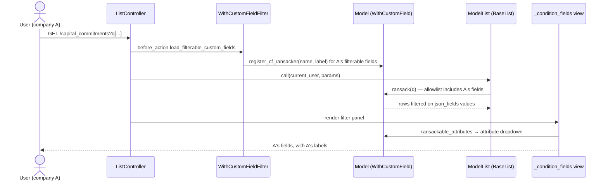
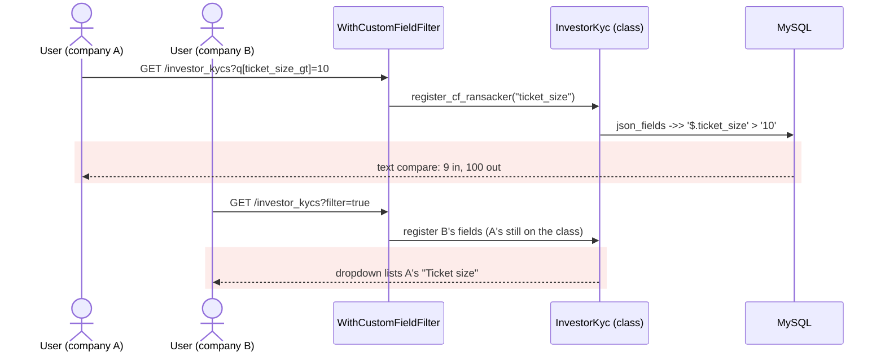
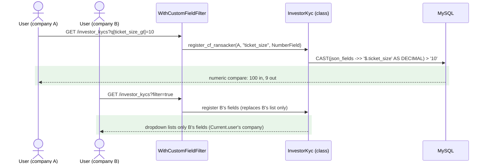

# Custom-field list filters: number comparison, cross-company names, dead path — Report

> **Audience:** The developer fixing this, and the reviewer checking the fix.
> **Companion document:** [Tasks](tasks.md)

> **Planning phase — no code changes.** This document diagnoses the bug and plans the fix.
> Implementation happens later, in the tasks phase.

> **Evidence, not guesses.** Every claim in Root Cause carries a `file.rb:LINE` you have opened.
> Those line numbers are **as of `537fef155`** — the fix deletes the lines they point
> at, so read them with `git show 537fef155:<path>`.

---

## Summary

The list-page filter on custom fields has three defects:
- **Numbers compare as text.** A "greater than" filter on a number custom field compares text, so 9 counts as greater than 10.
- **Names leak across companies.** One company's filterable field names and labels are registered on the model class, which every request in the server process shares, so they show up in other companies' filter dropdowns.
- **Dead code ignores its condition.** A second, unused translation path (`json_fields.*` keys) silently drops its condition.

Both live defects come from `WithCustomField.register_cf_ransacker`. It defines a text-only ransacker, and it records names and labels per class instead of per company.

---

## The Feature — how it is meant to work

### The idea

Admins mark custom fields as **Show in Filter** (`form_custom_fields.filter_in_search`) on a form type. Those fields then appear in the standard Ransack filter panel on five list screens: capital commitments, investor KYCs, account entries, portfolio investments and valuations. Each one sits beside the built-in attributes, so a user can filter "Source of Funds contains Savings" exactly like "Investor name contains Acme".

Custom-field values live in each record's `json_fields` JSON column, not in columns, so Ransack cannot see them on its own. The mechanism (#1454) closes that gap with a **named ransacker per field**:
- A ransacker called `source_of_funds` is defined on the model. It returns the SQL expression `json_fields ->> '$.source_of_funds'`.
- The name is added to the model's Ransack allowlist (`ransackable_attributes`), so the attribute dropdown offers it and a submitted `q[source_of_funds_cont]` is applied.
- `human_attribute_name` is overridden so the dropdown shows the field's label instead of its key.

Fields are company-specific, but the model class is shared by every request the server process handles. So the registration is done per request, from the current user's company's form types, just before the list is searched. This is why it is dynamic rather than a static list on the model: the set of fields depends on who is asking.

### How it fits together

| Part | Responsibility | Talks to |
|---|---|---|
| `FormCustomField#filter_in_search`, `.filterable` scope | Which fields may be filtered (excludes File, Header, GridColumns, Calculation) | the admin form type page |
| `WithCustomFieldFilter` (controller concern) | Per request, loads the user's company's filterable fields for the model and its ransackable associations, and registers them | `WithCustomField.register_cf_ransacker` |
| `WithCustomField.register_cf_ransacker` | Defines the named ransacker; records the name (allowlist) and label | Ransack |
| `WithCustomField` singleton prepend | `ransackable_attributes` += registered names; `human_attribute_name` → registered label | Ransack, the filter view |
| `BaseList` list services | Build `Model.ransack(params[:q])` | Ransack |
| `layouts/_condition_fields.html.erb` | `attribute_select` → the dropdown from the allowlist | Ransack form builder |

### What it rests on

- The allowlist and labels a request sees are **the requesting company's**, never another company's.
- A filter compares values **as the field's type**: text as text, numbers as numbers, dates as ISO dates (stored `YYYY-MM-DD`, so text order is date order).
- Every way of sending a custom-field filter reaches a ransacker the allowlist accepts. Ransack runs with `ignore_unknown_conditions: true`, so anything else is dropped silently.

---

## Symptom

| | |
|---|---|
| **What the user sees** | (1) Filtering KYCs on a number custom field "Ticket size greater than 10" returns a KYC with 9 and omits one with 100. (2) The filter dropdown on a list can show custom-field names/labels that belong to another company. (3) A hand-typed `q[json_fields.nationality_eq]=India` returns every row. |
| **Reproduce** | (1) Mark a NumberField filterable; give records 9, 25, 100; filter "greater than 10". (2) Company A filters its KYC list; then a user of company B opens the filter panel on the same server process: A's field is listed. (3) Visit a list with a `json_fields.<name>_eq` param. |
| **Who is affected** | (1) Every company with a filterable number or money custom field, on the five lists. (2) Every company: names and labels only, no record data. (3) Nobody through the UI: no screen, JS, API doc or test sends these keys. |
| **How often** | (1) Every time the values differ in digit count. (2) Whenever two companies' requests land on the same process: the class state persists until restart. (3) Every time. |
| **Since when** | #1454 (`5727bd484`), which introduced filterable custom fields and then switched from the `json_fields.*` rows to named ransackers in its own refactor. |

---

## Root Cause

**(1) Number fields compare as text.** `register_cf_ransacker` defines every field's ransacker the same way: `Arel::Nodes::InfixOperation.new('->>', parent.table[:json_fields], …)` (`with_custom_field.rb:111-112`), with no type. `->>` returns text, and Ransack's default ransacker type is string, so `ticket_size_gt=10` becomes `json_fields ->> '$.ticket_size' > '10'`, a string comparison (confirmed by `to_sql` in a runner probe). The field's `field_type` is never consulted: the controller passes only `name` and `label` (`with_custom_field_filter.rb:43`).

**(2) Names and labels are per class, not per company.** Names go into `class_attribute :_cf_ransacker_names` and labels into `_cf_ransacker_labels` (`with_custom_field.rb:11-12`). Both are appended to on every request (`:115-116`) and never removed. The allowlist and the label override read them without regard to who is asking (`:18`, `:22`). `register_filterable_ransackers_for` selects the right company's fields (`with_custom_field_filter.rb:36`), but stores them where every company's later requests read them. The dropdown is built from that allowlist (`_condition_fields.html.erb:13`). A field un-flagged by its admin also stays listed until the process restarts.

**(3) Dead `json_fields.*` path.** `BaseList#translate_json_fields_params` (`base_list.rb:56-59`), called by the five list services, rewrites `json_fields.<name>_<pred>` keys through `WithCustomField.json_fields_query` (`with_custom_field.rb:120`) into a grouping on the `json_fields` ransacker (`:60`). `json_fields` is in no model's `ransackable_attributes` (without an auth object), so Ransack drops the condition and returns every row. Nothing sends these keys: they were the first design in #1454, replaced by named ransackers in the same PR. The step file still describes the old path (`custom_field_filter_search_steps.rb:98`).

**Why it was hard to see:**
- **No error anywhere.** A string comparison returns *some* rows, and Ransack drops unknown conditions without raising (`ignore_unknown_conditions: true`).
- **Tests never cover it.** The existing feature (`features/core/custom_field_filter_search.feature`) uses only text, select and same-length date values, and only one company per scenario, so neither defect can show.
- **The leak only appears in production.** It needs two companies on one long-lived process.

---

## Blast Radius

| Also touches this code | Does this fix change it? | Needs checking |
|---|---|---|
| Capital commitments list filter (`CapitalCommitmentsController`, `CapitalCommitmentList`) | Yes: per-company names/labels; numbers cast | `features/core/custom_field_filter_search.feature` |
| Investor KYC list filter (`InvestorKycsController`, `InvestorKycList`) | Yes, same | same feature (new rows) |
| Account entries list filter (`AccountEntriesController`, `AccountEntryList`) | Yes, same. The query shape is unchanged apart from a `CAST` on number fields; filters are already scoped by the list's fund/policy scope, and the fix adds no new JSON predicate | `features/fund/account_entries.feature` (spot check) |
| Portfolio investments, valuations list filters | Yes, same | spot check by QA (R-rows) |
| Association filters (e.g. a stakeholder's custom fields on the commitments filter), registered by `load_filterable_custom_fields` | Yes: same per-company registration | `custom_field_filter_search.feature` |
| `human_attribute_name` on WithCustomField models (labels anywhere in the app) | Yes: the label override answers only for the current company's fields | R-row: a column header / error message on a KYC form |
| `WorkflowRuleFields` (rule builder, change `workflow-rule-condition-builder`) subtracts `_cf_ransacker_names` | Yes: must subtract the new per-company names instead | `features/core/workflow_rule_conditions.feature` |
| `WorkflowRuleMatcher` and the `json_fields` / `json_field_number` ransackers | No: they stay (rules use them with auth object `:workflow_rule`) | same feature |
| `WithCustomField.json_fields_query`, `BaseList#translate_json_fields_params` | Removed (dead) | grep proves no callers remain |
| Jobs / Sidekiq | No: ransackers are registered only in web requests, as today | — |
| MCP tools (ontology-driven; `ransackable_attributes` without a user) | No: no current company, so no custom-field names, as in a fresh process today | `features/ai/mcp_server/mcp_ontology.feature` |

---

## Fix

### How it works today

### How it works after the fix

### What changes

| # | Before | After | Where |
|---|---|---|---|
| 1 | `register_cf_ransacker(name, label:)` appends to class-wide `_cf_ransacker_names` / `_cf_ransacker_labels` | `register_cf_ransackers(entity_id, fields)` **replaces** that company's entry in class-level hashes keyed by entity id: names, labels, field types. The ransacker is still defined once per name | `WithCustomField` (`register_cf_ransacker` → per-entity) |
| 2 | Allowlist and label override read the class-wide lists | They read the entry for `Current.user&.entity_id`. No user (jobs, MCP, console) means no custom-field names. The `Current` model stays "who is acting"; this only reads it | `WithCustomField` singleton prepend |
| 3 | Ransacker block always `->>` text | The ransacker block casts when **the current company's** type for that name is NumberField or Money: `CAST(... AS DECIMAL(20,4))` on MySQL, `REAL` on SQLite (same cast as `json_field_number`). Otherwise it stays text | `WithCustomField.register_cf_ransacker` ransacker block |
| 4 | Controller passes `name`, `label` | It passes the company id and the deduped fields (name, label, field_type) in one call per model | `WithCustomFieldFilter#register_filterable_ransackers_for` |
| 5 | `translate_json_fields_params` + `json_fields_query` rewrite unused `json_fields.*` keys into a dropped condition | Both removed, along with the five call sites; the `json_fields` ransacker stays for the rule matcher | `BaseList`, 5 list services, `WithCustomField` |
| 6 | `WorkflowRuleFields` subtracts `model._cf_ransacker_names` | Subtracts the current company's registered names via a `WithCustomField` reader | `WorkflowRuleFields#model_fields` |
| 7 | Step-file comment describes the `json_fields.*` path | Comment describes the named-ransacker path | `features/step_definitions/custom_field_filter_search_steps.rb` |

---

## Verification

**ID legend:** **H** = Happy path · **E** = Edge case · **X** = Error (exception) case

### Happy Path

| # | Scenario | Given | When | Then | Feature |
|---|---|---|---|---|---|
| H1 | Number filter compares numerically | A filterable NumberField "ticket_size" on the CapitalCommitment form; commitments with 9, 25, 100 | Filter `ticket_size_gt` = 10 | 25 and 100 shown; 9 not shown | `features/core/custom_field_filter_search.feature` |
| H2 | Text filters unchanged | Existing text / select / date scenarios | Run them | Still pass | same |

### Edge Cases

| # | Scenario | Given | When | Then | Feature |
|---|---|---|---|---|---|
| E1 | Another company's fields are not in my dropdown | Company A has filterable "a_only_field"; A's user opened the filter panel | Company B's user opens the commitments filter panel | B's dropdown has no `a_only_field` option | same |
| E2 | Same field name, different type per company | A: "score" NumberField; B: "score" TextField | B filters `score_gt` = "B" after A filtered | B's query compares text (no CAST); A's compares numerically | same |
| E3 | Un-flagged field disappears without a restart | Company A's field was filterable and registered | Admin unticks **Show in Filter**, user reloads the filter panel | The field is no longer offered | same |
| E4 | Rule builder ignores registered filter fields | Another company registered "tax_residency" on InvestorKyc | Rule fields for InvestorKyc are built | "Tax residency" not offered | `features/core/workflow_rule_conditions.feature` (existing E8, adapted) |

### Error Cases

| # | Scenario | Given | When | Then | Feature |
|---|---|---|---|---|---|
| X1 | No current user | A field registered by company A | `ransackable_attributes` with no `Current.user` (job / MCP) | No custom-field names returned; no error | `features/core/custom_field_filter_search.feature` |
| X2 | Dead path removed | — | `grep` for `json_fields_query` / `translate_json_fields_params` | No matches outside `openspec/` | task check (not a scenario) |

**Fails against current code:** H1 (9 is returned), E1 (A's field is in B's dropdown), E2, E3.

---

## Risks and Rollout

- A request whose user switched company mid-session → registration and reading both use `current_user.entity_id` / `Current.user.entity_id` on the same request, so they always agree.
- The `CAST` on account entries adds per-row work only when a number custom field is filtered, on the same fund-scoped rows the text comparison already scans. No new unbounded query.
- Stored filter URLs (bookmarks) using custom-field names keep working: the parameter names don't change.

| | |
|---|---|
| **Safe to deploy alone?** | Yes. Ship after `workflow-rule-condition-builder` (it reuses that change's cast and adjusts `WorkflowRuleFields`), or together with it |
| **Data backfill needed?** | No. The state is in memory and rebuilt per request |
| **Both regions together?** | No. IN and US are independent; each deploy fixes its own processes |
| **Rollback** | Revert the code. Nothing persists |

---

## Spec Impact

**None.** The filter is meant to show the requesting company's fields and compare values by their type, and the code did not do that. `skip_specs: true` is set in this change's `.openspec.yaml`.
