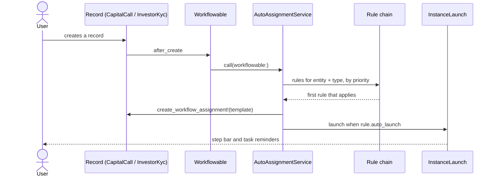
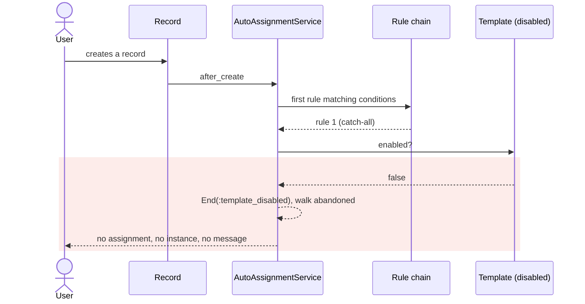
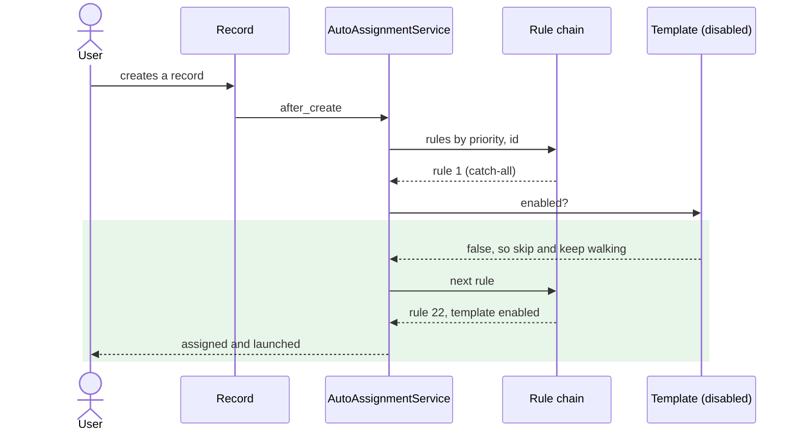

# A disabled template's auto-assignment rules block assignment instead of standing aside — Report

> **Audience:** The developer fixing this, and the reviewer checking the fix.
> **Companion document:** [Tasks](tasks.md)

> **Planning phase — no code changes.** This document diagnoses the bug and plans the fix.
> Implementation happens later, in the tasks phase.

> **Evidence, not guesses.** Every claim in Root Cause carries a `file.rb:LINE` you have opened.
> Those line numbers are **as of `537fef155`** — the fix deletes the lines they point at, so read
> them with `git show 537fef155:<path>`.

---

## Summary

Disabling a workflow template does not retire its auto-assignment rules — it turns them into
blockers: `WorkflowAutoAssignmentService` picks the first rule whose *conditions* match and only
then checks whether the template is enabled, ending the operation when it is not. So one catch-all
rule on a retired template silently denies a workflow to every new record of that type, and no
later rule — on a live template, at any priority — can ever be reached.

---

## The Feature — how it is meant to work

### The idea

A workflow template is a reusable checklist (ordered `WorkflowStep`s) that can be attached to one
kind of record — a capital call, a distribution, a KYC, a folder. Attaching it by hand is fine for
one record, but the interesting case is "every new record of this shape should get this checklist,
automatically, the moment it is created". That is what a `WorkflowAutoAssignmentRule` is for: a row
saying *for entity E and record type T, when these conditions hold, assign template X — and launch
it immediately if `auto_launch`*. This is the mechanism the capital-call, distribution and investor
KYC **journeys** are built on: the step bar a user sees on a call page exists only because a rule
assigned a journey template and launched an instance when that call was created.

The rules for one record type form an ordered chain. Each rule carries a `priority` integer (lower
runs first) and a `conditions` array of `{attribute, operator, value}` hashes evaluated against the
record's own DB columns (`WorkflowAutoAssignmentRule#matches?`, model line 33). An empty array
matches everything — a catch-all. The chain is walked in priority order and the **first** match
wins; nothing merges, and a record gets at most one template. That is how `JourneySetup` seeds two
journeys for one record type: the Light journey takes priority 10 with conditions picking imported
records, the Full journey takes priority 100 with no conditions, so imported records get Light and
everything else falls through to Full (`journey_setup.rb:168-177`).

A template also carries `enabled` (added in `537fef155`). Disabling is the retirement path for a
template that can no longer be deleted because it has assignments or history: the template, its
steps and its rules all stay as editable configuration, workflows already running on it keep
evaluating from the snapshot taken at launch, but nothing new is supposed to be *started* on it.
Enforcement is deliberately spread across every entry point rather than centralised, because each
one has a different thing to say to the user: the launch picker omits it (`_workflow_tab.html.erb:10`,
via `WorkflowTemplate.enabled`), the launch service refuses it (`workflow_instance_launch.rb:18`),
the controller rejects a disabled template id before swapping an assignment
(`workflow_instances_controller.rb:45`), and auto-assignment must not hand it to a new record.

### How it fits together



| Part | Responsibility | Talks to |
|---|---|---|
| `WorkflowTemplate` | the checklist, its `workflowable_type`, and `enabled` | its steps and rules |
| `WorkflowAutoAssignmentRule` | one *for this type, when this holds, use that template* row | `WorkflowTemplate` |
| `Workflowable` (concern) | fires auto-assignment on create and on update | `WorkflowAutoAssignmentService` |
| `WorkflowAutoAssignmentService` | walks the chain, assigns, optionally launches | rules, `WorkflowInstanceLaunch` |
| `WorkflowInstanceLaunch` | snapshots the template into a live instance | `WorkflowTemplate` |
| `JourneySetup` subclasses | seed the standard templates and their rules | both of the above |

### What it rests on

- A rule exists to assign **one** template: `belongs_to :workflow_template`, and a validation keeps
  the rule's `workflowable_type` equal to the template's (`workflow_auto_assignment_rule.rb:44-49`).
  A rule has no meaning independent of its template.
- Disabling a template is reversible configuration, not deletion. Its rules must survive untouched
  and resume exactly as they were when it is enabled again — a company may keep several retired
  workflows around.
- The chain is the unit of intent: a record type's outcome is decided by *all* its rules in
  priority order, not by any one of them in isolation.
- Auto-assignment is best-effort. It must never raise into record creation; both hooks rescue
  `StandardError` and log (`workflowable.rb:226-241`).

---

## Symptom

| | |
|---|---|
| **What the user sees** | A newly created record gets no workflow at all: no assignment, no instance, and for a journey template no step bar and no task reminders. No error, no flash, nothing on screen. |
| **Reproduce** | 1. Seed the investor KYC journey (`Set up investor KYC journeys`), which creates template "Investor KYC". 2. Add a catch-all rule for it. 3. Make sure an older template for the same type has a catch-all rule at an equal or lower priority, and disable that older template. 4. Create a KYC. It gets nothing. |
| **Who is affected** | Any entity with more than one template for a record type where the retired one owns a broad rule. Observed on entity 157 (dev, restored prod data): KYCs 1842, 1843 and 1844 all created with `workflow_assignment = nil`. |
| **How often** | Every time, for every record of that type, for as long as the blocking rule exists. |
| **Since when** | `537fef155` — the commit that introduced `enabled`. Before it, there was no disabled state to block on. |

The reproduction on entity 157, with four rules all at priority 0:

```
rule  1  prio=0  tmpl=3  "KYC Onboarding Kick-off"  enabled=false  conditions=[]   → matched, blocked
rule  2  prio=0  tmpl=4  "KYC Submission Review"    enabled=false
rule  3  prio=0  tmpl=5  "Post-Verification Audit"  enabled=false
rule 22  prio=0  tmpl=30 "Investor KYC"             enabled=true   conditions=[]   → never reached
```

Disabling templates 3, 4 and 5 — the intuitive "stop using these" action — made it worse, not
better: before, rule 1 at least assigned something.

---

## Root Cause

**The enabled check runs after the match, and fails the operation instead of resuming the walk.**
`find_matching_rule` selects purely on conditions
(`app/packs/core/workflow_templates/services/workflow_auto_assignment_service.rb:20-27`), and a
separate step then tests that rule's template and returns false when it is disabled, routing to
`End(:template_disabled)` (`:11` and `:37-45`). The walk is over by then — the chain is never
resumed, so a rule on a disabled template does not stand aside, it consumes the record. The code
comment at `:29-36` states this as a deliberate choice, to stop a disabled Light journey from
silently promoting imported capital calls onto the Full one. The intent is sound; the mechanism
overshoots. It does not merely prevent a substitution within one journey pair — it lets any rule on
any retired template veto the whole type, and the veto cannot be lifted from the template the admin
is actually looking at.

**Ties make which rule holds the veto arbitrary.** The chain is ordered by `order(:priority)` alone
(`:23`), so with several rules at the same priority the winner is whatever MySQL returns — in
practice primary-key order. Entity 157 has four rules at priority 0; a newly added rule can never
win a tie against an older one, and `priority` is validated `greater_than_or_equal_to: 0`
(`workflow_auto_assignment_rule.rb:20`), so 0 is the floor and there is no number that outranks it.

**Why it was hard to see:** the skip is logged at `Rails.logger.info` and nowhere else (`:39-42`),
and `apply_workflow_auto_assignment` swallows everything into a `warn` (`workflowable.rb:227-229`),
so the record saves cleanly and the UI says nothing. Worse, rules are only ever *displayed* per
template — the rules table on `show.html.erb:195` lists one template's rules, and the index shows a
bare count (`_workflow_template.html.erb:38`). The chain the runtime actually walks, across
templates, has no screen at all, so the blocking rule is invisible from the page where the admin is
trying to work out why their template is not being used. The disabled template's own page says its
rules "hand the record nothing — and no other rule takes over" (`show.html.erb:198-204`), which is
accurate but only visible if you already know which template to suspect.

---

## Blast Radius

| Also touches this code | Does this fix change it? | Needs checking |
|---|---|---|
| `Workflowable#apply_workflow_auto_assignment` (after_create) — every workflowable type: Folder, InvestorKyc, CapitalCommitment, CapitalCall, CapitalDistribution, Approval, Investor | Yes — this is the path being fixed | `features/core/workflow_auto_assignment.feature` |
| `Workflowable#apply_workflow_auto_assignment_on_update` (after_update) — re-evaluates while unassigned | Yes — same service, so a record created while blocked picks up the successor on its next save | `features/core/workflow_auto_assignment.feature` |
| `WorkflowInstanceLaunch` enabled refusal (`workflow_instance_launch.rb:18`) | No — manual launch of a disabled template stays refused | `features/core/workflow_templates.feature` |
| `WorkflowInstancesController#create` disabled-id rejection (`:45`) | No | `features/core/workflow_templates.feature` |
| Launch picker via `WorkflowTemplate.enabled` (`_workflow_tab.html.erb:10`) | No | manual (QA checklist) |
| `JourneySetup#plan` disabled reporting (`journey_setup.rb:150`) and its rule-skip guard (`:138`) | No — but its menu wording assumes a disabled kind means no journey, which is now only true when every template for the type is off | `features/core/workflow_templates.feature` |
| Capital call / distribution journey scenarios that disable **all** of a kind's templates (`features/fund/capital_call_journey.feature:186`, `capital_distribution_journey.feature:129`) | No — with no live template left in the chain the outcome is unchanged | run both features |
| `features/core/workflow_auto_assignment.feature:136` "does not fall through to the next rule" | Yes — this scenario asserts the defect and inverts | rewrite in this change |
| `workflow_template_toggle_message` (`workflow_templates_helper.rb:11-30`) and the inert-rules note (`show.html.erb:198-204`) | Yes — both describe the old no-fallthrough behaviour | `features/core/workflow_templates.feature` |
| `docs/user_guides/workflow_templates_user_guide.md:142, 635, 688` | Yes — three passages, including the FAQ the support chatbot answers "why did my record get no journey" from | `UserGuideLint` |
| `WorkflowEvaluator`, `WorkflowAdvancer`, reminders — anything acting on an instance already launched | No — they read the launch snapshot, never the rule chain | — |

---

## Fix

### How it works today



### How it works after the fix



### What changes

| # | Before | After | Where |
|---|---|---|---|
| 1 | `find` selects on `rule.matches?` alone | `find` selects on `rule.workflow_template&.enabled? && rule.matches?`, so a dormant rule is skipped and the walk continues | `services/workflow_auto_assignment_service.rb` — `#find_matching_rule` |
| 2 | `order(:priority)` — ties resolved by whatever MySQL returns | `order(:priority, :id)` — ties resolved by creation order, stated rather than incidental | same method |
| 3 | `step :check_template_enabled` with `End(:template_disabled)`, plus the method and its comment block | both removed; the enabled test now lives in the chain walk | same file, `:11` and `:37-45` |
| 4 | Disable confirm says the rules "will stop assigning it (they are kept, not deleted)" | says the rules go dormant **and names what takes over** for the records they used to match, or that nothing does | `helpers/workflow_templates_helper.rb` — `#workflow_template_toggle_message` |
| 5 | Inert-rules note: "a record they match is given no template, and no other rule takes over" | "these rules are dormant while the template is disabled: the next matching rule for this type applies, and they resume unchanged when you enable it" | `views/workflow_templates/show.html.erb` — `#rules_inert_note` |
| 6 | Guide and FAQ state that no other rule takes the disabled template's place | state skip-and-continue, and that a record gets nothing only when no live template's rule matches | `docs/user_guides/workflow_templates_user_guide.md:142, 635, 688` |

No migration, no new column, no change to any other enabled check.

---

## Verification

**ID legend:** **H** = Happy path · **E** = Edge case · **X** = Error (exception) case

### Happy Path

| # | Scenario | Given | When | Then | Feature |
|---|---|---|---|---|---|
| H1 | A disabled template's rule is skipped and the next matching rule applies | a disabled template with a catch-all rule at priority 0, and an enabled template with a catch-all rule at priority 0 created later | a new folder is created | the folder is assigned the enabled template, and an instance is launched per that rule's `auto_launch` | `features/core/workflow_auto_assignment.feature` |
| H2 | Rules resume unchanged when the template is enabled again | the disabled template from H1 is enabled again | a new folder is created | the folder is assigned the re-enabled template, whose rule was never edited or deleted | `features/core/workflow_auto_assignment.feature` |

### Edge Cases

| # | Scenario | Given | When | Then | Feature |
|---|---|---|---|---|---|
| E1 | Every template in the chain disabled still means no workflow | two templates for one type, both disabled, each with a matching rule | a new folder is created | the folder has no workflow template and no instance | `features/core/workflow_auto_assignment.feature` |
| E2 | A specific disabled rule falls through to the live catch-all | a disabled template with a rule matching `name eq "Target Folder"` at priority 10, and an enabled catch-all at priority 100 | a folder named "Target Folder" is created | it is assigned the catch-all template, the same as any other folder | `features/core/workflow_auto_assignment.feature` |
| E3 | The successor rule's own `auto_launch` governs | a disabled template whose rule has `auto_launch` true, and an enabled template whose matching rule has `auto_launch` false | a new folder is created | the enabled template is assigned and **no** instance is launched | `features/core/workflow_auto_assignment.feature` |
| E4 | Equal priorities resolve by creation order | two enabled templates, each with a catch-all rule at priority 0 | a new folder is created | the earlier-created rule's template is assigned, repeatably | `features/core/workflow_auto_assignment.feature` |
| E5 | A record created while blocked picks up the successor on its next save | a folder created while the only live rule was shadowed by a disabled template's catch-all, then that template's rule becomes reachable | the folder is updated | it is assigned the live template by the after_update hook | `features/core/workflow_auto_assignment.feature` |

### Error Cases

| # | Scenario | Given | When | Then | Feature |
|---|---|---|---|---|---|
| X1 | A rule whose template row is missing does not raise | a rule whose `workflow_template_id` points at no row, ahead of a live catch-all | a new folder is created | the orphaned rule is skipped, the catch-all applies, and record creation does not raise | `features/core/workflow_auto_assignment.feature` |
| X2 | A successor that cannot be assigned fails quietly | a disabled template's rule ahead of an enabled template retyped behind its rule's back, so assignment is invalid | a new folder is created | the folder saves with no template, the failure is logged, and nothing raises into record creation | `features/core/workflow_auto_assignment.feature` |

**Fails against current code:** measured, not predicted — `TEST_ENV_NUMBER=$RANDOM bundle exec
cucumber features/core/workflow_auto_assignment.feature` gives 18 scenarios, 5 failed, 13 passed.
**H1, H2, E2, E3 and X1 fail**; each one is a record denied a workflow a live rule would have given
it. E1, E4, E5 and X2 pass today and guard against over-correcting: E5 passes because enabling the
template puts its own rule back in reach, which already worked, and E4 passes by accident of MySQL
row order — the fix makes it guaranteed rather than incidental.

---

## Risks and Rollout

- **Disabling one of a pair now promotes records to the other.** Disabling the Light journey means
  imported capital calls get the Full journey, with its investor-facing reminders, rather than
  nothing — exactly the substitution the original code was written to prevent. → The disable confirm
  dialog names the successor before the admin confirms (change 4), so the promotion is disclosed at
  the moment of the decision rather than discovered later. Getting "no journey" is still available:
  disable every template for that type, which E1 locks in.
- **Ties change meaning for live chains.** `order(:priority, :id)` fixes resolution that was
  previously undefined. → It matches the order MySQL was returning in practice, so no observed
  assignment changes; E4 pins it.
- **Records created while blocked are not retro-assigned.** → By design, consistent with how
  disabling already behaves; the after_update hook assigns on the next save of such a record (E5).
  No backfill script, and nothing to undo if one is not wanted.
- **The guide's FAQ is the support chatbot's source.** → Updating all three passages is part of the
  fix, not a follow-up, or the chatbot keeps giving the old answer.

| | |
|---|---|
| **Safe to deploy alone?** | Yes — one service method, no migration, no coordination with another deploy |
| **Data backfill needed?** | No. Rules are untouched; no row changes shape |
| **Both regions together?** | No — production.in and production.us are independent and can take it separately |
| **Rollback** | Revert the commit. Nothing is persisted that the old code cannot read; records assigned under the new behaviour keep their assignment, and the old code simply blocks again for new ones |

---

## Spec Impact

**None.** No spec describes the no-fallthrough behaviour — `openspec/specs/` mentions disabled
templates only in the journey setup menu requirements
(`funds/capital-distribution-journey/spec.md:69, 78`), which this fix does not change. The specs
already describe auto-assignment as "the first matching rule assigns its template"; the defect is
that a rule pointing at a retired template was treated as matching. `skip_specs: true` is set in
this change's `.openspec.yaml`.
